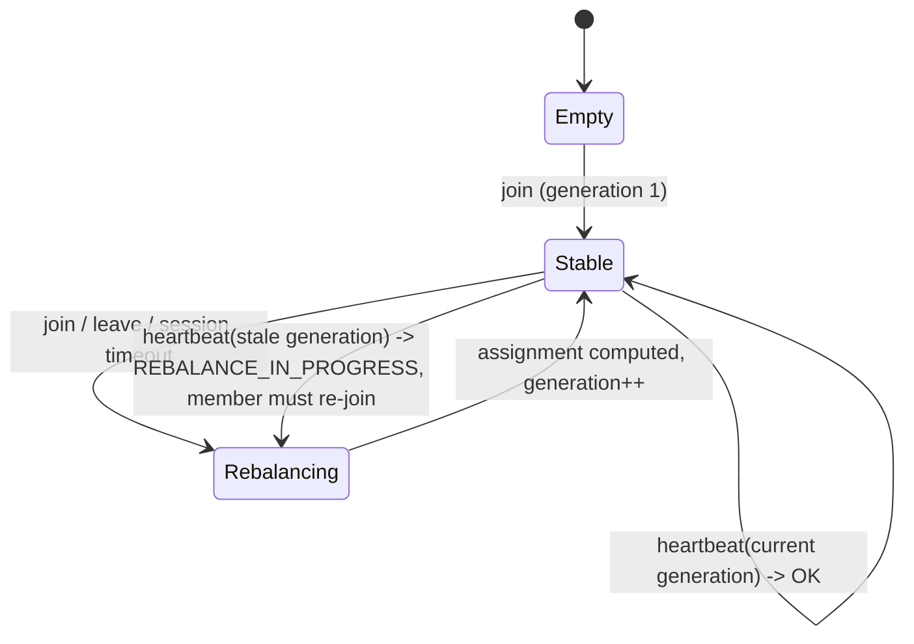

# Consumer Groups, Offsets, and Rebalancing

> Who owns partition 7 after a consumer dies?

**Type:** Build
**Languages:** Java, Python, Go
**Prerequisites:** Phase 8, Lesson 01 (The Append-Only Log), Phase 5, Lesson 13 (Gossip Protocols and Failure Detection)
**Time:** ~90 minutes

## Learning Objectives

- Explain why a consumer group needs a coordinator, a generation counter, and a session timeout, and what each one prevents
- Build three partition assignors (range, round-robin, sticky) and measure how many partitions each one moves when membership changes
- Implement group membership with heartbeats and session expiry against an injected clock, so "c2 died" is a deterministic event in a test
- Fence offset commits by member, generation, and ownership so a zombie consumer cannot overwrite the new owner's progress
- Answer "who owns partition 7" for any sequence of joins, leaves, and timeouts, and show the answer is the same on every coordinator

## The Problem

The ledger-poster service consumes `payments.authorized` (eight partitions, from Lesson 01) with three instances, `c1`, `c2`, `c3`. Each instance reads its partitions, posts the authorization to the ledger, and commits its offset. On a Thursday, `c2` hits a 14-second garbage-collection pause while it is halfway through a batch from partition 3. The group coordinator stops hearing from `c2`, declares it dead after the 10-second session timeout, and hands partitions 3, 4, and 5 to `c1` and `c3`. `c1` starts reading partition 3 from the last committed offset, 1,040, and posts authorizations 1,040 through 1,055 to the ledger.

Then `c2` wakes up. It does not know it was declared dead. It finishes its batch, which contained offsets 1,040 through 1,047, posts those eight authorizations to the ledger a second time, and commits offset 1,048 for partition 3. The coordinator accepts the commit. `c1`, whose own commit of 1,056 landed a moment earlier, is now overwritten; when `c1` restarts that night it resumes at 1,048 and posts 1,048 through 1,055 a third time. Reconciliation on Friday finds sixteen authorizations posted twice and eight posted three times. Nothing in the log was wrong. The group protocol let a member that had lost its partitions keep acting as if it owned them.

A second, quieter failure happens on every deploy. The platform rolls the three instances one at a time. Each restart is a leave and a join, and each one triggers a rebalance. With the range assignor, adding `c4` to a three-member group on eight partitions reassigns five of the eight partitions, so five partitions stop being processed while their new owners fetch committed offsets and warm up. A rolling deploy of three instances produces six rebalances and some thirty partition moves. Every move is a gap in processing and, for a payments topic, a few seconds during which a merchant's authorizations are not being posted.

Both failures are the coordinator's job to prevent. It must know who is alive (heartbeats, session timeout), it must give every rebalance a number so that stale members can be told apart from current ones (the generation), it must compute the assignment deterministically so every member and every coordinator replica agrees who owns what, and it must refuse offset commits from anyone who is not the current-generation owner. This lesson builds that coordinator, with three assignors, and makes the zombie scenario a test that fails if the fencing is removed.

## The Concept

### Why a group at all

Lesson 01 bound a `Consumer` to one partition by hand. In production nobody wants to configure "instance 2 reads partitions 3, 4, 5": instances come and go with deploys and failures, and the mapping must follow. A consumer group is the mechanism: members share a group id, and a coordinator divides the topic's partitions among the live members so that **every partition is owned by exactly one member of the group at any moment**. That is the invariant. Two members reading one partition means duplicated side effects; zero members means a partition whose authorizations nobody posts.

The invariant is easy when membership is static and hard precisely when it changes. Three things must be settled at every change:

1. **Who is a member.** A member that has not been heard from for `sessionTimeoutMs` is not. A member that said goodbye is not.
2. **Which generation this is.** Every rebalance increments a counter. A member carries the generation it last joined; any message it sends with an older generation is from the past and is refused.
3. **Who owns what.** A pure function of the sorted member list, the partition count, and (for sticky) the previous assignment. Pure, so every replica of the coordinator and every member computing it locally reaches the same answer.



### Heartbeats and the session timeout

Each member heartbeats every `heartbeatIntervalMs` (Kafka default 3 s). The coordinator records the time of the last heartbeat per member. On its own tick it evicts every member whose last heartbeat is at or older than `now - sessionTimeoutMs` (Kafka default 45 s since 3.0; this lesson uses 10 s so the demo is readable). The two numbers trade detection speed against false positives: a session timeout shorter than a realistic GC pause evicts healthy members and causes rebalance storms; one much longer than that leaves orphaned partitions unprocessed for the whole interval. Phase 5, Lesson 13 covers the general theory; the only new fact here is that eviction is not just a liveness verdict but a trigger for a reassignment that other members must learn about.

How do they learn? Through the heartbeat response. A member heartbeats with the generation it believes it is in. If the coordinator has moved on, the response is `REBALANCE_IN_PROGRESS`, and the member must stop processing, stop committing, and re-join. Only after the join returns does it know its new partitions. This is the eager protocol Kafka used from 0.9 to 2.3; the cooperative protocol (KIP-429) lets a member keep partitions it is not losing, and the Use It section explains what changes.

### Generation fencing

The generation is the fence against the zombie. When `c2` is evicted at generation 3 and the group moves to generation 4, three facts become true at once: `c2` is not a member, the current generation is 4, and partition 3 is owned by `c1`. A commit from `c2` can be refused on any of them, and the coordinator checks all three in order:

| Check | Refuses | Kafka error code |
|-------|---------|------------------|
| Is the sender a member? | A member that was evicted or left | `UNKNOWN_MEMBER_ID` |
| Is the sender's generation current? | A member that re-joined but is replaying an old request, or has not yet re-joined | `ILLEGAL_GENERATION` |
| Does the sender own the partition in this generation? | A current member committing for a partition it was never given | `NOT_COORDINATOR` family; locally, a programming error |

Note what fencing does not do: it does not stop `c2` from posting duplicates to the ledger during its zombie window. Side effects outside the log are outside the coordinator's reach. What it stops is the *persistence* of the zombie's view: the offset it commits is refused, so `c1`'s progress survives and the third posting never happens. Removing the duplicate second posting is Lesson 03's job (idempotent consumers, transactional commit).

### The three assignors

An assignor is `assign(sortedMembers, partitionCount, previousAssignment) -> member -> partitions`. Three strategies, with eight partitions and members `c1, c2, c3`:

| Assignor | Rule | Result for 8 partitions, 3 members | Adding `c4` moves |
|----------|------|-------------------------------------|-------------------|
| Range | Cut `[0, N)` into contiguous ranges; the first `N mod M` members get one extra | `c1=[0,1,2] c2=[3,4,5] c3=[6,7]` | 5 partitions |
| Round-robin | Partition `p` goes to member `p mod M` | `c1=[0,3,6] c2=[1,4,7] c3=[2,5]` | 5 partitions |
| Sticky | Survivors keep what they had; orphans to the least-loaded; then level until the spread is at most 1 | `c1=[0,3,6] c2=[1,4,7] c3=[2,5]` (same as round-robin on an empty previous) | 2 partitions |

Range is the simplest to reason about and has one property the others lack: if two topics have the same partition count, range gives the same member partition `k` of both, which co-partitioned joins need. Its weakness is that any membership change shifts every range boundary. Round-robin spreads load evenly across topics with different partition counts but moves almost everything on a change. Sticky is the one you want for a consumer whose per-partition state is expensive to rebuild (a local cache of merchant risk profiles, an open database transaction, a window in Lesson 07): it moves the minimum number of partitions needed to restore balance.

### Worked example by hand: sticky, c4 joins

Previous: `c1=[0,3,6] c2=[1,4,7] c3=[2,5]`. Members now `c1, c2, c3, c4`, eight partitions.

```text
step 1  survivors keep:   c1=[0,3,6]  c2=[1,4,7]  c3=[2,5]  c4=[]      unassigned: none
step 2  orphans:          none to hand out
step 3  level:            most loaded = c1 (3), least = c4 (0), spread 3 > 1
                          move c1's last partition 6 -> c4:   c1=[0,3] c4=[6]
                          most loaded = c2 (3), least = c4 (1), spread 2 > 1
                          move c2's last partition 7 -> c4:   c2=[1,4] c4=[6,7]
                          most = c1 (2), least = c3 (2), spread 0 -> stop
result  c1=[0,3] c2=[1,4] c3=[2,5] c4=[6,7]      moved = 2 (partitions 6 and 7)
```

Two partitions moved; the lower bound for going from 3 members to 4 with 8 partitions is 2, because `c4` must end up with 2 and had none. Range moved 5 for the same change. With a per-partition warm-up cost of a few seconds, that is the difference between a deploy nobody notices and a deploy that pages the on-call.

Ties in step 2 and step 3 are broken by member order, and members are sorted before the assignor runs. That is what makes the function deterministic: `ownerOf(3)` after any sequence of events is one answer, computable by anyone with the event sequence.

### Worked example by hand: the session timeout

Session timeout 10,000 ms. Events on the coordinator's clock:

```text
t=0        c1, c2, c3 join -> generations 1, 2, 3; assignment c1=[0,1,2] c2=[3,4,5] c3=[6,7]
t=4000     c1 and c3 heartbeat; c2 is silent (GC pause). expireSessions: deadline = -6000; nobody older -> []
t=10000    c1 and c3 heartbeat; c2 still silent. deadline = 0; c2's last heartbeat was 0 <= 0 -> evict c2
           rebalance: members [c1, c3], range -> c1=[0,1,2,3] c3=[4,5,6,7], generation 4
t=10000    c2 wakes, commits (gen 3, partition 3, offset 1048)  -> UNKNOWN_MEMBER
t=10000    c1 commits (gen 4, partition 3, offset 1040)         -> accepted
t=10000    c2 re-joins -> generation 5, c1=[0,1,2] c2=[3,4,5] c3=[6,7]
           c2 replays a buffered commit with gen 4               -> ILLEGAL_GENERATION
```

The boundary is inclusive: a member whose last heartbeat is exactly `sessionTimeoutMs` old is evicted. The test checks 9,999 ms (alive) and 10,000 ms (dead) explicitly, because an off-by-one here is a member that is never evicted when heartbeats stop at precisely the timeout.

### Choosing the timeouts

Three intervals govern the protocol, and they must be ordered:

| Setting | Kafka default | Must be | What a bad value does |
|---------|---------------|---------|-----------------------|
| `heartbeat.interval.ms` | 3,000 | Well under a third of the session timeout | Too close to the timeout: one dropped heartbeat evicts a healthy member |
| `session.timeout.ms` | 45,000 | Longer than the worst GC pause and network blip you accept | Too short: rebalance storms; too long: dead members hold partitions idle |
| `max.poll.interval.ms` | 300,000 | Longer than the slowest batch you will ever process | Too short: a slow batch is treated as a crash and its records are redelivered while the first attempt is still running |

The rolling-deploy arithmetic follows from these. Restarting one member with the eager protocol costs two rebalances (leave, join) and, for range on eight partitions, moves three to five partitions each time. Three members restarted in sequence is six generations and roughly twenty-five partition moves, each a gap of at least one offset fetch plus state rebuild. With sticky arithmetic the same deploy moves about two partitions per rebalance, and with static membership (Exercise 2) it moves none, because a restarted member reclaims its identity before the session expires.

### Complexity

Range and round-robin are `O(N)` in partitions. Sticky is `O(N)` for the keep-and-orphan steps and at most `O(N)` moves in the levelling loop, each move `O(M)` to find the most- and least-loaded member, so `O(N * M)`; with `M` in the tens and `N` in the hundreds that is microseconds. Session expiry is `O(M)` per tick. None of this is where the cost of a rebalance lives: the cost is the processing gap while members stop, re-join, fetch committed offsets, and rebuild per-partition state.

### Eager versus cooperative rebalancing

The coordinator built here is eager: a `REBALANCE_IN_PROGRESS` means "stop everything, re-join, start from the new assignment". It is simple and it is what the invariant needs in its strictest form, because between the member stopping and the new assignment arriving nobody owns anything, so nobody can double-process. The cost is that even the six partitions `c1`, `c2`, and `c3` keep when `c4` joins are paused for the duration of the round trip.

The cooperative protocol keeps the same assignor arithmetic and splits the rebalance into two rounds. In round one, every member learns the new assignment but only *revokes* partitions it is losing; it keeps processing the rest. In round two, after the revocations are acknowledged, the new owners pick up the moved partitions. The invariant still holds, because a partition is never owned by two members at once: the old owner releases it in round one, and the new owner acquires it in round two. The price is protocol complexity and a window during which the moved partitions have no owner at all, which is the same gap the eager protocol has, but only for the moved partitions rather than for all of them. The `GroupConsumer` of Exercise 3 is where that two-round handshake would live.

### What the coordinator does not do

- It does not deliver records. Members read partitions themselves, from the log of Lesson 01, using the assignment as permission.
- It does not make side effects idempotent. The zombie's duplicate posting during its window is real; Lesson 03 removes it.
- It does not detect a member that is alive but stuck. A member whose heartbeat thread runs while its processing thread is deadlocked keeps its partitions forever. Kafka added `max.poll.interval.ms` (KIP-62) for exactly this: a member that does not call `poll` within that interval leaves the group even though its heartbeats are fine.
- It does not replicate itself. A real coordinator persists group state (members, generation, committed offsets) to a replicated log; here it is a single object. Phase 6 covers what that replication costs.

## Build It

The implementation is in `code/java/Main.java`; the walkthrough shows each piece in the order the coordinator uses it.

### Step 1: An injected clock and the result types

```java
final class ManualClock {
    private long now;
    ManualClock(long startMillis) { this.now = startMillis; }
    long now() { return now; }
    void advance(long millis) {
        if (millis < 0) throw new IllegalArgumentException("clock only moves forward");
        now += millis;
    }
}

record Assignment(int generation, List<Integer> partitions) {}

enum HeartbeatResult { OK, REBALANCE_IN_PROGRESS, UNKNOWN_MEMBER }
```

`ManualClock` is the whole reason the session-timeout test takes no time to run: "c2 has been silent for ten seconds" is `clock.advance(10_000)`. A member's view of the group is an `Assignment`: the generation it joined and the partitions it was given. It presents that generation on every heartbeat and commit, which is what lets the coordinator recognise a stale member.

**Predict:** if `heartbeat` returned only a boolean, which of the two failure cases (evicted member, stale generation) would a member be unable to distinguish, and why does the distinction matter for what it does next?

### Step 2: The assignor contract and the movement metric

```java
interface Assignor {
    String name();
    Map<String, List<Integer>> assign(List<String> members, int partitionCount, Map<String, List<Integer>> previous);

    static int moved(Map<String, List<Integer>> before, Map<String, List<Integer>> after) {
        Map<Integer, String> ownerBefore = owners(before);
        Map<Integer, String> ownerAfter = owners(after);
        int moved = 0;
        for (Map.Entry<Integer, String> e : ownerBefore.entrySet()) {
            if (!e.getValue().equals(ownerAfter.get(e.getKey()))) moved++;
        }
        return moved;
    }

    static Map<Integer, String> owners(Map<String, List<Integer>> assignment) {
        Map<Integer, String> owners = new TreeMap<>();
        for (Map.Entry<String, List<Integer>> e : assignment.entrySet()) {
            for (int p : e.getValue()) {
                if (owners.put(p, e.getKey()) != null) throw new IllegalStateException("partition " + p + " assigned twice");
            }
        }
        return owners;
    }
}
```

`owners` inverts the assignment and, as a side effect, enforces the invariant: a partition that appears under two members throws. Every test that builds an assignment calls `owners` on it, so a buggy assignor cannot silently double-assign. `moved` is the metric the lesson is about: the number of partitions whose owner differs between two generations.

### Step 3: Range and round-robin

```java
public Map<String, List<Integer>> assign(List<String> members, int partitionCount, Map<String, List<Integer>> previous) {
    Map<String, List<Integer>> out = new LinkedHashMap<>();
    if (members.isEmpty()) return out;
    int perMember = partitionCount / members.size();
    int extra = partitionCount % members.size();
    int next = 0;
    for (int i = 0; i < members.size(); i++) {
        int count = perMember + (i < extra ? 1 : 0);
        List<Integer> mine = new ArrayList<>();
        for (int k = 0; k < count; k++) mine.add(next++);
        out.put(members.get(i), mine);
    }
    return out;
}
```

Range gives the first `extra` members one more partition than the rest, which is why `c1` and `c2` have three and `c3` has two. Round-robin is shorter: `out.get(members.get(p % members.size())).add(p)` for each `p`. Both ignore `previous`; that is the point of comparing them with sticky.

**Predict:** with 2 partitions and 3 members, which member gets nothing under range, and is that a bug?

### Step 4: Sticky

```java
// 1. survivors keep their partitions
for (String m : members) {
    for (int p : previous.getOrDefault(m, List.of())) {
        if (p < partitionCount && unassigned.remove(p)) out.get(m).add(p);
    }
}
// 2. orphans go to whoever has the fewest (ties: lowest member id, because members are sorted)
for (int p : unassigned) out.get(leastLoaded(members, out)).add(p);
// 3. level: move one partition at a time from the heaviest to the lightest while the spread exceeds one
while (true) {
    String most = mostLoaded(members, out), least = leastLoaded(members, out);
    if (out.get(most).size() - out.get(least).size() <= 1) break;
    List<Integer> from = out.get(most);
    int p = from.remove(from.size() - 1);
    out.get(least).add(p);
}
```

Three passes, each preserving the invariant. `unassigned` starts as every partition and shrinks as survivors reclaim theirs; whatever remains belonged to departed members. The `p < partitionCount` guard handles a topic whose partition count shrank, which Kafka does not allow but a test can construct. The levelling loop terminates because every iteration reduces the maximum load or raises the minimum, and it stops when the spread is at most one, which is the best balance an integer division allows. `leastLoaded` and `mostLoaded` scan members in sorted order and keep the first winner, so ties are deterministic.

**Predict:** on an empty `previous`, step 1 keeps nothing and step 2 hands out every partition in order to the least-loaded member. What assignment results, and which of the other two assignors does it match?

### Step 5: Membership and heartbeats

```java
Assignment join(String memberId) {
    boolean isNew = !lastHeartbeat.containsKey(memberId);
    lastHeartbeat.put(memberId, clock.now());
    if (isNew) rebalance("join of " + memberId);
    return new Assignment(generation, List.copyOf(assignment.getOrDefault(memberId, List.of())));
}

HeartbeatResult heartbeat(String memberId, int memberGeneration) {
    if (!lastHeartbeat.containsKey(memberId)) return HeartbeatResult.UNKNOWN_MEMBER;
    lastHeartbeat.put(memberId, clock.now());
    return memberGeneration == generation ? HeartbeatResult.OK : HeartbeatResult.REBALANCE_IN_PROGRESS;
}

List<String> expireSessions() {
    List<String> dead = new ArrayList<>();
    long deadline = clock.now() - sessionTimeoutMs;
    for (Map.Entry<String, Long> e : lastHeartbeat.entrySet()) {
        if (e.getValue() <= deadline) dead.add(e.getKey());
    }
    if (!dead.isEmpty()) {
        dead.forEach(lastHeartbeat::remove);
        rebalance("session timeout of " + dead);
    }
    return dead;
}
```

`lastHeartbeat` is a `TreeMap`, so `members()` is always sorted and the assignor sees the same order on every call. A join from a member already in the group is a re-join after `REBALANCE_IN_PROGRESS`: it refreshes the heartbeat and returns the current assignment without bumping the generation, because nothing about membership changed. `expireSessions` evicts everyone over the deadline in one pass and triggers one rebalance for all of them, not one per member; a network partition that silences four members should cost one generation, not four.

**Predict:** `expireSessions` uses `<=`. If it used `<`, what would happen to a member whose last heartbeat was at `t=0` when the coordinator checks at exactly `t=10000`?

### Step 6: Rebalance and the fenced commit

```java
private void rebalance(String reason) {
    Map<String, List<Integer>> previous = assignment;
    assignment = assignor.assign(members(), partitionCount, previous);
    generation++;
    history.add("generation " + generation + " (" + reason + "): " + assignment + " moved=" + Assignor.moved(previous, assignment));
}

void commitOffset(String memberId, int memberGeneration, int partition, long nextOffset) {
    if (!lastHeartbeat.containsKey(memberId)) throw new UnknownMemberException(memberId);
    if (memberGeneration != generation) throw new IllegalGenerationException(memberId, memberGeneration, generation);
    String owner = ownerOf(partition);
    if (!memberId.equals(owner)) throw new NotOwnerException(memberId, partition, owner);
    if (nextOffset < 0) throw new IllegalArgumentException("offset must be non-negative");
    committed.put(partition, nextOffset);
}
```

`rebalance` is the only place the generation changes and the only place the assignment changes, and they change together. The commit path checks the three fences in the order of the table above. `committed` is keyed by partition alone, not by member: the offset belongs to the group, and whoever owns the partition next reads it. That is why the fences matter: without them, `committed.put` from a zombie is indistinguishable from a legitimate commit.

### Step 7: Run it

```bash
cd phases/08-messaging-and-streams/02-consumer-groups-and-rebalancing/code/java
javac -d .out *.java && java -cp .out Main
java -cp .out MainTest
```

Expected output, abbreviated:

```console
== Three consumers join group 'ledger-poster' (8 partitions, range assignor) ==
  generation 3, members [c1, c2, c3]
    c1   owns [0, 1, 2]
    c2   owns [3, 4, 5]
    c3   owns [6, 7]
  c1's heartbeat with generation 1 -> REBALANCE_IN_PROGRESS
  c1 re-joins and now holds generation 3 with [0, 1, 2]

== c2 stops heartbeating; who owns partition 3? ==
  t+4s : expired = [] (c2 still inside its 10s session)
  t+10s: expired = [c2]
  generation 4, members [c1, c3]
    c1   owns [0, 1, 2, 3]
    c3   owns [4, 5, 6, 7]
  partition 3 is owned by c1

== The zombie: c2 comes back from its GC pause and tries to commit partition 3 ==
  rejected: unknown member c2
  new owner committed next offset 1040 for partition 3
  c2 re-joins -> generation 5, owns [3, 4, 5]
  stale generation rejected: member c2 sent generation 4 but the group is at 5

== Adding a fourth consumer: how many partitions move? ==
  range       ... moved=5
  round-robin ... moved=5
  sticky      ... moved=2
```

### In Python

```python
# 2. orphans go to whoever has the fewest (ties: lowest member id, because members are sorted)
for p in sorted(unassigned):
    out[self._least_loaded(members, out)].append(p)
# 3. level: move one partition at a time from the heaviest to the lightest while the spread exceeds one
while True:
    most, least = self._most_loaded(members, out), self._least_loaded(members, out)
    if len(out[most]) - len(out[least]) <= 1:
        break
    out[least].append(out[most].pop())
```

Differences, all in `code/python/main.py`:

- **Ordered maps are plain `dict`s.** Java uses `LinkedHashMap` for the assignment (insertion order = member order) and `TreeMap` for membership and owners. Python's `dict` keeps insertion order, so the assignment needs nothing extra; `members()` returns `sorted(self._last_heartbeat)` and `Assignor.owners` sorts its items before returning, which keeps the demo and history lines byte-identical to Java's.
- **`TreeSet<Integer> unassigned` is a `set` iterated with `sorted(...)`.** The sticky assignor hands orphans out in ascending partition order; a bare `set` iteration would be unordered and could give partition 7 a different owner than the Java run.
- **`pop()` is `remove(size - 1)`.** The levelling loop moves the *last* partition of the heaviest member, before the final sort. Keep it as `pop()`, not `pop(0)`; the two choices produce different but equally balanced assignments, and the tests pin the Java one (`moved == 2`).
- **Exceptions are `UnknownMemberError`, `IllegalGenerationError`, `NotOwnerError`** (plain `Exception` subclasses) and `ValueError` where Java throws `IllegalArgumentException`. `HeartbeatResult` is an `Enum` whose `__str__` prints the bare name so the demo reads `-> REBALANCE_IN_PROGRESS`.
- **`Assignment.partitions` is a tuple**, the frozen-dataclass equivalent of `List.copyOf`.

Run it from `code/python/` with `python3 main.py`; test with `python3 -m unittest -v`. The output, including the rebalance history, matches the Java run line for line.

### In Go

```go
func (g *GroupCoordinator) CommitOffset(memberID string, memberGeneration, partition int, nextOffset int64) error {
    if _, known := g.lastHeartbeat[memberID]; !known {
        return unknownMember(memberID)
    }
    if memberGeneration != g.generation {
        return illegalGeneration(memberID, memberGeneration, g.generation)
    }
    owner, err := g.OwnerOf(partition)
    if err != nil {
        return err
    }
    if memberID != owner {
        return notOwner(memberID, partition, owner)
    }
    ...
}
```

Differences, all in `code/go/main.go`:

- **Errors are values.** `Leave`, `OwnerOf`, and `CommitOffset` return `error`; the three fences wrap the sentinels `ErrUnknownMember`, `ErrIllegalGeneration`, and `ErrNotOwner`, so the demo and the tests match them with `errors.Is` where Java catches by exception class. `NewGroupCoordinator` returns an error for a non-positive partition count or session timeout. `Join` and `Heartbeat` cannot fail and return plain values, as in Java.
- **Go maps have no order, so every ordered view sorts.** Java leans on `TreeMap` (members, owners) and `LinkedHashMap` (assignment). The Go coordinator stores plain maps and sorts where order is observable: `Members()` returns sorted ids, `ExpireSessions` walks `Members()` so the evicted list and the rebalance reason are deterministic, and `FormatAssignment` prints members in sorted order so the history lines are byte-identical to Java's. The sticky assignor collects `unassigned` into a slice and `sort.Ints` it before handing orphans out, the stand-in for `TreeSet`.
- **Static interface methods become package functions.** Java's `Assignor.moved` and `Assignor.owners` are `Moved` and `Owners`; Go interfaces cannot carry static members. `Owners` panics on a partition assigned twice, because that is a bug in an assignor, not a condition a caller can handle.
- **Enums are typed constants.** `HeartbeatResult` is an `int` type with `OK`, `RebalanceInProgress`, `UnknownMember` and a `String()` method that prints the Java names, so the demo still reads `-> REBALANCE_IN_PROGRESS`.

Run it from `code/go/` with `go run .`; test with `go test ./...`. The output, including the rebalance history and `moved=` counts, matches the Java run.

## Use It

### Apache Kafka's group protocol

Every piece here maps onto Kafka's consumer group protocol. `join` is `JoinGroup` plus `SyncGroup` (in Kafka the leader member, not the broker, runs the assignor and sends the result back through `SyncGroup`, so that assignors can be swapped without a broker upgrade). `heartbeat` is `Heartbeat` with the `REBALANCE_IN_PROGRESS` and `UNKNOWN_MEMBER_ID` error codes. `sessionTimeoutMs` is `session.timeout.ms` (default 45,000 ms) alongside `heartbeat.interval.ms` (3,000 ms) and `max.poll.interval.ms` (300,000 ms). `generation` is `generationId`, and `ILLEGAL_GENERATION` is the error an `OffsetCommit` with a stale generation receives. The committed offsets live in the `__consumer_offsets` topic, keyed by `(group, topic, partition)`, exactly as `committed` here is keyed by partition within a group.

The assignors are `RangeAssignor` (default until 2.3), `RoundRobinAssignor`, `StickyAssignor` (KIP-54, Kafka 0.11), and `CooperativeStickyAssignor` (KIP-429, Kafka 2.4). The cooperative variant changes the protocol, not the arithmetic: instead of every member revoking everything on `REBALANCE_IN_PROGRESS`, a member revokes only the partitions the new assignment takes away, in a second rebalance round. With sticky arithmetic that is two partitions out of eight, and the other six never stop. Kafka 3.x's default is `[RangeAssignor, CooperativeStickyAssignor]`, which upgrades in place.

What Kafka adds that this lesson omits: static group membership (KIP-345, `group.instance.id`), which lets a restarted member reclaim its old identity within the session timeout and skip the rebalance entirely, which is the right fix for the rolling-deploy storm; the `max.poll.interval.ms` liveness check for members that heartbeat but do not progress; and, since Kafka 4.0, KIP-848, a server-side assignor that removes the leader-member round trip and reconciles assignments incrementally per member.

### Other systems

The same problem is solved with different vocabulary elsewhere. Amazon Kinesis's client library (KCL) keeps a lease table in DynamoDB: one row per shard with a lease owner, a lease counter (the generation), and a heartbeat timestamp; a worker that fails to renew its lease loses it, and a stale lease counter fences its checkpoints exactly as `ILLEGAL_GENERATION` does here. Apache Pulsar's Key_Shared subscription lets the broker, not the client, assign key ranges to consumers, which removes the leader-member round trip. Redis Streams' consumer groups (`XREADGROUP`, `XPENDING`, `XCLAIM`) have no automatic rebalance at all: a consumer that wants a dead peer's pending entries must `XCLAIM` them after an idle threshold, which is the session timeout done by hand. In every case the shape is the same: a lease, a counter, a timeout, and a fence on the checkpoint.

### The trap

The commonest production failure is a session timeout that is shorter than the consumer's worst-case pause. Every long GC, every slow database call inside the poll loop, every network blip longer than the timeout causes an eviction, a rebalance, a processing gap, and a round of redeliveries for whatever the evicted member had polled but not committed. Teams then raise the timeout to minutes, at which point a truly dead member leaves its partitions unprocessed for minutes. The right answer is the pair Kafka separated them into: a short heartbeat-based session timeout for crash detection, run on its own thread, and a longer `max.poll.interval.ms` for processing liveness.

## Ship It

`outputs/runbook-rebalance-incident.md` is an on-call runbook for the symptoms a consumer group produces: "lag climbing on three partitions", "rebalance storm", "duplicates after a deploy". For each symptom it gives the coordinator-side facts to check (generation history, session timeout versus observed pauses, assignor in use), the questions to ask, and the fix that does not make it worse.

## Exercises

1. **Reinforce.** Add `maxPollIntervalMs` to `GroupCoordinator` and a `poll(memberId)` call that records the time. In `expireSessions`, also evict a member whose last `poll` is older than `maxPollIntervalMs` even if its heartbeats are current. Write the test where a member heartbeats every second for a minute and is still evicted.
2. **Apply.** Implement static membership: `join(memberId, instanceId)` where a member with a known `instanceId` that re-joins within the session timeout gets its previous partitions back and no rebalance happens. Then count generations during a simulated rolling restart of three members with and without it.
3. **Extend.** Combine with Lesson 01: build a `GroupConsumer` that holds a `Topic`, a `GroupCoordinator`, and one `Consumer` per assigned partition. On `REBALANCE_IN_PROGRESS`, commit what it has, re-join, and rebuild its `Consumer` set from the new assignment. Reproduce the zombie scenario end to end and show that the duplicate postings during the zombie window are the only ones that remain, which is the exact gap Lesson 03 closes.

## Key Terms

| Term | What people say | What it actually means |
|------|-----------------|------------------------|
| Consumer group | "the consumers" | A set of members sharing a group id across which the coordinator divides a topic's partitions so each partition has exactly one owner |
| Generation | "the rebalance number" | A counter incremented on every membership change; every member carries one, and any request with an older value is refused |
| Session timeout | "how long until it's dead" | The silence after which the coordinator evicts a member and reassigns its partitions; too short causes storms, too long leaves partitions idle |
| Rebalance | "reshuffle" | Recomputing the assignment after a membership change; in the eager protocol every member stops, in the cooperative protocol only the moving partitions do |
| Sticky assignment | "keep what you have" | An assignor that preserves survivors' partitions and moves only enough to restore balance; minimises the processing gap |
| Zombie | "the consumer that came back" | A member evicted for silence that is still running and still believes it owns its partitions; fencing stops its commits, not its side effects |
| Fencing | "rejecting stale writers" | Refusing an action from a participant whose generation or membership is out of date; the mechanism behind every "exactly one owner" guarantee |

## Further Reading

- [Apache Kafka documentation, section 4.5 "Consumer Position" and consumer configs](https://kafka.apache.org/documentation/#consumerconfigs) — `session.timeout.ms`, `heartbeat.interval.ms`, `max.poll.interval.ms`, and `partition.assignment.strategy` with the semantics this lesson reproduces.
- [KIP-54: Sticky Partition Assignment Strategy](https://cwiki.apache.org/confluence/display/KAFKA/KIP-54+-+Sticky+Partition+Assignment+Strategy) — the design goals (balance, then minimal movement) and the worked examples the sticky assignor here follows.
- [KIP-429: Kafka Consumer Incremental Rebalance Protocol](https://cwiki.apache.org/confluence/display/KAFKA/KIP-429%3A+Kafka+Consumer+Incremental+Rebalance+Protocol) — why eager revocation of everything is the real cost of a rebalance, and the two-round cooperative protocol that removes it.
- [KIP-345: Introduce static membership protocol to reduce consumer rebalances](https://cwiki.apache.org/confluence/display/KAFKA/KIP-345%3A+Introduce+static+membership+protocol+to+reduce+consumer+rebalances) — `group.instance.id` and the rolling-deploy problem, for Exercise 2.
- [KIP-62: Allow consumer to send heartbeats from a background thread](https://cwiki.apache.org/confluence/display/KAFKA/KIP-62%3A+Allow+consumer+to+send+heartbeats+from+a+background+thread) — the separation of crash detection from processing liveness, for Exercise 1.
- [Kafka protocol guide: JoinGroup, SyncGroup, Heartbeat, OffsetCommit](https://kafka.apache.org/protocol) — the wire-level requests and the error codes `UNKNOWN_MEMBER_ID`, `ILLEGAL_GENERATION`, `REBALANCE_IN_PROGRESS`.
