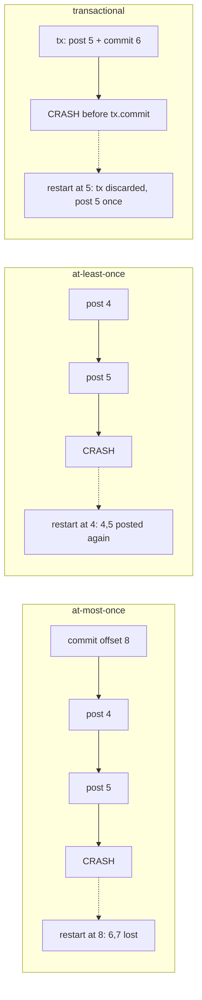

# At-Most-Once, At-Least-Once, and Effectively-Once

> Exactly-once delivery is impossible; exactly-once effects are engineering.

**Type:** Build
**Languages:** Java, Python, Go
**Prerequisites:** Phase 8, Lesson 01 (The Append-Only Log), Phase 8, Lesson 02 (Consumer Groups), Phase 7, Lesson 02 (Write-Ahead Logs), Phase 10, Lesson 01 (Representing Money)
**Time:** ~90 minutes

## Learning Objectives

- Explain why no protocol over an unreliable channel can deliver a message exactly once, and locate the gap where every real system either drops or duplicates
- Build the three orderings of "process" and "commit" and show, with an injected crash at a chosen offset, exactly which records are lost or duplicated under each
- Implement an idempotent consumer keyed on a business identifier and prove it absorbs redelivery without a transaction
- Implement a transactional consumer that commits the side effect and the offset atomically and prove it never has anything to absorb
- Decide, for a given side effect, which of the two effectively-once designs applies and what it costs

## The Problem

The ledger-poster from Lesson 02 consumes `payments.captured` and posts each capture to the ledger. It polls a batch of four, posts each one, then commits the offset. On a Tuesday at 14:07 the process is killed by the orchestrator mid-batch: it has posted captures `pay-1004` and `pay-1005` (offsets 4 and 5) but has not yet committed. The replacement process starts from the committed offset, 4, and posts `pay-1004` and `pay-1005` again. Two merchants are credited twice. The ledger total for the day is 30.33 USD higher than the sum of captures. Finance finds it on Thursday.

The on-call engineer "fixes" it by committing the offset before processing, so a crash can no longer cause a redelivery. Two weeks later the same kill happens, now at offset 5 with the offset already committed at 8. The replacement starts at 8. Captures `pay-1006` and `pay-1007` are never posted. Two merchants are never credited, and this time nobody finds it until the merchants complain, because a ledger with less money in it does not fail any internal check.

The engineer's third attempt is to commit after every single record instead of every batch. The window shrinks from four records to one, but a crash in that window still duplicates or drops exactly one record, and at 400 captures per second there are 400 windows per second. Shrinking the window does not close it. The window exists because "post to the ledger" and "record that I posted" are two writes to two systems, and a process can die between any two writes. This lesson makes the window visible, measures what falls through it under each ordering, and then closes it two different ways: by making the side effect idempotent so that falling through is harmless, and by making the two writes one write so that there is no between.

## The Concept

### Why exactly-once delivery is impossible

A sender transmits a message and waits for an acknowledgement. If the acknowledgement does not arrive, the sender cannot distinguish "the message was lost" from "the message arrived and the acknowledgement was lost". It must choose: resend (risking a duplicate) or not (risking a loss). No amount of extra round trips removes the ambiguity, because the last message in any protocol is itself unacknowledged. This is the same impossibility as the Two Generals problem (Phase 5, Lesson 02, Failure Models), and it applies to every hop: producer to broker, broker to consumer, consumer to the ledger.

So "exactly-once delivery" is not on offer. What is on offer is **exactly-once effect**: the ledger ends up with each capture posted once, even though the message describing it may have been delivered twice or its processing attempted three times. The industry word for this is *effectively once* (Kafka's documentation says "exactly-once semantics" and means the same thing). It is a property of the receiver's state, not of the channel.

### The three orderings

A consumer does two things per record: perform the side effect, and record its progress (commit the offset). A crash can land before, between, or after. The ordering of the two decides what the crash costs:

| Strategy | Order | Crash between the two | Who pays |
|----------|-------|------------------------|----------|
| At-most-once | commit, then process | Records committed but not yet processed are skipped forever | The party owed the effect (the merchant whose capture is never posted) |
| At-least-once | process, then commit | Records processed but not yet committed are processed again | The party harmed by a repeat (the ledger, and whoever reconciles it) |
| Effectively-once | process and commit atomically, or make process idempotent | Nothing observable | The engineer, in complexity and latency |

Both naive orderings are correct when nothing crashes, which is why they pass every test that does not inject a crash and why the failure arrives in production, in the one window that matters. The lesson's `FaultInjector` makes the crash a deterministic event at a chosen offset so the cost is a number in a table rather than a Thursday surprise.



### Worked example by hand

Ten captures at offsets 0 to 9, batch size 4, so the batches are `[0,1,2,3]`, `[4,5,6,7]`, `[8,9]`. The process crashes immediately after the side effect for offset 5 and before whatever commit follows it. Amounts are `10.00, 11.37, 12.74, 13.11, 14.48, 15.85, 16.22, 17.59, 18.96, 19.33` USD; the correct ledger total is 149.65 USD.

```text
AT_MOST_ONCE
  batch [4..7]: commit(8); post 4 (14.48); post 5 (15.85); CRASH
  restart: committed = 8; batch [8,9]: commit(10); post 8, post 9
  posted = 8, lost = {pay-1006, pay-1007}, total = 149.65 - 16.22 - 17.59 = 115.84 USD

AT_LEAST_ONCE
  batch [4..7]: post 4; post 5; CRASH   (commit(8) never ran)
  restart: committed = 4; batch [4..7]: post 4, 5, 6, 7; commit(8); batch [8,9]: ...
  posted = 12, duplicates = {pay-1004, pay-1005}, total = 149.65 + 14.48 + 15.85 = 179.98 USD

AT_LEAST_ONCE_IDEMPOTENT
  same path as AT_LEAST_ONCE, but post is postIfNew(paymentId)
  restart: postIfNew(pay-1004) -> false, postIfNew(pay-1005) -> false, 6 and 7 -> true
  posted = 10, duplicates = 0, lost = 0, total = 149.65 USD

TRANSACTIONAL
  record 4: tx{post 4; commitOffset(5)}; tx.commit   -> durable together
  record 5: tx{post 5; commitOffset(6)}; CRASH before tx.commit -> buffer discarded
  restart: committed = 5; tx{post 5; commitOffset(6)}; commit; ...
  posted = 10, duplicates = 0, lost = 0, total = 149.65 USD
```

The two naive strategies are wrong in opposite directions by amounts that depend on where in the batch the crash lands. The demo sweeps the crash across all ten offsets: at-most-once is correct only when the crash hits the last record of a batch (3 of 10), at-least-once is never correct (0 of 10), and both effectively-once designs are correct at every offset.

### Why the batch size does not matter

The intuition "commit more often and the problem shrinks" is half right. The number of records at risk per crash is bounded by the batch size, so batch size 1 bounds it at one record. But the guarantee is binary: one duplicate credit is a reconciliation break just as much as four, and a loss of one capture is a merchant who was never paid. Trace at-least-once with batch size 1 and a crash after offset 3:

```text
record 3: post 3; CRASH (commit(4) never ran)
restart: committed = 3; post 3 again; commit(4)
duplicates = 1
```

And at-most-once with batch size 2 and a crash after offset 2:

```text
batch [2,3]: commit(4); post 2; CRASH
restart: committed = 4; batch [4,5]: ...
lost = {offset 3}
```

Every batch size has a window; only the atomicity of the two writes, or the idempotence of one of them, removes it. The tests pin this with batch sizes 1, 2, and 4.

### The producer has the same window

The consumer's window is between "effect" and "commit". The producer's is between "append" and "acknowledgement": a producer that appends a capture, loses the acknowledgement, and retries produces two records at two offsets for one capture. No consumer-side ordering can tell them apart by offset, because they *are* two records. Only the business key can:

| Layer | Duplicate looks like | Detected by |
|-------|---------------------|-------------|
| Producer retry | Two records, two offsets, same `paymentId` | Idempotent producer (sequence number per producer per partition, deduplicated at the log) or the consumer's `postIfNew` on the business key |
| Consumer redelivery | One record, one offset, processed twice | Transactional offset commit or `postIfNew` |
| Both | Two records, each possibly processed twice | Only `postIfNew` on the business key catches every case |

That last row is why the idempotent route is not optional in a money-moving consumer even when the transactional route is in place: the transaction protects against the consumer's own crash, and the business key protects against everyone else's.

### Route one: the idempotent consumer

An operation is idempotent if performing it twice has the same effect as performing it once. "Post 14.48 USD to the merchant's account" is not idempotent. "Post capture `pay-1004` for 14.48 USD, unless a posting for `pay-1004` already exists" is. The transformation requires three things:

1. **A business key** that identifies the effect, not the message. `pay-1004` is the capture's identifier; the log offset is not usable because the same capture can be re-published at a new offset by a producer retry, and a different capture can never share the id.
2. **A processed-key store in the same durable store as the effect.** `postIfNew` checks the set and appends the posting in one operation on one store. If the set lived in a separate cache, a crash between "insert into set" and "append posting" would produce a capture that is marked processed and never posted, which is at-most-once wearing a disguise.
3. **Retention of the keys for at least as long as redelivery is possible.** For a consumer whose redelivery window is one uncommitted batch, that is seconds; for a producer that may retry for a day, it is a day. Phase 5, Lesson 09 builds the idempotency store with expiry, and Phase 12, Lesson 01 puts it in front of a payment API.

With those three in place, the offset can be committed with the at-least-once ordering and the redelivered records are no-ops. The cost is one indexed lookup per record and the storage for the keys. This is the design to use when the side effect is in a system you control (your ledger, your database) and especially when the side effect is a call to a system you do not control that offers an idempotency key (Stripe, Adyen, most bank APIs), because then the external party runs the `postIfNew` for you.

### Route two: the transactional consumer

If the ledger and the committed offset live in the same transactional store, write both in one transaction. A crash before commit discards both; a crash after commit has both. There is no between. The lesson's `Store.Transaction` buffers writes and applies them in `commit()`, which is what any database transaction does underneath: the undo log (Phase 7, Lesson 02) is what makes "discard the buffer" work after a real crash.

The design has a precondition that is easy to miss: **the offset must be stored where the effect is stored**, not in the broker. Kafka's own transactional consumer-producer (KIP-98) satisfies this for the case where the effect is itself a write to Kafka: the output records and the offset commit are written to Kafka topics under one transaction id, and a consumer with `isolation.level=read_committed` sees neither until the transaction commits. For an effect in an external database, the equivalent is storing the consumer's offset in a table of that database and committing it in the same database transaction as the effect, then seeking to that stored offset on startup instead of asking the broker. The broker's committed offset becomes advisory.

The cost is one transaction per record (or per batch, with the batch's records and the batch's offset in one transaction), and the constraint that every effect of the consumer must live in that one store. A consumer that posts to a ledger *and* sends an email cannot make both transactional; the email must become idempotent or go through an outbox (Phase 7, Lesson 13).

### Choosing between the routes

| Question | Idempotent consumer | Transactional consumer |
|----------|---------------------|------------------------|
| Where does the effect live? | Anywhere that can do insert-if-absent, including a third party with idempotency keys | Only in a store that supports transactions and can also hold the offset |
| Multiple effects per record? | Each must be idempotent individually | All must be in the same store |
| Cost per record | One key lookup plus key storage | One transaction |
| What a redelivery looks like | A no-op you can count in metrics | Nothing; the first attempt was never visible |
| Failure that defeats it | Key store and effect in different stores; key expiry shorter than the redelivery window | Offset committed to the broker instead of the store; an effect outside the store |

Most production consumers of money-moving events use both: the ledger write is transactional with the offset, and the ledger itself enforces uniqueness on the business key as a second line of defence against a producer that published the same capture twice at two offsets. The second defence is what `postIfNew` gives you and the first cannot, because a transaction per offset cannot know that offset 4 and offset 93 describe the same capture.

### Cost and complexity

Per record, the naive orderings cost one effect write plus one amortised offset write per batch. The idempotent route adds one indexed lookup-and-insert on the key store, `O(1)` expected with a hash index or `O(log n)` with a B-tree unique constraint, and `O(k)` storage for `k` retained keys. The transactional route costs one transaction per record or per batch; the transaction itself is cheap in a single store (one WAL append covering both writes, Phase 7, Lesson 02) and expensive across stores (two-phase commit, Phase 7, Lesson 08), which is the practical reason the offset must move into the effect's store rather than the effect moving into the broker's.

Latency follows the same shape. A per-record transaction serialises the consumer at the store's commit latency, typically a millisecond on local disk and tens of milliseconds across a replication quorum; batching the transaction (all records in the batch plus the batch's end offset) amortises it at the cost of a larger redelivery-free rollback on crash, which is harmless because nothing in it was visible. Choose the batch size from throughput, not from correctness.

A decision procedure, in order:

1. Does the effect live in a store that can also hold the offset and run a transaction? Use route two for the crash window.
2. Does the event have a business key, and can the effect's store enforce uniqueness on it? Use route one for producer duplicates, whether or not route two is in place.
3. Is the effect a call to an external party? Pass the business key as the idempotency key and treat the external party as the key store; keep the offset commit after the call returns.
4. Is there any effect that fits none of the above? It must become an outbox record in the transactional store (Phase 7, Lesson 13), to be delivered at-least-once by a separate relay to a receiver that is itself idempotent.

### What this lesson does not do

- It does not handle the producer side. A producer that retries a publish after a lost acknowledgement creates two records with two offsets for one capture; the idempotent producer (Kafka's `enable.idempotence`, sequence numbers per partition) deduplicates those at the broker. Exercise 2 adds it.
- It does not make the crash random. The point of the `FaultInjector` is that the crash offset is a test parameter; a randomised crash would pass sometimes and fail sometimes, which is the production experience the lesson exists to replace.
- It does not cover poison records, which are a different failure: a record that crashes the consumer every time, so that redelivery is infinite. Lesson 10 parks those.

## Build It

The code is in `code/java/Main.java`. Money is the integer-minor-unit type from Phase 10, Lesson 01, copied in; the rest is the log, the store, the four strategies, and the simulation harness.

### Step 1: The log and the record

```java
record Record(long offset, String paymentId, Money amount) {}

final class Log {
    private final List<Record> records = new ArrayList<>();

    long append(String paymentId, Money amount) {
        long offset = records.size();
        records.add(new Record(offset, paymentId, amount));
        return offset;
    }

    List<Record> read(long fromOffset, int maxRecords) {
        if (fromOffset < 0 || fromOffset > records.size()) throw new IllegalArgumentException("offset " + fromOffset + " out of range");
        int to = (int) Math.min(records.size(), fromOffset + maxRecords);
        return new ArrayList<>(records.subList((int) fromOffset, to));
    }
}
```

One partition, dense offsets, a read that returns an empty list at the end offset: Lesson 01's contract with the segments and index removed, because they do not change the delivery question. Each record carries a `paymentId`, the business key the idempotent route needs.

**Predict:** if two records on the log have the same `paymentId` (a producer retry), which strategies post it once and which post it twice?

### Step 2: The fault injector

```java
final class FaultInjector {
    private final long crashAtOffset;
    private boolean armed = true;

    void afterSideEffect(long offset) {
        if (armed && offset == crashAtOffset) {
            armed = false;
            throw new CrashException(offset);
        }
    }
}
```

The consumer calls `afterSideEffect(offset)` immediately after performing the side effect for that offset, and the injector throws exactly once, the first time the chosen offset is reached. The restart logic in `Simulation.run` catches the `CrashException` and constructs a fresh `Consumer` against the same `Store`, which is what a process restart is: the heap is gone, the durable store remains. Disarming after one throw means the restarted process reaches the same offset and succeeds, so every run terminates.

### Step 3: The store, with and without atomicity

```java
boolean postIfNew(Posting posting) {
    if (!processed.add(posting.paymentId())) return false;
    postings.add(posting);
    return true;
}

static final class Transaction {
    private final List<Posting> bufferedPostings = new ArrayList<>();
    private long bufferedOffset = -1;

    void post(Posting posting) { requireOpen(); bufferedPostings.add(posting); }
    void commitOffset(long nextOffset) { requireOpen(); bufferedOffset = nextOffset; }

    void commit() {
        requireOpen();
        store.postings.addAll(bufferedPostings);
        for (Posting p : bufferedPostings) store.processed.add(p.paymentId());
        if (bufferedOffset >= 0) store.committedOffset = bufferedOffset;
        done = true;
    }
}
```

The `Store` holds all three durable things (postings, processed keys, committed offset) so that any subset can be written atomically. Direct calls (`post`, `postIfNew`, `commitOffset`) are each a separate durable write with a crash point between them. A `Transaction` buffers and applies in `commit()`; a `CrashException` thrown while the transaction is open simply abandons the buffer, which is the in-memory stand-in for a database rolling back an uncommitted transaction on recovery.

**Predict:** `postIfNew` adds to `processed` first and `postings` second. If a crash could happen between those two lines, which delivery guarantee would the idempotent strategy degrade to?

### Step 4: The four strategies

```java
case AT_MOST_ONCE -> {
    store.commitOffset(batchEnd);
    for (Record r : batch) {
        store.post(new Posting(r.paymentId(), r.amount()));
        faults.afterSideEffect(r.offset());
    }
}
case AT_LEAST_ONCE -> {
    for (Record r : batch) {
        store.post(new Posting(r.paymentId(), r.amount()));
        faults.afterSideEffect(r.offset());
    }
    store.commitOffset(batchEnd);
}
```

The two naive orderings differ by one line's position. That is the whole lesson in two blocks: the same work, the same commit, and opposite failure modes depending on which comes first. Note that `afterSideEffect` sits after `store.post` and before the commit in both, which is the window a real process-kill lands in.

```java
case AT_LEAST_ONCE_IDEMPOTENT -> {
    for (Record r : batch) {
        store.postIfNew(new Posting(r.paymentId(), r.amount()));
        faults.afterSideEffect(r.offset());
    }
    store.commitOffset(batchEnd);
}
case TRANSACTIONAL -> {
    for (Record r : batch) {
        Store.Transaction tx = store.begin();
        tx.post(new Posting(r.paymentId(), r.amount()));
        tx.commitOffset(r.offset() + 1);
        faults.afterSideEffect(r.offset());
        tx.commit();
    }
}
```

The idempotent strategy is the at-least-once ordering with `post` replaced by `postIfNew`; redelivered records return `false` and change nothing. The transactional strategy puts the posting and the offset in one transaction and commits per record; the crash fires while the transaction is open, so the restarted process finds `committedOffset` still at the crashed record and the posting absent.

**Predict:** the transactional branch commits the offset as `r.offset() + 1` per record rather than `batchEnd` per batch. What would change if it used `batchEnd` inside each per-record transaction?

### Step 5: Measuring the damage

```java
static Outcome measure(Strategy strategy, Log log, Store store, int crashes) {
    Map<String, Integer> counts = new LinkedHashMap<>();
    for (Record r : log.read(0, (int) log.endOffset())) counts.put(r.paymentId(), 0);
    for (Posting p : store.postings()) counts.merge(p.paymentId(), 1, Integer::sum);
    int duplicates = 0, lost = 0;
    for (int c : counts.values()) {
        if (c == 0) lost++;
        if (c > 1) duplicates += c - 1;
    }
    return new Outcome(strategy, store.postings().size(), duplicates, lost, crashes, store.balance(Currency.USD));
}
```

`measure` compares what the log says happened with what the ledger says happened, per business key. A key with zero postings is a loss; a key with `n > 1` postings is `n - 1` duplicates. `effectivelyOnce()` is `duplicates == 0 && lost == 0`, and the ledger `balance` is the number finance would see. This is exactly the reconciliation job that found the Thursday discrepancy, run as a unit test.

### Step 6: Run it

```bash
cd phases/08-messaging-and-streams/03-delivery-guarantees/code/java
javac -d .out *.java && java -cp .out Main
java -cp .out MainTest
```

Expected output, abbreviated:

```console
== Crash after the side effect for offset 5, before its commit; then restart ==
  strategy                   posted  duplicates  lost  crashes  ledger total
  AT_MOST_ONCE               8       0           2     1        115.84 USD  <- money missing
  AT_LEAST_ONCE              12      2           0     1        179.98 USD  <- money counted twice
  AT_LEAST_ONCE_IDEMPOTENT   10      0           0     1        149.65 USD  <- matches
  TRANSACTIONAL              10      0           0     1        149.65 USD  <- matches

== Crash at every offset 0..9: how many runs end with the right ledger? ==
  AT_MOST_ONCE               3 of 10
  AT_LEAST_ONCE              0 of 10
  AT_LEAST_ONCE_IDEMPOTENT   10 of 10
  TRANSACTIONAL              10 of 10
```

Read the table as finance would. 115.84 USD is 149.65 minus the two captures at offsets 6 and 7 (16.22 and 17.59): at-most-once produced a ledger that is short by exactly the records between the crash and the committed batch end, and nothing in that ledger looks wrong on its own. 179.98 USD is 149.65 plus the two captures at offsets 4 and 5 (14.48 and 15.85): at-least-once produced a ledger with two extra postings carrying real payment ids, which a reconciliation job can find by counting postings per id. The sweep line is the one to remember: a strategy that is right 3 times in 10, or 0 times in 10, depending on where the crash lands, is not a strategy; it is a dice roll with the merchant's money.

Two things to try before moving on. Change the crash offset in `Main` to 7 (the last record of the second batch) and watch at-most-once become correct while at-least-once duplicates all four records of the batch. Then remove the `processed.add` line from `postIfNew` and watch the idempotent strategy collapse into plain at-least-once; the test named "idempotent consumer absorbs the redelivery" is the one that fails.

### In Python

```python
class Transaction:
    def commit(self) -> None:
        self._require_open()
        self._store._postings.extend(self._buffered_postings)
        for p in self._buffered_postings:
            self._store._processed.add(p.payment_id)
        if self._buffered_offset >= 0:
            self._store._committed_offset = self._buffered_offset
        self._done = True

    def __exit__(self, exc_type, exc, tb) -> bool:
        if exc_type is None:
            self.commit()
        return False
```

Differences, all in `code/python/main.py`:

- **The transaction is also a context manager.** The consumer calls `tx.commit()` explicitly, exactly as the Java does, so the four strategies read the same in both languages. `__enter__`/`__exit__` are an addition: `with store.begin() as tx:` commits on a clean exit and discards the buffer when a `CrashError` propagates, which turns the crash-discards-the-buffer rule into a language feature. The test file exercises both paths.
- **`Money` is `int` minor units** and `__post_init__` raises `TypeError` on a `float` (or `bool`); there is no overflow, so `Math.addExact` has no counterpart. `Money.parse` raises `ArithmeticError` for too many decimals, as the Java raises `ArithmeticException`.
- **Exceptions:** `CrashError` for `CrashException`, `CurrencyMismatchError`, `ValueError` for `IllegalArgumentException`, `RuntimeError` for the reused-transaction `IllegalStateException`. `Simulation.run` catches `CrashError` and restarts, like the Java `catch`.
- **`Strategy` is an `Enum`** iterated in declaration order (`for s in Strategy`), the same order `Strategy.values()` gives; the `postIfNew` check-and-insert is still a single `if ... in` followed by `add`, never split across calls.

Run it from `code/python/` with `python3 main.py`; test with `python3 -m unittest -v`. The table (8/12/10/10 posted, 3/0/10/10 correct runs out of 10) matches the Java output exactly.

### In Go

```go
case Transactional:
    for _, r := range batch {
        tx := c.store.Begin()
        if err := tx.Post(Posting{r.PaymentID, r.Amount}); err != nil {
            return err
        }
        if err := tx.CommitOffset(r.Offset + 1); err != nil {
            return err
        }
        if err := c.faults.AfterSideEffect(r.Offset); err != nil {
            return err // the buffered transaction dies with the process
        }
        if err := tx.Commit(); err != nil {
            return err
        }
    }
```

Differences, all in `code/go/main.go` and `code/go/money.go`:

- **The crash is a returned error, not a thrown one.** `FaultInjector.AfterSideEffect` returns `ErrCrash` wrapped with the offset; every strategy branch in `RunToEnd` returns it immediately, which is the Go spelling of "the process is gone". `Run` restarts a fresh consumer while `errors.Is(err, ErrCrash)` and panics on any other error, because in this single-threaded simulation nothing else can fail. Returning early is also what discards the buffered `Transaction`: the struct is simply never committed.
- **Errors are values elsewhere too.** `Log.Read`, `Store.CommitOffset`, `NewConsumer`, and the three `Transaction` methods return `error`; a reused transaction returns the sentinel `ErrTransactionDone` where Java throws `IllegalStateException`. `PostIfNew` keeps the check-and-insert as one method on one map, never split across calls.
- **`Money` is `int64` minor units** (the Phase 10, Lesson 01 Go `Money`, in `money.go`): `Parse` and `Plus` return `(Money, error)`, overflow is checked by `addChecked`, and a currency mix wraps `ErrCurrencyMismatch`. `Store.Balance` panics on a mismatch because every posting in this lesson carries the same currency, so it is a bug, not a condition.
- **`Strategy` is a typed constant** with a `String()` method printing the Java names, and the `Strategies` slice stands in for `Strategy.values()` so the demo iterates in the same order.

Run it from `code/go/` with `go run .`; test with `go test ./...`. The table (8/12/10/10 posted, 3/0/10/10 correct runs out of 10) and the ledger totals match the Java output exactly.

## Use It

### Kafka's transactions (KIP-98) and `isolation.level`

Kafka implements the transactional route for the case where the consumer's effect is a write to another Kafka topic. A producer with a `transactional.id` calls `beginTransaction`, writes output records, calls `sendOffsetsToTransaction(offsets, groupMetadata)` to include the consumer's offset commit in the same transaction, and `commitTransaction`. The transaction coordinator writes commit markers to every partition involved; a consumer with `isolation.level=read_committed` does not see records past the last stable offset until the marker lands. `sendOffsetsToTransaction` with the group metadata (KIP-447) is what fences a zombie from Lesson 02: a producer whose consumer generation is stale is rejected. Kafka Streams turns this on with `processing.guarantee=exactly_once_v2`.

What it does not cover is an effect outside Kafka. The documentation is explicit: for a database sink, store the offset in the database and commit it with the data. The Kafka Connect JDBC sink does not do this by default and is therefore at-least-once; it relies on the destination's primary key (an upsert) for the idempotent route.

### Queues with acknowledgements: SQS, RabbitMQ, Pub/Sub

Traditional queues express the same three orderings through acknowledgement timing. In Amazon SQS a received message becomes invisible for the *visibility timeout*; deleting it before processing is at-most-once, deleting it after is at-least-once, and a processing time longer than the timeout causes redelivery while the first attempt is still running, which is the Lesson 02 `max.poll.interval.ms` problem in another costume. SQS FIFO queues add a producer-side deduplication id with a five-minute window, which is the idempotent producer. RabbitMQ's `basic.ack` after processing versus `auto-ack` on delivery is the same choice; Google Pub/Sub's `ack` deadline and exactly-once delivery option (which deduplicates redeliveries within a subscription but cannot see a duplicate publish) likewise. In every one of these the effect store still has to carry either the transaction or the key; the queue's setting only chooses which naive failure you get by default.

### Idempotency keys at the boundary

Stripe, Adyen, and most card networks accept an idempotency key on money-moving requests and return the original response on a retry with the same key, typically for 24 hours. That is `postIfNew` run by the other party, and it is why a consumer that calls a payment API should derive the key from the business identifier on the record, never generate a fresh UUID per attempt. Phase 12, Lesson 01 builds the server side of that contract.

### The trap

The commonest way to lose the guarantee after building it is to put the processed-key set or the offset somewhere other than the effect's store: a Redis set for keys, the broker for offsets, a database for the ledger. Each pair of stores reintroduces a window. The test for any effectively-once design is a single question: name every durable write the consumer makes per record, and name the store each goes to. If the answer has more than one store and no idempotency key enforced inside the effect's store, there is a window, and this lesson's `FaultInjector` will find it.

## Ship It

`outputs/checklist-effectively-once-consumer.md` is a review checklist for any consumer that performs a side effect from a log: it asks for the ordering, the stores, the business key, the key retention, and the crash test, and it rejects a design that cannot answer. Use it on the next consumer PR that touches money.

## Exercises

1. **Reinforce.** Change the batch size to 1 and re-run the sweep. Show that at-least-once still duplicates exactly one record at every crash offset and explain, in one sentence, why "commit more often" cannot close the window.
2. **Apply.** Add an idempotent producer: `Log.append(producerId, sequence, paymentId, amount)` that rejects an append whose `(producerId, sequence)` is at or below the last accepted sequence for that producer, returning the existing offset. Simulate a producer that publishes, loses the acknowledgement, and retries; show the log has one record and every strategy posts it once. This is Kafka's `enable.idempotence`.
3. **Extend.** Combine with Lesson 02: give the `Store` a `commitOffset(member, generation, ...)` that applies the generation fence, and run two consumers against one partition where one is a zombie that lost its generation. Show that the zombie's transactional commit is rejected and that the ledger is still correct under the idempotent route even though the zombie posted. Then write down which route protected the money in that run and which only protected the offset.

## Key Terms

| Term | What people say | What it actually means |
|------|-----------------|------------------------|
| At-most-once | "fire and forget" | Commit before processing; a crash between them skips records permanently; never duplicates |
| At-least-once | "retry until acked" | Process before committing; a crash between them redelivers records; never loses |
| Effectively-once | "exactly-once" | The receiver's state reflects each message once regardless of how many times it was delivered or attempted |
| Idempotent | "safe to retry" | Performing the operation again produces no additional effect; requires a key that identifies the effect, stored with the effect |
| Business key | "the idempotency key" | An identifier of the real-world event (`pay-1004`), as opposed to the log offset, which identifies one copy of one message about it |
| Transactional outbox / inbox | "commit together" | Storing the progress marker in the same transaction as the effect so a crash cannot separate them |
| Redelivery window | "the gap" | The set of records processed but not yet durably marked as processed at the moment of a crash; every design either shrinks it or makes it harmless |

## Further Reading

- [KIP-98: Exactly Once Delivery and Transactional Messaging](https://cwiki.apache.org/confluence/display/KAFKA/KIP-98+-+Exactly+Once+Delivery+and+Transactional+Messaging) — the design of Kafka's idempotent producer and transactions, including the argument for why the offset commit must be part of the transaction.
- [Apache Kafka documentation, section 4.6 "Message Delivery Semantics"](https://kafka.apache.org/documentation/#semantics) — the three guarantees stated from the producer and consumer sides, and the sentence about storing offsets with the output for external systems.
- [Pat Helland, "Idempotence Is Not a Medical Condition" (ACM Queue, 2012)](https://queue.acm.org/detail.cfm?id=2187821) — why every message in a distributed system must be assumed to arrive more than once and how to design the receiver accordingly.
- [KIP-447: Producer scalability for exactly once semantics](https://cwiki.apache.org/confluence/display/KAFKA/KIP-447%3A+Producer+scalability+for+exactly+once+semantics) — fencing transactional producers with consumer group metadata, which joins this lesson to Lesson 02.
- [Stripe API: Idempotent requests](https://docs.stripe.com/api/idempotent_requests) — the production contract for client-supplied idempotency keys on money-moving requests.
- [Gray, "Notes on Data Base Operating Systems" (1978), section on the Two Generals](https://jimgray.azurewebsites.net/papers/dbos.pdf) — the original statement of why an acknowledgement protocol over a lossy channel cannot reach certainty.
