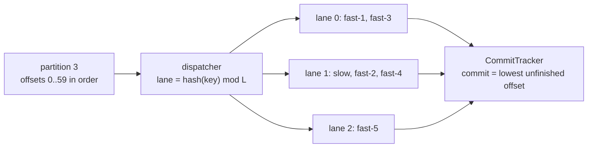

# Message Ordering, Keys, and Head-of-Line Blocking

> Order per account, parallelism across accounts.

**Type:** Build
**Languages:** Java, Python, Go
**Prerequisites:** Phase 8 Lesson 01 (The Append-Only Log), Phase 8 Lesson 02 (Consumer Groups), Phase 8 Lesson 03 (Delivery Guarantees)
**Time:** ~60 minutes

## Learning Objectives

- State precisely what ordering a partitioned log promises (per partition, therefore per key) and what it does not (across partitions, across topics, across retries)
- Reproduce head-of-line blocking with a discrete-event simulation and measure what one slow key costs every other key in its partition
- Build per-key lanes inside a partition that keep each key's order while letting unrelated keys proceed, and quantify the residual blocking from lane collisions
- Implement a commit tracker that commits the low-water mark of completed offsets, so parallel processing never commits past an unfinished record
- Show how a producer with more than one send in flight reorders a key's messages when a retry happens, detect it with per-key sequence numbers, and prevent it with a broker-side sequence check

## The Problem

A wallet service publishes one event per balance change to a topic keyed by account id: `AUTH` (funds held), `CAPTURE` (hold converted to a debit), `REVERSAL` (hold released). The consumer is a ledger poster that applies each event to the account's balance in the order received. Account `acct-7` sends `AUTH #2` for 40.00 USD and, 30 ms later, `REVERSAL #3` for the same hold. The producer runs with five requests in flight to the broker. The request carrying `AUTH #2` hits a transient `NotEnoughReplicas` error and is retried; the request carrying `REVERSAL #3` was already on the wire and succeeds. The partition now holds the reversal at offset 118 and the authorization at offset 121. The ledger poster sees a reversal for a hold it has never recorded, rejects it, and writes the hold three records later. The customer's available balance is 40.00 USD lower than it should be until someone notices. Nothing was lost and nothing was duplicated. The order changed, and the producer's retry logic is what changed it.

The second failure is slower and quieter. The same topic has twelve partitions and twelve consumer instances, one per partition. One merchant account, `acct-slow`, triggers an expensive fraud-rule evaluation on every event: 40 ms instead of the usual 2 ms. Its events share partition 3 with roughly four hundred other accounts. Every one of those accounts' events that lands behind an `acct-slow` event waits for it. The partition-level p99 latency for partition 3 climbs to 30 ms while the other eleven partitions sit at 2 ms. Dashboards show "partition 3 is slow"; nobody can see that one account is responsible, because the lag metric is per partition. Adding consumers does not help: a partition can have at most one consumer in a group (Lesson 02), so partition 3's throughput is capped by one thread processing records in strict offset order. This is head-of-line blocking: the record at the head of the line delays everything behind it, whether or not the records behind it have anything to do with it.

Both failures are about the same contract. A partitioned log promises exactly one kind of order, production order within a partition, and gives you exactly one knob to decide what shares that order, the key. This lesson builds the three mechanisms that make the contract usable: a scheduler that keeps per-key order while running keys in parallel inside a partition, a commit tracker that makes parallel processing safe to commit, and sequence numbers that detect and prevent the reordering that producer retries introduce.

## The Concept

### What ordering a log actually promises

| Scope | Promised? | Why |
|-------|-----------|-----|
| Two records in the same partition | Yes, by offset | A partition is one append-only array (Lesson 01) |
| Two records with the same key, same topic | Yes, if the partition count never changed and the producer sent them in order | Same key, same partition; the partitioner is a pure function of the key |
| Two records with different keys, same partition | Yes by offset, but it means nothing | They happened to hash together; the next deploy might change that |
| Two records in different partitions | No | Offsets in different partitions are unrelated numbers |
| Two records in different topics | No | Even with the same key; different logs |
| Two records from the same producer, same key, when one was retried | Only if the producer sends them one at a time, or the broker checks sequence numbers | A retry is a later send of an earlier record |

The row people get wrong most often is the last one. "Same key, same partition, therefore ordered" is true of what the broker stores; it says nothing about the order the producer's sends arrive in. The log stores what arrives, in the order it arrives.

### The key is a declaration of what must be ordered

Choosing the key is choosing the ordering domain. Key by account id and you get a total order of each account's events and no order between accounts, which is what a ledger needs. Key by merchant id and you get merchant order, which is what a settlement report needs, and you lose the ability to order one customer's events across merchants. Key by nothing and you get throughput and no order at all. There is no key that gives you two ordering domains at once; if a capture must be ordered after the authorization it captures, both must carry the same key, which means the capture must know the authorization's account id, which is a data-model decision made long before anyone thinks about topics.

The key also decides the unit of parallelism. Everything with one key goes through one partition and therefore, in a naive consumer, one thread. A key with 40% of the traffic is a partition with 40% of the traffic, and no partition count fixes that.

The demo's first section shows the partitioner at work on six account ids with three partitions:

```text
acct-1001 -> partition 2      acct-1004 -> partition 1
acct-1002 -> partition 1      acct-1005 -> partition 0
acct-1003 -> partition 0      acct-1006 -> partition 2
partition 0: 1003#0 1005#0 1003#1 1005#1 1003#2 1005#2
partition 1: 1002#0 1004#0 1002#1 1004#1 1002#2 1004#2
partition 2: 1001#0 1006#0 1001#1 1006#1 1001#2 1006#2
```

Each account's sequence numbers read `0, 1, 2` within its partition: per-key order. Partition 0 interleaves `acct-1003` and `acct-1005`, and that interleaving is an accident of FNV-1a, not a fact about the accounts. Re-run with four partitions and every one of the six accounts moves (`1001->3, 1002->2, 1003->1, 1004->0, 1005->3, 1006->2`). The naive expectation is that about a quarter of keys keep their partition when going from 3 to 4; in fact `h mod 3 == h mod 4` only when `h mod 12` is 0, 1, or 2, so one key in four keeps its home, and with six keys it is unremarkable that none did. Any key that moves has its history split across two partitions, and the order across that split is gone. Changing the partition count of a keyed topic is a migration, not a config change.

### Four ways to get parallelism, and what each costs

| Strategy | Per-key order | Parallelism | Head-of-line exposure | Commit discipline |
|----------|---------------|-------------|------------------------|-------------------|
| One consumer per partition, sequential | Yes | Partition count | Every key in the partition waits for the slow one | Trivial: last offset + 1 |
| More partitions | Yes (until you change the count) | More, but each partition still sequential | Same per partition; fewer keys per partition | Trivial |
| Per-key lanes inside a partition | Yes | Partition count times lane count | Only keys sharing the slow key's lane | Low-water mark required |
| Random (null) key | No | Unbounded | None | Trivial, but order is gone |

Adding partitions is the usual first reaction, and it helps only by diluting: with 400 keys per partition and one slow key, 24 partitions instead of 12 halve the number of victims and change nothing for them. Lanes attack the problem directly. Random keys solve it by giving up the thing you were trying to protect.

### Head-of-line blocking

A consumer that processes offsets strictly in order is a single FIFO queue. Queueing theory gives the cost directly: a record's latency is its own service time plus the sum of the service times of everything ahead of it that has not yet finished. One record with a 40 ms service time in a stream of 2 ms records adds up to 38 ms to the record immediately behind it, 36 ms to the one behind that, and so on until the backlog drains. The records paying the price are unrelated to the slow one: they were ordered only by accident of hashing.

The worked example by hand. Sixty records arrive one every 10 ms. Keys rotate through six accounts, so `acct-slow` is every sixth record: offsets 3, 9, 15, and so on. Fast records cost 2 ms, `acct-slow` costs 40 ms. Follow the first six offsets through a sequential consumer:

```text
offset  key         arrives  starts  cost  ends   latency
0       fast-1       0        0      2      2       2
1       fast-2      10       10      2     12       2
2       fast-3      20       20      2     22       2
3       slow        30       30     40     70      40
4       fast-4      40       70      2     72      32    <- waited 30 ms for a record it has nothing to do with
5       fast-5      50       72      2     74      24
6       fast-1      60       74      2     76      16
7       fast-2      70       76      2     78       8
8       fast-3      80       80      2     82       2    <- backlog drained
9       slow        90       90     40    130      40
```

Each slow record creates a 30 ms backlog that takes five fast records to drain. The fast accounts' p50 latency becomes 16 ms and their maximum 32 ms, for work that costs them 2 ms. The utilisation is only 83% (500 ms of work per 600 ms), so this is not an overload problem; it is an ordering problem.

### Per-key lanes

The fix is to stop pretending that the partition's order is the order you need. The order you need is per key. So inside one partition, dispatch each record to a lane chosen by `hash(key) mod L`. Each lane is a FIFO processed by its own worker, so records with the same key are processed in offset order; records in different lanes do not wait for each other. The partition's single consumer thread does nothing but poll and dispatch, which is cheap.



With 8 lanes in the demo, `acct-slow` has a lane to itself: the fast accounts' maximum latency drops from 32 ms to 2 ms, exactly their own cost. With 2 lanes, two fast accounts hash into `acct-slow`'s lane and still see a 32 ms maximum; the other three are unaffected. Lanes do not remove head-of-line blocking, they reduce it to lane collisions, and the collision rate falls with the lane count exactly as hash-table collisions do (Phase 1, Lesson 07). The slow key itself gains nothing: it still waits for its own earlier records, which is the order you asked for.

### Choosing the lane count

A lane is a worker, so the lane count is bounded by what the consumer host can run: threads, connections to the downstream store, memory for in-flight records. Within that bound, the question is how many keys share a lane with the slow one. With K active keys spread over L lanes, the expected number of other keys in any given lane is `(K - 1) / L`. For the demo's 6 keys: 2.5 other keys with 2 lanes, 1.25 with 4, 0.6 with 8. For a real partition with 400 active accounts, 16 lanes leaves about 25 accounts behind each slow one, which is a 16-fold improvement over the sequential consumer and still 25 victims. Lanes are a constant-factor tool. If one key is pathologically slow, the structural fix is to move it: route it to its own topic, or process it asynchronously and record a placeholder, so the ordering domain is preserved for everyone else.

The lane count does not bound the commit exposure described in the next section, and it is worth being clear about why. While one lane is busy with a 40 ms record, the other lanes keep finishing records that arrive behind it, and every one of those is finished-ahead of the mark. More lanes means more records can finish ahead, not fewer. The demo's `max finished-but-uncommittable` reads 2 for two lanes and 3 for eight; a slower key or a faster arrival rate would push it much higher, which is why the exposure needs its own explicit bound (Exercise 2).

### Committing when completion is out of order

Parallel lanes complete records out of offset order: offset 4 finishes at 42 ms while offset 3 is still running until 70 ms. Lesson 01's contract is that the committed offset is the next offset to read, and everything below it has been processed. If the consumer commits "highest offset finished" (4 + 1 = 5) and crashes, offset 3 is never redelivered: a lost authorization. The committable offset is the low-water mark, the smallest offset not yet complete. The `CommitTracker` keeps a sorted set of offsets finished ahead of the mark and advances the mark through them whenever the gap closes:

```text
complete(1) -> mark 0, ahead {1}
complete(2) -> mark 0, ahead {1,2}
complete(0) -> mark 3, ahead {}        0 done, 1 and 2 were waiting, all released
complete(4) -> mark 3, ahead {4}
complete(3) -> mark 5, ahead {}
```

The cost is that a slow record holds the mark back, so a crash redelivers everything after it, which the Lesson 03 consumer already handles idempotently. The bound on redelivery is the lane depth, which is why production implementations cap how many offsets may be "ahead" before the dispatcher stops polling.

### Retries reorder

A producer that wants throughput keeps several sends in flight on one connection. Kafka's default is five. If send 2 fails on its first attempt and sends 3 and 4 were already written by the broker, send 2's retry lands at offset 4, after them:

```text
window [0 1 2 3 4]  send 2 fails  -> broker appends 0 1 3 4;  retry queue [2]
window [2 5 6 7]    send 5 fails  -> broker appends 2 6 7;    retry queue [5]
window [5]                        -> broker appends 5
log by seq: 0 1 3 4 2 6 7 5
```

With one send in flight, the window is one record wide, the retry is the next thing sent, and the log reads `0 1 2 3 4 5 6 7`. That was the only fix until 2017: `max.in.flight.requests.per.connection=1`, at a large cost in throughput.

The current fix is sequence numbers (Kafka's KIP-98, "idempotent producer"). The producer stamps each record for a key with `seq = previous + 1` before the first attempt; a retry carries the same `seq`. The broker remembers the last `seq` it accepted per producer and partition and rejects any send whose `seq` is not `last + 1` with `OutOfOrderSequenceException`. In the trace above, with the guard on, sends 3 and 4 are rejected in the first window because the broker is still expecting 2; the producer re-sends 2, 3, 4 in order; the log is `0 1 2 3 4 5 6 7` with five in flight. The same number also deduplicates: a retry of a send that actually succeeded has `seq == last`, and the broker acknowledges it without appending.

A consumer can detect the unguarded case with the same arithmetic. A `SequenceTracker` expects `seq == last + 1` per key. `3` arriving when `2` is expected is a `GAP`; `2` arriving afterwards is below the expectation and is classified `DUPLICATE`, which is exactly what the consumer would conclude if it did not know about the retry. The signature of a reordered retry is a `GAP` followed shortly by a lower `seq`. The tracker cannot fix the order after the fact without buffering; it can alarm, and the alarm is the difference between the Problem section's silent 40.00 USD discrepancy and a page.

### Invariants and costs

The three mechanisms each carry one invariant and one cost figure worth memorising.

| Mechanism | Invariant | Cost per record |
|-----------|-----------|-----------------|
| Per-key lanes | For every key, record n+1 starts no earlier than record n completes | O(1) dispatch: one hash, one array index |
| Commit tracker | `committable` is the smallest offset not yet completed; every offset below it is done | O(log A) where A is the finished-ahead set; O(1) amortised when completion is nearly in order |
| Sequence tracker | A key's `seq` values are observed as `0, 1, 2, ...` or a `GAP`/`DUPLICATE` is reported | O(1): one map lookup |
| Broker sequence guard | The partition never contains `seq = n+1` for a key before `seq = n` | O(1) per send; rejections cost a round trip each |

The lane invariant is the one the tests check with `Workload.perKeyOrderHolds`. It is deliberately weaker than "records are processed in offset order": it says nothing about two records with different keys, which is the whole point. The commit invariant is the one that costs money when broken, and the only way to break it is to commit something other than `committable()`.

### What this lesson does not do

- It does not order across partitions. If you need a global order you need one partition, and then you have one thread and the throughput that implies.
- It does not make lanes survive a crash. Lane state is in memory; after a restart the consumer re-reads from the committed low-water mark and the lanes refill. That is correct and at-least-once.
- It does not reorder a key's records at the consumer. The exercises add a bounded reorder buffer; without a bound it is a memory leak waiting for a record that never arrives.
- It does not implement Kafka's full idempotent producer: there is no producer id, no epoch, no fencing of a zombie producer. Phase 8, Lesson 03 covers the transactional side.

## Build It

The implementation lives in `code/java/Main.java`; tests are in `MainTest.java`. Everything is simulated: a message carries its arrival time and processing cost, and the schedulers compute start and completion times with integer arithmetic. Nothing sleeps.

### Step 1: Messages carry the producer's sequence number

```java
record Message(String key, long seq, String type, Money amount, long producedAt, long costMillis) {
    Message {
        Objects.requireNonNull(key, "key");
        if (seq < 0) throw new IllegalArgumentException("seq must be non-negative");
        if (costMillis < 0) throw new IllegalArgumentException("costMillis must be non-negative");
    }
}

record StoredMessage(long offset, Message message) {}
```

`seq` is assigned by the producer, per key, before the first send attempt, and never changes on retry. `offset` is assigned by the log at append time. The whole lesson is about the cases where these two orders disagree. `producedAt` and `costMillis` exist for the simulation; a real message would carry neither.

**Predict:** if the producer restarts and its per-key counter resets to 0, what does a consumer's `SequenceTracker` report for the first message after the restart?

### Step 2: The partitioner, unchanged from Lesson 01

```java
static int partitionFor(String key, int partitionCount) {
    if (partitionCount <= 0) throw new IllegalArgumentException("partitionCount must be positive");
    int hash = fnv1a32(key.getBytes(StandardCharsets.UTF_8));
    return (hash & 0x7FFFFFFF) % partitionCount;
}
```

The same FNV-1a function and the same sign-bit mask as Lesson 01, so `acct-1001` lands in the same partition here that it would there. `Topic.append` calls this and appends to the chosen `Partition`, a plain list with dense offsets (the segmented log from Lesson 01 would slot in unchanged). `Partition.sequenceOf(key)` returns the `seq` values of one key in offset order; per-key order holds exactly when that list is `0, 1, 2, ...`.

**Predict:** the demo prints the six accounts' partitions for N = 3 and N = 4. How many keys keep their partition? Why is the answer not "about three quarters"?

### Step 3: The sequential scheduler reproduces head-of-line blocking

```java
public List<Completion> run(Partition partition) {
    List<Completion> out = new ArrayList<>();
    long busyUntil = 0;
    for (StoredMessage s : partition.readAll()) {
        Message m = s.message();
        long start = Math.max(busyUntil, m.producedAt());
        long end = start + m.costMillis();
        busyUntil = end;
        out.add(new Completion(s.offset(), m.key(), start, end, end - m.producedAt()));
    }
    return out;
}
```

A single worker is a single `busyUntil`. A record starts when it has arrived and the worker is free, whichever is later. That one `Math.max` is the entire head-of-line blocking mechanism: `busyUntil` after a 40 ms record is 30 ms past the next record's arrival, and that record inherits the wait. `LatencyStats.of` sorts the latencies and reports max, mean, p50, and p99; `LatencyStats.excluding(completions, "acct-slow")` answers the question the dashboard could not, "how did everyone else fare?".

### Step 4: Per-key lanes

```java
public List<Completion> run(Partition partition) {
    long[] laneBusyUntil = new long[lanes];
    List<Completion> out = new ArrayList<>();
    for (StoredMessage s : partition.readAll()) {
        Message m = s.message();
        int lane = laneFor(m.key());
        long start = Math.max(laneBusyUntil[lane], m.producedAt());
        long end = start + m.costMillis();
        laneBusyUntil[lane] = end;
        out.add(new Completion(s.offset(), m.key(), start, end, end - m.producedAt()));
    }
    ...
}
```

The only change from Step 3 is that `busyUntil` became an array indexed by `laneFor(key) = partitionFor(key, lanes)`. Because the dispatcher walks offsets in order and each lane is FIFO, two records with the same key are always processed in offset order (same lane, later start). Two records with different keys in different lanes never wait for each other. `Workload.perKeyOrderHolds` checks the invariant directly: for every key, each record starts no earlier than the key's previous record finished.

**Predict:** with 2 lanes and 6 keys, what is the probability that `acct-slow` shares its lane with no other key? Is the demo's "keys sharing acct-slow's lane: [acct-fast-2, acct-fast-4]" lucky or unlucky?

### Step 5: Commit the low-water mark

```java
long complete(long offset) {
    if (offset < committable) throw new IllegalStateException("offset " + offset + " already committed");
    if (!doneAhead.add(offset)) throw new IllegalStateException("offset " + offset + " completed twice");
    while (!doneAhead.isEmpty() && doneAhead.first() == committable) {
        doneAhead.pollFirst();
        committable++;
    }
    return committable;
}
```

`committable` is the next offset to read, in Lesson 01's sense; `doneAhead` is a `TreeSet` of offsets that finished while an earlier offset was still running. The loop advances the mark through any contiguous run of finished offsets. `KeyedLaneScheduler.run` replays its completions in completion-time order through a tracker and records `maxCompletedAhead`, the deepest the finished-but-uncommittable set ever got; that number is the redelivery exposure after a crash, and the demo prints 3 for eight lanes.

**Predict:** a consumer with 8 lanes and a 10,000-record backlog has one lane stuck on a record that never completes. What happens to `doneAhead`, and what should the dispatcher do about it?

### Step 6: Simulating a producer with sends in flight

```java
while (!pending.isEmpty()) {
    List<Send> window = new ArrayList<>();
    while (!pending.isEmpty() && window.size() < maxInFlight) window.add(pending.pollFirst());
    List<Send> resend = new ArrayList<>();
    for (Send send : window) {
        if (!send.attempted && faults.failsFirstAttempt(send.index)) {
            send.attempted = true;
            retries++;
            resend.add(send);
            continue;
        }
        send.attempted = true;
        long expected = lastSeq.getOrDefault(send.message.key(), -1L) + 1;
        if (sequenceGuard && send.message.seq() != expected) {
            rejected++;
            resend.add(send);
            continue;
        }
        lastSeq.put(send.message.key(), send.message.seq());
        appended.add(send.message);
    }
    resend.sort((a, b) -> Long.compare(a.index, b.index));
    for (int i = resend.size() - 1; i >= 0; i--) pending.addFirst(resend.get(i));
}
```

`ProducerSim.deliver` takes `maxInFlight` sends off the pending queue as a window, lets the broker process them in order, and pushes anything that must be re-sent back to the front of the queue. A send that fails its first attempt (decided by a `FaultInjector`, either an explicit set or a seeded `Random`) is re-sent in the next window, after the rest of this window has been appended: that is the reordering. With `sequenceGuard`, the broker also rejects any send whose `seq` is not `last + 1`, so the successors of a failed send are bounced and re-sent behind it. `SendOutcome` reports the appended order and the retry and rejection counts.

### Step 7: Detecting the damage at the consumer

```java
Verdict observe(Message m) {
    long expected = lastSeq.getOrDefault(m.key(), -1L) + 1;
    if (m.seq() == expected) { lastSeq.put(m.key(), m.seq()); return Verdict.IN_ORDER; }
    if (m.seq() < expected) { duplicates++; return Verdict.DUPLICATE; }
    gaps++;
    lastSeq.put(m.key(), m.seq());
    return Verdict.GAP;
}
```

Three outcomes and nothing else. `GAP` moves the expectation forward because the consumer has no way to wait; `DUPLICATE` does not touch it. A reordered retry therefore shows as one `GAP` and one `DUPLICATE` per incident, which the demo prints as `3:GAP 4:IN_ORDER 2:DUPLICATE`. `SequenceTracker.isOrdered(list)` is the assertion the tests use.

### Step 8: Run it

```bash
cd phases/08-messaging-and-streams/04-message-ordering-and-keys/code/java
javac -d .out *.java && java -cp .out Main
java -cp .out MainTest
```

Expected output, abbreviated:

```console
== 2. Head-of-line blocking: one slow account in a partition of fast ones ==
60 messages, one every 10 ms; fast accounts cost 2 ms, acct-slow costs 40 ms
sequential   : all p50=16 p99=40 max=40 | fast accounts only p50=16 max=32
  offset 4 (acct-fast-4, cost 2 ms) arrived at 40 ms, started at 70 ms: it waited behind acct-slow at offset 3

== 3. Per-key lanes inside the partition: order per key, parallelism across keys ==
2 lanes: fast accounts p50=2 max=32 | acct-slow max=40 | per-key order holds=true | committable at end=60, max finished-but-uncommittable=2
  keys sharing acct-slow's lane (still blocked): [acct-fast-2, acct-fast-4]
4 lanes: fast accounts p50=2 max=2 | acct-slow max=40 | per-key order holds=true | ...
8 lanes: fast accounts p50=2 max=2 | acct-slow max=40 | per-key order holds=true | committable at end=60, max finished-but-uncommittable=3

== 5. Retries reorder when more than one send is in flight ==
maxInFlight=1, sends 2 and 5 fail once: log seqs=[0, 1, 2, 3, 4, 5, 6, 7] retries=2 ordered=true
maxInFlight=5, sends 2 and 5 fail once: log seqs=[0, 1, 3, 4, 2, 6, 7, 5] retries=2 ordered=false
consumer-side SequenceTracker on the reordered log: 0:IN_ORDER 1:IN_ORDER 3:GAP 4:IN_ORDER 2:DUPLICATE 6:GAP 7:IN_ORDER 5:DUPLICATE
maxInFlight=5 with broker sequence guard: log seqs=[0, 1, 2, 3, 4, 5, 6, 7] retries=2 rejected=3 ordered=true

== 6. The same thing at scale, seeded ==
2000 sends, 5% fail once, maxInFlight=5: unguarded retries=90 gaps seen by consumer=59; guarded rejected=151 ordered=true
```

Ninety retries produced fifty-nine visible reorderings; the rest happened to be the last send in a window and landed in place. Every one of the fifty-nine would have been a reversal-before-authorization in the Problem section.

### In Python

The Python port (`code/python/main.py`) is the same design with four differences. **The seeded run reproduces `java.util.Random`:** `random.Random(42)` is a Mersenne Twister and would pick a different 5% of sends to fail, so the "90 retries, 59 gaps, 151 rejected" line would not match. `JavaRandom` is the JDK's 48-bit linear congruential generator in eight lines; `FaultInjector.random` uses it, and the test file checks its first two doubles against the JDK. **`CommitTracker.done_ahead` is a `heapq` plus a `set`**, not a `TreeSet`: the heap gives the smallest finished offset in O(log n) (`[0]` to peek, `heappop` while it equals the mark); the set is what detects "completed twice", which `TreeSet.add` reported for free. **FNV-1a masks every multiply** with `& 0xFFFFFFFF` because Python integers do not wrap; `for b in data` already yields `0..255`, so no `& 0xFF`. **`Money` is `int` minor units** and rejects a `float` in `__post_init__`; `Verdict` is an `Enum` whose `__str__` prints the bare name; `ValueError` replaces `IllegalArgumentException`, `RuntimeError` replaces `IllegalStateException`.

Run it from `code/python/` with `python3 main.py`; test with `python3 -m unittest -v`.

#### Step 1: Messages carry the producer's sequence number

`Message` is a frozen dataclass with the validation in `__post_init__`; `seq` is assigned by the producer per key before the first send and never changes on retry, while `StoredMessage.offset` is assigned by the log. `produced_at` and `cost_millis` exist only for the simulation.

```python
@dataclass(frozen=True)
class Message:
    key: str
    seq: int
    type: str
    amount: Money
    produced_at: int
    cost_millis: int

    def __post_init__(self) -> None:
        if self.key is None:
            raise TypeError("key")
        if self.seq < 0:
            raise ValueError("seq must be non-negative")
        if self.cost_millis < 0:
            raise ValueError("costMillis must be non-negative")


@dataclass(frozen=True)
class StoredMessage:
    offset: int
    message: Message
```

#### Step 2: The partitioner, unchanged from Lesson 01

Both functions are static methods on `Partitioner`. The hash masks after each multiply so it wraps like a Java `int`, and `partition_for` masks the sign bit before the modulo even though the Python hash is already non-negative, so the same key lands in the same partition in all three languages.

```python
class Partitioner:
    @staticmethod
    def fnv1a32(data: bytes) -> int:
        h = 0x811C9DC5
        for b in data:
            h ^= b
            h = (h * 0x01000193) & 0xFFFFFFFF
        return h

    @staticmethod
    def partition_for(key: str, partition_count: int) -> int:
        if partition_count <= 0:
            raise ValueError("partitionCount must be positive")
        h = Partitioner.fnv1a32(key.encode("utf-8"))
        return (h & 0x7FFFFFFF) % partition_count
```

#### Step 3: The sequential scheduler reproduces head-of-line blocking

One worker is one `busy_until`. The builtin `max` is the whole head-of-line mechanism: a record starts when it has arrived and the worker is free, whichever is later, so the wait behind a 40 ms record is inherited by the next one.

```python
class SequentialScheduler(Scheduler):
    def run(self, partition: Partition) -> List[Completion]:
        out: List[Completion] = []
        busy_until = 0
        for s in partition.read_all():
            m = s.message
            start = max(busy_until, m.produced_at)
            end = start + m.cost_millis
            busy_until = end
            out.append(Completion(s.offset, m.key, start, end, end - m.produced_at))
        return out
```

#### Step 4: Per-key lanes

`busy_until` becomes a list of length `lanes`, indexed by `lane_for(key)`, which is just `Partitioner.partition_for(key, lanes)`. Because the dispatcher walks offsets in order and each lane is FIFO, same-key records are processed in offset order; different lanes never wait for each other. The rest of `run` (shown in Step 5) replays the completions through a `CommitTracker`.

```python
    def lane_for(self, key: str) -> int:
        return Partitioner.partition_for(key, self._lanes)

    def run(self, partition: Partition) -> List[Completion]:
        lane_busy_until = [0] * self._lanes
        out: List[Completion] = []
        for s in partition.read_all():
            m = s.message
            lane = self.lane_for(m.key)
            start = max(lane_busy_until[lane], m.produced_at)
            end = start + m.cost_millis
            lane_busy_until[lane] = end
            out.append(Completion(s.offset, m.key, start, end, end - m.produced_at))
```

#### Step 5: Commit the low-water mark

`_done_ahead` is a min-heap and `_done_set` a parallel set: the heap's `[0]` is the smallest finished offset, popped while it equals `_committable`; the set catches an offset completed twice, which Java's `TreeSet.add` returning `false` caught for free. `KeyedLaneScheduler.run` replays its completions sorted by `(completed_at, offset)` through a tracker and records the deepest `completed_ahead()` it ever saw.

```python
    def complete(self, offset: int) -> int:
        if offset < self._committable:
            raise RuntimeError(f"offset {offset} already committed")
        if offset in self._done_set:
            raise RuntimeError(f"offset {offset} completed twice")
        self._done_set.add(offset)
        heapq.heappush(self._done_ahead, offset)
        while self._done_ahead and self._done_ahead[0] == self._committable:
            self._done_set.discard(heapq.heappop(self._done_ahead))
            self._committable += 1
        return self._committable
```

```python
        by_time = sorted(out, key=lambda c: (c.completed_at, c.offset))
        tracker = CommitTracker(0)
        self._max_completed_ahead = 0
        for c in by_time:
            tracker.complete(c.offset)
            self._max_completed_ahead = max(self._max_completed_ahead, tracker.completed_ahead())
        self._final_committable = tracker.committable()
        return out
```

#### Step 6: Simulating a producer with sends in flight

`pending` is a `collections.deque`, so taking a window from the front (`popleft`) and pushing re-sends back to the front (`appendleft`, in reverse so the smallest index ends up first) are both O(1). A send that fails its first attempt is re-sent in the next window, after the rest of this window has been appended: that is the reordering. With `sequence_guard`, the broker also bounces any send whose `seq` is not `last + 1`.

```python
        while pending:
            window: List[_Send] = []
            while pending and len(window) < max_in_flight:
                window.append(pending.popleft())
            resend: List[_Send] = []
            for send in window:
                if not send.attempted and faults.fails_first_attempt(send.index):
                    send.attempted = True
                    retries += 1
                    resend.append(send)
                    continue
                send.attempted = True
                key = send.message.key
                expected = last_seq.get(key, -1) + 1
                if sequence_guard and send.message.seq != expected:
                    rejected += 1
                    resend.append(send)
                    continue
                last_seq[key] = send.message.seq
                appended.append(send.message)
            resend.sort(key=lambda s: s.index)
            for s in reversed(resend):
                pending.appendleft(s)
        return SendOutcome(appended, retries, rejected)
```

#### Step 7: Detecting the damage at the consumer

Three verdicts and nothing else. `dict.get(key, -1) + 1` is the `getOrDefault` idiom; `GAP` moves the expectation forward because the consumer cannot wait, `DUPLICATE` leaves it alone, so a reordered retry shows as one of each.

```python
    def observe(self, m: Message) -> Verdict:
        expected = self._last_seq.get(m.key, -1) + 1
        if m.seq == expected:
            self._last_seq[m.key] = m.seq
            return Verdict.IN_ORDER
        if m.seq < expected:
            self._duplicates += 1
            return Verdict.DUPLICATE
        self._gaps += 1
        self._last_seq[m.key] = m.seq
        return Verdict.GAP
```

#### Step 8: Run it

```bash
cd phases/08-messaging-and-streams/04-message-ordering-and-keys/code/python
python3 main.py
python3 -m unittest -v
```

Every number in the demo, including the seeded section 6, matches the Java output:

```console
== 5. Retries reorder when more than one send is in flight ==
maxInFlight=1, sends 2 and 5 fail once: log seqs=[0, 1, 2, 3, 4, 5, 6, 7] retries=2 ordered=true
maxInFlight=5, sends 2 and 5 fail once: log seqs=[0, 1, 3, 4, 2, 6, 7, 5] retries=2 ordered=false
consumer-side SequenceTracker on the reordered log: 0:IN_ORDER 1:IN_ORDER 3:GAP 4:IN_ORDER 2:DUPLICATE 6:GAP 7:IN_ORDER 5:DUPLICATE
maxInFlight=5 with broker sequence guard: log seqs=[0, 1, 2, 3, 4, 5, 6, 7] retries=2 rejected=3 ordered=true

== 6. The same thing at scale, seeded ==
2000 sends, 5% fail once, maxInFlight=5: unguarded retries=90 gaps seen by consumer=59; guarded rejected=151 ordered=true
```

### In Go

The Go port (`code/go/main.go` and `code/go/javarandom.go`) keeps the design with four differences. **`CommitTracker` is a `map[int64]bool`, not a `TreeSet`:** it only ever needs the minimum finished offset when that minimum equals the mark, so a membership map plus the `for c.doneAhead[c.committable]` loop replaces the ordered set; the same map detects "completed twice". `Complete` returns `(mark, error)` with the sentinels `ErrAlreadyCommitted` and `ErrCompletedTwice` where Java throws `IllegalStateException`. **The seeded run reproduces `java.util.Random`:** `math/rand` would pick a different 5% of sends to fail, so section 6 would not match; `JavaRandom` in `javarandom.go` is the JDK's 48-bit LCG (`next(bits)` and `NextDouble`), and the test checks its first two doubles against the JDK. **Errors are values; programming errors panic:** `Deliver`, `NewKeyedLaneScheduler`, and `NewMessage` return `error` for bad arguments, while `PartitionFor` with a non-positive count and `Partition.Get` outside the log `panic`, matching the Java `IllegalArgumentException` / `IndexOutOfBoundsException` for conditions no caller can handle (the test uses `recover`). **Unsigned hashing:** `Fnv1a32` returns `uint32`, so the multiply wraps the way Java's `int` does, and `PartitionFor` masks with `0x7FFFFFFF` before the modulo. `Verdict` is a typed `int` with a `String()` that prints `IN_ORDER`, `DUPLICATE`, `GAP`.

Run it from `code/go/` with `go run .`; test with `go test ./...`.

#### Step 1: Messages carry the producer's sequence number

A struct literal has no constructor, so `NewMessage` is the validating path and returns an error where Java's compact constructor throws. The key cannot be `null` in Go (a string is always a value), so that check disappears.

```go
type Message struct {
	Key        string
	Seq        int64
	Type       string
	Amount     Money
	ProducedAt int64
	CostMillis int64
}

func NewMessage(key string, seq int64, typ string, amount Money, producedAt, costMillis int64) (Message, error) {
	if seq < 0 {
		return Message{}, errors.New("seq must be non-negative")
	}
	if costMillis < 0 {
		return Message{}, errors.New("costMillis must be non-negative")
	}
	return Message{key, seq, typ, amount, producedAt, costMillis}, nil
}

type StoredMessage struct {
	Offset  int64
	Message Message
}
```

#### Step 2: The partitioner, unchanged from Lesson 01

`uint32` arithmetic wraps by definition, so no mask is needed inside the hash. `[]byte(key)` is the UTF-8 encoding. A non-positive partition count panics rather than returning an error, because every caller passes a constant.

```go
func Fnv1a32(bytes []byte) uint32 {
	hash := uint32(0x811C9DC5)
	for _, b := range bytes {
		hash ^= uint32(b)
		hash *= 0x01000193
	}
	return hash
}

func PartitionFor(key string, partitionCount int) int {
	if partitionCount <= 0 {
		panic("partitionCount must be positive")
	}
	return int(Fnv1a32([]byte(key))&0x7FFFFFFF) % partitionCount
}
```

#### Step 3: The sequential scheduler reproduces head-of-line blocking

`SequentialScheduler` is an empty struct satisfying the `Scheduler` interface. The builtin `max` (Go 1.21+) is the head-of-line mechanism; everything else is the integer arithmetic of the Java version.

```go
func (SequentialScheduler) Run(partition *Partition) []Completion {
	out := []Completion{}
	var busyUntil int64
	for _, s := range partition.ReadAll() {
		m := s.Message
		start := max(busyUntil, m.ProducedAt)
		end := start + m.CostMillis
		busyUntil = end
		out = append(out, Completion{s.Offset, m.Key, start, end, end - m.ProducedAt})
	}
	return out
}
```

#### Step 4: Per-key lanes

`laneBusyUntil` is a `[]int64` of length `lanes`, indexed by `LaneFor`, which delegates to `PartitionFor`. The lane count is validated once in `NewKeyedLaneScheduler`, which returns an error. The replay through the `CommitTracker` follows in Step 5.

```go
func (k *KeyedLaneScheduler) LaneFor(key string) int { return PartitionFor(key, k.lanes) }

func (k *KeyedLaneScheduler) Run(partition *Partition) []Completion {
	laneBusyUntil := make([]int64, k.lanes)
	out := []Completion{}
	for _, s := range partition.ReadAll() {
		m := s.Message
		lane := k.LaneFor(m.Key)
		start := max(laneBusyUntil[lane], m.ProducedAt)
		end := start + m.CostMillis
		laneBusyUntil[lane] = end
		out = append(out, Completion{s.Offset, m.Key, start, end, end - m.ProducedAt})
	}
```

#### Step 5: Commit the low-water mark

The map replaces the ordered set: after marking `offset` done, the loop advances `committable` as long as the next offset is in the map, deleting as it goes, so `len(doneAhead)` is always the finished-but-uncommittable count. The replay in `Run` sorts a copy of the completions by `(CompletedAt, Offset)` and panics if `Complete` ever errors, because a replay completes every offset exactly once.

```go
func (c *CommitTracker) Complete(offset int64) (int64, error) {
	if offset < c.committable {
		return c.committable, fmt.Errorf("%w: %d", ErrAlreadyCommitted, offset)
	}
	if c.doneAhead[offset] {
		return c.committable, fmt.Errorf("%w: %d", ErrCompletedTwice, offset)
	}
	c.doneAhead[offset] = true
	for c.doneAhead[c.committable] {
		delete(c.doneAhead, c.committable)
		c.committable++
	}
	return c.committable, nil
}
```

```go
	tracker := NewCommitTracker(0)
	k.maxCompletedAhead = 0
	for _, c := range byTime {
		if _, err := tracker.Complete(c.Offset); err != nil {
			panic(err) // every offset completes exactly once in a replay
		}
		k.maxCompletedAhead = max(k.maxCompletedAhead, tracker.CompletedAhead())
	}
	k.finalCommittable = tracker.Committable()
	return out
}
```

#### Step 6: Simulating a producer with sends in flight

`pending` is a slice of `*send`; the window is `pending[:n]` and re-sends go back to the front with `append(resend, pending...)`, which copies but keeps the code to one line. The comma-ok lookup on `lastSeq` replaces `getOrDefault(key, -1L) + 1`: a missing key means `expected = 0`. The reordering and the sequence guard work exactly as in Java.

```go
	for len(pending) > 0 {
		n := min(maxInFlight, len(pending))
		window := pending[:n]
		pending = pending[n:]
		resend := []*send{}
		for _, s := range window {
			if !s.attempted && faults.FailsFirstAttempt(s.index) {
				s.attempted = true
				retries++
				resend = append(resend, s)
				continue
			}
			s.attempted = true
			key := s.message.Key
			expected := int64(0)
			if last, ok := lastSeq[key]; ok {
				expected = last + 1
			}
			if sequenceGuard && s.message.Seq != expected {
				rejected++
				resend = append(resend, s)
				continue
			}
			lastSeq[key] = s.message.Seq
			appended = append(appended, s.message)
		}
		sort.Slice(resend, func(i, j int) bool { return resend[i].index < resend[j].index })
		pending = append(resend, pending...)
	}
	return SendOutcome{appended, retries, rejected}, nil
```

#### Step 7: Detecting the damage at the consumer

Same three verdicts, with the comma-ok lookup for the expected sequence. `Gap` advances `lastSeq`; `Duplicate` does not; the typed constants print as the Java names through `Verdict.String()`.

```go
func (t *SequenceTracker) Observe(m Message) Verdict {
	expected := int64(0)
	if last, ok := t.lastSeq[m.Key]; ok {
		expected = last + 1
	}
	if m.Seq == expected {
		t.lastSeq[m.Key] = m.Seq
		return InOrder
	}
	if m.Seq < expected {
		t.duplicates++
		return Duplicate
	}
	t.gaps++
	t.lastSeq[m.Key] = m.Seq
	return Gap
}
```

#### Step 8: Run it

```bash
cd phases/08-messaging-and-streams/04-message-ordering-and-keys/code/go
go run .
go test ./...
```

Every number in the demo, including the seeded section 6, matches the Java output:

```console
consumer-side SequenceTracker on the reordered log: 0:IN_ORDER 1:IN_ORDER 3:GAP 4:IN_ORDER 2:DUPLICATE 6:GAP 7:IN_ORDER 5:DUPLICATE
  gaps=2 duplicates=2 (a GAP followed by a lower seq is the signature of a reordered retry)
maxInFlight=5 with broker sequence guard: log seqs=[0, 1, 2, 3, 4, 5, 6, 7] retries=2 rejected=3 ordered=true

== 6. The same thing at scale, seeded ==
2000 sends, 5% fail once, maxInFlight=5: unguarded retries=90 gaps seen by consumer=59; guarded rejected=151 ordered=true
```

## Use It

### Kafka

The producer side of this lesson is Kafka's `max.in.flight.requests.per.connection` (default 5), `retries` (default effectively unbounded since 2.1), and `enable.idempotence` (default `true` since 3.0). With idempotence on, the broker keeps the last five sequence numbers per producer id and partition, rejects out-of-order sends with `OutOfOrderSequenceException`, and silently acknowledges duplicates; the producer retries in order. Before 3.0 the default was idempotence off, which meant any producer with `retries > 0` and the default five in flight could reorder a key's records, and many did. Kafka's own documentation for `max.in.flight.requests.per.connection` still carries the warning.

The consumer side has no built-in lanes: a `KafkaConsumer` hands you records in offset order and it is your job to dispatch. Kafka Streams keys its internal state by partition and processes a partition on one thread, which is simple and has exactly the head-of-line property this lesson measures. Confluent's parallel-consumer library and the Spring Kafka `ConcurrentMessageListenerContainer` with key-based ordering implement what `KeyedLaneScheduler` does, including the low-water-mark commit: parallel-consumer calls it "offset encoding" and stores the finished-ahead set in the commit metadata so a restart does not redeliver records that completed ahead of the mark.

### The same ideas under other names

| This lesson | Kafka | Pulsar | Amazon SQS FIFO | Amazon Kinesis |
|-------------|-------|--------|-----------------|----------------|
| Key | record key | message key | `MessageGroupId` | partition key |
| Partition | partition | partition | message group (order) / queue (storage) | shard |
| Per-key lane | application-level (parallel-consumer, Spring) | `Key_Shared` subscription | one in flight per group, built in | application-level |
| Sequence number | producer `sequence` (KIP-98) | `sequenceId` | `MessageDeduplicationId` | `SequenceNumber` (broker-assigned) |
| Max in flight | `max.in.flight.requests.per.connection` | `maxPendingMessages` | n/a | KPL aggregation settings |
| Low-water mark commit | `commitSync` with the smallest unfinished offset | cumulative ack vs individual ack | per-message delete | checkpoint sequence number |

Pulsar's two acknowledgement modes are the clearest statement of the commit problem: cumulative acknowledgement is the low-water mark, individual acknowledgement lets a consumer acknowledge finished-ahead records so a restart does not redeliver them, at the cost of the broker tracking a set rather than a number.

### Pulsar, SQS, and Kinesis

Apache Pulsar's `Key_Shared` subscription is per-key lanes at the broker: one partition, many consumers, each key pinned to one consumer by hash range, with the same collision caveat. Amazon SQS FIFO queues use a `MessageGroupId` as the key and guarantee order per group with parallelism across groups, and cap each group's in-flight count at one. Kinesis orders per shard and provides a per-record `SequenceNumber` that a consumer can use exactly like `SequenceTracker`; the Kinesis Producer Library warns that its retry path can reorder within a shard unless you serialise sends per partition key.

### The trap

The commonest production mistake is assuming the partition's order is the key's order after a retry, which it is not unless idempotence is on and the broker version supports it. The second is committing the highest finished offset from a parallel consumer; the fix is the low-water mark, and the test for it is "kill the consumer mid-backlog and count what was lost". The third is choosing the key for load balance instead of ordering: a random key spreads load perfectly and orders nothing, which looks fine until the first reversal overtakes its authorization.

## Ship It

`outputs/checklist-ordering-review.md` is a review checklist for any topic where ordering matters: what the key declares, which producer settings can reorder it, how the consumer parallelises and commits, and what alarm fires when a sequence gap appears. Attach it to the design review of any consumer that moves money, next to Lesson 01's topic-design checklist.

## Exercises

1. **Reinforce.** Add a bounded reorder buffer to `SequenceTracker`: on a `GAP`, hold the record for up to `maxHold` subsequent records; if the missing `seq` arrives, release both in order; if not, release the held record and raise the gap. Measure, on the seeded 2000-send run, how many of the 59 gaps a buffer of 4 repairs.
2. **Apply.** Make the dispatcher in `KeyedLaneScheduler` stop polling when `CommitTracker.completedAhead()` exceeds a bound (say 16), and resume when it drops below. Show that the redelivery exposure after a simulated crash is then at most 16 records, and measure what the bound costs the fast accounts' p50 when `acct-slow` costs 400 ms instead of 40.
3. **Extend.** Combine with Lesson 03: give each lane the idempotent `Store` from the delivery-guarantees lesson, crash the consumer at a chosen simulated time, restart from the committed low-water mark, and assert that every record is posted exactly once even though the records finished ahead of the mark are redelivered. Then try committing the highest finished offset instead and count the records that are never posted.

## Key Terms

| Term | What people say | What it actually means |
|------|-----------------|------------------------|
| Ordering domain | "it's ordered" | The set of records that share a total order: one partition, hence one key; nothing larger |
| Key | "the partition key" | The declaration of what must be ordered together and, as a consequence, what cannot be parallelised |
| Head-of-line blocking | "the partition is slow" | A record at the front of a FIFO delaying unrelated records behind it; the cost is the head's service time, paid by everyone queued |
| Per-key lane | "keyed concurrency" | A FIFO per `hash(key) mod L` inside one partition; preserves per-key order, reduces blocking to lane collisions |
| Low-water mark commit | "commit what's done" | Committing the smallest unfinished offset, never the highest finished one; the finished-ahead set is the crash redelivery exposure |
| Max in flight | "pipelining" | The number of sends a producer has outstanding; above 1, a retry can land after its successors |
| Sequence number | "idempotent producer" | A per-key (per producer and partition) counter stamped before the first attempt; lets the broker reject out-of-order sends and absorb duplicate ones |
| Gap | "we skipped one" | A `seq` greater than expected; followed by a lower `seq`, it is a reordered retry, not a loss |

## Further Reading

- [Apache Kafka documentation, producer configs: `max.in.flight.requests.per.connection`, `enable.idempotence`](https://kafka.apache.org/documentation/#producerconfigs_max.in.flight.requests.per.connection) — the exact statement of when retries reorder and when the idempotent producer prevents it.
- [KIP-98: Exactly Once Delivery and Transactional Messaging](https://cwiki.apache.org/confluence/display/KAFKA/KIP-98+-+Exactly+Once+Delivery+and+Transactional+Messaging) — the design of producer ids and sequence numbers; the "Idempotent Producer" section is the broker-side guard this lesson simulates.
- [Apache Pulsar documentation, "Key_Shared" subscription type](https://pulsar.apache.org/docs/next/concepts-messaging/#key_shared) — per-key lanes implemented in the broker, with the ordering and collision caveats spelled out.
- [Amazon SQS Developer Guide, "FIFO queues: message groups"](https://docs.aws.amazon.com/AWSSimpleQueueService/latest/SQSDeveloperGuide/using-messagegroupid-property.html) — the message-group-id model: order per group, parallelism across groups, one in flight per group.
- [Amazon Kinesis Data Streams Developer Guide, "Terminology and concepts"](https://docs.aws.amazon.com/streams/latest/dev/key-concepts.html) — shards, partition keys, and per-record sequence numbers: the same three ideas under different names.
