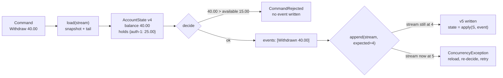

# Event Sourcing: State as a Fold Over Events

> An account is the sum of its events; a balance is a cache.

**Type:** Build
**Languages:** Java, Python
**Prerequisites:** Phase 8, Lesson 01 (The Append-Only Log), Phase 8, Lesson 04 (Message Ordering and Keys), Phase 10, Lesson 01 (Representing Money)
**Time:** ~120 minutes

## Learning Objectives

- Express an account's state as a pure fold (`replay`) over an ordered list of past-tense events, and show that `replay(all) == replay(prefix).applyAll(suffix)`
- Separate `decide` (validate a command, emit events, may refuse) from `apply` (fold one event, can never refuse) and explain why business rules live only in the first
- Implement an event store whose append is conditional on an expected stream version, and demonstrate that two writers who both loaded version 4 cannot both succeed
- Add snapshots as a cache of a fold prefix and prove that loading from a snapshot yields the same state as a full replay
- Enforce the no-overdraft invariant against *available* funds (balance minus active holds) using integer-minor-unit `Money`

## The Problem

A wallet service stores one row per account: `account_id, balance_minor, currency, updated_at`. A customer disputes a 60.00 USD debit from three weeks ago. Support opens the account and sees a balance of 30.00 USD. The question is simple: what was the balance immediately before that debit, and was the debit authorised against enough funds? The row cannot answer. It holds the present and nothing else. Someone writes a query against the transactions table, discovers that holds (temporary authorisations) were never recorded there because they "do not move money", and spends two days reconstructing a sequence that the system once knew exactly and then overwrote.

The same service has a second problem that shows up as a support ticket titled "balance went negative". Two requests for the same account arrive 3 ms apart: a withdrawal of 40.00 USD and a release of a 25.00 USD hold. Both handlers read the row (balance 40.00, held 25.00, available 15.00). The release handler writes `held = 0`. The withdrawal handler, which read the old row, checks `40.00 <= available`, sees 15.00, rejects. Fine. Now swap the arrival order by a few milliseconds: the withdrawal handler reads `available = 40.00` after the release has committed, approves, and writes `balance = 0.00`. Meanwhile a third request, a new 30.00 hold that read the row before the withdrawal, writes `held = 30.00`. The row now says balance 0.00, held 30.00, available −30.00. Nobody wrote a negative number. The lost-update race wrote it for them, because each handler overwrote a row it had read a few milliseconds earlier without checking that it was still the row it had read.

Both failures share a root cause: the system stores *derived* state as if it were the source of truth. The balance is the result of applying every deposit, withdrawal, hold, and release in order. If you store the events and derive the balance, the first question is a replay to a point in time, and the second is a version check on append: a writer that loaded the stream at version 4 may only append if the stream is still at version 4. This lesson builds that: events as the record, state as a fold, commands validated against the fold, and an event store that refuses stale writers.

## The Concept

### Events, commands, and the fold

Three vocabularies that are easy to blur:

| Word | Tense | Can be refused? | Example |
|------|-------|-----------------|---------|
| Command | imperative | yes, by `decide` | `Withdraw 60.00 USD` |
| Event | past | no; it happened | `Withdrawn 60.00 USD` |
| State | present | n/a; it is derived | balance 40.00, holds {auth-1: 25.00} |

An event is a fact. Once written, it is never validated again, never edited, never deleted. A command is a request; the aggregate checks it against the current state and either emits one or more events or refuses with a reason. State is whatever you get by folding the events in order from an empty start:

```text
state_0 = empty
state_n = apply(state_{n-1}, event_n)
replay(events) = fold(apply, empty, events)
```

`apply` is total: it handles every event type and has no branch that can fail on a well-formed stream. If `apply` could reject an event, the stream would contain a fact that the system refuses to believe, and no replay could finish. All the judgement lives in `decide`, which runs once, before the event is written.

### The invariant

The aggregate promises: **for every prefix of the stream, `available = balance − Σ active holds ≥ 0`.** Equivalently, no withdrawal or hold is ever written that would take available funds below zero at the moment it is written. This is enforced in `decide`, not in `apply`, and it is enforced against *available*, not balance, because a hold is a promise to a merchant that the funds will be there at capture time. A withdrawal that ignores holds is how the row in The Problem went to −30.00.

Two more promises that make the first one hold under concurrency:

1. **Append is conditional.** `append(stream, expectedVersion, events)` succeeds only if the stream has exactly `expectedVersion` events. The check and the write are one step.
2. **The decision is made against the version it is appended after.** `handle` loads the state, records its version, decides, and appends at that version. If anyone else appended in between, the append fails and the decision is discarded, because it was made against stale facts.



### Worked example by hand

Account `acct-42`, USD. Each line is one event; the state columns are what `replay` produces after it.

| v | Event | balance | holds | available |
|---|-------|---------|-------|-----------|
| 1 | `Opened(acct-42, USD)` | 0.00 | {} | 0.00 |
| 2 | `Deposited(100.00)` | 100.00 | {} | 100.00 |
| 3 | `Held(auth-1, 25.00)` | 100.00 | {auth-1: 25.00} | 75.00 |
| 4 | `Withdrawn(60.00)` | 40.00 | {auth-1: 25.00} | 15.00 |

Now two writers both load version 4.

- Writer A decides `ReleaseHold(auth-1)`: the hold exists, so it emits `Released(auth-1)` and appends at expected version 4. The stream is at 4, the append succeeds, the stream is now at version 5 and available is 40.00.
- Writer B wants `Withdraw(40.00)` and still believes the stream is at version 4. In the demo it calls `handle(acct, Withdraw(40.00), expectedVersion = 4)` after A has written v5. The service loads the current state, sees version 5, compares it with the expected 4, and throws `ConcurrencyException` before `decide` is even called. B reloads (v5, available 40.00), decides again (now valid), and appends at 5. Same command, fresh facts, version 6, balance 0.00.
- Had B decided against the v4 state it loaded, the withdrawal would have been refused outright (40.00 > available 15.00), which is also correct. The point of the version check is the interleavings where the two decisions differ.

Why does the version check matter when a stale decision might happen to agree with the fresh one? Because it does not always agree. If A had placed a *new* 20.00 hold instead of releasing one, a withdrawal that was valid at v4 (say 10.00 against available 15.00) would be invalid at v5 (available −5.00 after both). Without the check, B would write `Withdrawn(10.00)` on top of a hold it never saw, and the stream would contain a prefix where available is negative. The version check turns "I decided against the facts as of v4" into a condition on the write.

### Snapshots are a cache

Replaying 9 events is free. Replaying 9 million, for an account that has been active for a decade, is not: every load would be O(n) in the stream length. A snapshot is the fold result at version k, stored beside the stream. Loading becomes: read the latest snapshot (state at k), read events with version > k, fold those. The cost is O(n − k).

Snapshots never change the answer. `load` from a snapshot at version 8 plus one tail event must equal `replay` of all 9 events; the test and the demo both check this. If a snapshot is lost, corrupt, or taken with an old version of `apply`, you delete it and replay from zero; you lose time, never correctness. This is why the event stream, not the snapshot, is the system of record, and why a schema change to `AccountState` is handled by invalidating snapshots rather than migrating them.

The policy in this lesson is "snapshot every N events": after an append carries the version across a multiple of N, save. Production systems also snapshot on a timer or when load time exceeds a threshold; the mechanism is the same.

### Complexity

| Operation | Cost | Notes |
|-----------|------|-------|
| `apply` | O(h) | h = number of active holds, because the holds map is copied for immutability; O(1) for deposits and withdrawals |
| `replay(n events)` | O(n · h) | linear in stream length |
| `load` with snapshot at k | O((n − k) · h) | bounded by the snapshot interval N once snapshots exist |
| `append` | O(1) + the version comparison | the comparison is the entire concurrency mechanism |
| `decide` | O(h) | `available()` sums the holds |

### What this lesson does not do

- It does not build the **read side**. A customer-facing balance query should hit a projection (a table updated by consuming the stream), not replay the aggregate. That is Lesson 06 (CQRS and Projections).
- It does not **persist** the store. `EventStore` is in memory. Lesson 01's append-only log is the durable version: one partition per stream, the version is the offset plus one, and the expected-version check becomes a compare-and-append on the partition's end offset.
- It does not handle **cross-aggregate** transactions. A transfer between two accounts is two streams and therefore two appends with no atomicity between them; Phase 7's sagas are how you get there.
- It does not **upcast** old event schemas. Adding a field to `Withdrawn` in year three means `apply` must read both shapes forever, or you write an upcaster that translates on read. Lesson 11 covers schema evolution.

## Build It

The primary walkthrough is in Java. Python and Go implement the same design with the same names; the subsections at the end show only what differs. `Money` and `Currency` are copied from Phase 10, Lesson 01, trimmed to what this lesson needs.

### Step 1: Events and commands as closed sets

```java
sealed interface Event permits Opened, Deposited, Withdrawn, Held, Released {}

record Opened(String accountId, Currency currency) implements Event {}
record Deposited(Money amount) implements Event {}
record Withdrawn(Money amount) implements Event {}
record Held(String holdId, Money amount) implements Event {}
record Released(String holdId) implements Event {}

sealed interface Command permits OpenAccount, Deposit, Withdraw, PlaceHold, ReleaseHold {}

record OpenAccount(String accountId, Currency currency) implements Command {}
record Deposit(Money amount) implements Command {}
record Withdraw(Money amount) implements Command {}
record PlaceHold(String holdId, Money amount) implements Command {}
record ReleaseHold(String holdId) implements Command {}
```

Sealed interfaces make the sets closed, so a `switch` over them is exhaustive and the compiler refuses an `apply` that forgets a case. Records make events immutable with value equality, which the fold-equivalence test relies on. Note what is *not* here: no `version` field on the event, no `timestamp`, no `accountId` on `Deposited`. The stream supplies the version and identity; the event carries only what happened.

**Predict:** if you add a sixth event type `Frozen` and forget to handle it in `apply`, what happens at compile time, and why is that preferable to a runtime default branch?

### Step 2: The state and the fold step

```java
record AccountState(String accountId, Currency currency, Money balance, Map<String, Money> holds, long version) {

    static AccountState empty() { return new AccountState(null, null, null, Map.of(), 0); }

    Money available() {
        Money held = Money.zero(currency);
        for (Money m : holds.values()) held = held.plus(m);
        return balance.minus(held);
    }

    AccountState apply(Event event) {
        long next = version + 1;
        return switch (event) {
            case Opened e -> new AccountState(e.accountId(), e.currency(), Money.zero(e.currency()), Map.of(), next);
            case Deposited e -> new AccountState(accountId, currency, balance.plus(e.amount()), holds, next);
            case Withdrawn e -> new AccountState(accountId, currency, balance.minus(e.amount()), holds, next);
            case Held e -> {
                Map<String, Money> h = new LinkedHashMap<>(holds);
                h.put(e.holdId(), e.amount());
                yield new AccountState(accountId, currency, balance, Collections.unmodifiableMap(h), next);
            }
            case Released e -> {
                Map<String, Money> h = new LinkedHashMap<>(holds);
                h.remove(e.holdId());
                yield new AccountState(accountId, currency, balance, Collections.unmodifiableMap(h), next);
            }
        };
    }

    static AccountState replay(List<Event> events) { return empty().applyAll(events); }
}
```

Every branch returns a new state with `version + 1`; nothing is mutated, so a state loaded by one writer cannot be changed under another. `Released` touches only the holds map: the balance never moved when the hold was placed, so it does not move when the hold is released. The `version` on the state is the number of events folded, which is exactly what the store will compare against on append.

**Predict:** `replay([Opened, Deposited 100, Held 25, Withdrawn 60]).available()` is 15.00. What does `replay` of the same list with `Held` and `Withdrawn` swapped give, and does `apply` care about the order?

### Step 3: Decide, where the rules live

```java
List<Event> decide(Command command) {
    return switch (command) {
        case OpenAccount c -> {
            if (isOpen()) throw new CommandRejectedException("account " + accountId + " is already open");
            yield List.of(new Opened(c.accountId(), c.currency()));
        }
        case Withdraw c -> {
            requireOpen();
            requirePositiveSameCurrency(c.amount());
            if (c.amount().compareTo(available()) > 0) {
                throw new CommandRejectedException("insufficient available funds: " + available() + " < " + c.amount());
            }
            yield List.of(new Withdrawn(c.amount()));
        }
        case PlaceHold c -> {
            requireOpen();
            requirePositiveSameCurrency(c.amount());
            if (holds.containsKey(c.holdId())) throw new CommandRejectedException("hold " + c.holdId() + " already exists");
            if (c.amount().compareTo(available()) > 0) {
                throw new CommandRejectedException("insufficient available funds for hold: " + available() + " < " + c.amount());
            }
            yield List.of(new Held(c.holdId(), c.amount()));
        }
        // Deposit and ReleaseHold: see Main.java
    };
}
```

`decide` returns a list, not a single event, because some commands legitimately produce several (a `Capture` in a later lesson would emit `Released` and `Withdrawn` together). It reads state and returns facts; it never writes. The overdraft check compares against `available()`, and it rejects a `PlaceHold` the same way it rejects a `Withdraw`, because a hold is a commitment. Duplicate hold ids are rejected so that a retried authorisation does not double-reserve; this is the idempotency key for holds.

**Predict:** `decide` is called twice on the same state with the same command. Does the second call see any effect of the first?

### Step 4: The event store with conditional append

```java
final class EventStore {
    private final Map<String, List<StoredEvent>> streams = new HashMap<>();

    long version(String streamId) { return streams.getOrDefault(streamId, List.of()).size(); }

    long append(String streamId, long expectedVersion, List<Event> events) {
        List<StoredEvent> stream = streams.computeIfAbsent(streamId, k -> new ArrayList<>());
        if (stream.size() != expectedVersion) throw new ConcurrencyException(streamId, expectedVersion, stream.size());
        for (Event e : events) stream.add(new StoredEvent(stream.size() + 1, e));
        return stream.size();
    }

    List<Event> read(String streamId, long afterVersion) {
        List<Event> out = new ArrayList<>();
        for (StoredEvent s : streams.getOrDefault(streamId, List.of())) {
            if (s.version() > afterVersion) out.add(s.event());
        }
        return out;
    }
}
```

The whole of optimistic concurrency is the one `if`. In a single-threaded in-memory store the check and the appends are trivially atomic; in a database this is `INSERT ... WHERE (SELECT max(version) FROM events WHERE stream = ?) = ?` inside one transaction, or a unique constraint on `(stream_id, version)` that makes the second writer's insert fail. In Lesson 01's log it is a compare-and-append on the partition's end offset. The shape is always the same: the writer names the version it decided against, and the store refuses if that is no longer the end.

`read(streamId, afterVersion)` is the primitive snapshots need: "give me everything after version k".

**Predict:** two threads call `append("acct", 4, …)` at the same instant on a store with a mutex around `append`. How many succeed, and what does the loser see?

### Step 5: Snapshots and the service

```java
AccountState load(String streamId) {
    Optional<Snapshot> snap = snapshots.load(streamId);
    AccountState base = snap.map(Snapshot::state).orElse(AccountState.empty());
    List<Event> tail = events.read(streamId, base.version());
    eventsReplayedOnLastLoad = tail.size();
    return base.applyAll(tail);
}

AccountState handle(String streamId, Command command, long expectedVersion) {
    AccountState current = load(streamId);
    if (current.version() != expectedVersion) throw new ConcurrencyException(streamId, expectedVersion, current.version());
    List<Event> produced = current.decide(command);
    long newVersion = events.append(streamId, expectedVersion, produced);
    AccountState next = current.applyAll(produced);
    if (newVersion / snapshotEvery > expectedVersion / snapshotEvery) snapshots.save(streamId, next);
    return next;
}
```

`load` is "snapshot plus tail". `handle` is the full command cycle: load, check the caller's expected version, decide, append at that version, fold the new events onto the state you already have (no reload needed: `current.applyAll(produced)` is exactly what a reload would compute), and snapshot when a multiple of `snapshotEvery` has been crossed. The integer-division trick `newVersion / N > expectedVersion / N` is true exactly when the append crossed a multiple of N, even if it appended several events at once.

The service checks the expected version *before* `decide` as well as inside `append`. The first check saves the work of deciding against known-stale state; the second is the one that matters for correctness.

**Predict:** `snapshotEvery = 4`, stream at version 7, `handle` appends two events. Is a snapshot written, and at which version?

### Step 6: Run it

```bash
cd phases/08-messaging-and-streams/05-event-sourcing/code/java
javac -d .out *.java && java -cp .out Main
java -cp .out MainTest
```

Expected output, abbreviated:

```console
== Commands become events; state is the fold ==
opened                 v1 balance 0.00 USD available 0.00 USD holds []
deposited 100.00       v2 balance 100.00 USD available 100.00 USD holds []
held 25.00 for auth-1  v3 balance 100.00 USD available 75.00 USD holds [auth-1]
withdrew 60.00         v4 balance 40.00 USD available 15.00 USD holds [auth-1]

== Rejected commands produce no events ==
withdraw 20.00 rejected: insufficient available funds: 15.00 USD < 20.00 USD (version still 4)

== Optimistic concurrency: two writers load version 4 ==
writer A released auth-1 at expected version 4 -> version 5, available 40.00 USD
writer B withdraw 40.00 at expected version 4 rejected: stream acct-42: expected version 4 but found 5
writer B reloaded and retried -> version 6, balance 0.00 USD

== Snapshots: every 4 events, load folds only the tail ==
after 8 events: snapshot writes = 2, latest snapshot version = 8
load at version 9 replayed 1 event(s) on top of the snapshot; balance 30.00 USD
full replay from version 0 gives the same state: true
```

The line to keep is the last one. It is the test that snapshots are a cache and not a second source of truth.

### In Python

```python
def apply(self, event: Event) -> "AccountState":
    nxt = self.version + 1
    match event:
        case Opened(account_id, currency):
            return AccountState(account_id, currency, Money.zero(currency), MappingProxyType({}), nxt)
        case Held(hold_id, amount):
            holds = dict(self.holds)
            holds[hold_id] = amount
            return AccountState(self.account_id, self.currency, self.balance, MappingProxyType(holds), nxt)
        ...
    raise TypeError(f"unknown event {event!r}")
```

Differences, all in `code/python/main.py`:

- **Closed sets are a union type, not a sealed interface.** `Event = Opened | Deposited | ...` documents the set, and `match` with class patterns destructures each case, but nothing stops a caller passing a stranger. The trailing `raise TypeError` is the runtime stand-in for the exhaustiveness check Java gets at compile time.
- **Immutability is `frozen=True` plus `MappingProxyType`.** A frozen dataclass stops attribute assignment but a plain `dict` field is still mutable; wrapping holds in a `MappingProxyType` makes the view read-only. Equality still works because the proxy compares as its underlying mapping, which is what the snapshot-equals-replay test needs.
- **`handle` takes an optional expected version.** Python has no overloading, so `handle(stream, command, expected_version=None)` covers both Java methods; `None` means "the latest".
- **Exceptions are `CommandRejectedError` and `ConcurrencyError`**, both plain `Exception` subclasses, so a caller can catch the first and return a 4xx while letting the second drive a retry.

Run it from `code/python/` with `python3 main.py`; test with `python3 -m unittest -v`. The demo prints the same versions, balances, and snapshot counts as the Java run.

### In Go

```go
func (s AccountState) Decide(command Command) ([]Event, error) {
    switch c := command.(type) {
    case Withdraw:
        if err := s.requireOpen(); err != nil { return nil, err }
        if err := s.requirePositiveSameCurrency(c.Amount); err != nil { return nil, err }
        if c.Amount.Compare(s.Available()) > 0 {
            return nil, rejected("insufficient available funds: %s < %s", s.Available(), c.Amount)
        }
        return []Event{Withdrawn{c.Amount}}, nil
    ...
```

Differences, all in `code/go/main.go`:

- **Closed sets via an unexported marker method.** `type Event interface{ isEvent() }` with `func (Opened) isEvent() {}` on each type means only types in this package can be events. The type switch in `Apply` has a `default: panic`, because the compiler does not check exhaustiveness.
- **Errors are values.** `Decide`, `Append`, and `HandleAt` return `error`. Rejections wrap the sentinel `ErrCommandRejected` so callers use `errors.Is`; the concurrency failure is a `*ConcurrencyError` struct carrying expected and actual versions, matched with `errors.As`. Currency mismatch wraps `ErrCurrencyMismatch`.
- **Immutability is by convention.** `AccountState` is passed by value, but a Go map is a reference, so `Apply` copies the holds map (`copyHolds`) before changing it. Forgetting this copy is the Go-specific bug: two states that should be independent would share one map.
- **Maps have no order.** `HoldIDs()` sorts before printing so the demo output is deterministic; `Equal` compares states field by field because a struct containing a map is not comparable with `==`.
- **Overflow is checked by hand** in `addChecked`, as in the Money lesson; `apply` discards the error because events were validated before being written, and a well-formed stream cannot overflow.

## Use It

### EventStoreDB and the expected-version API

EventStoreDB (now KurrentDB) is a database built around exactly this model: streams of immutable events, `append` with an `expectedRevision` that may be a number, `NoStream`, `StreamExists`, or `Any`, and a `WrongExpectedVersion` error that is the production name for this lesson's `ConcurrencyException`. Its "$all" stream and category projections are what Lesson 06 will build. What it does for you: durable append, subscriptions, and a dedicated snapshot pattern. What it does not do: decide anything. `decide` is still your code.

### Kafka as an event store

A compacted or retained Kafka topic with the account id as the key is the Lesson 01 log used as an event store: one partition's offsets are the versions, and key-based partitioning (Lesson 04) keeps every event for one account in one ordered stream. What is missing is the conditional append: Kafka's producer has no `expectedOffset`. Teams either accept a single writer per partition (one consumer group member owns the key range and therefore serialises commands for it) or put the version check in a database that fronts the topic. Knowing which of those you have chosen is the difference between a design that holds the invariant and one that only usually does.

### Relational databases

The most common production event store is a table: `(stream_id, version, type, payload, recorded_at)` with a primary key on `(stream_id, version)`. The writer inserts rows at `expected + 1 .. expected + n`; the unique constraint makes the second writer's insert fail with a duplicate-key error, which the service translates into a retry. Snapshots are a second table keyed by stream with a `version` column. PostgreSQL's `INSERT ... ON CONFLICT DO NOTHING` plus a row-count check is one idiom; a `SELECT ... FOR UPDATE` on a stream header row is another, at the cost of a lock.

### The trap

Event sourcing is routinely blamed for problems that are actually missing projections (Lesson 06), missing upcasters (Lesson 11), or a decision to replay the aggregate on every read. The aggregate's `load` is for *writing*. If a dashboard replays the fold, the first customer with a ten-year history makes the page time out, and someone proposes abandoning the whole architecture. The fix was a read model all along.

## Ship It

`outputs/design-doc-event-sourced-aggregate.md` is a one-page design-review template for proposing an event-sourced aggregate: the event list with tense check, the invariants `decide` enforces, the expected-version strategy of the chosen store, the snapshot policy, and the questions a reviewer should ask about replay cost and schema evolution. Fill it in before the first line of code; most of the later pain comes from an event that should have been two, or a rule that ended up in `apply`.

## Exercises

1. **Reinforce.** Add a `Capture(holdId)` command that emits two events, `Released(holdId)` and `Withdrawn(amount)`, where the amount is the held amount. Write the test that captures with available funds of zero (balance exactly equal to the hold) and confirm it succeeds, because a capture spends funds that were already reserved.
2. **Apply.** Implement `stateAt(streamId, version)` in the service: the state as of a historical version, for the dispute in The Problem. Use the snapshot only when its version is at or below the requested one; otherwise replay from zero. Test it against every version of the demo stream.
3. **Extend.** Replace `EventStore` with the segmented log from Phase 8, Lesson 01: one partition per account, `version = endOffset`, and `append` implemented as compare-and-append on the end offset. Then run two writers in two threads (or goroutines, under `go test -race`) issuing interleaved commands against the same account and assert that the final replay has no prefix with negative available funds.

## Key Terms

| Term | What people say | What it actually means |
|------|-----------------|------------------------|
| Event sourcing | "store the events" | Treating the ordered, immutable event stream as the system of record and deriving every piece of current state by folding over it |
| Aggregate | "the domain object" | The unit of consistency: one stream, one version counter, one `decide` that sees the whole state before emitting events |
| Fold / replay | "rebuild the state" | `fold(apply, empty, events)`: a pure, total function from a prefix of the stream to a state; `replay(all) == replay(prefix).applyAll(suffix)` |
| Command vs event | "the request and the record" | A command is imperative and may be refused; an event is past tense, already true, and never validated again |
| Expected version | "optimistic locking" | The stream length the writer decided against; the store appends only if that is still the length, so stale decisions are rejected instead of overwriting newer facts |
| Snapshot | "a checkpoint" | A cached fold result at version k, used to make `load` cost O(n − k); deletable at any time without loss of correctness |
| Available balance | "the balance" | Ledger balance minus active holds; the quantity the no-overdraft invariant is actually about |
| Projection | "the read model" | A separate store updated by consuming events, used for queries so the aggregate is never replayed to answer one (Lesson 06) |

## Further Reading

- [Fowler, "Event Sourcing" (2005)](https://martinfowler.com/eaaDev/EventSourcing.html) — the original pattern description, including the distinction between retroactive events and the rebuild-from-log test.
- [Young, "CQRS Documents" (2010)](https://cqrs.files.wordpress.com/2010/11/cqrs_documents.pdf) — the expected-version append and the command/event vocabulary, from the person who named CQRS.
- [KurrentDB (EventStoreDB) docs: appending events and expected revision](https://docs.kurrent.io/clients/grpc/appending-events.html) — a production API whose `WrongExpectedVersion` is this lesson's `ConcurrencyException`.
- [Vernon, *Implementing Domain-Driven Design*, chapter on Aggregates](https://www.informit.com/store/implementing-domain-driven-design-9780321834577) — the rules for sizing an aggregate so that one stream's invariants are enforceable with one version check.
- [Kleppmann, *Designing Data-Intensive Applications*, chapter 11 "Stream Processing"](https://dataintensive.net/) — event sourcing placed beside change data capture and the log, with the immutability and replay arguments made precisely.
- [Helland, "Immutability Changes Everything" (CIDR 2015)](https://www.cidrdb.org/cidr2015/Papers/CIDR15_Paper16.pdf) — why append-only facts plus derived views is the shape so many systems converge on.
