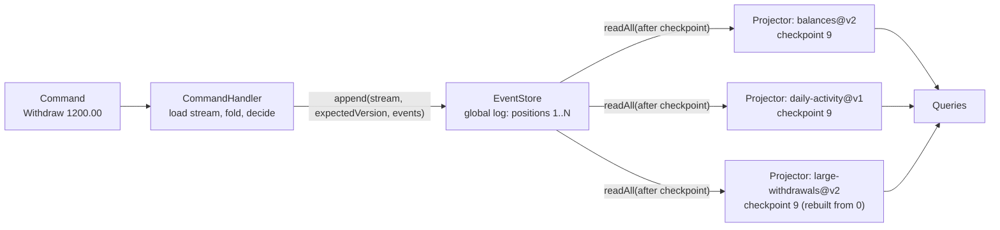

# CQRS and Projections

> Rebuild a read model from the log in one command.

**Type:** Build
**Languages:** Java, Python
**Prerequisites:** Phase 8, Lesson 01 (The Append-Only Log), Phase 8, Lesson 03 (Delivery Guarantees), Phase 8, Lesson 05 (Event Sourcing)
**Time:** ~75 minutes

## Learning Objectives

- Separate a command model that validates and appends events from read models that fold the global event log into query-shaped state, and explain what each side may and may not know
- Build a projector that reads from a per-projection checkpoint, applies events in global position order, and saves the checkpoint, and show why the apply step must be idempotent
- Version a projection, rebuild the new version from position 0 while the old one stays live, and promote it only when it has caught up with the log
- Measure the eventual-consistency window between a write and its visibility in a read model as a function of polling interval and projector throughput
- Implement read-your-own-writes on top of an eventually consistent read model by waiting for the projection to reach the write's position

## The Problem

A wallet service keeps one `accounts` table: id, owner, currency, balance, updated_at. The write path is `UPDATE accounts SET balance = balance - ? WHERE id = ? AND balance >= ?`. Then the product team asks for a daily activity screen (deposits and withdrawals per day), compliance asks for a list of every withdrawal above 1000.00 USD with the owner's name, and finance asks for a month-end balance as of midnight on the last day. Each request adds a table and a trigger or a second write in the same transaction: `daily_activity`, `large_withdrawals`, `balance_snapshots`. Each write now updates four tables; the transaction grows, lock time grows, and p99 withdrawal latency doubles. Then compliance changes the threshold from 1000.00 to 500.00. The `large_withdrawals` table has rows only for amounts that were over 1000.00 when they happened. The data to fill in the gap exists nowhere: the `accounts` table holds only the current balance, and the old withdrawals are gone. Someone writes a script against the card processor's monthly files. It takes two weeks.

The second failure is a bug in the daily-activity trigger discovered after three months in production: withdrawals that were reversed the same day were counted twice. Fixing the trigger fixes new rows. The three months of wrong rows have to be corrected by hand, because the trigger's inputs were consumed and discarded. Nobody is confident the correction is right, because there is nothing to check it against.

Both failures have the same cause: the system's one durable record is a derived value, the current state, and every other view was computed from inputs that were thrown away. Lesson 05 fixed the first half by making the event log the record and deriving the account's state by folding it. This lesson finishes the job. The write side (commands) validates against the fold and appends events; the read side (projections) folds the same log into as many shapes as there are questions, each with its own checkpoint, each rebuildable from position 0 when the question changes or the code was wrong. The cost is that a read model is behind the log by some window, and the second half of the lesson is about measuring and managing that window.

## The Concept

### Two models, one log

Command Query Responsibility Segregation says only this: the model you validate writes against and the model you answer reads from are different objects, and they may have different shapes. Event sourcing makes the separation natural because the write model is a fold of a stream and the read model is a fold of the log; the log is the thing both agree on.



| | Write model (`AccountState`) | Read model (a `Projection`) |
|---|---|---|
| Built from | One stream, every time a command arrives | The global log, incrementally from a checkpoint |
| Contains | Exactly what is needed to validate: currency, balance, version | Whatever a query needs: owner names, daily totals, alert lists |
| Consistency | Strong: the append checks the version it loaded | Eventual: behind the log by the polling window |
| Number of them | One per aggregate type | One per question; add and remove freely |
| When wrong | Fix the decide function; past events are still facts | Fix the apply function, bump the version, rebuild from 0 |
| Knows about | Only its own stream | Any stream, in global order; joins across streams are natural |

The write model in this lesson is deliberately poorer than Lesson 05's: `AccountState` has no owner name, because no command needs it to decide. The read models carry the owner, because the compliance screen does. That asymmetry is the point. Putting the owner in `AccountState` "in case" is how write models grow into the one-table-for-everything that the Problem section started with.

### The global log and positions

Lesson 05's `EventStore` kept a version per stream and a list of everything. Here the list gets a number: every appended event receives a dense, 1-based **global position** across all streams, in addition to its version within its stream. Positions are what projections checkpoint, because a projection that joins two accounts' events must see them in one order, and stream versions do not provide one. Kafka's analogue is the partition offset; EventStoreDB calls this stream `$all` and the position a commit position.

The read side has exactly one entry point: `readAll(afterPosition, max)`. It never reads a stream directly. That constraint is what lets the store be replaced by a partitioned log later: the projector would subscribe to partitions and checkpoint per partition, and nothing above it changes.

### The projector loop and the checkpoint

A projector does three things forever: read a batch after its checkpoint, apply each event to its projection, save the new checkpoint. The checkpoint is keyed by `(name, version)` so that two versions of one projection can run side by side.

The order of the last two steps is a choice with consequences:

| Order | Crash between the steps | Projection sees |
|-------|-------------------------|-----------------|
| Apply, then save checkpoint | Checkpoint is old; the batch is applied again on restart | Every event at least once |
| Save checkpoint, then apply | Checkpoint is new; the batch is never applied | Some events never |

Never is unrecoverable without a rebuild; at least once is recoverable if `apply` is idempotent. So the projector applies first, and the projection must tolerate redelivery. In a relational store the standard way to get both is to update the view and the checkpoint row in one transaction; where that is not possible (the view is in a search index, a cache, a file), the projection remembers the last position it applied per row and ignores anything at or below it. `IdempotentBalanceView` does exactly that with an `appliedThrough` map; `BalanceView` does not, and the demo shows what happens.

### Worked example by hand

Nine events in the global log, two accounts:

```text
pos 1  acct-alice v1  AccountOpened(owner=Alice Ng, USD)
pos 2  acct-bob   v1  AccountOpened(owner=Bob Osei, USD)
pos 3  acct-alice v2  Deposited(2500.00, payroll-oct)
pos 4  acct-bob   v2  Deposited(800.00, refund-4471)
pos 5  acct-alice v3  Withdrawn(1200.00, rent)            (one hour later, same day)
pos 6  acct-bob   v3  Withdrawn(600.00, card-9921)
pos 7  acct-alice v4  Withdrawn(750.00, tuition)          (next day)
pos 8  acct-bob   v4  Deposited(150.00, cashback)
pos 9  acct-alice v5  Deposited(50.00, interest)
```

Fold them into three shapes:

```text
balances@v2        alice: 0 +2500 -1200 -750 +50 = 600.00     bob: 0 +800 -600 +150 = 350.00
daily-activity@v1  day 19675: 2 deposits, 2 withdrawals, net +1500.00
                   day 19676: 2 deposits, 1 withdrawal,  net -550.00
large-withdrawals@v1 (>= 1000.00, no owner)   [pos 5: acct-alice 1200.00 rent]
large-withdrawals@v2 (>= 500.00, with owner)  [pos 5: Alice Ng 1200.00 rent] [pos 6: Bob Osei 600.00 card-9921] [pos 7: Alice Ng 750.00 tuition]
```

The v2 compliance view has three rows where v1 had one, and it needed the `AccountOpened` events to fill in the owner column. Neither fact was available to the trigger-based design in the Problem section after the fact; both fall out of a replay here.

Now the crash. A projector for `balances` with batch size 4 has checkpointed position 4. It applies positions 5 and 6 and dies before saving. On restart it reads from 4 again and applies 5 and 6 a second time. The naive view computes `alice = 2500 - 1200 - 1200 - 750 + 50 = -600.00` and `bob = 800 - 600 - 600 + 150 = -250.00`. The idempotent view sees position 5 arrive when `appliedThrough[acct-alice]` is already 5, skips it, skips 6 for the same reason, and ends at the correct `600.00` and `350.00`. Two skipped events, two correct balances.

### Versioning and rebuilding

A projection's code is part of its definition. Change the threshold, add a column, fix a bug, and the existing rows are wrong, not merely stale. The fix is never to patch rows in place; it is to bump the version, run the new version from position 0 beside the old one, and switch queries over when the new one has caught up. The old version's checkpoint and rows are left alone until the switch is confirmed, so a rollback is a pointer change.

```text
register large-withdrawals@v2    checkpoint(v2) = 0, live = v1
runOnce: v2 applies 1..4          checkpoint(v2) = 4, lag 5 -> promote refused
catchUp: v2 applies 5..9          checkpoint(v2) = 9, lag 0 -> promote succeeds, live = v2, v1 retired
```

`ReadSide.promote` refuses while the new version is behind, which is the one rule that keeps a half-built view from answering a query. How long the rebuild takes is the log's length divided by the projector's throughput, and it is the number that decides whether a projection can be rebuilt on a Tuesday afternoon or needs a weekend. A log of one billion events at 50,000 events per second rebuilds in under six hours; the exercises ask you to make it faster with snapshots.

### The eventual-consistency window

A projection is behind the log by the time between an event's append and the projector's next successful run that includes it. With a projector that polls every `T` milliseconds and keeps up, an event's staleness is uniform on `[0, T]`: mean `T/2`, maximum `T`. The demo measures it: 200 deposits, one every 7 ms, projector polling every 50 ms gives `mean = 24, max = 50`; every 10 ms gives `mean = 4, max = 10`; every 1 ms gives `max = 1`.

That is the keeping-up case. If the projector processes fewer events per poll than arrive per poll, the window is not bounded by `T` at all; it grows linearly with time until the producer stops. The demo's last probe polls every 10 ms with a batch size of 1 against a producer emitting one event every 7 ms and reaches a maximum staleness of 607 ms after 200 events; after 2000 events it would be ten times that. The lag of a projector (`store.lastPosition() - checkpoint`) is the one metric to alarm on; the polling interval only sets the floor.

### Read-your-own-writes

A client that withdraws and then immediately fetches its balance from the projection may see the old balance: in the demo, position 9 is written, the projection is at 8, and the read returns `550.00` when the truth is `600.00`. Three remedies, in increasing order of cost:

1. Return the new state from the command handler itself, since it has just computed it. No read needed.
2. The command returns the global position it wrote; the client passes that position with its read, and the read side waits until the projection's checkpoint is at least that position (`ReadSide.waitFor`). This is the pattern behind "read after write" tokens in Kafka Streams' interactive queries and in EventStoreDB's `$all` position.
3. Route that one client's reads to the write model for a few seconds after a write. Expensive and leaky; a last resort.

### Query or command? A decision procedure

The question that decides which side a piece of logic lives on is: **if this answer is a few hundred milliseconds stale, does money move wrongly?**

| Need | Stale answer is... | Side | Mechanism |
|------|--------------------|------|-----------|
| Approve a withdrawal | Wrong: an overdraft | Write | `decide` against the stream fold, expected-version append |
| Show the balance on the app's home screen | Acceptable, with read-your-own-writes after a transfer | Read | `balances` projection plus `waitFor` |
| Daily activity screen | Acceptable | Read | `daily-activity` projection |
| Compliance alert list | Acceptable, but rebuilt when the rule changes | Read, versioned | `large-withdrawals@vN` |
| Reject a duplicate reference number | Wrong: a double post | Write | A uniqueness check in `decide`, or a reservation stream |
| Month-end regulatory report | Acceptable; must be reproducible | Read, rebuilt on demand | Exercise 1 |

Costs follow from the table. The write side pays a stream read and fold per command, `O(events in the stream)` without snapshots, which is why Lesson 05 introduced them. The read side pays `O(1)` per event per projection on the hot path, and `O(log length)` for a rebuild. Adding a projection costs nothing on the write path; adding a check to `decide` costs every command.

### What this lesson does not do

- It does not make the read side strongly consistent. Every query answered by a projection is answered as of its checkpoint. If a query must be exactly current (an authorization decision), it is a command, not a query, and it goes through the write model.
- It does not run projectors concurrently. One projector per projection, in position order; parallelising a projection is Lesson 04's lanes applied to projections, with the same commit discipline.
- It does not snapshot projections. A rebuild starts at 0 every time. Lesson 05's snapshot store applies to projections too and is Exercise 2.
- It does not delete old versions. `ReadSide.promote` returns the retired projector and leaves its checkpoint in place; dropping its rows is an operational step this lesson leaves to the runbook in `outputs/`.

## Build It

The implementation is `code/java/Main.java`; tests are `MainTest.java`. The write side reuses Lesson 05's shape, cut down to what this lesson needs; the read side is new.

### Step 1: The write model knows only what it needs to decide

```java
record AccountState(String accountId, Currency currency, Money balance, long version) {
    static final AccountState EMPTY = new AccountState(null, null, null, 0);

    List<Event> decide(Command command) {
        return switch (command) {
            case OpenAccount c -> {
                if (exists()) throw new CommandRejectedException("account " + c.accountId() + " already open");
                yield List.of(new AccountOpened(c.accountId(), c.owner(), c.currency()));
            }
            case Withdraw c -> {
                requireOpen();
                if (!c.amount().isPositive()) throw new CommandRejectedException("withdrawal must be positive");
                if (balance.compareTo(c.amount()) < 0) throw new CommandRejectedException("insufficient funds: ...");
                yield List.of(new Withdrawn(c.amount(), c.reference()));
            }
            ...
        };
    }
}
```

`decide` is pure: state and command in, events or an exception out. The owner's name passes through `OpenAccount` into `AccountOpened` without being stored in `AccountState`, because no later decision depends on it. `apply` (not shown) is Lesson 05's fold.

**Predict:** compliance asks for the owner's name to be checked against a sanctions list before each withdrawal. Does the owner now belong in `AccountState`? What else changes?

### Step 2: The store assigns global positions

```java
long append(String streamId, long expectedVersion, List<Event> events, long recordedAt) {
    List<EventEnvelope> stream = streams.computeIfAbsent(streamId, k -> new ArrayList<>());
    if (stream.size() != expectedVersion) throw new ConcurrencyException(streamId, expectedVersion, stream.size());
    for (Event e : events) {
        EventEnvelope env = new EventEnvelope(all.size() + 1, streamId, stream.size() + 1, recordedAt, e);
        stream.add(env);
        all.add(env);
    }
    return all.size();
}

List<EventEnvelope> readAll(long afterPosition, int max) {
    int from = (int) afterPosition;
    int to = Math.min(all.size(), from + Math.max(0, max));
    return new ArrayList<>(all.subList(from, to));
}
```

Each envelope carries both coordinates: `position` in the global log and `version` in its stream. `append` returns the position of the last event written, which is what `CommandHandler.handle` hands back to the caller for read-your-own-writes. `readAll(after, max)` is the whole read-side API: "give me up to `max` events after the one I last saw".

**Predict:** `recordedAt` comes from the command handler's clock, not the client's. Which of the three projections would give a different answer if it used a client-supplied timestamp instead, and why is that the wrong fix for a late-arriving event?

### Step 3: The projector loop

```java
int runOnce(long now) {
    List<EventEnvelope> batch = store.readAll(position(), batchSize);
    int applied = 0;
    for (EventEnvelope env : batch) {
        projection.apply(env);
        applied++;
        if (crashAfterApplies >= 0 && applied >= crashAfterApplies) {
            crashAfterApplies = -1;
            throw new CrashException("...died after applying " + applied + " events, before saving the checkpoint");
        }
    }
    if (!batch.isEmpty()) checkpoints.save(projection, batch.get(batch.size() - 1).position());
    return applied;
}
```

Read after the checkpoint, apply, save. The fault injector throws between apply and save, which is the only place a crash is interesting; a crash before apply or after save loses nothing. `CheckpointStore.save` refuses to move a checkpoint backwards, so a misbehaving projector cannot silently replay history. `catchUp` calls `runOnce` until `lag() == 0`.

**Predict:** the batch size is 1000 and the projector crashes after applying 999. How many events are redelivered on restart, and what does that imply about choosing the batch size for a projection whose `apply` is expensive but idempotent?

### Step 4: An idempotent projection

```java
final class IdempotentBalanceView extends BalanceView {
    private final Map<String, Long> appliedThrough = new HashMap<>();

    @Override
    public void apply(EventEnvelope env) {
        long seen = appliedThrough.getOrDefault(env.streamId(), 0L);
        if (env.position() <= seen) { skipped++; return; }
        super.apply(env);
        appliedThrough.put(env.streamId(), env.position());
    }
}
```

One extra column per row: the last position applied to it. Because positions are dense and the projector delivers in position order, "at or below what I have seen" is exactly "already applied". The guard is per stream here because the balances view is keyed by account; `DailyActivityView` keeps a single `appliedThrough` because it has one logical table. In SQL the same thing is `UPDATE balances SET balance = ?, applied_through = ? WHERE id = ? AND applied_through < ?`.

### Step 5: A projection that joins streams

```java
public void apply(EventEnvelope env) {
    if (env.position() <= appliedThrough) return;
    appliedThrough = env.position();
    switch (env.event()) {
        case AccountOpened e -> owners.put(e.accountId(), e.owner());
        case Withdrawn e -> {
            if (e.amount().compareTo(threshold) >= 0) {
                String owner = version >= 2 ? owners.getOrDefault(env.streamId(), "?") : null;
                alerts.add(new Alert(env.position(), env.streamId(), owner, e.amount(), e.reference()));
            }
        }
        case Deposited e -> { }
    }
}
```

`LargeWithdrawalsView` remembers owners from `AccountOpened` events and uses them when a `Withdrawn` qualifies. This is a join across streams, and it is only correct because the projector delivers the global log in position order: an account is always opened before it withdraws. The constructor takes the version and threshold, so v1 and v2 are the same class with different parameters; in production they would more often be two deployments of different code.

**Predict:** a v3 needs the owner's current name, and owners can be renamed by a new `OwnerRenamed` event. What changes in `apply`, and does v2's checkpoint help v3 at all?

### Step 6: Promotion only when caught up

```java
Projector promote(String name) {
    Projector next = building.get(name);
    if (next == null) throw new IllegalStateException("nothing is being built for " + name);
    if (!next.caughtUp()) throw new IllegalStateException(key(next.projection()) + " is " + next.lag() + " events behind; not promoting");
    Projector old = live.put(name, next);
    building.remove(name);
    return old;
}

boolean waitFor(String name, long position, long now, int maxRuns) {
    Projector p = live(name);
    for (int i = 0; i < maxRuns && p.position() < position; i++) p.runOnce(now);
    return p.position() >= position;
}
```

`ReadSide` holds one live projector per name and at most one being built. `promote` is the switch; `waitFor` is read-your-own-writes, bounded by `maxRuns` so a stalled projector turns into a timeout rather than a hang.

### Step 7: Measuring the window

```java
while (issued < commands || !projector.caughtUp()) {
    if (issued < commands && clock.now() >= nextCommand) {
        long pos = handler.handle("acct-probe", new Deposit(...));
        recordedAt.put(pos, clock.now());
        issued++;
        nextCommand += commandGapMillis;
    }
    if (clock.now() >= nextPoll) {
        long before = projector.position();
        projector.runOnce(clock.now());
        for (long p = before + 1; p <= projector.position(); p++) staleness.add(clock.now() - recordedAt.get(p));
        nextPoll += pollIntervalMillis;
    }
    clock.advance(1);
}
```

`ConsistencyProbe.run` is a one-millisecond-step simulation: commands fire on their schedule, the projector fires on its, and every event's staleness is the clock at the poll that applied it minus the clock at its append. Nothing sleeps; a 2000-event probe runs in milliseconds of real time.

### Step 8: Run it

```bash
cd phases/08-messaging-and-streams/06-cqrs-and-projections/code/java
javac -d .out *.java && java -cp .out Main
java -cp .out MainTest
```

Expected output, abbreviated:

```console
== 2. Read side: three projections fold the same log into three shapes ==
balances@v2            applied 8 events, checkpoint at position 8
daily-activity@v1      applied 8 events, checkpoint at position 8
large-withdrawals@v1   applied 8 events, checkpoint at position 8
balances: {acct-alice=550.00 USD, acct-bob=350.00 USD}
large withdrawals v1 (>= 1000.00): [Alert[position=5, accountId=acct-alice, owner=null, amount=1200.00 USD, reference=rent]]

== 3. New events arrive; projections are behind until they poll ==
wrote position 9; balances projection is at 8 (lag 1): a read now returns 550.00 USD
waitFor(position 9) -> true; a read now returns 600.00 USD

== 4. Projection versioning: rebuild v2 from position 0, promote when caught up ==
promote refused: large-withdrawals@v2 is 5 events behind; not promoting
promoted v2; retired v1 (its checkpoint stays at 8 until it is deleted)
  Alert[position=5, accountId=acct-alice, owner=Alice Ng, amount=1200.00 USD, reference=rent]
  Alert[position=6, accountId=acct-bob, owner=Bob Osei, amount=600.00 USD, reference=card-9921]
  Alert[position=7, accountId=acct-alice, owner=Alice Ng, amount=750.00 USD, reference=tuition]

== 5. Crash between apply and checkpoint: naive vs idempotent projection ==
BalanceView: projector for balances@v1 died after applying 2 events, before saving the checkpoint
  after restart: alice=-600.00 USD bob=-250.00 USD (truth: alice=600.00 USD bob=350.00 USD)
IdempotentBalanceView: projector for balances@v2 died after applying 2 events, before saving the checkpoint
  after restart: alice=600.00 USD bob=350.00 USD (truth: alice=600.00 USD bob=350.00 USD)

== 6. The eventual-consistency window, measured ==
200 commands every 7 ms, projector polls every 50 ms: staleness min=0 mean=24 max=50 ms over 200 events
200 commands every 7 ms, projector polls every 10 ms: staleness min=0 mean=4 max=10 ms over 200 events
200 commands every 7 ms, projector polls every  1 ms: staleness min=0 mean=0 max=1 ms over 200 events
same, polling every 10 ms but batchSize=1 (projector slower than the producer): staleness mean=308 max=607 ms
```

### In Python

```python
class IdempotentBalanceView(BalanceView):
    def apply(self, env: EventEnvelope) -> None:
        seen = self._applied_through.get(env.stream_id, 0)
        if env.position <= seen:
            self._skipped += 1
            return
        super().apply(env)
        self._applied_through[env.stream_id] = env.position
```

Differences, all in `code/python/main.py`:

- **Sealed interfaces are `Union` aliases plus `match`.** `Event = Union[AccountOpened, Deposited, Withdrawn]` documents the closed set and `match env.event: case Deposited(amount, _):` destructures it (frozen dataclasses provide `__match_args__`), but nothing stops a stranger at compile time; `apply` and `decide` end in `raise TypeError` as the runtime stand-in for Java's exhaustiveness check.
- **`TreeMap` and `LinkedHashMap` are `dict`.** `BalanceView.all()` and `DailyActivityView.all()` return `dict(sorted(...))` so the demo prints accounts and days in key order as Java's `TreeMap` does; `ReadSide` relies on insertion order, which `dict` already keeps. `CheckpointStore` is a `dict[str, int]` keyed by `"name@vN"`.
- **`Money` is `int` minor units** with a `TypeError` on `float`; subtraction cannot overflow, so there is no `subtractExact`.
- **Exceptions:** `CommandRejectedError`, `ConcurrencyError`, `CrashError`; `ValueError` where Java throws `IllegalArgumentException` (bad batch size, unknown live projection, `read_all` out of range) and `RuntimeError` where it throws `IllegalStateException` (promotion refused, checkpoint moving backwards). `Projector.last_run_at()` is `None` instead of `Long.MIN_VALUE` before the first run.

Run it from `code/python/` with `python3 main.py`; test with `python3 -m unittest -v`. The staleness table in section 6 (mean 24/4/0 ms, overloaded mean 308 max 607) matches the Java output because both are driven by the same SimClock, not by wall time.

### Porting notes

In Go, events are structs implementing a marker interface and `apply` uses a type switch; `decide` and `append` return `error` values (`ErrCommandRejected`, `ErrConcurrency`, `ErrCrash` as sentinels) instead of throwing, and `Projector.RunOnce` returns `(int, error)`. If the Go port runs projectors on goroutines, `CheckpointStore` and each projection need a `sync.Mutex`, and the tests must pass under `go test -race`; the Java version is single-threaded by design and needs none.

## Use It

### Event stores and their subscriptions

EventStoreDB (now KurrentDB) is the closest production counterpart: streams with expected-version appends, a `$all` stream ordered by commit position, and persistent subscriptions that checkpoint a position per subscription group. Its documentation's warning that `$all` subscribers must handle events "at least once" is this lesson's Step 3 and 4. Axon Framework's tracking event processors and Marten's async daemon (on PostgreSQL) are the same loop with the checkpoint in a table next to the projection, updated in the same transaction as the view, which is the relational way to make apply-then-checkpoint atomic.

### Kafka and stream processors

With Kafka as the log, a projection is a consumer group with one consumer per partition and a committed offset per partition; `lag()` is consumer lag, the metric every Kafka deployment alarms on. Kafka Streams materialises projections as state stores (RocksDB) backed by changelog topics, so a rebuild is a replay of the changelog rather than the source topic; its interactive queries expose the store directly and have no built-in read-your-own-writes, which is why the "return the position and wait for it" pattern from Step 6 shows up in applications built on it. Debezium plus a sink connector is the same architecture with a relational database's transaction log in place of an event store: change data capture (Phase 7, Lesson 11) turns any database into a producer of events that projections can fold.

### Materialised views and caches

A PostgreSQL `MATERIALIZED VIEW` is a projection with a single version and a rebuild command (`REFRESH MATERIALIZED VIEW`) that reads the whole source every time; it has no incremental checkpoint, which is why it is rebuilt on a schedule rather than continuously. A cache in front of a database is a projection whose rebuild is "evict and reload" and whose consistency window is the TTL. Seeing both as projections makes their failure modes predictable: a materialised view is stale by at most its refresh interval and never wrong; a cache populated by application code is wrong whenever a write path forgets to invalidate.

### The trap

The classic CQRS mistake is to treat the read model as authoritative for a decision: checking a projected balance before approving a withdrawal. The projection is behind by the window measured in Step 7, and under load that window is unbounded. Any check that must be current belongs in `decide`, against the fold of the stream, under the expected-version guard. The second mistake is patching a projection's rows by hand when its code was wrong; the fix is always a new version rebuilt from position 0, because the patched rows cannot be verified and the next rebuild will silently undo the patch.

## Ship It

`outputs/runbook-projection-rebuild.md` is the operational procedure for rebuilding a projection in production: registering the new version, monitoring its lag, the promotion check, the rollback pointer, and when to drop the old version's rows. Use it the next time a read model's code changes or a bug is found in one.

## Exercises

1. **Reinforce.** Add a `MonthEndBalanceView` that records each account's balance as of the last event before each day boundary, using `recordedAt`. Prove, with a test, that it gives the same answer whether it is built incrementally as events arrive or rebuilt from position 0 after the fact. That property is what makes a projection trustworthy.
2. **Apply.** Add snapshotting to `Projector`, reusing Lesson 05's `SnapshotStore` idea: every N events, store the projection's state together with its position; a new instance of the same version starts from the latest snapshot rather than position 0. Measure the rebuild time with and without snapshots on a log of 100,000 synthetic events.
3. **Extend.** Combine with Lesson 04: give `Projector` a `KeyedLaneScheduler` so that `apply` runs in parallel per stream, with a `CommitTracker` deciding the checkpoint. Show that `LargeWithdrawalsView`'s join still works (hint: it does not unless `AccountOpened` and `Withdrawn` for the same account share a lane) and that `DailyActivityView` needs a lock because it has one row per day, not per stream.

## Key Terms

| Term | What people say | What it actually means |
|------|-----------------|------------------------|
| CQRS | "separate read and write databases" | Separate models: writes validate against one shape, reads are answered from others; storage separation is optional |
| Projection | "a read model" | A fold of the event log into a query-shaped state, with a name, a version, and a checkpoint |
| Global position | "the offset" | A dense, 1-based index over all streams' events in append order; what projections checkpoint |
| Checkpoint | "where the projector is" | The highest global position a projection has applied and saved; one per (name, version) |
| Rebuild | "replay" | Running a new version from position 0 beside the old one, then promoting it when caught up |
| Eventual-consistency window | "the lag" | Time between an event's append and its visibility in a projection; bounded by the poll interval only when the projector keeps up |
| Read-your-own-writes | "session consistency" | A read that waits until the projection has reached the position its own write returned |
| Idempotent apply | "dedup" | A projection that ignores an event at or below the position it last applied to that row, so redelivery after a crash is harmless |

## Further Reading

- [Greg Young, "CQRS Documents" (2010)](https://cqrs.files.wordpress.com/2010/11/cqrs_documents.pdf) — the original description of the pattern, including why the read model may be eventually consistent and how to version projections.
- [Martin Fowler, "CQRS" (2011)](https://martinfowler.com/bliki/CQRS.html) — a short, careful statement of what CQRS is and the warning that it is not a default architecture.
- [EventStoreDB documentation: persistent subscriptions and the `$all` stream](https://developers.eventstore.com/server/v24.10/features/persistent-subscriptions.html) — checkpointed subscriptions over a global position; the at-least-once warning this lesson's Step 4 answers.
- [Apache Kafka documentation, section 4.6 "Message Delivery Semantics" and consumer offsets](https://kafka.apache.org/documentation/#semantics) — the commit-after-process rule for consumers, which is the projector's apply-then-checkpoint rule.
- [Kleppmann, "Designing Data-Intensive Applications" (2017), chapter 11, "Stream Processing"](https://dataintensive.net/) — deriving views from a log, maintaining materialised views, and the reasoning about reprocessing that versioned projections rely on.
- [PostgreSQL documentation: `REFRESH MATERIALIZED VIEW`](https://www.postgresql.org/docs/current/sql-refreshmaterializedview.html) — the non-incremental cousin of a projection; compare its rebuild model with a checkpointed projector.
