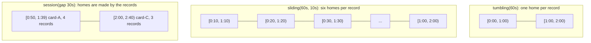

# Stream Processing: Tumbling, Sliding, and Session Windows

> Transactions per card per minute, computed as they arrive.

**Type:** Build
**Languages:** Java
**Prerequisites:** Phase 8, Lesson 01 (The Append-Only Log), Phase 8, Lesson 04 (Message Ordering and Keys), Phase 1, Lesson 05 (Hash Maps)
**Time:** ~90 minutes

## Learning Objectives

- Explain why an unbounded stream needs windows to produce any aggregate at all, and define a window as a pure function from a timestamp to the set of windows it belongs to
- Build tumbling, sliding, and session window assigners and show by hand which windows a given timestamp lands in
- Implement a windowed aggregator that keeps O(1) state per (key, window), emits on a processing-time trigger, and drops emitted windows
- Reproduce the boundary problem that makes tumbling windows miss a velocity breach, fix it with sliding windows, and measure the state cost of the fix
- Build gap-based session windows that extend and close on activity rather than on the clock, and state what processing-time semantics cannot do (which Lesson 08 addresses)

## The Problem

A card-fraud rule says: more than three transactions on one card within a minute is a velocity breach; decline the fourth and alert. The rule is implemented as a SQL query against the authorizations table, run by a scheduler every minute: `SELECT card_id, COUNT(*) FROM authorizations WHERE created_at >= :minute_start AND created_at < :minute_end GROUP BY card_id HAVING COUNT(*) > 3`. A stolen card is used at 12:00:50, 12:00:56, 12:01:03, and 12:01:09: four transactions in nineteen seconds. The 12:00 query sees two; the 12:01 query sees two. Neither fires. The fraudster was not clever; the minute boundary did the work for them. The rule's authors think in terms of "any sixty-second span"; the implementation computes "each calendar minute", and the two differ exactly when it matters.

The second problem is the query itself. It runs against the authorization database once a minute, which means the decision arrives up to sixty seconds after the fourth transaction, long after the authorization response was sent. To decline the fourth transaction, the count has to exist at the moment the fourth transaction arrives, computed from the stream of authorizations as they happen, not read back from a table later. That is a stream-processing problem: maintain, per card, a running aggregate over a bounded span of recent time, update it on every arrival in constant time, and emit or consult it the instant the span closes.

The third problem shows up when the risk team asks a different question: "how much does a card spend in one shopping session?" A session is not a minute or an hour; it is a burst of activity that ends when the card goes quiet for a while. No clock-aligned window answers it. This lesson builds the three window shapes that answer all three questions (tumbling, sliding, session), the aggregator and trigger that run them on an arriving stream, and the measurements that show what each costs.

## The Concept

### Why windows exist

An aggregate over an unbounded stream never finishes: `COUNT(*)` of all transactions ever is a number that changes forever and is never emitted. A window bounds the aggregate in time so it can complete. The window is the only thing that turns a stream into results, and choosing its shape is choosing what question is being answered.

Three shapes cover almost every production rule:

| Shape | Parameters | A timestamp belongs to | Answers | State per key |
|-------|------------|------------------------|---------|---------------|
| Tumbling | size | Exactly one window, aligned to the epoch | "per calendar minute / hour / day" | One open window |
| Sliding (hopping) | size, slide | size/slide windows, starting every slide | "in any 60-second span, checked every 10 seconds" | size/slide open windows |
| Session | gap | The session it is within `gap` of, or a new one | "per burst of activity" | One per active burst |



The one-sentence model: **a window assigner is a pure function from a timestamp to a set of windows; the operator keeps one aggregate per (key, window); a trigger decides when a window's aggregate is emitted and its state dropped.** Everything else is a consequence.

### Tumbling windows

A tumbling window of size `s` containing time `t` starts at `t - (t mod s)`. The windows are `[0, s)`, `[s, 2s)`, and so on, aligned to the epoch, so `[12:00:00, 12:01:00)` is a window and `[12:00:30, 12:01:30)` is not. Each record is assigned exactly once, state is one aggregate per key per open window, and the result is the clean "per minute" number dashboards want. The price is the boundary problem from the Problem section: a span that straddles a boundary is split, and no window sees it whole. A tumbling window answers "how many in this minute?", never "how many in the last minute?".

### Sliding windows

A sliding window of size `s` and slide `d` (Flink calls these sliding, Kafka Streams calls them hopping) starts every `d` and lasts `s`. Time `t` belongs to every window whose start is in `(t - s, t]` and is a multiple of `d`: that is `s / d` windows. For `s = 60s, d = 10s`, time `1:03` is in `[0:10, 1:10)`, `[0:20, 1:20)`, `[0:30, 1:30)`, `[0:40, 1:40)`, `[0:50, 1:50)`, `[1:00, 2:00)`. Any 60-second span of activity is fully contained in at least one window as long as its length is at most `s - d`, so the four transactions from `0:50` to `1:09` (19 seconds) are seen together by `[0:10, 1:10)` and four more windows. The rule fires.

The cost is exactly `s / d`: every record updates `s / d` aggregates, state holds `s / d` times as many windows, and the same burst is reported by every window that contains it (five times in the demo). Sliding windows with `d = s` are tumbling windows. As `d` shrinks toward one record, they approach the true "last 60 seconds from this record" semantics, at a state cost that grows without bound; the exercises build that variant with a per-key deque instead.

### Session windows

A session window has no fixed size. A record at time `t` with gap `g` proposes the session `[t, t + g)`. If that overlaps an existing session for the same key, the two merge into `[min start, max end)` and their aggregates are combined; otherwise it is a new session. A session closes when processing time reaches its end, that is, when `g` has elapsed since its last record. In the demo with `g = 30s`, card-A's four transactions over 19 seconds are one session `[0:50, 1:39)`; card-B, which transacts once a minute, gets one session per transaction because 60 seconds of silence is more than the gap; card-C's two bursts separated by 50 seconds are two sessions.

Session windows are the right shape for anything defined by activity rather than by the clock: a shopping session, a login session, a sequence of retries. They are also the only shape where the window boundaries depend on the data, which makes them the hardest to reason about and the only one where two windows can merge.

### The trigger, and what processing time means here

A window's aggregate is emitted when its trigger fires. This lesson uses the simplest trigger: **processing time has passed the window's end.** A timer runs every `timerInterval`; at each tick, every window with `end <= now` is emitted and removed. A tumbling window `[0:00, 1:00)` is emitted at the first tick at or after `1:00`; a session `[0:50, 1:39)` at the first tick at or after `1:39`, which with a 10-second timer is `1:40`.

"Processing time" means the clock when the record arrives at the operator; the record's `time` field is that clock. Two consequences follow. First, time never goes backwards, so a record can never arrive for a window that has already been emitted; the operator rejects a timestamp lower than the last one it saw as a programming error rather than handling lateness. Second, the results are not reproducible: replay the same records from the log tomorrow and they land in tomorrow's windows. Lesson 08 separates event time (when the transaction happened) from processing time (when it arrived), introduces watermarks to decide when an event-time window is complete, and handles the late records that processing time makes impossible by construction. This lesson is the mechanism without that complication, and that is deliberate: the assigners, state, and trigger are the same; only the clock changes.

### Worked example by hand

The stream, processing times in `m:ss`:

```text
0:30 card-B 40.00     0:50 card-A 12.99     0:56 card-A 24.50     1:03 card-A 8.99
1:09 card-A 150.00    1:30 card-B 40.01     2:00 card-C 5.00      2:04 card-C 5.00
2:10 card-C 5.00      2:30 card-B 40.02     3:00 card-C 99.00     3:05 card-C 99.00
3:30 card-B 40.03
```

Tumbling 60 s, rule "count > 3":

```text
[0:00, 1:00)  card-A count=2 sum=37.49     card-B count=1
[1:00, 2:00)  card-A count=2 sum=158.99    card-B count=1
[2:00, 3:00)  card-C count=3 sum=15.00     card-B count=1
[3:00, 4:00)  card-C count=2 sum=198.00    card-B count=1
breaches: none
```

Sliding 60 s every 10 s, card-A only, the windows that see all four records:

```text
[0:10, 1:10) [0:20, 1:20) [0:30, 1:30) [0:40, 1:40) [0:50, 1:50)   each: count=4 sum=196.48
[0:00, 1:00) count=2     [1:00, 2:00) count=2                        the edges
breaches: 5 (the same burst, five times)
```

Session, gap 30 s:

```text
card-A  [0:50, 1:39)  count=4 sum=196.48    four records, none more than 30 s apart; closes 30 s after 1:09
card-B  [0:30, 1:00) [1:30, 2:00) [2:30, 3:00) [3:30, 4:00)  one record each
card-C  [2:00, 2:40)  count=3                 [3:00, 3:35)  count=2
```

The three results are three different, correct answers to three different questions about the same thirteen records.

### Tracing the operator's state

Follow card-A through the tumbling operator with a 10-second timer, to see how little state there is and when it moves:

```text
time   event                         state for card-A                        emitted
0:50   process 12.99                 {[0:00,1:00): count=1 sum=12.99}
0:56   process 24.50                 {[0:00,1:00): count=2 sum=37.49}
1:00   timer: end 1:00 <= 1:00       {}                                      [0:00,1:00) count=2
1:03   process 8.99                  {[1:00,2:00): count=1 sum=8.99}
1:09   process 150.00                {[1:00,2:00): count=2 sum=158.99}
1:10   timer: nothing ends <= 1:10   unchanged
...
2:00   timer: end 2:00 <= 2:00       {}                                      [1:00,2:00) count=2
```

The same four records through the sliding operator write six aggregates each. At `1:09` card-A has exactly six open windows, `[0:10, 1:10)` through `[1:00, 2:00)`; `[0:00, 1:00)`, which held the first two records, was retired by the `1:00` tick. From `1:10` on, each tick retires one window per 10 seconds, and the first five of them report the burst with `count=4` before `[1:00, 2:00)` finally sees only two. The run's peak of ten state entries is reached at `0:56`, when card-A's six windows coexist with four of card-B's that have not yet ended.

### The timer interval

The trigger runs on a timer, and the timer's period is a latency-versus-overhead knob. A window whose end is `1:39` is emitted at the first tick at or after it: `1:40` with a 10-second timer, `1:39` with a 1-second one, `2:15` with a 45-second one. Nothing is lost by a coarse timer (the aggregate keeps accumulating until the tick), but the result arrives later and, for sliding windows, state lingers longer. For a velocity rule meant to decline the fourth transaction, no timer is fast enough: the decision has to be made in `process`, when the record arrives, by consulting the aggregate directly. That is Exercise 2 and the reason production fraud rules use the per-record variant rather than a trigger.

### Choosing a shape

| The rule says | Shape | Why |
|---------------|-------|-----|
| "per calendar minute / hour / day" (reports, billing, dashboards) | Tumbling | Clean, cheap, matches how people read a clock |
| "more than N within any M seconds" (velocity, rate limits) | Sliding with slide at most M minus the burst length, or per-record | Tumbling has a hole at every boundary |
| "per burst of activity" (sessions, retry storms, a card used at one shop) | Session | Boundaries come from the data, not the clock |
| "the last N records" (not time-based) | Count window, per-record deque | No time window answers a count question |
| Anything replayed or audited | Any shape, but on event time (Lesson 08) | Processing time is not reproducible |

### State and complexity

| Operator | Per record | State at any moment | Emission |
|----------|------------|---------------------|----------|
| Tumbling | O(1): one assign, one map update | keys with activity in the open window | O(windows closed) per timer tick |
| Sliding | O(s/d) map updates | up to s/d windows per active key | O(windows closed) per tick |
| Session | O(open sessions for the key), usually 1 | one per active burst per key | O(sessions whose end has passed) per tick |

The demo's peak state counts are 2 (tumbling), 10 (sliding), and 2 (session) for the same stream. The aggregate itself is constant size: count, sum, max. Keeping the records instead of an aggregate (to compute a median, say) changes every row of the table to "O(records in window)", and is the usual way a windowed job runs out of memory.

An aggregate that can be maintained in O(1) per record and merged in O(1) is the whole reason sliding and session windows are affordable: sliding writes the same record into `s/d` aggregates, session merges two aggregates when sessions merge. Sum, count, min, max, and anything expressible as a commutative monoid qualify; exact percentiles and distinct counts do not, which is why production systems approximate them (t-digest, HyperLogLog).

### What this lesson does not do

- It does not handle late or out-of-order records. By construction, processing time is monotonic and a window that has been emitted is gone. Lesson 08 adds event time, watermarks, allowed lateness, and the choice between discarding, updating, and retracting.
- It does not emit early or repeatedly. Each window is emitted exactly once, at the first timer tick after its end. Dataflow-style triggers (emit every N records, emit on every update) are a generalisation the exercises touch.
- It does not persist state. A crash loses every open window. A production operator checkpoints its state to a changelog topic or a store and resumes from it, which is Lesson 06's projector applied to windows.
- It does not deduplicate breaches: five sliding windows report the same burst. Suppressing repeats per key is the first exercise.

## Build It

The implementation is `code/java/Main.java`; the tests are `MainTest.java`. Time is the record's `time` field and an explicit timer; nothing sleeps.

### Step 1: Records, windows, aggregates

```java
record Txn(String cardId, Money amount, long time) { ... }

record Window(long start, long end) implements Comparable<Window> {
    Window {
        if (end <= start) throw new IllegalArgumentException("window must have positive length: [" + start + ", " + end + ")");
    }
    boolean contains(long t) { return t >= start && t < end; }
    public int compareTo(Window o) { return start != o.start ? Long.compare(start, o.start) : Long.compare(end, o.end); }
}

record Aggregate(int count, Money sum, Money max) {
    Aggregate add(Money amount) { return new Aggregate(count + 1, sum.plus(amount), max.max(amount)); }
    Aggregate merge(Aggregate other) { return new Aggregate(count + other.count, sum.plus(other.sum), max.max(other.max)); }
}
```

Windows are half-open: `1:00` belongs to `[1:00, 2:00)`, not to `[0:00, 1:00)`. Getting this wrong puts boundary records in two windows or none. `Aggregate` is immutable and has both `add` (one record) and `merge` (two aggregates), because sliding windows need the first and session merges need the second. `Money` is integer minor units, as everywhere in this course.

**Predict:** `Window.compareTo` orders by start, then end. Why does the session operator need the second clause when the tumbling operator never does?

### Step 2: Tumbling and sliding assigners

```java
public List<Window> assign(long time) {                       // TumblingWindows
    long start = time - Math.floorMod(time, size);
    return List.of(new Window(start, start + size));
}

public List<Window> assign(long time) {                       // SlidingWindows
    List<Window> out = new ArrayList<>();
    long lastStart = time - Math.floorMod(time, slide);
    for (long start = lastStart; start > time - size; start -= slide) {
        out.add(new Window(start, start + size));
    }
    Collections.reverse(out);
    return out;
}
```

`Math.floorMod` rather than `%` so negative timestamps (before the epoch) still align correctly. The sliding loop starts at the latest window start at or before `time` and walks back by `slide` while the window still contains `time`; the condition `start > time - size` is the half-open interval again. `SlidingWindows` rejects `slide > size` (that leaves gaps nothing is assigned to) and `size % slide != 0` (that makes the window count per record vary).

**Predict:** `sliding(60s, 10s).assign(1:00)`: what is the earliest window, and does `[0:00, 1:00)` appear?

### Step 3: The windowed aggregator

```java
public void process(Txn txn) {
    if (txn.time() < maxTimeSeen) throw new IllegalArgumentException("processing time went backwards: ...");
    maxTimeSeen = txn.time();
    TreeMap<Window, Aggregate> perKey = state.computeIfAbsent(txn.cardId(), k -> new TreeMap<>());
    for (Window w : assigner.assign(txn.time())) {
        perKey.merge(w, Aggregate.empty(currency).add(txn.amount()), Aggregate::merge);
    }
}
```

State is `Map<key, TreeMap<Window, Aggregate>>`: a hash map from card to a sorted map of its open windows. `TreeMap.merge` with `Aggregate::merge` either creates the window's aggregate or folds the record into it, one line for both cases. The sorted map matters for the trigger: closed windows are always at the front.

**Predict:** the state holds 400 cards with one open tumbling window each. A timer tick fires. How many map entries does `onTimer` touch, and what would happen to that number with sliding(60s, 1s)?

### Step 4: The processing-time trigger

```java
public List<WindowResult> onTimer(long now) {
    List<WindowResult> out = new ArrayList<>();
    Iterator<Map.Entry<String, TreeMap<Window, Aggregate>>> keys = state.entrySet().iterator();
    while (keys.hasNext()) {
        Map.Entry<String, TreeMap<Window, Aggregate>> entry = keys.next();
        TreeMap<Window, Aggregate> windows = entry.getValue();
        while (!windows.isEmpty() && windows.firstKey().end() <= now) {
            Map.Entry<Window, Aggregate> closed = windows.pollFirstEntry();
            out.add(new WindowResult(entry.getKey(), closed.getKey(), closed.getValue(), now));
        }
        if (windows.isEmpty()) keys.remove();
    }
    return out;
}
```

For each key, pop windows from the front of the sorted map while their end has passed. Because windows for one key are sorted by start and all have the same length (tumbling or sliding), "front of the map" and "earliest end" coincide. A key with no open windows is removed entirely, so an inactive card costs nothing. `WindowResult` records `emittedAt`, which the demo uses to show that a 10-second timer emits `[0:50, 1:39)` at `1:40`.

### Step 5: Session windows

```java
public void process(Txn txn) {
    ...
    Window mine = new Window(txn.time(), txn.time() + gap);
    Aggregate agg = Aggregate.empty(currency).add(txn.amount());
    Iterator<Map.Entry<Window, Aggregate>> it = sessions.entrySet().iterator();
    while (it.hasNext()) {
        Map.Entry<Window, Aggregate> e = it.next();
        Window w = e.getKey();
        boolean overlaps = w.start() < mine.end() && mine.start() < w.end();
        if (overlaps) {
            mine = new Window(Math.min(w.start(), mine.start()), Math.max(w.end(), mine.end()));
            agg = agg.merge(e.getValue());
            it.remove();
        }
    }
    sessions.put(mine, agg);
}
```

The record proposes `[t, t + gap)` and absorbs every session it overlaps. The overlap test is the standard half-open interval intersection. With monotonic processing time a record can only ever overlap the key's latest session, so the loop removes at most one entry; the general form is kept because with event time (Lesson 08) a record can arrive between two sessions and bridge them. A session's `end` is "last record plus gap", so the trigger from Step 4 works unchanged: the session closes when `now >= end`, meaning the gap has elapsed with nothing new.

**Predict:** a record arrives exactly at a session's `end`. Does it extend the session or start a new one, and which clause decides?

### Step 6: Driving the stream and applying the rule

```java
List<WindowResult> run(List<Txn> txns, long endOfStream) {
    for (Txn t : txns) {
        while (nextTimer <= t.time()) {
            results.addAll(operator.onTimer(nextTimer));
            nextTimer += timerInterval;
        }
        operator.process(t);
        maxStateSize = Math.max(maxStateSize, operator.stateSize());
    }
    while (nextTimer <= endOfStream) {
        results.addAll(operator.onTimer(nextTimer));
        nextTimer += timerInterval;
    }
    return results;
}
```

`StreamRunner` interleaves records and timer ticks in time order: before processing a record at time `t`, every tick at or before `t` fires. This is the discipline that makes the simulation equal to a real operator with a wall-clock timer, and it is why the results are deterministic. `VelocityRule.breaches` filters results with `count > maxPerWindow`; it is three lines because the hard part was done by the window.

### Step 7: Run it

```bash
cd phases/08-messaging-and-streams/07-stream-processing-windows/code/java
javac -d .out *.java && java -cp .out Main
java -cp .out MainTest
```

Expected output, abbreviated:

```console
== 2. Tumbling 1-minute windows: transactions per card per minute ==
  card-A  0:00-1:00  count=2 sum=37.49 USD max=24.50 USD  (emitted at 1:00)
  card-A  1:00-2:00  count=2 sum=158.99 USD max=150.00 USD  (emitted at 2:00)
  ...
velocity breaches (> 3 per window): 0   max state entries: 2
card-A made 4 transactions in 19 seconds (0:50 to 1:09) and no tumbling window saw more than 2.

== 3. Sliding 1-minute windows every 10 seconds: the boundary problem goes away ==
43 window results emitted (7 for card-A); breaches:
  card-A  0:10-1:10  count=4 sum=196.48 USD max=150.00 USD  (emitted at 1:10)
  card-A  0:20-1:20  count=4 sum=196.48 USD max=150.00 USD  (emitted at 1:20)
  ...
max state entries: 10 (each record lives in size/slide = 6 windows)

== 4. Session windows with a 30-second gap: activity bursts, not clock minutes ==
  card-B  0:30-1:00  count=1 sum=40.00 USD max=40.00 USD  (emitted at 1:00)
  card-A  0:50-1:39  count=4 sum=196.48 USD max=150.00 USD  (emitted at 1:40)
  card-C  2:00-2:40  count=3 sum=15.00 USD max=5.00 USD  (emitted at 2:40)
  card-C  3:00-3:35  count=2 sum=198.00 USD max=99.00 USD  (emitted at 3:40)

== 5. Trigger timing: a window closes only when the timer passes its end ==
onTimer(0:59) emits 0 windows; onTimer(1:00) emits 1
a record with an earlier processing time is rejected: processing time went backwards: 30000 < 56000
```

### Porting notes

In Python the state is `dict[str, dict[Window, Aggregate]]`; since per-key window counts are small, the trigger can scan each key's windows and delete the closed ones rather than relying on a sorted map; `Window` and `Aggregate` are frozen dataclasses, `Money` is `int` minor units, and `Math.floorMod` is Python's `%`, which already floors. In Go, `Window` is a comparable struct usable as a map key, per-key windows live in a slice kept sorted with `sort.Slice` or `slices.SortFunc`, and `floorMod` must be written by hand because Go's `%` truncates toward zero. Both ports keep the same monotonic-time check and the same half-open overlap test; a concurrent Go operator processing keys on goroutines needs a mutex per key's state and must pass `go test -race`.

## Use It

### Apache Flink

Flink's DataStream API names the parts exactly as this lesson does: a `WindowAssigner` (`TumblingProcessingTimeWindows.of(Time.minutes(1))`, `SlidingProcessingTimeWindows.of(size, slide)`, `ProcessingTimeSessionWindows.withGap(gap)`), a `Trigger` (`ProcessingTimeTrigger` fires when processing time passes the window end), and an `AggregateFunction` with `add` and `merge`, the latter required precisely for session windows. Flink's documentation states the state cost of sliding windows the same way: a record is copied into `size / slide` windows. What Flink adds is everything this lesson's "does not do" list names: event-time assigners with watermarks, allowed lateness, incremental checkpoints of window state to RocksDB, and `ProcessWindowFunction` for the cases that need the records themselves.

### Kafka Streams

Kafka Streams calls tumbling and sliding windows `TimeWindows.ofSizeWithNoGrace(size)` and `.advanceBy(slide)` (it calls them hopping windows, and reserves "sliding" for windows defined relative to each record, the variant Exercise 2 builds), and session windows `SessionWindows.ofInactivityGapWithNoGrace(gap)`. Window state lives in a windowed state store backed by a changelog topic, so a restart replays the changelog; results are emitted on every update by default, and `suppress(untilWindowCloses(...))` gives the emit-once behaviour of this lesson's trigger. The velocity rule in this lesson is a `groupByKey().windowedBy(...).count()` followed by a `filter(count > 3)`.

### The same shapes under other names

| This lesson | Flink | Kafka Streams | Google Dataflow / Beam | SQL |
|-------------|-------|---------------|------------------------|-----|
| `TumblingWindows(size)` | `TumblingProcessingTimeWindows.of(size)` | `TimeWindows.ofSizeWithNoGrace(size)` | `FixedWindows.of(size)` | `GROUP BY date_trunc(...)` / `time_bucket` |
| `SlidingWindows(size, slide)` | `SlidingProcessingTimeWindows.of(size, slide)` | `TimeWindows...advanceBy(slide)` ("hopping") | `SlidingWindows.of(size).every(slide)` | repeated `GROUP BY` per offset |
| per-record sliding (Exercise 2) | custom `KeyedProcessFunction` | `SlidingWindows.ofTimeDifferenceWithNoGrace(size)` | custom `DoFn` with state and timers | `COUNT(*) OVER (... RANGE ... PRECEDING)` |
| `SessionAggregator(gap)` | `ProcessingTimeSessionWindows.withGap(gap)` | `SessionWindows.ofInactivityGapWithNoGrace(gap)` | `Sessions.withGapDuration(gap)` | gaps-and-islands query |
| `onTimer` (emit once at end) | `ProcessingTimeTrigger` | `suppress(untilWindowCloses(...))` | `AfterProcessingTime.pastEndOfWindow()` | the query's schedule |
| `Aggregate.add` / `merge` | `AggregateFunction.add` / `merge` | `Aggregator` / `Merger` | `CombineFn.addInput` / `mergeAccumulators` | aggregate function |

The naming collision to remember: Kafka Streams' "sliding" is the per-record variant and its "hopping" is what Flink and this lesson call sliding.

### Databases and the boundary problem

The SQL query in the Problem section is a tumbling window computed after the fact. `GROUP BY date_trunc('minute', created_at)` is `TumblingWindows(60s)`; PostgreSQL and TimescaleDB's `time_bucket` are the same function. A sliding window in SQL is a window function (`COUNT(*) OVER (PARTITION BY card_id ORDER BY created_at RANGE BETWEEN INTERVAL '60 seconds' PRECEDING AND CURRENT ROW)`), which is Exercise 2's per-record variant, computed over stored rows rather than as they arrive. The difference is latency: the stream operator has the count when the fourth transaction arrives; the query has it on the next scheduler run.

### The trap

The commonest mistake with windows is using tumbling windows for a "within any N seconds" rule because they are cheapest and the dashboard already uses them. The rule then has a hole of up to the window size, and the hole is exactly where an adversary who tests the system will find it. The second mistake is processing-time windows for anything that will be replayed or audited: the same input yields different outputs on each run. The third is sliding windows with a tiny slide "to be safe", which multiplies state and emits the same breach dozens of times; the per-record deque of Exercise 2 is the right tool when the slide would be smaller than the inter-arrival time.

## Ship It

`outputs/interview-card-stream-windows.md` is an interview card for the stream-processing round: the three window shapes with their state costs, the boundary problem and its fix, the processing-time versus event-time distinction, and the five questions interviewers ask about a velocity rule. Review it before a payments or data-infrastructure system-design interview.

## Exercises

1. **Reinforce.** The sliding operator reports the same burst in five windows. Add a `BreachSuppressor` after `VelocityRule` that emits at most one breach per card until that card has a window with `count <= maxPerWindow` again. Assert the demo stream yields exactly one breach for card-A.
2. **Apply.** Build the true per-record sliding window: `RecentCountOperator(size)` keeps a per-key `ArrayDeque<Long>` of timestamps, evicts those older than `time - size` on every arrival, and reports the count at the moment of the fourth transaction (so the decline can happen in the authorization path). Compare its state and latency with `sliding(60s, 10s)` on the demo stream, and state when each is the right choice.
3. **Extend.** Combine with Lesson 06: make `WindowedAggregator` a `Projection` whose `apply` reads `Txn` events from an `EventStore` with their `recordedAt` as processing time, and checkpoint open-window state alongside the position so a restart resumes windows rather than losing them. Then replay the same log twice with the same timer schedule and show the results are identical; replay with a different timer interval and explain which results change.

## Key Terms

| Term | What people say | What it actually means |
|------|-----------------|------------------------|
| Window | "a time bucket" | A half-open interval `[start, end)` that bounds an aggregate so it can complete; assigned to a record by a pure function of its timestamp |
| Tumbling window | "per minute" | Fixed size, epoch-aligned, non-overlapping; each record in exactly one; cannot see a span that straddles a boundary |
| Sliding (hopping) window | "rolling window" | Fixed size, starting every `slide`; each record in `size/slide` windows; sees any span up to `size - slide` long whole |
| Session window | "a user session" | Gap-based: starts at a record, extends while records arrive within `gap`, closes when the gap elapses; boundaries come from the data |
| Trigger | "when it fires" | The condition that emits a window's aggregate and drops its state; here, processing time passing the window end |
| Processing time | "wall clock" | The time a record reaches the operator; monotonic, never late, not reproducible on replay |
| Aggregate (monoid) | "the count" | A constant-size summary with `add` and `merge`; what makes sliding and session windows affordable |
| Boundary problem | "it slipped between minutes" | A span split by a tumbling boundary so no window sees it whole; the reason velocity rules use sliding windows |

## Further Reading

- [Akidau et al., "The Dataflow Model: A Practical Approach to Balancing Correctness, Latency, and Cost in Massive-Scale, Unbounded, Out-of-Order Data Processing" (VLDB 2015)](https://research.google/pubs/pub43864/) — the paper that separates windowing (what), triggers (when), and accumulation (how); sections 2.2 and 2.3 define the three window shapes used here.
- [Apache Flink documentation, "Windows"](https://nightlies.apache.org/flink/flink-docs-stable/docs/dev/datastream/operators/windows/) — assigners, triggers, evictors, and the explicit note on the state cost of sliding windows.
- [Apache Kafka Streams documentation, "Windowing"](https://kafka.apache.org/documentation/streams/developer-guide/dsl-api.html#windowing) — tumbling, hopping, sliding, and session windows as Kafka Streams defines them, including why hopping and sliding are different things there.
- [Tyler Akidau, "Streaming 101" (O'Reilly, 2015)](https://www.oreilly.com/radar/the-world-beyond-batch-streaming-101/) — the processing-time versus event-time distinction this lesson defers to Lesson 08, with the diagrams that make it stick.
- [PostgreSQL documentation, "Window Functions"](https://www.postgresql.org/docs/current/tutorial-window.html) — the SQL counterpart of a per-record sliding window; compare its `RANGE ... PRECEDING` frame with Exercise 2.
