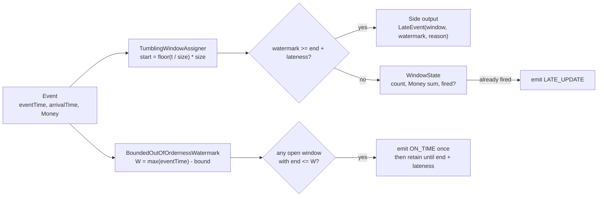

# Watermarks, Event Time, and Late Data

> The event happened at 11:59; it arrived at 12:03. Which window?

**Type:** Build
**Languages:** Java, Python, Go
**Prerequisites:** Phase 8, Lesson 07 (Stream Processing and Windows), Phase 5, Lesson 02 (Clocks and Ordering), Phase 10, Lesson 01 (Representing Money)
**Time:** ~90 minutes

## Learning Objectives

- Distinguish event time from processing time and show, with one event, how a processing-time window misattributes a payment
- Define a watermark as a completeness assertion ("no event older than T will arrive") and derive one from bounded out-of-orderness
- Build a tumbling event-time window operator that fires once per window when the watermark passes the window end
- Implement allowed lateness so a late event within the bound corrects an already-fired result, and a side output so an event beyond the bound is parked rather than dropped
- State and test the accounting invariant: every event is in exactly one of an open window, a closed window, or the side output
- Choose watermark bound and allowed lateness for a given latency and completeness requirement

## The Problem

A card acquirer computes hourly settlement totals per merchant from an authorization stream. The totals drive two things: the hourly file sent to the merchant's bank and a fraud model that flags an hour whose total is more than three standard deviations above the merchant's history. The job is a tumbling one-hour window over "the hour the authorization arrived at the stream processor".

A merchant's point-of-sale terminal in a basement store has a flaky uplink. At 11:59:40 it authorizes a 77.00 USD sale. The terminal buffers the event, reconnects, and the event reaches the broker at 12:03:12. The job windows it by arrival time, so 77.00 USD lands in the 12:00 hour. The 11:00 settlement file is short by 77.00; the 12:00 file is over by the same amount. Nothing reconciles at the merchant's bank, and a human spends forty minutes finding one transaction. Multiply by every store with a bad uplink, every mobile wallet that batches events while the phone is on the subway, every replay after a broker failover, and the "hourly totals" are not totals of any hour. They are totals of whatever happened to show up.

The fraud model is worse off. After a 20-minute broker outage, the backlog drains in two minutes. Every merchant's "12:00 hour" now contains 80 minutes of authorizations, and the model flags all of them. The on-call engineer silences the alert, and the one genuinely anomalous merchant in the batch goes unnoticed.

The root cause is that the job is answering a question nobody asked. The business asked "how much did merchant M authorize between 11:00 and 12:00?" The job answered "how much did I receive between 11:00 and 12:00?" Those are the same question only if events arrive instantly and in order, and they never do. The fix is to window by the timestamp inside the event (event time) and to make a deliberate, visible decision about how long to wait for stragglers before declaring an hour complete. That decision is the watermark.

## The Concept

### Two clocks

Every event in a stream has two timestamps, and conflating them is the bug.

| Clock | What it measures | Who stamps it | Monotonic? | Example |
|-------|------------------|---------------|------------|---------|
| Event time | When the thing happened in the world | The producer, at the source | No: events arrive out of order | The terminal's clock at authorization: 11:59:40 |
| Processing time | When the processor saw the event | The stream processor, on receipt | Yes, per processor | The job's wall clock when the record was polled: 12:03:12 |

Processing-time windows are trivially easy: the window is whatever the processor's clock says, every window closes exactly on time, and there is never late data because "late" is not a concept. They are also wrong for any question phrased in terms of when something happened, which is every question in payments: settlement cutoffs, interchange time bands, velocity rules ("more than five authorizations in ten minutes"), and SLA measurement.

Event-time windows answer the right question but introduce a problem processing time never has: **when is a window complete?** The event-time window [11:00, 12:00) cannot close at 12:00 on the wall clock, because the 11:59 event is still in a terminal's buffer. It cannot wait forever, because the settlement file is due. Something has to decide.

### The watermark is a completeness assertion

A watermark is a timestamp `W` injected into the stream carrying one claim: **no event with event time less than `W` will arrive after this point.** When a window `[start, end)` sees a watermark `W >= end`, every event that belongs to it has, by the claim, already arrived, so the window can fire.

The claim is a heuristic, not a guarantee. The stream processor does not know what is sitting in a terminal's buffer. It estimates. The simplest estimator, and the one most production jobs use, is **bounded out-of-orderness**:

```text
W = (maximum event time seen so far) - (maximum tolerated out-of-orderness)
```

If the bound is 5 minutes and the largest event time seen is 12:09, the watermark is 12:04, and the operator is asserting that nothing older than 12:04 is still in flight. The 11:00 window fires at that moment, not at wall-clock 12:00 and not at the first 12:xx event.

Two properties of the watermark are not optional:

1. **It never moves backwards.** A late event with time 11:30 arriving when the watermark is 12:04 does not pull the watermark down to 11:25. If it did, windows that already fired would need to un-fire. The watermark is a high-water mark.
2. **It is derived from data, not from the wall clock.** If the stream stalls for 20 minutes, the watermark stalls too, and no window fires until data resumes. That is the correct behaviour: the outage did not make the 11:00 hour complete. (Production systems add an idleness timeout for sources that are silent for long periods, otherwise one dead partition holds back every window. See Use It.)

### Other watermark strategies

Bounded out-of-orderness is one estimator. Three others appear in production, and all of them produce the same kind of monotonic completeness assertion that the operator in this lesson consumes:

| Strategy | How `W` is derived | When it fits | What it costs |
|----------|--------------------|--------------|---------------|
| Bounded out-of-orderness | `max(eventTime) - bound` | Sources with a measurable skew distribution; the default | Fixed latency equal to the bound, even when traffic is perfectly ordered |
| Monotonic timestamps | `max(eventTime)` (bound of zero) | Sources that guarantee order per partition, such as a log replicated in order | Any disorder at all produces late data |
| Punctuated | The producer embeds explicit "all events up to T sent" markers in the stream | Batch-oriented producers that know when a batch is complete, such as an end-of-day file loader | The producer must be trusted to emit the markers, and a missing marker stalls everything |
| Source-provided | The broker tracks per-partition progress and the processor combines them by minimum | Multi-partition topics where one partition can lag | Needs idleness handling for silent partitions |

The operator does not care which strategy produced the watermark. It only requires monotonicity and the completeness claim. That separation, between generating the watermark and consuming it, is why the lesson builds them as two classes.

### Where the skew comes from

The gap between event time and processing time is not noise; it has named causes, and each one suggests a different bound.

| Source of skew | Typical magnitude | Shape | Implication for the bound |
|----------------|-------------------|-------|---------------------------|
| Network and broker latency | 10 ms to 2 s | Small, roughly constant | A bound of a few seconds absorbs it entirely |
| Producer-side batching (SDK buffers, mobile wallets flushing on reconnect) | Seconds to minutes | Bursty: a silent period followed by a batch of old events | The bound must cover the longest expected buffer, or those batches are late by construction |
| Broker failover or consumer restart | Minutes | A backlog drains fast, so processing time compresses while event time does not | Watermark derived from data stalls and then jumps; no window fires early |
| Partition skew (one partition behind) | Minutes to hours | One source lags all others | With a single watermark, that partition's events are all late; needs per-partition watermarks combined by minimum |
| Clock skew on the producer | Milliseconds to years | A terminal with a wrong clock emits events far in the past or future | A future-dated event drags the watermark forward and makes every honest event late; see failure modes below |

The bound is a business number, not a tuning constant. It is the answer to "how long after an hour ends are we willing to wait before we send the file", and the people who own the file should sign off on it.

### Choosing the two parameters

A short decision procedure that covers most payment pipelines:

1. Measure the skew distribution on real traffic: `arrivalTime - eventTime` at p50, p99, p99.9, and max, per source. Do it over at least a week so a failover is included.
2. Set the **bound** at the point where the completeness the first result needs is met. A settlement total that must be within 0.1% on first emission needs the bound at roughly the p99.9 skew. A fraud velocity count that tolerates missing 1% of events needs p99.
3. Set **allowed lateness** to the window during which downstream can still accept a correction. For a settlement file amended until the next cutoff, that is the cutoff interval. For an alert that has already paged someone, it is zero.
4. Everything past bound plus lateness goes to the side output, and the side output must have an owner and a consumer. A side output nobody reads is a silent drop with extra steps.
5. Alert on the side output rate. A rise means a source's skew distribution changed, and the bound chosen in step 2 is no longer right.

### Late data: three outcomes, not one

An event is late when it arrives with `eventTime < W`. The window it belongs to has, by the watermark's claim, already been declared complete and may have fired. The operator has three choices, and the lesson builds all three as a single policy with two parameters:

| Outcome | Condition | What happens | Cost |
|---------|-----------|--------------|------|
| On time | `eventTime >= W` or the window has not fired yet | Folded into the window as usual | None |
| Allowed late | Window fired, but `W < windowEnd + allowedLateness` | Folded into the still-retained window state; a corrected result is re-emitted and marked `LATE_UPDATE` | Window state is held for `allowedLateness` after firing; downstream must handle updates |
| Too late | `W >= windowEnd + allowedLateness` | Sent to a **side output** with the target window, the watermark at arrival, and a reason. Never silently dropped | Someone must own the side output |

The watermark bound and the allowed lateness look similar but trade off differently:

- **The bound delays the first result.** A 5-minute bound means every window fires 5 minutes of event time after it ends. It buys correctness of the first answer at the cost of latency.
- **Allowed lateness delays finality.** It lets the first answer be revised. It buys completeness at the cost of memory (retained state) and downstream complexity (consumers must accept corrections).

A settlement job might use a 5-minute bound and 24 hours of allowed lateness, because the file can be amended until the next cutoff. A fraud scorer might use a 30-second bound and zero lateness, because a correction five minutes later is useless. Same operator, different parameters.

### Worked example by hand

One-hour tumbling windows, bound 5 minutes, allowed lateness 10 minutes. Hourly settlement for two merchants. Amounts are USD minor units.

| Step | Event time | Arrival | Amount | Max seen | Watermark | Effect |
|------|-----------|---------|--------|----------|-----------|--------|
| 1 | 11:40 | 11:40 | 19.99 | 11:40 | 11:35 | [11:00,12:00) count 1 |
| 2 | 11:52 | 11:52 | 45.00 | 11:52 | 11:47 | count 2 |
| 3 | 11:58 | 11:58 | 12.50 | 11:58 | 11:53 | count 3 |
| 4 | 12:01 | 12:01 | 8.00 | 12:01 | 11:56 | [12:00,13:00) opens |
| 5 | 12:02 | 12:02 | 30.00 | 12:02 | 11:57 | |
| 6 | **11:59** | **12:03** | 77.00 | 12:02 | 11:57 | 11:59 >= 11:57: on time. [11:00,12:00) count 4, sum 154.49 |
| 7 | 12:04 | 12:04 | 15.00 | 12:04 | 11:59 | |
| 8 | 12:09 | 12:09 | 20.00 | 12:09 | **12:04** | 12:04 >= 12:00: **fire [11:00,12:00) ON_TIME, count 4, 154.49** |
| 9 | 11:57 | 12:10 | 9.99 | 12:09 | 12:04 | late; 12:04 < 12:00 + 10 min: allowed. **Re-fire LATE_UPDATE, count 5, 164.48** |
| 10 | 12:16 | 12:16 | 6.00 | 12:16 | 12:11 | 12:11 >= 12:10: [11:00,12:00) state garbage-collected |
| 11 | 11:50 | 12:20 | 25.00 | 12:16 | 12:11 | too late: **side output**, target [11:00,12:00), reason WINDOW_CLOSED |
| 12 | 13:06 | 13:06 | 1.00 | 13:06 | 13:01 | fire [12:00,13:00) ON_TIME, count 5, 79.00 |

Three things to notice. The 11:59 event at step 6 arrives four minutes late in wall-clock terms and is **not** late in watermark terms, because the bound was chosen to absorb exactly this. The 11:00 window fired at step 8 when the watermark crossed 12:00, which happened when the first event with time >= 12:05 arrived, and not one moment earlier or later. The 11:50 event at step 11 is 30 minutes late, which exceeds the bound plus lateness, so it is parked with enough context (target window, watermark at arrival) that a reconciliation job can apply it to the settlement file by hand.

Compare the processing-time job on the same input: [11:00,12:00) count 3 sum 77.49, [12:00,13:00) count 8 sum 190.99. Every one of the 11:00 hour's late events moved into the 12:00 hour. Neither hourly total is a total of that hour.



### The invariant

The operator promises that **every event is in exactly one place**: an open window's state, a window that has since been closed and garbage-collected, or the side output. The test `accountsForEveryEvent` checks `eventsSeen == inOpenWindows + inClosedWindows + sideOutput.size()` after every scenario. It is the stream-processing form of the ledger's conservation rule: money that enters the operator leaves it exactly once, either in a result or in the side output, and never evaporates in a silent drop.

Two further promises follow: a window fires `ON_TIME` exactly once (the `fired` flag), and a `LATE_UPDATE` always carries the complete corrected aggregate, not a delta, so a downstream consumer can overwrite rather than add.

### Complexity

Processing an event is `O(log k)` for the `TreeMap` lookup where `k` is the number of open windows, plus `O(f)` to fire `f` windows when the watermark advances. Memory is `O(k)`, and `k` is bounded by `(bound + allowedLateness) / windowSize + 1` for well-behaved input, which is the whole point of garbage-collecting fired windows: without the GC step, `k` grows without bound and the job dies of memory after a few days. The watermark generator is `O(1)` and holds one `long`.

### Failure modes

- **A future-dated event poisons the watermark.** One terminal with its clock set to 2031 emits an event whose time is years ahead. `maxEventTime` jumps, the watermark follows, every open window fires immediately with partial data, and every subsequent honest event is years late and lands in the side output. The defence is upstream: reject or clamp event times more than a tolerance ahead of processing time before they reach the watermark generator. Exercise 2 of Phase 5, Lesson 02 is the same problem seen from the clock's side.
- **A stalled source stalls every window.** The watermark is the minimum across sources, so one partition with no traffic (a merchant region asleep overnight) holds the watermark at its last event and no window anywhere fires. Idleness detection marks a silent source as not contributing to the minimum.
- **Allowed lateness without downstream support double-counts.** If the consumer of `WindowResult` adds each result to a running total, a `LATE_UPDATE` is added on top of the `ON_TIME` result and the hour is counted twice. Consumers must key on `(windowStart, windowEnd)` and overwrite. This is why the result carries `FiringKind`.
- **The side output becomes a graveyard.** Parking late events is only better than dropping them if a job reads the parking lot. Measure its size; a side output that grows forever is a drop with a storage bill.

### What this operator does not do

- It does not handle **per-key watermarks**. All merchants share one watermark. A single merchant whose terminal is always 15 minutes behind will have its events in the side output forever, while a per-key design would hold its windows open longer. Production systems make the same choice (one watermark per source partition, not per business key) because per-key watermarks do not compose across joins.
- It does not **assign timestamps**. It trusts `Event.eventTime` as stamped by the producer. A producer with a wrong clock produces events that are early or late by the clock's skew, and the operator cannot tell. Phase 5, Lesson 02 is about why that skew exists.
- It does not do **sliding or session windows**. The assigner returns exactly one window per event; sliding windows return several and session windows merge. The watermark and lateness logic is unchanged for either.
- It does not **emit early results**. A window is silent until the watermark passes its end. Production systems add processing-time triggers ("emit a speculative result every minute") on top of the same completeness logic.

## Build It

The primary walkthrough is in Java. `Money` and `Currency` are the Phase 10 types, trimmed to what a window sum needs: `plus` with currency checking and `addExact`.

### Step 1: Events with two timestamps

```java
record Event(String key, long eventTime, long arrivalTime, Money amount) {}

record Window(long start, long end) implements Comparable<Window> {
    @Override public int compareTo(Window o) { return Long.compare(start, o.start); }
}

final class TumblingWindowAssigner {
    private final long sizeMillis;

    TumblingWindowAssigner(long sizeMillis) {
        if (sizeMillis <= 0) throw new IllegalArgumentException("window size must be positive");
        this.sizeMillis = sizeMillis;
    }

    Window assign(long timestamp) {
        long start = Math.floorDiv(timestamp, sizeMillis) * sizeMillis;
        return new Window(start, start + sizeMillis);
    }
}
```

Both timestamps live on the event. `arrivalTime` is stamped by the processor's clock, which in this lesson is injected as test data so the demo is deterministic; in production it is `System.currentTimeMillis()` at poll time. Windows are half-open: 12:00:00.000 belongs to the 12:00 window, not the 11:00 one, so no instant belongs to two windows and no instant belongs to none. `Math.floorDiv` rather than `/` keeps negative timestamps (before the epoch) in the correct window; `/` truncates toward zero and would put -1 ms into the window starting at 0.

**Predict:** with a 60-minute window, what does `assign(t("12:00"))` return, and why does the answer change if the window is `(start, end]` instead?

### Step 2: The watermark generator

```java
final class BoundedOutOfOrdernessWatermark {
    private final long maxOutOfOrdernessMillis;
    private long maxEventTime = Long.MIN_VALUE;

    long observe(long eventTime) {
        if (eventTime > maxEventTime) maxEventTime = eventTime;
        return current();
    }

    long current() {
        if (maxEventTime == Long.MIN_VALUE) return Long.MIN_VALUE;
        return maxEventTime - maxOutOfOrdernessMillis;
    }
}
```

One `long` of state. `observe` only ever raises `maxEventTime`, which is what makes the watermark monotonic: a late event is observed (so the test can prove it changed nothing) and ignored. `Long.MIN_VALUE` before the first event means "no claim yet"; the operator checks for it explicitly rather than treating it as a very old timestamp, because `Long.MIN_VALUE - bound` would overflow to a large positive number and fire every window at once.

**Predict:** the generator has seen 12:09 and the bound is 5 minutes. An event with time 12:06 arrives. What is the watermark after `observe`?

### Step 3: Window state and the three outcomes

```java
List<WindowResult> process(Event e) {
    eventsSeen++;
    List<WindowResult> out = new ArrayList<>();
    Window w = assigner.assign(e.eventTime());
    long wmBefore = watermark.current();

    if (wmBefore != Long.MIN_VALUE && wmBefore >= w.end() + allowedLatenessMillis) {
        sideOutput.add(new LateEvent(e, w.start(), w.end(), wmBefore, LateReason.WINDOW_CLOSED));
        watermark.observe(e.eventTime());
        return out;
    }

    WindowState state = open.computeIfAbsent(w, k -> new WindowState(currency));
    state.add(e);
    if (state.fired) {
        out.add(new WindowResult(w.start(), w.end(), state.count, state.sum, FiringKind.LATE_UPDATE));
    }

    long wmAfter = watermark.observe(e.eventTime());
    out.addAll(advance(wmAfter));
    return out;
}
```

The order matters. The lateness decision uses the watermark **before** this event is observed, because the event cannot make itself late. Then the three outcomes fall out of two checks: too late (side output and return), already fired (fold in and emit a `LATE_UPDATE`), otherwise just fold in. Only then is the watermark advanced and the windows it completes are fired.

The side output record carries the target window and the watermark at arrival. Without those, the reconciliation job that consumes the side output has to recompute the window assignment and cannot tell how late the event was.

**Predict:** an event arrives for a window that has never been opened (no state) but whose end is already below the watermark and within allowed lateness. Does it produce an `ON_TIME` or a `LATE_UPDATE` result?

### Step 4: Advancing the watermark

```java
private List<WindowResult> advance(long wm) {
    List<WindowResult> out = new ArrayList<>();
    if (wm == Long.MIN_VALUE) return out;
    for (Map.Entry<Window, WindowState> entry : open.entrySet()) {
        Window w = entry.getKey();
        if (w.end() > wm) break;
        WindowState s = entry.getValue();
        if (!s.fired) {
            s.fired = true;
            out.add(new WindowResult(w.start(), w.end(), s.count, s.sum, FiringKind.ON_TIME));
        }
    }
    var it = open.entrySet().iterator();
    while (it.hasNext()) {
        var entry = it.next();
        if (wm >= entry.getKey().end() + allowedLatenessMillis) {
            eventsInClosedWindows += entry.getValue().count;
            it.remove();
        } else {
            break;
        }
    }
    emitted.addAll(out);
    return out;
}
```

Two passes over a `TreeMap` ordered by window start. The first fires every unfired window whose end the watermark has passed and stops at the first window that is not ready, because every later window ends later. The second removes windows that are past `end + allowedLateness`, crediting their counts to `eventsInClosedWindows` so the accounting invariant still holds after the state is gone. The `fired` flag is what makes `ON_TIME` fire exactly once: a window whose end is below the watermark is visited on every later `advance` until it is garbage-collected, and must not re-emit.

**Predict:** allowed lateness is 0. Can a window ever be in the `fired == true` state at the end of `advance`? What does that imply about `LATE_UPDATE` with zero lateness?

### Step 5: The accounting invariant

```java
boolean accountsForEveryEvent() {
    long inOpen = open.values().stream().mapToLong(s -> s.count).sum();
    return eventsSeen == inOpen + eventsInClosedWindows + sideOutput.size();
}
```

Every scenario in `MainTest` ends by asserting this. If a future change drops an event (for example, by returning early from `process` without adding to the side output), this check fails before any downstream reconciliation does.

### Step 6: The processing-time baseline

```java
final class ProcessingTimeWindowOperator {
    void process(Event e) {
        windows.computeIfAbsent(assigner.assign(e.arrivalTime()), k -> new WindowState(currency)).add(e);
    }
}
```

Three lines, no watermark, no lateness, no side output, and the wrong answer for the 11:59 payment. It is in the lesson so the demo can print the two results side by side; keep it in your head as the thing you are comparing against whenever someone says event-time processing is "too complicated".

### Step 7: Run it

```bash
cd phases/08-messaging-and-streams/08-watermarks-and-late-data/code/java
javac -d .out *.java && java -cp .out Main
java -cp .out MainTest
```

Expected output, abbreviated:

```console
== Processing-time windows: the 11:59 payment lands in the 12:00 hour ==
  [11:00, 12:00) count=3 sum=77.49 USD ON_TIME
  [12:00, 13:00) count=8 sum=190.99 USD ON_TIME

== Event-time windows, watermark = max event time - 5 min, allowed lateness 10 min ==
  event m-1 @11:59 (arrived 12:03) 77.00 USD    watermark=11:57
  event m-1 @12:09 (arrived 12:09) 20.00 USD    watermark=12:04
    -> fired [11:00, 12:00) count=4 sum=154.49 USD ON_TIME
  event m-2 @11:57 (arrived 12:10) 9.99 USD     watermark=12:04
    -> fired [11:00, 12:00) count=5 sum=164.48 USD LATE_UPDATE
  event m-2 @11:50 (arrived 12:20) 25.00 USD    watermark=12:11

== Side output (late data that missed the window entirely) ==
  m-2 @11:50 arrived 12:20 amount=25.00 USD target=[11:00, 12:00) watermark-at-arrival=12:11 reason=WINDOW_CLOSED

every event accounted for exactly once: true
```

### In Python

```python
def current(self) -> Optional[int]:
    """None before any event has been seen: nothing is known to be complete (Java's Long.MIN_VALUE)."""
    if self._max_event_time is None:
        return None
    return self._max_event_time - self._max_out_of_orderness_millis

def _advance(self, wm: Optional[int]) -> List[WindowResult]:
    out: List[WindowResult] = []
    if wm is None:
        return out
    for w in sorted(self._open):
        if w.end > wm:
            break
        ...
```

Differences, all in `code/python/main.py`:

- **`Long.MIN_VALUE` is `None`.** "No watermark yet" is `Optional[int]`; `process` checks `wm_before is not None` before comparing, and `hhmm(None)` prints `-inf`. This removes the sentinel-overflow concern (`Long.MIN_VALUE - bound` would wrap in Java if the guard were missing).
- **No `TreeMap`.** Open windows live in a `dict[Window, WindowState]`, and `_advance` iterates `sorted(self._open)` twice: once to fire, once to garbage-collect. `Window` is a frozen dataclass with `order=True`, so sorting by `(start, end)` matches the Java `compareTo` on `start`. The number of open windows is tiny (two in the demo), so sorting per advance costs nothing measurable.
- **`floorDiv` is `//`.** Python's floor division already rounds toward negative infinity, so `assign(-1)` lands in `[-60 min, 0)` exactly as `Math.floorDiv` does; the test pins this.
- **`Money` is `int` minor units** and raises `TypeError` on a `float`; a currency mix is a `ValueError`, matching the Java `IllegalArgumentException`. `LateReason` and `FiringKind` are `Enum`s whose `__str__` prints the bare name.

Run it from `code/python/` with `python3 main.py`; test with `python3 -m unittest -v`. The event-by-event watermark trace and the side output match the Java run line for line.

### In Go

```go
// NoWatermark is the watermark before any event has been seen (Java's Long.MIN_VALUE).
const NoWatermark int64 = math.MinInt64

func (w *BoundedOutOfOrdernessWatermark) Current() int64 {
    if w.maxEventTime == NoWatermark {
        return NoWatermark
    }
    return w.maxEventTime - w.maxOutOfOrdernessMillis
}

func (s *WindowState) Add(e Event) error {
    sum, err := s.Sum.Plus(e.Amount)
    if err != nil {
        return err
    }
    s.Count++
    s.Sum = sum
    return nil
}
```

Differences, all in `code/go/main.go` and `code/go/money.go`:

- **The sentinel is a named constant with the same explicit guard.** `NoWatermark` is `math.MinInt64`; `Process` checks `wmBefore != NoWatermark` before comparing, exactly as the Java checks `Long.MIN_VALUE`, because `NoWatermark - bound` would wrap silently in both languages. `hhmm(NoWatermark)` prints `-inf`.
- **`Money.Plus` returns `(Money, error)` and the error propagates.** `WindowState.Add` returns it, so `EventTimeWindowOperator.Process` returns `([]WindowResult, error)` and `ProcessingTimeWindowOperator.Process` returns `error`: an event in a foreign currency is refused before it is counted, and the test checks that `AccountsForEveryEvent` still holds afterwards. Constructors return `error` where Java throws `IllegalArgumentException`.
- **No `TreeMap`.** Open windows live in `map[Window]*WindowState`; `advance` takes a sorted snapshot of the keys (`sortedOpen`) once to fire and once to garbage-collect, matching the Java iteration order. The window count is tiny (two in the demo), so the sort is free.
- **`floorDiv` is written by hand.** Go's `/` truncates toward zero like Java's, so `assign(-1)` needs `Math.floorDiv` semantics to land in `[-60 min, 0)`; the helper is six lines and the test pins it.

Run it from `code/go/` with `go run .`; test with `go test ./...`. The event-by-event watermark trace and the side output match the Java run line for line.

## Use It

### Apache Flink

Flink's `WatermarkStrategy.forBoundedOutOfOrderness(Duration.ofMinutes(5))` is Step 2. `TumblingEventTimeWindows.of(Time.hours(1))` is Step 1. `.allowedLateness(Time.minutes(10))` and `.sideOutputLateData(tag)` are Steps 3 and 4. Flink's watermark semantics differ by one millisecond from this lesson's: a Flink watermark `W` asserts no events with timestamp `<= W`, so a window `[start, end)` fires at watermark `end - 1`. This lesson uses strict `<` so a window fires at exactly `end`. Either is fine; the off-by-one is a classic source of test failures when porting.

What Flink adds that this lesson left out: **per-partition watermarks combined by minimum** (a source with eight Kafka partitions has eight watermarks and the operator's watermark is the smallest), **idleness detection** (`withIdleness(Duration)` stops a silent partition from holding the minimum at `-inf` forever), and **periodic emission** (watermarks are emitted every 200 ms by default, not on every event, which matters at millions of events per second). The trap: forgetting `withIdleness` on a topic with a cold partition, and watching every window across the whole job stop firing.

### Kafka Streams

Kafka Streams has no explicit watermark. Its equivalent is **grace period**: `TimeWindows.ofSizeAndGrace(Duration.ofHours(1), Duration.ofMinutes(5))`. Stream time (the maximum observed event time per task) advances the same way `BoundedOutOfOrdernessWatermark` does, a window accepts events until stream time passes `end + grace`, and results are emitted continuously with every update rather than once at close unless `suppress(untilWindowCloses(...))` is applied. Events after the grace period are dropped and counted in the `dropped-records-total` metric: there is no built-in side output, so if you need the 25.00 USD back you must build Step 3's side output yourself from the metric and a log line.

### Apache Beam / Google Cloud Dataflow

The Dataflow model paper (Further Reading) is where the vocabulary in this lesson comes from: event time versus processing time, watermarks as completeness estimates, allowed lateness, and triggers. Beam separates **when to compute** (triggers), **what to compute** (windows), and **how refinements relate** (accumulating versus discarding mode). This lesson's `LATE_UPDATE` carrying the full corrected aggregate is Beam's "accumulating" mode; a `LATE_UPDATE` carrying only the late event's contribution would be "discarding".

### Databases and batch

A nightly SQL job computing `SUM(amount) GROUP BY date_trunc('hour', event_time)` is an event-time window with an allowed lateness of "until the job runs". It gets the right answer by waiting a day. Stream processing is the engineering required to get the same answer in minutes, and the watermark is the explicit statement of how much of that day you are willing to give up.

## Ship It

`outputs/checklist-event-time-windows.md` is a review checklist for any stream job that aggregates by time: which clock, how the watermark is derived, what the lateness parameters are and who signed off on them, where late data goes, and how downstream handles corrections. Use it in design reviews for settlement, velocity, and SLA pipelines.

## Exercises

1. **Reinforce.** Add a `SlidingWindowAssigner(size, slide)` whose `assign` returns a `List<Window>` (an event with a 60-minute size and 15-minute slide belongs to four windows). Thread it through `process` so each window gets the event, and confirm `accountsForEveryEvent` needs to change: an event is now in several windows, so the invariant counts window memberships, not events.
2. **Apply.** Replace the single watermark with per-key watermarks (one `BoundedOutOfOrdernessWatermark` per merchant) and fire each merchant's windows independently. Then write a test showing the problem: a merchant that sends no events for an hour never fires its last window. Add an idleness timeout driven by an injected processing-time clock, as Flink's `withIdleness` does.
3. **Extend.** Combine with Phase 8, Lesson 03 (Delivery Guarantees). The upstream consumer is at-least-once, so the same `Event` can arrive twice. Add an idempotency key to `Event`, deduplicate inside `WindowState` using a bounded set, and decide what happens when a duplicate arrives for a window already garbage-collected: side output with a new `LateReason.DUPLICATE`, or silent discard? Write the reasoning in the test name.

## Key Terms

| Term | What people say | What it actually means |
|------|-----------------|------------------------|
| Event time | "when it happened" | The timestamp the producer stamped on the event at the source; not monotonic in the stream, so windows over it need a completeness rule |
| Processing time | "when we got it" | The processor's wall clock on receipt; monotonic and simple, but answers "what arrived in this hour" rather than "what happened in this hour" |
| Watermark | "the stream's clock" | An assertion, derived from observed data, that no event older than `W` will arrive; the trigger that lets an event-time window declare itself complete |
| Bounded out-of-orderness | "the 5-minute delay" | The watermark strategy `W = max(eventTime) - bound`; the bound is the maximum lateness a window absorbs without any event being counted as late |
| Allowed lateness | "the grace period" | How long after a window fires its state is retained so a late event can produce a corrected result; costs memory and requires downstream to accept updates |
| Side output | "the late topic" | A second output stream for events that arrive after the window state is gone; the alternative to dropping them, and the input to a reconciliation job |
| Late data | "stragglers" | Events whose event time is below the current watermark on arrival; the watermark's heuristic was wrong about them |
| Garbage collection (window) | "window close" | Dropping a window's state once the watermark passes `end + allowedLateness`; bounds memory to a function of the lateness parameters instead of the job's uptime |

## Further Reading

- [The Dataflow Model (Akidau et al., VLDB 2015)](https://research.google/pubs/the-dataflow-model-a-practical-approach-to-balancing-correctness-latency-and-cost-in-massive-scale-unbounded-out-of-order-data-processing/) — the paper that separated windows, triggers, watermarks, and refinement modes; every term in this lesson is defined here.
- [Apache Flink documentation: Generating Watermarks](https://nightlies.apache.org/flink/flink-docs-stable/docs/dev/datastream/event-time/generating_watermarks/) — `forBoundedOutOfOrderness`, `withIdleness`, and periodic versus punctuated watermarks; the production form of Step 2.
- [Apache Flink documentation: Windows, allowed lateness and side output](https://nightlies.apache.org/flink/flink-docs-stable/docs/dev/datastream/operators/windows/#allowed-lateness) — the exact semantics of `allowedLateness` and `sideOutputLateData`, and the one-millisecond difference from this lesson's convention.
- [Kafka Streams: `TimeWindows.ofSizeAndGrace`](https://kafka.apache.org/documentation/streams/developer-guide/dsl-api.html#windowing) — grace period as Kafka Streams' form of watermark plus lateness, and the absence of a built-in side output.
- [Tyler Akidau, "Streaming 101" and "Streaming 102" (O'Reilly, 2015)](https://www.oreilly.com/radar/the-world-beyond-batch-streaming-101/) — the diagrams of event-time versus processing-time skew that make the watermark intuitive.
