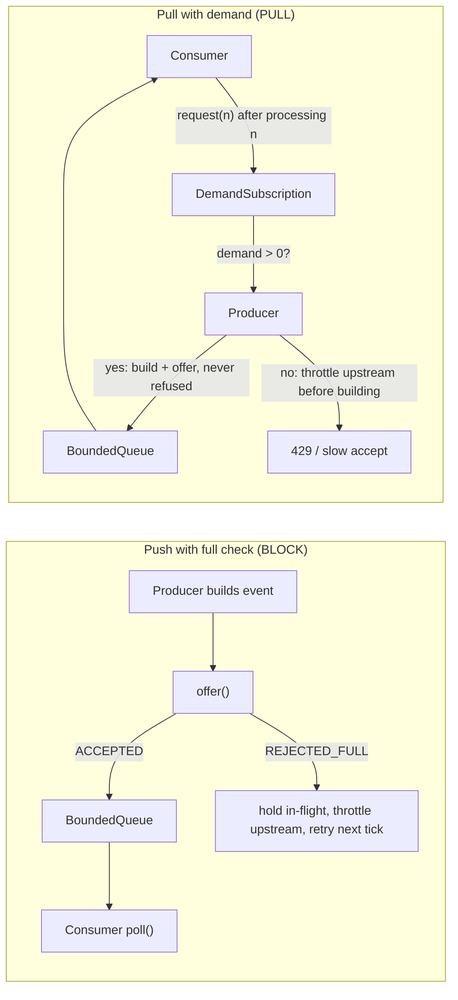

# Backpressure and Flow Control

> The fast producer, the slow consumer, and the queue in between.

**Type:** Build
**Languages:** Java, Python
**Prerequisites:** Phase 8, Lesson 08 (Watermarks, Event Time, and Late Data), Phase 4, Lesson 03 (Bounded Buffers and Producer-Consumer), Phase 10, Lesson 01 (Representing Money)
**Time:** ~75 minutes

## Learning Objectives

- Explain why an unbounded queue between a fast producer and a slow consumer is a deferred outage, and compute how long the deferral lasts
- Build a bounded queue with three explicit overflow policies (block, drop newest, drop oldest) and state what each one sacrifices
- Implement pull-based demand with `request(n)` semantics from the Reactive Streams specification and show why it never offers into a full buffer
- Compare the five strategies under an identical seeded load and read the trade-offs off one table: memory, latency, loss, and where the overload surfaces
- State the conservation invariant for a flow-controlled pipeline and test it
- Decide, for a given payment pipeline, which strategy is acceptable and what the producer must do when it is told to slow down

## The Problem

An authorization service accepts card authorizations over HTTP and publishes a `PaymentEvent` for each one onto an in-process queue. A ledger poster drains the queue and writes a double-entry posting per event to PostgreSQL. On a normal weekday the service admits around 800 authorizations per second and the poster writes 1,000 postings per second. The queue is a `LinkedBlockingQueue` with no capacity argument, which means `Integer.MAX_VALUE`.

On Black Friday at 09:00 the authorization rate climbs to 1,200 per second. The poster, bound by the database's commit latency, still writes 1,000 per second. The queue grows by 200 events per second. Nobody notices, because nothing is failing: every HTTP request returns 200 in 4 ms, every posting commits, the dashboards show throughput at an all-time high. At 09:00 the queue holds 0 events. At 10:00 it holds 720,000. At 11:40, 1.9 million events at roughly 600 bytes each have consumed the heap, the JVM spends 80% of its time in garbage collection, the poster's throughput collapses to 200 per second, the queue grows faster, and at 11:52 the process dies with `OutOfMemoryError`. The 1.9 million authorizations in the queue were approved to cardholders and never posted to the ledger. The ledger is now short by their total, about 94 million USD, and the reconciliation team finds out on Monday.

A colleague proposes a fix: cap the queue at 100,000 and drop events when it is full. Memory is safe, the process stays up, and on the next overload 200 authorizations per second are silently discarded. Approved money, not in the ledger, with no record that it ever existed. The first fix lost everything at once; the second loses a steady trickle forever and calls it stability.

Both fixes share a misconception: that the queue's job is to absorb the difference between the two rates. A queue can absorb a *burst* (a difference that lasts seconds). It cannot absorb a *sustained* difference, because the backlog it accumulates is the integral of the rate gap over time, and that integral has no upper bound. Something in the system must eventually run at the slower rate, and the only question is what: the heap (unbounded queue), the data (drop), or the producer (backpressure). This lesson builds all three and measures them under the same load, so the choice is a table rather than an argument.

## The Concept

### Little's Law and the integral of the gap

Let `lambda_in` be the arrival rate and `mu` the service rate. If `lambda_in <= mu` the queue is stable: its depth fluctuates with bursts but returns to zero. If `lambda_in > mu` for a sustained period `T`, the backlog after `T` is at least `(lambda_in - mu) * T`, and by Little's Law the latency of an event entering a queue of depth `N` is `N / mu`. For the acquirer: `(1200 - 1000) * 3600 = 720,000` events after one hour, and an event entering at that point waits `720,000 / 1000 = 720 seconds` to be posted. The latency is not a side effect of the memory problem; they are the same number in different units.

This gives the first design rule: **a queue's capacity is a latency budget, not a safety margin.** A capacity of 64 with a consumer at 10 per tick means no event waits more than about 6.4 ticks. Choose the capacity by asking "how stale may an event be when the consumer sees it", and the memory bound follows.

### The five things that can give

| Strategy | What runs at the slow rate | Memory | Latency | Loss | Where overload is visible |
|----------|---------------------------|--------|---------|------|---------------------------|
| Unbounded queue | Eventually the heap, then everything | Unbounded | Unbounded | Everything, at once, later | Nowhere, until the crash |
| Drop newest | The data | Bounded | Bounded | Newest events, steady trickle | A counter nobody reads |
| Drop oldest | The data | Bounded | Bounded, lowest | Oldest events, steady trickle | A counter nobody reads |
| Block (push + full check) | The producer, discovered by collision | Bounded | Bounded | None | Producer blocked; upstream throttled |
| Pull (demand signalling) | The producer, told in advance | Bounded | Bounded | None | Zero demand; upstream throttled |

Dropping is legitimate for some data. A metrics pipeline can drop a CPU sample; a market-data feed should drop stale quotes in favour of fresh ones (drop oldest is exactly right there); a video stream drops frames. Payment events are not in that category: an authorization that was approved exists whether or not the ledger hears about it, so dropping it does not reduce load, it creates a reconciliation break.

Blocking and pulling are the two forms of **backpressure**: the consumer's inability to keep up is propagated upstream until it reaches something that can act on it. In the acquirer, that something is the HTTP handler, which can return `429 Too Many Requests` with a `Retry-After`, slow its accept rate, or shed load by rejecting authorizations from the lowest-priority channel first. The decision about what to sacrifice moves from the queue, which knows nothing, to the edge, which knows the business.

### Push with a full check versus pull with demand

Both bound the queue and both lose nothing. They differ in *when the producer learns*.

With a **blocking bounded queue**, the producer builds the event, offers it, and is refused. It now holds an event it cannot deliver, and must either retry (blocking its own thread, which is how `BlockingQueue.put` works) or fail the request that caused it. Overload is discovered by collision, one event at a time, after the work of producing it has been done.

With **pull-based demand**, the consumer tells the producer how many events it can take before any are produced. The producer emits only while outstanding demand is positive. When demand is zero, the producer knows *before* building the event that it should not, and can refuse the upstream request immediately. This is the Reactive Streams model: `Subscription.request(n)` from the consumer, at most `n` `onNext` calls from the producer, demand is additive, and demand that would exceed `Long.MAX_VALUE` saturates rather than wraps (specification rule 3.17). The consumer's natural `request(n)` is "the number of slots I just freed", which keeps the buffer exactly full and never fuller.



In the simulation the two strategies throttle the same number of upstream requests (they must: the consumer is the bottleneck and it delivers the same count either way), but `BLOCK` records 1,977 rejected offers and `PULL` records zero. In a real system each rejected offer is a wasted allocation, a possible thread park, and a retry loop, and at a million events per second that waste is the difference between a service that degrades and one that falls over.

### Worked example by hand

Capacity 4, consumer drains 2 per tick, producer offers 3 per tick, no jitter. Trace `BLOCK` for four ticks. `inFlight` is the event the producer is holding after a refusal.

| Tick | Producer offers | Queue before | Accepted | Refused (held) | Throttled upstream | Consumer takes | Queue after |
|------|-----------------|--------------|----------|----------------|--------------------|----------------|-------------|
| 0 | e1 e2 e3 | 0 | e1 e2 e3 | | 0 | e1 e2 | e3 |
| 1 | e4 e5 e6 | 1 | e4 e5 e6 | | 0 | e3 e4 | e5 e6 |
| 2 | e7 e8 e9 | 2 | e7 e8 | e9 | 0 | e5 e6 | e7 e8 |
| 3 | retry e9, then e10 e11 e12 | 2 | e9 e10 | e11 refused and held | e12 | e7 e8 | e9 e10 |
| 4 | retry e11, then e13 e14 e15 | 2 | e11 e13 | e14 held | e15 | e9 e10 | e11 e13 |

From tick 3 onward the system is in steady state: 2 admitted per tick (the consumer's rate), 1 throttled per tick (the rate gap), queue depth oscillates between 2 and 4, latency at most 2 ticks. The heap is flat. The throttled requests are where the `429` goes. Now trace `UNBOUNDED` on the same input: the queue depth after tick `t` is `t + 1`, and the latency of the event at the back is `(t + 1) / 2` ticks. After 2,000 ticks in the demo it is 5,819 deep with a 489-tick latency, and still growing.

The `PULL` trace differs only in tick 2: the consumer requested 4 initially and has requested 2 per tick since, so at the start of tick 2 outstanding demand is 2, e7 and e8 consume it, and e9 is refused *before being built*, counted as throttled, and nothing is held. No event ever collides with a full queue.

### Sizing the buffer: bursts versus sustained gaps

A bounded queue is for bursts. Deciding its capacity is three questions with numbers:

1. **How long is the longest burst you must absorb without throttling?** The acquirer sees 3-second bursts at 2,000 per second when a large merchant's batch job fires, against a 1,000 per second consumer. Backlog at the end of the burst: `(2000 - 1000) * 3 = 3,000` events.
2. **How stale may an event be when the consumer sees it?** Postings must land within 10 seconds of authorization for the real-time balance to be trusted. With `mu = 1000`, a depth of 3,000 means a 3-second wait: acceptable. A depth of 10,000 would mean 10 seconds: the ceiling.
3. **What does that depth cost in memory?** 10,000 events at 600 bytes is 6 MB, which is nothing. If the answer were 6 GB, the latency budget would have to shrink or the consumer would have to get faster.

So the capacity is about 10,000: comfortably above the burst backlog, at the latency ceiling, and cheap. Any sustained gap beyond that is not the queue's problem, and the overflow policy decides whose problem it is. The demo uses 64 because the simulation's rates are per tick, but the arithmetic is the same.

### Choosing a strategy

| If the data is... | And the producer can... | Choose | Because |
|-------------------|-------------------------|--------|---------|
| Money, orders, anything reconciled | Be slowed (return `429`, slow accept, smaller batches) | `PULL` or `BLOCK` | Nothing admitted may be lost; the edge decides what to shed |
| Money, orders | Not be slowed (an external rail pushing settlement files) | `BLOCK` into a durable log (Kafka, a WAL), then `PULL` from it | The log's retention becomes the capacity; the consumer catches up |
| Latest-value state (prices, positions, sensor readings) | Anything | `DROP_OLDEST` | A stale value is worse than no value; the newest is all that matters |
| Samples, metrics, logs | Anything | `DROP_NEWEST` with a counter | Losing a sample is tolerable; the counter makes the loss visible |
| Anything | Anything | `UNBOUNDED` | Never. It is a choice to crash later instead of deciding now |

The second row is the one payment engineers meet most. When a card network pushes a settlement file, there is no `429` to return; the file arrives. The answer is a tier whose capacity is measured in days of disk rather than megabytes of heap, and a consumer that pulls from it at its own pace. That is the architecture Phase 8, Lesson 01 built the log for.

### Failure modes

- **Retry storms defeat backpressure.** A caller that receives `429` and retries immediately has doubled its request rate. The throttled count climbs, more callers retry, and the edge is now the overloaded component. `Retry-After` and exponential backoff with jitter (Phase 9) are what make the signal effective; without them, backpressure moves the fire rather than putting it out.
- **Backpressure cycles deadlock.** Service A blocks on a full queue to B; B blocks on a full queue to A. Both wait forever. Any blocking backpressure in a cyclic graph needs a timeout (`offer(e, timeout, unit)`) and a decision about what to do when it fires.
- **`CallerRunsPolicy` inverts priorities.** A thread pool that runs rejected tasks on the submitting thread slows the submitter, which is backpressure, but if the submitter is the HTTP acceptor thread, every caller now waits behind one slow task. The policy is right; the placement is wrong.
- **Head-of-line blocking.** One slow event (a posting that hits a lock) at the head of a FIFO holds everything behind it. Bounded queues make this visible quickly (the queue fills and throttles) where an unbounded queue hides it as growing latency. The fix is per-key queues or a dead-letter path, which is Lesson 10.
- **The drop counter nobody reads.** `DROP_NEWEST` with `dropped` incrementing on a metric that has no alert is a silent drop with a receipt. Every drop policy needs an alert threshold, and for money that threshold is one.

### The invariant

Two conservation identities hold at every tick, and `Stats.conserves()` checks both at the end of every run:

```text
offeredLoad == produced + throttled                     every upstream request was admitted or turned away
produced    == delivered + dropped + inFlight + inQueue  every admitted event is in exactly one place
```

The second identity is the stream-processing form of the ledger's rule that money is never created or destroyed. If a refactor loses an event (returns from the producer loop without counting a throttle, say, or polls the queue without counting a delivery) the identity fails. The test runs it for all five strategies on the same seeded load.

### Complexity

`BoundedQueue.offer` and `poll` are `O(1)` on an `ArrayDeque`; `DROP_OLDEST` does one extra `pollFirst`. `DemandSubscription` is one `long`. The simulation is `O(ticks * (producerRate + consumerRate))` plus one sort of the latency list for the percentiles. Memory for the bounded strategies is `O(capacity)`; for `UNBOUNDED` it is `O((lambda_in - mu) * T)`, which is the whole point.

### What this lesson does not do

- It does not use threads. `BlockingQueue.put` really blocks a thread; here, "blocked" is a state the single-threaded simulation records so the result is reproducible from a seed. The Phase 4 bounded-buffer lesson built the real thing with locks and conditions; this lesson is about the policy, not the synchronization.
- It does not distribute backpressure across a network. TCP does this with its receive window (the receiver advertises how many bytes it can take, which is `request(n)` in bytes); HTTP/2 does it per stream; gRPC exposes it to the application. Kafka does it by making consumers pull. Use It covers how each surfaces.
- It does not prioritize. All events are equal in the queue. A real authorization service sheds low-value or low-priority traffic first when throttling; that is a scheduling decision layered on top of the mechanism here.
- It does not retry. A throttled request is counted and forgotten. What the caller does with a `429` (exponential backoff with jitter, Phase 9) is the caller's lesson.

## Build It

The primary walkthrough is in Java. `Money` and `Currency` are the Phase 10 types, trimmed to `plus`.

### Step 1: The bounded queue with an explicit overflow policy

```java
enum OverflowPolicy { BLOCK, DROP_NEWEST, DROP_OLDEST }
enum OfferResult { ACCEPTED, REJECTED_FULL, DROPPED_NEWEST, EVICTED_OLDEST }

final class BoundedQueue<T> {
    private final ArrayDeque<T> items = new ArrayDeque<>();
    private final int capacity;
    private final OverflowPolicy policy;
    private long dropped = 0;
    private int maxDepth = 0;

    OfferResult offer(T item) {
        Objects.requireNonNull(item);
        if (items.size() < capacity) {
            items.addLast(item);
            maxDepth = Math.max(maxDepth, items.size());
            return OfferResult.ACCEPTED;
        }
        return switch (policy) {
            case BLOCK -> OfferResult.REJECTED_FULL;
            case DROP_NEWEST -> { dropped++; yield OfferResult.DROPPED_NEWEST; }
            case DROP_OLDEST -> { items.pollFirst(); dropped++; items.addLast(item); yield OfferResult.EVICTED_OLDEST; }
        };
    }
}
```

The policy is a constructor argument, so a reviewer reading `new BoundedQueue<>(64, OverflowPolicy.DROP_NEWEST)` sees the decision. `offer` returns what happened rather than a boolean, so the caller can distinguish "take it back and retry" (`REJECTED_FULL`) from "the queue took responsibility for it, even if that meant discarding it" (the other three). `dropped` and `maxDepth` are the two numbers that end up on a dashboard. An unbounded queue is `capacity = Integer.MAX_VALUE`, which is also the `LinkedBlockingQueue` default, and the simulation uses exactly that to model it.

**Predict:** under `DROP_OLDEST`, is `maxDepth` ever greater than `capacity`?

### Step 2: Demand

```java
final class DemandSubscription {
    private long demand = 0;

    void request(long n) {
        if (n <= 0) throw new IllegalArgumentException("request(n) requires n > 0 (Reactive Streams rule 3.9)");
        long next = demand + n;
        demand = next < 0 ? Long.MAX_VALUE : next;   // saturate, never wrap
    }

    boolean tryConsumeOne() {
        if (demand <= 0) return false;
        if (demand != Long.MAX_VALUE) demand--;
        return true;
    }
}
```

Three rules from the specification in nine lines. `request(0)` and negative requests are errors, not no-ops (rule 3.9). Demand is additive (rule 3.17), so a consumer that calls `request(2)` and then `request(3)` has five outstanding. And the sum saturates at `Long.MAX_VALUE`, which the specification defines as "effectively unbounded": `request(Long.MAX_VALUE)` turns the pull model back into push, and `tryConsumeOne` leaves it there rather than decrementing toward a bound that would never be reached. The overflow check `next < 0` works because adding two non-negative `long`s wraps negative exactly when the true sum exceeds `Long.MAX_VALUE`.

**Predict:** a consumer processes in batches of 10 and calls `request(10)` after each batch, starting with `request(64)`. What is the maximum queue depth, and does the answer depend on the producer's rate?

### Step 3: The producer loop

```java
if (inFlight != null) {
    if (queue.offer(inFlight) == OfferResult.REJECTED_FULL) { rejected++; blockedThisTick = true; }
    else inFlight = null;
}

int want = producerRate + (producerJitter == 0 ? 0 : random.nextInt(producerJitter + 1));
for (int i = 0; i < want; i++) {
    offered++;
    long cents = 100 + random.nextInt(9900);
    if (inFlight != null) { throttled++; continue; }
    if (strategy == Strategy.PULL && !subscription.tryConsumeOne()) {
        throttled++; blockedThisTick = true; continue;
    }
    PaymentEvent e = new PaymentEvent(nextId++, tick, Money.ofMinor(cents, Currency.USD));
    produced++;
    OfferResult r = queue.offer(e);
    if (r == OfferResult.REJECTED_FULL) { rejected++; inFlight = e; blockedThisTick = true; }
}
```

The producer is a request handler, not a loop that manufactures events. Each of the `want` requests this tick is an upstream caller. If the handler is stuck holding an event the queue refused, the caller is throttled: that is the `429`. Under `PULL`, the handler checks demand first and throttles *before* allocating the event. Under `BLOCK`, it allocates, offers, and discovers the refusal; the event becomes `inFlight` and is retried at the top of the next tick. The amount is drawn from the seeded `Random` for every request, admitted or not, so all five strategies see byte-identical load and the comparison table is fair.

**Predict:** why does `inFlight` hold at most one event, and what would change in the conservation identity if it held a list?

### Step 4: The consumer and the demand signal

```java
boolean stalled = random.nextDouble() < consumerStallProbability;
int processed = 0;
if (!stalled) {
    for (int i = 0; i < consumerRate; i++) {
        PaymentEvent e = queue.poll();
        if (e == null) break;
        delivered++;
        processed++;
        latencies.add((long) tick - e.producedAtTick());
        deliveredAmount = deliveredAmount.plus(e.amount());
    }
}
if (strategy == Strategy.PULL && processed > 0) subscription.request(processed);
```

The stall is the realistic part: a consumer's rate is not constant, and a 10% chance of a zero-throughput tick (a GC pause, a slow commit, a lock) is what turns "producer slightly faster on average" into "queue grows". The demand signal is the last line: request exactly what was freed. Requesting more than that would let the queue exceed its capacity; requesting less would starve the producer while slots sit empty.

**Predict:** if the consumer requested `consumerRate` every tick regardless of how many it actually processed, what would happen to the queue depth during stalls?

### Step 5: Statistics and the conservation check

```java
record Stats(Strategy strategy, long offeredLoad, long produced, long throttled, long delivered, long dropped,
             long inFlight, long inQueue, long rejectedOffers, long producerBlockedTicks, int maxQueueDepth,
             long maxLatencyTicks, long p99LatencyTicks, Money deliveredAmount) {

    boolean conserves() {
        return offeredLoad == produced + throttled && produced == delivered + dropped + inFlight + inQueue;
    }
}
```

Every number a dashboard would show, as exact counts. `deliveredAmount` is a `Money` so the sum of posted amounts can be reconciled against the authorization total by the test; it is the number the Monday-morning incident is about.

### Step 6: Run it

```bash
cd phases/08-messaging-and-streams/09-backpressure/code/java
javac -d .out *.java && java -cp .out Main
java -cp .out MainTest
```

Expected output, abbreviated:

```console
== Fast producer (~12/tick), slow consumer (10/tick, 10% stalls), queue capacity 64, 2000 ticks, seed 42 ==
UNBOUNDED    offered= 23969 produced= 23969 throttled=    0 delivered= 18150 dropped=    0 inQueue= 5819 rejectedOffers=    0 maxDepth=  5829 maxLat=  489 p99Lat= 483
DROP_NEWEST  offered= 23969 produced= 23969 throttled=    0 delivered= 18150 dropped= 5765 inQueue=   54 rejectedOffers=    0 maxDepth=    64 maxLat=   12 p99Lat=   9
DROP_OLDEST  offered= 23969 produced= 23969 throttled=    0 delivered= 18150 dropped= 5765 inQueue=   54 rejectedOffers=    0 maxDepth=    64 maxLat=    6 p99Lat=   5
BLOCK        offered= 23969 produced= 18205 throttled= 5764 delivered= 18150 dropped=    0 inQueue=   54 rejectedOffers= 1977 maxDepth=    64 maxLat=   12 p99Lat=   9
PULL         offered= 23969 produced= 18204 throttled= 5765 delivered= 18150 dropped=    0 inQueue=   54 rejectedOffers=    0 maxDepth=    64 maxLat=   12 p99Lat=   9

== Same strategies when the consumer is fast enough (12/tick, no stalls): backpressure costs nothing ==
UNBOUNDED    offered= 23969 produced= 23969 throttled=    0 delivered= 23969 dropped=    0 inQueue=    0 ...
BLOCK        offered= 23969 produced= 23969 throttled=    0 delivered= 23969 dropped=    0 inQueue=    0 ...
```

Read down the `delivered` column first: every strategy delivers 18,150, because the consumer is the bottleneck and no queueing policy changes that. Then read across: the 5,800-odd events the consumer could not handle are in the heap (`UNBOUNDED`), destroyed (`DROP_*`), or never admitted (`BLOCK`, `PULL`). The second table is the argument for always using backpressure: when the consumer keeps up, the bounded strategies behave identically to the unbounded one.

### In Python

```python
class BoundedQueue(Generic[T]):
    def __init__(self, capacity: int, policy: OverflowPolicy) -> None:
        if capacity <= 0:
            raise ValueError("capacity must be positive")
        self._items: Deque[T] = deque()      # never deque(maxlen=n): that drops oldest silently
        ...

class DemandSubscription:
    def request(self, n: int) -> None:
        if n <= 0:
            raise ValueError("request(n) requires n > 0 (Reactive Streams rule 3.9)")
        self._demand = min(self._demand + n, LONG_MAX)  # saturate, never wrap
```

Differences, all in `code/python/main.py`:

- **`collections.deque` without `maxlen`.** `deque(maxlen=n)` is a built-in `DROP_OLDEST` that evicts silently and never reports it; the whole point of `BoundedQueue` is that the policy is explicit and counted, so the deque is unbounded and the capacity check lives in `offer`.
- **Saturation is kept on purpose.** Python `int` cannot overflow, so `demand + n` would never wrap; `request` still clamps to `LONG_MAX` (`2**63 - 1`) because "demand is effectively unbounded at `Long.MAX_VALUE`" is the Reactive Streams contract (rule 3.17), not an accident of 64-bit arithmetic, and `try_consume_one` leaves saturated demand untouched exactly as the Java does.
- **The seeded run reproduces `java.util.Random`.** `random.Random(42)` would pick different jitter, amounts, and stalls and the table would not match. `JavaRandom` implements the 48-bit LCG including `nextInt(bound)`'s power-of-two fast path and rejection loop (the `bits - val + (bound - 1) < 0` overflow test becomes `> INT_MAX`), so every count in the demo, down to `rejectedOffers=1977`, is identical in both languages; the test file pins those counts.
- **`Integer.MAX_VALUE` is the constant `INT_MAX`** for the "unbounded" capacity, `OverflowPolicy`, `OfferResult`, and `Strategy` are `Enum`s, `Stats` is a frozen dataclass (so `==` gives the determinism check for free), and `ValueError`/`TypeError` replace `IllegalArgumentException`/`NullPointerException`.

Run it from `code/python/` with `python3 main.py`; test with `python3 -m unittest -v`. Both tables match the Java output number for number.

### Porting notes

In Go, `BoundedQueue` is a slice-backed ring or a `container/list`; `request(n)` with `n <= 0` returns an error value; and the natural production analogue is a buffered channel, where `select` with a `default` case is `DROP_NEWEST` and a plain send is `BLOCK`. The Go port keeps the simulation single-threaded with a seeded generator (`rand.New(rand.NewSource(42))`); because Go's generator differs from `java.util.Random`, that port asserts the invariants and the qualitative ordering, not the exact counts.

## Use It

### `java.util.concurrent.BlockingQueue`

`ArrayBlockingQueue(capacity)` is Step 1 with `BLOCK`, plus real thread parking: `put` blocks until space exists, `offer` returns `false` immediately, `offer(e, timeout, unit)` waits a bounded time. `LinkedBlockingQueue()` with no capacity is `UNBOUNDED`, and it is the default queue in `Executors.newFixedThreadPool`, which is why a fixed thread pool under sustained overload dies of memory rather than rejecting work. `ThreadPoolExecutor` makes the policy explicit through `RejectedExecutionHandler`: `AbortPolicy` (throw: block at the caller), `CallerRunsPolicy` (the submitting thread does the work: backpressure by making the producer slower), `DiscardPolicy` (drop newest), `DiscardOldestPolicy` (drop oldest). The four handlers are this lesson's table.

### `java.util.concurrent.Flow` and Reactive Streams

Java 9 adopted the Reactive Streams interfaces as `java.util.concurrent.Flow`: `Publisher`, `Subscriber`, `Subscription` with `request(long n)` and `cancel()`. `SubmissionPublisher` is a reference implementation with a bounded buffer per subscriber and a configurable drop/block behaviour when the buffer fills. Project Reactor, RxJava, and Akka Streams implement the same specification, and gRPC's Java client exposes `request(n)` on its stream observers. The trap: `request(Long.MAX_VALUE)` is the default in many convenience methods and quietly turns a pull pipeline back into push.

### Kafka: pull by design

A Kafka consumer polls. `max.poll.records` bounds how many records one `poll()` returns, `fetch.max.bytes` bounds the bytes, and the broker never pushes. A slow consumer simply polls less often and its lag (`consumer_lag` per partition) grows on the broker's disk, which is bounded by retention rather than by the consumer's heap. That is backpressure moved to a tier designed to hold a backlog, and it is the reason "put Kafka in front of it" is often the right answer to a sustained rate gap: the log is the bounded buffer, retention is the capacity, and lag is the dashboard. Producers get their own backpressure through `buffer.memory` and `max.block.ms`: when the client-side buffer is full, `send()` blocks for `max.block.ms` and then throws.

### TCP and HTTP/2

TCP flow control is `request(n)` in bytes: the receiver advertises a window, the sender may have at most that many unacknowledged bytes in flight, and a zero window stops the sender entirely (RFC 9293, section 3.8.6). HTTP/2 adds a per-stream window on top (RFC 9113, section 5.2) so one slow stream does not stall a connection. gRPC exposes both through its streaming API. When a service "slows down because the client is slow", this is the mechanism, and it works for the same reason Step 2 does: the receiver states its capacity before the sender commits bytes.

### HTTP 429 and `Retry-After`

At the edge, backpressure becomes a status code. RFC 6585 defines `429 Too Many Requests`, and the `Retry-After` header tells the caller how long to wait. Stripe, Adyen, and most payment APIs return `429` with a rate-limit reason when a merchant exceeds their quota; a well-behaved client treats it as the `throttled` counter in this lesson and backs off. The design question the acquirer should have answered on Black Friday is not "how big should the queue be" but "which callers get `429` first, and what do they do with it".

### Reading it on a dashboard

The simulation's `Stats` record maps onto the metrics a production system should already export. The pattern of the three graphs tells you which strategy you are actually running, whatever the design document says.

| Graph | Unbounded queue | Drop policy | Backpressure |
|-------|-----------------|-------------|--------------|
| Queue depth over time | Rises linearly during overload and never returns to zero until a restart | Flat line at capacity during overload | Flat line at capacity during overload |
| End-to-end latency (p99) | Rises linearly with depth; the two graphs have the same shape | Flat at `capacity / mu` | Flat at `capacity / mu` |
| Loss or refusal counter | Zero, then a restart | `dropped` rising at the rate gap | `throttled` or `429` count rising at the rate gap |
| Heap or RSS | Rises with depth; GC time climbs; throughput collapses before the crash | Flat | Flat |

The diagnostic question for an incident is "where did the rate gap go?" If no graph shows it, it went into memory, and the clock is running.

### Go channels and Python `asyncio.Queue`

A Go buffered channel `make(chan PaymentEvent, 64)` is a bounded queue whose policy is chosen at the send site: a plain `ch <- e` is `BLOCK`, and `select { case ch <- e: default: dropped++ }` is `DROP_NEWEST`. An unbuffered channel is a bounded queue of capacity zero, which is pure backpressure with no burst absorption. Python's `asyncio.Queue(maxsize=64)` has `put` (awaits, `BLOCK`) and `put_nowait` (raises `QueueFull`, the caller decides), and `asyncio.Queue()` with no `maxsize` is unbounded. Both languages make the unbounded form the shortest to type, which is why it is the most common.

## Ship It

`outputs/checklist-flow-control.md` is a review checklist for any queue, buffer, or thread pool between two components with independent rates: is the capacity a stated latency budget, what is the overflow policy and who chose it, where does the backpressure signal surface, and what does the producer do when it arrives. Use it when a design document contains the word "queue".

## Exercises

1. **Reinforce.** Add `OverflowPolicy.DROP_BY_PRIORITY`: `PaymentEvent` gains a `priority` field, and when the queue is full the lowest-priority event (the new one or one already queued) is dropped. Show with a test that a high-priority event is never dropped while a lower-priority one is in the queue. Then write one sentence on why this is still not acceptable for approved authorizations.
2. **Apply.** Replace the single consumer with `k` consumers sharing the queue (round-robin poll in the simulation) and find, for the demo's load, the smallest `k` at which `BLOCK` throttles nothing. Then add a seeded 1% chance that a consumer stalls for 50 consecutive ticks, and observe what happens to the p99 latency under `UNBOUNDED` versus `PULL`.
3. **Extend.** Combine with Phase 8, Lesson 08 (Watermarks). Feed the delivered events into the `EventTimeWindowOperator` using `producedAtTick` as event time and the delivery tick as arrival time. Under `UNBOUNDED`, the 489-tick queueing delay makes events arrive long after their window's watermark has passed. Measure how many land in the side output for a bound of 10 ticks, then show that `PULL` with capacity 64 sends none there. Backpressure is also a watermark-correctness mechanism.

## Key Terms

| Term | What people say | What it actually means |
|------|-----------------|------------------------|
| Backpressure | "slow down the producer" | Propagating a consumer's inability to keep up toward the source until it reaches a component that can reduce the rate or shed load with knowledge of the business |
| Flow control | "rate limiting" | The mechanism by which a receiver bounds what a sender may have outstanding; TCP windows, `request(n)`, bounded queues; distinct from rate limiting, which is a policy on the sender's side |
| Bounded buffer | "the queue" | A FIFO with a hard capacity and a stated overflow policy; its capacity is a latency budget (`depth / service rate`), not a safety margin |
| Overflow policy | "what happens when it's full" | One of block, drop newest, drop oldest, or (badly) grow without bound; the choice decides what the system sacrifices under sustained overload |
| Demand | "request(n)" | The number of items a consumer has declared it can accept; additive, consumed one per emission, saturating at `Long.MAX_VALUE` which means unbounded |
| Little's Law | "queue length equals rate times wait" | `L = lambda * W`: the average number in a system equals arrival rate times average time in the system; the formula that turns a queue depth into a latency |
| Load shedding | "dropping requests" | Refusing work at the edge, with knowledge of priority, before it is admitted; the correct place for a `429`, as opposed to dropping admitted work from a queue |
| Reactive Streams | "reactive" | A specification (and `java.util.concurrent.Flow`) for asynchronous stream processing with non-blocking backpressure via `Subscription.request(n)` |

## Further Reading

- [Reactive Streams Specification 1.0.4](https://github.com/reactive-streams/reactive-streams-jvm/blob/v1.0.4/README.md) — the rules `DemandSubscription` implements, in particular 3.9 (positive demand), 3.17 (additive, saturating demand), and the definition of `Long.MAX_VALUE` as unbounded.
- [`java.util.concurrent.Flow` (Java SE 21 API)](https://docs.oracle.com/en/java/javase/21/docs/api/java.base/java/util/concurrent/Flow.html) — the JDK's adoption of the specification, and `SubmissionPublisher` as a bounded-buffer reference implementation.
- [`ThreadPoolExecutor` (Java SE 21 API): Rejected tasks](https://docs.oracle.com/en/java/javase/21/docs/api/java.base/java/util/concurrent/ThreadPoolExecutor.html) — the four `RejectedExecutionHandler` policies, which are this lesson's table in a thread pool.
- [RFC 9293: Transmission Control Protocol, section 3.8.6 (Managing the Window)](https://www.rfc-editor.org/rfc/rfc9293#section-3.8.6) — flow control as a receiver-advertised window; the oldest and most widely deployed pull-based backpressure.
- [RFC 9113: HTTP/2, section 5.2 (Flow Control)](https://www.rfc-editor.org/rfc/rfc9113#section-5.2) — per-stream and per-connection windows, and why one slow stream must not stall the connection.
- [RFC 6585: Additional HTTP Status Codes, section 4 (429 Too Many Requests)](https://www.rfc-editor.org/rfc/rfc6585#section-4) — what the `throttled` counter becomes at the edge, and the `Retry-After` header.
- [Little, J. D. C. (1961), "A Proof for the Queuing Formula: L = lambda W"](https://doi.org/10.1287/opre.9.3.383) — the one-line relationship between queue depth, arrival rate, and latency that makes capacity a latency budget.
