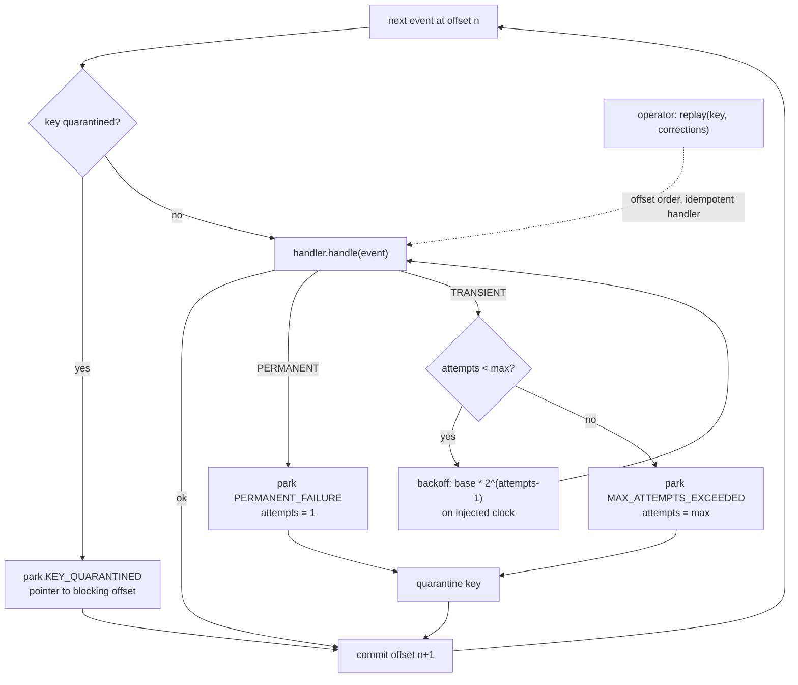

# Dead-Letter Queues and Poison Messages

> One malformed event must not stall every account behind it.

**Type:** Build
**Languages:** Java, Python, Go
**Prerequisites:** Phase 8 Lesson 09 (Backpressure and Flow Control), Phase 8 Lesson 04 (Message Ordering and Keys), Phase 8 Lesson 03 (Delivery Guarantees), Phase 0 Lesson 07 (Decimal and Integer Arithmetic)
**Time:** ~60 minutes

## Learning Objectives

- Explain head-of-line blocking in a partitioned stream and show, with one poison message, how it stalls every key on the partition
- Classify handler failures as transient or permanent and derive a different retry policy for each
- Build a consumer that bounds retries with an attempts counter and exponential backoff on an injected clock, then parks the event in a dead-letter queue with a structured reason
- Implement per-key quarantine so a parked event blocks only later events for the same key, preserving per-key order while every other key keeps flowing
- Replay parked events for one key in offset order after a fix, with or without a corrected payload, against an idempotent handler
- State and test the accounting invariant: every consumed event is processed or parked, and the committed offset always reaches the end of the partition

## The Problem

A ledger-posting service consumes a Kafka partition of posting events, one per authorization, keyed by account so each account's postings arrive in order. The handler parses the amount, looks up the currency, and writes a posting. At 02:14 a new release of the upstream pricing service starts emitting amounts with three decimal places for a handful of merchants whose fee schedules were migrated to basis-point precision: `"amount": "12.345", "currency": "USD"`. The handler, correctly, refuses to post a fraction of a cent and throws.

The consumer's error handling is the default one: log the exception, do not commit the offset, poll again. The same record comes back. It fails again. The consumer is now in a loop at offset 48,211,907 of partition 7, retrying a message that will never parse, at 400 retries per second, filling the log with the same stack trace. Partition 7 carries roughly one eighth of all accounts. Every one of them stops receiving postings. Real-time balances for those accounts freeze. Cardholders whose available balance depends on those postings see declines. The on-call engineer is paged at 02:31 for "consumer lag increasing on partition 7", finds the stack trace at 02:50, and has two options: skip the offset by hand (losing a posting that finance will later ask about) or hotfix the parser at three in the morning. The other seven partitions were fine the whole time. One event stalled an eighth of the ledger for forty minutes.

The second failure is quieter. A different team's consumer has a `maxRetries = 5` guard that, after five failures, logs `WARN dropping message` and commits the offset. Partition 7 does not stall. Instead the 12.345 USD posting, and the 1,100 others like it over the next hour, are gone. The account balances are wrong by small amounts that nobody notices until month-end reconciliation, when the sum of postings does not match the sum of authorizations and there is no record of what was dropped, because the `WARN` lines rotated out of the log retention a week earlier.

Both failures come from treating "this message failed" as a single condition with a single response. It is at least three conditions. A database timeout is transient and deserves a retry with backoff. A payload that cannot parse is permanent and retrying it is pure waste. A message that is fine on its own but belongs to a key whose earlier message is stuck must not jump the queue, because posting a 40.00 debit before the 12.34 credit it follows would change the balance history. The mechanism that handles all three is a dead-letter queue with an attempts counter, a reason, per-key quarantine, and a replay path, and that is what this lesson builds.

## The Concept

### Head-of-line blocking

A partition is a FIFO. The consumer processes offset `n` before offset `n+1`. This is what gives per-key ordering (Lesson 04): two postings for the same account are on the same partition in the order they were produced. It also means that if offset `n` cannot be processed, offset `n+1` cannot be reached, for every key on the partition, not just the key that offset `n` belongs to.

The partition carries many keys because partitioning is coarse: thousands of accounts hash to partition 7. Ordering is needed only within a key. Blocking is paid across all of them. The gap between what is needed (per-key order) and what is paid (per-partition stall) is the space in which a dead-letter queue works.

### Transient versus permanent

| Failure | Example | Will a retry help? | Correct response |
|---------|---------|--------------------|------------------|
| Transient | Database timeout, connection reset, lock wait, downstream `503`, rate limit | Probably, after a delay | Retry with exponential backoff, bounded by a maximum attempt count |
| Permanent (poison) | Unparseable payload, unknown currency code, schema violation, business rule that cannot be satisfied (`amount` has more decimals than the currency allows) | Never, until code or data changes | Park immediately; do not waste a single retry |
| Unknown | Any exception the handler did not classify | Unknown | Treat as transient but with a low attempt cap, and alert, because an unclassified failure is a bug in the classifier |

The handler is the only component that can make the classification, because only it knows whether `ArithmeticException` here means "bad input" or "overflowed a counter that will reset". The lesson's `HandlerException` carries a `FailureKind` for exactly that reason. A consumer that catches `Exception` and retries everything five times is spending four retries on poison and possibly too few on a database that needs thirty seconds to fail over.

### The dead-letter queue is a parking lot with paperwork

A dead-letter queue (DLQ) is a second destination for events the consumer could not process. Moving an event there lets the offset advance. That is the whole mechanism; everything else is about making the parked event useful later. A dead letter that is only the original bytes is a drop with a longer retention period. A useful dead letter carries:

- **The event**, byte-for-byte, so it can be replayed without reconstruction.
- **The reason**, as an enumeration (`PERMANENT_FAILURE`, `MAX_ATTEMPTS_EXCEEDED`, `KEY_QUARANTINED`), so a dashboard can count by cause and an operator can filter.
- **The attempt count**, so a `MAX_ATTEMPTS_EXCEEDED` with 3 attempts is distinguishable from a permanent failure parked on attempt 1.
- **The last error message**, so the operator does not have to reproduce the failure to learn what it was.
- **When it was parked**, on the consumer's clock, so the age of the DLQ is measurable and alertable.

### Per-key quarantine

Parking offset 2 (acct-A, 12.345 USD) and continuing lets acct-B and acct-C flow. But offset 4 is acct-A again: `-40.00 USD`, perfectly well formed. Processing it would apply a debit before the credit that precedes it in the account's history. For a running balance the final number is the same, but the intermediate balance (which an overdraft check, an interest calculation, or an audit trail depends on) is not. Per-key order has been violated for acct-A.

Quarantine fixes this: once a key has an event in the DLQ, every later event for that key is parked too, with reason `KEY_QUARANTINED` and a pointer to the offset that caused it. The handler is never called for them. When the operator fixes offset 2 and replays acct-A, the replay applies offsets 2, 4, and 9 in order and the account's history is exactly what it would have been. Other keys never notice.

The cost is that one poison message for a busy account parks every subsequent event for that account until someone acts. That is the correct cost: the alternative is either a stalled partition (everyone pays) or a corrupted history (the account pays silently). An alert on quarantined-key age is the operational consequence.



### Worked example by hand

Ten events on one partition, four accounts. `maxAttempts = 3`, base backoff 100 ms, a ledger that times out on one call in four (seeded so the run is reproducible). Offset 2 has three decimals in USD; offset 6 has currency `US$`.

| Offset | Key | Payload | Handler outcome | Consumer action | DLQ reason | Clock |
|--------|-----|---------|-----------------|-----------------|------------|-------|
| 0 | acct-A | 100.00 USD | posted | commit 1 | | 0 |
| 1 | acct-B | 25.50 USD | posted | commit 2 | | 0 |
| 2 | acct-A | 12.345 USD | PERMANENT: excess precision | park, quarantine acct-A, commit 3 | PERMANENT_FAILURE, attempts 1 | 0 |
| 3 | acct-C | 1200 JPY | posted | commit 4 | | 0 |
| 4 | acct-A | -40.00 USD | not called | park, commit 5 | KEY_QUARANTINED (offset 2) | 0 |
| 5 | acct-B | 10.00 USD | TRANSIENT x3 | backoff 100, backoff 200, park, quarantine acct-B, commit 6 | MAX_ATTEMPTS_EXCEEDED, attempts 3 | 300 |
| 6 | acct-D | 7.00 US$ | PERMANENT: unknown currency | park, quarantine acct-D, commit 7 | PERMANENT_FAILURE, attempts 1 | 300 |
| 7 | acct-C | 300 JPY | posted | commit 8 | | 300 |
| 8 | acct-B | 4.25 USD | not called | park, commit 9 | KEY_QUARANTINED (offset 5) | 300 |
| 9 | acct-A | 5.00 USD | not called | park, commit 10 | KEY_QUARANTINED (offset 2) | 300 |

End state: processed 4, parked 6 (3 of them quarantined followers), 2 transient retries, committed offset 10, balances acct-A 100.00, acct-B 25.50, acct-C 1500 JPY. The stop-the-world consumer on the same input: processed 2, committed offset 2, stuck.

Then the operator acts. Finance approves rounding offset 2 to 12.34. `replay("acct-A", {2: corrected})` takes the three acct-A dead letters in offset order, applies 12.34, -40.00, and 5.00, and acct-A ends at 77.34 USD with the correct history. The database has recovered, so `replay("acct-B", {})` applies 10.00 and 4.25 unchanged: acct-B is 39.75. One dead letter remains, acct-D, waiting for someone to decide whether `US$` means USD.

### The invariant

Two properties hold after every `consume` and every `replay`, and the tests check both:

```text
processed + parked == events consumed            every event is in exactly one of: applied, parked
committedOffset == last offset + 1               the partition never stalls
```

The first is the conservation rule from the previous two lessons, in DLQ form. A consumer that drops an event after `maxRetries` without parking it breaks the left side; a consumer that stops committing on failure breaks the right side. The second DLQ-specific promise is **per-key order under replay**: for any key, the sequence of offsets the handler successfully applied is increasing. Quarantine guarantees it during consumption; sorting by offset guarantees it during replay; stopping the replay at the first re-failure (and re-parking the followers) guarantees it when the fix was incomplete.

### Idempotency is not optional

Retries re-invoke the handler. A transient failure thrown *after* the posting was written (the database committed, then the connection dropped before the acknowledgement) means the retry will write it again unless the handler checks. `LedgerPostingHandler` keeps an `applied` set keyed by offset and returns early on a repeat. In production the same check is a unique constraint on `(partition, offset)` or an idempotency key in the posting table. Without it, a DLQ with retries is a double-posting machine, which is worse than the stall it replaced. Lesson 03 is the full treatment.

### Choosing the retry parameters

`maxAttempts` and the backoff base are not tuning constants; they encode how long the partition may be blocked for one event and how long a dependency gets to recover.

| Dependency | Typical recovery time | Suggested policy | Reasoning |
|------------|-----------------------|------------------|-----------|
| Local database with connection pool | 50 ms to 2 s (pool wait, failover) | 3 attempts, base 100 ms (total 300 ms) | Most pool waits clear in under a second; a 2-second failover is rare enough to park and replay |
| Remote service behind a load balancer | 1 to 10 s (instance replacement) | 4 attempts, base 250 ms (total 1.75 s) | Longer than this blocks the partition for every key; park and let a delay topic or replay handle the rest |
| Rate-limited third-party API (`429`) | As stated by `Retry-After` | Honour the header once, then park | Retrying against a rate limit makes the limit worse; the DLQ is the buffer |
| Anything permanent | Never | 1 attempt | Every additional attempt is a lie to the metrics |

The sum of backoffs is the maximum time one event blocks its partition, and in Lesson 09's terms it is the stall that drives the queue depth. If that sum exceeds what the latency budget allows, the fix is not a bigger `maxAttempts`; it is to park sooner and replay later, or to move retries off the partition onto a delay topic.

### Failure modes

- **Retrying poison.** A consumer that cannot tell transient from permanent retries a parse error `maxAttempts` times, blocks the partition for the full backoff sum, and then parks it anyway. The classification is the handler's job; a consumer that does not receive one should treat the failure as permanent, not transient.
- **Dropping after retries.** `maxRetries` followed by `log.warn` and a commit is a DLQ with the log's retention and no replay. The conservation invariant catches this in tests; in production, only reconciliation does.
- **Processing quarantined followers.** A DLQ without per-key quarantine lets offset 4 post before offset 2 is fixed. The final balance is right and the history is wrong, and nothing in the system notices until an auditor replays the account.
- **Replaying against a non-idempotent handler.** A transient failure thrown after the write means the retry or replay writes twice. Every handler behind a DLQ needs an idempotency check keyed on something stable (offset, event id), and the test for it is to call `handle` twice with the same event.
- **The DLQ nobody drains.** A dead-letter queue with no alert on its oldest entry's age is a drop with a longer fuse. The runbook in Ship It starts with that alert.
- **Replaying out of order.** A replay tool that takes dead letters in the order they were parked (which is partition order, so usually right) breaks when the same key was parked, replayed partially, and parked again. Sort by offset, always.

### Complexity

`consume` is `O(n * maxAttempts)` handler calls in the worst case, `O(n)` in the common one. Quarantine lookup is `O(1)` per event. `replay(key)` is `O(d log d)` for `d` dead letters on that key (the sort), plus the handler calls. The DLQ is `O(d)` memory for all parked events; `forKey` is a linear scan, which is fine for a parking lot that should be nearly empty and alarming when it is not. A production DLQ is a topic or a table and the per-key view is an index.

### What this lesson does not do

- **It does not retry across restarts.** The attempts counter lives in memory for the duration of one `attempt` call. Kafka consumers that want retries to survive a crash write the count into message headers on a retry topic; SQS tracks `ApproximateReceiveCount` on the broker. Either way the counter must live somewhere the retry can see it.
- **It does not delay retries in wall-clock time.** `SimClock.advance` records the backoff; nothing sleeps. A production consumer either blocks the partition for the backoff (acceptable for 100 ms, not for 30 s) or publishes to a delay topic and moves on.
- **It does not decide what the fix is.** Replay accepts a `corrections` map and trusts it. Whether 12.345 USD becomes 12.34 or 12.35 or a rejected transaction is a business decision with an approver, and the lesson's job is to make that decision possible rather than forced at 3 a.m.
- **It does not expire dead letters.** A real DLQ has retention and an alert when its oldest entry exceeds an SLA. Here it is a list.

## Build It

The primary walkthrough is in Java. `Money.parse` is the Phase 10 parser, kept whole because its precision check is what makes offset 2 a poison message.

### Step 1: Events, failures, and the clock

```java
record Event(long offset, String accountKey, String amountText, String currencyCode) {}

enum FailureKind { TRANSIENT, PERMANENT }

final class HandlerException extends RuntimeException {
    final FailureKind kind;
    HandlerException(FailureKind kind, String message) { super(message); this.kind = kind; }
}

final class SimClock {
    private long now = 0;
    long now() { return now; }
    void advance(long millis) { if (millis < 0) throw new IllegalArgumentException("cannot advance backwards"); now += millis; }
}
```

The event carries the payload as the producer serialized it: strings, not parsed values. A poison message is one that cannot be parsed, so parsing must happen inside the handler where it can fail and be classified. `HandlerException` is the one channel from handler to consumer, and its `kind` is the only thing the retry policy looks at. The clock is injected so backoff is recorded rather than slept; tests assert on `clock.now()`.

**Predict:** if the handler threw plain `IllegalArgumentException` for a bad amount instead of a classified `HandlerException`, what would the consumer have to assume, and how many times would it call the handler for offset 2?

### Step 2: An idempotent handler that classifies its failures

```java
@Override public void handle(Event e) {
    Currency currency;
    Money amount;
    try {
        currency = Currency.of(e.currencyCode());
        amount = Money.parse(e.amountText(), currency);
    } catch (IllegalArgumentException | ArithmeticException ex) {
        throw new HandlerException(FailureKind.PERMANENT, ex.getMessage());
    }
    if (faults.shouldFail()) throw new HandlerException(FailureKind.TRANSIENT, "ledger db timeout");
    if (applied.containsKey(e.offset())) return;
    balances.merge(e.accountKey(), amount, Money::plus);
    applied.put(e.offset(), Boolean.TRUE);
}
```

Parse failures are permanent: the bytes will not parse differently next time. The injected database timeout is transient. The `applied` check comes after the fault injection on purpose: a retry of an offset that already posted (the timeout happened after the write) must be a no-op, and the test `handler is idempotent per offset` proves it. Note that `NumberFormatException` extends `IllegalArgumentException`, so one `catch` covers the unknown currency, the garbage amount, and the excess-precision `ArithmeticException` from `Money.parse`.

**Predict:** `Money.parse("12.345", USD)` throws `ArithmeticException`. What would happen downstream if `parse` rounded to 12.35 instead, and who would discover it?

### Step 3: The dead letter and its queue

```java
enum ParkReason { PERMANENT_FAILURE, MAX_ATTEMPTS_EXCEEDED, KEY_QUARANTINED }

record DeadLetter(Event event, ParkReason reason, int attempts, String lastError, long parkedAt) {}

final class DeadLetterQueue {
    private final List<DeadLetter> entries = new ArrayList<>();
    void park(DeadLetter letter) { entries.add(letter); }
    List<DeadLetter> forKey(String key) { /* linear scan, offset order preserved */ }
    void clear(String key) { entries.removeIf(d -> d.event().accountKey().equals(key)); }
}
```

Five fields, each one a question an operator asks at 3 a.m.: what was it, why is it here, how hard did we try, what did it say, how long has it been sitting. `forKey` is the replay unit, because fixes are usually per cause and causes are usually per key (one merchant's pricing migration, one account with a bad currency).

### Step 4: The consumer loop with quarantine

```java
void consume(List<Event> partition) {
    for (Event e : partition) {
        if (quarantinedKeys.containsKey(e.accountKey())) {
            dlq.park(new DeadLetter(e, ParkReason.KEY_QUARANTINED, 0,
                    "earlier offset " + quarantinedKeys.get(e.accountKey()) + " for this key is parked", clock.now()));
            parked++;
            quarantined++;
        } else {
            attempt(e);
        }
        committedOffset = e.offset() + 1;
    }
}
```

The last line is the lesson in one statement: the offset commits whether the event was processed or parked. The quarantine check comes before the handler is called, so a quarantined follower never reaches the ledger. Its dead letter points at the offset that caused the quarantine, which is what the operator needs to know which fix will release it.

**Predict:** offset 4 is `-40.00 USD` for acct-A, which would parse and post fine. Why is it wrong to process it, given that the final balance after replaying offset 2 would be the same either way?

### Step 5: Bounded retries with backoff

```java
private boolean attempt(Event e) {
    int attempts = 0;
    while (true) {
        attempts++;
        try {
            handler.handle(e);
            processed++;
            return true;
        } catch (HandlerException ex) {
            if (ex.kind == FailureKind.PERMANENT) {
                park(e, ParkReason.PERMANENT_FAILURE, attempts, ex.getMessage());
                return false;
            }
            if (attempts >= maxAttempts) {
                park(e, ParkReason.MAX_ATTEMPTS_EXCEEDED, attempts, ex.getMessage());
                return false;
            }
            retries++;
            clock.advance(baseBackoffMillis << (attempts - 1));
        }
    }
}
```

Permanent failures park on the first attempt with `attempts = 1`. Transient failures back off 100, 200, 400 ms (base shifted left by `attempts - 1`) and park with `attempts = maxAttempts`. The two park reasons are distinguishable on the dashboard, which matters: a spike in `MAX_ATTEMPTS_EXCEEDED` is a downstream outage, a spike in `PERMANENT_FAILURE` is an upstream release.

**Predict:** with `maxAttempts = 3` and `base = 100`, what is `clock.now()` after an event that fails transiently three times, and why is it not 700?

### Step 6: Replay in offset order

```java
int replay(String key, Map<Long, Event> corrections) {
    List<DeadLetter> letters = dlq.forKey(key);
    letters.sort((a, b) -> Long.compare(a.event().offset(), b.event().offset()));
    dlq.clear(key);
    quarantinedKeys.remove(key);
    int replayed = 0;
    for (int i = 0; i < letters.size(); i++) {
        Event e = corrections.getOrDefault(letters.get(i).event().offset(), letters.get(i).event());
        parked--;
        if (attempt(e)) {
            replayed++;
        } else {
            for (int j = i + 1; j < letters.size(); j++) {
                dlq.park(new DeadLetter(letters.get(j).event(), ParkReason.KEY_QUARANTINED, 0,
                        "replay of offset " + e.offset() + " failed again", clock.now()));
                quarantined++;
            }
            break;
        }
    }
    return replayed;
}
```

Replay reuses `attempt`, so a replayed event gets the same retry policy and the same parking on failure. The `corrections` map lets the operator substitute a repaired event for a poison one while leaving the followers untouched. If the first event fails again (the fix was wrong), `attempt` re-parks it and quarantines the key, and the loop re-parks every follower behind it in order. Per-key order survives a failed replay.

**Predict:** `replay("acct-D", Map.of())` is called without fixing the `US$` currency. What does `dlq.forKey("acct-D")` contain afterwards, and is acct-D quarantined?

### Step 7: Run it

```bash
cd phases/08-messaging-and-streams/10-dead-letter-queues-and-poison-messages/code/java
javac -d .out *.java && java -cp .out Main
java -cp .out MainTest
```

Expected output, abbreviated:

```console
== Stop-the-world consumer: retry the same offset until it works ==
processed 2 of 10, committed offset 2, stuck on offset 2 (acct-A 12.345)

== Resilient consumer: park the poison, quarantine its key, keep every other account moving ==
processed=4 parked=6 (of which quarantined followers=3) transient retries=2 committed offset=10 simulated clock=300ms
balances: {acct-A=100.00 USD, acct-B=25.50 USD, acct-C=1500 JPY}
dead letters:
  offset 2 acct-A 12.345   USD  reason=PERMANENT_FAILURE      attempts=1 error=12.345 has more decimals than USD allows (2)
  offset 4 acct-A -40.00   USD  reason=KEY_QUARANTINED        attempts=0 error=earlier offset 2 for this key is parked
  offset 5 acct-B 10.00    USD  reason=MAX_ATTEMPTS_EXCEEDED  attempts=3 error=ledger db timeout
  offset 6 acct-D 7.00     US$  reason=PERMANENT_FAILURE      attempts=1 error=unknown currency: US$

== Replay acct-A after correcting offset 2 (12.345 -> 12.34, approved by finance) ==
replayed 3 events in offset order; acct-A quarantined=false
acct-A balance = 77.34 USD  (100.00 + 12.34 - 40.00 + 5.00)

== Replay acct-B after the ledger database recovered: no correction needed ==
replayed 2 events; acct-B balance = 39.75 USD  (25.50 + 10.00 + 4.25)
dead letters remaining: 1 (offset 6, acct-D, awaiting a currency-code fix)
```

### In Python

```python
def handle(self, e: Event) -> None:
    try:
        currency = Currency.of(e.currency_code)
        amount = Money.parse(e.amount_text, currency)
    except (ValueError, ArithmeticError) as ex:   # NumberFormatException / IllegalArgumentException / ArithmeticException
        raise HandlerError(FailureKind.PERMANENT, str(ex)) from None
    if self._faults.should_fail():
        raise HandlerError(FailureKind.TRANSIENT, "ledger db timeout")
    if e.offset in self._applied:                  # idempotent replay
        return
```

Differences, all in `code/python/main.py`:

- **`HandlerError` carries `kind`** as a `FailureKind` enum attribute, and the consumer checks `ex.kind is FailureKind.PERMANENT`. The multi-catch becomes `except (ValueError, ArithmeticError)`: `Money.parse` raises `ValueError` for garbage (Java's `NumberFormatException`) and `ArithmeticError` for excess precision, and `Currency.of` raises `ValueError` for an unknown code, so the same three poison cases are classified PERMANENT.
- **The seeded fault injector reproduces `java.util.Random`.** `random.Random(11)` would time out on different ledger calls and the demo would park a different offset. `JavaRandom.next_double()` is the 48-bit LCG, so the second run retries exactly twice and parks offset 5, as in Java; the test file pins the first twelve draws.
- **`TreeMap` becomes `dict(sorted(...))`** in `LedgerPostingHandler.balances()`, and `LinkedHashMap quarantinedKeys` is a plain `dict` (insertion-ordered). `DeadLetterQueue.clear` rebuilds the list with a comprehension where Java uses `removeIf`; `replay` sorts the letters with `sorted(..., key=lambda d: d.event.offset)`.
- **`Money` is `int` minor units** and raises `TypeError` on a `float`; `ConsumerStats` is a frozen dataclass with a `__str__` that prints the Java record shape so the final `stats:` line matches.

Run it from `code/python/` with `python3 main.py`; test with `python3 -m unittest -v`. The dead-letter table and both replays match the Java run line for line.

### In Go

```go
// HandlerError is the handler's one way to say no; the consumer recovers it with errors.As.
type HandlerError struct {
    Kind FailureKind
    Msg  string
}

func (e *HandlerError) Error() string { return e.Msg }

func (h *LedgerPostingHandler) Handle(e Event) error {
    currency, err := CurrencyOf(e.CurrencyCode)
    if err != nil {
        return newHandlerError(Permanent, err.Error())
    }
    amount, err := ParseMoney(e.AmountText, currency)
    if err != nil {
        return newHandlerError(Permanent, err.Error())
    }
    if h.faults.ShouldFail() {
        return newHandlerError(Transient, "ledger db timeout")
    }
    if h.applied[e.Offset] { // idempotent replay
        return nil
    }
    ...
}
```

Differences, all in `code/go/main.go`, `code/go/money.go`, and `code/go/javarandom.go`:

- **Failures are error values, not exceptions.** `Handler.Handle` returns `error`; the consumer does `var he *HandlerError; errors.As(err, &he)` and branches on `he.Kind`. Anything that is not a `*HandlerError` is a programming error and panics, which is what an uncaught non-`HandlerException` does to the Java consumer. `CurrencyOf` and `ParseMoney` return `(T, error)` with sentinels (`ErrUnknownCurrency`, `ErrNotDecimal`, `ErrExcessPrecision`, `ErrCurrencyMismatch`, `ErrOverflow`) that still answer `errors.Is`, while `Error()` prints the Java message verbatim so the dead-letter table reads `12.345 has more decimals than USD allows (2)` in both languages. `NewResilientConsumer` returns `ErrMaxAttempts` and `SimClock.Advance` returns `ErrNegativeAdvance` where Java throws `IllegalArgumentException`.
- **Overflow is checked by hand.** `ParseMoney` uses `mulChecked` and `addChecked` in place of `Math.multiplyExact` / `Math.addExact`, because `int64` wraps silently like Java's `long` would without them. Amounts stay integer minor units; there is no `float64` anywhere.
- **The seeded fault injector reproduces `java.util.Random`.** `math/rand` would time out on different ledger calls and the demo would park a different offset. `JavaRandom.NextDouble` is the 48-bit LCG, so the second run retries exactly twice and parks offset 5 as in Java; the test pins the first twelve draws and the whole run's `ConsumerStats{4, 6, 3, 2, 10}`.
- **`TreeMap`, `LinkedHashMap`, and `null` have no direct equivalent.** `Balances()` returns the keys sorted plus the map, and `formatBalances` prints the Java `{acct-A=100.00 USD, ...}` shape; `quarantinedKeys` is a plain `map[string]int64` (the demo never iterates it, so insertion order is not needed); `Balance` returns `(Money, bool)` and `StuckOn` returns `*Event`, nil when the partition finished. `DeadLetterQueue.Clear` filters the slice in place where Java uses `removeIf`, and `Replay` sorts with `sort.SliceStable` on the offset.

Run it from `code/go/` with `go run .`; test with `go test ./...` (the tests also pass under `go test -race ./...`). The dead-letter table, both replays, and the final `stats:` line are identical to the Java run.

## Use It

### Kafka: no built-in DLQ, three conventions

A Kafka consumer has no dead-letter facility of its own; the pattern is a separate topic (`postings.dlq`) the consumer produces to before committing the offset. Kafka Connect formalizes this for connectors with `errors.tolerance=all`, `errors.deadletterqueue.topic.name`, and `errors.deadletterqueue.context.headers.enable=true`, which writes the original topic, partition, offset, exception class, and message into headers on the dead-letter record: exactly the `DeadLetter` fields. Spring Kafka's `DefaultErrorHandler` with a `DeadLetterPublishingRecoverer` adds bounded retries with `BackOff` and a retry-topic variant (`@RetryableTopic`) that publishes to `postings-retry-100ms`, `postings-retry-1s`, and so on, so the partition is not blocked during the backoff. What none of them do is per-key quarantine; that is application logic, and skipping it is how a Kafka DLQ corrupts per-key history.

### AWS SQS redrive policies

SQS has the mechanism built in: a queue's redrive policy names a dead-letter queue and a `maxReceiveCount`. Each receive increments `ApproximateReceiveCount`; when it exceeds the maximum, the broker moves the message to the DLQ. That is `MAX_ATTEMPTS_EXCEEDED` with the counter kept by the broker, so it survives consumer restarts. SQS also offers a redrive *from* the DLQ back to the source queue, which is `replay` without the `corrections` map. The trap: standard SQS queues have no ordering, so quarantine is moot, but FIFO queues with message groups do have per-key order, and a poison message in a message group blocks that group until the DLQ takes it, which is exactly the quarantine semantics built here.

### RabbitMQ and AMQP

RabbitMQ dead-letters a message when it is rejected with `requeue=false`, when its TTL expires, or when the queue overflows, routing it via a configured dead-letter exchange and adding an `x-death` header with the count, reason, and original queue. Quorum queues add `delivery-limit`, which is `maxAttempts` enforced by the broker. The `x-death` header is the `DeadLetter` record as AMQP metadata.

### The anti-pattern: `maxRetries` then `log.warn`

The second failure in The Problem is common enough to name. Any consumer whose failure path ends in a log line and an offset commit has a DLQ with a retention equal to the log's and no replay path. Grep your consumers for `catch` blocks that do not produce to anything. Each one is a silent drop with a receipt.

## Ship It

`outputs/runbook-dead-letter-queue.md` is an operations runbook for a DLQ: the alerts, the triage decision tree (which reason, which key, which fix), the replay procedure with its preconditions (idempotent handler, fix deployed or correction approved), and the sign-off table. Use it when you add a DLQ to a service, and hand it to whoever is on call.

## Exercises

1. **Reinforce.** Add `FailureKind.UNKNOWN` for exceptions the handler did not classify (wrap any non-`HandlerException` thrown by `handle`) and give it its own attempt cap of 1 plus a distinct `ParkReason.UNCLASSIFIED`. Write the test that shows an unexpected `NullPointerException` from the handler is parked, not retried three times, and not allowed to escape `consume`.
2. **Apply.** The attempts counter is lost if the consumer restarts mid-retry. Move it into the event: add a `Map<String, String> headers` to `Event`, write `attempts` into it on each transient failure, and make `attempt` read the starting count from the header. Then simulate a restart by constructing a new `ResilientConsumer` and re-consuming the partition from the last committed offset, and show the total attempts across both consumers never exceeds `maxAttempts`.
3. **Extend.** Combine with Phase 8, Lesson 09 (Backpressure). A DLQ that fills faster than anyone can drain it is itself an unbounded queue. Give `DeadLetterQueue` a capacity and an `OverflowPolicy`, and decide what the consumer does when the DLQ is full: block the partition (the stall is back, but now it is deliberate and alerted), or refuse to consume further and surface the condition upstream. Write the reasoning for your choice in the test name, and measure with the simulation from Lesson 09 how long a DLQ of capacity 1,000 lasts at a 1% poison rate and 500 events per second.

## Key Terms

| Term | What people say | What it actually means |
|------|-----------------|------------------------|
| Poison message | "a bad message" | An event that fails processing deterministically on every attempt; retrying it is waste, and only a code or data change can make it succeed |
| Dead-letter queue | "the error queue" | A second destination for events the consumer could not process, carrying the event plus reason, attempt count, last error, and timestamp, so the main partition's offset can advance without losing the event |
| Head-of-line blocking | "the consumer is stuck" | A FIFO's property that an unprocessable item at the head prevents every item behind it from being processed, regardless of key |
| Transient failure | "flaky" | A failure caused by a condition that may clear on its own (timeout, lock, outage); the only class of failure for which a retry is a rational response |
| Permanent failure | "it'll never work" | A failure that will recur on every attempt because its cause is in the input or the code; the correct attempt count is one |
| Per-key quarantine | "hold the account" | Parking every later event for a key once one of its events is parked, so per-key order survives the detour through the DLQ |
| Exponential backoff | "wait longer each time" | Retry delay that doubles on each attempt (`base * 2^(n-1)`); gives a struggling dependency time to recover instead of hammering it |
| Replay | "redrive" | Re-processing parked events for a key in original offset order against an idempotent handler, after the cause has been fixed or the payload corrected |
| Idempotent handler | "safe to retry" | A handler for which applying the same offset twice has the same effect as applying it once; the precondition for every retry and every replay |

## Further Reading

- [Amazon SQS dead-letter queues](https://docs.aws.amazon.com/AWSSimpleQueueService/latest/SQSDeveloperGuide/sqs-dead-letter-queues.html) — redrive policies, `maxReceiveCount`, `ApproximateReceiveCount`, and redrive back to the source: the broker-side form of attempts and replay.
- [Kafka Connect: Error Reporting and Dead Letter Queues (KIP-298)](https://cwiki.apache.org/confluence/display/KAFKA/KIP-298%3A+Error+Handling+in+Connect) — the design that added `errors.tolerance` and DLQ headers to Connect, with the reasoning about what metadata a dead letter needs.
- [Spring for Apache Kafka: Non-Blocking Retries](https://docs.spring.io/spring-kafka/reference/retrytopic.html) — retry topics with per-topic backoff, which solve the blocked-partition-during-backoff problem this lesson's `SimClock` sidesteps.
- [RabbitMQ: Dead Letter Exchanges](https://www.rabbitmq.com/docs/dlx) — the `x-death` header and the three dead-lettering triggers; compare `delivery-limit` on quorum queues to `maxAttempts`.
- [Enterprise Integration Patterns: Dead Letter Channel and Invalid Message Channel](https://www.enterpriseintegrationpatterns.com/patterns/messaging/DeadLetterChannel.html) — Hohpe and Woolf's original distinction between a message the channel could not deliver and a message the receiver could not understand, which is the transient/permanent split by another name.
