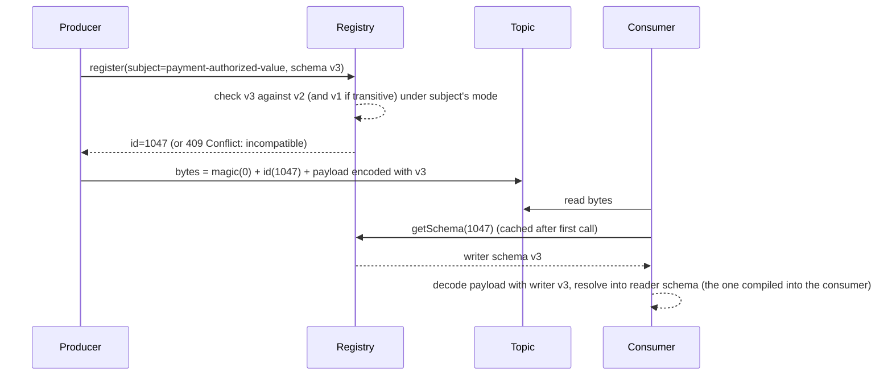

# Schema Registries and Compatible Evolution

> Add a field without breaking last month's consumer.

**Type:** Learn
**Languages:** —
**Prerequisites:** Phase 8 Lesson 10 (Dead-Letter Queues and Poison Messages), Phase 8 Lesson 05 (Event Sourcing), Phase 3 Lesson 15 (Serialization)
**Time:** ~60 minutes

## Learning Objectives

- Explain why a stream's schema is a contract between producers and consumers who deploy independently, and why "just add a field" is a breaking change in some directions and not others
- Describe what a schema registry does at produce time and at consume time, and what the schema id in the message envelope buys
- Apply the four compatibility modes (backward, forward, full, none) and their transitive variants to decide whether a proposed schema change may be deployed, and in which order producers and consumers must roll out
- State the evolution rules for Avro and Protobuf (defaults, field numbers, reserved fields, type changes) and identify which rule a given change violates
- Design a versioned event envelope and an upcasting chain so an event-sourced aggregate can replay ten years of events through today's code
- Walk a worked incompatible change through a registry's compatibility check and show exactly which consumer it would have broken

## The Problem

A payments platform publishes `PaymentAuthorized` events to a topic consumed by four teams: the ledger poster (Lesson 10), a fraud scorer, a merchant notification service, and a data warehouse loader. The producing team adds a field, `surcharge`, to carry a new regulatory fee. They also tidy up: `amount` becomes `grossAmount` for clarity, and `cardLast4`, which compliance has asked them to stop emitting, is removed. The change ships at 10:00 on a Tuesday with a note in the team channel.

By 10:04 the fraud scorer is parking every event in its dead-letter queue: its deserializer requires `amount` and the field is gone. By 10:07 the ledger poster, which was written defensively and ignores unknown fields, is posting zero-amount entries, because it reads `amount` as an optional field with a default of zero and `grossAmount` is an unknown field it ignores. Zero-amount postings reconcile perfectly against nothing. The notification service, which only reads `merchantId` and `status`, is fine. The warehouse loader is loading `grossAmount` into a column named `amount` by position, because its Avro reader was given the writer's schema and told to resolve by field order, and position 3 used to be `cardLast4`. By 10:30 the warehouse has 90 minutes of authorizations with amounts in the card-number column.

Three of four consumers broke, each differently, from a change that passed every unit test the producer had. Nothing in the pipeline knew that the shape of the message was a contract, let alone checked it. The producer's tests used the producer's schema; each consumer's tests used the schema it was written against; nobody's tests used both.

The rollback is not clean either. Events with the new shape are already on the topic with seven days of retention and in the event store forever. Rolling the producer back makes new events parse again, but the 10:00 to 10:35 events are still there, and every consumer that replays from an earlier offset (every event-sourced aggregate, every new consumer bootstrapping from the beginning) will hit them. The schema of a stream is not whatever the producer emits now; it is the union of everything the producer has ever emitted and still retains. That is the problem a schema registry and compatibility rules exist to make tractable.

## The Concept

### A schema is a contract with asymmetric parties

In a request-response API the client and server are deployed by teams that can coordinate, and the contract is enforced by the server rejecting bad requests. In a stream, the producer writes once and many consumers read at times of their choosing, including far in the future from a replay. The producer cannot know who will read; the consumer cannot know what was written. The schema is the only thing they share, and it has to be versioned, discoverable, and checked by a machine rather than announced in a channel.

Two facts shape every rule that follows:

1. **Producers and consumers deploy independently.** At any moment some consumers run last month's code. A change the producer makes today must be readable by them, or the rollout order must be arranged so it is not.
2. **Old data does not go away.** Consumers reading from a retention window or an event store must read every version ever written, with today's code.

### What a registry does

A schema registry is a service that stores schemas, assigns each one an id, groups them by *subject* (typically one per topic or per event type), and refuses to register a new version of a subject if it violates the subject's compatibility rule.



Two moments matter. At **produce time**, the serializer asks the registry for an id for the exact schema it is about to use. If the schema is new, the registry runs the compatibility check against the subject's history and either assigns an id or refuses. This is where the Tuesday-morning change should have died: a `409 Conflict` in the producer's deployment pipeline instead of four broken consumers. At **consume time**, the deserializer reads the id from the first bytes of the message, fetches the writer's schema (once; it is immutable, so caching is trivial), and decodes with it. The consumer then *resolves* the decoded record into the schema its own code was compiled against: the reader schema.

The id in the envelope is what makes retained data safe. Every message says which schema wrote it. A consumer replaying three years of events fetches three years of schemas by id and decodes each message correctly, without anyone having to remember when each change shipped.

### Writer schema, reader schema, and resolution

Avro's design makes the two schemas explicit. The *writer schema* is the one the bytes were encoded with. The *reader schema* is the one the consuming code expects. Decoding is always done with the writer schema (the bytes make no sense otherwise), and the result is then resolved into the reader schema by name:

| Situation | Resolution rule |
|-----------|-----------------|
| Field in writer, not in reader | Ignored |
| Field in reader, not in writer | Reader's default is used; if the reader field has no default, resolution fails |
| Field in both, same type | Copied |
| Field in both, different type | Allowed only for Avro's promotions (`int` to `long`, `long` to `float`, `float` to `double`, `string` to `bytes` and back); otherwise fails |
| Field renamed | Treated as removed plus added; the reader's new name has no source unless an alias is declared |
| Enum symbol in writer, not in reader | Fails, unless the reader's enum declares a default |

Resolution by *name* is why the warehouse loader in The Problem failed: it resolved by position, which no registry-aware deserializer does. Resolution by name is also why renaming a field is the most dangerous "cosmetic" change in streaming: to every consumer it is a deletion.

### The four compatibility modes

A compatibility mode is a rule about which of the two schemas (old or new) must be able to read data written by the other. Confluent's names are the common vocabulary.

| Mode | Guarantee | Allowed changes | Required rollout order |
|------|-----------|-----------------|------------------------|
| BACKWARD | New reader schema can read data written with the previous schema | Add a field **with a default**; remove a field | Consumers first, then producers |
| FORWARD | Previous reader schema can read data written with the new schema | Add a field; remove a field **that had a default** | Producers first, then consumers |
| FULL | Both directions | Add a field with a default; remove a field that had a default | Either order |
| NONE | No check | Anything | Coordinated, all at once, with a replay plan |

Each mode has a `_TRANSITIVE` variant that checks the new schema against *every* previous version of the subject rather than only the latest. Non-transitive BACKWARD lets v3 be compatible with v2 while v2 was compatible with v1, yet v3 is incompatible with v1; a consumer replaying v1 data with v3 code then fails. For any topic with retention longer than a deployment cycle, and for every event store, transitive is the only mode that matches what consumers will actually read.

The default in Confluent Schema Registry is BACKWARD, which encodes a specific operational assumption: **consumers upgrade before producers**. That matches event sourcing and replay (today's reader must read all of yesterday's data) and matches the common case where the consuming team controls its own deploy. FORWARD matches the opposite assumption, where producers are many and uncontrolled (mobile apps emitting telemetry) and the consumer must cope with whatever arrives. FULL costs the most discipline (every field ever added must have a default, and every removed field must have had one) and buys freedom in rollout order.

### Evolution rules by format

Avro and Protobuf solve the same problem with different mechanisms, and the rules differ in ways that bite.

| Change | Avro | Protobuf (proto3) | JSON Schema |
|--------|------|-------------------|-------------|
| Add a field | Compatible only if a `default` is declared | Always compatible; missing fields read as the type's zero value | Compatible if not in `required`; careful with `additionalProperties: false` on the reader |
| Remove a field | BACKWARD-compatible; FORWARD requires the removed field to have had a default | Compatible, but the field number must be marked `reserved` so it is never reused with a different type | Compatible if not `required` |
| Rename a field | Breaking (resolution is by name) unless `aliases` are declared on the reader | Compatible on the wire (field numbers carry identity, names are local), breaking for JSON mapping and reflection | Breaking (match is by property name) |
| Change a type | Only the promotions listed above | Only within wire-compatible groups (`int32`/`uint32`/`int64`/`uint64`/`bool`, `sint32`/`sint64`, `fixed32`/`sfixed32`, `fixed64`/`sfixed64`, `string`/`bytes` if valid UTF-8) | Breaking unless widened (`integer` to `number`) |
| Reuse an identifier | Reusing a name with a new type is breaking | Reusing a field number is silently catastrophic: old data decodes into the wrong field with the wrong type | Reusing a name is breaking |
| Add an enum value | Breaking for old readers unless the reader enum has a `default` | Compatible; unknown values are preserved as integers | Breaking if the reader uses `enum` validation |

The Protobuf rule that field numbers, not names, are the identity is the single biggest difference. It makes renaming safe and makes number reuse the cardinal sin, hence `reserved 5;` after deleting field 5. Avro's rule that identity is the name makes renaming a deletion-plus-addition and makes defaults the whole game: a field without a default can never be added under BACKWARD and never removed under FORWARD.

Money appears here as a schema question. An Avro `amount` of type `double` is the Phase 10 Lesson 01 bug in schema form; the correct shape is `{"name": "amountMinor", "type": "long"}` plus `{"name": "currency", "type": "string"}`, or Avro's `decimal` logical type over `bytes` with a fixed `scale`. Changing the scale of a `decimal` logical type is a breaking change the registry's compatibility check does **not** catch (the underlying type is still `bytes`), which is one of several reasons to carry the ISO 4217 code and let the exponent come from it.

### Two format-specific traps worth seeing in code

Avro defaults for optional fields use a union, and the default must match the **first** branch of the union. `["null", "string"]` with `"default": null` is correct; `["string", "null"]` with `"default": null` is rejected by the parser, and `["string", "null"]` with `"default": ""` compiles but makes the field's absence indistinguishable from an empty string downstream:

```json
{"name": "storeId", "type": ["null", "string"], "default": null}
```

Protobuf's `reserved` is the entire defence against number reuse, and it belongs in the same commit as the deletion:

```text
message PaymentAuthorized {
  string merchant_id = 1;
  int64 amount_minor = 2;
  string currency = 3;
  reserved 4;                 // was card_last4; removed 2026-10 for compliance; never reuse
  reserved "card_last4";
  string status = 5;
  int64 surcharge_minor = 6;  // added 2026-10; absent in old data reads as 0, which is correct
}
```

Both snippets are what a reviewer should expect to see in the diff; their absence is the review finding.

### Versioned envelopes and upcasting

Compatibility modes govern the wire. Event-sourced systems have a second problem: the *meaning* of an event changes over years in ways no field default can express. `PaymentAuthorized` v1 had `amount` in major units as a string; v2 switched to `amountMinor` as a long; v3 split `merchantId` into `merchantId` and `storeId`. An aggregate replaying from 2019 must apply all three correctly with today's code.

The pattern is an envelope with an explicit version and a chain of **upcasters**, pure functions from version `n` to version `n+1`:

```json
{
  "eventType": "PaymentAuthorized",
  "eventVersion": 3,
  "eventId": "01J9X...",
  "occurredAt": "2026-10-13T11:59:40Z",
  "schemaId": 1047,
  "payload": { "merchantId": "m-1", "storeId": "s-7", "amountMinor": 7700, "currency": "USD", "surcharge": 0 }
}
```

```java
// Illustrative: each upcaster knows exactly one transition and nothing else.
Map<Integer, UnaryOperator<JsonNode>> upcasters = Map.of(
    1, v1 -> v1.put("amountMinor", Money.parse(v1.get("amount").asText(), Currency.of(v1.get("currency").asText())).minorUnits())
               .remove("amount"),
    2, v2 -> v2.put("storeId", "unknown")   // v2 had no store concept; the aggregate treats "unknown" as the merchant's default store
);

JsonNode upcast(JsonNode payload, int fromVersion, int toVersion) {
    for (int v = fromVersion; v < toVersion; v++) payload = upcasters.get(v).apply(payload);
    return payload;
}
```

Three rules keep the chain honest. Upcasters are **pure** and **total** for their version: no I/O, and every v1 event must upcast. Upcasters are **never deleted**: the day you delete the v1 upcaster is the day a 2019 event cannot be replayed. And the aggregate's command handler sees **only the latest version**: the chain runs in the repository, so business logic has one shape to reason about. The wire-level compatibility check and the upcasting chain are complementary: the registry stops a change that would break the bytes; upcasters carry meaning across changes the registry allowed.

### A decision procedure for a proposed change

Run this before opening the pull request that changes a schema. It is what the registry will do mechanically, plus the parts it cannot.

1. **Classify each field change** as add, remove, rename, retype, or enum change. A rename is a remove plus an add unless the format carries identity separately (Protobuf numbers, Avro aliases).
2. **Look up the subject's compatibility mode.** If it is not transitive and the topic retains data longer than one deploy cycle, fix that first.
3. **For each added field under BACKWARD or FULL:** does it have a default? If the field has no sensible default (a value that is correct for every event written before the field existed), the change is not an addition; it is a new event version with an upcaster, or a new event type.
4. **For each removed field under FORWARD or FULL:** did the field have a default in every version still retained? If not, add the default in one version and remove the field in the next.
5. **For each type change:** is it in the format's promotion list? If not, add a new field with the new type and deprecate the old one.
6. **Ask the question the registry cannot:** did the meaning of any field change while its name and type stayed the same? If yes, the change needs a new field name or a new event version, whatever the compatibility check says.
7. **Write down the rollout order the mode implies** and put it in the deploy plan: consumers first for BACKWARD, producers first for FORWARD.
8. **Register the schema in the pipeline, not from a laptop,** so the `409` stops the deploy rather than surprising the on-call.

### Subjects, naming, and immutability

A registry's unit of history is the subject, and the choice of how topics map to subjects decides what the compatibility check can see.

| Strategy | Subject name | Fits | Cost |
|----------|--------------|------|------|
| Topic name | `payment-authorized-value` | One event type per topic; the common case | Cannot put two record types on one topic without a union |
| Record name | `com.example.PaymentAuthorized` | The same event type on several topics | Compatibility is checked per type, not per topic; a topic can carry an incompatible mix |
| Topic plus record name | `payments.com.example.PaymentAuthorized` | Several event types on one topic, each evolving independently | More subjects to govern |

Whatever the strategy, two properties are non-negotiable. **Schemas are immutable**: id 1001 means the same bytes forever, so a cached schema can never go stale. **Deletion is soft** by default: a deleted version can still be fetched by id so retained data remains decodable, and hard deletion exists only for schemas that were never used to write anything. An operator who hard-deletes a schema that has data behind it has made that data unreadable; the registry's refusal to do this casually is a feature.

### Without a registry: consumer-driven contract tests

Some stacks (JSON over HTTP webhooks, SQS with JSON bodies) have no registry in the path. The compatibility check still has to happen somewhere, and the substitute is a consumer-driven contract test: each consumer publishes the schema it actually reads (its reader schema), and the producer's build runs its proposed writer schema against every published reader schema with the same resolution rules the registry would apply. Pact and similar tools automate the plumbing; the logic is the table in the Worked Example. The gap compared with a registry is that nothing stamps the message with a schema id, so retained data cannot say which version wrote it; the envelope's `eventVersion` field has to carry that burden explicitly.

### Failure modes

- **The unchecked logical change.** `amount` switches from gross to net; name and type unchanged. Every compatibility mode passes. Every downstream balance is wrong. Only a human reading the pull request, or a semantic test that reconciles against an independent source, catches it.
- **Default that lies.** `surchargeMinor` gets default `0`, which is correct for events before the fee existed. `settlementDate` gets default `""`, which is not a date, and a consumer that parses it throws on every old event. A default must be a value that is *true* for every event written before the field existed, not merely a value that type-checks.
- **Non-transitive drift.** v2 is backward-compatible with v1, v3 with v2, and v3 is not with v1 because v2 added a default that v3 then removed. A consumer replaying from the start fails on v1 data. Transitive mode exists for exactly this.
- **Field number reuse in Protobuf.** `string card_last4 = 4` is deleted; six months later `int64 surcharge_minor = 4` is added. Old events decode their card digits into the surcharge as garbage integers, with no error. `reserved 4;` costs one line.
- **The bypassing consumer.** A consumer that ignores the schema id and hard-codes a reader schema with positional resolution gets none of the registry's protection and fails in the most confusing way: by misreading rather than by erroring.
- **Rollout in the wrong order.** BACKWARD is registered, the producer deploys first, and every consumer still on the old schema fails on data the registry approved. The registry checked compatibility; it did not check the deploy plan.

### Schema versions on the payment rails

The same problem exists outside Kafka, and the rails solved it the slow way. ISO 20022 messages carry their version in the message identifier itself: `pacs.008.001.08` is the eighth version of the FI-to-FI customer credit transfer. A new version is a new identifier, never an in-place change, and schemes publish a usage guideline that fixes which version is in force and a migration window during which both are accepted. SWIFT's MT-to-MX migration ran a coexistence period of several years precisely because every bank is an independently deployed consumer that cannot be forced to upgrade on the same day. Card networks do the same with dated release cycles: a new field in an authorization message is announced in a spring release, optional through the autumn, and mandatory the following year.

Read against the vocabulary of this lesson, the rails run FULL_TRANSITIVE compatibility with very long rollout windows and a version-in-the-name convention instead of a registry id. The cost is years of coexistence; the benefit is that no participant has ever been broken by a Tuesday-morning rename. An internal stream that touches money should expect to be held to the same standard eventually, and designing for it from the first version is cheaper than retrofitting it.

| Property | Internal Kafka topic with a registry | ISO 20022 scheme message |
|----------|--------------------------------------|--------------------------|
| Version identity | Schema id in the message envelope | Version in the message name (`pacs.008.001.08`) |
| Compatibility check | Registry, at register time, structural | Scheme usage guideline and certification testing, semantic as well |
| Rollout order | Implied by mode; enforced by the deploy plan | Mandated coexistence window, both versions accepted |
| Who can break a consumer | A producer with registry write access | Nobody unilaterally; the scheme publishes a change request |
| Time from proposal to mandatory | Hours to days | Twelve to thirty-six months |

### What a registry does not do

- It does not check **semantics**. Changing `amount` from gross to net without renaming it passes every compatibility mode and is the worst kind of break.
- It does not check **logical types' parameters**. A `decimal` scale change or a timestamp changing from millis to micros is invisible to Avro's structural check.
- It does not coordinate **rollout order**. BACKWARD tells you consumers must go first; it does not stop a producer from deploying first.
- It does not protect consumers that **bypass it**. A consumer that hard-codes a schema and ignores the id in the envelope gets no benefit; the warehouse loader in The Problem was one of these.

## Worked Example

The Tuesday change, replayed through a registry with the subject `payment-authorized-value` set to `BACKWARD_TRANSITIVE`. The registered history:

```json
{"type": "record", "name": "PaymentAuthorized", "fields": [
  {"name": "merchantId", "type": "string"},
  {"name": "amountMinor", "type": "long"},
  {"name": "currency", "type": "string"},
  {"name": "cardLast4", "type": "string"},
  {"name": "status", "type": "string"}
]}
```

That is v1 (id 1001). The producer proposes v2:

```json
{"type": "record", "name": "PaymentAuthorized", "fields": [
  {"name": "merchantId", "type": "string"},
  {"name": "grossAmountMinor", "type": "long"},
  {"name": "currency", "type": "string"},
  {"name": "status", "type": "string"},
  {"name": "surchargeMinor", "type": "long"}
]}
```

The check asks: can a reader using v2 read data written with v1?

| v2 reader field | Present in v1 writer? | Resolution | Verdict |
|-----------------|----------------------|------------|---------|
| `merchantId` | yes, same type | copied | ok |
| `grossAmountMinor` | no (v1 has `amountMinor`) | reader field with no default and no alias | **fail** |
| `currency` | yes | copied | ok |
| `status` | yes | copied | ok |
| `surchargeMinor` | no | reader field with no default | **fail** |
| (`cardLast4` in writer, not in reader) | | ignored | ok |

Two failures. The registry returns `409 Conflict` and the producer's pipeline stops before deploy. The fix that passes:

```json
{"type": "record", "name": "PaymentAuthorized", "fields": [
  {"name": "merchantId", "type": "string"},
  {"name": "amountMinor", "type": "long", "aliases": ["grossAmountMinor"], "doc": "gross amount; the field keeps its wire name"},
  {"name": "currency", "type": "string"},
  {"name": "status", "type": "string"},
  {"name": "surchargeMinor", "type": "long", "default": 0}
]}
```

`cardLast4` is removed, which BACKWARD allows: new readers ignore it in old data. `surchargeMinor` has a default, so new readers reading old data see `0`, which is the correct value for events that predate the fee. The rename is withdrawn; `doc` carries the clarification, because a wire name is an identifier, not prose. Under `BACKWARD_TRANSITIVE` the same table is run against every earlier version, which here is only v1.

Now the rollout order the mode implies: consumers deploy with v2 compiled in (they can read v1 and v2 data), then the producer starts writing v2. Reverse the order and a v1 consumer receives v2 data: it looks for `cardLast4`, which is absent and has no default in v1, and fails. BACKWARD does not protect that direction; FULL would have required `cardLast4` to have had a default in v1, which it did not, so under FULL the removal would have been refused and compliance's request would need a two-step change (add a default in v2, remove in v3).

Finally, the event store. Events written with id 1001 remain. A new consumer bootstrapping from offset zero reads id 1001, fetches v1, decodes, resolves into v2: `surchargeMinor = 0`, `cardLast4` dropped. No upcaster is needed because the change was purely structural. Had the producer also changed `amountMinor` from gross to net, no registry check would have failed and every replayed balance would be wrong; that change needs a new event version, a `v2 -> v3` upcaster that cannot be written (net cannot be recovered from gross without the fee), and therefore a new event type instead.

## Ship It

`outputs/checklist-schema-change.md` is a pull-request checklist for any schema change on a shared topic or event store: the field-level table from the decision procedure, the money-field rules, the semantic questions the registry cannot answer, and the sign-off from every consumer owner. Attach it to your repository's PR template for any directory holding `.avsc`, `.proto`, or event classes.

## Exercises

1. **Reinforce.** For each change below, state whether it passes BACKWARD, FORWARD, and FULL in Avro, and name the rule: (a) add `settlementDate: string` with no default; (b) remove `status`, which has no default; (c) change `amountMinor` from `long` to `int`; (d) change `amountMinor` from `int` to `long`; (e) add an enum symbol `PARTIALLY_AUTHORIZED` to `status` where the reader enum has no default.
2. **Apply.** The fraud team needs `cardLast4` back for six months while they migrate to a token. Design the three-version sequence (current v2 has no `cardLast4`) that reintroduces the field, lets both teams deploy in any order, and removes it again, all under FULL_TRANSITIVE. State the default you choose for a field that is sometimes legitimately absent, and why `""` and `null` (via a union `["null", "string"]`) have different consequences for consumers.
3. **Extend.** Combine with Phase 8, Lesson 05 (Event Sourcing). Take the `PaymentAuthorized` v1 to v3 history from The Concept and write the upcaster chain in your lesson language against the event-sourcing lesson's replay loop, including the v1 string-amount to `Money` conversion using the Phase 10 parser (which must reject `"12.345"` rather than round it). Add a test that replays a stream containing all three versions and asserts the aggregate's balance, then delete the v1 upcaster and watch which test fails and how.

## Key Terms

| Term | What people say | What it actually means |
|------|-----------------|------------------------|
| Schema registry | "where the schemas live" | A service that stores immutable schemas by id, groups versions under a subject, and refuses to register a version that violates the subject's compatibility mode |
| Subject | "the topic's schema" | The named sequence of schema versions a compatibility rule applies to; usually one per topic-value or per event type |
| Writer schema / reader schema | "the schema" | The schema the bytes were encoded with versus the schema the consuming code expects; decoding uses the writer, resolution maps into the reader by field name |
| Backward compatibility | "old data still works" | A new reader can read data written by the previous schema; consumers upgrade first; requires defaults on added fields |
| Forward compatibility | "old consumers still work" | The previous reader can read data written by the new schema; producers upgrade first; requires defaults on removed fields |
| Transitive compatibility | "against all versions" | The check runs against every registered version, not only the latest; the only mode that matches a consumer replaying retained history |
| Upcaster | "event migration" | A pure, total function from event version n to n+1, applied in a chain at read time so business logic sees only the latest version; never deleted |
| Reserved field number | "don't reuse 5" | Protobuf's declaration that a deleted field's number may never be reassigned, because numbers are field identity on the wire and reuse decodes old data into the wrong field |

## Further Reading

- [Apache Avro Specification: Schema Resolution](https://avro.apache.org/docs/1.11.1/specification/#schema-resolution) — the exact rules for writer-to-reader resolution, defaults, promotions, and aliases that the compatibility tables in this lesson are derived from.
- [Confluent Schema Registry: Schema Evolution and Compatibility](https://docs.confluent.io/platform/current/schema-registry/fundamentals/schema-evolution.html) — the definitions of BACKWARD, FORWARD, FULL, NONE and their transitive variants, with the rollout-order consequences of each.
- [Confluent Schema Registry: Wire Format](https://docs.confluent.io/platform/current/schema-registry/fundamentals/serdes-develop/index.html#wire-format) — the magic byte and four-byte schema id that prefix every message, which is what makes retained data decodable.
- [Protocol Buffers Language Guide (proto3): Updating a Message Type](https://protobuf.dev/programming-guides/proto3/#updating) — the field-number identity rule, `reserved`, wire-compatible type groups, and unknown-field preservation.
- [Avro Specification: Logical Types](https://avro.apache.org/docs/1.11.1/specification/#logical-types) — `decimal` with `precision` and `scale`, and why a scale change is invisible to structural compatibility checks.
- [Greg Young, *Versioning in an Event Sourced System* (2017)](https://leanpub.com/esversioning/read) — the upcasting chain, weak schema, and why some changes need a new event type rather than a new version.
