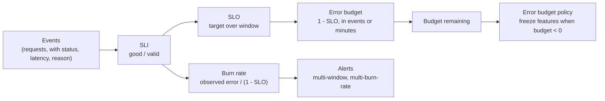

# SLIs, SLOs, and Error Budgets

> Availability is a number you choose and then pay for.

**Type:** Learn
**Languages:** —
**Prerequisites:** Phase 5, Lesson 01 (Failure Models), Phase 9 README
**Time:** ~60 minutes

## Learning Objectives

- Define an SLI as a ratio of good events to valid events and write three for a payment authorization service: availability, latency, and correctness
- Choose an SLO target and window and compute the resulting error budget in minutes and in failed requests
- Compute a burn rate from an observed error ratio and state how long until the budget is exhausted
- Design a multi-window, multi-burn-rate alert and explain why a single threshold on raw error rate pages too often and too late at the same time
- Distinguish SLI, SLO, SLA, and error budget policy, and say who owns each

## The Problem

A card-authorization service advertises "99.99% availability" on a slide. Nobody wrote down what a good request is. The on-call rotation has an alert: page if the HTTP 5xx rate exceeds 1% for five minutes. In one quarter it fires 71 times. Forty of those are a batch job that retries a dead merchant endpoint every night at 02:00 and produces a burst of 5xx against a background of almost no traffic; the ratio spikes, the page fires, the engineer wakes up, nothing is wrong for any customer. Meanwhile, for eleven days, 0.4% of authorizations return `HTTP 200` with a body saying `"status": "declined", "reason": "processor_timeout"`, because a downstream connection pool is misconfigured. Those are counted as successes by the alert. The merchants notice first. The eleven days cost 0.4% of all authorization volume: a few hundred thousand dollars of declined legitimate payments and a churned enterprise account.

The team has two problems, and both come from not having defined the number on the slide. First, their indicator measures the wrong thing. A `200` with a timeout decline is a failure for the merchant; a `503` to a batch job retrying a dead endpoint is noise. Second, their alert measures the right quantity in the wrong units. "1% for five minutes" says nothing about how much of the quarter's acceptable failure the current incident is consuming. A 1% error rate when you promise 99.99% is burning the budget 100 times faster than sustainable; a 0.4% error rate for eleven days consumed the entire quarter's budget four times over without ever crossing the threshold.

Service level objectives fix both problems by making the number on the slide operational. An SLI defines, in code, what counts as a good event. An SLO sets a target for that SLI over a window. The error budget is the arithmetic consequence: how many bad events you can afford before you break the promise. Alerts are then expressed as rates of budget consumption, which is a unit that directly answers the question an on-call engineer actually has: if this continues, when do we break the promise, and is that soon enough to wake up for?

## The Concept

### Four words that get mixed up

| Term | Who sets it | What it is | Example |
|------|-------------|------------|---------|
| SLI (indicator) | engineers | A measurement: good events / valid events, over a window | Fraction of authorization requests that returned a definitive approve or decline within 800 ms |
| SLO (objective) | product + engineering | A target for an SLI over a window, used internally | 99.95% over a rolling 30 days |
| SLA (agreement) | legal + sales | A contract with a customer, with consequences if an SLO-like target is missed | 99.9% monthly, with service credits; always looser than the SLO |
| Error budget | arithmetic | `1 − SLO`, expressed as allowed bad events or allowed downtime in the window | 0.05% of 30 days = 21.6 minutes, or 0.05% of requests |

The SLA is looser than the SLO so that the SLO is breached, and the team acts, before any money changes hands. If the SLO equals the SLA, every internal miss is a contractual miss.

### Writing an SLI

Google's SRE workbook gives the shape: **SLI = good events / valid events**, as a percentage. The two decisions are what is *valid* (which events count at all) and what is *good*.

For an authorization service, three SLIs cover most of what matters:

1. **Availability.** Valid: every authorization request that reached the service with a well-formed body. Good: the response was a definitive approve or decline from the issuer path. Not good: 5xx, timeouts, and *any* decline whose reason is an internal failure (`processor_timeout`, `internal_error`), even if the HTTP status was 200. Excluded from valid: requests rejected for malformed input (`400`), because a client bug is not a service failure, and health checks.
2. **Latency.** Valid: the same set. Good: the response was returned within 800 ms. This is written as "fraction of requests under 800 ms", not as "p99 latency", because a fraction can be averaged over a window and a percentile cannot. A target of 99% under 800 ms is a p99 of 800 ms, stated in a form you can budget.
3. **Correctness.** Valid: every authorization that reached a terminal state. Good: the amount, currency, and merchant on the authorization match the amount, currency, and merchant on the issuer's record for that transaction, as checked by the nightly reconciliation (Phase 13). This SLI is slow (it is known a day late) but it is the one that measures whether money moved correctly. For money movement, a correctness SLI is not optional.

Two principles. First, measure as close to the user as you can afford: a load-balancer log sees failures the application never logged (it crashed). Second, the SLI must be computable from data you already keep, with no judgement call per event, or it will not be computed.

### Choosing the SLO

The target is a product decision disguised as an engineering one. Three constraints bound it:

- **Dependencies.** A service cannot promise more than the product of its hard dependencies. If the issuer gateway offers 99.95% and the database 99.99%, the authorization path cannot exceed roughly 99.94% without redundancy around one of them.
- **Cost.** Each additional nine roughly multiplies the cost of achieving it: more replicas, more regions, more engineering time on failover. 99.99% leaves 4.3 minutes per month, which is less than one human-paced incident response.
- **User perception.** Below some threshold the user cannot tell the difference. A customer whose mobile network drops 1% of requests cannot distinguish 99.99% from 99.999%.

The window matters as much as the number. A 30-day rolling window is the common default: long enough that one bad hour does not dominate, short enough that a bad month is forgotten by the next one. Calendar windows (per month) reset the budget abruptly and invite end-of-month risk-taking; rolling windows do not.

### The error budget: worked arithmetic

Take the availability SLO: 99.95% over 30 days.

```text
window           = 30 days = 43,200 minutes
error budget     = 1 - 0.9995 = 0.0005 = 0.05%
budget in time   = 0.0005 * 43,200 min = 21.6 minutes of total outage
                   (or any equivalent: 43.2 minutes at 50% failure, 216 minutes at 10%, ...)
```

The same budget in requests, at 2,000 authorizations per second:

```text
requests / 30 d  = 2,000 * 86,400 * 30 = 5,184,000,000
budget in events = 0.0005 * 5,184,000,000 = 2,592,000 failed authorizations
```

The two forms are the same budget. The time form is intuitive; the event form is what the SLI actually measures, and it is what makes partial outages legible: a 10% failure rate for 216 minutes spends exactly the budget.

### Burn rate

Burn rate is the ratio of the observed error rate to the error rate that would exactly spend the budget over the window.

```text
burn rate = observed error ratio / (1 - SLO)
```

For the 99.95% SLO, the sustainable error ratio is 0.0005. Some burn rates and what they mean:

| Observed error ratio | Burn rate | Budget exhausted after | Interpretation |
|----------------------|-----------|------------------------|----------------|
| 0.05% | 1 | 30 days | spending exactly on plan |
| 0.1% | 2 | 15 days | worth a ticket, not a page |
| 0.7% | 14.4 | 50 hours | page: 2% of monthly budget per hour |
| 1.0% | 20 | 36 hours | page |
| 3.0% | 60 | 12 hours | page, and probably an incident |
| 100% | 2,000 | 21.6 minutes | total outage |

Return to The Problem. The 0.4% decline-as-200 defect is a burn rate of 8: the budget was gone in 3.75 days, and the defect lasted eleven. The 02:00 batch spike, by contrast, is a 1% ratio but at 02:00 traffic is perhaps 50 requests per second: for five minutes that is 150 failed requests out of a budget of 2.6 million, which is 0.006% of the budget. Raw error rate could not tell these apart. Burn rate, applied to the right SLI, separates them completely.



### Alerting on burn rate: why multiple windows

A single alert, "page if burn rate over the last hour exceeds 14.4", has two failure modes. It is too slow for a total outage (you wait an hour before the one-hour average catches up) and it keeps paging after the incident is over (the one-hour average stays high for an hour after errors stop). A short window alone, "burn rate over 5 minutes exceeds 14.4", catches the outage fast but pages on every 5-minute blip.

The SRE workbook's answer is to combine windows and burn rates:

| Severity | Long window | Short window | Burn rate | Budget consumed by long window | Action |
|----------|-------------|--------------|-----------|-------------------------------|--------|
| Page | 1 hour | 5 minutes | 14.4 | 2% | wake someone up |
| Page | 6 hours | 30 minutes | 6 | 5% | wake someone up |
| Ticket | 3 days | 6 hours | 1 | 10% | fix during business hours |

Read the first row as: page when **both** the 1-hour burn rate and the 5-minute burn rate exceed 14.4. The long window says the problem is big enough to matter (2% of a month's budget in an hour). The short window says it is still happening right now, which stops the alert re-firing for the rest of the hour after a fix. The short window is conventionally one twelfth of the long one.

Where does 14.4 come from? It is the burn rate at which a one-hour incident consumes 2% of a 30-day budget: `(2% × 30 days) / 1 hour = 0.6 days / (1/24 day) = 14.4`. The three tiers then cover a total outage (detected in about 5 minutes by the first row), a moderate degradation (6 hours at 6x spends 5%), and a slow leak like the 0.4% defect (burn rate 8 trips the 6-hour row within 30 minutes of starting, and the 3-day row shortly after).

Detection time for a total outage under the first row: the 5-minute window reaches burn rate 14.4 after `14.4 × 0.0005 × 5 min ≈ 2.2 seconds` of 100% errors, and the 1-hour window after `14.4 × 0.0005 × 60 min ≈ 26 seconds`. In practice the scrape interval dominates, and you page in two to three minutes.

### The error budget policy

The budget is only useful if something happens when it runs out. The policy is written down before the quarter starts and signed by product and engineering, and it typically says:

- Budget remaining above 0: ship features at normal velocity; the on-call owns reliability work on a best-effort basis.
- Budget exhausted: feature launches for this service are frozen; the team's sprint is reliability work until the 30-day window has recovered above the SLO.
- Budget consumed by a dependency: the dependency's team is pulled into the postmortem; the SLO is not relaxed.

The freeze is what makes the number real. Without it, the SLO is the slide again.

### What SLOs do not do

- They do not catch a failure your SLI does not measure. The 0.4% defect was invisible until "declined with internal reason" was defined as not-good. Every incident postmortem should ask whether the SLI would have seen it.
- They do not replace capacity planning or chaos testing; they tell you when reliability is slipping, not why.
- A single SLO for a service with two very different user populations (a 10,000 TPS enterprise merchant and a long tail of small merchants) will be dominated by the large one. Slice the SLI by the dimension that matters, or the small merchants' outage will never register.
- They are not an SLA. Publishing your internal SLO as a contractual target removes the room you need to act before the customer notices.

## Worked Example

A payments platform runs an authorization service at 2,000 TPS. The SLO is 99.95% availability over a rolling 30 days, with the availability SLI defined above (declines with internal reasons count as bad).

**Day 1 to day 9.** Normal operation. The SLI runs at 99.985%: an observed error ratio of 0.015%, a burn rate of 0.3. After nine days the team has spent 9 × 0.3 / 30 = 9% of its budget.

**Day 10, 14:00.** A deploy introduces a connection-pool misconfiguration to the issuer gateway. 2.5% of requests time out and return `200 declined processor_timeout`. Error ratio 2.5%, burn rate 50.

- 14:02: the 5-minute window shows burn rate 50 (over 14.4); the 1-hour window reaches 14.4 after about 17 minutes at this rate (14.4 / 50 of an hour). At 14:17 both conditions of the first row hold and the page fires.
- Budget spent so far in this incident: 17 minutes at burn rate 50 = 17 × 50 / 43,200 of the window = 1.97% of the budget.
- 14:40: rollback completes. Errors stop. The 5-minute window drops below threshold within five minutes; the alert resolves at 14:45 even though the 1-hour window stays high until 15:40. Total incident: 40 minutes at burn rate 50 = 4.6% of the budget.

**Day 10 after the incident.** Budget spent: 9% + 4.6% = 13.6%. Remaining: 86.4%. No freeze.

**Days 11 to 30.** Suppose the same 0.4% slow defect from The Problem appears on day 15 and runs undetected by humans. Burn rate 8. The 6-hour / 30-minute row fires at burn rate 6 within about 25 minutes of onset; the team finds it on day 15 instead of day 26. Had they not, 15 days at burn rate 8 would be 400% of the budget: the SLO would have been missed by a factor of four, and under the policy, feature work would be frozen for most of the following month.

The arithmetic a reviewer should be able to reproduce from this example: 21.6 minutes of budget, burn rate 50 for 40 minutes is 4.6% of it, and the difference between detection on day 15 and day 26 is the difference between a ticket and a frozen quarter.

## Exercises

1. **Reinforce.** The latency SLO is 99% of authorizations under 800 ms over 30 days. At 2,000 TPS, how many requests may exceed 800 ms in the window? If a slow database replica causes 5% of requests to exceed 800 ms, what is the burn rate and how long until the budget is gone? Then compute the burn-rate thresholds for a 2% / 1 hour and a 5% / 6 hour alert on this SLO (they are the same numbers as for availability; explain why).
2. **Apply.** Write the SLI definitions for a payout service (Phase 11) as three SQL-like predicates over a `payout_attempts` table with columns `status`, `failure_reason`, `latency_ms`, `amount_minor`, `reconciled_amount_minor`. Decide explicitly which `failure_reason` values are the service's fault and which are the beneficiary bank's, and write one sentence defending each exclusion.
3. **Extend.** Using the histogram from Phase 9, Lesson 06, show that "fraction of requests under 800 ms" can be computed exactly from a bucketed histogram if 800 ms is a bucket boundary and only approximately otherwise. Then compute, for a histogram with 2% precision, the maximum error in the latency SLI that bucket boundaries can introduce, and decide whether that error is acceptable against a 1% budget.

## Key Terms

| Term | What people say | What it actually means |
|------|-----------------|------------------------|
| SLI | "the metric" | A ratio of good events to valid events over a window, with both "good" and "valid" defined precisely enough to compute from logs without judgement |
| SLO | "the target" | An internal objective for an SLI over a window; breached before any contract is, so the team can act first |
| SLA | "the SLO" | A customer contract with consequences; deliberately looser than the SLO it is backed by |
| Error budget | "how much we can break" | `1 − SLO` over the window, in events or minutes; the quantity alerts and launch decisions are expressed in |
| Burn rate | "how fast we're failing" | Observed error ratio divided by the sustainable error ratio `1 − SLO`; burn rate 1 spends the budget exactly at the end of the window |
| Multi-window alert | "the two-threshold page" | Fire when both a long window (is it big enough to matter?) and a short window (is it still happening?) exceed the same burn rate |
| Error budget policy | "the freeze rule" | The pre-agreed consequence of exhausting the budget, usually a halt on feature launches until the window recovers |
| Correctness SLI | "reconciliation" | For money movement, the fraction of transactions whose recorded amount, currency, and counterparty match the external record; slow but non-negotiable |

## Further Reading

- [Google SRE Workbook, "Implementing SLOs"](https://sre.google/workbook/implementing-slos/) — the SLI specification shape, choosing targets, and the worked error-budget arithmetic this lesson follows.
- [Google SRE Workbook, "Alerting on SLOs"](https://sre.google/workbook/alerting-on-slos/) — the six iterations from a raw threshold to multi-window multi-burn-rate alerts, with the 14.4 / 6 / 1 derivation.
- [Google SRE Book, "Service Level Objectives"](https://sre.google/sre-book/service-level-objectives/) — the original SLI/SLO/SLA distinction and the argument for not over-achieving your SLO.
- [Google SRE Book, "Embracing Risk"](https://sre.google/sre-book/embracing-risk/) — why 100% is the wrong target and how error budgets resolve the product-versus-reliability negotiation.
- [Alex Hidalgo, *Implementing Service Level Objectives* (O'Reilly, 2020)](https://www.oreilly.com/library/view/implementing-service-level/9781492076803/) — the book-length treatment, including SLOs for data pipelines and correctness, which payments systems need.
- [PCI Security Standards Council, PCI DSS](https://www.pcisecuritystandards.org/document_library/) — requirement 10 on logging; the reason an authorization service already has the per-request records an SLI needs.
