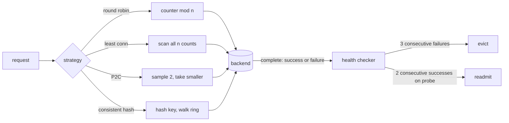

# Load Balancing: Round Robin, Least Connections, Power of Two Choices

> Two random choices beat one by an exponential margin.

**Type:** Build
**Languages:** Java, Python, Go
**Prerequisites:** Phase 3 Lesson 06 (Consistent Hashing and Virtual Nodes), Phase 9 Lesson 01 (SLIs, SLOs, and Error Budgets)
**Time:** ~90 minutes

## Learning Objectives

- Explain why round robin produces unbounded queues on a fleet with one slow server, and quantify it with a seeded simulation
- Implement smooth weighted round robin and show why its interleaving matters for burst behaviour
- Implement least connections and power of two choices and state the complexity and the information each one needs
- Explain the balls-into-bins result that makes two random choices exponentially better than one
- Build passive health checking with consecutive-failure eviction and active probing for readmission, and show how it bounds the damage of a dead backend
- Use consistent hashing for affinity and explain why it is the wrong tool for spreading load

## The Problem

An authorization service runs six instances behind a load balancer. Each request takes about 10 ms of work and arrives, on average, every 2.2 ms, so the fleet is at roughly 83% utilisation: busy but fine. On Thursday a deploy rolls out and `auth-6` lands on a node with a noisy neighbour. It still answers every request correctly; it just takes twice as long. Nobody is paged, because nothing is failing.

The load balancer is round robin. It sends `auth-6` exactly one request in six, the same as every other instance, and does not care that `auth-6` finishes them at half the rate. `auth-6`'s queue grows by about one request every 13 ms and never drains. After five minutes its p99 is 20 seconds, and because one in six of all requests goes there, the fleet's p99 is 20 seconds too. The other five instances are idle 30% of the time. The on-call engineer sees a fleet-wide latency SLO breach, a healthy-looking dashboard for five of six instances, and no errors anywhere.

This is the general shape of the problem. Any assignment rule that does not look at load will, on a heterogeneous fleet, send work to the server that can least afford it at exactly the same rate as to the one that can most afford it. Fleets are always heterogeneous in practice: a rolling deploy means two versions with different performance for twenty minutes; a garbage collection pause makes one JVM slow for 200 ms; a cache miss storm makes one shard slow for a minute. The question is not whether one backend will be slow but how much damage it does while it is.

The fix is a strategy that reads load before assigning. Least connections reads all of it and sends the request to the emptiest queue. Power of two choices reads two queues at random and takes the shorter one, which sounds like a shortcut and turns out, by a result from randomized algorithms, to capture almost all of the benefit at a fraction of the cost. The lesson builds five strategies, runs them on the same seeded fleet, and measures the difference.

## The Concept

### What a balancer knows

Every strategy is a function from `(healthy backends, request)` to one backend. They differ in what they read:

| Strategy | Reads | Per-pick cost | Best for | Fails when |
|----------|-------|---------------|----------|------------|
| Round robin | A counter | O(1) | Identical servers, identical requests | Any server or request is slower than the others |
| Weighted round robin | A counter and static weights | O(n) (nginx smooth form) | Known, static capacity differences | Capacity changes at runtime (GC, noisy neighbour) |
| Least connections | Every backend's in-flight count | O(n) | Heterogeneous servers or requests | n is large and the counts live on other machines |
| Power of two choices | Two backends' in-flight counts | O(1) | Large fleets, distributed balancers | Load information is stale by more than a service time |
| Consistent hash | The request key and a ring | O(log(n * v)) | Session or cache affinity | Keys are skewed (one hot merchant) |

The first two are *static*: they decide without looking at the fleet's current state. The next two are *dynamic*: they read the queue lengths. The last one is not a load-spreading strategy at all; it is a placement function, and it is in the lesson because people reach for it as if it were one.

### Round robin and why it fails on a slow server

Round robin sends request `i` to backend `i mod n`. Each backend receives exactly `1/n` of the arrivals regardless of how fast it drains them. A backend that is half as fast has an arrival rate of `lambda / n` and a service rate of `mu / 2`. If `lambda / n > mu / 2`, which on an 83% fleet it is, that backend's queue grows without bound. In the simulation `auth-6` reaches a queue of 1,141 requests and the fleet p99 is 20.7 seconds, while `auth-1` through `auth-5` are each at roughly 70% utilisation.

The lesson of the queueing model is that utilisation above 1.0 on any single server is a catastrophe for the whole fleet's tail, and a static strategy cannot detect it because it never looks.

### Smooth weighted round robin

If capacity differences are known and static, weights fix the proportion: give `auth-6` weight 1 and the others weight 2, and it receives one request in eleven. The naive implementation ("send `w_i` requests to `i`, then move on") sends bursts: weights 5:1:1 yield `a a a a a b c`, which puts five consecutive requests on `a` and then leaves it idle. The nginx algorithm smooths this:

```text
each pick:
  for every backend i: current[i] += weight[i]
  winner = backend with the largest current
  current[winner] -= sum of all weights
```

Trace for weights a=5, b=1, c=1 (total 7):

```text
pick  current before (a,b,c)  +weights -> (a,b,c)   winner  after subtracting 7
 1    (0, 0, 0)               (5, 1, 1)             a       (-2, 1, 1)
 2    (-2, 1, 1)              (3, 2, 2)             a       (-4, 2, 2)
 3    (-4, 2, 2)              (1, 3, 3)             b       (1, -4, 3)
 4    (1, -4, 3)              (6, -3, 4)            a       (-1, -3, 4)
 5    (-1, -3, 4)             (4, -2, 5)            c       (4, -2, -2)
 6    (4, -2, -2)             (9, -1, -1)           a       (2, -1, -1)
 7    (2, -1, -1)             (7, 0, 0)             a       (0, 0, 0)
```

Seven picks give `a a b a c a a`: five for `a`, one each for `b` and `c`, with `a`'s picks spread across the cycle, and the state returns to zero so the sequence repeats. The invariant is that over any full cycle of `sum(weights)` picks, each backend is chosen exactly `weight` times. Weights handle the *known* half-speed server; they do nothing for the server that became slow after the config was written.

### Least connections

Send the request to the backend with the fewest in-flight requests. On the slow-server fleet this is self-correcting: `auth-6` drains slowly, so its count stays higher, so it is picked less often. In the simulation its share drops from 1/6 to about 1/12 and the fleet p99 falls from 20.7 seconds to 84 ms. The price is reading `n` counters per pick, and, when the balancer is itself distributed across many proxies, those counters are approximations of other proxies' views. Ties go to the first backend in list order, which is deterministic and, in a real system, a mild bias toward whichever backend sorts first.

### Power of two choices and balls into bins

Drop `m` balls into `n` bins uniformly at random. With `m = n`, the fullest bin holds about `ln n / ln ln n` balls with high probability: for `n = 10,000` that is around 6. Now, for each ball, pick two bins at random and drop it into the emptier one. The fullest bin holds about `ln ln n / ln 2 + O(1)`: for `n = 10,000` that is about 3. The improvement from one choice to two is exponential (the logarithm moved inside another logarithm); from two to three it is only a constant factor. This is Azar, Broder, Karlin, and Upfal's 1994 result, surveyed by Mitzenmacher, and the demo reproduces it with a seeded generator:

```text
1 choice(s): max load 6
2 choice(s): max load 3
3 choice(s): max load 3
```

For a balancer, the bins are backends and the ball's "fullness" check is reading two in-flight counts. Two reads instead of `n`, and the maximum queue in the simulation is 9 against least connections' 7, with a p99 of 127 ms against 84 ms, both a factor of 160 better than round robin. For a fleet of 6 the saving is irrelevant; for a service mesh where each of 2,000 sidecars balances across 500 backends, reading two counters instead of 500 per request is the difference between a feasible design and not.

There is a second, less obvious benefit. When many independent balancers all use least connections with slightly stale data, they all see the same emptiest backend and all send to it at once; this is the herd effect. Two random choices decorrelate the balancers, so stale information does less damage. Mitzenmacher's paper treats this directly.



### Health checking: eviction and readmission

A strategy decides among the *healthy* backends; something else decides which those are. Passive health checking observes real traffic: `N` consecutive failures evict, `M` consecutive successes readmit. The word *consecutive* is doing the work. A cumulative count would evict a backend that fails one request in a thousand after a thousand requests; a consecutive count resets on every success, so only a backend that is actually down accumulates failures. With `N = 3`, a dead backend costs at most three failed requests per balancer before it is out.

Passive checking has a hole: an evicted backend receives no traffic, so it can never produce the `M` successes that would readmit it. Active probing fills it: every `probeIntervalMs`, send a synthetic request to each evicted backend and feed the result to the same checker. In the simulation `auth-3` dies from `t = 5 s` to `t = 8 s`; least connections and P2C each fail five requests in total (three to evict, and a couple more that were already queued), the fleet's p99 rises to around 200 ms during the outage window, and `auth-3` is probed back in after it recovers. Round robin fails only three but its p99 was already 22 seconds for an unrelated reason.

### Consistent hashing is for affinity, not load

The ring from Phase 3, Lesson 06 maps a key to a backend so that the same key always lands on the same backend and removing a backend moves only that backend's keys. In the demo, removing one of six backends moves 182 of 1,000 keys (the ideal is 167); modulo hashing would move 833. That property is what you want when the backend holds per-key state: a session cache, a per-merchant rate-limiter bucket, a connection to a specific acquirer.

It is not what you want for spreading load. The simulation shows a p99 of 32.6 seconds for consistent hashing, worse than round robin, because hashing assigns `auth-6` its 1/6 share of the key space exactly like round robin assigns it 1/6 of the requests, with the added skew of an uneven ring. Google's "consistent hashing with bounded loads" (Mirrokni, Thorup, and Zadimoghaddam, 2016) fixes this by capping each backend at `(1 + epsilon)` times the average and spilling over to the next ring position; it is Exercise 3.

The hash function matters. FNV-1a alone places `merchant-1` and `merchant-2` adjacent on the ring because its high bits barely depend on the last byte; the implementation runs the FNV output through MurmurHash3's 64-bit finaliser (`fmix64`) so every input bit affects every output bit.

### The simulation model

The measurements come from a discrete-event simulation with one FIFO queue per backend. Arrivals are exponentially distributed with mean gap 2.2 ms; work is exponential with mean 10 ms; a backend with `speed = 0.5` takes twice as long. A request's latency is the time it waits behind the requests already queued on its backend plus its own service time. Each backend's queue length is exactly its `activeConnections`, which is what the dynamic strategies read. The random generator is SplitMix64 with a fixed seed, so every number in this lesson is reproducible in all three languages and the tests assert on them.

What the model leaves out: network latency between balancer and backend, request cancellation, backends that slow down under load rather than running at a fixed speed, and the staleness of load information when the balancer is distributed. Each of those makes the dynamic strategies look somewhat less good and P2C somewhat better relative to least connections.

### What this lesson's balancer does not do

- It does not retry. A failed request fails; retry policy with budgets is Phase 12, Lesson 04.
- It does not shed load. When every backend is evicted, `route` returns null and the caller decides; graceful degradation is Lesson 13.
- It does not do slow-start. A readmitted backend gets full traffic immediately; production balancers ramp it over a window.
- It does not know about connections in the TCP sense. "Least connections" here counts in-flight requests, which is what HTTP/2 and gRPC balancers count too.

## Build It

The primary walkthrough is in Java. The Python and Go files implement the same design with the same names and produce the same numbers; the subsections at the end show only what differs.

### Step 1: A generator that is identical in three languages

```java
final class Rng {
    private long state;

    long nextLong() {
        state += 0x9E3779B97F4A7C15L;
        long z = state;
        z = (z ^ (z >>> 30)) * 0xBF58476D1CE4E5B9L;
        z = (z ^ (z >>> 27)) * 0x94D049BB133111EBL;
        return z ^ (z >>> 31);
    }

    double nextDouble() { return (nextLong() >>> 11) * 0x1.0p-53; }
    int nextInt(int bound) { return (int) (nextDouble() * bound); }
    double nextExponential(double mean) { return -mean * Math.log(1.0 - nextDouble()); }
}
```

`java.util.Random`, Python's `random`, and Go's `math/rand` all produce different streams for the same seed, so a simulation that used them could not be compared across languages. SplitMix64 is twelve lines, has no library dependency, and its first output for seed 42 is `-4767286540954276203` in all three implementations; the tests assert exactly that. `nextExponential` is inverse-transform sampling: `-mean * ln(U)` is exponential with the given mean, and `1 - U` avoids `ln(0)`.

**Predict:** what does `nextInt(bound)` return when `nextDouble()` is `0.9999`, and can it ever return `bound`?

### Step 2: Backends and the balancer interface

```java
final class Backend {
    final String id;
    final int weight;          // relative capacity for weighted strategies
    final double speed;        // service-time divisor: 2.0 finishes work twice as fast as 1.0
    int activeConnections;     // requests assigned and not yet completed
    long totalAssigned;
    boolean healthy = true;    // flipped by the HealthChecker, never by a strategy
}

interface Balancer {
    String name();
    Backend pick(List<Backend> healthy, Request request);
}
```

`weight` is what the operator declares; `speed` is what the simulation knows and the balancer cannot see. Keeping them separate is the point of the slow-server demo: the weight says `auth-6` is as capable as the rest, the speed says it is not, and only a strategy that reads `activeConnections` finds out. `pick` receives the already-filtered healthy list, so no strategy has to think about health.

### Step 3: Round robin and the smooth weighted form

```java
final class RoundRobin implements Balancer {
    private long counter;
    public Backend pick(List<Backend> healthy, Request request) {
        if (healthy.isEmpty()) throw new IllegalStateException("no healthy backends");
        Backend b = healthy.get((int) (counter % healthy.size()));
        counter++;
        return b;
    }
}
```

The counter is modulo the *current* healthy size, so an eviction shifts the cycle rather than leaving a gap. The weighted version:

```java
public Backend pick(List<Backend> healthy, Request request) {
    long total = 0;
    Backend best = null;
    long bestScore = Long.MIN_VALUE;
    for (Backend b : healthy) {
        long score = current.getOrDefault(b.id, 0L) + b.weight;
        current.put(b.id, score);
        total += b.weight;
        if (score > bestScore) { bestScore = score; best = b; }
    }
    current.put(best.id, bestScore - total);
    return best;
}
```

This is the trace from The Concept in code. `current` is keyed by backend id rather than list index so that an eviction does not reassign scores to the wrong backends.

**Predict:** with weights a=5, b=1, c=1, what are the `current` values after seven picks, and what does that tell you about pick eight?

### Step 4: Least connections and power of two choices

```java
final class LeastConnections implements Balancer {
    public Backend pick(List<Backend> healthy, Request request) {
        Backend best = healthy.get(0);
        for (Backend b : healthy) if (b.activeConnections < best.activeConnections) best = b;
        return best;
    }
}

final class PowerOfTwoChoices implements Balancer {
    public Backend pick(List<Backend> healthy, Request request) {
        if (healthy.size() == 1) return healthy.get(0);
        int i = rng.nextInt(healthy.size());
        int j = rng.nextInt(healthy.size() - 1);
        if (j >= i) j++;                                   // distinct second sample
        Backend a = healthy.get(i), b = healthy.get(j);
        return b.activeConnections < a.activeConnections ? b : a;
    }
}
```

Least connections uses strict `<`, so ties resolve to the earliest backend. P2C draws the second index from `n - 1` values and skips past the first, which gives two *distinct* backends without a retry loop; sampling with replacement would occasionally compare a backend to itself and waste the pick. The tie in P2C goes to `a`, the first sample, which is uniformly random, so there is no positional bias.

**Predict:** on a fleet of two backends where one has 10 in-flight requests and the other 0, how often does P2C pick the empty one?

### Step 5: The ring

```java
static long hash64(String s) { return fmix64(fnv1a64(s)); }

public Backend pick(List<Backend> healthy, Request request) {
    if (!ids.equals(builtFor)) rebuild(healthy);        // ring depends only on the healthy set
    long h = hash64(request.key());
    int lo = 0, hi = ringHashes.length;
    while (lo < hi) {
        int mid = (lo + hi) >>> 1;
        if (Long.compareUnsigned(ringHashes[mid], h) < 0) lo = mid + 1; else hi = mid;
    }
    return ringOwners[lo == ringHashes.length ? 0 : lo];
}
```

The ring is rebuilt only when the healthy set changes, which is rare; a pick is a binary search over `n * virtualNodes` sorted hashes. The comparison is unsigned because a 64-bit hash is a position on a circle, not a signed quantity, and `Long.compareUnsigned` is the only correct comparator for it. The wrap at the end of the array is what makes it a ring.

### Step 6: Health checking

```java
boolean record(Backend b, boolean success) {
    if (success) {
        consecutiveFailures.put(b.id, 0);
        int s = consecutiveSuccesses.merge(b.id, 1, Integer::sum);
        if (!b.healthy && s >= successThreshold) { b.healthy = true; return true; }
    } else {
        consecutiveSuccesses.put(b.id, 0);
        int f = consecutiveFailures.merge(b.id, 1, Integer::sum);
        if (b.healthy && f >= failThreshold) { b.healthy = false; return true; }
    }
    return false;
}
```

Each observation resets the opposite streak. The return value says whether the health flag flipped, which is what an operator would alert on. `Pool.route` filters by `healthy`, increments `activeConnections`, and returns null when nothing is left; `Pool.complete` decrements and feeds the checker. The simulation's `probeEvicted` sends a synthetic observation to every evicted backend every 500 ms so that readmission can happen.

**Predict:** with thresholds (3, 2), a backend sees the sequence fail, fail, success, fail, fail, fail. After which observation is it evicted, and why not earlier?

### Step 7: Run it

```bash
cd phases/09-reliability-and-scale/02-load-balancing-algorithms/code/java
javac -d .out *.java && java -cp .out Main
java -cp .out MainTest
```

Expected output, abbreviated:

```console
== Balls into bins: 10,000 balls, 10,000 bins ==
1 choice(s): max load 6
2 choice(s): max load 3
3 choice(s): max load 3

== Authorization fleet: 5 fast servers + 1 at half speed, 20,000 requests, ~83% utilisation ==
round-robin            mean  1880.07  p50   23.59  p99  20674.94  max-queue 1141  assigned 3333..3334  failed 0  shed 0
weighted-round-robin   mean    42.01  p50   26.80  p99    249.10  max-queue   23  assigned 1818..3637  failed 0  shed 0
least-connections      mean    19.08  p50   14.00  p99     84.04  max-queue    7  assigned 1697..4032  failed 0  shed 0
power-of-two-choices   mean    28.00  p50   20.88  p99    127.43  max-queue    9  assigned 2002..3622  failed 0  shed 0
consistent-hash        mean  3341.28  p50   39.83  p99  32619.17  max-queue 1721  assigned 2898..3844  failed 0  shed 0

== Same fleet, auth-3 dies from t=5s to t=8s; health checker evicts after 3 failures ==
least-connections      mean    26.69  p50   15.70  p99    202.00  max-queue   23  assigned 1707..4086  failed 5  shed 0
power-of-two-choices   mean    36.35  p50   23.50  p99    217.17  max-queue   26  assigned 2032..3696  failed 5  shed 0

== Smooth weighted round robin, weights a=5 b=1 c=1 ==
a a b a c a a

== Consistent hashing: remove one of 6 backends, how many of 1,000 keys move? ==
moved 182 of 1000 keys (ideal 1/6 = 167); modulo hashing would move ~833
40 passed, 0 failed
```

Read the `assigned` column against the `p99` column. Round robin assigns the most evenly (3333 to 3334 each) and has the worst tail; least connections assigns the least evenly (1697 to the slow server, 4032 to a fast one) and has the best. Even assignment is not the goal. Even *queues* are.

### In Python

The Python port (`code/python/main.py`) is the same design with three differences. **No fixed-width integers:** every multiplication and addition in `Rng` and the hash functions is masked with `& MASK64` to emulate 64-bit wraparound, and `next_long` converts to a signed value at the end so the test can assert the same `-4767286540954276203` as Java. **No unsigned comparison problem:** ring hashes are kept as non-negative Python ints, so `bisect.bisect_left` on the sorted list does the binary search directly. **`NoHealthyBackends`** is a `RuntimeError` subclass instead of `IllegalStateException`; `Pool.route` returns `None` for the shed case, and `Backend` is a mutable dataclass whose `__post_init__` raises `ValueError` for a non-positive weight or speed.

Run it from `code/python/` with `python3 main.py`; test with `python3 -m unittest -v`.

#### Step 1: A generator that is identical in three languages

SplitMix64 with a `& MASK64` after every operation that could exceed 64 bits, and a final two's-complement conversion so `next_long` returns the Java `long`. `next_double` re-masks to unsigned before the shift, which is Java's `>>> 11`; the rest is the same inverse-transform sampling.

```python
class Rng:
    def __init__(self, seed: int) -> None:
        self.state = seed & MASK64

    def next_long(self) -> int:
        self.state = (self.state + 0x9E3779B97F4A7C15) & MASK64
        z = self.state
        z = ((z ^ (z >> 30)) * 0xBF58476D1CE4E5B9) & MASK64
        z = ((z ^ (z >> 27)) * 0x94D049BB133111EB) & MASK64
        z ^= z >> 31
        return z - (1 << 64) if z >= 1 << 63 else z

    def next_double(self) -> float:
        return ((self.next_long() & MASK64) >> 11) * (2.0 ** -53)

    def next_int(self, bound: int) -> int:
        return int(self.next_double() * bound)

    def next_exponential(self, mean: float) -> float:
        return -mean * math.log(1.0 - self.next_double())
```

#### Step 2: Backends and the balancer interface

`Backend` is a plain (non-frozen) dataclass because its load changes with every routed request; `weight` is what the operator declares and `speed` is what only the simulation knows. `Balancer` is a base class with a `name` attribute and a `pick` that raises `NotImplementedError`.

```python
class Backend:
    id: str
    weight: int = 1          # relative capacity for weighted strategies
    speed: float = 1.0       # service-time divisor: 2.0 finishes work twice as fast as 1.0
    active_connections: int = 0
    total_assigned: int = 0
    healthy: bool = True     # flipped by the HealthChecker, never by a strategy

    def __post_init__(self) -> None:
        if self.weight <= 0:
            raise ValueError(f"weight must be positive: {self.id}")
        if self.speed <= 0:
            raise ValueError(f"speed must be positive: {self.id}")


class Balancer:
    name = "balancer"

    def pick(self, healthy: list[Backend], request: Request) -> Backend:
        raise NotImplementedError
```

#### Step 3: Round robin and the smooth weighted form

Round robin indexes by `counter % len(healthy)`, so an eviction shifts the cycle rather than leaving a gap. The smooth weighted form keeps `current` keyed by backend id in a dict; `-(1 << 62)` stands in for `Long.MIN_VALUE` as the initial best score, and the `assert` tells the type checker that a non-empty list always yields a winner.

```python
    def pick(self, healthy: list[Backend], request: Request) -> Backend:
        if not healthy:
            raise NoHealthyBackends("no healthy backends")
        b = healthy[self.counter % len(healthy)]
        self.counter += 1
        return b
```

```python
    def pick(self, healthy: list[Backend], request: Request) -> Backend:
        if not healthy:
            raise NoHealthyBackends("no healthy backends")
        total = 0
        best: Backend | None = None
        best_score = -(1 << 62)
        for b in healthy:
            score = self.current.get(b.id, 0) + b.weight
            self.current[b.id] = score
            total += b.weight
            if score > best_score:
                best_score, best = score, b
        assert best is not None
        self.current[best.id] = best_score - total
        return best
```

#### Step 4: Least connections and power of two choices

Strict `<` in least connections resolves ties to the earliest backend. P2C draws the second index from `n - 1` values and bumps it past the first, so the two samples are always distinct; the tie goes to `a`, the first (uniformly random) sample.

```python
    def pick(self, healthy: list[Backend], request: Request) -> Backend:
        if not healthy:
            raise NoHealthyBackends("no healthy backends")
        best = healthy[0]
        for b in healthy:
            if b.active_connections < best.active_connections:
                best = b
        return best
```

```python
    def pick(self, healthy: list[Backend], request: Request) -> Backend:
        if not healthy:
            raise NoHealthyBackends("no healthy backends")
        if len(healthy) == 1:
            return healthy[0]
        i = self.rng.next_int(len(healthy))
        j = self.rng.next_int(len(healthy) - 1)
        if j >= i:
            j += 1  # distinct second sample
        a, b = healthy[i], healthy[j]
        return b if b.active_connections < a.active_connections else a
```

#### Step 5: The ring

`hash64` composes `fnv1a64` and `fmix64`, both masked to 64 bits, and returns a non-negative int, so the ring positions compare correctly with ordinary `<`. `bisect.bisect_left` is the "first position `>= h`" binary search; an index equal to the length wraps to 0. The ring is rebuilt only when the list of healthy ids changes.

```python
def hash64(s: str) -> int:
    return fmix64(fnv1a64(s))
```

```python
    def pick(self, healthy: list[Backend], request: Request) -> Backend:
        if not healthy:
            raise NoHealthyBackends("no healthy backends")
        if [b.id for b in healthy] != self._built_for:
            self._rebuild(healthy)
        h = hash64(request.key)
        i = bisect.bisect_left(self._ring_hashes, h)  # first ring position >= h, wrapping to 0
        if i == len(self._ring_hashes):
            i = 0
        return self._ring_owners[i]
```

#### Step 6: Health checking

Two dicts of streaks keyed by backend id; each observation resets the opposite streak, and the return value says whether the health flag flipped. `dict.get(key, 0) + 1` replaces Java's `merge(..., Integer::sum)`.

```python
    def record(self, b: Backend, success: bool) -> bool:
        if success:
            self._failures[b.id] = 0
            s = self._successes.get(b.id, 0) + 1
            self._successes[b.id] = s
            if not b.healthy and s >= self.success_threshold:
                b.healthy = True
                return True
        else:
            self._successes[b.id] = 0
            f = self._failures.get(b.id, 0) + 1
            self._failures[b.id] = f
            if b.healthy and f >= self.fail_threshold:
                b.healthy = False
                return True
        return False
```

#### Step 7: Run it

```bash
cd phases/09-reliability-and-scale/02-load-balancing-algorithms/code/python
python3 main.py
python3 -m unittest -v
```

Because the generator and the hashes are bit-identical, every number matches the Java run, including the fleet table and the key-movement count:

```console
== Same fleet, auth-3 dies from t=5s to t=8s; health checker evicts after 3 failures ==
least-connections      mean    26.69  p50   15.70  p99    202.00  max-queue   23  assigned 1707..4086  failed 5  shed 0
power-of-two-choices   mean    36.35  p50   23.50  p99    217.17  max-queue   26  assigned 2032..3696  failed 5  shed 0

== Smooth weighted round robin, weights a=5 b=1 c=1 ==
a a b a c a a

== Consistent hashing: remove one of 6 backends, how many of 1,000 keys move? ==
moved 182 of 1000 keys (ideal 1/6 = 167); modulo hashing would move ~833
```

### In Go

The Go port (`code/go/main.go`) keeps the design with three differences. **Errors are values:** `Pick` returns `(*Backend, error)` with a sentinel `ErrNoHealthyBackends`; `main` uses a `mustPick` helper where an error would be a programming mistake, and `NewBackend` panics on a non-positive weight or speed for the same reason. **`uint64` throughout the hash and ring:** Go has unsigned integers, so `Hash64` returns `uint64` and `sort.Search` compares them directly; no `compareUnsigned` is needed, and `NextLong` casts to `int64` only at the boundary so the seed-42 assertion matches. **Constant folding:** `1.0 / (1 << 53)` is evaluated exactly at compile time, which is what you want here; it is the same property that hid the float bug in Phase 10, Lesson 01.

Run it from `code/go/` with `go run .`; test with `go test ./...`.

#### Step 1: A generator that is identical in three languages

The state is a `uint64`, so the additions and multiplications wrap by definition and the shifts are logical; the only conversion is the final `int64(...)`, which reinterprets the bits as Java's `long`. `NextDouble` converts back to `uint64` for the `>> 11`, which is the `>>>` in Java.

```go
type Rng struct{ state uint64 }

func NewRng(seed int64) *Rng { return &Rng{state: uint64(seed)} }

func (r *Rng) NextLong() int64 {
	r.state += 0x9E3779B97F4A7C15
	z := r.state
	z = (z ^ (z >> 30)) * 0xBF58476D1CE4E5B9
	z = (z ^ (z >> 27)) * 0x94D049BB133111EB
	return int64(z ^ (z >> 31))
}

func (r *Rng) NextDouble() float64 { return float64(uint64(r.NextLong())>>11) * (1.0 / (1 << 53)) }

func (r *Rng) NextInt(bound int) int { return int(r.NextDouble() * float64(bound)) }

func (r *Rng) NextExponential(mean float64) float64 { return -mean * math.Log(1.0-r.NextDouble()) }
```

#### Step 2: Backends and the balancer interface

`Backend` is a struct always handled through a pointer, since every strategy and the pool mutate its counters. `NewBackend` is the validating constructor. The `Balancer` interface carries `Pick`'s error return so a strategy can refuse an empty list without panicking.

```go
type Backend struct {
	ID                string
	Weight            int     // relative capacity for weighted strategies
	Speed             float64 // service-time divisor: 2.0 finishes work twice as fast as 1.0
	ActiveConnections int
	TotalAssigned     int64
	Healthy           bool // flipped by the HealthChecker, never by a strategy
}

func NewBackend(id string, weight int, speed float64) *Backend {
	if weight <= 0 {
		panic("weight must be positive: " + id)
	}
	if speed <= 0 {
		panic("speed must be positive: " + id)
	}
	return &Backend{ID: id, Weight: weight, Speed: speed, Healthy: true}
}

var ErrNoHealthyBackends = errors.New("no healthy backends")

type Balancer interface {
	Name() string
	Pick(healthy []*Backend, request Request) (*Backend, error)
}
```

#### Step 3: Round robin and the smooth weighted form

Round robin is the same modulo-the-current-size index. The smooth weighted form reads `w.current[b.ID]`, which yields 0 for a backend not yet in the map, so there is no `getOrDefault`; `math.MinInt64` is the initial best score.

```go
func (rr *RoundRobin) Pick(healthy []*Backend, _ Request) (*Backend, error) {
	if len(healthy) == 0 {
		return nil, ErrNoHealthyBackends
	}
	b := healthy[int(rr.counter%int64(len(healthy)))]
	rr.counter++
	return b, nil
}
```

```go
func (w *WeightedRoundRobin) Pick(healthy []*Backend, _ Request) (*Backend, error) {
	if len(healthy) == 0 {
		return nil, ErrNoHealthyBackends
	}
	var total int64
	var best *Backend
	bestScore := int64(math.MinInt64)
	for _, b := range healthy {
		score := w.current[b.ID] + int64(b.Weight)
		w.current[b.ID] = score
		total += int64(b.Weight)
		if score > bestScore {
			bestScore, best = score, b
		}
	}
	w.current[best.ID] = bestScore - total
	return best, nil
}
```

#### Step 4: Least connections and power of two choices

`LeastConnections` is an empty struct with value receivers. P2C's distinct-second-sample trick and the tie-to-`a` rule are unchanged; the ternary becomes an `if`.

```go
func (LeastConnections) Pick(healthy []*Backend, _ Request) (*Backend, error) {
	if len(healthy) == 0 {
		return nil, ErrNoHealthyBackends
	}
	best := healthy[0]
	for _, b := range healthy {
		if b.ActiveConnections < best.ActiveConnections {
			best = b
		}
	}
	return best, nil
}
```

```go
func (p *PowerOfTwoChoices) Pick(healthy []*Backend, _ Request) (*Backend, error) {
	if len(healthy) == 0 {
		return nil, ErrNoHealthyBackends
	}
	if len(healthy) == 1 {
		return healthy[0], nil
	}
	i := p.rng.NextInt(len(healthy))
	j := p.rng.NextInt(len(healthy) - 1)
	if j >= i {
		j++ // distinct second sample
	}
	a, b := healthy[i], healthy[j]
	if b.ActiveConnections < a.ActiveConnections {
		return b, nil
	}
	return a, nil
}
```

#### Step 5: The ring

`Hash64` returns `uint64`, so `sort.Search` with `>= h` is the first-position binary search with no unsigned-comparison helper. `idsOf` joins the healthy ids into a string that is compared against `builtFor` to decide whether to rebuild.

```go
func Hash64(s string) uint64 { return fmix64(fnv1a64(s)) }

func (c *ConsistentHash) Pick(healthy []*Backend, request Request) (*Backend, error) {
	if len(healthy) == 0 {
		return nil, ErrNoHealthyBackends
	}
	if ids := idsOf(healthy); ids != c.builtFor {
		c.rebuild(healthy)
	}
	h := Hash64(request.Key)
	i := sort.Search(len(c.ringHashes), func(k int) bool { return c.ringHashes[k] >= h }) // first position >= h
	if i == len(c.ringHashes) {
		i = 0 // wrap around the ring
	}
	return c.ringOwners[i], nil
}
```

#### Step 6: Health checking

Go maps return 0 for a missing key, so `h.successes[b.ID]++` is the whole `merge`. Everything else is the Java method: reset the opposite streak, flip the flag at the threshold, report whether it flipped.

```go
func (h *HealthChecker) Record(b *Backend, success bool) bool {
	if success {
		h.failures[b.ID] = 0
		h.successes[b.ID]++
		if !b.Healthy && h.successes[b.ID] >= h.SuccessThreshold {
			b.Healthy = true
			return true
		}
	} else {
		h.successes[b.ID] = 0
		h.failures[b.ID]++
		if b.Healthy && h.failures[b.ID] >= h.FailThreshold {
			b.Healthy = false
			return true
		}
	}
	return false
}
```

#### Step 7: Run it

```bash
cd phases/09-reliability-and-scale/02-load-balancing-algorithms/code/go
go run .
go test ./...
```

Every number matches the Java run:

```console
== Balls into bins: 10,000 balls, 10,000 bins ==
1 choice(s): max load 6
2 choice(s): max load 3
3 choice(s): max load 3

== Authorization fleet: 5 fast servers + 1 at half speed, 20,000 requests, ~83% utilisation ==
round-robin            mean  1880.07  p50   23.59  p99  20674.94  max-queue 1141  assigned 3333..3334  failed 0  shed 0
weighted-round-robin   mean    42.01  p50   26.80  p99    249.10  max-queue   23  assigned 1818..3637  failed 0  shed 0
least-connections      mean    19.08  p50   14.00  p99     84.04  max-queue    7  assigned 1697..4032  failed 0  shed 0
power-of-two-choices   mean    28.00  p50   20.88  p99    127.43  max-queue    9  assigned 2002..3622  failed 0  shed 0
consistent-hash        mean  3341.28  p50   39.83  p99  32619.17  max-queue 1721  assigned 2898..3844  failed 0  shed 0
```

## Use It

### nginx, HAProxy, and Envoy

nginx's default upstream strategy is the smooth weighted round robin built in Step 3; `least_conn` and `hash ... consistent` (ketama) are the other two. Its passive health checks use `max_fails` and `fail_timeout`, a count within a window rather than a consecutive count, so a backend that fails 1% of requests steadily will eventually be evicted under nginx and never under this lesson's checker; decide which you want. HAProxy adds `leastconn` with slow-start and active checks (`check inter`). Envoy, which sits in most service meshes, defaults to least request with P2C (`choice_count: 2`) precisely because each sidecar is one of thousands of balancers with slightly stale views; it also implements ring hash, Maglev, and outlier detection, which is passive eviction with consecutive-5xx and success-rate variants.

### Client-side balancing in gRPC

gRPC clients balance themselves across resolved addresses with pluggable policies: `pick_first`, `round_robin`, and in several implementations `least_request` with P2C and `ring_hash`. This is where "the balancer is distributed" stops being hypothetical: every client process has its own view of in-flight counts, and the herd effect from The Concept is a real failure mode if those clients all use plain least connections against a small fleet.

### What the production versions hide

They hide the probing schedule, the slow-start ramp after readmission, connection pooling (so "connections" and "in-flight requests" diverge), and locality (preferring backends in the same zone before spreading). They do not hide the central choice, which is whether the strategy reads load. If your balancer is configured for round robin and your fleet ever has one slow instance, the output from Step 7 is what your p99 will look like.

## Ship It

`outputs/checklist-load-balancer-config.md` is a review checklist for a load balancer or service-mesh configuration: strategy choice against fleet heterogeneity, health-check thresholds and their failure budget, affinity versus spreading, and the metrics that would have caught the slow-server incident in The Problem.

## Exercises

1. **Reinforce.** Add a `Random` strategy (one uniform choice) and run it on the fleet. Compare its max queue to round robin's and to P2C's, and explain in a comment why one random choice is roughly as bad as round robin while two are dramatically better.
2. **Apply.** Give `HealthChecker` a slow-start: a readmitted backend has an effective weight that ramps from 0 to its configured weight over `rampMs`, and `LeastConnections` divides `activeConnections` by that effective weight when comparing. Re-run the outage scenario and measure the p99 spike at `t = 8 s` with and without it.
3. **Extend.** Implement consistent hashing with bounded loads: a key's backend is the first ring owner at or after its hash whose `activeConnections` is at most `ceil((1 + epsilon) * average)`, walking the ring otherwise. With `epsilon = 0.25`, show that affinity is preserved for most keys while the slow server's queue stays bounded. This connects to Phase 3, Lesson 06.

## Key Terms

| Term | What people say | What it actually means |
|------|-----------------|------------------------|
| Round robin | "spread it evenly" | Assign request `i` to backend `i mod n`; even arrivals, which is the wrong thing to make even when servers differ |
| Smooth weighted round robin | "weighted" | The nginx algorithm: add weights to running scores, pick the max, subtract the total; spreads each backend's share across the cycle instead of bursting |
| Least connections | "least loaded" | Pick the backend with the fewest in-flight requests; reads `n` counters per pick and self-corrects for slow servers |
| Power of two choices | "P2C" | Sample two backends uniformly, take the less loaded; max load drops from `ln n / ln ln n` to `ln ln n / ln 2`, and the choice decorrelates distributed balancers |
| Balls into bins | "the birthday-paradox thing" | The model of `m` items placed in `n` slots at random; the max-load bound is the theory behind P2C |
| Passive health check | "circuit breaker" | Eviction based on real traffic outcomes, usually consecutive failures; cannot readmit on its own because evicted backends get no traffic |
| Active probe | "health endpoint" | A synthetic request sent on a schedule, needed to readmit an evicted backend and to detect a dead one before real traffic does |
| Affinity | "sticky sessions" | Routing the same key to the same backend, via consistent hashing; a placement property, not a load-spreading one |

## Further Reading

- [Mitzenmacher, "The Power of Two Choices in Randomized Load Balancing" (IEEE TPDS 2001)](https://www.eecs.harvard.edu/~michaelm/postscripts/tpds2001.pdf) — the survey and analysis behind P2C, including the herd effect with stale information.
- [Azar, Broder, Karlin, Upfal, "Balanced Allocations" (SIAM J. Computing 1999)](https://www.cs.cornell.edu/courses/cs6820/2020fa/handouts/balanced-allocations.pdf) — the original `ln ln n` bound for `d` choices.
- [nginx: smooth weighted round-robin balancing (commit message)](https://github.com/nginx/nginx/commit/52327e0627f49dbda1e8db695e63a4b0af4448b1) — the algorithm in Step 3 as its author described it, with the `a a b a c a a` example.
- [Envoy documentation: Supported load balancers](https://www.envoyproxy.io/docs/envoy/latest/intro/arch_overview/upstream/load_balancing/load_balancers) — least request with P2C as the default, ring hash and Maglev, and why.
- [Mirrokni, Thorup, Zadimoghaddam, "Consistent Hashing with Bounded Loads" (2016)](https://arxiv.org/abs/1608.01350) — the fix for consistent hashing's load problem, for Exercise 3.
- [Karger et al., "Consistent Hashing and Random Trees" (STOC 1997)](https://www.cs.princeton.edu/courses/archive/fall09/cos518/papers/chash.pdf) — the ring, virtual nodes, and the minimal-disruption property measured in Step 7.
