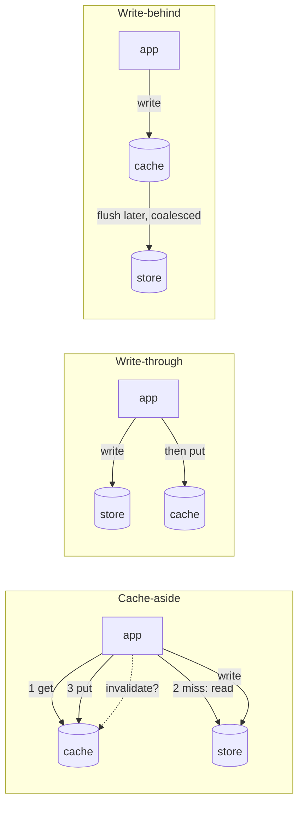

# Caching Strategies: Cache-Aside, Write-Through, Write-Behind

> Stale balances are worse than slow balances.

**Type:** Build
**Languages:** Java, Python, Go
**Prerequisites:** Phase 1, Lesson 06 (Hash Maps from Scratch), Phase 3, Lesson 08 (LRU and LFU Caches), Phase 5, Lesson 05 (Consistency Models), Phase 10, Lesson 01 (Representing Money)
**Time:** ~90 minutes

## Learning Objectives

- Explain where a cache sits relative to the system of record and name the one question every strategy answers differently: who writes what, when
- Build cache-aside, read-through, write-through, and write-behind against a simulated slow store with an injected clock, and run the same seeded workload through all four
- Demonstrate the stale-balance hazard: a TTL-only cache that authorizes a withdrawal against money that has already left
- Distinguish TTL expiry from explicit invalidation and state what each one bounds
- Measure hit rate, store load, simulated latency, and cache/store divergence for each strategy, and read the trade-off out of the numbers
- Explain why write-behind is the fastest strategy and the only one that loses acknowledged writes

## The Problem

A wallet service answers `GET /accounts/{id}/balance` about 9,000 times a second. Each call hits PostgreSQL, which copes until a marketing campaign doubles traffic and p99 latency on the balance endpoint climbs from 18 ms to 400 ms. An engineer adds a cache in front of the query: look in Redis, and on a miss read the database and store the result with a 30-second TTL. The database load drops by two thirds, p99 falls to 3 ms, and the change ships on a Thursday.

On Friday the nightly settlement job runs. It debits 80.00 USD from account `acct-0001` by writing directly to the database, because that job was written two years before the cache existed and knows nothing about Redis. The cache still holds `100.00 USD` for that account, and will for up to 30 seconds. In that window the customer taps their card for 50.00 USD. The authorization service reads the balance through the cache, sees 100.00, approves, and writes the debit. The real balance is now -30.00 USD on an account that is not allowed to go negative. Multiply by every account the settlement job touched and every authorization in the thirty seconds after, and the risk team spends Monday reconciling overdrafts the product does not offer.

Nothing in that story is a bug in Redis or in PostgreSQL. The cache did exactly what a TTL cache does: it served the last value it was given until the time ran out. The failure is a design decision that was never made explicitly: when the balance changes, who tells the cache? A cache is a second copy of state, and the moment you have two copies you have a consistency problem (Phase 5, Lesson 05). Every caching strategy is a different answer to one question: on a write, which copy is updated, in what order, and when does the other one find out. This lesson builds the four standard answers against a simulated slow store, runs the same seeded workload through each, and measures the hit rate you gain against the staleness and durability you give up.

## The Concept

### Two copies, one truth

A cache sits between the application and a system of record, and the system of record is the truth. The cache holds a subset of that truth that is faster to reach. Three quantities describe any cache:

- **Hit rate**: the fraction of reads the cache answers without touching the store. On a skewed workload where 20% of accounts receive 80% of the reads, a cache that holds only the hot accounts can answer most reads.
- **Staleness**: how long, and under what conditions, the cache can hand out a value that the store no longer holds.
- **Durability exposure**: whether a value the application was told was written can be lost before it reaches the store.

The strategies differ in the paths a read and a write take:

| Strategy | Read miss | Write | Stale after a write through the cache? | Stale after a write around the cache? | Loses acknowledged writes? |
|----------|-----------|-------|----------------------------------------|---------------------------------------|----------------------------|
| Cache-aside, TTL only | app loads from store, puts in cache | app writes store only | Yes, until TTL | Yes, until TTL | No |
| Cache-aside + invalidate | same | app writes store, deletes key | No | Yes, until TTL | No |
| Read-through | cache loads from store itself | store, then delete key | No | Yes, until TTL | No |
| Write-through | cache loads from store | store, then cache, synchronously | No | Yes, until TTL | No |
| Write-behind | cache loads from store | cache now, store later (batched) | No; the store is behind instead | Yes, and the write may be overwritten by the flush | Yes, if the cache dies before flushing |

Read the two "stale" columns together. No strategy that lives in the application protects you from a writer that bypasses it; that is what the settlement job in The Problem did. The only defences against write-around are architectural: every writer goes through the same path, or the store itself publishes changes (change data capture, Phase 7, Lesson 11) and a consumer invalidates the cache, or the cache is the store (which is what write-behind edges toward, and why it is dangerous).



### Cache-aside and read-through: who loads

In **cache-aside** (also called lazy loading) the application owns the logic: `get` from the cache; on a miss `read` from the store and `put` the result with a TTL. The cache is a dumb map and knows nothing about the store. This is how Memcached and Redis are used from most application code. The cost is that every call site must do the dance correctly, use the same key format, and remember to invalidate on write. In a service with forty call sites, one of them will not.

**Read-through** moves the loader into the cache. The application calls `cache.read(key)` and the cache calls the store on a miss. Same read path, same TTL semantics, but the loading logic exists once. Caffeine's `LoadingCache`, Guava's `CacheLoader`, and Hibernate's second-level cache are read-through. The simulation in this lesson has both so that you can see that they produce identical numbers under the same workload; the difference is where a bug can live, not how the cache behaves.

### Write-through and write-behind: who writes

**Write-through** writes the store and then the cache, synchronously, on every write. After a write through the cache there is no window where the cache disagrees with the store, and the next read of that key is a hit rather than the miss that invalidation produces. The cost is that every write pays store latency (it would anyway) plus a cache write, and keys that are written but never read occupy cache memory. In the measured run below it has the highest hit rate of the safe strategies because a debit followed by a read, which is what every authorization does, hits instead of missing.

**Write-behind** (write-back) acknowledges the write as soon as the cache has it and writes the store later, from a queue, usually coalescing several writes to the same key into one. It is how CPU caches work, how the operating system page cache works, and how some "cache" products that are really in-memory databases work. It converts N writes into far fewer store writes and makes the write path as fast as the cache. The cost is on the first line of every write-behind product's documentation: if the cache process dies with dirty entries, those writes are gone, and the application has already told the user they succeeded. For a page cache that is an fsync question. For a balance it is money that was debited on the receipt and never debited in the ledger.

### TTL versus invalidation

A **TTL** (time to live) bounds staleness by time: a cached value is wrong for at most TTL after the truth changes, regardless of who changed it. It is the safety net for writers you do not control, and it is also the reason TTL-only caching is wrong for balances: a 30-second bound on "how long can we authorize against money that is gone" is not a bound a risk team accepts.

**Invalidation** bounds staleness by causality: when a write goes through the strategy, it removes (or replaces) the cached entry, so the next read sees the store. It is exact for writers that use it and useless for writers that do not. Production systems use both: invalidate on every write you know about, and keep a TTL as the backstop for the writes you do not.

The ordering of "write store, then invalidate cache" matters and is deliberate. If you invalidate first and then write the store, a concurrent reader can miss, load the old value from the store, and repopulate the cache after your store write lands, leaving the stale value in place with a fresh TTL. Writing the store first narrows that window to the gap between the store commit and the delete; Lesson 04 closes it the rest of the way.

### Worked example by hand

Account `acct-0001` holds 100.00 USD in the store. Store reads cost 20 ms, store writes 25 ms, cache operations 1 ms, TTL 30 s. The clock starts at t = 0.

```text
t=0      app reads balance via cache-aside (TTL only)
         cache miss (1 ms) -> store read (20 ms) -> put {acct-0001: 100.00, expires t=30000}
         app sees 100.00. Latency 21 ms.
t=5000   settlement job writes 20.00 directly to the store (25 ms). Cache untouched.
t=7000   authorization reads via cache: hit (1 ms). app sees 100.00. Store says 20.00. STALE by 80.00.
         request 50.00 <= 100.00 -> approved. Store would go to -30.00.
t=30000  entry expires. next read misses, loads 20.00. Correct again, 23 seconds too late.
```

Same scenario with invalidate-on-write, but now the debit goes through the strategy:

```text
t=0      read: miss, load 100.00, cache it
t=5000   write 20.00: store write (25 ms), then cache.invalidate(acct-0001)
t=7000   read: miss (1 ms) -> store read (20 ms) -> 20.00. Correct. Latency 21 ms instead of 1 ms.
```

The invalidating version is slower on exactly the read that matters and right on exactly the read that matters. That is the trade the hook describes.

### What the measurement shows

The demo runs 20,000 operations over 500 accounts with a seeded generator: 80% of operations land on 20% of accounts, 15% of operations are debits, one operation every 10 ms. Every strategy sees the identical sequence. A debit reads the balance through the cache, subtracts a random amount, and writes the result back through the strategy. The meter compares every value handed to the caller with the store's value at that instant and counts a divergence.

```text
cache-aside, TTL only      hit rate  67.8%  store reads  6433  store writes  2980  divergent  4686
cache-aside + invalidate   hit rate  60.8%  store reads  7850  store writes  2980  divergent     0
read-through               hit rate  60.8%  store reads  7850  store writes  2980  divergent     0
write-through              hit rate  71.6%  store reads  5685  store writes  2980  divergent     0
write-behind               hit rate  97.5%  store reads   500  store writes   399  divergent 17092
no cache                   hit rate   0.0%  store reads 20000  store writes  2980  divergent     0
```

Four things to read out of it:

1. **TTL-only has a higher hit rate than invalidation and 4,686 wrong answers.** The extra hits are exactly the stale ones: a key that was just debited stays in the cache and is served again. Hit rate is not a quality metric on its own.
2. **Invalidation costs about seven points of hit rate** (60.8% vs 67.8%) and 1,400 extra store reads. That is the price of being right, and it is the right price to pay for a balance.
3. **Write-through beats invalidation on hit rate** (71.6%) with zero divergence, because the read that follows a debit hits. It costs nothing extra here because every write already went to the store.
4. **Write-behind looks miraculous**: 97.5% hits, 500 store reads, 399 store writes for 2,980 debits (coalesced 7.5 to 1). The 17,092 divergences are the store lagging the cache, not the cache lagging the store, and in a steady state that is fine. Then the cache crashes, and the demo's smaller scenario shows the result: a debit the user saw is not in the ledger.

### Complexity and cost

Every operation on the cache is O(1) expected: it is a hash map (Phase 1, Lesson 06) with an expiry timestamp per entry. The costs that matter are not CPU; they are the store round trips you avoid (hit rate times read traffic) and the ones you add (invalidation misses, write-through puts, write-behind flushes). The simulation accounts latency as a sum of fixed costs per operation so the comparison is about counts, which is what you can reason about, rather than about a particular network.

Memory is the other budget. A TTL cache with no size bound grows with the number of distinct keys seen within one TTL. This lesson's `TtlCache` has no eviction policy beyond expiry; Phase 3, Lesson 08 (LRU and LFU Caches) supplies one, and Lesson 04 of this phase handles what happens when a hot key's expiry lines up for thousands of readers at once.

### What these strategies do not do

- They do not protect you from writers that bypass them. Only a shared write path or change-data-capture does.
- They do not make the cache transactional with the store. "Write store, then invalidate" is two operations, and a crash between them leaves a stale entry until the TTL. Lesson 04 and Phase 7, Lesson 13 (Transactional Outbox) cover the recovery.
- They do not decide what to evict when memory is full. That is an eviction policy, taught separately.
- They do not make reads consistent across replicas of the cache. A cache cluster is itself a replicated system (Phase 6, Lesson 01).

## Build It

The implementation is in `code/java/`. One `BalanceCache` interface, four strategies, a `BackingStore` that charges simulated latency instead of sleeping, a `TtlCache` driven by a `ManualClock`, and a `Workload` that generates the same operations for every strategy. Money is the Phase 10 type: integer minor units plus currency.

### Step 1: A clock you move by hand and a store that charges for every call

```java
final class ManualClock {
    private long nowMs;
    ManualClock(long startMs) { this.nowMs = startMs; }
    long now() { return nowMs; }
    void advance(long ms) { if (ms < 0) throw new IllegalArgumentException("clock only moves forward"); nowMs += ms; }
}

final class BackingStore {
    private final Map<String, Money> rows = new HashMap<>();
    private final long readLatencyMs, writeLatencyMs;
    long reads, writes, simulatedLatencyMs;

    Money read(String account) { reads++; simulatedLatencyMs += readLatencyMs; return rows.get(account); }
    void write(String account, Money balance) { writes++; simulatedLatencyMs += writeLatencyMs; rows.put(account, balance); }
    Money peek(String account) { return rows.get(account); }   // the oracle; not an operation, not counted
}
```

Nothing in this lesson sleeps. Latency is a number added to a counter, so a run of 20,000 operations representing 200 seconds of wall time finishes in milliseconds and is identical every time. `peek` exists only so the meter can compare what the cache said with what the store holds; a real application has no such oracle, which is the whole reason staleness is hard to see in production.

**Predict:** if `BackingStore.read` were allowed to return a copy that was then mutated by the caller, which strategy would silently corrupt the store?

### Step 2: The TTL cache

```java
final class TtlCache {
    record Entry(Money value, long expiresAtMs) {}
    static final long NO_EXPIRY = Long.MAX_VALUE;
    private final Map<String, Entry> entries = new HashMap<>();
    private final ManualClock clock;

    Money get(String key) {
        Entry e = entries.get(key);
        if (e == null) return null;
        if (e.expiresAtMs() <= clock.now()) { entries.remove(key); return null; }
        return e.value();
    }

    void put(String key, Money value, long ttlMs) {
        long expires = ttlMs == NO_EXPIRY ? NO_EXPIRY : Math.addExact(clock.now(), ttlMs);
        entries.put(key, new Entry(value, expires));
    }

    boolean invalidate(String key) { return entries.remove(key) != null; }
}
```

Expiry is lazy: nothing scans for dead entries, a read of an expired key removes it. Redis does the same plus a background sampler; Memcached is purely lazy. The `<=` is deliberate: an entry whose `expiresAtMs` equals `now` is expired, so a TTL of 500 ms set at t=1000 is gone at t=1500, not t=1501. The test pins that boundary because off-by-one on expiry is the kind of bug that makes two caches disagree.

**Predict:** `put` is called twice for the same key, first with TTL 500, then with `NO_EXPIRY`. What does `get` return after the clock advances by a year?

### Step 3: One interface, with the meter built in

```java
interface BalanceCache {
    String name();
    Money read(String account);
    void write(String account, Money balance);
    CacheStats stats();
    BackingStore store();
    TtlCache cache();

    default Money readMeasured(String account) {
        Money seen = read(account);
        Money truth = store().peek(account);
        if (!Objects.equals(seen, truth)) stats().staleReads++;
        return seen;
    }
}
```

`readMeasured` is what the workload calls. It performs the strategy's real `read` and then asks the oracle whether the answer was right. Every strategy gets the same meter, so the divergence column in the output is comparable across rows.

### Step 4: Cache-aside, with invalidation as a switch

```java
@Override public Money read(String account) {
    Money cached = cache.get(account);
    if (cached != null) { stats.hit(); return cached; }
    stats.miss();
    Money loaded = store.read(account);
    if (loaded != null) cache.put(account, loaded, ttlMs);
    return loaded;
}

@Override public void write(String account, Money balance) {
    store.write(account, balance);
    if (invalidateOnWrite) cache.invalidate(account);
}
```

The `invalidateOnWrite` flag is the entire difference between the first two rows of the measurement. A `null` from the store is not cached: caching the absence of a key is a separate decision (negative caching) with its own staleness story, and for balances an unknown account should fail loudly rather than be remembered as missing.

**Predict:** with `invalidateOnWrite = true`, a debit is followed immediately by a read of the same account. Hit or miss? What does write-through do differently on that same read?

### Step 5: Read-through moves the loader behind the interface

```java
final class ReadThrough implements BalanceCache {
    interface Loader { Money load(String account); }
    private final Loader loader;

    ReadThrough(BackingStore store, ManualClock clock, long ttlMs, long cacheLatencyMs) {
        this.loader = store::read;
        ...
    }

    @Override public Money read(String account) {
        Money cached = cache.get(account);
        if (cached != null) { stats.hit(); return cached; }
        stats.miss();
        Money loaded = loader.load(account);
        if (loaded != null) cache.put(account, loaded, ttlMs);
        return loaded;
    }
}
```

Identical read path; the only change is that the store call is a `Loader` the cache owns. The measurement confirms the two produce the same counts. The reason to prefer read-through in a real codebase is not performance, it is that the key format, the TTL, and the null handling exist in one place.

### Step 6: Write-through

```java
@Override public void write(String account, Money balance) {
    store.write(account, balance);           // store first: if this fails, the cache never sees the value
    cache.put(account, balance, ttlMs);
}
```

Store first. If the store write throws, the cache is untouched and still holds the previous (correct) value or nothing. Cache first would leave a value in the cache that the store rejected, which is a stale read manufactured by your own write path.

### Step 7: Write-behind, with a flush and a crash

```java
@Override public void write(String account, Money balance) {
    cache.put(account, balance, TtlCache.NO_EXPIRY);
    if (dirty.put(account, balance) == null) order.addLast(account);
}

int flush() {
    int flushed = 0;
    while (!order.isEmpty()) {
        String key = order.pollFirst();
        store.write(key, dirty.remove(key));
        flushed++;
    }
    return flushed;
}

void crash() {
    lostWrites += dirty.size();
    dirty.clear(); order.clear(); cache.clear();
}
```

Three details carry the lesson. Dirty entries are stored with `NO_EXPIRY`: if a dirty value could expire, the cache would forget a write before the store had it, and the next read would load the old balance from the store and hand it out as truth. The dirty map is keyed by account, so three debits to one account become one store write holding the last value; that is the coalescing that makes write-behind cheap. And `crash` is a method, because the failure mode is part of the design and must be testable: after it, `lostWrites` says how many acknowledged writes never reached the ledger.

**Predict:** `flush` writes the final value per key. Which intermediate balances does the store never see, and why does that matter for an audit log even when nothing crashes?

### Step 8: A seeded workload, identical for every strategy

```java
static List<Op> generate(long seed, int ops, int accounts, double writeFraction, double hotFraction, double hotShare) {
    Random rng = new Random(seed);
    int hotCount = Math.max(1, (int) Math.round(accounts * hotFraction));
    for (int i = 0; i < ops; i++) {
        boolean hot = rng.nextDouble() < hotShare;
        int idx = hot ? rng.nextInt(hotCount) : hotCount + rng.nextInt(Math.max(1, accounts - hotCount));
        boolean isWrite = rng.nextDouble() < writeFraction;
        out.add(new Op(isWrite, String.format("acct-%04d", idx % accounts), isWrite ? 1 + rng.nextInt(2000) : 0));
    }
    return out;
}
```

The generator is called once and the resulting list is handed to every strategy, each with its own fresh store and clock. Seeded randomness is what makes the comparison a measurement rather than an anecdote: change one strategy and only its row moves.

### Step 9: Run it

```bash
cd phases/09-reliability-and-scale/03-caching-strategies/code/java
javac -d .out *.java && java -cp .out Main
java -cp .out MainTest
```

Expected output, abbreviated:

```console
== The stale balance hazard: cache-aside with TTL, no invalidation ==
balance read through cache:        100.00 USD  (miss, now cached for 30s)
batch job debits 80.00 in the DB:  store = 20.00 USD
authorization reads the cache:     100.00 USD  (hit; STALE by 80.00 USD)
approve 50.00 withdrawal?          true  -> store balance would become -30.00 USD
after the 30s TTL:                 20.00 USD  (miss, reloaded; correct again)

== Write-behind: fast until the cache dies ==
three debits applied; cache says   400.00 USD, store still says 500.00 USD, dirty keys = 1
flush(): 1 store write for 3 debits (coalesced); store now 400.00 USD; store writes went 1 -> 2
one more debit, then crash before flush: store = 400.00 USD, lost writes = 1

== Measured: 20,000 ops, 500 accounts, 20% of accounts take 80% of traffic, 15% writes ==
cache-aside, TTL only      hit rate  67.8%  store reads  6433  store writes  2980  divergent  4686  ...
write-through              hit rate  71.6%  store reads  5685  store writes  2980  divergent     0  ...
write-behind               hit rate  97.5%  store reads   500  store writes   399  divergent 17092  ...
```

The test suite has 41 assertions: expiry boundaries, each strategy's write path, the stale read and its count, coalescing and loss in write-behind, and the measured ordering of the strategies on the seeded workload.

### In Python

```python
class JavaRandom:
    """java.util.Random, bit for bit (48-bit LCG), so the seeded workload matches the Java demo exactly."""

    def next(self, bits: int) -> int:
        self._seed = (self._seed * self._MULTIPLIER + self._ADDEND) & self._MASK
        r = self._seed >> (48 - bits)
        return r - (1 << 32) if r >= (1 << 31) else r

    def next_double(self) -> float:
        return ((self.next(26) << 27) + self.next(27)) * (1.0 / (1 << 53))
```

Differences, all in `code/python/main.py`:

- **The workload generator is `java.util.Random`, not `random.Random`.** Python's Mersenne Twister would produce a different 80/20 stream and different hit rates, so `JavaRandom` reproduces the 48-bit LCG (`next`, `next_int(bound)` with its rejection loop, `next_double`) and `java_round` is `floor(x + 0.5)` rather than Python's banker's `round`. The measured table then matches the Java output digit for digit: 6433 store reads and 4686 divergent reads for TTL-only, 399 coalesced writes for write-behind.
- **No overflow.** `Math.addExact(clock.now(), ttlMs)` becomes plain addition; `NO_EXPIRY` is still `2**63 - 1` so the sentinel comparison reads the same.
- **`null` becomes `None`, and the interface becomes an `ABC`.** `BalanceCache` is an abstract base class with `read_measured` as the one concrete method; the four strategies share a `_CachedStrategy` helper for the accessors and the miss-then-load path, which the Java code repeats inline. `TtlCache.get` returns `Optional[Money]`, and `read_measured` compares with `!=` on frozen dataclasses where Java uses `Objects.equals`.
- **Write-behind's `LinkedHashMap` is a plain `dict`.** Python dicts preserve insertion order, so the dirty map alone would do; the port keeps the explicit `_order` list anyway so the flush order is spelled out the same way as in Java and Go.

```bash
cd phases/09-reliability-and-scale/03-caching-strategies/code/python
python3 main.py
python3 -m unittest -v
```

### In Go

```go
// ReadMeasured counts a read as stale when the value handed to the caller differs from the store's truth.
// It is the Java interface's default method, written as a function because Go interfaces carry no bodies.
func ReadMeasured(c BalanceCache, account string) (Money, bool) {
    seen, seenOk := c.Read(account)
    truth, truthOk := c.Store().Peek(account)
    if seenOk != truthOk || (seenOk && seen != truth) {
        c.Stats().StaleReads++
    }
    return seen, seenOk
}
```

Differences, all in `code/go/main.go`, `money.go`, and `javarandom.go`:

- **Absence is a second return value, not `null`.** `TtlCache.Get`, `BackingStore.Read`, and every strategy's `Read` return `(Money, bool)`. A missing account is `false`, never a zero `Money`, so the staleness meter compares presence first and value second; a `Money` struct compares with `==` because both fields are comparable.
- **The interface has no default method.** Go interfaces declare behaviour only, so `readMeasured` becomes the package function `ReadMeasured(c BalanceCache, account)`. The four strategies embed one small `cached` struct that supplies `Stats()`, `Store()`, `Cache()` and the shared miss-then-load path, which the Java code repeats in each class.
- **`Money` returns errors instead of throwing.** `Plus` and `Minus` return `(Money, error)` with `ErrCurrencyMismatch` and `ErrOverflow` sentinels (`errors.Is` in the tests), and `addChecked` stands in for `Math.addExact` both in `Money` and in `TtlCache.Put`. `Compare` panics on a currency mismatch, exactly as the Phase 10 reference `Money` does. The workload driver uses `must(...)` because a debit that fails to subtract is a bug in the demo, not a condition to handle.
- **The workload generator is `java.util.Random`, not `math/rand`.** `javarandom.go` reproduces the 48-bit LCG (`next`, `NextInt(bound)` with its power-of-two fast path and rejection loop, `NextDouble`), and `javaRound` is `math.Floor(x + 0.5)`. The measured table matches the Java output digit for digit: 6433 store reads and 4686 divergent reads for TTL-only, 399 coalesced writes for write-behind; `TestJavaRandomMatchesJava` pins those numbers.
- **Write-behind's `LinkedHashMap` is a `map` plus a `[]string`.** Go maps have no iteration order, so the first-dirtied order lives in an explicit slice, exactly the pair the Python port keeps too.

```bash
cd phases/09-reliability-and-scale/03-caching-strategies/code/go
go run .
go test ./...
```

## Use It

### Redis and Memcached as cache-aside stores

Both are dumb maps with TTLs, which is to say both are the `TtlCache` of this lesson with a network in front. Redis `SET key value EX 30` and `DEL key` are `put` and `invalidate`; `GET` is `get`. Memcached is the same with `set`/`get`/`delete` and an `exptime`. Neither knows your database exists, so cache-aside and invalidate-on-write are the application's job, exactly as in Step 4. What they add that the from-scratch version lacks: a size bound with LRU or LFU eviction (`maxmemory-policy allkeys-lru`), an active expiry sampler so expired keys free memory without being read, and in Redis's case, a way to delete many keys that share a prefix (`SCAN` plus `UNLINK`), which is how a "flush everything about this account" invalidation is done.

### Caffeine and Guava: read-through in process

Caffeine's `LoadingCache<K, V>` is read-through: `Caffeine.newBuilder().expireAfterWrite(Duration.ofSeconds(30)).build(key -> db.load(key))`. `get(key)` loads on a miss, and crucially, concurrent misses on the same key block on one load rather than issuing one each, which is the stampede protection Lesson 04 builds by hand. Caffeine also offers `refreshAfterWrite`, which is stale-while-revalidate: serve the old value and reload in the background. Guava's `CacheBuilder` has the same shape with fewer policies.

### Write-behind in production

Hibernate's second-level cache, Ehcache, and Hazelcast all offer write-behind with a configurable flush interval and batch size, and all of them document the data-loss window. The operating system page cache is write-behind too: `write(2)` returns when the kernel has the bytes, and `fsync(2)` is `flush`. A database's WAL (Phase 7, Lesson 02) exists so that the durable write happens before the acknowledgement, which is exactly what write-behind inverts. The rule in a payment system is that write-behind is acceptable for derived data that can be recomputed (a cached risk score, a denormalized view) and never for the ledger itself.

### Databases do this too

PostgreSQL's shared buffers are a write-behind cache in front of the heap files, protected by the WAL. InnoDB's buffer pool is the same. When a database vendor says "durable", they mean the WAL was fsynced, not that the data page was written. Understanding that is understanding why write-behind can be safe (when a log makes it so) and when it cannot (when nothing does).

## Ship It

`outputs/checklist-caching-a-balance.md` is a review checklist for any pull request that puts a cache in front of money: which strategy, who else writes the store, the invalidation path, TTL as backstop, negative caching, and what the oracle in your test suite is. Use it when a p99 graph tempts someone to add a TTL on a Thursday.

## Exercises

1. **Reinforce.** Add a `maxEntries` bound to `TtlCache` with LRU eviction (Phase 3, Lesson 08) and re-run the measurement with a bound of 100 entries for 500 accounts. Report how each strategy's hit rate changes and which strategy suffers least. Explain why write-through is hurt more than cache-aside by a tight bound.
2. **Apply.** Implement negative caching: when the store returns `null`, cache a tombstone for a short TTL so repeated lookups of a missing account do not hit the store. Then write the test that shows the new hazard: an account created in the store while its tombstone is cached is invisible until the tombstone expires. Decide and document what TTL you would use for tombstones versus values and why they differ.
3. **Extend.** Replace `crash()` with a write-ahead log (Phase 7, Lesson 02): every write-behind `write` appends to a log before acknowledging, and recovery after a crash replays the log into the dirty queue. Measure how many store writes the log costs versus plain write-behind, and show with a test that `lostWrites` is zero. Then answer in a comment: now that it is durable, what is the remaining difference between this cache and a database?

## Key Terms

| Term | What people say | What it actually means |
|------|-----------------|------------------------|
| Cache-aside | "look in the cache first" | The application owns the miss path: get, then read the store, then put; the cache knows nothing about the store |
| Read-through | "the cache loads itself" | The cache owns the loader; same read semantics as cache-aside with the logic in one place |
| Write-through | "write both" | Every write goes to the store and then to the cache synchronously; reads after writes hit |
| Write-behind | "write-back", "async writes" | Writes are acknowledged from the cache and flushed to the store later, coalesced; acknowledged writes can be lost |
| TTL | "it expires after a while" | A time bound on staleness: the maximum interval a cached value can disagree with the store, regardless of who changed the store |
| Invalidation | "bust the cache" | Removing or replacing a cached entry because of a known write; exact for writers that do it, useless for writers that do not |
| Stale read | "the cache was out of date" | A read that returns a value the system of record no longer holds; for a balance, an authorization against money that has left |
| Write-around | "the batch job updated the table directly" | A write to the store that does not pass through the cache's write path, and so cannot invalidate; the TTL is the only defence |

## Further Reading

- [Redis documentation: EXPIRE](https://redis.io/docs/latest/commands/expire/) — how expiry is implemented (lazy on access plus active sampling) and the exact semantics of a TTL being reached; the source of the `<=` boundary in Step 2.
- [Memcached protocol: expiration times](https://github.com/memcached/memcached/blob/master/doc/protocol.txt) — the `exptime` rules and the original cache-aside idiom as the protocol expects it.
- [Caffeine wiki: Population and Refresh](https://github.com/ben-manes/caffeine/wiki/Population) — read-through loading, `refreshAfterWrite` as stale-while-revalidate, and the single-load-per-miss guarantee that Lesson 04 builds.
- [Scaling Memcache at Facebook (Nishtala et al., NSDI 2013)](https://www.usenix.org/system/files/conference/nsdi13/nsdi13-final170_update.pdf) — the paper on cache-aside at scale: leases, invalidation ordering, and why "delete, not set" on write.
- [PostgreSQL documentation: Write-Ahead Logging](https://www.postgresql.org/docs/current/wal-intro.html) — the mechanism that makes a database's write-behind buffer pool durable, for Exercise 3.
- [Ehcache documentation: Write-Behind](https://www.ehcache.org/documentation/3.10/writers.html) — a production write-behind implementation's configuration and its stated loss window.
