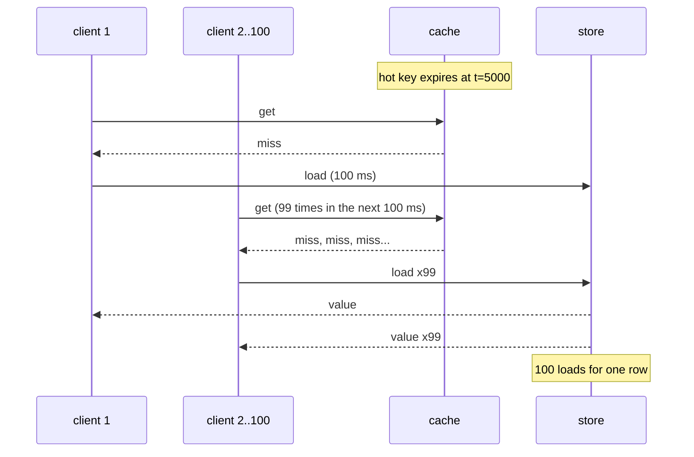

# Cache Invalidation, Stampedes, and Request Coalescing

> A hot key expires and ten thousand requests hit the database.

**Type:** Build
**Languages:** Java, Python, Go
**Prerequisites:** Phase 9 Lesson 03 (Caching Strategies), Phase 5 Lesson 10 (Retries, Exponential Backoff, and Jitter), Phase 1 Lesson 09 (Heaps and Priority Queues)
**Time:** ~75 minutes

## Learning Objectives

- Reproduce a cache stampede deterministically with a discrete-event simulator, many simulated clients, and a hot key whose TTL expires under load
- Explain why explicit invalidation of a hot key is a stampede you scheduled, and why Lesson 03's invalidate-on-write makes this lesson mandatory
- Build request coalescing (single-flight), per-key locking with retry, probabilistic early expiration, and stale-while-revalidate against the same simulated store
- Measure store load, peak concurrent loads, client latency percentiles, and stale serves for each fix, and state what each one trades
- Derive the XFetch recompute rule and explain what the beta parameter controls
- Choose between the fixes for a given key based on whether its readers can tolerate a stale value, a wait, or neither

## The Problem

The wallet service from Lesson 03 now invalidates its balance cache on every write and keeps a 5-second TTL as a backstop. One merchant account, a large marketplace that settles every sale into a single balance, is read 1,000 times a second by the merchant's own dashboard, by the payout scheduler, and by the authorization path for refunds. Its cache entry is the hottest key in the cluster.

At 14:00:00.000 the entry expires. In the next 100 milliseconds, which is how long the balance query takes against the primary, 100 requests arrive. Each one checks the cache, misses, and issues the same query. The database, which was serving 300 queries a second for the whole cache fleet, receives 100 identical queries in a tenth of a second for one row. They all return the same answer and each one writes it back to the cache. At 14:00:05.100 it happens again. If the query holds a row lock, the 100 queries serialize and the last one completes at 14:00:10, after the next expiry has already begun. If the database is a replica with a connection pool of 50, half the requests wait for a connection and the ones behind them time out. Every refund authorization in that window fails. The dashboard says the account is unavailable. The on-call engineer sees a database saturated by one query that normally costs nothing.

The textbook name is a cache stampede, also called dog-piling or the thundering herd. It is not a bug in the cache or the database; it is the combination of three things that are each correct on their own: a key that is read far more often than its TTL, a reload that takes longer than the gap between reads, and a miss path that lets every reader reload independently. Lesson 03 made the stampede more likely, not less, because invalidating on every write to a hot key is an expiry you scheduled at the busiest possible moment. This lesson builds a simulator that reproduces the stampede on demand and then builds the four standard fixes, each of which breaks one of the three conditions, and measures what each costs.

## The Concept

### Anatomy of a stampede

Let the hot key be read at rate `r` requests per second and let a reload take `L` seconds. When the entry becomes unavailable (expiry or invalidation), every request that arrives before the first reload completes sees a miss. Without protection, the number of simultaneous reloads is approximately `r * L`: at 1,000 requests/s and a 100 ms reload, 100 concurrent identical queries. If the reloads contend with each other, `L` grows, which lets more requests arrive during the reload, which grows `L`. The feedback loop is why a stampede can take down a database that handled the steady state with ease.



Three conditions, three places to intervene:

| Condition | Break it by | Fix in this lesson |
|-----------|-------------|--------------------|
| Every miss reloads independently | Letting the first miss reload and making the rest wait for its result | Single-flight (request coalescing); per-key lock with retry |
| The entry becomes unavailable all at once | Refreshing it before it expires, spread across time | Probabilistic early expiration (XFetch) |
| Readers must wait for a fresh value | Serving the stale value during the refresh | Stale-while-revalidate (RFC 5861) |

### Single-flight: one load, N answers

On a miss, check whether a load for this key is already in flight. If not, start one and register yourself as its first waiter. If so, add yourself to its waiter list and return. When the load completes, write the entry and hand the value to every waiter. The store sees exactly one load per cliff no matter how many clients arrive during it; every waiter waits at most `L`, the same as the leader. This is what Go's `golang.org/x/sync/singleflight` package does, what Caffeine's `LoadingCache` does for concurrent `get` calls on the same key, and what Facebook's Memcache leases approximate across processes.

Single-flight has one limitation: it lives in a process. Fifty application servers each coalesce their own misses and the store still sees fifty loads. For a single-server cache that is fine; for a fleet, you either accept fifty (which is usually fine too; it is a hundred times better than five thousand) or move the coalescing to a shared place with a lock.

### Per-key lock with retry

The cross-process version of single-flight: on a miss, try to acquire a lock on the key (Redis `SET lock:key NX PX 1000`, a database advisory lock). The winner reloads and releases. The losers cannot register as waiters because they are in different processes, so they back off and retry the cache after a short interval. One load, but every retry is a cache round trip and up to one retry interval of extra latency, and a lock holder that crashes leaves everyone retrying until the lock's own TTL expires. In the simulation with a 30 ms retry interval and a 100 ms load, waiters attempt at 0, 30, 60, and 90 ms, fail, and succeed at 120 ms: 20 ms slower than single-flight and four cache round trips each.

### Probabilistic early expiration

Vattani, Chierichetti, and Lowenstein (VLDB 2015) asked a different question: why wait for the cliff? If some reader refreshes the value shortly before it expires, nobody ever sees a miss. The trick is to choose that reader without coordination. Each reader, on a hit, computes

```text
recompute if   now + delta * beta * (-ln(rand))   >=   expiry
```

where `delta` is how long the last reload took, `beta` is a tuning parameter (1.0 by default), and `rand` is uniform in (0, 1]. The term `-ln(rand)` is an exponential random variable with mean 1, so the "look-ahead" `delta * beta * (-ln rand)` has mean `delta * beta` and a heavy right tail. Far from expiry the look-ahead almost never reaches it. Within a few `delta` of expiry, each reader has a meaningful chance of volunteering, and with 1,000 readers per second the first volunteer appears, on average, about one `delta` before the cliff. That reader reloads synchronously (it pays `L`), writes the new entry, and the cliff never arrives.

Worked example: `delta = 100 ms`, `beta = 1`, the entry expires at t = 5000, a reader arrives at t = 4950.

```text
gap to expiry = 50 ms
recompute if  100 * 1 * (-ln rand) >= 50
           if  -ln rand >= 0.5
           if  rand <= e^-0.5 = 0.607
probability of recomputing on this read = 60.7%
```

At t = 4700 (gap 300): `rand <= e^-3 = 0.050`, a 5% chance per read, so about one reader in twenty volunteers, which at 1,000 reads per second means the refresh usually happens between 4600 and 4800. At t = 4000 (gap 1000): `rand <= e^-10 = 0.000045`; practically never. The test pins the 60.7% figure with 10,000 trials and a seeded generator.

What beta does: it scales the look-ahead. `beta < 1` waits until the last moment, so several readers can volunteer during the same reload and duplicate it (the simulation shows peak concurrency of 13 at beta = 0.5). `beta > 1` refreshes earlier, so duplicates are rare but the entry is refreshed more often than its TTL requires. The paper's default of 1 is a reasonable middle; the demo prints the trade-off at 0.5, 1, 2, and 4.

Early expiration prevents the expiry stampede. It cannot prevent the cold-start stampede (there is no entry to refresh) or the invalidation stampede (the entry is gone before anyone can volunteer). For those you still need coalescing. Production systems combine them.

### Stale-while-revalidate

RFC 5861 adds two Cache-Control extensions to HTTP: `stale-while-revalidate=N` says a cache may serve a stale response for up to N seconds after it expires while fetching a fresh one in the background, and `stale-if-error=N` says it may serve stale if the origin is down. The idea generalizes to any cache. An entry gets two horizons: fresh until `T`, usable until `T + grace`. Between them, a read returns the stale value immediately and triggers one background refresh (coalesced, so only one). After the grace horizon the entry is treated as missing. Readers never wait for the store except on a cold key, and the price is written on the entry: up to `grace` of explicit, bounded staleness.

For a balance that authorizations read, stale-while-revalidate is the wrong tool for the reason Lesson 03 gave: a bounded stale window is still a window in which money that has left is authorized again. For a merchant dashboard, a fee schedule, an FX rate table, or a feature flag, it is often the right tool, and it is the only one of the four that makes p99 latency independent of store latency.

### Worked trace: the cliff under single-flight

The same cliff as the sequence diagram, with the numbers the simulator produces. The entry was written at t = 0 with a 5,000 ms TTL. Requests arrive once per millisecond.

```text
t=4999   request: entry fresh until 5000, 4999 < 5000 -> hit, latency 0
t=5000   request: 5000 < 5000 is false -> miss. inFlight has no entry for the key.
         start load (completes at 5100); inFlight[key] = [waiter_5000]
t=5001   request: miss. inFlight[key] exists -> append. inFlight[key] = [w5000, w5001]
...
t=5099   request: miss, append. 100 waiters in the list. Store in-flight count: 1.
t=5100   load completes: entries[key] = (value, freshUntil 10100). inFlight.remove(key).
         complete w5000 (latency 100), w5001 (latency 99), ... w5099 (latency 1)
t=5100   request scheduled at 5100 (later seq than the completion): hit, latency 0
```

Store loads: 1. Peak in-flight: 1. Latencies at the cliff: 100 clients spread uniformly between 1 and 100 ms, which is why single-flight's p99 over the whole 10-second run is a few milliseconds rather than zero; one percent of all requests landed inside a reload window. Under the naive strategy the same 100 requests each start a load, every one of them waits the full 100 ms, and the store's in-flight count reads 100 at t = 5099.

### The measurement

One hot key, 1,000 requests per second for 10 seconds, TTL 5 s, store latency 100 ms, cache warmed by one request at t = 0, the store debited by 80.00 USD at t = 4.0 s so that staleness is visible.

```text
naive (every miss loads)                loads  103  peak in-flight 102  p50 0 ms  p99 100 ms  stale 1099  retries   0  early 0
single-flight (coalesce)                loads    2  peak in-flight   1  p50 0 ms  p99   3 ms  stale 1099  retries   0  early 0
lock + retry (10 ms)                    loads    2  peak in-flight   1  p50 0 ms  p99  10 ms  stale 1099  retries 547  early 0
probabilistic early expiry (beta=1.0)   loads    5  peak in-flight   3  p50 0 ms  p99   0 ms  stale  761  retries   0  early 4
stale-while-revalidate (grace 2000 ms)  loads    2  peak in-flight   1  p50 0 ms  p99   0 ms  stale 1201  retries   0  early 0
```

How to read it:

- **Naive**: 103 loads, 102 of them in the 100 ms after the cliff. That is the stampede: one row, a hundred identical queries.
- **Single-flight**: 2 loads (warm-up and cliff). Peak concurrency 1. The 100 clients that arrived during the reload waited for it, which is why p99 is 3 ms rather than 0: one percent of requests paid part of a reload.
- **Lock + retry**: same 2 loads, but 547 retries, each a cache round trip, and p99 of 10 ms, the retry interval.
- **Early expiry**: 5 loads, 4 of them volunteered before an expiry. Peak concurrency 3 (two readers volunteered during the same reload). Nobody waited: p99 is 0. Fewer stale serves because a refresh happened to land after the write.
- **Stale-while-revalidate**: 2 loads, p99 0, and 1,201 stale serves: the 1,099 every strategy served between the write at 4.0 s and the TTL at 5.0 s, plus about 100 served from the stale entry during the background refresh.

The stale column is the Lesson 03 hazard appearing again. Every strategy served roughly 1,100 stale balances because the write at t = 4.0 s went around the cache. The only fix is invalidation at write time, and the second table in the demo shows what invalidation does to a hot key: with the naive strategy it causes 101 concurrent loads at t = 2.5 s, and with single-flight it causes 1. Invalidate on write and coalesce on miss; neither alone is enough.

### Choosing a fix

The decision is about the readers, not the key.

| Readers can tolerate | Use | Example keys |
|----------------------|-----|--------------|
| A bounded stale value, never a wait | Stale-while-revalidate, plus early expiration so the refresh rarely has to be background at all | Fee schedules, FX rate tables, merchant configuration, dashboard aggregates |
| A wait of one reload, never a stale value | Single-flight in process; add a shared lock when the fleet is large enough that one load per process is too many | Balances, limits, account status, anything an authorization reads |
| Neither | Do not put it in a TTL cache; replicate it (change data capture into a local read model) or read the primary | Idempotency records, in-flight payment state |

If a key is read through a strategy that invalidates on write (Lesson 03), it needs single-flight regardless of the row above, because each write is a cliff.

### Complexity

Single-flight adds one hash map lookup per miss and a list append per waiter: O(1) per request, O(waiters) memory per in-flight key, which is bounded by `r * L`. Locking adds a cache round trip per retry: O(L / retry) round trips per waiter. Early expiration adds one `nextDouble` and one `log` per hit, which is cheaper than any network call. Stale-while-revalidate adds one field per entry and one set membership check. None of them is expensive; the question is never cost, it is which readers can tolerate what.

### What these fixes do not do

- They do not fix a key that is too hot for one node. If a single row is read 100,000 times per second, the answer is replication of the cached value (Phase 6) or a local in-process layer in front of the shared cache, not a smarter miss path.
- Single-flight in process does not coalesce across processes; locking does, at the cost of retries.
- Early expiration does not help cold starts or invalidations.
- Stale-while-revalidate does not make stale values correct; it makes them bounded and explicit.
- None of them changes the ordering rule from Lesson 03: write the store, then invalidate.

## Build It

Everything is in `code/java/`. A `Simulator` with a priority queue of events, a `BackingStore` whose loads complete after simulated latency, an abstract `Strategy` with a measuring wrapper, five concrete strategies, and a `Scenario` that drives the same traffic through each.

### Step 1: A discrete-event simulator

```java
final class Simulator {
    private record Event(long atMs, long seq, Runnable action) {}
    private final PriorityQueue<Event> queue = new PriorityQueue<>(
            (a, b) -> a.atMs != b.atMs ? Long.compare(a.atMs, b.atMs) : Long.compare(a.seq, b.seq));
    private long nowMs, seq;

    void schedule(long atMs, Runnable action) {
        if (atMs < nowMs) throw new IllegalArgumentException("cannot schedule in the past");
        queue.add(new Event(atMs, seq++, action));
    }
    void after(long delayMs, Runnable action) { schedule(nowMs + delayMs, action); }
    void run() { while (!queue.isEmpty()) { Event e = queue.poll(); nowMs = e.atMs(); e.action().run(); } }
}
```

Concurrency without threads. Time is a number that jumps to the next event; ten seconds of traffic at 1,000 requests per second is 10,000 events and runs in a few milliseconds. The `seq` tiebreaker makes events at the same instant run in the order they were scheduled, which is what makes every run identical and every test exact. The priority queue is the heap from Phase 1, Lesson 09, doing the job it was built for.

**Predict:** a load completes at t = 100 and a lock waiter retries at t = 100. Which runs first, and why does the answer decide whether that waiter sees a hit?

### Step 2: A store that counts concurrency

```java
void load(String key, Callback cb) {
    loads++;
    inFlight++;
    peakInFlight = Math.max(peakInFlight, inFlight);
    sim.after(latencyMs, () -> {
        inFlight--;
        cb.onLoaded(rows.get(key));
    });
}
```

`peakInFlight` is the stampede meter: it is the largest number of identical queries the database was asked to run at once. The callback receives the row as it stands when the load completes, not when it starts, which is how a real query behaves and is what lets a write during a load be visible to the loaded value.

### Step 3: The measuring wrapper every strategy uses

```java
Waiter measured(String key, long arrivedMs, Waiter inner) {
    return value -> {
        boolean stale = !Objects.equals(value, store.peek(key));
        stats.record(sim.now() - arrivedMs, stale);
        inner.complete(value);
    };
}
```

Latency is completion time minus arrival time, in simulated milliseconds. Staleness is judged at completion against the store's current row. Wrapping the waiter rather than instrumenting each strategy means the five rows of the table are measured identically.

### Step 4: The naive strategy, which is the bug

```java
@Override void get(String key, Waiter waiter) {
    Waiter w = measured(key, sim.now(), waiter);
    Entry e = entries.get(key);
    if (e != null && e.isFresh(sim.now())) { stats.hits++; w.complete(e.value()); return; }
    stats.misses++;
    long started = sim.now();
    store.load(key, value -> {
        entries.put(key, freshEntry(value, sim.now() - started, 0));
        w.complete(value);
    });
}
```

This is Lesson 03's cache-aside read path, and it is correct. It is also the stampede: nothing between the miss and the load asks whether someone else is already loading.

### Step 5: Single-flight

```java
List<Waiter> waiters = inFlight.get(key);
if (waiters != null) { waiters.add(w); return; }                 // join the flight already in the air
List<Waiter> fresh = new ArrayList<>();
fresh.add(w);
inFlight.put(key, fresh);
long started = sim.now();
store.load(key, value -> {
    entries.put(key, freshEntry(value, sim.now() - started, 0));
    List<Waiter> done = inFlight.remove(key);
    for (Waiter each : done) each.complete(value);
});
```

Eleven lines turn 100 loads into 1. The entry is written before the waiters are completed, so a request that arrives in the same instant as the completion sees a hit. In a threaded implementation the `inFlight` map needs a lock or a `ConcurrentHashMap.computeIfAbsent`, and the waiter list becomes a `CompletableFuture` that every joiner shares; the shape is the same.

**Predict:** the load fails with an exception. What should happen to the 99 waiters, and what happens to the next request if `inFlight` is not cleaned up?

### Step 6: Lock and retry

```java
if (locks.add(key)) {                                             // SET key NX: we own the reload
    long started = sim.now();
    store.load(key, value -> {
        entries.put(key, freshEntry(value, sim.now() - started, 0));
        locks.remove(key);
        measured(key, arrivedMs, waiter).complete(value);
    });
} else {
    stats.lockRetries++;
    sim.after(retryMs, () -> attempt(key, arrivedMs, waiter, false));
}
```

`locks.add` returning `true` is `SET NX` succeeding. The loser schedules itself to try again, carrying its original arrival time so latency is measured from the first attempt. Compare with Phase 5, Lesson 10: this retry has no backoff and no jitter, which is acceptable only because the retry hits the cache, not the store. A production version adds a TTL to the lock so a crashed holder cannot block the key forever.

### Step 7: Probabilistic early expiration

```java
boolean shouldRecompute(Entry e, long now) {
    double u = rng.nextDouble();
    if (u == 0.0) u = Double.MIN_VALUE;
    double gap = e.loadTookMs() * beta * -Math.log(u);               // >= 0, heavy-tailed
    return now + gap >= e.freshUntilMs();
}
```

The one formula from the paper. `nextDouble` returns `[0, 1)`, and `ln(0)` is negative infinity, which would make every reader recompute; the guard turns a zero into the smallest positive double, whose log is about -744, a look-ahead of 74 seconds that is harmless. `loadTookMs` is recorded on every reload, so a store that slows down automatically pushes the refresh earlier, which is the paper's reason for using measured `delta` rather than a constant.

**Predict:** `loadTookMs` is 0 because the store answered instantly. What does the rule do, and is that a problem?

### Step 8: Stale-while-revalidate

```java
if (e != null && e.isFresh(now)) { stats.hits++; w.complete(e.value()); return; }
if (e != null && e.isUsable(now)) {                               // stale but within grace: serve it, refresh once
    stats.hits++;
    w.complete(e.value());
    startRefresh(key);
    return;
}
stats.misses++;                                                   // cold or past grace: must wait, but coalesce
coldWaiters.computeIfAbsent(key, k -> new ArrayList<>()).add(w);
startRefresh(key);
```

Three tiers. Fresh: serve. Stale within grace: serve now, refresh in the background, exactly once (`refreshing` is a set; `startRefresh` returns early if the key is in it). Beyond grace: behave like single-flight. The staleness meter counts the serves in the middle tier honestly, which is how the 1,201 in the table arises.

### Step 9: The scenario

```java
sim.schedule(0, () -> s.get(key, v -> {}));                        // one warm-up request fills the cache at t=0
for (long t = WARM_UP_MS * 1000; t < durationMs * 1000; t += gapMicros) {
    long at = t / 1000 + jitter.nextInt(2);                      // one request every gap, with 0-1 ms of jitter
    sim.schedule(at, () -> s.get(key, v -> {}));
}
if (writeAtMs >= 0) sim.schedule(writeAtMs, () -> store.write(key, ...minus 80.00 USD...));
sim.run();
```

The warm-up isolates the expiry stampede from the cold-start stampede so the table measures one thing. The jitter is seeded. Every strategy is built fresh with its own simulator and store and fed the identical event list.

### Step 10: Run it

```bash
cd phases/09-reliability-and-scale/04-cache-invalidation-and-stampedes/code/java
javac -d .out *.java && java -cp .out Main
java -cp .out MainTest
```

Expected output, abbreviated:

```console
== The stampede: one hot balance key, 1,000 requests/s, 10 s of traffic, TTL 5 s, store latency 100 ms ==
naive (every miss loads)                   loads  103  peak in-flight  102  p50    0 ms  p99  100 ms ...
single-flight (coalesce)                   loads    2  peak in-flight    1  p50    0 ms  p99    3 ms ...
probabilistic early expiry (beta=1.0)      loads    5  peak in-flight    3  p50    0 ms  p99    0 ms ...
stale-while-revalidate (grace 2000 ms)     loads    2  peak in-flight    1  p50    0 ms  p99    0 ms ...

== Invalidation is a cliff you chose: same traffic, key invalidated at t=2.5 s ==
naive (every miss loads)                   loads  203  peak in-flight  101 ...
single-flight (coalesce)                   loads    3  peak in-flight    1 ...

== Why beta matters ==
  beta=0.5  loads  44  peak in-flight 13  early refreshes  43  avg lead before expiry  123 ms
  beta=1.0  loads  23  peak in-flight  6  early refreshes  22  avg lead before expiry  371 ms
  beta=2.0  loads  13  peak in-flight  3  early refreshes  12  avg lead before expiry 1036 ms
```

The test suite has 37 assertions: simulator ordering, store concurrency accounting, the stampede itself (100 loads, peak 100), each fix's load count and latency profile, the XFetch probability at a known gap, stale-while-revalidate's three tiers, invalidation as a cliff, and determinism.

### In Python

```python
class Simulator:
    def schedule(self, at_ms: int, action: Action) -> None:
        if at_ms < self._now_ms:
            raise ValueError(f"cannot schedule in the past: {at_ms} < {self._now_ms}")
        heapq.heappush(self._queue, (at_ms, self._seq, action))
        self._seq += 1

    def run(self) -> None:
        while self._queue:
            at_ms, _, action = heapq.heappop(self._queue)
            self._now_ms = at_ms
            action()
```

Differences, all in `code/python/main.py`:

- **The event queue is `heapq` over `(at_ms, seq, action)` tuples.** The sequence number is the tie-breaker that keeps same-instant events in scheduling order, and it also stops Python from ever comparing two callables when the times are equal. `Waiter` and `Runnable` become plain functions; each strategy's load callback is a nested `def loaded(value)` closing over `started`, `key`, and `w`.
- **Both RNGs are `java.util.Random`, not `random.Random`.** The jitter in `Scenario.run` and the XFetch draw in `should_recompute` port the 48-bit LCG (`next_int(2)` takes the power-of-two path, `next_double` is `(next(26) << 27 + next(27)) / 2**53`), so the loads, peak in-flight, and stale columns match the Java table digit for digit. `Double.MIN_VALUE` is spelled as the literal subnormal `5e-324`.
- **Integer division is explicit.** `average_lead_ms` uses `//` on non-negative totals, and `gap_micros = 1_000_000 // requests_per_second`; the `now + gap >= fresh_until` comparison mixes `int` and `float` exactly as the Java `long + double` does.
- **Closures in a loop.** The beta sweep binds the loop variable with a default argument (`lambda sim, st, b=beta: ...`) so each factory keeps its own beta; the request-scheduling loops are safe because `key` and `s` do not change.

```bash
cd phases/09-reliability-and-scale/04-cache-invalidation-and-stampedes/code/python
python3 main.py
python3 -m unittest -v
```

### In Go

```go
// Schedule queues an action at an absolute time; it panics on time travel because that is a bug in the caller.
func (s *Simulator) Schedule(atMs int64, action func()) {
    if atMs < s.nowMs {
        panic(fmt.Sprintf("cannot schedule in the past: %d < %d", atMs, s.nowMs))
    }
    heap.Push(&s.queue, event{atMs, s.seq, action})
    s.seq++
}

func (s *Simulator) Run() {
    for s.queue.Len() > 0 {
        e := heap.Pop(&s.queue).(event)
        s.nowMs = e.atMs
        e.action()
    }
}
```

Differences, all in `code/go/main.go` and `javarandom.go`:

- **The event queue is `container/heap`.** `eventQueue` implements `heap.Interface` with `Less` ordering by `(atMs, seq)`, so same-instant events run in scheduling order exactly as the Java `PriorityQueue` comparator does. `Runnable` becomes `func()`, `Waiter` and `Callback` become `func(Money)`; each strategy's load callback is a closure over `started`, `key`, and the measured waiter, which is the same shape as the Java lambdas.
- **The abstract class is an interface plus an embedded struct.** `Strategy` declares `Name`, `Get`, `Invalidate`, `Stats`, `Store`; `strategyBase` holds the shared fields and the `freshEntry`, `measured`, and `freshHit` helpers, and the five concrete strategies embed it. `Factory` is `func(*Simulator, *BackingStore) Strategy`, so the beta sweep needs no default-argument trick: Go 1.22 gives each loop iteration its own `beta`.
- **Both RNGs are `java.util.Random`.** The jitter in `Scenario.Run` and the XFetch draw in `ShouldRecompute` use `JavaRandom` (48-bit LCG; `NextInt(2)` takes the power-of-two path, `NextDouble` is `(next(26)<<27 + next(27)) / 2^53`), so the loads, peak in-flight, and stale columns match the Java table digit for digit; `TestDemoParity` pins 103/102/1099 for naive and 5/3/761 for early expiry. `Double.MIN_VALUE` is `math.SmallestNonzeroFloat64`.
- **Errors are values, panics are bugs.** `Money.Minus` returns `(Money, error)` with `ErrCurrencyMismatch`; the scenario's debit uses `must(...)` because a failing subtraction there is a programming error. `Simulator.Schedule` panics rather than returning an error for the same reason, and the test recovers it with `defer`/`recover()`.
- **Integer semantics match.** `AverageLeadMs` and `gapMicros = 1_000_000 / requestsPerSecond` are `int64` division, which truncates like Java `long`; `float64(now) + gap >= float64(freshUntil)` is the Java `long + double` comparison written out.

```bash
cd phases/09-reliability-and-scale/04-cache-invalidation-and-stampedes/code/go
go run .
go test ./...
```

## Use It

### `singleflight` and `LoadingCache`

Go's `golang.org/x/sync/singleflight` is Step 5 as a library: `group.Do(key, fn)` runs `fn` once per key among concurrent callers and hands every caller the same result. `DoChan` returns a channel so callers can time out independently; `Forget(key)` is the cleanup the Predict question in Step 5 asked about. Caffeine's `LoadingCache.get(key)` coalesces concurrent loads of one key through a per-entry `CompletableFuture`, and `refreshAfterWrite(d)` is stale-while-revalidate with a fixed lead time. Guava's `LoadingCache` behaves the same way. In Java without a library, `ConcurrentHashMap.computeIfAbsent(key, k -> new CompletableFuture<>())` is the primitive.

### Redis and Memcached

Neither coalesces for you. The lock pattern is `SET lock:{key} {token} NX PX {ttl}` and a Lua script or `DEL` guarded by the token to release (Phase 5, Lesson 12 explains why the token matters). Memcached's `gat` (get-and-touch) extends a TTL on read, which teams use as a crude early-expiration. Facebook's leases, described in the NSDI 2013 paper, are the closest production relative of single-flight across processes: a miss returns a lease token, only the holder may set the key, and other missers are told to wait and retry, which bounds the load on the database to one per key per lease period.

### HTTP caches and CDNs

RFC 5861 is implemented by every major CDN and by Nginx (`proxy_cache_use_stale updating`, `proxy_cache_lock`). `proxy_cache_lock on` is single-flight at the edge: one request per cache key goes to the origin while the rest wait. `proxy_cache_use_stale updating` is stale-while-revalidate. Reading those two directives after this lesson, you know exactly which condition each one breaks.

### Where this matters in payments

Fee schedules, FX rate tables, merchant configuration, and risk rules are hot, rarely written, and safe to serve slightly stale, so stale-while-revalidate plus early expiration is the usual answer. Balances and limits are hot and never safe to serve stale, so the answer is invalidate-on-write plus single-flight, accepting that each write to a hot account produces one reload. Idempotency records (Phase 5, Lesson 09) must never be served stale and are rarely hot, so they are often not cached at all.

## Ship It

`outputs/runbook-hot-key-stampede.md` is an on-call runbook: how to recognize a stampede from database and cache metrics in the first two minutes, what to do immediately (lengthen the TTL, enable the lock, shed the key), and the follow-up checklist that decides which of the four fixes the key needs permanently.

## Exercises

1. **Reinforce.** Add a load failure mode to `BackingStore` (every Nth load throws) and make `SingleFlightStrategy` handle it: waiters must be completed with the failure and `inFlight` must be cleaned up so the next request can retry. Write the test that currently fails without the cleanup: after one failed load, the key is stuck and every later request waits forever (the simulator queue drains with waiters never completed).
2. **Apply.** Combine early expiration with single-flight so that a volunteer's reload is shared by any other volunteer in the same window. Re-run the beta table and show that peak in-flight is 1 at every beta. Then explain in a comment why beta still matters for store load even after coalescing.
3. **Extend.** Model a fleet: run 20 `SingleFlightStrategy` instances against one shared `BackingStore` with the traffic split evenly across them. Measure peak in-flight at the cliff (it should be about 20), then add a shared `LockingStrategy`-style lock in front of the per-process coalescers and bring it to 1. Compare total client latency between the two designs and, using Phase 9, Lesson 01, state the SLO a balance read would need for the extra latency to be unacceptable.

## Key Terms

| Term | What people say | What it actually means |
|------|-----------------|------------------------|
| Cache stampede | "thundering herd", "dog-pile" | Many concurrent misses on one key each reloading from the store, roughly `rate x reload latency` identical queries at once |
| Request coalescing | "single-flight", "dedupe the misses" | The first miss loads; later misses for the same key wait for that load's result instead of issuing their own |
| Per-key lock | "SET NX before reloading" | A cross-process mutex on the reload; losers retry the cache after an interval, paying latency and round trips |
| Probabilistic early expiration | "XFetch", "refresh a bit early" | Each reader recomputes with probability rising as expiry nears, scaled by reload time; no coordination, cliff never reached |
| Stale-while-revalidate | "serve stale and refresh in the background" | An entry has a fresh horizon and a grace horizon; between them the old value is served and one refresh runs |
| Beta | "the XFetch knob" | A multiplier on the look-ahead `delta * -ln(rand)`; below 1 waits longer and duplicates more, above 1 refreshes earlier and more often |
| Hot key | "that one merchant" | A key whose read rate times reload latency exceeds 1, so any unavailability produces concurrent reloads |
| Discrete-event simulation | "a fake clock" | Events in a priority queue by timestamp; time jumps between events, so concurrency is modelled exactly and deterministically without threads |

## Further Reading

- [Optimal Probabilistic Cache Stampede Prevention (Vattani, Chierichetti, Lowenstein, VLDB 2015)](https://cseweb.ucsd.edu/~avattani/papers/cache_stampede.pdf) — the XFetch paper: the recompute rule, the proof that it is optimal among uncoordinated schemes, and the beta discussion.
- [RFC 5861: HTTP Cache-Control Extensions for Stale Content](https://www.rfc-editor.org/rfc/rfc5861) — `stale-while-revalidate` and `stale-if-error` as the HTTP standard defines them; four pages.
- [Scaling Memcache at Facebook (Nishtala et al., NSDI 2013)](https://www.usenix.org/system/files/conference/nsdi13/nsdi13-final170_update.pdf) — Section 3.2.1 on leases: the cross-process coalescing scheme and the stale-set problem it also solves.
- [golang.org/x/sync/singleflight documentation](https://pkg.go.dev/golang.org/x/sync/singleflight) — the production API for Step 5, including `DoChan` and `Forget`.
- [Caffeine wiki: Refresh](https://github.com/ben-manes/caffeine/wiki/Refresh) — `refreshAfterWrite` semantics and how concurrent loads are coalesced in an in-process cache.
- [Nginx `ngx_http_proxy_module`: `proxy_cache_lock` and `proxy_cache_use_stale`](https://nginx.org/en/docs/http/ngx_http_proxy_module.html#proxy_cache_lock) — the same two fixes as configuration directives at the edge.
