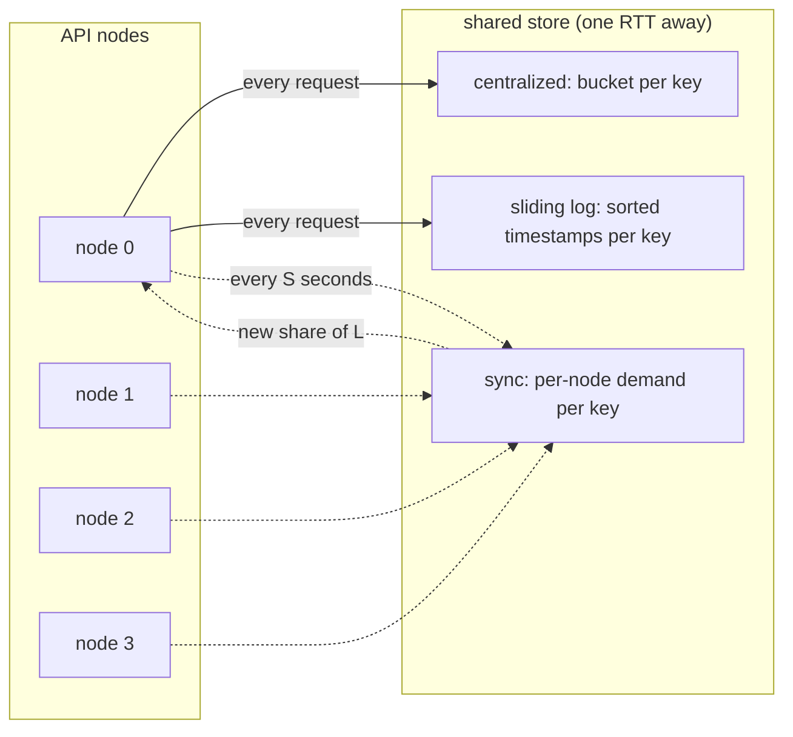

# Distributed Rate Limiting

> Token buckets across nodes without a coordinator.

**Type:** Build
**Languages:** Java, Python, Go
**Prerequisites:** Phase 9 Lesson 04 (Cache Invalidation, Stampedes, and Request Coalescing), Phase 5 Lesson 10 (Retries, Exponential Backoff, and Jitter), Phase 1 Lesson 06 (Hash Maps)
**Time:** ~90 minutes

## Learning Objectives

- Build a token bucket with integer arithmetic and lazy refill, and state the exact number of requests it admits over any interval
- Explain why a limit that is correct on one node is wrong on N nodes, and quantify the error for the two naive fixes
- Implement three coordination strategies (centralized bucket, local buckets with periodic sync, shared sliding-window log) behind one interface
- Measure accuracy, per-request latency, and coordination traffic for each strategy under seeded even and skewed load
- Choose a strategy for a given limit by reasoning about what the limit protects, what an over-admit costs, and what a false reject costs

## The Problem

A payments API gives each merchant a quota of 100 requests per second on `POST /charges`. The quota exists for two reasons: the card processor behind the API has its own per-acquirer limit, and a merchant whose checkout page has a retry bug can otherwise crowd out every other merchant. The limiter was written when the API ran on one node: a token bucket in process memory, 100 tokens, refilling at 100 per second. It worked for two years.

The API now runs on four nodes behind the load balancer from Lesson 02. Each node still has its own in-memory bucket for `merchant:acme`, each still holding 100 tokens. On Black Friday a merchant's checkout retries in a tight loop and sends 900 requests per second. Round-robin spreads them across four nodes, each node sees 225 per second, each node admits its 100 and rejects 125, and the processor receives 400 requests per second from one merchant: four times the contracted limit. The processor's own limiter trips and returns `429` for *every* merchant routed through that acquirer connection, including the ones behaving well. The quota that was supposed to isolate merchants from one another has caused exactly the blast radius it existed to prevent.

The obvious fix is to divide the quota: give each node 25 tokens per second. Now a well-behaved merchant whose traffic happens to hash onto one node (sticky sessions, a single IP behind a NAT, a keep-alive connection) gets rejected at 26 requests per second while three other nodes hold 75 tokens nobody is using. Support receives a ticket: "we are paying for 100 per second and getting 25". Both naive answers are wrong in opposite directions. The first leaks N times the limit; the second refuses up to (N-1)/N of what was sold.

The honest statement of the problem is that a rate limit is a *global* counter and the nodes enforcing it do not share memory. Every real design chooses where that counter lives and how stale a node is allowed to be about it. This lesson builds the three standard answers on a deterministic simulator and measures them, because the right choice depends on numbers (round-trip time to the store, skew of traffic across nodes, cost of an over-admit) that you should be able to produce for your own system.

## The Concept

### The token bucket and its invariant

A token bucket is two numbers and a rule. `capacity` tokens fit in the bucket; `rate` tokens are added per second; a request takes one token or is rejected. The bucket starts full. The invariant it enforces: **over any interval of length T, the number of admitted requests is at most `rate * T + capacity`.** The `capacity` term is the burst allowance: a client that has been idle may spend saved-up tokens all at once, but can never save more than one bucketful.

The textbook implementation refills on a timer. The implementation everyone ships refills lazily: store the token count and the timestamp of the last refill, and when a request arrives compute `elapsed * rate`, add it, clamp to capacity, then try to spend. No timer thread, no work for idle keys, and the result is identical.

Lazy refill has one arithmetic trap. A rate of 7 per second over 13 milliseconds is 0.091 tokens. Store tokens as a `double` and the bucket drifts; after a few million refills the sum of the fractions is not what it should be, and two nodes that saw the same events in a different order disagree. The fix is the same one Phase 10 uses for money: pick a smaller unit and count integers. This lesson stores *milli-tokens*: a rate of `r` tokens per second is exactly `r` milli-tokens per millisecond, so `elapsedMillis * r` is exact and `tokens / 1000` is the whole-token count. Capacity 100 is 100,000 milli-tokens. Nothing ever rounds.

Worked example, rate 100 per second, capacity 100, bucket drained to zero at t = 0:

```text
t = 0 ms      tokensMilli = 0
t = 10 ms     refill: 10 ms * 100 = 1,000 milli-tokens -> 1 whole token available
t = 15 ms     refill: 5 ms * 100 = 500 -> 1,500 milli-tokens; spend 1,000 -> 500 left
t = 5,015 ms  refill: 5,000 * 100 = 500,000 -> clamp to 100,000 (capacity); 100 tokens, not 500
```

The clamp at t = 5,015 is what makes the burst allowance bounded. Without it, an hour of idleness would bank 360,000 tokens.

### Why one node's limit is wrong on N nodes

Let the global limit be `L` per second and the cluster have `N` nodes.

| Strategy | Admits per second (worst case) | Rejects a well-behaved client when | Decision latency |
|----------|-------------------------------|------------------------------------|------------------|
| Full bucket on every node | up to `N * L` | never (that is the problem) | 0 |
| `L / N` on every node | at most `L` | its traffic is uneven across nodes; a client on one node gets `L / N` | 0 |
| One bucket in a shared store | exactly `L` | never | one round trip per request |
| Local `L / N` buckets, shares resynced every `S` seconds | between `L / N` and `L`, approaching `L` as `S` shrinks | for up to `S` seconds after its traffic pattern shifts | 0, plus one round trip per `S` seconds per key |
| Shared sliding-window log | exactly `L` in every window, no burst | never | one round trip per request; memory `O(L)` per key |

The first two rows are the two wrong answers from The Problem. The remaining three are the designs this lesson builds. They form a spectrum: the centralized bucket and the log are exact and pay latency on every request; local buckets pay nothing per request and are exact only in the limit as the sync interval goes to zero, at which point they have become the centralized design with extra steps.



### Strategy 1: the centralized bucket

Put the bucket in a store every node can reach (in production, Redis; here, a `SharedStore` object that counts calls and charges a fixed round trip). Each request does one read-modify-write on the key's bucket. Accuracy is exact: there is one counter, so the invariant holds globally. The cost is a round trip on the request path. With a 2 ms RTT and a 20 ms p50 for the charge itself, that is a 10% latency tax on every call, paid by the 99% of merchants who are nowhere near their limit.

The read-modify-write must be atomic, which is why production implementations are a Lua script or a `MULTI`/`EXEC` block on the store rather than a `GET` followed by a `SET`. Two nodes that both read 1 token, both decide to spend it, and both write 0 have admitted two requests on one token. The simulator here is single-threaded so the atomicity is free; the test that would catch the race in a real deployment is in Exercise 3.

### Strategy 2: local buckets with periodic sync

Each node keeps its own bucket for each key with a *share* of the global rate. Decisions are in-process. Every `S` milliseconds a node reports how many requests it saw for the key since the last sync; the shares are then redistributed in proportion to demand, with a floor so a node that has been idle can still admit something when traffic arrives. The code uses a floor of `L / (4N)`: with `L = 100` and `N = 4`, every node always has at least 6 per second and the remaining 76 are split by observed demand.

Hand trace, `L = 100`, `N = 4`, sync every 1 s, node 0 receiving 85% of traffic:

```text
t = 0        shares [25, 25, 25, 25]; node 0 drains its 25 tokens in 70 ms and rejects for 930 ms
             nodes 1-3 each see ~5% of 400 req/s = 20 req/s and admit all of them: 75 tokens/s mostly unused
t = 1,000    sync: demand = [340, 20, 20, 20], total 400
             floor 6 each = 24; remaining 76 split 340:20:20:20 -> [64, 3, 3, 3]
             new shares [70, 9, 9, 9], sum 97 (3 lost to integer division; never exceeds 100)
t = 1,000+   node 0 now admits 70/s; the cluster admits ~97/s instead of ~85/s
```

During the first second the cluster admitted roughly 25 + 20 + 20 + 20 = 85 requests for a merchant entitled to 100: under-admission of 15%. That is the inaccuracy you buy with zero per-request latency, and it shrinks with a shorter sync interval. In the opposite direction, if traffic shifts *away* from node 0 the moment after a sync, node 0 holds a 70 per second share it no longer uses while the others are capped at 9: the same under-admission, mirrored. Over-admission is impossible in this design because the shares always sum to at most `L` and each bucket's capacity is `L / N`; the price of that guarantee is that it is systematically stingy.

### Strategy 3: the sliding-window log

Keep, per key, a sorted list of the timestamps of admitted requests. On each request, drop every timestamp older than `now - window`, and admit if fewer than `L` remain. This enforces a different invariant from the token bucket: **at most `L` admitted in *any* window of length `W`**, with no burst term. It is the semantics most people *mean* when they say "100 per second", and it is what a processor's contract usually says.

The cost is memory: `L` timestamps per key, so a limit of 10,000 per minute per merchant across 50,000 merchants is 500 million entries. Redis implementations use a sorted set (`ZADD`, `ZREMRANGEBYSCORE`, `ZCARD`) inside a Lua script. The sliding-window *counter* approximation (two fixed windows, weighted by overlap) fixes the memory at two integers per key and is what most production limiters use; it is Exercise 2.

### Which invariant are you buying?

| | Token bucket | Sliding-window log |
|-|--------------|--------------------|
| Admitted in any interval `T` | `<= rate * T + capacity` | `<= L` per window `W` exactly |
| Bursts | allowed up to `capacity` after idleness | never |
| First second from idle | up to `rate + capacity` (200 for 100/100) | `L` (100) |
| Memory per key | two integers | `L` timestamps |
| Matches "100 requests per second" in a contract | only if the contract allows bursts | yes |

The demo's "vs ideal" column measures each strategy against the token-bucket ideal (`rate * seconds + capacity`), so the log shows `-100`: that is not a defect in the log, it is the burst allowance it deliberately does not grant. When you compare limiters, first agree on which invariant the limit is supposed to enforce.

### Choosing a strategy

The decision procedure the checklist in Ship It encodes:

1. **What does an over-admit cost?** If the limit protects a shared downstream (a processor connection, a database pool) and exceeding it hurts other tenants, over-admission is the failure that matters and the local-sync design is the right default: it never over-admits, and its stinginess is a client-facing annoyance rather than an outage.
2. **What does a false reject cost?** If the limit is a contractual quota a merchant pays for, under-admitting by 15% for a second after their traffic shifts is a support ticket and possibly a credit. If the store round trip fits in the latency budget, the centralized bucket is exact and simple.
3. **Does the contract say "in any window"?** Processor rulebooks and partner agreements usually do. Then the invariant is the sliding window's, and the question becomes whether you can afford `O(L)` memory per key (log) or must accept the counter approximation.
4. **How skewed is traffic across nodes?** Measure it. With consistent hashing on merchant ID (Lesson 02), one merchant's traffic lands on one node and the local design is exact for that key with no sync at all. With round-robin, it is nearly even and the local design is within a few percent. Sticky sessions and NAT are the cases that produce the 85% skew in the demo.
5. **What happens when the store is down?** Decide fail-open or fail-closed per limit before the first incident decides it for you.

Most mature payment platforms run two limits in series: a cheap local limiter protecting each node from being overwhelmed (fail-closed, generous, never exact) in front of a centralized limiter enforcing the per-merchant contract (fail-open with an alert).

### Complexity

Every strategy is `O(1)` per decision except the log, which is amortized `O(1)` (each timestamp is added once and removed once) with `O(L)` memory per key. The centralized and log strategies make one store call per request: `R` requests per second produce `R` store operations per second, which is a store sizing question. Local sync makes `N / S` store calls per second per *active key*, independent of request rate: 4 nodes syncing every 100 ms is 40 calls per second per key whether the key sees 10 requests or 10,000.

### What this lesson does not do

- It does not pick the key. Per merchant, per API key, per IP, per card BIN, and per endpoint are all legitimate and usually several apply at once; the limiter takes a string.
- It does not decide what to do on reject. Returning `429` with `Retry-After` is the HTTP answer (RFC 6585 and the IETF `RateLimit` header draft); queuing instead of rejecting is Lesson 13.
- It does not limit concurrency. "At most 20 in-flight requests per merchant" is a semaphore, not a bucket; it protects against slow requests rather than many requests, and the two limits are usually layered.
- It does not weight requests. A `POST /charges` and a `GET /charges/{id}` cost one token each here; a production limiter often charges tokens proportional to cost, which the `tryAcquire(tokens, now)` signature already allows.
- It does not handle store failure. If the shared store is unreachable, fail open (admit everything), fail closed (reject everything), or fall back to local buckets: that is a policy decision per limit, and it belongs in the checklist in Ship It.

## Build It

### Step 1: Integer token bucket with lazy refill

```java
final class TokenBucket {
    private final long capacityMilli;
    private long ratePerSecond;          // tokens per second == milli-tokens per millisecond
    private long tokensMilli;
    private long lastRefillMillis;

    TokenBucket(long capacity, long ratePerSecond, long nowMillis) {
        if (capacity <= 0) throw new IllegalArgumentException("capacity must be positive");
        this.capacityMilli = Math.multiplyExact(capacity, 1000L);
        this.ratePerSecond = ratePerSecond;
        this.tokensMilli = capacityMilli;   // a new bucket starts full
        this.lastRefillMillis = nowMillis;
    }

    void refill(long nowMillis) {
        if (nowMillis <= lastRefillMillis) return;
        long elapsed = nowMillis - lastRefillMillis;
        long added = Math.multiplyExact(elapsed, ratePerSecond);
        tokensMilli = Math.min(capacityMilli, Math.addExact(tokensMilli, added));
        lastRefillMillis = nowMillis;
    }

    boolean tryAcquire(long tokens, long nowMillis) {
        refill(nowMillis);
        long needed = Math.multiplyExact(tokens, 1000L);
        if (tokensMilli >= needed) { tokensMilli -= needed; return true; }
        return false;
    }
}
```

The clock is a parameter, not `System.currentTimeMillis()`, so the tests can advance time by exactly 100 ms and assert that exactly 500 milli-tokens appeared. `refill` ignores a clock that appears to go backwards (`nowMillis <= lastRefillMillis`), which in production happens on NTP adjustments; refusing to add negative tokens is the safe choice. `Math.multiplyExact` turns an absurd rate or a 300-year gap into an exception rather than a wrapped negative balance.

**Predict:** a bucket with rate 5 and capacity 10 is drained at t = 0. What does `availableTokens` return at t = 100 ms, and at t = 200 ms?

### Step 2: The shared store and the decision record

```java
record Decision(boolean allowed, long latencyMillis, int storeCalls) {}

final class SharedStore {
    private final long rttMillis;
    private final Map<String, TokenBucket> buckets = new HashMap<>();
    private final Map<String, ArrayDeque<Long>> logs = new HashMap<>();
    private final Map<String, long[]> usageReports = new HashMap<>();
    private long calls;

    TokenBucket bucket(String key, long capacity, long rate, long nowMillis) {
        calls++;
        return buckets.computeIfAbsent(key, k -> new TokenBucket(capacity, rate, nowMillis));
    }
    ArrayDeque<Long> log(String key) { calls++; return logs.computeIfAbsent(key, k -> new ArrayDeque<>()); }
    long[] usage(String key, int nodes) { calls++; return usageReports.computeIfAbsent(key, k -> new long[nodes]); }
}
```

The store is a stand-in for Redis with two properties that matter for the comparison: every access costs `rttMillis`, and every access is counted. A `Decision` carries both the answer and what it cost to obtain, so the load generator can total latency and coordination traffic without knowing which strategy produced the decision.

**Predict:** which of the three strategies will have `storeCalls` equal to the number of offered requests, and which will have it proportional to elapsed time instead?

### Step 3: The centralized limiter

```java
final class CentralizedLimiter implements RateLimiter {
    @Override public Decision tryAcquire(int node, String key, long nowMillis) {
        TokenBucket bucket = store.bucket(key, capacity, ratePerSecond, nowMillis);
        boolean ok = bucket.tryAcquire(1, nowMillis);
        return new Decision(ok, store.rttMillis(), 1);
    }
}
```

Three lines because the hard part, the bucket, is already written; the `node` argument is ignored because the store does not care who asked. In production this method is a Lua script executed atomically on the Redis node that owns the key's hash slot. The script reads the two fields, computes the refill, writes back, and returns the verdict, all without another client interleaving.

### Step 4: Local buckets with proportional resync

```java
@Override public Decision tryAcquire(int node, String key, long nowMillis) {
    TokenBucket[] buckets = bucketsFor(key, nowMillis);
    long[] demand = demandSinceSync.get(key);
    demand[node]++;
    int storeCalls = 0;
    long latency = 0;
    if (nowMillis - lastSync.get(key) >= syncIntervalMillis) {
        storeCalls = sync(key, buckets, demand, nowMillis);
        latency = store.rttMillis();
    }
    boolean ok = buckets[node].tryAcquire(1, nowMillis);
    return new Decision(ok, latency, storeCalls);
}

int sync(String key, TokenBucket[] buckets, long[] demand, long nowMillis) {
    long[] shared = store.usage(key, nodes);
    long total = 0;
    for (int i = 0; i < nodes; i++) { shared[i] = demand[i]; total += demand[i]; }
    long floor = Math.max(1, ratePerSecond / (4L * nodes));
    long remaining = ratePerSecond - floor * nodes;
    for (int i = 0; i < nodes; i++) {
        long share = floor + (total == 0 ? remaining / nodes : remaining * shared[i] / total);
        buckets[i].refill(nowMillis);
        buckets[i].setRatePerSecond(share);
        demand[i] = 0;
    }
    lastSync.put(key, nowMillis);
    return 1;
}
```

Two details carry the design. First, `buckets[i].refill(nowMillis)` is called *before* `setRatePerSecond`: tokens earned at the old rate are banked at the old rate, and the new rate applies only from now. Skip that line and a node whose share drops from 70 to 9 retroactively loses tokens it already earned. Second, `remaining * shared[i] / total` is integer division and the shares can sum to slightly less than `L`; that is accepted because the alternative, rounding up, could sum to more than `L`, and over-admission is the failure this strategy promises never to commit. (Phase 10, Lesson 01's largest-remainder allocation would hand out the lost units deterministically; using it here is a good five-minute exercise.)

The sync is charged to the request that triggered it. In production the sync runs on a background thread and no request waits for it, so the simulator slightly overstates this strategy's latency. The honest comparison still favours it by two orders of magnitude.

**Predict:** with `L = 100` and `N = 4`, what is the floor share, and what is the most any single node can be allocated after a sync?

### Step 5: The sliding-window log

```java
@Override public Decision tryAcquire(int node, String key, long nowMillis) {
    ArrayDeque<Long> log = store.log(key);
    long cutoff = nowMillis - windowMillis;
    while (!log.isEmpty() && log.peekFirst() <= cutoff) log.pollFirst();
    if (log.size() < limit) {
        log.addLast(nowMillis);
        return new Decision(true, store.rttMillis(), 1);
    }
    return new Decision(false, store.rttMillis(), 1);
}
```

Timestamps are appended in arrival order, so the deque is sorted by construction and expiry is a loop from the head. Only *admitted* requests are logged; logging rejected ones would let a client that is already over the limit keep itself over the limit forever by retrying. The `<=` on the cutoff means a window is half-open: a request admitted at exactly `now - W` has aged out. Redis's `ZREMRANGEBYSCORE key -inf (cutoff` is the same half-open interval.

### Step 6: The seeded load generator

```java
LoadReport run(RateLimiter limiter, FakeClock clock, String key, int seconds, long ratePerSecond, long capacity) {
    Random random = new Random(seed);
    LoadReport report = new LoadReport(limiter.name(), seconds);
    long start = clock.nowMillis();
    for (int ms = 0; ms < seconds * 1000; ms++) {
        for (int node = 0; node < nodes; node++) {
            double share = nodes == 1 ? 1.0 : (node == 0 ? hotShare : (1.0 - hotShare) / (nodes - 1));
            double p = requestsPerSecond * share / 1000.0;
            if (random.nextDouble() < p) {
                Decision d = limiter.tryAcquire(node, key, clock.nowMillis());
                report.offered++;
                report.latencyTotal += d.latencyMillis();
                report.storeCalls += d.storeCalls();
                if (d.allowed()) {
                    report.admitted++;
                    report.admittedPerSecond[(int) ((clock.nowMillis() - start) / 1000)]++;
                } else report.rejected++;
            }
        }
        clock.advance(1);
    }
    return report;
}
```

Each millisecond, each node draws a Bernoulli trial with probability `rate * share / 1000`, which approximates Poisson arrivals at the configured rate and skew. The same seed produces the same arrival sequence for every strategy, so the four reports differ only in how the limiter responded. `admittedPerSecond` is what lets the report compute the peak over any one-second bucket, the number that tells you whether the invariant held. Floating point appears here, in the *load generator*, and nowhere in the limiters themselves.

### Step 7: Run it

```bash
cd phases/09-reliability-and-scale/05-distributed-rate-limiting/code/java
javac -d .out *.java && java -cp .out Main
java -cp .out MainTest
```

Expected output, abbreviated:

```console
== A single token bucket: 100/s, capacity 100 ==
burst admitted from a full bucket: 100
after 10 ms: 1 token(s) refilled (100/s * 0.010 s = 1)
after 5 s idle: 100 tokens (clamped at capacity, not 500)

== Even load, 4 nodes, 400 offered/s against a 100/s limit (seed 7) ==
strategy              offered  admitted  rejected     peak/s   vs ideal    mean ms
centralized              3893      1099      2794        199         -1       2.00
local+sync(1000ms)       3893      1079      2814        195        -21       0.00
local+sync(100ms)        3893      1078      2815        194        -22       0.05
sliding-log              3893      1000      2893        100       -100       2.00

== Skewed load, node 0 takes 85% of 400 offered/s (seed 7) ==
strategy              offered  admitted  rejected     peak/s   vs ideal    mean ms
centralized              4024      1099      2925        199         -1       2.00
local+sync(1000ms)       4024      1052      2972        131        -48       0.00
local+sync(100ms)        4024      1072      2952        145        -28       0.05
sliding-log              4024      1000      3024        100       -100       2.00
```

Read the skewed table row by row. The centralized bucket admits 1,099 of an ideal 1,100 (ten seconds at 100 plus one burst of 100) and pays 2 ms on every one of 4,024 requests. The log admits exactly 1,000: 100 in every window, no burst, same latency. Local buckets syncing once a second admit 1,052, under by 48 (4.4%), for a mean latency that rounds to zero; syncing ten times a second recovers 20 of those 48 at ten times the store traffic. Under even load the local strategy is within 2% of exact, because the initial `L / N` split happens to be right.

### In Python

The Python port (`code/python/main.py`) is the same design with four differences. **No overflow, same integers:** `Math.multiplyExact` and `Math.addExact` become plain `*` and `+` because Python ints never wrap; the milli-token representation stays an `int` throughout (never `float`), and every division in `sync` and `available_tokens` is `//` on non-negative operands, so it matches Java's truncation. **The load generator is `java.util.Random`, not `random.Random`:** `JavaRandom.next_double` reproduces `nextDouble()` from the 48-bit LCG, so seed 7 offers the same 3,893 even-load and 4,024 skewed requests and every row in the three tables matches the Java output. **Collections:** `ArrayDeque<Long>` is `collections.deque` with `popleft`; the `long[]` demand and usage arrays are `list[int]`; `computeIfAbsent` is `setdefault` or an explicit `if key not in` check where the constructor needs `now_millis`. **`IllegalArgumentException` is `ValueError`**, and the `Clock`/`RateLimiter` interfaces are `abc.ABC` classes with one abstract method each.

Run it from `code/python/` with `python3 main.py`; test with `python3 -m unittest -v`.

#### Step 1: Integer token bucket with lazy refill

The same milli-token arithmetic; the clock is a parameter so tests can advance it by exactly 100 ms. `refill` ignores a clock that appears to go backwards, and the multiplications are plain because Python ints cannot wrap.

```python
class TokenBucket:
    def __init__(self, capacity: int, rate_per_second: int, now_millis: int) -> None:
        if capacity <= 0:
            raise ValueError("capacity must be positive")
        if rate_per_second < 0:
            raise ValueError("rate must be non-negative")
        self._capacity_milli = capacity * 1000
        self._rate_per_second = rate_per_second  # tokens per second == milli-tokens per millisecond
        self._tokens_milli = self._capacity_milli  # a new bucket starts full: the burst allowance is immediate
        self._last_refill_millis = now_millis

    def refill(self, now_millis: int) -> None:
        if now_millis <= self._last_refill_millis:
            return
        elapsed = now_millis - self._last_refill_millis
        added = elapsed * self._rate_per_second
        self._tokens_milli = min(self._capacity_milli, self._tokens_milli + added)
        self._last_refill_millis = now_millis

    def try_acquire(self, tokens: int, now_millis: int) -> bool:
        self.refill(now_millis)
        needed = tokens * 1000
        if self._tokens_milli >= needed:
            self._tokens_milli -= needed
            return True
        return False
```

#### Step 2: The shared store and the decision record

`Decision` is a frozen dataclass. The store counts every call and hands back mutable objects the limiters change in place: a `TokenBucket`, a `deque` (`setdefault` creates it), or a `list[int]` of per-node usage. `bucket` cannot use `setdefault` because constructing a bucket needs `now_millis`.

```python
@dataclass(frozen=True)
class Decision:
    allowed: bool
    latency_millis: int
    store_calls: int


class SharedStore:
    def __init__(self, rtt_millis: int) -> None:
        self._rtt_millis = rtt_millis
        self._buckets: dict[str, TokenBucket] = {}
        self._logs: dict[str, deque[int]] = {}
        self._usage_reports: dict[str, list[int]] = {}  # key -> per-node counts
        self._calls = 0

    def bucket(self, key: str, capacity: int, rate: int, now_millis: int) -> TokenBucket:
        self._calls += 1
        if key not in self._buckets:
            self._buckets[key] = TokenBucket(capacity, rate, now_millis)
        return self._buckets[key]

    def log(self, key: str) -> deque[int]:
        self._calls += 1
        return self._logs.setdefault(key, deque())

    def usage(self, key: str, nodes: int) -> list[int]:
        self._calls += 1
        if key not in self._usage_reports:
            self._usage_reports[key] = [0] * nodes
        return self._usage_reports[key]
```

#### Step 3: The centralized limiter

Three lines, as in Java; `node` is ignored because the store does not care who asked. Every decision costs one round trip.

```python
    def try_acquire(self, node: int, key: str, now_millis: int) -> Decision:
        bucket = self._store.bucket(key, self._capacity, self._rate_per_second, now_millis)
        ok = bucket.try_acquire(1, now_millis)
        return Decision(ok, self._store.rtt_millis(), 1)
```

#### Step 4: Local buckets with proportional resync

The request path counts demand and syncs when the interval has elapsed. In `sync`, `//` is Java's integer division on non-negative operands, `refill` is called before `set_rate_per_second` so tokens earned at the old rate are banked, and the shares may sum to slightly less than the limit by design.

```python
    def try_acquire(self, node: int, key: str, now_millis: int) -> Decision:
        buckets = self._buckets_for(key, now_millis)
        demand = self._demand_since_sync[key]
        demand[node] += 1
        store_calls = 0
        latency = 0
        if now_millis - self._last_sync[key] >= self._sync_interval_millis:
            store_calls = self.sync(key, buckets, demand, now_millis)
            latency = self._store.rtt_millis()  # the sync is off the request path in production; charged here for honesty
        ok = buckets[node].try_acquire(1, now_millis)
        return Decision(ok, latency, store_calls)

    def sync(self, key: str, buckets: list[TokenBucket], demand: list[int], now_millis: int) -> int:
        shared = self._store.usage(key, self._nodes)
        total = 0
        for i in range(self._nodes):
            shared[i] = demand[i]
            total += demand[i]
        floor = max(1, self._rate_per_second // (4 * self._nodes))
        remaining = self._rate_per_second - floor * self._nodes
        for i in range(self._nodes):
            share = floor + (remaining // self._nodes if total == 0 else remaining * shared[i] // total)
            buckets[i].refill(now_millis)
            buckets[i].set_rate_per_second(share)
            demand[i] = 0
        self._last_sync[key] = now_millis
        self._syncs += 1
        return 1
```

#### Step 5: The sliding-window log

`deque` gives O(1) `popleft` for expiry from the head and `append` for admission. Only admitted requests are logged, and the `<=` on the cutoff keeps the window half-open.

```python
    def try_acquire(self, node: int, key: str, now_millis: int) -> Decision:
        log = self._store.log(key)
        cutoff = now_millis - self._window_millis
        while log and log[0] <= cutoff:
            log.popleft()
        if len(log) < self._limit:
            log.append(now_millis)
            return Decision(True, self._store.rtt_millis(), 1)
        return Decision(False, self._store.rtt_millis(), 1)
```

#### Step 6: The seeded load generator

One Bernoulli trial per node per millisecond, drawn from `JavaRandom` so the arrival sequence is the Java one. Floating point appears here, in the load generator, and nowhere in the limiters; `//` indexes the per-second bucket.

```python
    def run(self, limiter: RateLimiter, clock: FakeClock, key: str, seconds: int, rate_per_second: int,
            capacity: int) -> LoadReport:
        random = JavaRandom(self._seed)
        report = LoadReport(limiter.name(), seconds)
        start = clock.now_millis()
        for _ in range(seconds * 1000):
            for node in range(self._nodes):
                if self._nodes == 1:
                    share = 1.0
                else:
                    share = self._hot_share if node == 0 else (1.0 - self._hot_share) / (self._nodes - 1)
                p = self._requests_per_second * share / 1000.0
                if random.next_double() < p:
                    d = limiter.try_acquire(node, key, clock.now_millis())
                    report.offered += 1
                    report.latency_total += d.latency_millis
                    report.store_calls += d.store_calls
                    if d.allowed:
                        report.admitted += 1
                        report.admitted_per_second[(clock.now_millis() - start) // 1000] += 1
                    else:
                        report.rejected += 1
            clock.advance(1)
        return report
```

#### Step 7: Run it

```bash
cd phases/09-reliability-and-scale/05-distributed-rate-limiting/code/python
python3 main.py
python3 -m unittest -v
```

Every row of the three tables matches the Java output:

```console
== A single token bucket: 100/s, capacity 100 ==
burst admitted from a full bucket: 100
after 10 ms: 1 token(s) refilled (100/s * 0.010 s = 1)
after 5 s idle: 100 tokens (clamped at capacity, not 500)

== Light load, 60 offered/s, nobody should be rejected (seed 7) ==
strategy              offered  admitted  rejected     peak/s   vs ideal    mean ms
centralized               607       607         0         67         +0       2.00
local+sync(1000ms)        607       607         0         67         +0       0.03
local+sync(100ms)         607       607         0         67         +0       0.28
sliding-log               607       607         0         67         +0       2.00
```

### In Go

The Go port (`code/go/main.go` and `javarandom.go`) keeps the design with five differences. **`int64` wraps silently, so overflow is checked by hand:** `mulChecked` and `addChecked` (the Phase 10, Lesson 01 helpers) stand in for `Math.multiplyExact` and `Math.addExact`. The constructor returns `ErrOverflow` when `capacity * 1000` does not fit; inside `Refill` and `TryAcquire` an overflow is a programming error with no caller to report to, so `mustInt` panics there, which is what the Java `ArithmeticException` does too. All token math stays in `int64` milli-tokens; nothing is a `float64`. **Invalid arguments are errors, not exceptions:** `NewTokenBucket`, `NewLocalSyncLimiter`, and `SetRatePerSecond` return `error` where Java throws `IllegalArgumentException`; tests check `err != nil` or `errors.Is(err, ErrOverflow)`. `FakeClock.Advance` panics on a negative step because a clock running backwards is a bug in the test, not a condition. **The load generator is `java.util.Random`:** `JavaRandom.NextDouble` reproduces the 48-bit LCG, so seed 7 offers the same 3,893 even-load and 4,024 skewed requests and every row of the three tables matches the Java output; `TestSeededLoad` pins 1099 admitted for centralized and 1052 for `local+sync(1000ms)` under skew. **Collections:** `ArrayDeque<Long>` is a `*[]int64` the limiter mutates in place (`(*log)[1:]` is `pollFirst`, `append` is `addLast`); the `long[]` demand and usage arrays are `[]int64` slices that share their backing array exactly as the Java arrays are shared by reference; `computeIfAbsent` is an explicit `if _, ok := m[key]; !ok` because the bucket constructor needs `nowMillis`. **Formatting:** `%+10d` and `%10.2f` exist in `fmt` with the same meaning as in `String.format`, so the table prints identically.

Run it from `code/go/` with `go run .`; test with `go test ./...`.

#### Step 1: Integer token bucket with lazy refill

The constructor returns an error for a bad capacity, rate, or an overflowing `capacity * 1000`. Inside `Refill` and `TryAcquire`, `mustInt` unwraps the checked arithmetic and panics on overflow; the builtin `min` is Go 1.21+.

```go
func NewTokenBucket(capacity, ratePerSecond, nowMillis int64) (*TokenBucket, error) {
	if capacity <= 0 {
		return nil, errors.New("capacity must be positive")
	}
	if ratePerSecond < 0 {
		return nil, errors.New("rate must be non-negative")
	}
	capacityMilli, err := mulChecked(capacity, 1000)
	if err != nil {
		return nil, err
	}
	return &TokenBucket{capacityMilli: capacityMilli, ratePerSecond: ratePerSecond, tokensMilli: capacityMilli, lastRefillMillis: nowMillis}, nil
}

func (b *TokenBucket) Refill(nowMillis int64) {
	if nowMillis <= b.lastRefillMillis {
		return
	}
	elapsed := nowMillis - b.lastRefillMillis
	added := mustInt(mulChecked(elapsed, b.ratePerSecond))
	b.tokensMilli = min(b.capacityMilli, mustInt(addChecked(b.tokensMilli, added)))
	b.lastRefillMillis = nowMillis
}

func (b *TokenBucket) TryAcquire(tokens, nowMillis int64) bool {
	b.Refill(nowMillis)
	needed := mustInt(mulChecked(tokens, 1000))
	if b.tokensMilli >= needed {
		b.tokensMilli -= needed
		return true
	}
	return false
}
```

#### Step 2: The shared store and the decision record

Three maps and a call counter. `Bucket` panics if the constructor fails because the store's callers pass validated arguments. `Log` returns a pointer to a slice so the limiter's `(*log)[1:]` and `append` are visible to the next caller, which is the in-place mutation Java gets from a shared `ArrayDeque`.

```go
type Decision struct {
	Allowed       bool
	LatencyMillis int64
	StoreCalls    int
}

func (s *SharedStore) Bucket(key string, capacity, rate, nowMillis int64) *TokenBucket {
	s.calls++
	b, ok := s.buckets[key]
	if !ok {
		var err error
		if b, err = NewTokenBucket(capacity, rate, nowMillis); err != nil {
			panic(err)
		}
		s.buckets[key] = b
	}
	return b
}

func (s *SharedStore) Log(key string) *[]int64 {
	s.calls++
	l, ok := s.logs[key]
	if !ok {
		l = &[]int64{}
		s.logs[key] = l
	}
	return l
}

func (s *SharedStore) Usage(key string, nodes int) []int64 {
	s.calls++
	u, ok := s.usageReports[key]
	if !ok {
		u = make([]int64, nodes)
		s.usageReports[key] = u
	}
	return u
}
```

#### Step 3: The centralized limiter

Unchanged in shape; the `Decision` is a struct literal.

```go
func (l *CentralizedLimiter) TryAcquire(node int, key string, nowMillis int64) Decision {
	bucket := l.store.Bucket(key, l.capacity, l.ratePerSecond, nowMillis)
	ok := bucket.TryAcquire(1, nowMillis)
	return Decision{ok, l.store.RttMillis(), 1}
}
```

#### Step 4: Local buckets with proportional resync

`demand` and `shared` are slices that alias the limiter's and the store's arrays, so writing through them is the Java pass-by-reference. `Sync` converts `nodes` to `int64` once for the arithmetic, uses truncating `/` like Java, calls `Refill` before `SetRatePerSecond`, and panics if the new rate is rejected because a computed share is never negative.

```go
func (l *LocalSyncLimiter) TryAcquire(node int, key string, nowMillis int64) Decision {
	buckets := l.bucketsFor(key, nowMillis)
	demand := l.demandSinceSync[key]
	demand[node]++
	storeCalls := 0
	var latency int64
	if nowMillis-l.lastSync[key] >= l.syncIntervalMillis {
		storeCalls = l.Sync(key, buckets, demand, nowMillis)
		latency = l.store.RttMillis() // the sync is off the request path in production; charged here for honesty
	}
	ok := buckets[node].TryAcquire(1, nowMillis)
	return Decision{ok, latency, storeCalls}
}

func (l *LocalSyncLimiter) Sync(key string, buckets []*TokenBucket, demand []int64, nowMillis int64) int {
	shared := l.store.Usage(key, l.nodes)
	var total int64
	for i := 0; i < l.nodes; i++ {
		shared[i] = demand[i]
		total += demand[i]
	}
	n := int64(l.nodes)
	floor := max(1, l.ratePerSecond/(4*n))
	remaining := l.ratePerSecond - floor*n
	for i := 0; i < l.nodes; i++ {
		var share int64
		if total == 0 {
			share = floor + remaining/n
		} else {
			share = floor + remaining*shared[i]/total
		}
		buckets[i].Refill(nowMillis)
		if err := buckets[i].SetRatePerSecond(share); err != nil {
			panic(err)
		}
		demand[i] = 0
	}
	l.lastSync[key] = nowMillis
	l.syncs++
	return 1
}
```

#### Step 5: The sliding-window log

Head expiry is a reslice, admission is an `append`, both through the pointer the store handed out. Same half-open cutoff.

```go
func (l *SlidingWindowLogLimiter) TryAcquire(node int, key string, nowMillis int64) Decision {
	log := l.store.Log(key)
	cutoff := nowMillis - l.windowMillis
	for len(*log) > 0 && (*log)[0] <= cutoff {
		*log = (*log)[1:]
	}
	if int64(len(*log)) < l.limit {
		*log = append(*log, nowMillis)
		return Decision{true, l.store.RttMillis(), 1}
	}
	return Decision{false, l.store.RttMillis(), 1}
}
```

#### Step 6: The seeded load generator

The nested ternary becomes a tagless `switch`. `NewJavaRandom(seed)` draws the same Bernoulli trials as the Java `Random`, and the `int64` division indexes the per-second bucket.

```go
func (g *LoadGenerator) Run(limiter RateLimiter, clock *FakeClock, key string, seconds int, ratePerSecond, capacity int64) *LoadReport {
	random := NewJavaRandom(g.seed)
	report := NewLoadReport(limiter.Name(), seconds)
	start := clock.NowMillis()
	for ms := 0; ms < seconds*1000; ms++ {
		for node := 0; node < g.nodes; node++ {
			var share float64
			switch {
			case g.nodes == 1:
				share = 1.0
			case node == 0:
				share = g.hotShare
			default:
				share = (1.0 - g.hotShare) / float64(g.nodes-1)
			}
			p := g.requestsPerSecond * share / 1000.0
			if random.NextDouble() < p {
				d := limiter.TryAcquire(node, key, clock.NowMillis())
				report.Offered++
				report.LatencyTotal += d.LatencyMillis
				report.StoreCalls += int64(d.StoreCalls)
				if d.Allowed {
					report.Admitted++
					report.AdmittedPerSecond[(clock.NowMillis()-start)/1000]++
				} else {
					report.Rejected++
				}
			}
		}
		clock.Advance(1)
	}
	return report
}
```

#### Step 7: Run it

```bash
cd phases/09-reliability-and-scale/05-distributed-rate-limiting/code/go
go run .
go test ./...
```

Every row of the three tables matches the Java output:

```console
== Even load, 4 nodes, 400 offered/s against a 100/s limit (seed 7) ==
strategy              offered  admitted  rejected     peak/s   vs ideal    mean ms
centralized              3893      1099      2794        199         -1       2.00
local+sync(1000ms)       3893      1079      2814        195        -21       0.00
local+sync(100ms)        3893      1078      2815        194        -22       0.05
sliding-log              3893      1000      2893        100       -100       2.00

== Skewed load, node 0 takes 85% of 400 offered/s (seed 7) ==
strategy              offered  admitted  rejected     peak/s   vs ideal    mean ms
centralized              4024      1099      2925        199         -1       2.00
local+sync(1000ms)       4024      1052      2972        131        -48       0.00
local+sync(100ms)        4024      1072      2952        145        -28       0.05
sliding-log              4024      1000      3024        100       -100       2.00
```

## Use It

### Redis as the shared store

Nearly every production distributed limiter is Strategy 1 or Strategy 3 running as a Lua script on Redis, because `EVAL` executes atomically on the node that owns the key. A token-bucket script stores two hash fields (`tokens`, `last_refill`), does the refill math with `redis.call('TIME')` so all nodes agree on the clock, and sets a TTL so idle keys expire. A sliding-log script is `ZREMRANGEBYSCORE`, `ZCARD`, and a conditional `ZADD`. What Redis gives you that the simulator made explicit: atomicity of the read-modify-write, a shared clock, key expiry, and a single network hop. What it hides: that hop is on your request path, and when Redis is slow every limited endpoint is slow. Redis Cluster shards keys by hash slot, so one hot merchant key still lands on one node; the limiter's throughput ceiling is one Redis node's `EVAL` rate, roughly 100k per second.

### Envoy and gateway limiters

Envoy's global rate limit filter calls an external `ratelimit` service over gRPC per request (Strategy 1 with the bucket behind a service rather than a store), and its *local* rate limit filter is a per-proxy token bucket (the first wrong answer from The Problem, acceptable when the goal is protecting the proxy itself rather than enforcing a contract). Cloud API gateways typically document their limits as "approximately" enforced, which is Strategy 2 described honestly: regional nodes with periodic reconciliation.

### Guava `RateLimiter` and Resilience4j

`com.google.common.util.concurrent.RateLimiter` is a single-process token bucket (its `SmoothBursty` mode) with `acquire()` that *blocks* until a token is available rather than rejecting, which makes it a smoother, not a limiter, for a server. Resilience4j's `RateLimiter` is a fixed-window counter per process. Neither coordinates across nodes; both are correct on one JVM and become the first wrong answer the moment you scale out, which is why they belong in clients (smoothing your calls to a processor) rather than in servers enforcing a quota.

### Telling the client

RFC 6585 defines `429 Too Many Requests`, and `Retry-After` tells a well-behaved client when to try again. The IETF `RateLimit` header draft (`RateLimit-Limit`, `RateLimit-Remaining`, `RateLimit-Reset`) is converging on a standard shape. A client that honours `Retry-After` with the jittered backoff from Phase 5, Lesson 10 is the other half of this lesson; a limiter whose rejects are retried immediately has only moved the load from the processor to the limiter.

## Ship It

`outputs/checklist-rate-limit-design.md` is a design-review checklist for any new or changed rate limit: which invariant it enforces, where the counter lives, what happens when the store is unavailable, how the client is told, and how the limit is observed. Use it in the design review before the limit ships, and again when a `429` incident asks why the limit did not hold.

## Exercises

1. **Reinforce.** Add a `peekAvailable(nowMillis)` to `TokenBucket` that refills without spending, and write a test proving that calling it one thousand times in a row never changes the outcome of the next `tryAcquire`. Then explain in one sentence why the production Lua script must not expose this as a separate round trip.
2. **Apply.** Implement `SlidingWindowCounterLimiter`: two fixed-window counters per key (current and previous), and an estimated count of `previous * (1 - elapsedFractionOfWindow) + current`. Run it through `Main.compare` and report its peak-per-second and memory against the log. Find an arrival pattern where it admits more than `L` in a one-second window and quantify the maximum over-admission.
3. **Extend.** Replace the single-threaded `SharedStore` with one that four real threads call concurrently, and make `CentralizedLimiter` admit more than `capacity` at t = 0 by racing the read-modify-write. Then fix it with `synchronized` or a `ReentrantLock` per key and show the test passes again. This connects to Phase 4 (Concurrency) and is the race the Lua script exists to prevent.

## Key Terms

| Term | What people say | What it actually means |
|------|-----------------|------------------------|
| Token bucket | "100 requests per second" | Admits at most `rate * T + capacity` in any interval `T`; the capacity is a burst allowance, so the first second from idle can admit `rate + capacity` |
| Lazy refill | "the bucket fills up over time" | Tokens are computed on demand from `(now - lastRefill) * rate`, clamped to capacity; no timer, no work for idle keys |
| Sliding-window log | "a strict 100 per second" | A sorted set of admitted timestamps; at most `L` in any window of length `W`, no burst, `O(L)` memory per key |
| Sliding-window counter | "approximately 100 per second" | Two fixed-window counters weighted by overlap; constant memory, can over-admit by up to one window's worth on adversarial timing |
| Centralized limiter | "we keep the counter in Redis" | One bucket per key in a shared store, one atomic read-modify-write per request; exact, and the store's latency is on every request |
| Periodic sync | "each node has its own quota" | Nodes decide locally against a share of the limit and rebalance shares every `S` seconds; never over-admits, under-admits for up to `S` seconds after traffic shifts |
| Fail open / fail closed | "what if Redis is down" | Whether an unreachable limiter store means admit everything or reject everything; a policy decision per limit, never a default left to the client library |

## Further Reading

- [RFC 6585: Additional HTTP Status Codes](https://www.rfc-editor.org/rfc/rfc6585) — Section 4 defines `429 Too Many Requests` and the expectation that the response explains the condition and may carry `Retry-After`.
- [RateLimit header fields for HTTP (IETF httpapi draft)](https://datatracker.ietf.org/doc/draft-ietf-httpapi-ratelimit-headers/) — the emerging standard for telling clients their remaining quota and reset time.
- [Redis documentation: INCR pattern "Rate limiter"](https://redis.io/docs/latest/commands/incr/) — the official fixed-window example and the discussion of why the increment-then-expire version has a race.
- [Redis documentation: EVAL and script atomicity](https://redis.io/docs/latest/commands/eval/) — why the read-modify-write of a bucket must be a script, not two commands.
- [Stripe Engineering: Scaling your API with rate limiters](https://stripe.com/blog/rate-limiters) — a production account of layering request-rate, concurrency, and load-shedding limiters, with the token bucket in Redis as the base.
- [Envoy proxy: Global rate limiting](https://www.envoyproxy.io/docs/envoy/latest/intro/arch_overview/other_features/global_rate_limiting) — the architecture of a per-request external limiter service and where it sits relative to the local filter.
