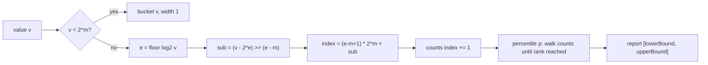

# Metrics: Counters, Gauges, and Histograms Without Averages

> p99 latency from a histogram you built.

**Type:** Build
**Languages:** Java, Python, Go
**Prerequisites:** Phase 1, Lesson 01 (Big-O and Measuring), Phase 3, Lesson 02 (Count-Min Sketch and HyperLogLog), Phase 9, Lesson 01 (SLIs, SLOs, and Error Budgets)
**Time:** ~75 minutes

## Learning Objectives

- Distinguish the three metric types by what operations are legal on them and what a scraper may compute from each
- Explain why a mean latency can sit comfortably under an SLO while one customer in a hundred waits a second, and demonstrate it with seeded data
- Build a log-linear bucketed histogram with fixed memory whose percentile estimates carry a guaranteed relative error bound
- Prove that bucket indexing and bucket bounds are exact inverses and that the buckets tile the value range with no gaps
- Merge histograms from several hosts into a fleet histogram and show why averaging per-host percentiles gives a wrong answer
- Export counters, gauges, and histograms in the Prometheus text format and compute a rate that survives a process restart

## The Problem

An authorization service has a latency SLO: 99% of calls complete within 100 ms. The dashboard shows mean latency at 35 ms, comfortably green, and has for weeks. Then the merchant success team forwards a complaint: a large retailer's checkout conversion dropped 2% and their own tracing shows your authorization call taking two seconds about once every hundred attempts. Your dashboard disagrees. Your dashboard is wrong, and it has been wrong the whole time.

What happened is arithmetic. Ninety-nine of every hundred calls take about 12 ms. One takes about 2,000 ms because it falls through to a slow issuer path with a retry. The mean is `(99 * 12 + 2000) / 100 = 31.9 ms`. Every number in that calculation is true and the result tells you nothing about the customer who waited two seconds. A mean is the wrong summary for a distribution with a long tail, and service latency always has a long tail: GC pauses, lock contention, cache misses, retries, a downstream that is having a bad minute. Dean and Barroso's "The Tail at Scale" makes the point that at scale the tail is not an edge case; a page that fans out to 100 backends sees the p99 of one backend as its p63.

The fix everyone knows is "report percentiles". The fix nobody wants to pay for is "keep every latency sample so you can sort them". At 10,000 requests per second that is 864 million longs a day per host, and the dashboard query would sort them. So instead you keep a histogram: a fixed set of buckets, each counting how many samples fell in its range, and you read percentiles off the cumulative counts. The question that decides whether the histogram is useful is how the buckets are laid out. Linear buckets waste memory on the range you do not care about and give you no resolution where you do. Logarithmic buckets have the opposite problem at the bottom. The answer is log-linear bucketing, the layout HdrHistogram made standard: powers of two for range, equal sub-buckets within each power for resolution, and a guarantee that every reported percentile is within a chosen relative error of the truth.

There is a second trap waiting after you have histograms. You have forty hosts, each reporting its own p99. The fleet p99 is not their average. It is not their max. It is the p99 of the merged distribution, and the only way to compute it is to merge the histograms, bucket by bucket, and read the percentile off the merged counts. Averaging percentiles is one of the most common errors in production dashboards, and this lesson produces a case where the average of two p99s is 1.5 seconds, the true fleet p99 is under 0.9 seconds, and both hosts' own p99s are nowhere near either.

## The Concept

### Three types, three contracts

A metric type is a contract about what operations are legal and therefore what a consumer may compute:

| Type | Legal operations | What a scraper may compute | Example | Common misuse |
|------|------------------|----------------------------|---------|---------------|
| Counter | increment by a non-negative amount | rate over an interval, total since reset | `authorizations_total`, `outbox_published_total` | Storing a rate in it; decrementing it |
| Gauge | set, increment, decrement | current value, min/max over a window | `inflight_requests`, `outbox_pending_rows`, `queue_depth` | Summing gauges across hosts when the quantity is not additive |
| Histogram | record an observation | percentiles, fraction below a threshold, count, sum, mean | `authorization_latency_micros` | Averaging percentiles across hosts |

The counter contract is "only goes up", which lets the scraper compute rates by differencing two samples, and lets it detect a process restart: a counter that went down did not go down, it was reset to zero, so the delta since the previous sample is the current value. `Counter.rate` implements exactly that rule. A gauge has no such structure; a gauge sample is just the value at the moment of the scrape, and anything that happened between scrapes is gone.

The histogram's contract is subtler. It records observations and answers "how many were at or below `x`?" for any `x`, which is enough for every percentile and for the SLI "fraction of requests under 100 ms" directly. What it gives up is the individual samples: once an observation is in a bucket, you know it was between the bucket's bounds and nothing more.

### Why the mean lies

A mean is sensitive to every sample's magnitude and insensitive to how the samples are distributed. For latency that is backwards. The customer experience is determined by the distribution: how many people waited longer than they would tolerate. Two services with the same 35 ms mean can have p99s of 40 ms and 2,000 ms. The first is healthy; the second is losing a retailer's business. The demo data makes this concrete:

```text
100,000 authorizations, 99% log-normal around 12 ms, 1% log-normal around 2 s
  mean   = 35.3 ms      <- under a 100 ms SLO, looks healthy
  p50    = 12.2 ms
  p90    = 23.6 ms
  p99    = 1155.1 ms
  p99.9  = 2916.4 ms
  fraction at or below 100 ms = 98.956%   <- the SLO was 99%: breached
```

The mean is 35 ms. The SLO is breached. A dashboard showing the mean shows green. The histogram answers the SLO question directly, from its buckets, with no sorting and no raw samples.

### Log-linear bucketing

A bucket layout is a function `indexOf(value) -> bucket` with an inverse `lowerBound(bucket)`. The design goals are fixed memory, O(1) record, and a bounded *relative* error on any percentile: a p99 of 1,150 ms reported as 1,155 ms is fine; reported as 1,400 ms it is not.

| Layout | Buckets for 1 us to 60 s | Error at 100 us | Error at 10 s | Verdict |
|--------|--------------------------|-----------------|---------------|---------|
| Linear, 1 ms wide | 60,000 | 1000% | 0.01% | Useless at the fast end |
| Logarithmic, powers of 2 | 26 | up to 100% | up to 100% | Tiny, but a bucket can span [8.4 s, 16.8 s] |
| Log-linear, 128 sub-buckets per power of 2 | 2,533 | 0.78% | 0.78% | Constant relative error, 20 KB |

Log-linear takes the powers of two from the logarithmic layout and splits each one into `2^m` equal sub-buckets. Within `[2^e, 2^(e+1))` each sub-bucket is `2^(e-m)` wide, and the lower bound of any sub-bucket is at least `2^e`, so the width as a fraction of the value is at most `2^(e-m) / 2^e = 2^-m`. For `m = 7`, that is `1/128 = 0.78%`, everywhere, for any value above `2^m`. Below `2^m` the sub-bucket width would be less than 1, so those values are simply counted exactly, one bucket per integer.

```text
indexOf(v):
  if v < 2^m:                 return v                                     (exact range)
  e   = floor(log2 v)         the power-of-two range v is in
  sub = (v - 2^e) >> (e - m)  which of the 2^m slices of [2^e, 2^(e+1)) v falls in
  return (e - m + 1) * 2^m + sub

lowerBound(i):
  if i < 2^m:                 return i
  k   = i / 2^m,  e = k + m - 1,  sub = i mod 2^m
  return 2^e + (sub << (e - m))
```

Worked example with `m = 7`, `v = 12,345` microseconds:

```text
e   = floor(log2 12345) = 13            (8192 <= 12345 < 16384)
sub = (12345 - 8192) >> (13 - 7) = 4153 >> 6 = 64
i   = (13 - 7 + 1) * 128 + 64 = 7 * 128 + 64 = 960
lowerBound(960): k = 7, e = 13, sub = 64 -> 8192 + (64 << 6) = 8192 + 4096 = 12288
upperBound(960) = lowerBound(961) - 1 = 12351
width = 64 = 2^(13-7); 64 / 12288 = 0.52% < 1/128
```

The histogram knows that some number of samples fell in `[12288, 12351]`. It does not know where. When a percentile lands in this bucket, the estimate is reported as the pair `[12288, 12351]`, and the point value is the upper bound, so the report is never optimistic.



### The invariants the tests check

1. **Inverse.** `indexOf(lowerBound(i)) == i` and `indexOf(upperBound(i)) == i` for every bucket. If this fails, some values are counted in the wrong bucket and percentiles drift silently.
2. **Tiling.** `lowerBound(i + 1) == upperBound(i) + 1`. No gaps, no overlaps.
3. **Width bound.** For every bucket above the exact range, `width * 2^m <= lowerBound`. This is the error guarantee.
4. **Bracketing.** For a skewed dataset, every exact percentile computed by sorting lies within the histogram's reported `[lower, upper]`, and `(upper - lower) / lower <= 2^-m`.
5. **Merge exactness.** Recording streams A and B into separate histograms and merging equals recording both into one. Merge is commutative.

### Percentiles from buckets

The nearest-rank definition: the `p`-th percentile of `n` samples is the value at rank `ceil(p/100 * n)` in sorted order. On a histogram, walk the buckets in index order accumulating counts until the running total reaches the rank; the percentile is in that bucket. This is O(buckets), which for 2,533 buckets is a few microseconds and happens at scrape time, not record time. The SLI "fraction at or below 100 ms" is the same walk stopped at `indexOf(100,000)`.

Worked by hand, with `m = 2` (four sub-buckets per power of two, exact below 4) and ten samples `1, 2, 2, 3, 5, 6, 9, 12, 20, 33`:

```text
bucket  range      count  cumulative
   1    [1, 1]       1        1
   2    [2, 2]       2        3
   3    [3, 3]       1        4
   5    [5, 5]       1        5
   6    [6, 6]       1        6
   8    [8, 9]       1        7        <- first bucket wider than 1: [8,16) split into 4 slices of 2
  10    [12, 13]     1        8
  13    [20, 23]     1        9        <- [16,32) split into 4 slices of 4
  16    [32, 39]     1       10        <- [32,64) split into 4 slices of 8

p50: rank = ceil(0.5 * 10) = 5  -> cumulative first reaches 5 at bucket 5 -> [5, 5]     exact: 5
p90: rank = ceil(0.9 * 10) = 9  -> cumulative first reaches 9 at bucket 13 -> [20, 23]  exact: 20
p99: rank = ceil(0.99 * 10) = 10 -> bucket 16 -> [32, 39], clamped to max -> [32, 33]   exact: 33
```

Each exact value sits inside its bracket, and each bracket is at most a quarter of its lower bound wide (`m = 2` gives `2^-2`). The same walk with `m = 7` and 100,000 samples is what the demo prints, and the brackets there are under 0.78% wide.

Precision near a threshold deserves one honest note. `fractionAtOrBelow(100_000)` includes the whole bucket that contains 100,000, which with `m = 7` spans `[99840, 100351]`. Samples between 100,001 and 100,351 are counted as "at or below". The error is bounded by one bucket's count, and if the SLO threshold matters to the basis point, align it to a bucket boundary or raise `m`.

### Merging, and why averaging percentiles fails

Host A handles 90,000 requests with no slow path; its p99 is 38 ms. Host B handles 10,000 with 10% slow; its p99 is 2.9 s. Three candidate "fleet p99" numbers:

```text
average of per-host p99s  = (38.4 + 2916.4) / 2 = 1477.4 ms    <- meaningless
max of per-host p99s      = 2916.4 ms                          <- pessimistic by a factor of 3
p99 of merged histogram   = 892.9 ms                           <- correct
```

The merged value is right because percentiles are a property of the whole distribution and the merge reconstructs the whole distribution (to within bucket resolution). The average is wrong because a percentile is not additive: host A's 38 ms says nothing about what rank the 2.9 s samples hold in the combined population. The same error afflicts means: the unweighted average of the two host means is 117 ms against a true fleet mean of 34 ms, because host B's samples are only 10% of the total. Averaging means can be fixed by weighting with counts; averaging percentiles cannot be fixed at all.

Merging works because the layout is fixed: both histograms have the same `m` and the same `highestTrackable`, so bucket `i` means the same range in both, and the merged count for bucket `i` is the sum. Histograms with different layouts cannot be merged, and the implementation refuses.

### Complexity and memory

| Operation | Cost |
|-----------|------|
| `record` | O(1): one `numberOfLeadingZeros`, one shift, one array increment |
| `percentile` | O(B) where B is the bucket count; 2,533 for `m = 7` up to 60 s |
| `merge` | O(B) |
| Memory | B longs: 20 KB for `m = 7`, 160 KB for `m = 10` (0.1% error) |

Compare the alternative of keeping samples: 10,000 requests per second is 80 KB per second, and percentile queries are O(n log n). The histogram's memory is independent of the request rate, which is why it can live in the request path.

### What the histogram does not do

- It does not keep samples. After `record`, the individual value is gone; you cannot ask "what was the slowest request's trace id". That is the job of tracing (Lesson 07), which samples.
- It does not handle values above `highestTrackable`; it rejects them. HdrHistogram offers auto-resize; this implementation prefers a loud failure so a 61-second request shows up as a bug report rather than a silently clamped bucket.
- It does not do time windows. One histogram accumulates forever. Rolling windows are built by keeping a ring of histograms per interval and merging the last `k` (Exercise 2).
- It does not correct for coordinated omission. If your load generator waits for each response before sending the next, slow responses suppress the samples that would have been taken during them, and the histogram under-reports the tail. Tene's talk covers this; Exercise 1 reproduces it.

## Build It

One Java file: a seeded generator, `Counter`, `Gauge`, `LogLinearHistogram` with its `Estimate` record, a `MetricsRegistry` that renders Prometheus text, and a `main` that runs the five demos.

### Step 1: Counter and gauge

```java
final class Counter {
    private long value;

    void inc(long n) {
        if (n < 0) throw new IllegalArgumentException("counter can only go up: " + n);
        value = Math.addExact(value, n);
    }

    static double rate(long previous, long current, double seconds) {
        if (seconds <= 0) throw new IllegalArgumentException("interval must be positive");
        long delta = current >= previous ? current - previous : current;
        return delta / seconds;
    }
}

final class Gauge {
    private long value;
    void set(long v) { value = v; }
    void inc() { value++; }
    void dec() { value--; }
}
```

The counter enforces its contract by rejecting negative increments, and `rate` is the scraper's half of the contract: a drop means a restart, and the delta since the restart is the current value. The demo shows the naive rate on a restart as `-121.0/s` and the reset-aware rate as `4.0/s`.

**Predict:** a counter is at 1,250, the process restarts, and by the next scrape it reads 40. What is the true number of events since the previous scrape, and can the scraper know it?

### Step 2: Bucket indexing

```java
int indexOf(long v) {
    if (v < linear) return (int) v;
    int e = 63 - Long.numberOfLeadingZeros(v);                  // floor(log2 v), e >= precisionBits
    long sub = (v - (1L << e)) >> (e - precisionBits);          // which of the 2^precisionBits slices of [2^e, 2^(e+1))
    return (int) ((long) (e - precisionBits + 1) * linear + sub);
}

long lowerBound(int index) {
    if (index < linear) return index;
    int k = index / linear;
    int e = k + precisionBits - 1;
    long sub = index % linear;
    return (1L << e) + (sub << (e - precisionBits));
}

long upperBound(int index) { return lowerBound(index + 1) - 1; }
```

`Long.numberOfLeadingZeros` is a single CPU instruction on every modern architecture, so `floor(log2 v)` costs nothing. The exact range below `2^m` occupies indices `0..2^m - 1`, and the first log-linear range `[2^m, 2^(m+1))` starts at index `2^m`, which is why `(e - m + 1) * 2^m` is the base: `e = m` gives `1 * 2^m`. The constructor sizes the array as `indexOf(highestTrackable) + 1`, so memory is fixed at construction.

**Predict:** with `m = 7`, what are `indexOf(255)`, `indexOf(256)`, and the width of the bucket containing 256?

### Step 3: Recording and percentiles

```java
void recordMany(long v, long n) {
    if (v < 0 || v > highestTrackable) throw new IllegalArgumentException("value out of range: " + v);
    counts[indexOf(v)] += n;
    total = Math.addExact(total, n);
    sum = Math.addExact(sum, Math.multiplyExact(v, n));
    if (v < min) min = v;
    if (v > max) max = v;
}

Estimate percentile(double p) {
    if (total == 0) return new Estimate(p, 0, 0);
    long rank = Math.max(1, (long) Math.ceil(p / 100.0 * total));
    long seen = 0;
    for (int i = 0; i < counts.length; i++) {
        seen += counts[i];
        if (seen >= rank) return new Estimate(p, Math.max(lowerBound(i), min), Math.min(upperBound(i), max));
    }
    return new Estimate(p, max, max);
}
```

`sum` is kept exactly so the demo can compute the mean and show what it hides; a production histogram keeps it for the Prometheus `_sum` series. The estimate's bounds are clamped to the observed `min` and `max`, which tightens the bracket at the edges without changing the guarantee. `value(p)` returns `percentile(p).upper()`: the conservative point estimate.

**Predict:** 100 samples with values 1 through 100. What does `percentile(99)` return, and how wide is its bracket?

### Step 4: Merge and cumulative export

```java
void merge(LogLinearHistogram other) {
    if (other.precisionBits != precisionBits || other.highestTrackable != highestTrackable) {
        throw new IllegalArgumentException("cannot merge histograms with different layouts");
    }
    for (int i = 0; i < counts.length; i++) counts[i] = Math.addExact(counts[i], other.counts[i]);
    total = Math.addExact(total, other.total);
    sum = Math.addExact(sum, other.sum);
    if (other.total > 0) { min = Math.min(min, other.min); max = Math.max(max, other.max); }
}

long[] cumulative(long[] boundaries) {
    long[] out = new long[boundaries.length];
    for (int b = 0; b < boundaries.length; b++) {
        int idx = indexOf(Math.min(boundaries[b], highestTrackable));
        long seen = 0;
        for (int i = 0; i <= idx; i++) seen += counts[i];
        out[b] = seen;
    }
    return out;
}
```

Merge is element-wise addition, which is why it is exact and commutative. `cumulative` produces the shape Prometheus classic histograms export: for each `le` boundary, the count of observations at or below it. A log-linear histogram with 2,533 buckets exported at seven `le` boundaries loses resolution between those boundaries; the registry exports a few for compatibility and keeps the full histogram for its own percentile queries.

### Step 5: The registry and exposition

```java
String render(long[] histogramBoundaries) {
    for (Map.Entry<String, Counter> e : counters.entrySet()) {
        sb.append("# TYPE ").append(e.getKey()).append("_total counter\n");
        sb.append(e.getKey()).append("_total ").append(e.getValue().value()).append('\n');
    }
    ...
    for (Map.Entry<String, LogLinearHistogram> e : histograms.entrySet()) {
        long[] cum = h.cumulative(histogramBoundaries);
        for (int i = 0; i < histogramBoundaries.length; i++) {
            sb.append(e.getKey()).append("_bucket{le=\"").append(histogramBoundaries[i]).append("\"} ").append(cum[i]).append('\n');
        }
        sb.append(e.getKey()).append("_bucket{le=\"+Inf\"} ").append(h.count()).append('\n');
        sb.append(e.getKey()).append("_sum ").append(Math.round(h.mean() * h.count())).append('\n');
        sb.append(e.getKey()).append("_count ").append(h.count()).append('\n');
    }
}
```

Counters get the `_total` suffix, histograms become `_bucket{le=...}`, `_sum`, and `_count`, and `+Inf` equals the total count. A scraper that understands this format can compute rates and approximate percentiles with no knowledge of the log-linear layout, which is the point of a standard exposition.

**Predict:** `lat` has observations 500 and 2,000 and is exported with boundaries 1,000 and 10,000. What are the three `_bucket` lines?

### Step 6: Run it

```bash
cd phases/09-reliability-and-scale/06-metrics-and-histograms/code/java
javac -d .out *.java && java -cp .out Main
java -cp .out MainTest
```

Expected output, abbreviated:

```console
== 1. Bucket layout: precisionBits=7 means at most 1/128 = 0.78% relative error ==
  value        255 -> bucket   255 covering [255, 255]  width 1
  value        256 -> bucket   256 covering [256, 257]  width 2
  value     12,345 -> bucket   960 covering [12,288, 12,351]  width 64
  value  2,000,000 -> bucket  1908 covering [1,998,848, 2,007,039]  width 8,192
  buckets allocated for values up to one minute in microseconds: 2533

== 2. Averages lie: 100,000 authorizations, 1% hit a slow issuer path ==
  mean   = 35.3 ms   <- under a 100 ms SLO, this looks healthy
  p50    = 12.2 ms      histogram says [12.1 ms, 12.2 ms], exact = 12.1 ms, bound 0.52%
  p99    = 1155.1 ms    histogram says [1146.9 ms, 1155.1 ms], exact = 1151.3 ms, bound 0.71%
  p99.9  = 2916.4 ms    histogram says [2900.0 ms, 2916.4 ms], exact = 2909.9 ms, bound 0.56%
  fraction of requests at or below 100 ms = 98.956%  (the SLI, answered from the buckets)

== 3. Averaging percentiles is wrong; merging histograms is right ==
  host A (90,000 requests): p99 = 38.4 ms   host B (10,000 requests, 10% slow): p99 = 2916.4 ms
  average of the two p99s      = 1477.4 ms   <- meaningless
  p99 of the merged histogram  = 892.9 ms   <- the fleet p99, computed correctly

== 4. Counters only go up; the scraper computes the rate and must handle a restart ==
  after a process restart the counter reads 40: naive rate = -121.0/s, reset-aware rate = 4.0/s
51 passed, 0 failed
```

Every exact percentile sits inside the histogram's bracket and every bracket is narrower than 0.78% of its value. That is the whole guarantee, and the test suite checks it on every percentile from p1 to p99.99.

### In Python

```python
def index_of(self, v: int) -> int:
    """Which bucket holds ``v``. Exact below 2^precision_bits; log-linear above."""
    if v < self._linear:
        return v
    e = v.bit_length() - 1  # floor(log2 v), e >= precision_bits
    sub = (v - (1 << e)) >> (e - self.precision_bits)
    return (e - self.precision_bits + 1) * self._linear + sub
```

Differences, all in `code/python/main.py`:

- **`floor(log2 v)` is `v.bit_length() - 1`.** Python has no `numberOfLeadingZeros`, but on a non-negative int `bit_length` gives the same exponent and `>>` behaves identically, so `index_of`, `lower_bound`, and `upper_bound` are line-for-line the Java shifts with no casts.
- **No fixed-width integers.** The `Math.*Exact` checks on counts and sums vanish, and `_min`/`_max` start at `LONG_MAX`/`LONG_MIN` constants only to keep the sentinels the same. `Rng` masks every SplitMix64 step with `& MASK64`, converts to a signed value in `next_long` so the seed-42 assertion matches `-4767286540954276203`, and `next_double` shifts the unsigned form by 11 as `>>>` does.
- **`Math.round` is `java_round`, not `round`.** Python's `round` is banker's rounding; `java_round` is round-half-up computed exactly, which is what turns the log-normal draws into the same microsecond samples (so the histogram sum `3529462222` matches) and renders `_sum` the same way.
- **Exposition.** `LinkedHashMap` is a plain `dict` (insertion-ordered), `StringBuilder` is a list of strings joined once, and `String.indent(2)` is a three-line helper.

```bash
cd phases/09-reliability-and-scale/06-metrics-and-histograms/code/python
python3 main.py
python3 -m unittest -v
```

### In Go

```go
// IndexOf is which bucket holds v. Exact below 2^precisionBits; log-linear above.
func (h *LogLinearHistogram) IndexOf(v int64) int {
    if v < int64(h.linear) {
        return int(v)
    }
    e := bits.Len64(uint64(v)) - 1                    // floor(log2 v), e >= precisionBits
    sub := (v - int64(1)<<e) >> (e - h.PrecisionBits) // which of the 2^precisionBits slices of [2^e, 2^(e+1))
    return int(int64(e-h.PrecisionBits+1)*int64(h.linear) + sub)
}
```

Differences, all in `code/go/main.go`:

- **`floor(log2 v)` is `bits.Len64(uint64(v)) - 1`.** `math/bits` replaces `Long.numberOfLeadingZeros`; the shifts in `IndexOf`, `LowerBound`, and `UpperBound` are otherwise the Java lines with explicit `int64` casts, because Go will not mix `int` and `int64` silently.
- **Errors are values.** `NewLogLinearHistogram`, `Record`, `RecordMany`, `Merge`, `Counter.IncBy`, `Rate`, and `Percentile` return `error` where Java throws `IllegalArgumentException`. `Value(p)` panics on a `p` outside 0..100 because the Java `value` has no error channel either and the bad argument is a caller bug. `Counter.IncBy` returns `ErrOverflow` instead of wrapping at `math.MaxInt64`, which `Math.addExact` would have thrown; inside `RecordMany` and `Merge` the same `addChecked`/`mulChecked` helpers panic, since a histogram that has counted 2^63 observations has no sensible caller to inform.
- **The generator uses `uint64` state.** SplitMix64's multiplications must wrap, so `Rng.state` is unsigned and `NextLong` converts the result to `int64` at the end; the seed-42 assertion `-4767286540954276203` then holds exactly, and `NextDouble` shifts the unsigned form by 11 as `>>>` does. `Math.round` is `javaRound` (`math.Floor(x + 0.5)`), which is what makes the 100,000 log-normal draws land on the same microsecond values and the histogram `_sum` print `3529462222` in both languages.
- **Formatting and ordering.** `fmt` has no `%,d`, so a nine-line `commas` helper renders thousands separators; `String.indent(2)` is `indent`; `Double.toString` for the percentile label is `Trim` with `strconv.FormatFloat(p, 'f', -1, 64)`. `LinkedHashMap` becomes a `map` plus a `[]string` of names per metric type so the exposition keeps registration order.

```bash
cd phases/09-reliability-and-scale/06-metrics-and-histograms/code/go
go run .
go test ./...
```

## Use It

### HdrHistogram

Gil Tene's HdrHistogram is the production version of Step 2, with the same log-linear layout expressed as "significant value digits" (3 digits is roughly `m = 10`), auto-resize for values above the configured maximum, concurrent and atomic variants for recording from many threads, a compressed wire format for shipping histograms between hosts, and a `Recorder` that swaps histograms in and out for interval sampling without stopping writers. It also ships a corrected-for-coordinated-omission recording mode that fills in the samples a stalled load generator would have missed. Java, C, Go, Python, Rust, and JavaScript ports exist and interoperate on the wire format, which is how a fleet's histograms get merged in one place.

### Prometheus histograms and summaries

Prometheus's classic histogram is Step 4's `cumulative` as a first-class type: you choose the `le` boundaries up front (`0.005, 0.01, 0.025, ...` by default), the client library maintains cumulative counts, and `histogram_quantile()` interpolates linearly inside the bucket a quantile lands in. Its weakness is exactly what the demo shows: resolution is only as good as your boundaries, and a p99 that lands in the `[1, 2.5]` second bucket is reported somewhere in that range. Native histograms (Prometheus 2.40+) replace the fixed boundaries with an exponential layout that adapts to the data, which is a log-linear scheme in spirit. Prometheus summaries compute quantiles on the client and cannot be aggregated across hosts, which is the averaging-percentiles mistake made into a metric type; the documentation says so and recommends histograms for anything you will aggregate.

### OpenTelemetry

OpenTelemetry's metrics API has the same three instruments (`Counter`, `UpDownCounter` for gauges, `Histogram`) and two histogram aggregations: explicit buckets, which are the Prometheus classic shape, and the exponential bucket histogram, which is log-linear with a configurable scale and is the default for latency in newer SDKs. Exponential histograms with the same scale merge exactly; with different scales, the finer one is downscaled first. That is the merge rule from Step 4 generalised.

### What the production versions hide

They hide the layout math, thread safety, the wire format, and the interval-swapping machinery. They do not hide the three decisions you still make: what precision you need (which fixes memory), what maximum you track (which fixes what gets rejected or clamped), and whether your dashboards compute fleet percentiles by merging or by averaging. The third one is a query, not a library feature, and the wrong version looks plausible on every graph until a customer tells you otherwise.

## Ship It

`outputs/checklist-latency-metrics.md` is a review checklist for a service's metrics: which type each metric is, whether any dashboard shows a mean where a percentile belongs, how fleet percentiles are computed, bucket precision and range, and the restart handling in rate queries.

## Exercises

1. **Reinforce.** Simulate coordinated omission. Generate a load test that sends one request per 10 ms, but when a request takes longer than 10 ms, skip the sends that would have happened during it. Record the latencies you did observe into one histogram and the latencies you would have observed (each skipped send waits for the stall to end) into another. Compare the two p99s and explain which one the customer experienced.
2. **Apply.** Build a `WindowedHistogram` that keeps a ring of `k` histograms, one per interval, rotates on `tick()`, and answers `percentile(p)` from the merge of the last `k`. Show that a two-second stall at `t = 0` is visible at `t = 1` and gone from a one-minute window at `t = 61`.
3. **Extend.** Replace the exact `sum` with a count-min sketch from Phase 3, Lesson 02 keyed by merchant id, so the histogram can also answer "which merchant contributed the most samples above 1 s?" within the sketch's error bound. Record 100,000 samples with one merchant responsible for 80% of the slow ones and show the sketch finds it.

## Key Terms

| Term | What people say | What it actually means |
|------|-----------------|------------------------|
| Counter | "a count" | A monotonically non-decreasing value; the scraper differences samples to get a rate and treats a decrease as a reset to zero |
| Gauge | "a number" | A value that can go up or down, sampled at scrape time; nothing between scrapes is recorded |
| Histogram | "latency buckets" | A fixed set of ranges with a count per range; answers "how many at or below x" and therefore any percentile, within bucket resolution |
| Percentile | "p99" | The value at rank `ceil(p/100 * n)` in sorted order; the value 99% of samples are at or below |
| Log-linear bucketing | "HdrHistogram style" | Powers of two split into `2^m` equal sub-buckets; relative error bounded by `2^-m` at every magnitude with fixed memory |
| Relative error bound | "precision" | The maximum of `(upper - lower) / lower` over all buckets; the guarantee that a reported p99 is within that fraction of the truth |
| Merge | "aggregate" | Element-wise addition of two histograms with the same layout; the only correct way to compute a fleet percentile from per-host data |
| Coordinated omission | "the load generator lied" | A measurement bias where slow responses suppress the samples that would have been taken during them, under-reporting the tail |

## Further Reading

- [HdrHistogram: A High Dynamic Range Histogram](http://hdrhistogram.org/) — the reference implementation of log-linear bucketing, its wire format, and the `Recorder` pattern for interval sampling.
- [Gil Tene, "How NOT to Measure Latency" (Strange Loop 2015)](https://www.youtube.com/watch?v=lJ8ydIuPFeU) — coordinated omission, why percentiles must come from the whole distribution, and the case against averages, from the author of HdrHistogram.
- [Dean and Barroso, "The Tail at Scale" (CACM 2013)](https://research.google/pubs/the-tail-at-scale/) — why tail latency dominates at scale and the techniques (hedging, tied requests) that follow from measuring it correctly.
- [Prometheus documentation: Histograms and summaries](https://prometheus.io/docs/practices/histograms/) — the classic histogram exposition from Step 5, `histogram_quantile`, and the explicit warning that summaries cannot be aggregated.
- [OpenTelemetry specification: Exponential histogram aggregation](https://opentelemetry.io/docs/specs/otel/metrics/data-model/#exponentialhistogram) — the standardised log-linear layout and its merge and downscale rules.
- [Prometheus exposition format](https://prometheus.io/docs/instrumenting/exposition_formats/) — the text format the registry renders, including the `_total`, `_bucket`, `_sum`, and `_count` conventions.
