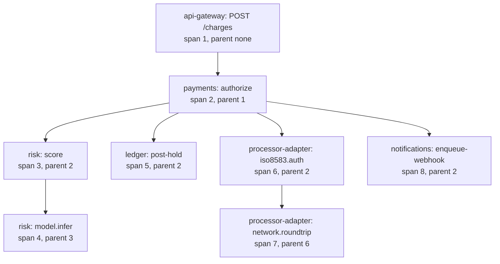

# Distributed Tracing and Context Propagation

> Follow one payment across six services.

**Type:** Build
**Languages:** Java, Python, Go
**Prerequisites:** Phase 9 Lesson 06 (Metrics and Histograms), Phase 5 Lesson 03 (Lamport and Vector Clocks), Phase 2 Lesson 04 (Recursion and Backtracking)
**Time:** ~90 minutes

## Learning Objectives

- Explain what a trace, a span, and a span context are, and which of the three must cross a process boundary
- Build W3C `traceparent` injection and strict parsing, and state what a receiver does when the header is malformed
- Propagate context through six simulated services and reassemble the parent/child tree from the exported spans
- Compute exclusive time per span and use it to name the service that actually consumed the wall clock
- Detect the two propagation failures (a dropped header, a lost parent span) from the shape of the trace alone

## The Problem

A merchant reports that `POST /charges` has a p99 of 1.4 seconds, up from 180 milliseconds last week. The payments team opens the dashboards from Lesson 06. The API gateway's latency histogram confirms the regression. The payments service's own histogram says its p99 is 1.35 seconds. The risk service's histogram says 40 milliseconds. The ledger's says 9 milliseconds. The processor adapter's says 110 milliseconds. The notification service says 5 milliseconds. Those four add up to 164 milliseconds. Somewhere, 1.2 seconds is unaccounted for, and every team has a graph proving it is not theirs.

The missing time is between services: a connection pool in the payments service that has been exhausted since a deploy doubled the thread count, so each outbound call to the ledger waits 300 milliseconds for a connection before the ledger ever sees it. The ledger's metrics are honest; they measure from the moment the request arrives. The payments service's metrics are honest; they measure the whole call. Neither one measures the gap, because per-service metrics aggregate across requests and lose the thing you need, which is *one request's* timeline across *every* service it touched.

That is what a trace is: the record of one request's path, as a tree of timed operations, with every node stamped with the same identifier so a collector can reassemble them. Google's Dapper paper (2010) described the design nearly every system has since copied, and the W3C Trace Context recommendation (2020) standardised the one header, `traceparent`, that lets a trace survive a hop between services written by different teams using different vendors. The engineering content of tracing is small and almost entirely about discipline: generate the ids correctly, propagate them on every hop including the asynchronous ones, and compute the right number (exclusive time, not duration) when you read the result. This lesson builds all of it and follows one $19.99 charge through six services.

## The Concept

### Three nouns

A **trace** is everything that happened because of one request: one id, one tree. A **span** is one timed operation inside it: a name, a service, a start and end, a parent, and key-value attributes. A **span context** is the subset of a span that must travel to the next service: the trace id, the span id, and the sampling flag. The context is what goes on the wire; the span is what goes to the collector; the trace is what the collector reassembles.



Every arrow is a hop where the *context* was injected into a carrier (HTTP headers, Kafka record headers, a queue message's properties) by the caller and extracted by the callee. The tree structure is reconstructed by the collector from `parentSpanId` references; nothing on the wire carries the whole tree.

### Identifiers

W3C Trace Context fixes the sizes: a trace id is 16 bytes, a span id (which the spec calls `parent-id`) is 8 bytes, both rendered as lowercase hex, and neither may be all zeros. Sixteen random bytes make collision a non-concern (2^128 space). Eight bytes for span ids is enough because uniqueness is only needed within one trace. The ids are random, not sequential and not derived from a timestamp or a host, so two services that never talk to each other cannot collide and nothing about the topology leaks into the id.

### The `traceparent` header

```text
traceparent: 00-4bf92f3577b34da6a3ce929d0e0e4736-00f067aa0ba902b7-01
             |  |                                |                |
             |  trace-id (32 hex)                parent-id (16)   trace-flags (2)
             version
```

The version is `00`. `trace-flags` is a bit field whose only defined bit is `sampled` (`01`): the caller is telling the callee "I am recording this trace; please record your part too". A second header, `tracestate`, is an opaque list of `vendor=value` pairs that is passed through unchanged so that a vendor's own tracer can carry extra state across a service that uses a different vendor.

The receiving rules matter more than the format. A receiver that gets a well-formed `traceparent` *continues* the trace: same trace id, new span id, parent = the incoming `parent-id`. A receiver that gets a malformed one (wrong length, uppercase hex, all-zero ids, version `ff`) *restarts*: it generates a new trace id and becomes a root. The spec is specific about one asymmetry: a version `00` header must have exactly four fields, but a header with a *future* version and extra fields must still be parsed by its first four fields, so that today's services do not break when tomorrow's version adds a field. Restarting on a malformed header rather than rejecting the request is deliberate. Tracing is observability; it never causes a payment to fail.

### Exclusive time: the number that finds the problem

A span's **duration** is `end - start`. Its **exclusive time** (also called self time) is its duration minus the time covered by its children. The root span of a payment has a duration of 92 milliseconds in the demo but an exclusive time of 3: almost everything it "spent" was spent waiting for `payments`. Sort a trace's spans by duration and the root always wins, uselessly. Sort by exclusive time and you get the span that was *doing* something, or waiting on something that is not instrumented.

Worked example from the demo trace, every number from the code's injected clock:

```text
span                                   start   end   duration   children covered   exclusive
api-gateway / POST /charges                0    92        92            89 (payments)         3
  payments / authorize                     2    91        89     23+6+49+3 = 81              8
    risk / score                           5    28        23            18 (model.infer)      5
      risk / model.infer                   9    27        18             0                   18
    ledger / post-hold                    29    35         6             0                    6
    processor-adapter / iso8583.auth      36    85        49            45 (network)          4
      processor-adapter / network.roundtrip 38  83        45             0                   45
    notifications / enqueue-webhook       87    90         3             0                    3
                                                                             sum = 92
```

When children run sequentially, as here, exclusive times sum exactly to the root's duration: every millisecond belongs to exactly one span. The 45 milliseconds in `network.roundtrip` is the card network, which is the one thing nobody in the building can speed up. The 8 milliseconds exclusive in `payments / authorize` is where the Problem's missing 1.2 seconds would appear: time the payments service spent not calling anyone, which is where a connection-pool wait shows up. A trace tells you *which* service to open a profiler on; it does not tell you what the profiler will find.

With concurrent children the subtraction must use the *union* of child intervals, not their sum, or two parallel 40-millisecond calls would subtract 80 from a parent that only lasted 45. The code sorts children by start and walks a cursor, which handles overlap correctly.

### Sampling

Recording every span of every request at a payment platform's volume is unaffordable, and most traces are uninteresting. Head-based sampling decides at the root (keep 1 in 100) and propagates the decision through the `sampled` flag so a trace is either complete or absent, never partial. Tail-based sampling records everything briefly at the edge and keeps a trace only if it turned out to be slow or to contain an error, which is what you actually want but requires buffering every span until the trace completes. This lesson carries the flag and leaves the policy to Exercise 2. One rule is non-negotiable in payments: a trace that contains an `ERROR` span is kept, and the decision has to be made somewhere that has seen the whole trace.

### The two ways a trace breaks

1. **A dropped header.** A service receives the context but does not forward it: a hand-written HTTP client, a thread pool that loses thread-local state, a queue consumer that reads the payload and ignores the record headers. The downstream span starts a new trace. The symptom is a trace that is *shorter* than it should be and a second, single-span trace with the same payment id. The demo's `notificationsDropsHeader` switch produces exactly this.
2. **A lost span.** The header was propagated but the parent span never reached the collector: the process crashed before export, the exporter's buffer overflowed, the span was never ended. The child arrives with a `parentSpanId` that nothing in the trace matches. The collector should surface these as *orphans* rather than silently attaching them to the root; an orphan is a signal that export is lossy.

Both are detectable from the trace alone, without knowing the system, which is why the `TraceTree` class reports them.

### Three signals, one id

| | Metric (Lesson 06) | Trace (this lesson) | Log (Lesson 08) |
|-|--------------------|---------------------|-----------------|
| Unit | an aggregate over many requests | one request's tree of spans | one event in one service |
| Answers | is it slow, how often, for whom | where in this request did the time go | what exactly happened at that point |
| Cardinality | low: labels are bounded | one record per span per request | one record per event, unbounded |
| Cost model | fixed per series | proportional to sampled requests | proportional to events, usually the largest |
| Joined by | exemplar carrying a trace id | trace id and span id | `trace_id` and `span_id` fields |

The trace id is the join key for all three. A metric alert fires; its exemplar names a trace; the trace's hottest span names a service and a span id; that span id finds the log records. Any link in that chain that is missing (no exemplars, no propagated header, no trace id in logs) turns the investigation back into guesswork.

### Span kinds, links, and clock skew

OpenTelemetry attaches a **kind** to each span: `SERVER` for the span a service starts when a request arrives, `CLIENT` for the span around an outbound call, `PRODUCER` and `CONSUMER` for the two ends of a message queue, `INTERNAL` for everything else. The demo collapses client and server into one span per hop for brevity; production tracers emit both, and the gap between a `CLIENT` span's start and its `SERVER` child's start is the network plus any queueing in front of the server, which is precisely the time the Problem could not find.

A **link** connects a span to another span in a different trace without making it a child. A retry job that re-attempts a failed capture tomorrow is a new trace (there is no live request to inherit from) with a link to yesterday's authorisation trace. A batch settlement that processes 10,000 captures links to all of them. Links are how asynchronous payment flows stay navigable without pretending that a settlement run is a child of a checkout.

Spans from different hosts are stamped by different clocks. With NTP keeping hosts within a few milliseconds, a child can appear to start before its parent or end after it. The `exclusiveMillis` code clips child intervals to the parent's `[start, end]`, which bounds the damage, and a tracing backend typically flags a child that starts before its parent rather than redrawing it. Phase 5, Lesson 02 is the longer treatment of why two hosts' clocks are never the same clock; the practical rule here is that *durations* measured within one span are trustworthy and *offsets* between spans on different hosts are trustworthy only to within the skew bound.

### What a trace does not do

- It does not replace metrics. A trace is one request; a p99 is a statement about a population. Lesson 06's histograms tell you *that* something is slow, a trace tells you *where* in one example of it.
- It does not replace logs. A span has a handful of attributes; the detail of what happened inside a service is in its log records, which Lesson 08 correlates to the span by id.
- It does not carry business data. Attributes like `payment.id` and `amount.minor` are fine; a PAN, a name, or an address in a span attribute is a data leak into a system with a different retention policy and access list than your ledger.

## Build It

### Step 1: Ids

```java
final class IdGenerator {
    private final Random random;
    IdGenerator(long seed) { this.random = new Random(seed); }

    String traceId() { return hex(16); }
    String spanId() { return hex(8); }

    private String hex(int bytes) {
        while (true) {
            byte[] buf = new byte[bytes];
            random.nextBytes(buf);
            StringBuilder sb = new StringBuilder(bytes * 2);
            boolean allZero = true;
            for (byte b : buf) {
                if (b != 0) allZero = false;
                sb.append(Character.forDigit((b >> 4) & 0xF, 16)).append(Character.forDigit(b & 0xF, 16));
            }
            if (!allZero) return sb.toString();
        }
    }
}
```

The generator is seeded so the demo prints the same trace id every run and the tests can assert on it. In production replace `new Random(seed)` with `SecureRandom` or a fast non-cryptographic generator; the spec requires randomness, not secrecy. The all-zero retry loop will effectively never execute, but the spec says all-zero ids are invalid and a parser that honours the spec would reject our own header.

**Predict:** `Character.forDigit(10, 16)` returns which character, and why does that matter for a parser that only accepts lowercase?

### Step 2: The context and the header

```java
record SpanContext(String traceId, String spanId, boolean sampled) {
    String toTraceparent() {
        return "00-" + traceId + "-" + spanId + "-" + (sampled ? "01" : "00");
    }

    static Optional<SpanContext> parseTraceparent(String header) {
        if (header == null) return Optional.empty();
        String[] parts = header.trim().split("-", -1);
        if (parts.length < 4) return Optional.empty();
        String version = parts[0];
        if (!isHex(version, 2) || version.equals("ff")) return Optional.empty();
        if (version.equals("00") && parts.length != 4) return Optional.empty();
        if (!isHex(parts[1], 32) || parts[1].equals("0".repeat(32))) return Optional.empty();
        if (!isHex(parts[2], 16) || parts[2].equals("0".repeat(16))) return Optional.empty();
        if (!isHex(parts[3], 2)) return Optional.empty();
        boolean sampled = (Integer.parseInt(parts[3], 16) & 0x01) == 1;
        return Optional.of(new SpanContext(parts[1], parts[2], sampled));
    }
}
```

The parser returns `Optional.empty()` rather than throwing, because the caller's correct reaction to a bad header is "start a new trace", not "fail the request". Every check is one line of the spec: version `ff` is reserved and invalid; version `00` has exactly four fields; ids are lowercase hex of fixed length and not all zeros; the flags are read as a bit field so `03` (sampled plus an undefined bit) still means sampled. `isHex` is hand-written rather than a regex because it must reject uppercase, which `Character.isLetterOrDigit` would not.

**Predict:** what does the parser do with `01-<trace>-<span>-01-somefuturefield`, and why is that the right behaviour?

### Step 3: Spans and the tracer

```java
final class Tracer {
    Span startRoot(String name) {
        return new Span(ids.traceId(), ids.spanId(), null, service, name, clock.nowMillis());
    }

    Span startChild(String name, SpanContext parent) {
        return new Span(parent.traceId(), ids.spanId(), parent.spanId(), service, name, clock.nowMillis());
    }

    Span startFromCarrier(String name, Map<String, String> carrier) {
        Optional<SpanContext> parent = SpanContext.parseTraceparent(carrier.get(SpanContext.HEADER));
        return parent.map(ctx -> startChild(name, ctx)).orElseGet(() -> startRoot(name));
    }

    void end(Span span) {
        span.endMillis = clock.nowMillis();
        collector.export(span);
    }
}
```

`startFromCarrier` is the whole receiving side of propagation: extract, continue if valid, restart if not. A span is exported to the collector only when it ends, which is why a crashed process loses its open spans and why those losses show up downstream as orphans. The `Clock` is injected; the demo advances it by exact amounts to stand in for work, so the timeline is reproducible to the millisecond.

### Step 4: Propagating through a service

```java
void payments(Map<String, String> carrier, String paymentId, long amountMinor, String currency) {
    Tracer t = tracer("payments");
    Span s = t.startFromCarrier("authorize", carrier);
    s.setAttribute("payment.id", paymentId);
    s.setAttribute("amount.minor", Long.toString(amountMinor));
    clock.advance(3);
    String decision = risk(Propagator.inject(s.context(true), carrier.get(SpanContext.STATE_HEADER)), paymentId);
    s.setAttribute("risk.decision", decision);
    clock.advance(1);
    ledger(Propagator.inject(s.context(true), null), paymentId, amountMinor);
    clock.advance(1);
    processor(Propagator.inject(s.context(true), null), paymentId);
    clock.advance(2);
    notifications(Propagator.inject(s.context(true), null), paymentId);
    clock.advance(1);
    t.end(s);
}
```

Each outbound call gets a *fresh* carrier with this span's context, so the callee's parent is `authorize`, not the gateway. `tracestate` from the incoming request is forwarded on the first call to show the passthrough; a real client library forwards it on every call. The `clock.advance` calls between children are the payments service's own work and become its exclusive time: 3 + 1 + 1 + 2 + 1 = 8 milliseconds. Notice `amount.minor` is an attribute as a string of minor units, matching Phase 10's rule; a span attribute is never a float.

**Predict:** if the call to `ledger` were made on a background thread that did not receive the carrier, what would the ledger's span look like in the collector?

### Step 4b: Nested spans inside one service

```java
String risk(Map<String, String> carrier, String paymentId) {
    Tracer t = tracer("risk");
    Span s = t.startFromCarrier("score", carrier);
    clock.advance(4);                                   // feature lookup
    Span model = t.startChild("model.infer", s.context(true));
    clock.advance(18);                                  // the slow part
    t.end(model);
    clock.advance(1);
    t.end(s);
    return "APPROVE";
}
```

Not every span is a hop. The risk service wraps its model inference in a child span of its own `score` span, in-process, with no carrier involved: `startChild` takes the parent's context directly. That is how a trace shows *where inside* a service the time went (18 of 23 milliseconds in inference) without a profiler. The rule of thumb is one span per operation you would want to see as its own bar: a database query, a cache lookup, a model call, a lock acquisition that can wait. Not one per function.

**Predict:** in the timeline, `risk / model.infer` is indented one level deeper than `risk / score`. What is its `parentSpanId`, and what is its exclusive time?

### Step 5: Reassembling the tree and computing exclusive time

```java
TraceTree(String traceId, List<Span> spans) {
    this.spans.sort(Comparator.comparingLong((Span s) -> s.startMillis).thenComparing(s -> s.spanId));
    for (Span s : this.spans) byId.put(s.spanId, s);
    for (Span s : this.spans) {
        if (s.isRoot()) roots.add(s);
        else if (byId.containsKey(s.parentSpanId)) children.computeIfAbsent(s.parentSpanId, k -> new ArrayList<>()).add(s);
        else orphans.add(s);
    }
}

long exclusiveMillis(Span s) {
    List<Span> kids = new ArrayList<>(childrenOf(s));
    kids.sort(Comparator.comparingLong(k -> k.startMillis));
    long covered = 0, cursor = s.startMillis;
    for (Span k : kids) {
        long from = Math.max(cursor, k.startMillis), to = Math.min(s.endMillis, k.endMillis);
        if (to > from) { covered += to - from; cursor = to; }
    }
    return s.durationMillis() - covered;
}
```

The constructor is one pass to index by id and one pass to classify: root, attached child, or orphan. Spans are sorted by start time with span id as a tiebreaker so the timeline is deterministic even when two spans start in the same millisecond. `exclusiveMillis` computes the union of child intervals with a sweeping cursor: a child that starts before the cursor (overlapping its sibling) only contributes the part beyond the cursor, and a child that outlives its parent (a clock skew artefact in real systems) is clipped at the parent's end.

**Predict:** two children of a 50 ms span each run from 10 to 40. What does `exclusiveMillis` return, and what would a naive `duration - sum(childDurations)` return?

### Step 6: The timeline

```java
String renderTimeline(int width) {
    Span root = roots.get(0);
    long origin = root.startMillis, total = Math.max(1, root.durationMillis());
    StringBuilder sb = new StringBuilder();
    sb.append("trace ").append(traceId).append("  total ").append(total).append(" ms\n");
    for (Span s : spans) {
        if (!s.isRoot() && !byId.containsKey(s.parentSpanId)) continue;
        String label = "  ".repeat(depth(s)) + s.service + " / " + s.name;
        int from = (int) ((s.startMillis - origin) * width / total);
        int len = Math.max(1, (int) (s.durationMillis() * width / total));
        String bar = " ".repeat(Math.min(from, width)) + "#".repeat(Math.min(len, width - Math.min(from, width)));
        sb.append(String.format("%-46s %5d ms %4d ms  %s%n", label, s.startMillis - origin, s.durationMillis(), bar));
    }
    for (Span o : orphans) sb.append(String.format("ORPHAN %s / %s (parent %s never arrived)%n", o.service, o.name, o.parentSpanId));
    return sb.toString();
}
```

This is the Gantt view every tracing UI draws, reduced to text: indentation is depth, horizontal position is start offset, bar length is duration, all scaled to the root. A span shorter than one column still gets one `#` so it is visible. Orphans are listed after the tree rather than drawn into it, because drawing them would require guessing where they belong.

### Step 7: Run it

```bash
cd phases/09-reliability-and-scale/07-distributed-tracing/code/java
javac -d .out *.java && java -cp .out Main
java -cp .out MainTest
```

Expected output, abbreviated:

```console
== One payment through six services (seed 42) ==
trace 359d41baf78afe0de1bbe7ae28c0450c  total 92 ms
service / span                                   start    dur  timeline
api-gateway / POST /charges                        0 ms   92 ms  ################################################
  payments / authorize                             2 ms   89 ms   ##############################################
    risk / score                                   5 ms   23 ms    ############
      risk / model.infer                           9 ms   18 ms      #########
    ledger / post-hold                            29 ms    6 ms                 ###
    processor-adapter / iso8583.auth              36 ms   49 ms                    #########################
      processor-adapter / network.roundtrip       38 ms   45 ms                     #######################
    notifications / enqueue-webhook               87 ms    3 ms                                               #

spans exported: 8, root duration: 92 ms
sum of exclusive times: 92 ms  (equals root duration when children are sequential)
hottest span: processor-adapter / network.roundtrip with 45 ms exclusive

== The same payment when notifications drops the header (seed 42) ==
spans in trace 359d41ba...: 7 (one fewer)
total traces in collector: 2 (the notification span became its own root)
```

The second block is the dropped-header failure: the trace is one span short and a second trace with one span has appeared. In a real collector you would find it by searching for the payment id across traces, which is exactly what Lesson 08's log correlation makes possible.

### In Python

```python
def start_from_carrier(self, name: str, carrier: dict[str, str]) -> Span:
    parent = SpanContext.parse_traceparent(carrier.get(SpanContext.HEADER))
    return self.start_child(name, parent) if parent is not None else self.start_root(name)
```

Differences, all in `code/python/main.py`:

- **`Optional.empty()` is `None`.** `parse_traceparent` returns `Optional[SpanContext]`, so the fall-back-to-a-new-root decision in `start_from_carrier` is an `is not None` test; the `SpanContext` record is a frozen dataclass whose `__post_init__` raises `ValueError` where Java throws `IllegalArgumentException`, and the two lifecycle guards (`duration_millis` on an open span, `export` of an open span) raise `RuntimeError` for `IllegalStateException`.
- **Ids come from `java.util.Random.nextBytes`, not `random.randbytes`.** `JavaRandom.next_bytes` consumes each 32-bit draw least-significant byte first, exactly as the JDK does, so seed 42 produces the same trace id `359d41ba...` as the Java demo and `bytes.hex()` gives the lowercase form the spec requires.
- **Ordered collections are plain `dict` and `list`.** `LinkedHashMap` attributes and `LinkedHashSet` trace ids become insertion-ordered dicts (`dict.fromkeys` for the de-duplicated id list); the span sort is `sorted(..., key=lambda s: (s.start_millis, s.span_id))`, the same two-key order as the Java comparator.
- **Carrier maps are `dict[str, str]`.** In a real Python service the same dict is `request.headers` or a Kafka record's header list, and the context would travel between `asyncio` tasks in a `contextvars.ContextVar`, which is the same loss-across-an-executor trap as Java's `ThreadLocal`.

```bash
cd phases/09-reliability-and-scale/07-distributed-tracing/code/python
python3 main.py
python3 -m unittest -v
```

### In Go

```go
// StartFromCarrier starts a span from a carrier; if the header is missing or malformed, a new trace begins.
func (t *Tracer) StartFromCarrier(name string, carrier map[string]string) *Span {
    if parent, ok := ParseTraceparent(carrier[Header]); ok {
        return t.StartChild(name, parent)
    }
    return t.StartRoot(name)
}
```

Differences, all in `code/go/main.go` and `javarandom.go`:

- **`Optional` is a second return value.** `ParseTraceparent` returns `(SpanContext, bool)`; a missing header is the empty string a `map[string]string` lookup yields, so the fall-back-to-a-new-root decision is one `if ... ok` and no `null` is ever handled. `NewSpanContext` returns `(SpanContext, error)` where the Java record constructor throws; `Span.Context` builds the struct directly because its ids are already known-good. A root span's parent is `""` rather than `null`, so `IsRoot` is a string comparison.
- **Lifecycle guards are errors.** `DurationMillis` returns `(int64, error)` and `Collector.Export` returns `error`, both wrapping the sentinel `ErrSpanOpen` so tests use `errors.Is`. Inside `TraceTree` every span came from the collector and is therefore ended, so `mustDuration` panics on an open one: that would be a bug in the tree, not a condition for a caller.
- **Ids come from `java.util.Random.nextBytes`.** `JavaRandom.NextBytes` consumes each 32-bit draw least-significant byte first, exactly as the JDK does, and `hex.EncodeToString` gives the lowercase form the spec requires, so seed 42 produces the same trace id `359d41ba...` as the Java demo and the whole timeline matches character for character. `TestIds` pins that id.
- **Ordered collections are explicit.** `LinkedHashMap` attributes become a `map` plus an `attrKeys` slice (`AttributeKeys()` exposes the order); `LinkedHashSet` trace ids become a first-seen `[]string`; the span sort is `sort.SliceStable` on `(StartMillis, SpanId)`, the same two-key order as the Java comparator. In a real Go service the carrier is `http.Header` and the context travels in a `context.Context`; a goroutine started with `context.Background()` instead of the request's context is the dropped-header failure the demo shows.

```bash
cd phases/09-reliability-and-scale/07-distributed-tracing/code/go
go run .
go test ./...
```

## Use It

### OpenTelemetry

OpenTelemetry (OTel) is the vendor-neutral standard that absorbed OpenTracing and OpenCensus. Its API has exactly the objects built here: `Tracer.spanBuilder(name).setParent(context).startSpan()`, `Span.setAttribute`, `Span.end()`, a `TextMapPropagator` that injects and extracts `traceparent`/`tracestate`, and an SDK that batches finished spans to an exporter. What it does that the from-scratch version made explicit: automatic instrumentation of HTTP clients and servers, JDBC, Kafka, and gRPC, so the carrier injection in Step 4 happens inside the client library; context propagation through `ThreadLocal` with explicit `Context.makeCurrent()` scopes; and a `BatchSpanProcessor` that drops spans under back-pressure rather than blocking the request (the lost-span failure, by design). The trap: the Java agent propagates context across `ExecutorService` submissions, but a hand-built thread or a `CompletableFuture` chain that was not wrapped loses it silently, and the first you hear of it is a trace with a hole.

### Context in the JVM

OTel Java keeps the current context in a `ThreadLocal` and exposes it through scopes:

```java
Span span = tracer.spanBuilder("authorize").setParent(Context.current().with(parentSpan)).startSpan();
try (Scope scope = span.makeCurrent()) {
    ledgerClient.postHold(...);        // the instrumented HTTP client reads Context.current() and injects traceparent
} finally {
    span.end();
}
```

Inside the `try`, any instrumented client picks up the span automatically, which is what makes Step 4's explicit `Propagator.inject` disappear from application code. Outside it, or on another thread, `Context.current()` is the root context and an outbound call starts a new trace: the dropped-header failure, caused not by a missing line but by a scope that ended too early. `Context.taskWrapping(executor)` and the agent's executor instrumentation exist to carry the context across thread boundaries.

### Backends

Jaeger, Grafana Tempo, Zipkin, and the commercial APMs all ingest OTel spans and draw the Step 6 timeline with a mouse. Tempo stores traces in object storage indexed by trace id only, which is cheap, and relies on logs or metrics exemplars to *find* the trace id; Jaeger indexes by service, operation, and tags. Every one of them displays exclusive (self) time on the span detail; look for it before sorting by duration.

### Exemplars and correlation

Prometheus exemplars attach a trace id to a histogram bucket observation, so the p99 bucket in Lesson 06's histogram links to a trace that landed in it. Logs carry the trace id as a field (Lesson 08). Together they form the loop: the metric says it is slow, the exemplar names a trace, the trace names a span, the span's service and ids find the log lines. Without a propagated trace id, each of those is a dead end.

### What does not propagate by itself

Message queues. Kafka record headers can carry `traceparent`, and the OTel Kafka instrumentation does it, but a consumer that was written before tracing and reads only the value will drop the context every time. Scheduled jobs and retries from a dead-letter queue have no incoming request to inherit from; they should start a new trace and *link* to the original (OTel span links exist for this). Webhooks to merchants cross an organisational boundary; forwarding `traceparent` to them is harmless and occasionally invaluable, forwarding `tracestate` may leak vendor information.

## Ship It

`outputs/checklist-trace-propagation.md` is a review checklist for a service joining a traced system: id generation, header handling, every hop type (sync, async, queue, scheduled), attribute hygiene, sampling, and the two failure signatures to alert on. Run it before the service's first deploy and whenever an incident review finds a trace with a hole.

## Exercises

1. **Reinforce.** Add a `Span.addEvent(name)` that records a timestamped marker inside a span (OTel calls these span events) and render events as a `*` on the timeline bar at the right column. Use it to mark "connection acquired" inside `payments / authorize`.
2. **Apply.** Implement head-based sampling in `Tracer.startRoot`: a seeded decision to set `sampled = false` on 90% of roots, propagated through the flag so children of an unsampled root are not exported. Then implement the payments rule: a span that calls `setError` forces its whole trace to be kept. Explain why the second rule cannot be implemented at the root alone.
3. **Extend.** Run two children of `payments / authorize` concurrently (risk and ledger overlapping in time by advancing the clock in an interleaved pattern) and verify that `exclusiveMillis` still sums correctly across the trace while a naive `duration - sum(children)` goes negative. Then compute the trace's *critical path* (the chain of spans whose exclusive times add up to the root duration) and compare it to Phase 1's longest-path-in-a-tree recursion.

## Key Terms

| Term | What people say | What it actually means |
|------|-----------------|------------------------|
| Trace | "the request's journey" | The tree of all spans sharing one 16-byte trace id; reassembled by the collector from parent references, never carried whole on the wire |
| Span | "one hop" | One timed operation in one service: ids, parent, name, start, end, attributes, status; exported only when it ends |
| Span context | "the trace headers" | The trace id, span id, and flags that cross a process boundary; everything else about a span stays local |
| `traceparent` | "the W3C header" | `version-traceid-parentid-flags`; lowercase hex, fixed widths, no all-zero ids; a malformed one restarts the trace rather than failing the request |
| Exclusive time | "self time" | Duration minus the union of child intervals; the number that identifies which span was actually doing or waiting on uninstrumented work |
| Orphan span | "a span with no parent" | A span whose `parentSpanId` matches nothing in its trace; the signature of a lost parent span, as opposed to a dropped header which produces a new root |
| Head-based sampling | "we sample 1%" | The keep/drop decision made at the root and propagated via the sampled flag, so traces are complete or absent, never partial |

## Further Reading

- [W3C Recommendation: Trace Context Level 1](https://www.w3.org/TR/trace-context/) — the `traceparent` and `tracestate` formats and, in Section 3.2.2, the exact rules for handling a malformed or future-version header.
- [Dapper, a Large-Scale Distributed Systems Tracing Infrastructure (Sigelman et al., 2010)](https://research.google/pubs/dapper-a-large-scale-distributed-systems-tracing-infrastructure/) — the paper that defined spans, annotations, sampling, and the collection pipeline every later system copied.
- [OpenTelemetry Tracing API specification](https://opentelemetry.io/docs/specs/otel/trace/api/) — the standard's `Tracer`, `Span`, `SpanContext`, links, events, and status, matching the objects built here.
- [OpenTelemetry Context Propagation specification](https://opentelemetry.io/docs/specs/otel/context/api-propagators/) — the `TextMapPropagator` inject/extract contract that Step 4's `Propagator` imitates.
- [OpenTelemetry Semantic Conventions](https://opentelemetry.io/docs/specs/semconv/) — standard attribute names (`http.request.method`, `db.system`, `messaging.system`) so that tools can understand spans from any service.
- [Prometheus: Exemplars](https://prometheus.io/docs/specs/om/open_metrics_spec/#exemplars) — the OpenMetrics mechanism that attaches a trace id to a histogram observation, connecting Lesson 06 to this one.
