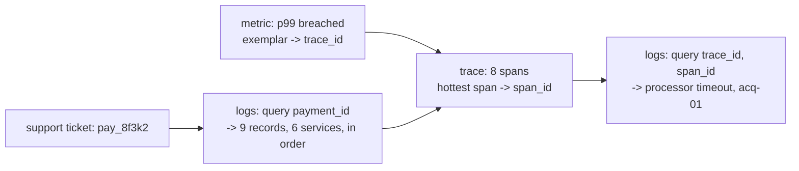

# Structured Logging and Log Correlation

> Every log line carries the payment ID or it is noise.

**Type:** Build
**Languages:** Java, Python, Go
**Prerequisites:** Phase 9 Lesson 07 (Distributed Tracing and Context Propagation), Phase 1 Lesson 06 (Hash Maps), Phase 0 Lesson 07 (Decimal and Integer Arithmetic)
**Time:** ~60 minutes

## Learning Objectives

- Explain why a log line is a record with fields, not a sentence, and what that changes about how logs are written and read
- Build a logger that binds request context (payment id, trace id, span id) once and stamps it on every record in scope
- Implement PAN and secret redaction that catches card numbers in free text and in field values before they are written
- Implement per-level, trace-consistent sampling so DEBUG volume is controlled while every WARN and ERROR survives
- Reconstruct one payment's story across six services with a single query by payment id

## The Problem

A merchant's support agent asks why charge `pay_8f3k2` was declined on Tuesday. The on-call engineer opens the log search and types the payment id. Three hits come back, all from the API gateway, because the gateway is the only service whose developer put the id in the log message. The payments service logged `Authorize started for merchant acme`, the risk service logged `Scored request: 12`, the ledger logged `Posted journal jrn_pay_8f3k2`, and the processor adapter logged `ISO 0100 sent to acq-01, response 05`. Four services, four formats, four different ideas of what identifies a request. Reconstructing the sequence takes forty minutes of grepping by timestamp across services whose clocks differ by a few hundred milliseconds, and ends with a guess.

Three weeks later the same platform fails a PCI DSS assessment. A `DEBUG` statement in the processor adapter, added during an incident and never removed, logged the full ISO 8583 message, which contains the primary account number. The log platform retains ninety days. The platform has now stored tens of millions of unmasked card numbers in a system whose access list includes every engineer and two vendors. Requirement 3 of PCI DSS says PAN must be rendered unreadable wherever it is stored and masked to at most the first six and last four digits wherever it is displayed. Logs are storage. The remediation is a forensic scrub of the log cluster and a report to the acquirer.

Both failures have the same cause: logs were treated as prose for humans rather than as records for machines. A sentence cannot be queried by payment id unless someone remembered to put the id in it, and a sentence cannot be scanned for secrets unless someone remembered to redact them. A record with named fields can do both mechanically. The logger in this lesson binds the payment id and trace id once per request so every call site inherits them, runs every value through a redactor before it is written, samples the noisy levels per trace so volume stays bounded, and indexes by the fields that matter so the question "what happened to `pay_8f3k2`" is one lookup with nine results in order.

## The Concept

### A log record is a map, not a string

An unstructured log line:

```text
2026-10-13 14:02:11 INFO Charged 19.99 for pay_8f3k2 (merchant acme) ok
```

The same event as a structured record:

```json
{"ts":1700000000002,"level":"INFO","service":"payments","msg":"authorize started","trace_id":"4bf92f3577b34da6a3ce929d0e0e4736","span_id":"b2b2b2b2b2b2b2b2","payment_id":"pay_8f3k2","merchant_id":"acme","amount_minor":"1999","currency":"USD"}
```

The first line is readable by a person and by nothing else. To find all charges for merchant `acme` you write a regular expression, and the regex breaks the day someone changes the wording. The amount is a decimal string that a log parser will turn into a float. The second line is longer and uglier, and every one of its properties is the point: the message is a constant template (`authorize started`) that can be counted, the variable parts are fields with names that can be filtered and aggregated, the amount follows Phase 10's rule (minor units plus currency, never `19.99`), and the trace and span ids connect this record to Lesson 07's spans. A log platform indexes fields; it full-text-searches messages. The difference is the difference between a millisecond lookup and a forty-minute grep.

Three conventions follow from treating the record as a map:

1. **Messages are low-cardinality constants.** `authorize started`, not `authorize started for pay_8f3k2`. Everything that varies goes in a field. A dashboard can then show "count of `authorize started` per minute" and the message is a metric name in disguise.
2. **Field names are stable and shared.** `payment_id` is `payment_id` in all six services, not `paymentId` in one and `pid` in another. The index in Ship It's checklist is the team's agreed list.
3. **One record is one line.** A JSON object with no embedded newlines, so a pipeline that splits on `\n` never splits a record. Stack traces go in a field, escaped.

### The record contract

A team that adopts structured logging agrees on a small set of fields that every record carries and a larger set that records carry when relevant. The demo's contract:

| Field | On every record | Source | Why |
|-------|-----------------|--------|-----|
| `ts` | yes | injected clock | ordering across services; epoch milliseconds, never a formatted local time |
| `level` | yes | call site | filtering and alerting; `ERROR` count per service is the first dashboard panel |
| `service` | yes | logger construction | which deployable emitted it |
| `msg` | yes | call site | constant template, low cardinality |
| `trace_id`, `span_id` | inside a request | Lesson 07 context | join to the trace |
| `payment_id` | inside a payment | bound at the edge | the question support asks |
| `merchant_id` | inside a payment | bound at the edge | per-tenant filtering and rate of errors per merchant |
| `amount_minor`, `currency` | when money moves | call site | Phase 10 discipline: integer plus ISO 4217 code |

Everything else (`journal_id`, `processor`, `auth_code`, `decision`) is call-site detail. The contract is enforced socially (the checklist in Ship It) and mechanically (the indexed-field set in the store refuses to index a field it does not know, and a test asserts every record in a request carries `payment_id`).

### What a payment logs

The nine records in the demo are the minimum story of an authorisation: received, idempotency checked, authorisation started, risk scored, hold posted, processor message built, processor responded, webhook enqueued, and on failure the hold reversed. Each is a state transition in the payment state machine of Phase 12, logged at the moment the transition commits, with the fields that identify the before and after. That is the test for whether a log statement earns its place: does it mark a transition someone will need to locate later, or is it narrating code execution? "Entering method `authorize`" is the second kind and belongs at `DEBUG` if anywhere.

### Cost arithmetic

A 300-byte record at 18,000 records per second is 5.4 MB per second, 470 GB per day, 42 TB at ninety days' retention, before indexing overhead that typically doubles it. Hosted log platforms price per ingested gigabyte and per indexed field; at list prices that volume is a six-figure annual bill for logs alone. Three levers reduce it in order of effectiveness: do not emit records nobody reads (the `DEBUG` body dump), sample the healthy traffic per trace, and index fewer fields. Redaction, by contrast, slightly *increases* cost (a regex scan per value) and is not negotiable.

### Context binding

The payments service handles a request across a dozen methods. Each of them could pass the payment id to each log call, and each of them would eventually forget. The alternative is to bind the context once at the edge:

```text
request arrives
  -> logger = base.withTrace(traceId, spanId).with("payment_id", id).with("merchant_id", m)
  -> every call on `logger` inside this request emits trace_id, span_id, payment_id, merchant_id
  -> a call site adds only what is new: logger.info("hold posted", "journal_id", j)
```

`with` returns a *new* logger holding a copy of the bound fields plus the addition, and never mutates the parent. That immutability is what makes it safe to hand the scoped logger to helper methods and thread pools: there is no shared mutable map for two requests to overwrite. Logging frameworks call the mutable version of this idea MDC (Mapped Diagnostic Context) and implement it with a `ThreadLocal`, which has the same thread-boundary failure as the trace context in Lesson 07: hand work to an executor without copying the MDC and the records come out with no payment id.

### Correlation: the join to traces

A record stamped with `trace_id` and `span_id` is joined to the span it was emitted inside. The trace (Lesson 07) says the processor adapter's span took 45 milliseconds and ended with status `ERROR`; the records with that span id say *why*: `processor timeout`, `processor acq-01`, `timeout_ms 45`, `retryable true`. Neither signal alone answers the support ticket. The pairing works in both directions: from a slow span to its records, and from an `ERROR` record to the trace that shows what else was happening. Lesson 06's metrics complete the loop through exemplars.



### Redaction

Two kinds of secret reach a logger. The first is **named**: a field called `password`, `cvv`, `api_key`, `authorization`, or `pan`. The redactor replaces the whole value with `[REDACTED]` when the key is on the list, regardless of the value. The second is **embedded**: a card number inside a request body, an exception message, or a URL that a developer logged as a blob. For that the redactor scans every string for a run of 13 to 19 digits (ISO/IEC 7812 card number lengths), allowing spaces or dashes between groups, and applies the Luhn check.

Luhn (ISO/IEC 7812-1) is a mod-10 checksum every card number satisfies. Walk the digits from the right, double every second one, subtract nine from any doubled digit above nine, sum, and the result is divisible by ten:

```text
4111 1111 1111 1111
from the right, doubling alternate digits:
  1 1 1 1 1 1 1 1 1 1 1 1 1 1 1 4
  positions 2,4,6,...,16 doubled: 2 2 2 2 2 2 2 8
  sum = 8 * 1 + 7 * 2 + 8 = 30   -> 30 mod 10 == 0: valid
1234567890123 (an order id)
  sum = 55 -> not divisible by 10: not a PAN, left alone
```

Random digit runs pass Luhn one time in ten, so the check turns a blunt "mask every long number" into one that leaves most order ids, timestamps, and account references readable. A valid PAN is masked to first six and last four (`411111******1111`), which PCI DSS Requirement 3.4 allows for display and which keeps the BIN (the issuer prefix) visible for debugging routing. The redactor runs on *every* string that passes through the logger, bound fields, call-site fields, and the message, before the record exists, so there is no window in which the raw value is in memory as part of a log record.

What redaction does not do: it does not catch a PAN split across two fields, encoded in base64, or written as words, and it does not know about your proprietary identifiers. It is a last line of defence behind the real control, which is that the application never puts a PAN in a log call in the first place. The `pan` field in the demo's processor adapter is there to show the catch, not to suggest the pattern.

### Levels and sampling

The four levels used here, with their RFC 5424 severity codes: `DEBUG` (7) for what a developer wants when something is wrong, `INFO` (6) for the normal progress of a request, `WARN` (4) for something unexpected that was handled, `ERROR` (3) for something that failed. The minimum level is a cheap filter: a service running at `INFO` never constructs `DEBUG` records.

Volume is the operational problem. A payments platform at 2,000 requests per second with nine records per request emits 18,000 records per second, roughly 1.5 billion per day; at `DEBUG` with request bodies, several times that. Sampling is the answer, and *how* you sample decides whether the result is useful:

| Strategy | Keeps | Problem |
|----------|-------|---------|
| Drop every record with probability 1 - 1/N | 1/N of records, uniformly | A request's story has random holes; the record you need is gone with probability 1 - 1/N |
| Keep 1 in N requests, decided by hashing the trace id | all records of 1/N of requests | None for debugging a sampled request; an unsampled request has no `INFO`/`DEBUG` at all |
| As above, but `WARN` and `ERROR` always kept | every failure, plus complete stories for 1/N of successes | The failed request's own `INFO` leading up to the error is missing unless the trace was selected |

This lesson implements the third row. The sampler hashes the trace id with FNV-1a (stable across processes, unlike `Object.hashCode`) and keeps `DEBUG`/`INFO` when `hash mod N == 0`; `WARN` and `ERROR` bypass it. The demo shows the consequence: of four payments at 1-in-4, one trace keeps all nine records, the failed one keeps its `ERROR` and `WARN`, and the other two keep nothing. The third row's problem is real and the production fix is the same as for traces: tail-based sampling that buffers a request's records briefly and keeps them all if an error occurs. That is Exercise 2.

### Querying

The store indexes a chosen set of fields (`payment_id`, `trace_id`, `merchant_id`) in a hash map from field to value to records, which is the structure every log platform builds, whether it calls it an inverted index (Elasticsearch), labels (Loki), or columns (ClickHouse). Records arrive in time order from the single injected clock, so a query returns them in order with no sort. In production, records from six services arrive through six pipelines and are sorted by their embedded timestamp, which is why the timestamp must come from a clock the service trusts and must have millisecond or better resolution.

### What this lesson does not do

- It does not ship records anywhere. Writing to stdout for a collector agent (Fluent Bit, Vector, the OTel Collector) to pick up is the production pattern, and the agent handles batching, retry, and back-pressure.
- It does not handle the logger being too slow. A synchronous logger on the request path adds its serialization cost to every request; production loggers use a bounded async queue and *drop* when full, and the drop count is a metric.
- It does not aggregate. "How many `processor timeout` records per minute per processor" is a query over the store today and a metric (Lesson 06) tomorrow; deriving metrics from logs works at small scale and becomes the most expensive way to count at large scale.
- It does not authenticate the writer. An audit log that must prove who did what (PCI DSS Requirement 10) needs write-once storage and integrity checks that an application logger does not provide.
- It does not define retention or access. Those are policy decisions that PCI DSS and GDPR constrain, and they are what makes redaction mandatory rather than nice.

## Build It

### Step 1: The record and its JSON

```java
final class LogRecord {
    final long timestampMillis;
    final Level level;
    final String service;
    final String message;
    final Map<String, String> fields;      // LinkedHashMap copy: insertion order is the output order

    String toJson() {
        StringBuilder sb = new StringBuilder(160);
        sb.append('{');
        Json.pair(sb, "ts", Long.toString(timestampMillis), false).append(',');
        Json.pair(sb, "level", level.name(), true).append(',');
        Json.pair(sb, "service", service, true).append(',');
        Json.pair(sb, "msg", message, true);
        for (Map.Entry<String, String> e : fields.entrySet()) {
            sb.append(',');
            Json.pair(sb, e.getKey(), e.getValue(), true);
        }
        return sb.append('}').toString();
    }
}
```

Four fixed keys first, in a fixed order, then the fields in the order they were bound. Stable order makes two records diffable and lets a human scan a column. Every value is a string except `ts`, which is a JSON number of epoch milliseconds, because a parser that sees `"amount_minor":"1999"` leaves it alone while one that sees `1999` may helpfully convert it to a double. `Json.escape` handles the five characters RFC 8259 requires (`"`, `\`, and the control characters), which is the whole of what a one-line JSON writer needs and the part that a `"{\"msg\":\"" + msg + "\"}"` string concatenation always gets wrong.

**Predict:** a message contains a literal newline. What does the stored record contain, and why does the log pipeline care?

### Step 2: The redactor

```java
private static final Pattern CANDIDATE = Pattern.compile("(?<!\\d)\\d(?:[ -]?\\d){12,18}(?!\\d)");

String maskPans(String text) {
    Matcher m = CANDIDATE.matcher(text);
    StringBuilder out = new StringBuilder();
    int last = 0;
    while (m.find()) {
        String digits = m.group().replaceAll("[ -]", "");
        if (luhnValid(digits)) {
            out.append(text, last, m.start()).append(mask(digits));
            last = m.end();
            redactions++;
        }
    }
    out.append(text.substring(last));
    return out.toString();
}

static boolean luhnValid(String digits) {
    int sum = 0;
    boolean dbl = false;
    for (int i = digits.length() - 1; i >= 0; i--) {
        int d = digits.charAt(i) - '0';
        if (dbl) { d *= 2; if (d > 9) d -= 9; }
        sum += d;
        dbl = !dbl;
    }
    return sum % 10 == 0;
}
```

The pattern finds a digit followed by 12 to 18 more digits with optional single separators between them, bounded by non-digits on both sides so a 20-digit run is not mis-read as a 19-digit PAN plus a stray digit. Candidates that fail Luhn are copied through untouched, which is how `order 1234567890123` survives while `4111111111111111` does not. The separators are stripped before the check and the mask is applied to the stripped digits, so `4111 1111 1111 1111` becomes `411111******1111` rather than a masked string with the original spacing.

**Predict:** `maskPans("ref 411111111111")` has twelve digits. What does it return, and what is the risk of lowering the minimum to 12?

### Step 3: Trace-consistent sampling

```java
boolean keep(Level level, String traceId, String message) {
    if (level.atLeast(Level.WARN)) return true;
    int rate = level == Level.DEBUG ? debugRate : infoRate;
    if (rate == 1) return true;
    String key = traceId != null ? traceId : message;
    boolean keep = Math.floorMod(fnv1a(key), rate) == 0;
    if (!keep) dropped++;
    return keep;
}

static int fnv1a(String s) {
    int h = 0x811c9dc5;
    for (int i = 0; i < s.length(); i++) { h ^= s.charAt(i); h *= 0x01000193; }
    return h;
}
```

The decision depends only on the trace id and the rate, so every service that sees the same trace makes the same decision without talking to each other: a record with a trace id is kept by all six services or by none. `Math.floorMod` rather than `%` because the hash is a signed `int` and `%` of a negative number is negative. Without a trace id (a startup message, a cron job) the message text is hashed, which keeps a constant 1-in-N of each distinct message.

### Step 4: The logger

```java
Logger with(String key, String value) {
    Map<String, String> next = new LinkedHashMap<>(bound);
    next.put(key, value);
    return new Logger(service, clock, minimum, redactor, sampler, store, next);
}

void log(Level level, String message, String... kv) {
    if (kv.length % 2 != 0) throw new IllegalArgumentException("fields must be key/value pairs");
    if (!level.atLeast(minimum)) return;
    if (!sampler.keep(level, bound.get("trace_id"), message)) return;
    Map<String, String> fields = new LinkedHashMap<>();
    for (Map.Entry<String, String> e : bound.entrySet()) fields.put(e.getKey(), redactor.redactValue(e.getKey(), e.getValue()));
    for (int i = 0; i < kv.length; i += 2) fields.put(kv[i], redactor.redactValue(kv[i], kv[i + 1]));
    store.write(new LogRecord(clock.nowMillis(), level, service, redactor.maskPans(message), fields));
}
```

The order of the three gates matters for cost: the level check is a comparison, the sampler is a hash, and redaction is a regex scan of every value. Nothing is redacted for a record that will not be written. Bound fields are copied first, call-site fields second, so a call site can override a bound field by name (rarely wanted, occasionally necessary). The varargs `String...` keeps the call sites short (`logger.info("hold posted", "journal_id", j)`) at the cost of a runtime check for an odd count; a builder or a `Map.of` would move that check to compile time at the cost of noise at every call.

**Predict:** `base.with("payment_id", "pay_1")` is called and the result discarded; then `base.info("x")` is called. Does the record carry `payment_id`?

### Step 4b: Context across a hand-off

```java
Logger scoped = logger("payments").withTrace(traceId, spanId).with("payment_id", paymentId);
executor.submit(() -> scoped.info("async settlement check", "attempt", "1"));   // carries context
executor.submit(() -> logger("payments").info("async settlement check"));       // does not
```

Because the scoped logger *is* the context (an immutable object captured by the lambda), handing it to another thread carries the fields with it. The second line is the MDC failure in miniature: a logger constructed on the worker thread knows nothing about the request. The scratch design makes the right thing the easy thing by having no ambient state at all; frameworks with a `ThreadLocal` MDC need a context-copying executor to get the same result.

**Predict:** two requests are processed concurrently on different threads, each with its own scoped logger derived from the same `base`. Can one request's `payment_id` appear on the other's record?

### Step 5: The index

```java
void write(LogRecord r) {
    records.add(r);
    for (String f : indexed) {
        String v = r.field(f);
        if (v != null) index.computeIfAbsent(f, k -> new LinkedHashMap<>()).computeIfAbsent(v, k -> new ArrayList<>()).add(r);
    }
}

List<LogRecord> query(String field, String value) {
    return index.getOrDefault(field, Map.of()).getOrDefault(value, List.of());
}
```

Phase 1's hash map, twice nested: field name to value to the list of records carrying that value, appended in arrival order. `query("payment_id", "pay_8f3k2")` is two lookups and returns the nine records of the demo in time order. The set of indexed fields is a constructor argument because indexing everything is how log platforms become expensive: every indexed field is another hash map, and a high-cardinality field like `span_id` across billions of records is a cost decision, not a default.

### Step 6: Six services, one payment

```java
Logger pay = logger("payments").withTrace(traceId, "b2b2b2b2b2b2b2b2").with("payment_id", paymentId).with("merchant_id", merchantId);
pay.debug("idempotency key checked", "idempotency_key", "idem_" + paymentId);
pay.info("authorize started", "amount_minor", Long.toString(amountMinor), "currency", currency);
pay.debug("raw request body", "body", "{\"card\":\"" + rawPan + "\",\"amount\":" + amountMinor + "}");
```

Each service builds a scoped logger from the trace context it received (Lesson 07) and the payment id, then logs its steps with only the new information. The third call is the careless one from The Problem: a developer logs the raw body. It reaches the store as `{"card":"411111******1111","amount":1999}` because `redactValue` ran `maskPans` on the value. The processor adapter's `"pan", rawPan` is caught by the key rule instead and becomes `[REDACTED]`. Both paths are tested; neither relies on the developer.

### Step 7: Run it

```bash
cd phases/09-reliability-and-scale/08-structured-logging/code/java
javac -d .out *.java && java -cp .out Main
java -cp .out MainTest
```

Expected output, abbreviated:

```console
== Every record for payment pay_8f3k2, across six services, in order ==
{"ts":1700000000000,"level":"INFO","service":"api-gateway","msg":"request received","trace_id":"4bf9...","span_id":"a1a1a1a1a1a1a1a1","payment_id":"pay_8f3k2","merchant_id":"acme","method":"POST","path":"/charges"}
{"ts":1700000000002,"level":"DEBUG","service":"payments","msg":"raw request body",...,"body":"{\"card\":\"411111******1111\",\"amount\":1999}"}
{"ts":1700000000034,"level":"DEBUG","service":"processor-adapter","msg":"iso8583 message built",...,"mti":"0100","pan":"[REDACTED]"}
{"ts":1700000000083,"level":"INFO","service":"notifications","msg":"webhook enqueued",...,"event":"payment.authorized","secret":"[REDACTED]"}

== Redaction ==
records written: 9, redactions applied: 4
PAN in free text:    declined card 411111******1111 for order 1234567890123
order id left alone: order 1234567890123 shipped  (fails Luhn)

== A failed payment: ERROR and WARN survive sampling, DEBUG/INFO are sampled 1-in-4 traces ==
records kept: 11 of 37 emitted
trace 1af76519...:  9 records kept, 0 WARN/ERROR
trace 2af76519...:  2 records kept, 2 WARN/ERROR

== Query: what happened to pay_s2? (its INFO/DEBUG were sampled out; the failure was not) ==
processor-adapter  ERROR processor timeout
ledger             WARN  hold reversed
```

Keep the redaction block. "records written: 9, redactions applied: 4" is the number an assessor wants to see move when a new log statement lands: it should go up when a body is logged, and the raw PAN test should still pass.

The last block is the support ticket answered: two records, two services, and the second one (`hold reversed`, reason `processor_timeout`) is the ledger confirming that the money was released. The `INFO` records that led up to the timeout were sampled out, which is the gap Exercise 2 closes.

### In Python

```python
@staticmethod
def fnv1a(s: str) -> int:
    """FNV-1a over UTF-16 code units, wrapped to a signed 32-bit int exactly as Java's int arithmetic does."""
    h = 0x811C9DC5
    for c in s:
        h ^= ord(c)
        h = (h * 0x01000193) & 0xFFFFFFFF
    return to_int32(h)
```

Differences, all in `code/python/main.py`:

- **The sampling hash must wrap.** Python ints do not overflow, so `fnv1a` masks every multiply with `& 0xFFFFFFFF` and converts to a signed value at the end; `keep` then uses Python's `%`, which floors like `Math.floorMod`. The same trace id (`1af76519...`) is selected in both languages, so the "records kept: 11 of 37" line matches.
- **`with` is a keyword**, so the child-logger method is `with_`; `with_trace` reads the same. Varargs `String... kv` become `*kv: str`, and the odd-length check raises `ValueError` where Java throws `IllegalArgumentException`.
- **The JSON writer is still hand-written.** `json.dumps` would produce the same bytes for these records, but the lesson's point is that the key order and escaping are yours to control; the port builds a list of fragments and joins once, with `f"\\u{ord(c):04x}"` for control characters. `Level` is an `Enum` whose value is `(ordinal, syslog)` so `at_least` compares ordinals as the Java enum does.
- **The PAN regex is compiled with `re.ASCII`.** Python's `\d` matches any Unicode digit by default; Java's matches only `0-9`, and a redactor that disagrees between services is a compliance gap. `re.finditer` replaces the `Matcher` loop and `LinkedHashMap` is a plain `dict`.

```bash
cd phases/09-reliability-and-scale/08-structured-logging/code/python
python3 main.py
python3 -m unittest -v
```

### In Go

```go
// Fnv1a is FNV-1a over UTF-16 code units in wrapping 32-bit arithmetic, bit for bit the Java int version.
func Fnv1a(s string) int32 {
    h := uint32(0x811c9dc5)
    for _, cu := range utf16.Encode([]rune(s)) {
        h ^= uint32(cu)
        h *= 0x01000193
    }
    return int32(h)
}
```

Differences, all in `code/go/main.go`:

- **The sampling hash wraps in `uint32`, then goes signed.** Go's `int32` would wrap too, but the unsigned form makes the intent visible; the result is converted to `int32` so `floorMod` (a four-line port of `Math.floorMod`, because Go's `%` keeps the dividend's sign) selects the same trace `1af76519...` and the demo prints the same "records kept: 11 of 37". Java hashes UTF-16 code units, so the loop runs over `utf16.Encode`, not over bytes or runes.
- **RE2 has no lookaround, so the PAN matcher is written out.** `(?<!\d)\d(?:[ -]?\d){12,18}(?!\d)` becomes `candidateAt`: start only at a digit not preceded by a digit, follow the digit/separator chain, then back off from 19 digits down to 13 until the next character is not a digit, exactly the regex engine's greedy-then-backtrack order. Two extra tests pin the corner cases (a 20-digit run never matches; a spaced 20-digit chain backs off to 16 at a separator). `\d` is ASCII in both languages; the Go version checks bytes `'0'..'9'`.
- **Errors are values.** `NewSampler` returns `error` for a rate below 1, and `Log`/`Debug`/`Info`/`Warn`/`Error` return `ErrOddFields` for an odd key/value list (`errors.Is` in the test); the demo's call sites ignore the return because their argument lists are literals. `LogRecord.Field` returns `(string, bool)` instead of `null`, and the sampler takes `""` for "no trace bound".
- **Ordered maps are explicit.** `LinkedHashMap` becomes the small `Fields` type (a key slice plus a map) used for bound context and record fields, so `With` copies and extends the order and `ToJson` emits bound fields before call-site fields, as the test requires. `Set.of(...)` of indexed fields is a variadic `[]string`; `Level` is an `int` enum with `String()` and `Syslog()` tables.
- **`with` is a legal method name in Go**, so `With` and `WithTrace` keep the Java names; `String... kv` is `kv ...string`.

```bash
cd phases/09-reliability-and-scale/08-structured-logging/code/go
go run .
go test ./...
```

## Use It

### SLF4J, Logback, and MDC

Java's logging stack separates the API (SLF4J) from the implementation (Logback, Log4j 2). Logback's `JsonEncoder` or the widely used `logstash-logback-encoder` emits one JSON object per record; `MDC.put("payment_id", id)` binds a field to the current thread and `MDC.clear()` in a `finally` releases it. What it does for you that the scratch version made explicit: async appenders with a bounded queue, file rotation, level configuration per package at runtime, and a `MaskingJsonGeneratorDecorator` that is a configurable version of the redactor. What it hides: MDC is a `ThreadLocal`, so a `CompletableFuture` continuation or a thread-pool task runs with the *pool thread's* MDC, which is either empty or, worse, a previous request's payment id. Log4j 2's `ThreadContext` has the same property. The fix is the same as for trace context: copy the MDC map when handing off work, or use a context-propagating executor.

```java
MDC.put("payment_id", paymentId);
MDC.put("trace_id", Span.current().getSpanContext().getTraceId());
try {
    log.info("authorize started");                 // Logback's JSON encoder appends the MDC map as fields
} finally {
    MDC.clear();                                   // forgetting this leaks pay_1's id onto the next request on this thread
}
```

### OpenTelemetry Logs

The OTel Logs Data Model defines a record as `Timestamp`, `SeverityNumber`, `Body`, `Attributes`, `TraceId`, `SpanId`, which is this lesson's `LogRecord` field for field. The OTel Java agent bridges SLF4J/Logback records into that model and injects the current span's ids automatically, so the `withTrace` call disappears from application code. The OTel Collector then routes records to any backend and can apply a `transform` processor that performs redaction centrally, a defence in depth behind the in-process redactor.

### Loki, Elasticsearch, ClickHouse

Grafana Loki indexes only *labels* (a small set of fields like `service` and `level`) and stores the record body compressed; a `payment_id` query is a label filter followed by a scan of matching chunks. Elasticsearch indexes every field by default, which makes any query fast and the cluster expensive, and is why teams eventually disable indexing on high-cardinality fields. ClickHouse stores records as columns with a sparse primary index, which is why `trace_id` lookups are fast when `trace_id` is in the ordering key and slow otherwise. All three force the Step 5 decision, which fields to index, at a cost that scales with record volume. The 1-in-N sampler is the other lever on the same bill.

### The compliance view

PCI DSS v4.0 Requirement 3.3.1 forbids storing sensitive authentication data (CVV, full track, PIN) after authorisation, anywhere, including logs; 3.4.1 limits PAN display to the first six and last four; 10.2 and 10.3 require audit logs of access to cardholder data that are themselves protected from modification. A redactor satisfies the first two for the log path; the third is why log platforms have write-once storage tiers. A QSA will ask to see the redaction tests, which is one reason the tests in this lesson assert that the raw PAN string never appears anywhere in the store.

## Ship It

`outputs/checklist-log-hygiene.md` is a review checklist for any service's logging: record shape, mandatory fields, context propagation across threads, redaction coverage, sampling policy, index choices, and the PCI DSS requirements a logging change can violate. Use it on the pull request that adds a new log statement with a request body in it, before the assessor does.

## Exercises

1. **Reinforce.** Add a `Logger.withMoney(String prefix, Money m)` that binds `prefix_minor` and `prefix_currency` from the Phase 10 `Money` type (copy the record into this lesson), and write the test that proves the serialized record never contains a decimal point in an amount.
2. **Apply.** Implement tail-based sampling: a `TraceBuffer` that holds a trace's `DEBUG`/`INFO` records for a bounded time or count, and flushes all of them to the store if any `WARN`/`ERROR` arrives for the same trace id, or discards them (keeping the 1-in-N hash decision) when the trace completes cleanly. Show that `pay_s2`'s query now returns ten records instead of two, and measure the buffer's peak memory in records under the demo load.
3. **Extend.** Combine with Lesson 07: give `LogStore` a `storyOf(paymentId)` that joins the records to the trace's spans by `span_id` and renders the Lesson 07 timeline with each record printed under its span, indented and offset by its timestamp. The result is the single page an on-call engineer should see when they type a payment id.

## Key Terms

| Term | What people say | What it actually means |
|------|-----------------|------------------------|
| Structured log | "JSON logs" | A record with a constant message template and named, typed fields; queryable by field without regexes, countable by message |
| Bound context / MDC | "the request id is in the thread" | Fields attached once per scope and stamped on every record in that scope; `ThreadLocal`-based implementations lose it across executors |
| Correlation id | "the trace id in the logs" | The `trace_id` and `span_id` fields that join a record to the span it was emitted inside, and so to every other record and span of that request |
| Redaction | "masking" | Replacing secrets before a record is written: wholesale for named secret fields, first-six-last-four for Luhn-valid 13-19 digit runs found anywhere in a value |
| Luhn check | "the card checksum" | ISO/IEC 7812-1 mod-10: double alternate digits from the right, sum, divisible by ten; passes all card numbers and about one random digit run in ten |
| Trace-consistent sampling | "we log 1% of requests" | Keep or drop decided by hashing the trace id, so every service keeps the same requests and a kept request's story is complete; `WARN` and `ERROR` bypass it |
| Low-cardinality message | "the log message" | A constant template (`authorize started`) with the variable parts in fields, so the message itself can be counted and alerted on like a metric |

## Further Reading

- [PCI DSS v4.0 (PCI Security Standards Council)](https://www.pcisecuritystandards.org/document_library/) — Requirement 3 (protect stored account data, PAN masking to first six/last four) and Requirement 10 (logging and monitoring); the document a QSA will quote.
- [RFC 8259: The JavaScript Object Notation (JSON) Data Interchange Format](https://www.rfc-editor.org/rfc/rfc8259) — Section 7 lists exactly which characters a string must escape, which is all a one-line JSON writer needs to get right.
- [RFC 5424: The Syslog Protocol](https://www.rfc-editor.org/rfc/rfc5424) — Section 6.2.1 defines the severity levels (0-7) that every logging framework's `DEBUG`/`INFO`/`WARN`/`ERROR` maps onto.
- [OpenTelemetry Logs Data Model](https://opentelemetry.io/docs/specs/otel/logs/data-model/) — the vendor-neutral record shape (timestamp, severity, body, attributes, trace id, span id) this lesson's `LogRecord` matches.
- [ISO/IEC 7812-1: Identification cards — Identification of issuers](https://www.iso.org/standard/70484.html) — the card number structure (IIN/BIN, account identifier, Luhn check digit) and the 13-19 digit length range the redactor scans for.
- [Go `log/slog` package documentation](https://pkg.go.dev/log/slog) — a standard-library structured logger with bound attributes and a handler interface, a clean reference design for the Go port.
