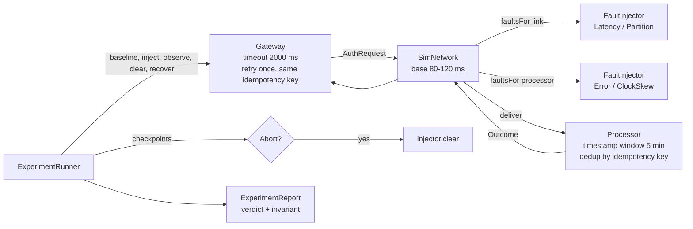

# Chaos Engineering and Fault Injection

> Kill the processor connection on purpose, in test.

**Type:** Build
**Languages:** Java
**Prerequisites:** Phase 5, Lesson 01 (Failure Models), Phase 9, Lesson 01 (SLIs, SLOs, and Error Budgets), Phase 9, Lesson 06 (Metrics and Histograms)
**Time:** ~75 minutes

## Learning Objectives

- Explain why a system that has only ever been tested against the failures its authors imagined will fail in production against the ones they did not
- Build a fault-injection layer that sits between a payment gateway and a card processor and can add latency, return errors, cut the link, and skew the processor's clock, each with an explicit blast radius
- Structure an experiment as steady state, hypothesis, injection, abort condition, and report, and run it deterministically against a seeded simulation
- Prove with a test that the gateway's retry never authorizes a payment twice under any of the four faults
- Read an experiment report and turn a violated hypothesis into a concrete engineering change

## The Problem

A payment gateway sits between merchants and a card processor. Its authors tested it well: unit tests for every state transition, integration tests against a processor sandbox, a load test at twice peak volume. It has an SLO of 99.9% good authorizations with a p99 under 1.5 seconds, and it has met that SLO for eighteen months.

On a Tuesday the processor rolls out a new signing-key rotation service in one of its data centres. The rotation service has a bug: it syncs time from a decommissioned NTP pool, and over four hours the clock on that fleet drifts six minutes ahead. The processor validates every request's timestamp against its own clock with a five-minute window, as the API documentation says it does. Every authorization the gateway sends to that fleet is rejected as a stale request. The gateway treats the rejection as a permanent decline, does not retry, and tells 40% of merchants that their customers' cards were refused. The processor's own dashboards are green: it is rejecting invalid requests exactly as designed. The gateway's dashboards show a decline rate climbing from 2% to 40% and an on-call engineer who has never seen a `STALE_REQUEST` response code and has no runbook for it.

Nothing in the gateway's test suite could have found this, because nobody on the team imagined the processor's clock would be wrong. The test suite covers the failures its authors thought of. Production produces the ones they did not. The same gateway would also have surprised its authors on the day a network partition cut one availability zone off from the processor: the gateway's timeout was 2 seconds and its retry policy was "retry once on timeout", which means every affected request burned 4 seconds before failing, which means a 10% partition pushed the p99 from 120 milliseconds to 4,000 and blew the latency SLO while the success-rate SLO still looked acceptable.

Chaos engineering is the discipline of finding these before a Tuesday does. It is not "break things randomly". It is a controlled experiment: write down what normal looks like as a measurable steady state, state a hypothesis about what the system will do under a specific fault, inject that fault into a bounded blast radius with a tripwire that stops the experiment if it goes wrong, and compare the measurement with the hypothesis. When the hypothesis holds, you have evidence. When it is violated, you have a bug report with a reproduction. This lesson builds the injection layer, the experiment structure, and the report, over a simulated payment flow on a simulated clock, so that every result is replayable.

## The Concept

### Five parts of an experiment

Chaos engineering as a named practice comes from Netflix (Basiri et al., 2016, and the Principles of Chaos Engineering). Stripped of tooling, an experiment has five parts, and skipping any one of them turns the experiment into an outage.

| Part | Question it answers | In this lesson |
|------|---------------------|----------------|
| Steady state | What does normal look like, as numbers? | good rate >= 99%, p99 <= 1,500 ms over 500 requests |
| Hypothesis | What do we believe happens under the fault? | "a 300 ms slower processor stays inside the SLO" |
| Fault and blast radius | What do we break, and for whom? | `Latency(300)` on the gateway-to-processor link, 10% of requests |
| Abort condition | When do we stop regardless of the hypothesis? | good rate < 80% at any 50-request checkpoint |
| Report | What did we learn and what will we change? | baseline, experimental, recovery metrics; verdict; invariant |

The steady state must be written down before the fault is armed. If you cannot express normal as thresholds on SLIs, you cannot tell whether the experiment changed anything, and you have no abort condition because the abort condition is a steady-state threshold with a shorter window. In this lesson the runner refuses to inject anything when the baseline run does not meet the steady state: the report says `NOT RUN` and the injector is never armed.

The hypothesis is a sentence about behaviour, not a wish. "The system will be fine" is not a hypothesis. "Requests beyond the timeout are retried once with the same idempotency key, so the good rate stays above 99% and no payment is authorized twice" is a hypothesis, because it names the mechanism (retry with idempotency key) and the measurable consequences (good rate, authorization count), and the experiment can show it is wrong.

### The four faults

Real infrastructure fails in a small number of ways, and the fault model from Phase 5 Lesson 01 enumerates them. This lesson injects four, chosen because together they cover almost every production payments incident that is not a code bug.

| Fault | What it models | How a caller sees it | What it tends to find |
|-------|----------------|----------------------|-----------------------|
| `Latency(ms)` | slow network, GC pause, saturated downstream | responses still arrive, later | timeouts set too tight or too loose, retry storms, p99 breaches |
| `Error(code)` | downstream 5xx, deploy gone wrong, dependency down | fast, explicit failure | missing retry classification, wrong fallback, alert gaps |
| `Partition()` | cut link, firewall change, AZ isolation | requests vanish; the caller sees only its own timeout | timeout plus retry doubling latency, no circuit breaker, no fail-fast |
| `ClockSkew(ms)` | bad NTP, VM pause, leap-second handling | the callee rejects requests as stale or future-dated | signing windows, token expiry, idempotency TTLs, certificate validity |

Notice the third column for `Partition`. From the caller's seat a partition is indistinguishable from a very slow dependency: the request leaves and nothing comes back. The gateway's timeout is what converts "nothing" into a result, which is why the timeout value is the single most important number in a partition experiment and why the `Partition` fault in this lesson is implemented as "latency exceeds any timeout".

Clock skew is the fault teams forget, and it is the one that produced the incident in The Problem. Payment APIs sign requests with a timestamp and reject anything outside a window (typically five minutes); OAuth tokens expire by wall clock; idempotency keys have a time-to-live. Every one of those is a dependency on two clocks agreeing. Phase 5 Lesson 02 showed that they do not have to; this lesson shows what breaks when they do not.

### Blast radius

Production chaos is safe only because the fault reaches a small, known population. Three shapes of blast radius appear in practice, and the lesson implements all three as a predicate over the request:

- **A percentage of requests**, chosen with a seeded random source. Good for latency and error faults where you want statistical coverage without picking on anyone.
- **A set of merchants (or tenants, or users)**: canaries. Good for partitions and anything where the affected party needs to know in advance. In production the set is usually internal test merchants or a merchant who has agreed to be a canary.
- **Everyone.** Only in a test environment, or when the fault is believed to be harmless and the abort condition is tight.

The blast radius is a property of the injection, not of the fault. The same `Latency(300)` can hit 1% of requests in production on Monday and everyone in staging on Tuesday. Keeping them separate is what lets the report say "fault X at radius Y produced Z", which is the sentence the postmortem needs.

### The abort condition is not optional

An experiment is a bet that the hypothesis is right. The abort condition is what you pay when it is wrong. It is evaluated on the cumulative experimental metrics at fixed checkpoints, and when it fires three things happen in order: the injector clears every fault, the run stops, and the report records how many requests were affected. The abort threshold is looser than the steady state (80% versus 99% here) because the steady state is measured over a full window and a short checkpoint is noisier; an abort set at the SLO threshold would fire on noise and teach you nothing.

The abort path must be the simplest code in the system. In the lesson it is one method call, `injector.clear()`, with no dependency on the thing being broken. A chaos tool whose off switch goes through the service mesh it is partitioning is a well-documented way to turn an experiment into an incident.

### Worked example: the latency experiment by hand

Steady state: good rate >= 99%, p99 <= 1,500 ms. Fault: `Latency(2500)` on 10% of requests. Gateway timeout 2,000 ms; retry once on timeout with the same idempotency key. Baseline latency 80 to 120 ms.

Take one affected request. The first attempt leaves at t=0, the network adds 2,500 ms to a 100 ms base, so a reply would arrive at t=2,600, but the gateway stops waiting at t=2,000 and records a timeout. The retry leaves at t=2,000 with the same idempotency key. Whether the retry is also affected is a fresh 10% draw. If it is not, the reply arrives around t=2,100 and the request succeeds in 2,100 ms with two attempts. If it is, the second attempt also times out at t=4,000 and the outcome is `TIMEOUT`.

Over 500 requests, about 50 are affected on the first attempt and about 5 of those on the retry too. The expected good rate is roughly 99%, right at the steady-state edge, and the p99 is 4,000 ms because more than 1% of requests took the full two timeouts. The run in `Main` records `good=98.4% p99=4000ms timeout=8`, and the verdict is `HYPOTHESIS VIOLATED`. The hypothesis said "retried once, no double authorization, SLO holds". Two of the three were right: the retry happened and no payment was authorized twice (the processor deduplicates by idempotency key and the report's invariant line says `HELD`). The third was wrong, and the report tells you exactly why: the p99 went to twice the timeout. The engineering change that follows is a decision, not a guess: lower the timeout, make the retry budget-aware, or accept a looser latency SLO.



### What the experiment proves and what it does not

An experiment that holds proves the hypothesis for that fault, that blast radius, that traffic mix, and that build. It does not prove the system is resilient. The latency experiment at 300 ms held; the one at 2,500 ms did not; nothing in the first result predicted the second. Chaos engineering produces a growing set of specific, replayable facts, not a certificate.

It also does not find bugs in the code path that was not exercised. The processor in this lesson deduplicates by idempotency key, so the "no double authorization" invariant holds under every fault. If the processor forgot to persist the dedup table, this lesson's experiments would find it on the first retry. If the bug were in a refund path, they would not, because no experiment sends refunds. The experiments you run are bounded by the hypotheses you write, which is why GameDays are a team exercise: the person who wrote the retry logic is the worst person to guess how it fails.

### GameDays

A GameDay is a scheduled block of time, a named incident commander, a list of experiments with hypotheses written in advance, and a rule that the on-call engineer treats whatever happens as a real incident. The structure forces the experiments to be prepared (you cannot write a hypothesis on the day), bounds the risk (the commander owns the abort), and tests the humans and runbooks along with the software. The `GameDay` class in this lesson is the minimum: an ordered list of experiments and a summary table. Lesson 12 covers the incident-response side.

## Build It

The whole implementation is in `code/java/Main.java`. It has three layers: the simulated payment flow (clock, network, processor, gateway), the fault-injection layer that the network consults, and the experiment machinery (steady state, abort, runner, report, GameDay). Money appears as the Phase 10 Lesson 01 record because every request carries an amount and the invariant is about money.

### Step 1: Faults as values

```java
sealed interface Fault permits Fault.Latency, Fault.Error, Fault.Partition, Fault.ClockSkew {
    record Latency(long addedMillis) implements Fault {
        public Latency { if (addedMillis < 0) throw new IllegalArgumentException("latency must be >= 0"); }
    }
    record Error(String code) implements Fault {}
    record Partition() implements Fault {}
    record ClockSkew(long skewMillis) implements Fault {}
}
```

A fault is data, not a callback. That is what makes it loggable (`Latency[addedMillis=300]` appears verbatim in the report), comparable in a test, and replayable from a saved experiment file. The sealed interface means `SimNetwork` can pattern-match over the four cases and the compiler will complain when a fifth is added.

**Predict:** why is `ClockSkew` a fault on the processor rather than on the link?

### Step 2: Blast radius as a predicate

```java
sealed interface BlastRadius permits BlastRadius.PercentOfRequests, BlastRadius.Merchants, BlastRadius.Everyone {
    boolean includes(AuthRequest request, Random rng);

    record PercentOfRequests(int percent) implements BlastRadius {
        public boolean includes(AuthRequest request, Random rng) { return rng.nextInt(100) < percent; }
    }
    record Merchants(Set<String> merchantIds) implements BlastRadius {
        public boolean includes(AuthRequest request, Random rng) { return merchantIds.contains(request.merchantId()); }
    }
    record Everyone() implements BlastRadius {
        public boolean includes(AuthRequest request, Random rng) { return true; }
    }
}
```

The random source is passed in rather than owned, so the injector controls the seed and two runs with the same seed affect the same requests. `Merchants` ignores the random source entirely; a canary is a canary on every request.

### Step 3: The injector

```java
final class FaultInjector {
    private final List<Injection> injections = new ArrayList<>();
    private final Random rng;
    private int applied = 0;

    void inject(String target, Fault fault, BlastRadius radius) { injections.add(new Injection(target, fault, radius)); }
    void clear() { injections.clear(); }
    boolean isArmed() { return !injections.isEmpty(); }

    List<Fault> faultsFor(String target, AuthRequest request) {
        List<Fault> out = new ArrayList<>();
        for (Injection inj : injections) {
            if (inj.target().equals(target) && inj.blastRadius().includes(request, rng)) {
                out.add(inj.fault());
                applied++;
            }
        }
        return out;
    }
}
```

Targets are strings (`"gateway->processor"` for the link, `"processor"` for the callee) because in production they are service names and route labels. `clear()` is the abort path and is deliberately trivial: no I/O, no dependency, cannot fail. `applied` is the count the report uses to say how many requests were actually touched, which is a different number from the blast radius you asked for.

**Predict:** an injection targets `"processor"` with `PercentOfRequests(10)`. Over 500 requests with one retry each on some of them, is `appliedCount()` closer to 50 or to 55, and why?

### Step 4: The processor, with its own clock

```java
final class Processor {
    static final long TIMESTAMP_TOLERANCE_MILLIS = 5 * 60 * 1000L;
    private long clockSkewMillis = 0;
    private final Map<String, Outcome> byIdempotencyKey = new HashMap<>();
    private final Map<String, Integer> authorizationsByPayment = new HashMap<>();

    long localNowMillis() { return clock.nowMillis() + clockSkewMillis; }

    Outcome handle(AuthRequest request) {
        long age = Math.abs(localNowMillis() - request.sentAtMillis());
        if (age > TIMESTAMP_TOLERANCE_MILLIS) {
            throw new StaleRequestException("request timestamp outside signing window by " + age + " ms");
        }
        Outcome seen = byIdempotencyKey.get(request.idempotencyKey());
        if (seen != null) return seen;
        Outcome outcome = rng.nextInt(100) < 2 ? Outcome.DECLINED : Outcome.AUTHORIZED;
        byIdempotencyKey.put(request.idempotencyKey(), outcome);
        if (outcome == Outcome.AUTHORIZED) authorizationsByPayment.merge(request.paymentId(), 1, Integer::sum);
        return outcome;
    }
}
```

Two things to notice. The processor validates the request timestamp against its own view of time, `localNowMillis()`, which the `ClockSkew` fault offsets; that is how six minutes of skew produces `STALE_REQUEST` on every request even though the gateway's clock is correct. And the processor is the system that has to hold the invariant: the idempotency map returns the first answer on a replay, so a retry with the same key can never produce a second authorization. `authorizationsByPayment` exists only so the test and the report can check that.

### Step 5: The network applies faults in the order they happen

```java
Outcome call(AuthRequest request, Processor processor, long timeoutMillis) {
    long latency = 80 + rng.nextInt(41);
    boolean partitioned = false;
    for (Fault f : injector.faultsFor(LINK_GATEWAY_TO_PROCESSOR, request)) {
        if (f instanceof Fault.Latency l) latency += l.addedMillis();
        if (f instanceof Fault.Partition) partitioned = true;
    }
    if (partitioned || latency > timeoutMillis) {
        clock.advance(timeoutMillis);
        return Outcome.TIMEOUT;
    }
    clock.advance(latency);
    long skew = 0;
    String errorCode = null;
    for (Fault f : injector.faultsFor(TARGET_PROCESSOR, request)) {
        if (f instanceof Fault.ClockSkew s) skew = s.skewMillis();
        if (f instanceof Fault.Error e) errorCode = e.code();
    }
    processor.setClockSkew(skew);
    try {
        if (errorCode != null) throw new ProcessorErrorException(errorCode);
        return processor.handle(request);
    } catch (ProcessorErrorException e) { return Outcome.PROCESSOR_ERROR; }
    catch (StaleRequestException e) { return Outcome.STALE_REQUEST; }
    finally { processor.setClockSkew(0); }
}
```

Link faults are resolved first because they decide whether the request arrives at all. A partition or a latency beyond the timeout advances the clock by exactly the timeout and returns `TIMEOUT` without ever calling the processor, which is what happens in reality: the processor never saw the request, so there is nothing to deduplicate and nothing was authorized. Only requests that arrive are subject to processor faults. The clock advances by the observed latency, never by sleeping, so 500 requests with 4-second timeouts take milliseconds of real time.

**Predict:** a request is affected by both `Latency(2500)` on the link and `Error("HTTP_500")` on the processor. Which outcome does the gateway see, and does the processor's error counter move?

### Step 6: The gateway under test

```java
AuthResult authorize(String paymentId, String merchantId, Money amount) {
    long started = clock.nowMillis();
    String idempotencyKey = "idem-" + paymentId;
    Outcome outcome = Outcome.TIMEOUT;
    int attempts = 0;
    while (attempts < MAX_ATTEMPTS) {
        attempts++;
        AuthRequest request = new AuthRequest(paymentId, merchantId, amount, idempotencyKey, clock.nowMillis());
        outcome = network.call(request, processor, TIMEOUT_MILLIS);
        if (outcome != Outcome.TIMEOUT && outcome != Outcome.PROCESSOR_ERROR) break;
    }
    return new AuthResult(outcome, clock.nowMillis() - started, attempts);
}
```

The gateway is deliberately plain: a 2-second timeout, one retry, retry only on timeout and 5xx. The idempotency key is derived from the payment id and reused across attempts, which is the mechanism from Phase 12 that the invariant depends on. `STALE_REQUEST` and `DECLINED` are not retried: a decline is an answer, and a stale request will be just as stale a hundred milliseconds later. Whether that classification is right is exactly the kind of thing an experiment tests; the clock-skew experiment shows that treating `STALE_REQUEST` as terminal turns a clock problem into a 100% failure rate.

### Step 7: Steady state, abort, and the runner

```java
record SteadyState(double minGoodRatePercent, long maxP99Millis) {
    boolean holds(Metrics m) { return m.goodRatePercent() >= minGoodRatePercent && m.p99Millis() <= maxP99Millis; }
}

record AbortCondition(double minGoodRatePercent, int checkEvery) {
    boolean triggered(Metrics m) { return m.goodRatePercent() < minGoodRatePercent; }
}
```

Both are thresholds on SLIs from Lesson 01. `Metrics.p99Millis()` sorts the samples and takes the 99th percentile; it is never an average, for the reasons Lesson 06 gives. The runner is the experiment protocol in code:

```java
ExperimentReport run(Experiment e) {
    injector.clear();
    int[] stop = new int[1];
    Metrics baseline = drive(e.requests(), null, stop);
    boolean baselineHeld = e.steadyState().holds(baseline);
    if (!baselineHeld) { /* report NOT RUN; injector never armed */ }
    injector.inject(e.target(), e.fault(), e.blastRadius());
    Metrics experimental = drive(e.requests(), e.abort(), stop);
    boolean aborted = stop[0] > 0;
    int requestsBeforeAbort = aborted ? stop[0] : experimental.total();
    injector.clear();
    Metrics recovery = drive(e.requests(), null, stop);
    boolean hypothesisHeld = !aborted && e.steadyState().holds(experimental);
    return new ExperimentReport(e, baseline, experimental, recovery, true, aborted, requestsBeforeAbort,
            hypothesisHeld, e.steadyState().holds(recovery), processor.noDoubleAuthorizations());
}
```

Five phases: establish the baseline, arm, observe with abort checkpoints, clear, verify recovery. The recovery run matters as much as the experimental one: a system that stays broken after the fault is removed (a retry storm that keeps feeding itself, a circuit breaker stuck open, a cache full of errors) is a worse finding than one that degrades under the fault. `drive` checks the abort condition every `checkEvery` requests and returns early, and the `finally`-style `injector.clear()` runs whether or not it aborted.

**Predict:** the abort fires after 50 requests. How many requests of the 500 planned were actually affected, at most, and what does the report print for `requestsBeforeAbort`?

### Step 8: Run it

```bash
cd phases/09-reliability-and-scale/09-chaos-engineering/code/java
javac -d .out *.java && java -cp .out Main
java -cp .out MainTest
```

Abbreviated output:

```console
Steady state: good rate >= 99.0%, p99 <= 1500 ms
Abort if good rate < 80.0% at any 50-request checkpoint

Experiment: latency +300ms, 10% of requests
  Baseline:     n=500 good=100.0% p99=120ms auth=488 decl=12 timeout=0 error=0 stale=0
  Experimental: n=500 good=100.0% p99=417ms auth=490 decl=10 timeout=0 error=0 stale=0
  Verdict: HYPOTHESIS HELD

Experiment: latency +2500ms, 10% of requests
  Experimental: n=500 good=98.4% p99=4000ms auth=486 decl=6 timeout=8 error=0 stale=0
  Invariant (no payment authorized twice): HELD
  Verdict: HYPOTHESIS VIOLATED

Experiment: processor 500s, 70% of requests
  Experimental: n=50 good=56.0% p99=231ms auth=27 decl=1 timeout=0 error=22 stale=0
  Verdict: ABORTED after 50 requests

Experiment: partition, canary merchant m-3
  Experimental: n=500 good=92.0% p99=4000ms auth=446 decl=14 timeout=40 error=0 stale=0
  Verdict: HYPOTHESIS VIOLATED

Experiment: processor clock +6 minutes, everyone
  Experimental: n=50 good=0.0% p99=120ms auth=0 decl=0 timeout=0 error=0 stale=50
  Verdict: ABORTED after 50 requests

GameDay summary
  latency +300ms, 10% of requests              HYPOTHESIS HELD
  latency +2500ms, 10% of requests             HYPOTHESIS VIOLATED
  processor 500s, 70% of requests              ABORTED after 50 requests
  partition, canary merchant m-3               HYPOTHESIS VIOLATED
  processor clock +6 minutes, everyone         ABORTED after 50 requests
```

Read the five verdicts as five findings. The first is evidence that 300 ms of extra latency is absorbed. The second says the retry works but the timeout is too long for the latency SLO. The third says the abort tripwire works. The fourth says a partition for one merchant in ten doubles that merchant's latency to 4 seconds, because retry-on-timeout against a dead link is a second timeout, not a second chance. The fifth is the incident from The Problem reproduced in a test: six minutes of processor clock skew is total failure, which argues for monitoring the processor's `Date` header against your own clock and for treating `STALE_REQUEST` as a page, not a decline.

### Porting notes

The design ports directly. In Python, `Fault` and `BlastRadius` become a `@dataclass(frozen=True)` family with `match` statements in the network; `random.Random(seed)` replaces `java.util.Random` (different sequences, so expected counts in tests should be checked as ranges, not exact values); `Money.minor_units` is an `int` and must reject floats in `__post_init__`. In Go, the faults are a small interface with four struct types and a type switch in `call`; errors return as values (`Outcome, error`) rather than exceptions; the injector needs a `sync.Mutex` if experiments ever run concurrently, and the tests then must pass `go test -race`. In both languages the clock stays a manual `SimClock`; the moment a port calls `time.sleep` or `time.Now()` the experiments stop being replayable.

## Use It

### Chaos tooling

The structure in this lesson is what production tools implement with real infrastructure instead of a simulated network. [Chaos Monkey](https://netflix.github.io/chaosmonkey/) terminates instances; [Chaos Mesh](https://chaos-mesh.org/docs/) injects pod kills, network latency, partitions, DNS failures, and clock skew (`TimeChaos`) into Kubernetes workloads, with a CRD per experiment that has a `selector` (the blast radius) and a `duration`; [Gremlin](https://www.gremlin.com/docs/) and [AWS Fault Injection Service](https://docs.aws.amazon.com/fis/latest/userguide/what-is.html) add the abort condition as a first-class "stop condition" tied to a CloudWatch alarm, which is the production form of `AbortCondition`. What these do that the from-scratch version makes explicit: the steady-state measurement comes from your real metrics pipeline (Lesson 06), the blast radius is enforced by labels and IAM rather than a predicate, and the abort is a monitored alarm rather than an in-process checkpoint. What they cannot do for you: write the hypothesis.

### Fault injection inside the code

Toxiproxy and Envoy's fault-injection filter sit on the network path exactly where `SimNetwork` does, adding latency or aborting a percentage of requests by header or route. Java's `java.net.http.HttpClient` and Go's `net/http` both allow a wrapping transport, which is where teams put a `FaultInjector` for integration tests. The idea of a deterministic simulated network you can replay is the basis of FoundationDB's simulation testing and of Jepsen's nemesis, both of which found consensus bugs that years of production had not; Phase 6 used the same approach for Raft.

### Clock skew specifically

Google's [Spanner paper](https://research.google/pubs/spanner-googles-globally-distributed-database/) exposes clock uncertainty as an interval rather than a point for exactly the reason the fifth experiment fails: a timestamp compared with another machine's clock is a comparison with an error bar. Processors publish their signing-window rules; Stripe's webhook signatures, for example, carry a timestamp and the docs recommend a five-minute tolerance. Monitoring the difference between a dependency's `Date` response header and your own clock is a one-line SLI that would have caught the incident in The Problem four hours early.

## Ship It

`outputs/runbook-gameday.md` is a GameDay plan template: the experiment table with hypothesis, fault, blast radius, abort condition, and owner; the pre-flight checklist; the roles; and the report skeleton. Fill it in a week before the GameDay, run it as a real incident, and attach the filled copy to the postmortem (Lesson 12).

## Exercises

1. **Reinforce.** Add a fifth fault, `Fault.Corruption(fieldName)`, that makes the processor receive a request with a different amount than the gateway sent (for example off by one minor unit). Decide what the processor should do and write the experiment whose hypothesis is "the processor's amount check rejects the request and the invariant holds".
2. **Apply.** The partition experiment showed that retry-on-timeout doubles latency against a dead link. Add a circuit breaker to `Gateway` (Phase 12 covers the design; a count of consecutive timeouts per merchant that opens after three is enough) and re-run the GameDay. Which verdicts change, and does the recovery run still reach steady state after the fault clears?
3. **Extend.** Write a `BudgetedAbort` that uses the error-budget arithmetic from Phase 9, Lesson 01: the experiment aborts when it has consumed more than 5% of the monthly error budget at the current burn rate, rather than at a fixed good-rate threshold. Run the 70% error experiment under both abort rules and explain, in the test's comments, which one you would use in production and why.

## Key Terms

| Term | What people say | What it actually means |
|------|-----------------|------------------------|
| Steady state | "normal" | A set of SLI thresholds, measured before any fault is armed, that defines what unchanged behaviour looks like; without it there is no experiment |
| Hypothesis | "we think it'll be fine" | A falsifiable statement naming the mechanism and the measurable result, written before the fault is injected |
| Blast radius | "how much we break" | The population the injection can reach: a percentage of requests, a set of tenants, or everyone; a property of the injection, not of the fault |
| Abort condition | "the kill switch" | A threshold evaluated at checkpoints during the experiment that clears every fault and stops the run; looser than the steady state, independent of the thing being broken |
| Fault injection | "chaos" | Deliberately introducing a specific failure (latency, error, partition, skew) into a system under observation |
| GameDay | "chaos day" | A scheduled, staffed session that runs prepared experiments as real incidents to test software, runbooks, and people together |
| Clock skew | "the clocks are a bit off" | A fixed offset between two machines' clocks; breaks every mechanism that compares a remote timestamp with a local one, including signing windows and token expiry |

## Further Reading

- [Principles of Chaos Engineering](https://principlesofchaos.org/) — the one-page statement of the discipline: steady state, hypothesis, real-world events, production, automation, minimal blast radius.
- [Basiri et al., "Chaos Engineering", IEEE Software, 2016](https://ieeexplore.ieee.org/document/7436642) — the Netflix paper that names the five principles and explains why injecting failures into production is safer than not doing so.
- [Chaos Mesh documentation: TimeChaos](https://chaos-mesh.org/docs/simulate-time-chaos-on-kubernetes/) — a production implementation of the clock-skew fault, with the selector fields that are its blast radius.
- [AWS Fault Injection Service: stop conditions](https://docs.aws.amazon.com/fis/latest/userguide/stop-conditions.html) — the abort condition as an alarm-backed first-class object.
- [Corbett et al., "Spanner: Google's Globally-Distributed Database", OSDI 2012](https://research.google/pubs/spanner-googles-globally-distributed-database/) — TrueTime, and the argument that a remote timestamp is an interval, not a point.
- [Kingsbury, Jepsen analyses](https://jepsen.io/analyses) — fault injection (the "nemesis") against real databases, with the partitions and clock skews this lesson simulates.
