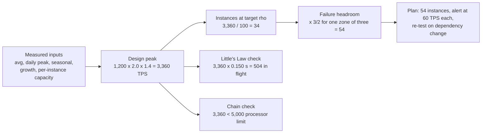

# Capacity Planning and Queueing Theory

> Little's Law predicts your queue depth before you build it.

**Type:** Learn
**Languages:** —
**Prerequisites:** Phase 9, Lesson 01 (SLIs, SLOs, and Error Budgets), Phase 9, Lesson 02 (Load Balancing), Phase 9, Lesson 06 (Metrics and Histograms)
**Time:** ~75 minutes

## Learning Objectives

- State Little's Law and use it to size a thread pool, a connection pool, and a queue from an arrival rate and a residence time
- Explain why latency rises as a hockey stick with utilization in an M/M/1 queue, and compute the mean wait at 50%, 80%, 90%, and 95% utilization from a 10 ms service time
- Compare c independent queues with one pooled M/M/c queue at the same utilization and say when pooling pays
- Compute how fan-out amplifies tail latency and derive the per-dependency percentile a fan-out needs to meet an end-to-end p99
- Write a capacity plan for an authorization service that states its inputs, its headroom rules, and the number it produces

## The Problem

An authorization service runs on 12 instances, each with a pool of 200 worker threads, behind a load balancer. On an ordinary day it handles 1,200 requests per second at a p99 of 140 ms. The team's capacity rule is "add instances when CPU passes 70%", and CPU is at 45%. Everyone agrees there is room.

On the evening of a retail promotion, traffic rises to 2,100 requests per second, which is 1.75 times normal and well below the 2.5 times the service was load-tested for. CPU goes to 62%. The p99 goes to 3.8 seconds. Merchants time out after 3 seconds and retry, which adds load, and the p99 goes to 9 seconds before the on-call engineer doubles the fleet by hand. The postmortem finds that the load test had been run with a fraud-scoring dependency stubbed to respond in 5 ms; in production it responds in 90 ms at p50 and 400 ms at p99, so each request held a worker thread for roughly 150 ms on average rather than 60. Twelve instances with 200 threads each can hold 2,400 requests in flight. At 2,100 requests per second with a 150 ms residence time, Little's Law says 315 requests are in flight on average; that is comfortable. But the fraud dependency's own latency rose under the extra load, residence time went to 600 ms, and 2,100 times 0.6 is 1,260 in flight, then 1,900, then more than 2,400, at which point requests queued for a thread, residence time included the queue wait, the in-flight count rose further, and the system fell over a cliff that CPU never saw.

Nobody did anything unreasonable. The team measured the wrong quantity (CPU, which measures the processor, not the threads), tested with the wrong dependency latency, and did not have the one equation that would have told them, before the promotion, how many requests would be in flight at 2,100 requests per second with a 150 ms residence time, and how close that was to the pool size. This lesson is that equation and the three or four that follow from it. They are all algebra on numbers you already collect, and together they answer the question a capacity plan has to answer: how much headroom do we have, in what unit, and when does it run out.

## The Concept

### Little's Law

For any stable system, over a long enough window:

```text
L = lambda * W

L       mean number of items in the system (in flight, or in the queue)
lambda  mean arrival rate (items per second)
W       mean time each item spends in the system (seconds)
```

It holds for any arrival distribution, any service distribution, and any scheduling policy, as long as the system is stable (nothing accumulates without bound) and the window is long compared with W. That generality is why it is the first thing to reach for. Three uses:

- **Thread pool or connection pool size.** 1,200 requests per second with a 150 ms residence time means `1200 * 0.150 = 180` requests in flight on average. A pool of 200 has about 11% headroom at the mean, and none at a busy second. At 2,100 requests per second and 600 ms, `2100 * 0.6 = 1,260`, and the 12-instance fleet's 2,400 threads are 52% occupied on average before any burst.
- **Queue depth from latency.** If the queue in front of a worker shows a mean depth of 40 items and the arrival rate is 400 per second, every item waits `40 / 400 = 100 ms` on average. You can read latency from a depth gauge, and depth from a latency histogram.
- **Residence time from in-flight count.** A database reports 85 active connections at 1,700 queries per second; each query holds a connection for 50 ms on average. If the application's own timing says 20 ms, the other 30 ms is waiting for a connection, lock, or I/O inside the database.

Little's Law tells you the mean. It says nothing about the distribution, and it cannot say how latency changes as load rises. For that you need a model of the queue.

### M/M/1: one server, random arrivals

Kendall's notation `A/S/c` names the arrival process, the service-time distribution, and the number of servers. `M` means Markovian (memoryless, exponentially distributed). M/M/1 is the simplest model that produces the behaviour every production system shows:

```text
rho = lambda / mu        utilization: arrival rate over service rate (mu = 1 / mean service time S)
L   = rho / (1 - rho)    mean number in system
W   = S / (1 - rho)      mean residence time (service plus wait)
Wq  = rho * S / (1 - rho)  mean time waiting in the queue before service starts
```

With a 10 ms service time:

| Utilization rho | Mean in system L | Mean residence W | Mean queue wait Wq | W relative to S |
|-----------------|------------------|------------------|--------------------|-----------------|
| 0.50 | 1.0 | 20 ms | 10 ms | 2x |
| 0.70 | 2.3 | 33 ms | 23 ms | 3.3x |
| 0.80 | 4.0 | 50 ms | 40 ms | 5x |
| 0.90 | 9.0 | 100 ms | 90 ms | 10x |
| 0.95 | 19.0 | 200 ms | 190 ms | 20x |
| 0.99 | 99.0 | 1,000 ms | 990 ms | 100x |

This is the hockey stick. From 50% to 80% utilization, latency goes from 2x to 5x the service time. From 80% to 90%, it doubles again. From 90% to 95%, it doubles again. The factor `1 / (1 - rho)` is why "we are at 70% CPU, there is room" is wrong for a latency-sensitive service: the remaining 30% of throughput costs most of the latency budget. It is also why a service that is fine at 1,200 requests per second and fine at 1,800 can be unusable at 2,100: the three points are at different places on a curve that is almost flat and then almost vertical.

Two assumptions matter. Exponential service times have a coefficient of variation of 1; if your service time is more variable than that (a fraud call that usually takes 90 ms and sometimes 400), waits are longer than the table says. Kingman's approximation for a general single-server queue makes this explicit: `Wq ~= (rho / (1 - rho)) * ((ca^2 + cs^2) / 2) * S`, where `ca` and `cs` are the coefficients of variation of inter-arrival and service times. Halving variability halves the wait at the same utilization; that is the quantitative argument for making dependency latency predictable (timeouts, hedging, bounded retries) rather than merely fast on average. And arrivals are assumed independent; retries after a timeout are not independent, they are correlated with the system being slow, which is why retry storms turn a bad minute into a bad hour.

### M/M/c: pooling servers

With `c` identical servers sharing one queue, utilization per server is `rho = lambda / (c * mu)`. The probability an arriving request has to wait is the Erlang C formula, and the mean queue wait is `Wq = P(wait) / (c * mu - lambda)`. The numbers for `rho = 0.8` and a 10 ms service time:

| Configuration | P(wait) | Mean queue wait Wq | Mean residence W |
|---------------|---------|--------------------|------------------|
| 1 server at 80% (M/M/1) | 0.80 | 40.0 ms | 50.0 ms |
| 2 servers, one shared queue, each at 80% | 0.71 | 17.8 ms | 27.8 ms |
| 4 servers, one shared queue, each at 80% | 0.60 | 7.5 ms | 17.5 ms |
| 8 servers, one shared queue, each at 80% | 0.46 | 2.9 ms | 12.9 ms |
| 4 servers, 4 separate queues, each at 80% | 0.80 each | 40.0 ms | 50.0 ms |

The last two rows are the lesson. Four servers with four private queues behave like four M/M/1 systems: 40 ms mean wait at 80%. The same four servers behind one shared queue wait 7.5 ms. Pooling lets an idle server take work that would otherwise wait behind a busy one. This is why a single shared connection pool beats per-thread connections, why one work queue beats one queue per worker, and why the load-balancing lesson found that routing to the least-loaded server matters: a load balancer that assigns requests to servers without knowing their queue depth is building the four-private-queues row.

Pooling has a cost: the shared queue is a point of coordination (a lock, a broker, a balancer), and a very large `c` reaches diminishing returns, since the 8-server row is already close to the 10 ms service time. The practical rule is to pool as widely as the coordination cost allows, and to measure that cost.

### Tail latency amplification in fan-out

An authorization request fans out to five dependencies in parallel: account lookup, fraud score, velocity check, FX quote, ledger reservation. Each has a p99 of 100 ms, meaning 1% of calls exceed 100 ms. The request completes when the slowest of the five returns. The probability that at least one of five independent calls exceeds 100 ms is:

```text
P(max > 100 ms) = 1 - (0.99)^5 = 1 - 0.951 = 4.9%
```

So the fan-out's p95 is about 100 ms, not its p99. The table for other fan-out widths:

| Dependencies called | Share of requests slower than every dependency's p99 |
|---------------------|------------------------------------------------------|
| 1 | 1.0% |
| 2 | 2.0% |
| 5 | 4.9% |
| 10 | 9.6% |
| 20 | 18.2% |
| 100 | 63.4% |

At 100 backends (a scatter-gather over a sharded store, say), the median request is slower than any single backend's p99. Dean and Barroso call this "the tail at scale", and the arithmetic has a direct design consequence: to give the five-way fan-out a p99 of 100 ms, each dependency needs `0.99^(1/5) = 0.998`, a p99.8 of 100 ms. The per-dependency latency SLO must be tighter than the end-to-end one by a factor set by the fan-out width, and it must be written as a higher percentile, not as a smaller number at p99.

Three mitigations, each with a cost. Hedged requests send a second copy of a call after it exceeds, say, the p95 and take the first response, which cuts the tail at the price of about 5% extra load. Tied requests enqueue on two servers and cancel one when the other starts. And reducing fan-out, by caching the account lookup or by colocating the velocity check with the fraud score, removes a term from the exponent. The one thing that does not work is making the dependencies faster on average; the tail is set by the slow percentiles, and averages hide them (Lesson 06).

### Retries multiply arrivals

The M/M/1 formula assumes `lambda` is independent of `W`. Retries break that. Suppose a client times out at 100 ms and retries once, the service time is 10 ms, and the service runs at `rho = 0.8`, so the mean residence is 50 ms and, with exponential residence times, about `e^(-100/50) = 13.5%` of requests exceed the timeout. Those 13.5% are re-sent, so the effective arrival rate is `1.135 * lambda`, utilization is `0.91`, mean residence is `111 ms`, and now `e^(-100/111) = 40%` of requests time out. The next round puts utilization above 1.

| Round | Effective rho | Mean residence | Share exceeding 100 ms timeout |
|-------|---------------|----------------|--------------------------------|
| 0 | 0.80 | 50 ms | 13.5% |
| 1 | 0.91 | 111 ms | 40.6% |
| 2 | 1.12 | unstable | approaches 100% |

The exponential tail is an approximation, but the shape is exact: a retry policy is a feedback loop whose gain is `1 / (1 - rho)`, and above roughly 80% utilization the loop is unstable. Capacity planning therefore has to include the retry policy as an input: a timeout set near the p99 at design load, a retry budget (Phase 12) that caps retries at a fraction of first attempts, and the load shedding of Lesson 13 that breaks the loop when it starts. Headroom is what keeps the system on the flat part of the curve, where the loop gain is small.

### Which resource is the queue?

Every formula above has a `rho`, and the question in practice is: utilization of what? A request holds several resources in sequence or in parallel, and the one closest to saturation sets the latency. The USE method (utilization, saturation, errors, per resource) is a checklist for finding it.

| Resource | Utilization metric | Saturation signal | Typical limit in an authorization service |
|----------|--------------------|-------------------|-------------------------------------------|
| CPU | busy time / wall time | run-queue length | rarely first; a thread waiting on I/O uses no CPU |
| Worker thread pool | threads busy / pool size | requests queued for a thread | 200 per instance; the resource in The Problem |
| Database connection pool | connections checked out / pool size | wait time to acquire a connection | 20 to 50 per instance; often the real bottleneck |
| Downstream rate limit | TPS sent / TPS allowed | 429 responses, throttled retries | processor contract, fraud vendor contract |
| Network and TLS | bytes / link capacity, handshakes per second | retransmits, handshake latency | rarely first inside a region |
| Lock or single writer | hold time / wall time | waiters on the lock | the ledger writer (Phase 7); saturates far below CPU |

The thread pool and the connection pool deserve a specific warning because they are both Little's Law in disguise. Pool occupancy is `lambda * W` where `W` is the time the resource is held, and `W` is set by the slowest thing downstream, not by the service's own code. A dependency that gets 100 ms slower raises your pool occupancy by `lambda * 0.1` with no change in your CPU. A capacity rule expressed in CPU is blind to exactly the failure that brings latency-sensitive services down.

A short Java snippet computes the two models, for checking the tables and for a dashboard annotation:

```java
static double mm1ResidenceMillis(double rho, double serviceMillis) {
    if (rho >= 1.0) return Double.POSITIVE_INFINITY;          // unstable: the queue grows without bound
    return serviceMillis / (1.0 - rho);
}

/** Erlang C: probability an arrival waits, c servers, offered load a = lambda / mu (in erlangs). */
static double erlangC(int c, double a) {
    double num = Math.pow(a, c) / (factorial(c) * (1.0 - a / c));
    double den = num;
    for (int k = 0; k < c; k++) den += Math.pow(a, k) / factorial(k);
    return num / den;
}

static double mmcQueueWaitMillis(int c, double lambdaPerSec, double muPerSec) {
    double pWait = erlangC(c, lambdaPerSec / muPerSec);
    return 1000.0 * pWait / (c * muPerSec - lambdaPerSec);
}
```

`mmcQueueWaitMillis(4, 320, 100)` returns 7.5, the M/M/4 row in the table; `mm1ResidenceMillis(0.9, 10)` returns 100.

### Open loop, closed loop, and the load test that lies

Load generators come in two shapes. A closed-loop generator has `N` virtual users, each sending a request, waiting for the response, then sending the next. An open-loop generator sends requests at a fixed rate regardless of responses. Production traffic from merchants is open loop: a shopper's checkout does not wait for the previous shopper's authorization to finish. A closed-loop test against a slowing service sends fewer requests as latency rises, which caps the queue at `N` and hides the hockey stick entirely; the load test in The Problem was closed loop with 200 virtual users, which is why it never saw a queue.

The same effect inside a single measurement is called coordinated omission: a generator that waits for a slow response before sending the next request does not record the requests it would have sent during the stall, so the recorded histogram is missing exactly the samples that were slow. The fix is to schedule send times in advance and measure latency from the scheduled time, not from the actual send. Any saturation test that feeds a capacity plan must be open loop, must include real dependency latencies, and must step load until the SLO percentile is crossed.

A workable step protocol: hold each load level for at least ten times the p99 and at least two minutes, so the queue reaches its stationary depth; record the full latency histogram and the pool occupancies at each step; stop at the first step where the p99 exceeds the SLO; report the previous step as the instance's capacity together with the utilization of every resource at that step. The resource closest to saturation at that step is the one the plan should alert on.

### From the histogram to the inputs

The plan's inputs come from two histograms built with the Lesson 06 implementation. The first is a histogram of per-second request counts over 30 days (2.6 million samples): its mean is the average throughput, its p99.9 is the daily peak worth planning for (about 43 minutes a month, in total, are busier, which is what the headroom absorbs), and the ratio is the peak-to-average factor. Planning on the p100 of per-second counts over-sizes for a single anomalous second; planning on the p95 under-sizes for the busiest hour of every day. The second is the latency histogram at the saturation test's final stable step: its mean is the residence time Little's Law needs, and its p99 is the number that was compared with the SLO to declare saturation. Both histograms should be stored with the plan, because a reviewer who disagrees with an input needs to see where it came from, and because next year's plan starts by diffing them.

### Headroom rules

Capacity planning turns the models into a number of instances. The inputs are measured, the rules are stated, and the output is defended with both.

| Rule | Typical value | Why |
|------|---------------|-----|
| Target utilization for latency-sensitive services | 50% to 60% of the saturation point | The hockey stick: above 70% the latency SLO is spent on queueing; the headroom is what absorbs a burst without crossing it |
| Target utilization for batch or throughput services | 80% to 90% | Latency is not the objective; the queue is the buffer |
| Failure headroom | N+1 instance, or 1 availability zone of 3 | Capacity must hold with the largest single failure unit gone; with 3 zones that is 1.5x the computed need |
| Peak-to-average ratio | measured, often 2x to 4x daily | Plan for the peak second, not the average; the histogram from Lesson 06 gives it |
| Seasonal factor | measured, 2x to 5x for retail payments | Black Friday and Singles' Day are the design point for a payments service, not an exception to it |
| Growth factor | measured year over year, over the planning horizon | Capacity ordered today arrives in weeks (cloud) or months (hardware) |
| Dependency capacity | the lowest limit among downstreams | Your capacity is the minimum over the chain; a processor that caps you at 3,000 TPS caps you at 3,000 TPS |

The saturation point is measured, not assumed: load one instance with production-shaped traffic, including real dependency latencies, until the p99 crosses the SLO, and record the throughput one step before that. That throughput at that latency is one instance's capacity. CPU is one input to that measurement, not the measurement.

## Worked Example

A capacity plan for an authorization service, written as the document a reviewer would read.

**Inputs (measured, with source).**

| Quantity | Value | Source |
|----------|-------|--------|
| Average throughput, last 30 days | 400 TPS | request counter |
| Daily peak throughput | 1,200 TPS | p99.9 of per-second counts over 30 days (peak-to-average 3x) |
| Last year-end peak over daily peak | 2.0x | last November's histogram |
| Year-over-year growth | 40% | 12-month trend of monthly volume |
| Planning horizon | 12 months | procurement lead time plus one quarter |
| Single-instance capacity at SLO | 100 TPS at 60% CPU, p99 140 ms | load test with real fraud and ledger dependencies, stepped until p99 crossed 150 ms at 115 TPS |
| Mean residence time at that load | 150 ms | latency histogram mean |
| Availability zones | 3 | deployment |
| Downstream processor limit | 5,000 TPS | contractual |

**Arithmetic.**

```text
design peak        = daily peak * seasonal * growth
                   = 1,200 * 2.0 * 1.4            = 3,360 TPS
instances at target utilization
                   = 3,360 / 100                   = 33.6 -> 34
with one zone lost (3 zones): need 34 instances across the 2 surviving zones
                   = 34 * 3 / 2                    = 51 -> 54 (18 per zone, divisible by 3)
threads in flight at design peak (Little's Law)
                   = 3,360 * 0.150 s               = 504 in flight fleet-wide
per instance (54)  = 504 / 54                      = 9.3 mean, so a 200-thread pool is 5% occupied at the mean
per instance after zone loss (36)
                   = 504 / 36                      = 14 mean
downstream check   : 3,360 TPS < 5,000 TPS processor limit, 33% headroom on the chain
```

**What the plan says.** Order 54 instances, 18 per zone, by the start of Q4. Alert at 60% of per-instance measured capacity (60 TPS per instance), not on CPU. Re-run the single-instance load test after every dependency change, because the residence time (and therefore the thread pool occupancy and the saturation point) depends on fraud and ledger latency, not on this service's code. Re-check the processor limit contractually before the holiday; 33% headroom on the chain is the thinnest number in the plan.

**A second pass: the database connection pool.** The same service holds a database connection for 12 ms per request on average (two queries, measured from the pool's checkout histogram), with a pool of 20 connections per instance. At the per-instance design load of `3,360 / 54 = 62 TPS`, Little's Law gives `62 * 0.012 = 0.75` connections busy on average, so the pool is 4% occupied and is not the bottleneck. Lose a zone and the per-instance load is `3,360 / 36 = 93 TPS`, still `1.1` connections. Now suppose a slow query doubles the hold time to 24 ms and a lock on the ledger table adds a 200 ms wait on 10% of requests: the mean hold time is `0.9 * 24 + 0.1 * 224 = 44 ms`, and occupancy is `93 * 0.044 = 4.1` connections, 20% of the pool. Still fine on the mean, but the 10% of requests that hit the lock hold a connection for a quarter of a second each, and at `rho = 0.2` the M/M/c tables say waits are negligible; the risk is not the pool, it is the lock. The plan should say so: the connection pool has 5x headroom, the ledger lock is the resource to watch, and the Phase 7 single-writer design is the reason.

**What it would have said about The Problem.** The old plan had 12 instances with a stubbed dependency. With the real 150 ms residence time, the single-instance load test would have crossed the SLO at a much lower throughput, and the plan would have called for roughly three times the fleet before the promotion rather than during it.



### A procedure for sizing anything

1. Name the resource that is held (threads, connections, a lock, a downstream quota) and measure how long each request holds it, as a histogram, under production-shaped load.
2. Apply Little's Law with the design-peak arrival rate to get the mean occupancy. If the mean occupancy is above half the pool, the pool is the bottleneck; stop and fix that before modelling further.
3. Compute `rho` for the resource at design peak. If it is above 0.6 for a latency-sensitive path, read the M/M/1 row to see what it costs, and decide between adding capacity (lower `rho`), pooling (M/M/c), or reducing variability (Kingman).
4. For every fan-out, compute `1 - p^n` with the dependency's measured tail and the fan-out width, and set per-dependency SLOs at the percentile the end-to-end target requires.
5. Multiply by the failure headroom (largest failure unit gone) and check the chain (the smallest downstream limit).
6. Write down every input with its source and date, so that the plan can be recomputed when any of them changes.

### Mistakes that recur

| Mistake | What happens | What the model says |
|---------|--------------|---------------------|
| Planning on CPU | Thread or connection pool saturates at 45% CPU | Pool occupancy is `lambda * W`, and `W` is set downstream; CPU does not see it |
| Planning on averages | Peak second is 3x the average; year-end is 6x | Little's Law with the average rate sizes for the average second |
| Closed-loop load test | Hockey stick never appears; plan is 3x short | Closed loop caps the queue at the number of virtual users |
| Stubbing dependencies | Residence time measured at 60 ms instead of 150 ms | Every pool size and saturation point scales with `W` |
| Ignoring fan-out | End-to-end p99 misses while every dependency meets its p99 | `1 - 0.99^5 = 4.9%` of requests exceed the per-dependency p99 |
| Adding capacity above 90% | Latency falls, then the retry storm that was feeding arrivals stops, and load halves | At `rho = 0.95` a 5% drop in load cuts mean wait by 50% (`1/(1-0.95)` to `1/(1-0.90)`); the system was in the vertical part of the curve |
| Treating headroom as waste | Fleet is right-sized to the average; the first zone failure takes down the remaining zones | Capacity is a promise about the worst planned second with the largest failure unit gone |

### What the models do not do

M/M/1 and M/M/c assume memoryless arrivals and service; real traffic is bursty and real service times have long tails, so the tables understate waits. Treat them as lower bounds and as shapes, not as predictions to two decimals. Little's Law gives means only; the SLO is about a percentile, so pair it with the histogram. None of the models include the feedback loop in The Problem, where slow responses cause retries that increase arrivals; that is the subject of Lesson 13, and the models tell you only that the loop exists above about 80% utilization. And no model substitutes for the measured single-instance saturation test; the models tell you how the measured number scales, not what it is.

Finally, the models describe one resource at a time. A request that queues for a thread, then for a connection, then for a lock is three queues in series, and its residence time is the sum of three waits, each with its own `rho`. The resource with the highest utilization dominates, which is why the procedure below starts by naming the resource and not by picking a formula.

## Exercises

1. **Reinforce.** A webhook delivery worker processes 250 events per second and a gauge shows 60 events in its queue on average. What is the mean queue wait? If the team wants the mean wait under 100 ms, what is the maximum mean depth at that arrival rate, and what depth should the alert fire at?
2. **Apply.** The ledger write path has a service time of 4 ms on a single writer (Phase 7). Using the M/M/1 table, at what arrival rate does the mean residence time reach 40 ms? If the ledger is sharded into 4 independent writers that each receive a quarter of the traffic, what happens to that threshold, and why does it not change by a factor of four in latency terms? Then compare with a single shared queue feeding 4 writers using the M/M/c row for `c = 4`.
3. **Extend.** The authorization fan-out in this lesson has five dependencies. Using the histogram implementation from Phase 9, Lesson 06, generate 100,000 samples for each dependency from a distribution with a p99 of 100 ms and a heavier tail for the fraud call, take the per-request maximum, and measure the end-to-end p99. Then implement hedged requests for the fraud call only (send a second copy after 95 ms, take the first response) and measure the end-to-end p99 and the extra load. Write a one-paragraph recommendation.

## Key Terms

| Term | What people say | What it actually means |
|------|-----------------|------------------------|
| Little's Law | "L equals lambda W" | Mean items in system equals mean arrival rate times mean residence time, for any stable system regardless of distributions; the tool for sizing pools and reading latency from depth |
| Utilization | "how busy the server is" | Arrival rate over service rate, `rho = lambda / mu`; the quantity latency depends on, and not the same as CPU percentage |
| M/M/1 | "the simple queue model" | One server, exponential inter-arrival and service times; mean residence `S / (1 - rho)`, the hockey stick |
| M/M/c and Erlang C | "pooled servers" | `c` servers sharing one queue; Erlang C gives the probability of waiting; pooling cuts the mean wait sharply at the same utilization |
| Coefficient of variation | "how spiky it is" | Standard deviation over mean of inter-arrival or service times; Kingman's formula shows waits scale with its square |
| Tail latency amplification | "the slowest of N" | A fan-out to `n` dependencies exceeds a per-dependency percentile `p` with probability `1 - p^n`; the end-to-end p99 requires each dependency to meet a higher percentile |
| Headroom | "spare capacity" | The gap between planned load and measured saturation, stated as a utilization target plus the largest failure unit; the thing a capacity plan buys |
| Coordinated omission | "the load tool missed some samples" | A generator that waits on a slow response skips the requests it should have sent during the stall, so the recorded histogram omits the slow samples; fixed by scheduling send times in advance |
| Open-loop load | "fire and forget" | Requests arrive at a rate independent of the system's responses, as merchant traffic does; the only load shape that can reveal the hockey stick |
| Saturation point | "where it falls over" | The throughput at which a single instance's p99 crosses the SLO under production-shaped load, including real dependency latencies; measured, never assumed |

## Further Reading

- [Little, J. D. C., "A Proof for the Queuing Formula: L = lambda W", Operations Research, 1961](https://pubsonline.informs.org/doi/10.1287/opre.9.3.383) — the original proof, and the generality conditions that make the law safe to apply to any stable system.
- [Dean, J. and Barroso, L. A., "The Tail at Scale", Communications of the ACM, 2013](https://research.google/pubs/the-tail-at-scale/) — the fan-out amplification arithmetic and the hedged and tied request techniques, from the people who measured them at Google.
- [Kingman, J. F. C., "The single server queue in heavy traffic", 1961](https://doi.org/10.1017/S0305004100036094) — the approximation that puts variability into the wait formula; the quantitative case for predictable dependency latency.
- [Harchol-Balter, M., "Performance Modeling and Design of Computer Systems", Cambridge University Press, 2013](https://www.cs.cmu.edu/~harchol/PerformanceModeling/book.html) — the textbook treatment of M/M/1, M/M/c, and why pooling beats partitioning, with the proofs this lesson skips.
- [Google SRE Workbook, "Managing Load" and "Non-Abstract Large System Design"](https://sre.google/workbook/managing-load/) — capacity planning as practised, including the measured-saturation discipline and the N+2 rule.
- [Gregg, B., "The USE Method"](https://www.brendangregg.com/usemethod.html) — utilization, saturation, errors per resource; the checklist for finding which resource is the queue.
- [Tene, G., "How NOT to Measure Latency" (Strange Loop 2015)](https://www.youtube.com/watch?v=lJ8ydIuPFeU) — coordinated omission and why closed-loop load tests hide the hockey stick.
- [Erlang C calculator derivation (Wikipedia, "Erlang (unit)")](https://en.wikipedia.org/wiki/Erlang_(unit)#Erlang_C_formula) — the formula behind the M/M/c table, for reproducing the numbers in this lesson.
