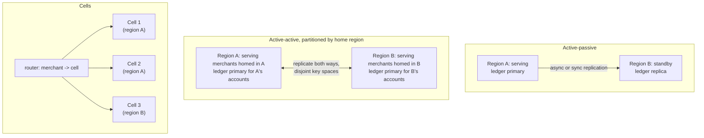
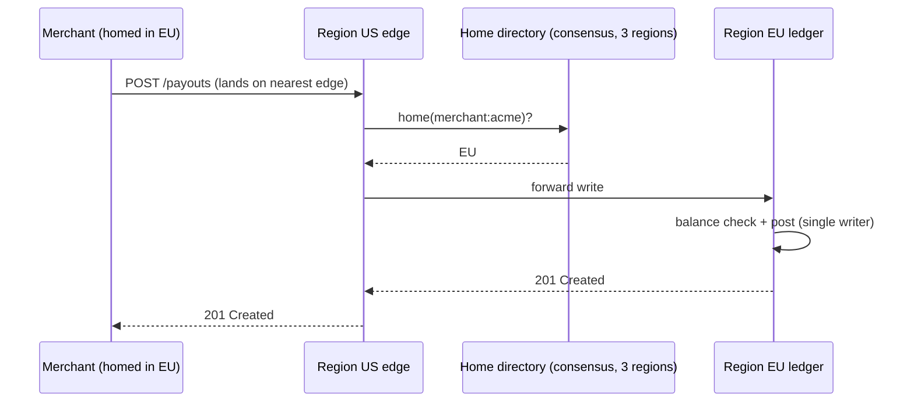
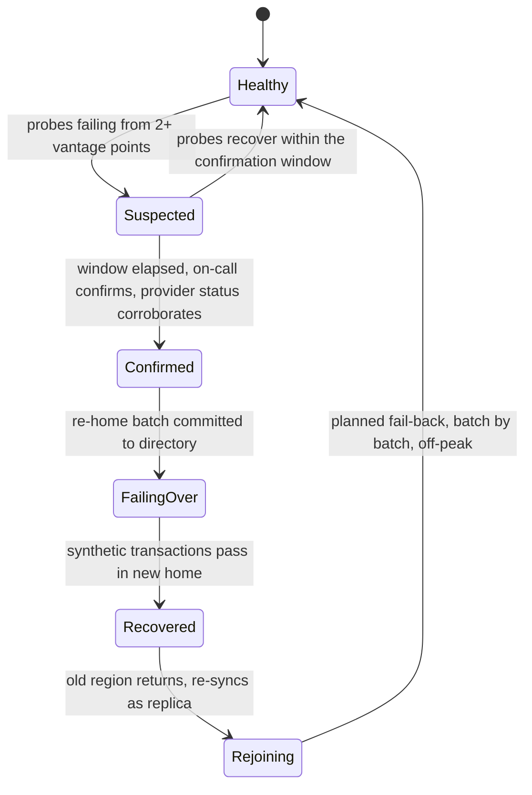

# Multi-Region Architecture and Disaster Recovery

> RPO, RTO, and the active-active ledger problem.

**Type:** Learn
**Languages:** —
**Prerequisites:** Phase 9, Lesson 10 (Capacity Planning and Queueing Theory), Phase 6, Lesson 02 (Replication: Leader-Follower, Sync vs Async), Phase 6, Lesson 05 (Raft), Phase 10, Lesson 03 (Double-Entry Ledger)
**Time:** ~90 minutes

## Learning Objectives

- Define RPO and RTO precisely, derive each from a replication mode and a failover procedure, and state what they cost
- Compare active-passive, active-active, and cell-based topologies on data loss, failover time, cost, and operational complexity
- Explain why a double-entry ledger cannot be made active-active by replication alone, and describe home-region routing as the standard resolution
- Apply data-residency constraints to a topology without breaking the ledger's invariants
- Write a failover runbook with explicit decision criteria, steps, verification, and a path back

## The Problem

A payment processor runs in one cloud region. At 03:12 the region's power feed fails and the backup generators do not take over. Every service is down: API, ledger, processor adapters, dashboards. Merchants' checkouts return connection errors. The team has a replica of the ledger database in a second region, replicating asynchronously with a lag that averages two seconds. They have never failed over to it.

It takes forty minutes to decide to fail over, because nobody is sure whether the region will come back in five minutes and a failover is irreversible once writes land in the new region. It takes another fifty minutes to execute, because the DNS change has a ten-minute TTL, the secondary database must be promoted by hand, the processor adapters in the secondary region have never been issued production credentials by the acquirer, and the configuration service that would tell them where the acquirer's endpoints are is itself in the failed region. At 04:42 the platform is serving traffic from the second region. The last two seconds of ledger writes before the failure were never replicated and are gone: 114 postings, including 31 captures that the acquirer did receive and will settle. The ledger now says those merchants were not paid; the bank statement tomorrow will say they were. Reconciliation (Phase 10) will find every one of them, and finance will spend a week working them by hand.

Nothing in that story was unforeseeable. The ninety-minute outage was the sum of decisions nobody had made in advance (when to fail over, who decides), steps nobody had rehearsed (credentials, DNS, configuration dependencies), and a data-loss figure nobody had written down (two seconds of asynchronous replication is two seconds of lost postings). Disaster recovery is the discipline of making those three things explicit *before* the pager goes off: how much data you will lose (RPO), how long you will be down (RTO), and the exact procedure that achieves both. For a ledger there is a fourth question with no cheap answer: whether two regions can accept writes at the same time without the books ceasing to balance.

## The Concept

### RPO and RTO

**Recovery Point Objective (RPO)** is the maximum acceptable data loss, measured as time: an RPO of two seconds means that after a disaster, the recovered system reflects every write that happened more than two seconds before the failure and may be missing anything newer. **Recovery Time Objective (RTO)** is the maximum acceptable time from failure to the system serving traffic again. The two are independent: a nightly backup restored in five minutes has a five-minute RTO and a 24-hour RPO; a synchronous replica that takes an hour to promote by hand has a zero RPO and a one-hour RTO.

Both are *objectives*: numbers the business chooses and pays for, the way Lesson 01 chose an availability target. They are derived, not asserted:

| Mechanism | RPO it delivers | Why |
|-----------|-----------------|-----|
| Nightly snapshot shipped to another region | up to 24 hours | everything since the last snapshot is lost |
| Continuous WAL shipping (Phase 7) with 30 s batches | up to 30 s plus transfer time | the batch in flight is lost |
| Asynchronous streaming replication | the replication lag at the moment of failure, typically 0.1-5 s | acknowledged writes not yet applied on the replica are lost |
| Synchronous replication to one other region | zero | a write is not acknowledged until the remote region has it |
| Consensus group spanning three regions (Raft, Phase 6) | zero | a write is committed only when a majority has it, and a majority survives one region's loss |

| Mechanism | RTO it delivers | Why |
|-----------|-----------------|-----|
| Restore from backup into fresh infrastructure | hours | provisioning, restore, verification, DNS |
| Warm standby: replica running, application not | 15-60 minutes | promote, start applications, re-point clients |
| Hot standby: replica and application running, no traffic | 1-15 minutes | promote, flip routing; dominated by human decision time and DNS TTL |
| Active-active: both regions serving | seconds | nothing to promote; clients retry against the other region |

The costs climb the same ladder. Synchronous cross-region replication adds the inter-region round trip (20-80 ms between regions on one continent, 150+ ms across oceans) to every write's latency. Active-active doubles the running infrastructure and, as the next section shows, is not available to every workload at any price.

### The invariant a DR plan must keep

For a payments platform the invariant is the ledger's: **every posting that an external party has acted on exists in the recovered ledger, exactly once.** The 31 lost captures in The Problem violate it in one direction (the acquirer acted; the ledger forgot). Replaying a WAL twice after a botched failover violates it in the other (the ledger remembers twice). RPO is the time window in which the first violation can occur; the failover procedure is where the second one is created. A DR plan that quotes an RPO without a procedure that guarantees exactly-once replay has quoted half a number.

### Topologies



**Active-passive.** One region serves; the other holds a replica and idle (or warm) application capacity. Simple to reason about: one writer, so no write conflicts. RPO is the replication mode's; RTO is dominated by the decision and the flip. The standing risk is that the passive region is never exercised and does not work when needed (missing credentials, stale configuration, undersized capacity), which is The Problem.

**Active-active.** Both regions serve traffic. For stateless services and for data with no cross-record invariants (session caches, idempotency keys scoped to one request) this is straightforward and halves the blast radius of a regional failure. For a ledger it is a hard problem, discussed below; the resolution is to make it active-active at the *region* level while every individual account has exactly one writer at a time.

**Cells.** Rather than two large regions, run many small, independent, identical stacks (cells), each serving a slice of merchants with its own database, and route each merchant to one cell. A regional failure takes down the cells in that region and their merchants are failed over cell by cell to standby cells elsewhere. Cells bound blast radius (a bad deploy or a poison request hurts one cell's merchants), make capacity planning linear, and make the failover procedure something you run every week for one cell as routine rather than once a decade for everything. The price is routing (a merchant-to-cell directory that is itself highly available) and the loss of any query that spans cells.

| | Active-passive | Active-active (home-region) | Cells |
|-|----------------|-----------------------------|-------|
| RPO | replication mode's lag | per-account: replication lag for accounts whose home failed; zero for others | per-cell replication mode |
| RTO | 15-60 min warm, 1-15 min hot | seconds for unaffected accounts; minutes to re-home affected ones | minutes per cell, routinely rehearsed |
| Write conflicts | none | none by construction (disjoint writers) | none (one writer per cell) |
| Idle cost | one region's worth | none | standby cells |
| Blast radius of a bad deploy | everything | everything in the region | one cell |
| Rehearsal frequency achievable | annual, painful | frequent for re-homing | weekly, per cell |

### The active-active ledger problem

A double-entry ledger (Phase 10, Lesson 03) has an invariant across records: the postings of a transaction sum to zero, and an account's balance is the sum of its postings. Add a second constraint every real ledger has: a balance may not go below zero (or below an authorised limit). Now let two regions both accept postings against the same account.

Account `merchant:acme:available` holds 100.00 USD. At the same instant, region A accepts a payout of 80.00 (balance check: 100 >= 80, passes, posts) and region B accepts a payout of 70.00 (balance check: 100 >= 70, passes, posts). Each region's check was correct against the state it could see. When replication converges, the account holds -50.00. Both payouts have been sent to the bank. The invariant is broken and the money has left the building.

```text
t0   A: read balance(acme) = 100.00        B: read balance(acme) = 100.00
t1   A: check 100.00 >= 80.00  ok          B: check 100.00 >= 70.00  ok
t2   A: post  -80.00, send payout          B: post  -70.00, send payout
t3   replication A->B and B->A converge
t4   both regions: balance(acme) = -50.00; two payouts in flight at the bank
```

There is no conflict-resolution rule that fixes this after the fact. Last-writer-wins keeps one posting and silently discards the other, so the ledger no longer matches what was paid. Keeping both records the truth (the money did leave) and leaves the balance negative. A CRDT counter converges to the right sum and is exactly as negative. The problem is not merging; it is that the *check* that preceded each write was made against a stale view, and a check-then-act on shared state cannot be made correct by anything done after the act.

The options, in order of how often they are used:

1. **Home-region routing (single writer per account).** Every account has a home region. All writes to that account are routed to its home; the other region can read (with lag) but never write. Two regions are both active, each is the only writer for its half of the accounts, and the invariant holds because the balance check and the posting happen in one place. Failover of an account means changing its home, which is a metadata write that must itself be consistent (a small consensus group spanning regions, or a well-ordered manual procedure). This is what nearly every payments platform does.
2. **Synchronous cross-region consensus for the ledger.** Run the ledger's write path on a Raft group whose members span three regions. Every posting pays an inter-region round trip; the invariant holds; a region can fail with zero RPO and an RTO of one leader election. Spanner and CockroachDB-style systems make this practical for moderate write rates. The cost is latency on every write, which is why it is used for the account-home directory more often than for the postings themselves.
3. **Reservation with bounded local authority.** Give each region a pre-allocated share of an account's balance it may spend without coordination (region A may authorise up to 60.00, region B up to 40.00), reconcile periodically, and fall back to coordination when a region's share is exhausted. This is the escrow pattern, and it is how some card networks let issuers approve offline. It turns the hard problem into a capacity-allocation problem and works only where temporary over-conservatism (declining a payout the account could in fact cover) is acceptable.

What does not work: optimistic replication with conflict detection (by the time the conflict is detected the payout is gone), and application-level locks across regions (a lock service spanning regions *is* option 2 with extra steps).

### Home-region routing in detail



Three components. The **directory** maps each account (or merchant, or shard) to its home region and must be consistent and highly available, which is a small amount of data that justifies a cross-region consensus group. The **edge** in every region consults the directory and forwards writes to the home; reads can be served locally from the replica if the caller accepts lag, or forwarded if not. The **re-homing procedure** changes an account's home: stop writes at the old home, wait for replication to drain to the new home (or accept the RPO loss if the old home is dead), update the directory, resume at the new home. Re-homing a live account for maintenance is a routine operation and the rehearsal for re-homing a dead region's accounts in anger.

Residency fits naturally: an account whose data must stay in the EU has its home in an EU region, its replica in a second EU region, and never a home in the US. The directory enforces the constraint as a validation rule on home changes.

### Replication lag as RPO, in postings

RPO is quoted in seconds but paid in records. The arithmetic for the ledger from Lesson 10's capacity numbers:

```text
posting rate        1,250 postings/s (steady), 3,000/s (peak)
async lag p50       0.4 s   -> 500 postings lost at steady state, 1,200 at peak
async lag p99       2.5 s   -> 3,125 lost at steady state, 7,500 at peak
                    (lag p99 happens under load, which is exactly when peak rate happens too)
externally acted    ~35% of postings are captures/payouts an acquirer or bank has already seen
                    -> at p99 lag during peak: ~2,600 postings whose loss breaks the invariant
sync replication    0 postings; +25 ms per write
```

The number to put in front of the business is the last line of the asynchronous case: about 2,600 reconciliation breaks, each worked by hand at a cost of perhaps 20 minutes of a finance analyst's time, versus 25 milliseconds on every write. Framed as "two seconds of data" the asynchronous option sounds acceptable; framed as 870 analyst-hours after one bad night it does not. Lag should be a metric with an alert (Lesson 06), because an RPO quoted at p50 lag is wrong precisely when it matters.

### Choosing a topology

1. **List the invariants that cross records.** Ledger balances, idempotency uniqueness, sequence numbers. Anything on the list needs a single writer per key or cross-region consensus; everything else can be active-active freely.
2. **Set RPO per data class, in records.** Postings an external party has acted on: zero, which means synchronous replication or consensus for the ledger write path. Session state, caches, analytics: whatever the replication gives you.
3. **Set RTO per customer class.** Merchants homed in the failed region: minutes, dominated by decision time. Everyone else: zero, which means the topology must isolate regions (home-region routing or cells), not share a global primary.
4. **Apply residency.** Group regions into jurisdiction pairs; a home may only move within its pair. If a jurisdiction has one usable region, write down that its RTO is restore-from-backup and get that accepted in writing.
5. **Price it.** Synchronous replication's latency, the standby capacity (warm standby at 30% versus active-active at 100%), the directory's consensus group, and the engineering to make every dependency multi-region.
6. **Decide who decides.** Name the role that can declare a regional failover and the two signals they need to see; without this the RTO has an unbounded term.

### Testing the plan

A DR plan that has not been executed is a hypothesis. Three levels of test, in increasing cost and realism:

| Level | What runs | What it proves | Cadence |
|-------|-----------|----------------|---------|
| Tabletop | engineers walk the runbook aloud against a scenario | the runbook is complete and the decision criteria are unambiguous | quarterly |
| Component failover | re-home a batch of real merchants between healthy regions during a low-traffic window | the directory, routing, promotion, and credentials work; measures the RTO components | weekly or monthly |
| Game day | isolate a region (block its network at the edge) in production or a production-identical environment, with the on-call responding as if real | the dependencies list is complete; the people can do it under time pressure | annually or semi-annually |

Component failover is the one that matters most, because it is cheap enough to run routinely and so keeps the standby region honest. A platform that re-homes 1% of its merchants every week has an RTO it has measured fifty times a year; one that has never re-homed anything has a brochure.



The state machine has one deliberate asymmetry: `Suspected` can return to `Healthy` without human action, but nothing after `Confirmed` is automatic. Automated failover of a ledger has caused more incidents than it has prevented, because the failure modes that look like "region down" from one vantage point (a partition between regions, a monitoring outage, a bad deploy of the prober) are common and an automated re-home during a partition creates two writers for the same accounts, which is the active-active ledger problem by accident. Automate everything up to the decision and the execution after it; keep a human at the decision.

### Common ways DR plans fail

| Failure | Symptom on the day | Prevention |
|---------|-------------------|------------|
| Standby never exercised | credentials missing, capacity too small, configuration stale | weekly component failovers; standby serves some real traffic (reads, or a slice of merchants) |
| Dependency in the failed region | runbook step cannot run (DNS control plane, secrets, SSO, CI) | dependency inventory with region column; each in-region dependency has a documented workaround |
| RPO quoted at p50 lag | losses far exceed the quoted figure because failure coincided with load | quote RPO at p99 lag under peak; alert on lag |
| No decision owner | forty minutes of debate while the region is down | named role, two signals, confirmation window written in the runbook |
| Fail-back in a hurry | second outage, or two writers during the move | fail-back is a planned re-home a week later; the returned region rejoins as replica and stays replica |
| Replay without idempotency | duplicate postings after WAL replay into the new primary | idempotency keys on every posting (Phase 12, Lesson 01); replay is a no-op for records already present |

### Reads during and after failover

Writes get the attention, but most traffic is reads, and reads have their own consistency question during a regional event:

| Read | Served from | During failover of the home | Acceptable? |
|------|-------------|------------------------------|-------------|
| Balance shown on a dashboard | local replica, lag-tolerant | may be stale by the lag; shows a banner | yes |
| Balance check before a payout | home region only | fails fast with `503` until re-home completes | yes: a wrong answer is worse than no answer |
| Payment status for a webhook retry | home or replica with read-your-writes token | replica may not yet have the posting; client retries | yes, with retry |
| Reconciliation batch (Phase 10) | replica, run after convergence | paused until the new home is confirmed | yes |
| Regulator or audit export | home region, point-in-time snapshot | deferred | yes |

The rule that falls out: a read whose result will be *acted on* (a balance check, an authorisation decision) goes to the single writer or fails; a read that is *displayed* may be served locally with lag. The Phase 5 consistency models give the vocabulary: the first class needs linearizability with respect to the writer, the second tolerates eventual consistency with a bounded staleness that the UI discloses.

### Data residency

Regulations constrain where personal and financial data may be stored and processed: GDPR for EU residents' personal data (transfer outside the EEA requires a legal basis and, after *Schrems II*, additional safeguards), India's RBI directive of 2018 requiring payment system data to be stored only in India, and a growing list of national rules. For a multi-region payments platform the consequences are concrete:

- **Replication topology is a compliance artefact.** A replica in a non-compliant region is storage in that region. The DR plan for an Indian merchant's data cannot be "fail over to Singapore".
- **Residency pairs.** Each regulated jurisdiction needs at least two regions inside it for DR to be possible at all, or a documented acceptance that DR for that jurisdiction means restore-from-backup within the jurisdiction with a longer RTO.
- **Metadata leaks.** The home directory, logs (Lesson 08), traces (Lesson 07), and backups all contain account identifiers and sometimes amounts. Each needs the same residency analysis as the ledger, and redaction or tokenisation where the analysis fails.
- **Processing, not only storage.** Some rules cover where computation happens. A failover that moves processing out of the jurisdiction, even with storage staying put, may need a regulator's advance approval.

### Dependencies that do not fail over

The Problem's failover stalled on credentials and configuration that lived only in the failed region. A DR plan is only as good as its most region-bound dependency. The checklist:

- DNS and traffic management: is the control plane for changing routing itself in one region?
- Secrets and certificates: are the standby region's processor credentials issued, stored in-region, and tested?
- Configuration and feature flags (Lesson 13): does the standby region read configuration from a store that survives the primary's loss?
- Identity: can engineers authenticate to the standby region's tooling when the primary's SSO is down?
- Third parties: do acquirers and networks allow-list the standby region's egress IPs? Do webhook consumers accept a new source?
- Build and deploy: can a fix be shipped to the standby region without the primary's CI?
- Observability: do dashboards and alerting (Lessons 06-08) work when the primary is down, or are they what tells you the primary is down and then go dark?

Each line that is "no" is an RTO contribution measured in tens of minutes.

### Zones before regions

Cloud providers divide a region into availability zones: separate buildings, power, and network within a metro, with single-digit-millisecond latency between them. Synchronous replication across zones is cheap enough to be the default for every stateful service, and a zone's loss should be invisible to customers. Regions are the next layer for failures that zones share: a regional control-plane outage, a metro-wide network event, a provider-wide bad deploy, a legal order. Multi-region DR built on a single-zone primary is solving the rare problem before the common one; the Problem's platform would have survived a zone failure with cross-zone replication and never reached the regional question.

### What this lesson does not do

- It does not make the replication itself. Leader-follower and consensus replication are Phase 6; this lesson chooses between them and quotes their RPO.
- It does not cover backup hygiene (encryption, retention, restore testing) beyond noting that an untested backup has an unknown RTO.
- It does not address intra-region availability zones. Zones are the cheaper, lower-blast-radius first line; regions are for when a whole metro's zones share a fate (network, control plane, power grid, legal jurisdiction).

## Worked Example

A platform serving EU and US merchants designs for the loss of one region. Requirements: RPO of zero for postings an external party has acted on, RTO of 15 minutes for the affected region's merchants, zero impact for the other region's, EU data stays in the EU.

**Topology.** Four regions: `eu-west-1` and `eu-central-1` as the EU pair, `us-east-1` and `us-west-2` as the US pair. Each merchant is homed in one region of its jurisdiction's pair; the other region of the pair holds a synchronous replica of that merchant's ledger partition and warm application capacity. The home directory is a five-node Raft group with two nodes in each pair and one tiebreaker in a fifth region holding no merchant data.

**RPO derivation.** Within a pair, synchronous replication: a posting is acknowledged to the processor adapter only when both regions have it, so no acknowledged posting is lost. RPO is zero for the invariant that matters. Cost: about 25 ms added to every ledger write (the eu-west to eu-central round trip), which the authorisation latency budget absorbs because the card network round trip is already 45 ms.

**RTO derivation, loss of `eu-west-1` at 03:12.**

```text
03:12:00  region fails; health checks from eu-central-1 and the directory's other nodes see it
03:12:30  automated: directory marks eu-west-1 unhealthy after 30 s of failed probes (chosen > any normal blip)
03:12:30  automated: edge routers in all regions stop forwarding to eu-west-1; EU traffic lands on eu-central-1
03:12:30  eu-central-1 edge consults directory: homes still say eu-west-1 -> writes fail fast with 503 Retry-After
03:13:00  on-call paged with "region eu-west-1 unhealthy, 4,812 merchants homed there"
03:18:00  on-call confirms (runbook step 1: two independent signals, provider status page, no recovery in 5 min)
03:19:00  on-call runs re-home: directory batch update, 4,812 merchants eu-west-1 -> eu-central-1 (one Raft commit)
03:19:05  eu-central-1 ledger partition promoted from synchronous replica to primary (already has every posting)
03:19:10  warm application capacity in eu-central-1 scaled from 30% to 100%; processor adapters already credentialed
03:21:00  verification: synthetic authorisation and payout succeed for a test merchant homed in eu-central-1
03:21:00  declared recovered: RTO achieved 9 minutes; US merchants unaffected throughout
```

The seven minutes between page and decision are the budget for a human to confirm this is a real regional failure and not a monitoring artefact; that budget is a deliberate choice, written in the runbook, and the single largest contributor to RTO. The automated steps before it mean that during those seven minutes EU merchants received fast, honest `503`s rather than timeouts, and their clients backed off (Phase 5, Lesson 10).

**The dependency check.** Everything the procedure touched was outside `eu-west-1`: the directory (quorum survives one region), the edge routers (per region), the processor credentials (issued per region in advance), the on-call's SSO (multi-region), the runbook (printed, and also in a document store outside the region).

**What it cost.** Two extra regions of warm capacity at 30% (about 0.6 of a region's compute), 25 ms on every ledger write, a five-node directory, and the engineering to re-home merchants as a routine job. Against that: an RPO of zero postings and a measured nine-minute RTO, versus the Problem's ninety minutes and 114 lost postings. The directory and the re-homing job are the components that made the difference; the rest is replication Phase 6 already built.

**Failing back.** When `eu-west-1` returns it has a ledger partition that is a stale copy. It rejoins as the synchronous replica of `eu-central-1`, catches up, and *stays the replica*. Re-homing the 4,812 merchants back is a planned, rehearsed operation for the following week, during a low-traffic window, one batch at a time, exactly as the weekly re-homing drill does it. Nothing is failed back in a hurry.

## Exercises

1. **Reinforce.** The platform in the Worked Example replaces synchronous intra-pair replication with asynchronous replication averaging 800 ms of lag to save the 25 ms write latency. Recompute the RPO in postings per second at 1,250 postings per second, state which invariant is at risk, and describe the reconciliation job that would have to exist to detect the loss.
2. **Apply.** Write the failover runbook for your own (or a hypothetical) service using `outputs/runbook-regional-failover.md`: decision criteria with numbers, the ordered steps with who executes each, the verification that proves recovery, and the fail-back plan. Then list every dependency the runbook touches and mark each as in-region or multi-region.
3. **Extend.** Design the re-homing procedure for a *live* account (both regions healthy) so that no posting is lost or duplicated during the move, using the idempotency keys from Phase 12, Lesson 01 and the WAL from Phase 7. Specify the exact moment the directory is updated relative to the last write at the old home and the first write at the new one, and what a request that arrives during the window observes.

## Key Terms

| Term | What people say | What it actually means |
|------|-----------------|------------------------|
| RPO | "how much data we can lose" | Recovery Point Objective: the maximum age of the newest write that may be missing after recovery; derived from the replication mode (async lag, sync zero, snapshot interval) |
| RTO | "how long we can be down" | Recovery Time Objective: the maximum time from failure to serving traffic; the sum of detection, decision, promotion, routing change, and verification |
| Active-passive | "we have a DR region" | One region serves while another holds a replica and idle capacity; no write conflicts, but the standby is rarely exercised and often does not work when needed |
| Active-active | "both regions take traffic" | Both regions serve; for a ledger this requires a single writer per account (home-region routing), because a balance check in two places cannot be made correct after the fact |
| Home region | "the account lives in EU" | The one region allowed to write an account's ledger, recorded in a consistent directory; failover is a directory update, residency is a constraint on allowed homes |
| Cell | "a shard of everything" | A complete, independent copy of the stack serving a slice of customers; bounds blast radius and makes failover a routine per-cell operation |
| Data residency | "GDPR" | Legal constraints on where data may be stored and processed; turns replication topology, backups, logs, and traces into compliance artefacts |

## Further Reading

- [NIST SP 800-34 Rev. 1: Contingency Planning Guide for Federal Information Systems](https://csrc.nist.gov/publications/detail/sp/800-34/rev-1/final) — the formal definitions of RPO, RTO, and the plan lifecycle, including testing and maintenance.
- [Corbett et al., "Spanner: Google's Globally-Distributed Database" (OSDI 2012)](https://research.google/pubs/spanner-googles-globally-distributed-database-2/) — synchronous cross-region consensus for a transactional store, and what it costs per write.
- [AWS Well-Architected: Disaster Recovery of Workloads on AWS](https://docs.aws.amazon.com/whitepapers/latest/disaster-recovery-workloads-on-aws/disaster-recovery-workloads-on-aws.html) — the backup/restore, pilot light, warm standby, and multi-site active-active ladder with RPO/RTO ranges for each.
- [Reserve Bank of India: Storage of Payment System Data (April 2018) and FAQs](https://www.rbi.org.in/Scripts/NotificationUser.aspx?Id=11244) — a residency rule with direct consequences for where a payments platform may replicate.
- [European Data Protection Board: Recommendations 01/2020 on supplementary measures for transfers](https://www.edpb.europa.eu/our-work-tools/our-documents/recommendations/recommendations-012020-measures-supplement-transfer_en) — the post-*Schrems II* framework governing EU data in non-EU regions.
- [Google SRE Workbook, Chapter 9: Incident Response](https://sre.google/workbook/incident-response/) and [Chapter 17: Managing Load / cellular architecture discussions](https://sre.google/workbook/managing-load/) — operational practice around failover decisions and bounded blast radius.
