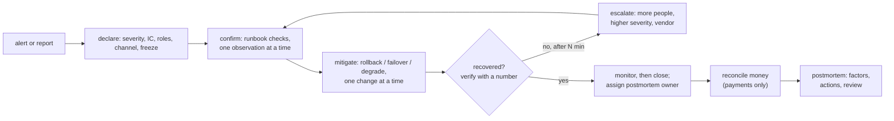

# Incident Response and Blameless Postmortems

> The runbook you write before the pager goes off.

**Type:** Learn
**Languages:** —
**Prerequisites:** Phase 9 Lesson 11 (Multi-Region Architecture and Disaster Recovery), Phase 9 Lesson 01 (SLIs, SLOs, and Error Budgets), Phase 9 Lesson 06 (Metrics and Histograms), Phase 9 Lesson 07 (Distributed Tracing and Context Propagation), Phase 9 Lesson 08 (Structured Logging)
**Time:** ~60 minutes

## Learning Objectives

- Define severity levels by customer impact and name what each level obligates the responders to do
- Describe the Incident Commander, Communications Lead, Operations Lead, and Scribe roles and why they are separated
- Write a runbook that an engineer who did not build the system can execute at 03:00 without guessing
- Capture an incident timeline as it happens and reconstruct one afterwards from traces, logs, and metrics
- Run a blameless postmortem that produces contributing factors and tracked actions rather than a culprit

## The Problem

At 14:07 on a Tuesday the payments platform's authorisation success rate drops from 97.1% to 71.4%. Three engineers notice the alert at the same time. One restarts the processor adapter because "it was flaky last week". One starts reading the adapter's logs. One messages the acquirer's support line. Nobody tells the merchant-facing support team, who learn about the problem from a merchant's angry tweet at 14:19 and tell the merchant it is the acquirer's fault, which it is not. At 14:25 a fourth engineer, who has not been told anything, deploys a routine change to the API gateway, and now there are two changes in flight and nobody can tell which one made the success rate move to 64%. At 14:40 the engineer reading logs finds it: a configuration push at 14:05 changed the adapter's timeout from 8 seconds to 800 milliseconds, a units mistake, and the slow-but-successful authorisations are being abandoned. Rolling the config back takes four minutes. Total: 37 minutes of 30% authorisation failures, roughly 42,000 declined transactions, and a merchant communication that blamed the wrong party.

The config change is the trigger. It is not what made the incident cost 37 minutes. The time went to three people doing uncoordinated things, one of them (the restart) destroying evidence and briefly making it worse, a deploy during an incident because nobody knew there was an incident, and support finding out from a customer. A week later the postmortem meeting opens with "who pushed the config?" and the engineer who did spends the hour defending themselves, the units mistake is logged as "human error", and the action item is "be more careful with config changes". Six months later it happens again with a different field.

Incident response is the practice of deciding in advance how a group of people will behave when the system is failing and they are frightened: who is in charge, who talks to whom, what is written down, and what is never done (deploying, restarting things speculatively, blaming). The postmortem is the practice of turning the incident into changes to the system rather than a verdict on a person. Both are engineering disciplines with specific artefacts, and this lesson walks one payments incident through all of them.

## The Concept

### Severity is customer impact

Severity classifies an incident by what customers experience, not by how hard it is to fix or how embarrassing it is. The classification exists to answer one question fast: how many people, with what urgency, and who needs to know. A workable scale for a payments platform:

| Severity | Customer impact | Examples | Obligations |
|----------|-----------------|----------|-------------|
| SEV1 | Money is moving wrongly, or a core flow is down for many merchants | authorisations failing broadly; duplicate captures; ledger out of balance; a region down | page the IC rotation and a second responder immediately; status page within 15 minutes; executive notified; postmortem mandatory, reviewed within 5 business days |
| SEV2 | A core flow degraded or a secondary flow down | elevated declines for one acquirer; refunds queued; webhooks delayed over an hour | page the on-call; status page if merchant-visible; postmortem mandatory |
| SEV3 | Internal impact or a minor merchant-visible defect with a workaround | dashboard stale; one report failing; a non-critical job stuck | ticket, business hours; postmortem optional |
| SEV4 | No customer impact; a risk discovered | an alert that fired wrongly; capacity trending toward a limit | ticket |

Two rules make the scale usable. **Classify early and adjust later**: a SEV2 that turns out to be a SEV1 should have been declared SEV1 at the start, so when in doubt, go up. **The IC owns the severity**: anyone can declare an incident, but once there is an IC only the IC changes the level, which stops the level being argued about during the response.

A payments-specific addition: any incident where money may have moved incorrectly (duplicates, missing captures, wrong amounts, a broken ledger invariant) is SEV1 regardless of how many merchants it touched, because the remediation involves other people's money and the clock on reconciliation and regulatory notification starts at detection.

### Declaring

Declaration is the step teams most often skip, because it feels like an admission. Make it one command and make it cheap to be wrong:

```text
/incident declare sev1 "authorization success rate 71%"
  -> creates #inc-2026-10-13-01, invites the on-call rotations
  -> posts the roles template (IC / Ops / Comms / Scribe) and the runbook linked from the firing alert
  -> pages the secondary responder and the comms rotation
  -> enables the platform deploy freeze and announces it in #deploys
  -> opens a status-page draft and a postmortem document from the template
  -> starts the timeline with the alert event
/incident downgrade sev3 "false alarm: probe misconfiguration"
  -> lifts the freeze, keeps the channel and timeline for the record
```

A declaration that turns out to be a false alarm costs ten minutes of a few people's attention. A real SEV1 that goes undeclared for twenty minutes costs what The Problem cost. The asymmetry is why the culture must reward declaring and never punish a downgrade.

### Roles

The Incident Command System came from firefighting in the 1970s and the structure transferred to software intact: one person is in charge, and that person does not fight the fire.

| Role | Does | Does not |
|------|------|----------|
| **Incident Commander (IC)** | owns the incident: declares severity, decides what is tried and in what order, assigns tasks, calls the end | debug, type commands, talk to customers |
| **Operations Lead** | leads the technical investigation and executes changes, with the IC's approval for anything risky | communicate externally; decide to try two things at once |
| **Communications Lead** | writes status page updates, briefs support and account managers, answers executives, on a cadence the IC sets | speculate about cause; promise times |
| **Scribe** | keeps the timeline: every observation, decision, action, and its time, in the incident channel | anything else |

The separation exists because each pair of roles has a conflict when held by one person. An IC who is debugging stops coordinating the moment the debugging gets interesting, which is exactly when a second engineer's restart destroys the evidence. A communicator who is also investigating either goes silent to customers or leaks half-formed theories. A scribe who is also operating writes nothing down during the ten minutes that matter most. For a small team the IC may also scribe at SEV3; at SEV1 all four roles are filled, and the IC's first action is to fill them.

The IC's standing orders during a response:

- **One change at a time.** Nothing is tried until the previous attempt's effect has been observed and recorded.
- **Freeze.** No deploys, no config pushes, no scaling events not ordered by the IC, platform-wide at SEV1.
- **Preserve evidence before remediating** when the two conflict and money is involved: capture the heap dump, copy the logs, snapshot the queue, then restart.
- **Mitigate before you understand.** Rolling back the last change, failing over, enabling a brownout level (Lesson 13) are tried on suspicion; root cause is for the postmortem.
- **Hand over explicitly.** An IC who has been on for two hours names a successor, briefs them in the channel, and leaves.

### The incident lifecycle



Two loops matter. The inner one, confirm-mitigate-verify, runs until a number says recovery; the IC bounds each pass with a time limit so that a theory that is not paying off is abandoned rather than pursued. The outer one closes the incident only when the postmortem's actions are owned, which is what keeps a platform from having the same incident twice.

### Which mitigation first

The IC usually has four levers and must pick an order under uncertainty:

| Lever | Try it when | Cost if wrong | Typical time to effect |
|-------|-------------|---------------|------------------------|
| Roll back the most recent change | any change touched the failing component in the last hour (deploy, config, flag, data migration) | low: you return to a known state | 1-5 minutes |
| Degrade (Lesson 13): shed a class, flip a flag, serve from cache | the failure is load- or dependency-shaped and critical flows can be protected | bounded, pre-agreed (fraud precision, freshness) | seconds |
| Fail over (Lesson 11): to another instance, zone, or region | the failure is localised to infrastructure and the standby is known healthy | high if the failure is a partition (two writers) | minutes, plus the decision |
| Fix forward: patch and deploy | nothing to roll back and nothing to shed; the cause is understood and the fix is small | high: a new change under stress, often wrong | 15-60 minutes |

Rollback first is the default because most incidents follow a change and because its downside is small. Fix forward is last for the same reason the deploy freeze exists: a change made under stress by people who are frightened has the worst odds of any change you will ever ship. The exception is a change that cannot be rolled back (a data migration already applied), which is why irreversible changes get their own runbook before they are run.

### Communication cadence

External communication is a schedule, not a reaction. The Communications Lead posts at fixed intervals whether or not there is news, because silence is read as either "fixed" or "abandoned" and both are wrong.

| Audience | First update | Cadence | Content | Never |
|----------|--------------|---------|---------|-------|
| Status page / merchants | within 15 min of SEV1 declaration | every 30 min until resolved | what is affected, since when, that you are working on it, next update time | cause speculation; blame; a time to fix |
| Support and account managers | at declaration | every update, plus the FAQ | what merchants will see, what to tell them, what not to promise | details that are not yet confirmed |
| Executives | at declaration for SEV1 | hourly, or at state changes | impact in customers and money, current action, next decision point | technical narrative |
| Partners (acquirers, networks) | when their systems are involved or they will see a volume change | as agreed in the partner contact list | facts, request for data, planned actions touching them | fault assignment |
| Regulators | per jurisdiction rule, when notifiable | per rule | per rule, from prepared template | ad hoc wording |

A status page update that has worked, in full:

```text
14:16 UTC  Investigating  Some merchants are seeing elevated authorization failures since 14:05 UTC.
                          We have identified a likely cause and applied a fix. Next update by 14:45 UTC.
14:35 UTC  Resolved       Authorization success rates returned to normal at 14:15 UTC. Transactions declined
                          between 14:05 and 14:15 UTC can be retried. A postmortem will be published.
```

### Runbooks

A runbook is the procedure for a specific, anticipated situation, written so that a competent engineer who did not build the system can execute it under stress. The test of a runbook is not whether its author can follow it; it is whether the newest member of the rotation can, at 03:00, without asking anyone. Each one has the same shape:

1. **Trigger.** The alert or symptom that leads here, with the exact alert name.
2. **Impact and severity.** What customers see and the default severity, so the responder can declare without deliberation.
3. **Confirm.** Two or three checks that distinguish this situation from its look-alikes, with dashboard links and expected values.
4. **Mitigate.** Ordered steps, each with the exact command or link, its expected effect, how long to wait, and what to do if the effect does not appear. Rollback instructions for each step.
5. **Escalate.** Who to page if mitigation fails, and after how long.
6. **Verify.** The signal that proves recovery, with a number.
7. **Follow-up.** What to record and whether a postmortem is required.

Runbooks exist for the alerts you have, not the incidents you imagine; the rule is that every paging alert links to a runbook, and an alert without one is a bug in the alert. They decay: a runbook with a stale dashboard link or a command for a decommissioned tool teaches the responder to distrust all runbooks. Lessons 11 and 13 ship two; the regional-failover runbook's step table with owners and expected durations is the model.

A runbook is also the boundary between automation and judgement. Steps 1, 3, and 6 should be automated over time (the alert runs the confirmation checks and posts the results; the verification is a synthetic transaction). Step 4 is automated only when a wrong execution is cheap and reversible; failing over a ledger (Lesson 11) is not.

### The timeline

The scribe's timeline is the single most valuable artefact an incident produces, because every later question (how long were customers affected, what did we know when, which action moved the metric) is answered from it and nothing else. It is captured in the incident channel as events happen, in one format:

```text
14:07:10  [alert]    auth-success-rate < 90% fired (71.4%)
14:08:30  [IC]       Priya declares SEV1, takes IC. Ops: Marcus. Comms: Deepa. Scribe: Tomasz.
14:09:00  [IC]       Platform deploy freeze. No speculative restarts.
14:10:15  [obs]      Decline reason breakdown: 94% of new failures are "timeout" from adapter acq-01 (dashboard link)
14:11:40  [obs]      Trace sample: adapter span ends at 800 ms with status ERROR, network span still open (trace id ...)
14:12:05  [obs]      Change log: config push 14:05:12 to processor-adapter, field acq01.timeout 8000 -> 800 (author: Lin)
14:13:00  [decision] IC: roll back the 14:05 config push. Nothing else in flight.
14:13:45  [action]   Marcus: rollback applied via config service, version 4411 -> 4410
14:15:30  [obs]      auth-success-rate 96.8% and rising
14:16:00  [comms]    Status page: "Elevated authorization failures 14:05-14:15 UTC, resolved, investigating cause"
14:20:00  [IC]       Monitoring 15 min before closing. Postmortem owner: Marcus. Doc created (link).
14:35:00  [IC]       Success rate stable at 97.0%. Incident closed. Duration 14:05-14:15 impact, 14:07-14:35 response.
```

Four event types: `obs` for something seen, `decision` for something the IC chose, `action` for something done, `comms` for something said externally. Timestamps in UTC to the second where possible. Links to the dashboard, trace, or log query that produced each observation, which is where Lessons 06-08 earn their place: the trace id in the 14:11:40 entry is the whole investigation in one line.

Reconstructing a timeline *after* an incident, when nobody kept one, takes hours and is always incomplete. Reconstructing the system's side of it is possible from telemetry if the system has the correlation Lesson 08 built: query the deploy and config systems for changes in the window, the metrics for the first anomalous minute, the traces for the first errors, the logs by payment id for what the failure looked like to one request. The people's side (who knew what when) is gone.

### The blameless postmortem

A postmortem is a written analysis of an incident that answers: what happened, what the impact was, how it was detected and resolved, what contributed to it, and what will change. **Blameless** means the document does not name a person as the cause. It is not politeness. It is a claim about systems: that a competent engineer acting reasonably with the information and tools available at the time did something that led to an incident, and that the same conditions will lead the next competent engineer to the same place. Finding the person is cheap and changes nothing; finding the conditions is the work.

The units mistake in The Problem is a good test. "Lin entered 800 instead of 8000" is true and useless. The contributing factors behind it are what the postmortem is for:

- The config field `timeout` has no unit in its name and the schema accepts any positive integer.
- The config service applied the change to 100% of adapters at once, with no canary and no validation that the new value is within a sane range.
- No alert fired on the change itself; the first signal was customer impact two minutes later.
- The adapter's own metrics did not distinguish "declined by issuer" from "abandoned by our timeout", so the first responder read it as an acquirer problem.
- Three engineers responded without an IC, and a restart was performed before evidence was captured.
- Support had no channel from engineering and learned of the incident from a customer.

Each of those is a property of the system or the process. Each yields an action with an owner and a date: rename to `timeout_ms` and add a range check; canary config changes with automatic rollback on error-rate movement; alert on config change events; split the decline metric by reason; make IC declaration the first step of the SEV1 runbook; add support to the incident channel automation. "Be more careful" appears nowhere.

The document's sections, in the order they are written (the template in `outputs/` has them):

1. **Summary**: three sentences, impact first, for people who read nothing else.
2. **Impact**: customers, transactions, money, duration, SLO budget consumed (Lesson 01); for payments, an explicit statement of whether any money moved incorrectly and the reconciliation status.
3. **Timeline**: the scribe's record, cleaned.
4. **Detection**: how it was noticed, how long after it began, and whether an alert should have fired earlier.
5. **Response**: what went well and what did not, about the *response* (roles, communication, decisions), separately from the cause.
6. **Contributing factors**: the list above; never a single "root cause", because incidents in complex systems have several necessary conditions and naming one as root is how the others survive to the next incident.
7. **What went well**: the detection that worked, the runbook that was right, the trace that found it. This is not morale; it identifies the controls to keep.
8. **Actions**: each with owner, due date, priority, and a tracking ticket; reviewed until closed.
9. **Lessons for other teams**: the generalisable finding (unit-less config fields exist elsewhere).

The meeting is for disagreement about contributing factors and for committing to actions, not for reading the document aloud. It is run by someone other than the responders, it starts with the facilitator restating that the purpose is the system, and it ends with the action list owned.

### Actions that change something

Postmortem actions are where most of the value is lost, because an action list is easy to write and hard to finish. Criteria for an action worth tracking:

- It changes the system or the process, not a person's attentiveness. "Add range validation to `timeout_ms`" passes; "remind the team to double-check config" fails.
- It has one owner, a date, and a ticket in the same tracker as feature work, so it competes for the same time honestly.
- It is sized. An action that would take a quarter is a project with its own planning, and the postmortem's action is "open and staff the project", with a date for that.
- It is testable: someone can look at the system afterwards and say whether it was done.
- The set is reviewed on a schedule (weekly for SEV1 actions) by someone with the authority to escalate when owners miss dates.

A platform's postmortem action completion rate is a leading indicator of its incident rate six months out. Teams that track it find that the rate is what the organisation actually values, whatever it says.

### Response anti-patterns

| What happens | Why it is tempting | What it costs |
|--------------|--------------------|---------------|
| Everyone debugs, nobody commands | debugging is the interesting part | uncoordinated changes; evidence destroyed; nobody talks to customers |
| Speculative restart | it worked last time | destroys the state that would have shown the cause; sometimes makes it worse (cold caches, connection storms) |
| Two mitigations at once | urgency | cannot attribute the recovery or the regression to either; one of them is now permanent |
| Hero IC for six hours | handover feels like giving up | decisions degrade after two hours; the hero's errors in hour five are the next incident |
| Status page silence until resolved | nothing to say yet | customers assume the worst and open tickets that drown support |
| Postmortem names a culprit | it is the simplest story | the culprit learns to hide the next mistake; the conditions remain; the next competent person repeats it |
| Single root cause | it feels complete | the other necessary conditions survive unexamined |
| Actions nobody tracks | the meeting felt productive | the same incident in six months, with a postmortem that references this one |

### Payments specifics

Three things make payments incidents different from a web outage:

- **Money may have moved.** Every SEV1 postmortem has a mandatory "financial reconciliation" section: were there duplicate captures, missing captures, wrong amounts, orphaned holds? The reconciliation lessons in Phase 10 are the tooling; the incident is not closed until that section is complete, which may be days after the technical fix.
- **Third parties are in the loop.** Acquirers, networks, banks, and merchants all have incident processes and some have contractual notification windows. The Communications Lead owns these, from a prepared contact list, with prepared wording that does not assign fault.
- **Regulators and schemes may need to be told.** Card scheme rules and payment-services regulations in many jurisdictions require notification of major operational incidents within fixed windows (hours, for some). Knowing whether an incident is notifiable, and who decides, is a runbook step, not a question for the day.

### Measuring the response

The postmortem records four durations, and the trend across incidents is a property of the organisation rather than of any one system:

| Interval | From | To | Lesson's incident (managed) | Lesson's incident (unmanaged) | What shortens it |
|----------|------|----|-----------------------------|-------------------------------|------------------|
| Time to detect | first customer impact | alert or report | 2 min 10 s | 2 min 10 s | SLI-based alerts (Lesson 01), change-event alerts |
| Time to declare | alert | IC named, roles filled | 1 min 20 s | never | bot-driven declaration; declare-first culture |
| Time to mitigate | declaration | first effective mitigation applied | 5 min 15 s | 33 min | runbooks; rollback-first; one change at a time |
| Time to recover | first impact | metric back within SLO | 10 min | 37 min | all of the above |

Impact is then `declined transactions * conversion value` plus reconciliation labour plus any scheme or regulatory consequence, and that figure, not the duration, is what the error budget (Lesson 01) is spent in and what justifies the actions' cost. A ten-minute SEV1 at peak can outweigh an hour at 04:00; the postmortem states impact in money and customers first for that reason.

### Practising

Incident response is a skill, and skills decay without use. Three ways teams keep it: **game days** (Lesson 11) where a failure is injected and the on-call responds for real with an observer scribing; **IC shadowing**, where a new IC runs a SEV3 with an experienced one beside them before they take a SEV1 alone; and **postmortem reading groups**, where a team reads another team's postmortem and lists what would have happened on their own system. The cheapest is the last; the most effective is the first; a rotation that has done none of the three in a quarter will rediscover The Problem's version of the next incident.

### What this lesson does not do

- It does not design the alerts. Lessons 01 and 06 do; this lesson assumes an alert exists and asks what happens after it fires.
- It does not cover on-call scheduling, compensation, or rotation health, which are organisational questions with large effects on response quality.
- It does not treat security incidents, which share the structure but add evidence-preservation, legal, and disclosure obligations that override the mitigate-first rule.

## Worked Example

The same incident, run as the lesson describes. Compare with The Problem line by line.

**14:07:10.** Alert `auth-success-rate-sev1` fires. Its runbook link opens to: trigger, default severity SEV1, three confirmation checks (decline-reason breakdown, per-acquirer success rate, change log for the last 30 minutes), mitigation steps starting with "roll back the most recent change touching the failing component", escalation after 10 minutes without improvement.

**14:08:30.** The on-call, Priya, declares SEV1 in the incident channel using the bot command, which creates the channel, posts the roles template, pins the runbook, pages the secondary responder, and notifies support and the Communications rotation. She takes IC and assigns Ops to Marcus (secondary responder), Comms to Deepa (comms rotation), Scribe to Tomasz (who volunteered in channel). Elapsed: 80 seconds. In The Problem, the equivalent 80 seconds contained a speculative restart.

**14:09:00.** IC orders a deploy freeze. The deploy bot refuses the 14:25 gateway deploy that caused confusion in The Problem; the engineer sees "frozen: SEV1 in progress, channel #inc-2026-10-13-01" and joins the channel instead.

**14:10:15 to 14:12:05.** Marcus runs the three confirmation checks in order. The decline-reason panel (Lesson 06) shows the new failures are timeouts from one acquirer. A trace (Lesson 07) shows the adapter span ending with `ERROR` at exactly 800 ms while the network span is still open: the adapter gave up, not the acquirer. The change log shows a config push at 14:05 to that adapter. Three observations, each posted with a link, each timestamped by the scribe.

**14:13:00.** IC decision: roll back the config push. Marcus asks whether to also restart the adapter; IC says no, one change at a time. Rollback applied 14:13:45. The success rate recovers by 14:15:30. Comms posts the status page update Deepa drafted while the rollback was in progress, from a template: what, when, resolved, no cause speculation.

**14:15:00.** Deepa briefs support in their channel: "elevated authorisation failures 14:05-14:15, our side, resolved, merchants may see declined transactions in that window that will succeed on retry". Support answers the tweet at 14:18 with accurate information. In The Problem, support blamed the acquirer at 14:19.

**14:35:00.** After 15 minutes stable, IC closes the incident. Impact window 14:05-14:15, ten minutes, roughly 11,000 declined transactions versus 42,000. Marcus owns the postmortem; the bot creates the document from the template with the timeline already pasted in. Reconciliation (Phase 10) is queued to check the window for any capture that succeeded at the acquirer after the adapter had abandoned it, because a timeout on our side does not mean the acquirer did not process the authorisation: that is the money question, and it is open until the job reports.

**Reconciliation, 16:40.** The Phase 10 reconciliation job compares the ledger against the acquirer's authorisation file for 14:05-14:15. It finds 212 authorisations the acquirer approved after the adapter had already given up at 800 ms. Each has a hold at the issuer against a cardholder, no capture on the platform's side, and a merchant who saw a decline. The IC reopens the money question: those holds will expire on their own in seven days, but the merchant has lost the sale and the cardholder sees a pending charge. Comms prepares merchant-facing wording; the 212 are reversed proactively through the acquirer's API so the cardholder's pending charge disappears today. This section of the incident took longer than the technical fix and is the part that would have been missed entirely in The Problem's telling.

**Postmortem, five days later.** The contributing-factors list is the one in the Concept section. Six actions, each with an owner and a ticket. The meeting spends most of its time on whether canarying config changes is feasible for the processor adapter (it is, with a 5% slice and a 2-minute hold) and none on Lin. The lesson shared with other teams is "audit every numeric config field for a missing unit", and three other teams find one.

The technical fix was identical in both tellings: roll back one config version. Every difference in outcome came from the process around it.

## Exercises

1. **Reinforce.** Take an alert your team has (or one from Lesson 01) and write its runbook in the seven-section shape, with real dashboard links and commands. Give it to someone who did not write it and time how long they take to reach the mitigation step; every question they ask is a gap in the runbook.
2. **Apply.** Using `outputs/template-postmortem.md`, write the postmortem for The Problem's version of the incident (the uncoordinated one), as if you were the facilitator. Produce at least six contributing factors, none of which is a person, and an action for each with an owner and a date. Then write the one-paragraph version for executives.
3. **Extend.** Combine with Lessons 07 and 08: specify the bot command `/incident timeline <payment_id>` that, given a payment id from a merchant complaint, reconstructs the system side of the timeline automatically: the trace's spans with exclusive times, the structured log records by span, the metrics for the services involved in the surrounding five minutes, and the deploys and config changes to those services in the preceding hour. State which of the four sources is missing from your own platform today.

## Key Terms

| Term | What people say | What it actually means |
|------|-----------------|------------------------|
| Severity | "how bad is it" | A classification by customer impact that fixes who is paged, how fast external communication happens, and whether a postmortem is mandatory; owned by the IC once declared |
| Incident Commander | "who's running this" | The single person who owns decisions and coordination during an incident and who deliberately does not debug or type commands |
| Runbook | "the wiki page" | A procedure for one anticipated situation, executable by someone who did not build the system: trigger, confirm, mitigate with exact commands, escalate, verify |
| Timeline | "what happened when" | The scribe's real-time record of observations, decisions, actions, and communications with timestamps and links; the source for every later question |
| Blameless | "no finger pointing" | The analytical stance that a reasonable person acting on available information did what they did, so the contributing conditions, not the person, are what must change |
| Contributing factor | "root cause" | One of several necessary conditions for the incident; postmortems list all of them because fixing a single named root cause leaves the rest in place |
| Mitigate first | "fix forward" | Restoring service by rollback, failover, or degradation on suspicion, before the cause is understood; understanding is the postmortem's job |

## Further Reading

- [Google SRE Book, Chapter 14: Managing Incidents](https://sre.google/sre-book/managing-incidents/) — the roles, the handover, and the unmanaged-incident anatomy this lesson's Problem reproduces.
- [Google SRE Book, Chapter 15: Postmortem Culture: Learning from Failure](https://sre.google/sre-book/postmortem-culture/) — the case for blamelessness and a worked postmortem.
- [Google SRE Workbook, Chapter 9: Incident Response](https://sre.google/workbook/incident-response/) and [Chapter 10: Postmortem Culture](https://sre.google/workbook/postmortem-culture/) — the practical companions, including a bad and a good postmortem of the same incident.
- [PagerDuty Incident Response documentation](https://response.pagerduty.com/) — an open, complete incident process: severity definitions, role descriptions, call etiquette, and the IC training programme.
- [Allspaw, "Blameless PostMortems and a Just Culture" (Etsy, 2012)](https://www.etsy.com/codeascraft/blameless-postmortems/) — the essay that brought the term into software, with the argument from safety science.
- [Dekker, *The Field Guide to Understanding 'Human Error'* (3rd ed.)](https://www.routledge.com/The-Field-Guide-to-Understanding-Human-Error/Dekker/p/book/9781472439055) — the safety-engineering foundation: why "human error" is where the investigation starts, not where it ends.
