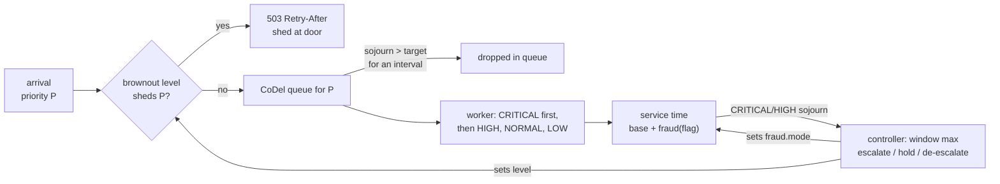

# Graceful Degradation and Load Shedding

> Drop the reporting query so the authorization goes through.

**Type:** Build
**Languages:** Java, Python, Go
**Prerequisites:** Phase 9 Lesson 12 (Incident Response and Blameless Postmortems), Phase 9 Lesson 10 (Capacity Planning and Queueing Theory), Phase 9 Lesson 05 (Distributed Rate Limiting), Phase 1 Lesson 09 (Heaps and Priority Queues)
**Time:** ~75 minutes

## Learning Objectives

- Explain why a FIFO queue under sustained overload makes every request late, including the ones that matter most
- Build a CoDel queue (RFC 8289) that drops from the head only when the minimum sojourn time has stayed above target for an interval
- Build priority admission with a brownout controller that sheds the least important class first and degrades expensive features via flags
- Measure, under seeded overload, that priority shedding keeps CRITICAL p99 within tens of milliseconds while FIFO lets it reach seconds
- Recognise controller oscillation and the trade-off between completing more requests and completing the right ones

## The Problem

At 11:58 on the last day of the month a payments platform receives three kinds of traffic at once: merchants' checkouts authorising cards, finance teams pulling month-end settlement reports, and dashboards polling balances every few seconds. The reporting queries are heavy, the polls are many, and the authorisations are the business. All three enter the same service through the same thread pool and the same unbounded queue. At 12:00 a large merchant's cron job starts an export that fans out into forty thousand report requests. Offered load is now 2,400 requests per second against a capacity of about 1,250.

Queueing theory (Lesson 10) says what happens next with no further information: arrivals exceed service, the queue grows without bound, and sojourn time grows with it. Within three seconds every request waits 1.4 seconds in the queue before a worker touches it. Reports are late, which nobody minds. Balance polls are late, which nobody notices. Card authorisations are late, and the card networks have a timeout: an issuer that does not hear back in time treats the authorisation as failed, the merchant's checkout shows an error, and the shopper tries another card or leaves. The service is "up" by every health check and it is failing at the one thing it exists for, because a FIFO queue is scrupulously fair and fairness is the wrong policy when work has different values.

The engineering response has three parts, and this lesson builds all of them on a seeded simulator so the effect can be measured rather than asserted. First, *admission by priority*: when the service is overloaded, reject reporting at the door with a fast `503` instead of queueing it, so capacity goes to authorisations. Second, *queue management*: a queue that notices when sojourn has been above target for too long and drops stale work before it is served, so that the work that is served is fresh. Third, *degradation by flag*: the fraud model that takes 8 milliseconds per authorisation is replaced under load by a rule set that takes 1, trading a little precision for a lot of capacity, and switched back when the load passes. The result completes *fewer* requests than FIFO during the overload, and the right ones.

## The Concept

### Overload is a queueing state, not a CPU number

A service is overloaded when arrivals exceed what it can serve for long enough that the queue's delay matters. Little's Law (Lesson 10) gives the quantity: `L = λW`, queue length equals arrival rate times time in system. With arrivals at 2,400 per second and capacity at 1,250, the queue grows by 1,150 requests every second and so does everyone's wait. CPU might be at 100% or it might be at 60% waiting on a downstream; what the client experiences is `W`, and `W` is what every mechanism in this lesson acts on.

Two bad responses are common. *Grow the queue* (bigger thread pools, bigger buffers) raises `W` further; the work still arrives faster than it leaves, and now the service holds more of it while it ages. *Reject at a fixed queue depth* (a bounded queue) is better and still wrong: a depth that is right at one service time is wrong at another, and depth says nothing about delay. A queue of 100 drains in 100 milliseconds at 1,000 per second and in 10 seconds at 10 per second. The signal that matters is *sojourn time*: how long the request at the head of the queue has been waiting.

### CoDel: delay as the control signal

Controlled Delay (Nichols and Jacobson, 2012; RFC 8289) was designed for router buffers but describes any FIFO under load. It tracks the sojourn time of each dequeued item and two parameters: a **target** (5 ms in the RFC; the acceptable standing delay) and an **interval** (100 ms; longer than a round trip, the time over which a burst is allowed to clear on its own). The rule:

1. If the sojourn of the item being dequeued is below target, the queue is fine. Reset.
2. If it is above target, start a timer. Do nothing yet: a burst shorter than the interval is normal and will drain.
3. If sojourn has been above target *continuously for a whole interval*, drop the item being dequeued and enter the dropping state. Schedule the next drop at `now + interval / sqrt(1)`.
4. While dropping, each drop happens at `interval / sqrt(count)` after the previous one: the 2nd after 70.7 ms, the 3rd after 57.7, the 4th after 50. The drop rate increases slowly until sojourn falls below target, which ends the episode.

Hand trace from the demo: 400 requests queued at t = 0, drained one per millisecond.

```text
t = 0..4     sojourn 0..4 ms  < target 5     fine, timer reset
t = 5        sojourn 5 >= target              timer starts: firstAboveTime = 5 + 100 = 105
t = 6..104   sojourn above target              not yet a full interval: serve, do not drop
t = 105      sojourn 105, past firstAboveTime  DROP #1; dropping = true; dropNext = 105 + 100/sqrt(1) = 205
t = 205      still above target                DROP #2; dropNext = 205 + 100/sqrt(2) = 275
t = 275      DROP #3; dropNext = 275 + 100/sqrt(3) = 332
t = 332      DROP #4; dropNext = 332 + 50 = 382
t = 382      DROP #5; dropNext = 382 + 44 = 426
t = 395      queue empty; dropping ends
served 395, dropped 5, max sojourn 394 ms
```

Five drops out of four hundred. CoDel is deliberately gentle: its job in a router is to signal congestion to TCP, which backs off, and a few drops suffice. As a server-side queue manager it does two things well, tolerating bursts shorter than the interval and never dropping when delay is acceptable, and one thing poorly: by itself it cannot save a service that is 2x over capacity, because dropping a few percent does not close a 50% gap. That is why it is the *second* line in this lesson. The first is admission control.

The RFC's pseudocode has one subtlety worth knowing: when a new dropping episode starts shortly after the previous one ended, `count` resumes from the previous value rather than restarting at 1, so the drop rate ramps faster. The code carries that logic (`delta`, `lastCount`, the `16 * interval` check) verbatim from Section 5.4, because it is the kind of detail that makes a reimplementation subtly different from the thing it claims to be.

### Priority admission and brownout levels

Admission control decides at the door, before queueing. The policy here has four request classes and four levels:

| Level | Rejects at the door | Fraud scoring | Entered when |
|-------|--------------------|---------------|--------------|
| `NORMAL` | nothing | full model (8 ms) | default |
| `SHED_LOW` | LOW (reports, exports) | rules only (1 ms) | CRITICAL/HIGH sojourn > target for one window |
| `SHED_NORMAL` | LOW, NORMAL (polls, reads) | rules only | one more bad window |
| `CRITICAL_ONLY` | LOW, NORMAL, HIGH (refunds, webhooks) | rules only | one more bad window |

The controller watches the sojourn of CRITICAL and HIGH requests only, because those are the ones whose delay is the failure, and moves at most one level per 100 ms window: up when the window's worst sojourn exceeded the target, down when it stayed under half the target for `cooldown` consecutive windows. The gap between "escalate above 5 ms" and "de-escalate below 2.5 ms" is **hysteresis**: without it the controller flips every window at the boundary. The cooldown is a second form of the same idea in time.

A rejected request costs almost nothing (a few microseconds to return `503` with `Retry-After`) and that is the whole point: the service spends its capacity on work it will finish. A rejected LOW request at 12:00 is a report that runs at 12:01. A queued LOW request at 12:00 is an authorisation that times out.

### Degradation by flag

The third lever changes how much each admitted request costs. Fraud scoring here is 8 milliseconds with the model and 1 with a rule set; across 30% of traffic that is the difference between 6.4 and 4.3 milliseconds of mean service time, a 50% capacity increase. The brownout controller flips `fraud.mode` when it leaves `NORMAL` and flips it back when it returns. Other common degradations: serving a balance from cache instead of the ledger, skipping a non-essential downstream call (loyalty points, analytics events), returning a smaller page, disabling retries to a slow dependency. Each is a feature flag whose value is set by the controller rather than by a human, and each trades something named (fraud precision, freshness, completeness) for capacity.

The named trade is what makes this *graceful*. A fraud model skipped for three seconds on month-end is a bounded, known risk that the fraud team has agreed to in advance. A fraud model skipped because the whole service fell over is the same risk with no agreement and no measurement.



### What the measurement shows

The demo runs 8 workers at 800 requests per second for two seconds, 2,400 for three, and 800 for four more, with a 30/10/40/20 mix of CRITICAL/HIGH/NORMAL/LOW, under two policies on the identical seeded arrival sequence.

| | FIFO, no shedding | priority + CoDel + brownout |
|-|-------------------|----------------------------|
| CRITICAL completed / offered | 3,078 / 3,577 (backlog) | 3,571 / 3,577 |
| CRITICAL p50 / p99 | 1,362 / 2,700 ms | 5 / 25 ms |
| LOW completed | 2,130 | 998 |
| shed at door | 0 | 2,814 (LOW 1,456, NORMAL 1,358) |
| dropped in queue | 0 | 3 |
| still queued at end | 1,635 | 9 |

FIFO completes 1,200 more requests in total and makes every authorisation wait 1.4 seconds at the median during the overload; with a card network timeout, most of those 3,078 "completions" were failures as far as the shopper was concerned. The degrading policy sheds 2,814 requests, nearly all of them reports and polls, and the authorisations it completes are indistinguishable from a quiet day. CoDel dropped three, because admission control had already removed the standing queue; it is the safety net for the case where the controller is slow or the overload is in CRITICAL itself.

### Controller oscillation

Look at the transitions the demo prints:

```text
2100ms NORMAL -> SHED_LOW
2200ms SHED_LOW -> SHED_NORMAL
2900ms SHED_NORMAL -> SHED_LOW
3400ms SHED_LOW -> NORMAL
3500ms NORMAL -> SHED_LOW
3600ms SHED_LOW -> SHED_NORMAL
```

At `SHED_LOW` with rules-only fraud the service has enough capacity, sojourn drops, five calm windows pass, the controller steps down to `NORMAL`, which re-enables full fraud and LOW traffic, which overloads the service again within one window. This is the classic control-loop hunt: the measurement that drives de-escalation is taken *under the degraded configuration* and does not predict the load under the restored one. It is not a bug in the code; it is a property of any controller that infers capacity from delay. Mitigations are a longer cooldown, de-escalating one lever at a time (restore fraud first, admit LOW later), or probing (admit a small fraction of LOW and watch) before fully restoring. Exercise 2 implements one of them. The oscillation costs little here because every transition is a step, not a cliff, which is itself a design property: the levels are ordered so that a wrong step is a small step.

### Choosing target and interval

The RFC's defaults (5 ms target, 100 ms interval) come from internet round-trip times and are a reasonable start for a service whose clients time out in seconds. The rules for adapting them:

- **Target** is the standing queue delay you are willing to tolerate, roughly 5-10% of the latency SLO for the class. A 200 ms authorisation SLO with 150 ms of unavoidable downstream time leaves about 50 ms; a 5 ms target is conservative and a 20 ms one is defensible.
- **Interval** must exceed the duration of a normal burst, or CoDel punishes variance that would have cleared on its own. Measure the longest sojourn excursion on a healthy day and set the interval above it; 100 ms is right for most request-serving systems and too short for batch consumers.
- **Controller window** should be at least one interval so the controller never reacts to a burst CoDel is still tolerating; **cooldown** of five to ten windows is where oscillation stops being frequent without making recovery take minutes.

Whatever you choose, run the seeded simulation with your own service times and mix before trusting it. The simulator exists so that the first time the controller acts is not in production.

### Complexity

Admission is `O(1)`. CoDel enqueue and dequeue are `O(1)` amortised; a dropping episode does `O(drops)` work in one dequeue call, bounded by queue length. The worker's search for the next request is `O(classes)`, four here. The brownout controller is `O(1)` per observation and per tick. Memory is the queues, which under control stay near the capacity-delay product (Little's Law again) rather than growing with the backlog.

### What this lesson does not do

- It does not pick the priorities. Whether refunds outrank webhooks is a product decision; the code takes an enum and a mapping from request to class.
- It does not tell the client what to do. A `503` with `Retry-After` and the jittered backoff of Phase 5, Lesson 10 is the contract; a client that retries immediately turns shedding into a retry storm (Lesson 09).
- It does not coordinate across nodes. Each node sheds independently based on its own queues, which is correct for protecting that node; a cluster-wide quota is Lesson 05.
- It does not address overload *in* CRITICAL. If authorisations alone exceed capacity, shedding cannot help and the answers are capacity (Lesson 10), a per-merchant limiter (Lesson 05), or failing over (Lesson 11).

## Build It

### Step 1: Requests and priorities

```java
enum Priority { CRITICAL, HIGH, NORMAL, LOW }

final class Request {
    final long id;
    final Priority priority;
    final long arrivalMillis;
    long enqueuedMillis;

    Request(long id, Priority priority, long arrivalMillis) {
        this.id = id; this.priority = priority; this.arrivalMillis = arrivalMillis; this.enqueuedMillis = arrivalMillis;
    }
}
```

Ordinal order is importance order, so "shed everything at or below NORMAL" is `p.ordinal() >= NORMAL.ordinal()`. `arrivalMillis` is when the request hit the service (for end-to-end latency); `enqueuedMillis` is when it entered a queue (for sojourn). They are equal here but differ in a system with an admission step that itself takes time.

### Step 2: CoDel

```java
private DoDequeue doDequeue(long now) {
    Request r = queue.pollFirst();
    if (r == null) { firstAboveTime = 0; return new DoDequeue(null, false); }
    long sojourn = now - r.enqueuedMillis;
    if (sojourn < targetMillis) { firstAboveTime = 0; return new DoDequeue(r, false); }
    if (firstAboveTime == 0) { firstAboveTime = now + intervalMillis; return new DoDequeue(r, false); }
    return new DoDequeue(r, now >= firstAboveTime);
}

Request dequeue(long now) {
    DoDequeue d = doDequeue(now);
    Request r = d.request();
    boolean ok = d.okToDrop();
    if (dropping) {
        if (!ok) dropping = false;
        else while (now >= dropNext && dropping) {
            dropped++; count++;
            d = doDequeue(now); r = d.request(); ok = d.okToDrop();
            if (!ok) dropping = false; else dropNext = controlLaw(dropNext, count);
        }
    } else if (ok) {
        dropped++;
        d = doDequeue(now); r = d.request();
        dropping = true;
        int delta = count - lastCount;
        count = (delta > 1 && now - dropNext < 16 * intervalMillis) ? delta : 1;
        dropNext = controlLaw(now, count);
        lastCount = count;
    }
    return r;
}
```

This is RFC 8289 Sections 5.3 and 5.4 transcribed, with packets replaced by requests. `doDequeue` answers one question: has sojourn been above target for a full interval? `dequeue` runs the state machine: enter dropping on the first `okToDrop`, keep dropping on the `dropNext` schedule while the signal persists, leave as soon as one dequeued item is under target. The empty-queue branch resets `firstAboveTime`, so an idle queue starts clean. Everything is in integer milliseconds except `sqrt`, which the RFC also uses.

**Predict:** 50 requests are queued at t = 0 and drained one per millisecond. Max sojourn is 49 ms, far above the 5 ms target. How many are dropped?

### Step 3: The brownout controller

```java
void tick(long nowMillis) {
    millisAtLevel[level.ordinal()] += nowMillis - lastTick;
    lastTick = nowMillis;
    if (nowMillis - windowStart < windowMillis) return;
    Level before = level;
    if (windowMaxSojourn > targetMillis) {
        calmWindows = 0;
        if (level.ordinal() < Level.values().length - 1) level = Level.values()[level.ordinal() + 1];
    } else if (windowMaxSojourn <= targetMillis / 2) {
        calmWindows++;
        if (calmWindows >= cooldownWindows && level != Level.NORMAL) { level = Level.values()[level.ordinal() - 1]; calmWindows = 0; }
    } else {
        calmWindows = 0;
    }
    if (level != before) {
        transitions.add(nowMillis + "ms " + before + " -> " + level);
        flags.set("fraud.mode", level.fraudMode);
    }
    windowMaxSojourn = 0;
    windowStart = nowMillis;
}
```

Three bands: above target escalates, below half target counts toward de-escalation, between them holds and resets the calm count. One step per window in either direction. The flag write is the only side effect outside the controller, which is what makes it testable in isolation: feed it sojourns and ticks, read the level and the flag. `windowMaxSojourn` is a max, not a mean, because the controller's job is to react to the worst authorisation in the window, not the average one.

**Predict:** with `cooldownWindows = 3`, after escalating to `CRITICAL_ONLY`, how many consecutive calm windows return the controller to `NORMAL`?

### Step 4: The degrading policy

```java
@Override public boolean admit(Request r, long now, Outcome out) {
    if (brownout.level().sheds(r.priority)) {
        out.shedAtDoor.merge(r.priority, 1L, Long::sum);
        return false;
    }
    queues.get(r.priority).enqueue(r, now);
    return true;
}

@Override public Request next(long now, Outcome out) {
    for (Priority p : Priority.values()) {
        CoDelQueue q = queues.get(p);
        long before = q.dropped;
        Request r = q.dequeue(now);
        if (q.dropped > before) out.droppedInQueue.merge(p, q.dropped - before, Long::sum);
        if (r != null) {
            if (p == Priority.CRITICAL || p == Priority.HIGH) brownout.observe(now - r.enqueuedMillis);
            return r;
        }
    }
    return null;
}

@Override public long serviceMillis(Request r) {
    return Simulation.baseServiceMillis(r.priority) + (r.priority == Priority.CRITICAL ? fraud.serviceMillis(flags) : 0);
}
```

Strict priority: a worker always takes from the highest non-empty class. Under sustained overload that starves LOW completely, which is intended; in a system where starvation is unacceptable, weighted fair queueing (serve LOW one time in ten) is the usual compromise. Each class has its own CoDel queue so that a stale NORMAL backlog does not make the CRITICAL queue's sojourn look bad. The controller is fed only CRITICAL and HIGH sojourns, so a mountain of waiting reports does not by itself trigger a brownout; only the effect on important work does.

**Predict:** if the controller were fed LOW sojourns too, what would happen at 12:00 in The Problem's scenario before any authorisation was late?

### Step 4b: The FIFO baseline

```java
final class FifoPolicy implements Policy {
    private final ArrayDeque<Request> queue = new ArrayDeque<>();
    @Override public boolean admit(Request r, long now, Outcome out) { queue.addLast(r); return true; }
    @Override public Request next(long now, Outcome out) { return queue.pollFirst(); }
}
```

The baseline is four lines and it is what most services ship: admit everything, serve in order. It is in the code so the comparison is against a real implementation on identical input rather than against a description. When you adopt the degrading policy in a real service, keep the baseline reachable behind a flag; the first production brownout will raise the question "would FIFO have been fine?" and the simulator answers it.

### Step 5: The simulator

```java
for (long now = 0; now < durationMillis; now++) {
    double rps = (now >= overloadFromMillis && now < overloadToMillis) ? overloadRps : normalRps;
    double p = rps / 3000.0;
    for (int k = 0; k < 3; k++) {
        if (random.nextDouble() < p) {
            Request r = new Request(nextId++, pick(random.nextDouble()), now);
            out.offered.merge(r.priority, 1L, Long::sum);
            policy.admit(r, now, out);
        }
    }
    for (int w = 0; w < workers; w++) {
        if (inService[w] != null && busyUntil[w] <= now) {
            out.latencies.get(inService[w].priority).add(now - inService[w].arrivalMillis);
            inService[w] = null;
        }
        if (inService[w] == null) {
            Request r = policy.next(now, out);
            if (r != null) { inService[w] = r; busyUntil[w] = now + policy.serviceMillis(r); }
        }
    }
    policy.tick(now);
}
```

One millisecond per iteration; up to three Bernoulli arrivals per millisecond so the per-millisecond count has a Poisson-like spread; eight workers that each finish, then pull. The same seed drives the same arrivals for every policy, so the tables differ only in the policy. Floating point appears in the arrival draw and nowhere in the queues or controller.

### Step 6: Run it

```bash
cd phases/09-reliability-and-scale/13-graceful-degradation/code/java
javac -d .out *.java && java -cp .out Main
java -cp .out MainTest
```

Expected output, abbreviated:

```console
== CoDel on one queue: 5 ms target, 100 ms interval ==
400 queued, drained at 1/ms: served 395, dropped 5, max sojourn seen 394 ms

-- fifo, no shedding --
priority   offered     shed  dropped completed   p50 ms   p99 ms
CRITICAL      3577        0        0      3078     1362     2700
LOW           2456        0        0      2130     1410     2694
total: offered 12038, completed 10403, shed at door 0, dropped in queue 0, still queued at end 1635

-- priority + CoDel + brownout --
priority   offered     shed  dropped completed   p50 ms   p99 ms
CRITICAL      3577        0        0      3571        5       25
HIGH          1206        0        0      1205        4       75
NORMAL        4799     1358        3      3438        3      144
LOW           2456     1456        0       998        6      317
total: offered 12038, completed 9212, shed at door 2814, dropped in queue 3, still queued at end 9

brownout transitions:
  2100ms NORMAL -> SHED_LOW
  2200ms SHED_LOW -> SHED_NORMAL
  ...
  5400ms SHED_LOW -> NORMAL
time at each level (ms):  NORMAL=5799  SHED_LOW=1800  SHED_NORMAL=1400  CRITICAL_ONLY=0
fraud.mode at end: full
```

The number to carry into the design review is CRITICAL p99: 2,700 ms versus 25 ms, on identical load, differing only in policy.

### In Python

```python
def _do_dequeue(self, now: int) -> tuple[Optional[Request], bool]:
    if not self._queue:
        self._first_above_time = 0
        return None, False
    r = self._queue.popleft()
    sojourn = now - r.enqueued_millis
    ...
    return r, now >= self._first_above_time  # above target for a whole interval: ok to drop

def _control_law(self, t: int, c: int) -> int:
    return t + int(self._interval_millis / math.sqrt(c))
```

Differences, all in `code/python/main.py`:

- **The `DoDequeue` record is a tuple.** `_do_dequeue` returns `(request, ok_to_drop)` and `dequeue` unpacks it in place, so the RFC 8289 state machine reads line for line like the Java. `(long)(interval / Math.sqrt(c))` is `int(...)`, which also truncates toward zero for the positive values here; `target / 2` becomes `target // 2`.
- **Enums carry their data.** `Priority` is an `Enum` with an `ordinal` property, and `Level`'s value is `(ordinal, shed_at_or_below, fraud_mode)`, so `sheds` and the one-level-per-window escalation (`LEVELS[level.ordinal + 1]`) are the same ordinal arithmetic. `EnumMap` is a `dict` keyed by the enum members, built in declaration order.
- **Arrivals come from `java.util.Random`.** `JavaRandom.next_double` reproduces `nextDouble()` so seed 11 offers the same 12,038 requests, the brownout flips at the same milliseconds (2100, 2200, 2900, ...), and both tables match the Java output digit for digit.
- **`Policy` is an `ABC`**, `null` is `None`, and `deque.popleft()` on an empty queue raises, so `FifoPolicy.next` checks emptiness first where Java's `pollFirst` returns `null`.

```bash
cd phases/09-reliability-and-scale/13-graceful-degradation/code/python
python3 main.py
python3 -m unittest -v
```

### In Go

```go
// doDequeue is RFC 8289 Section 5.3. The Java DoDequeue record is the pair of return values.
func (q *CoDelQueue) doDequeue(now int64) (*Request, bool) {
    if len(q.queue) == 0 {
        q.firstAboveTime = 0
        return nil, false
    }
    r := q.queue[0]
    q.queue = q.queue[1:]
    sojourn := now - r.EnqueuedMillis
    ...
    return r, now >= q.firstAboveTime // above target for a whole interval: ok to drop
}

func (q *CoDelQueue) controlLaw(t int64, c int) int64 {
    return t + int64(float64(q.intervalMillis)/math.Sqrt(float64(c)))
}
```

Differences, all in `code/go/main.go` and `javarandom.go`:

- **The `DoDequeue` record is a pair of return values.** `doDequeue` returns `(*Request, bool)` and `Dequeue` unpacks it in place, so the RFC 8289 state machine reads line for line like the Java. `(long)(interval / Math.sqrt(c))` is `int64(float64(...) / math.Sqrt(...))`, which truncates toward zero exactly as the Java cast does; `target / 2` on `int64` truncates like Java `long`. The deque is a slice (`append` to push, `q.queue[1:]` to pop); `nil` replaces `null` for an empty queue.
- **Enums are typed integers with lookup tables.** `Priority` and `Level` are `int` constants with `Priorities`/`Levels` arrays standing in for `values()`, `String()` methods for the names, and `levelShedAtOrBelow` using `-1` where the Java `Level.NORMAL` carries `null`. The one-level-per-window escalation is `b.level++` / `b.level--`, the same ordinal arithmetic. `EnumMap<Priority, ...>` becomes fixed-size arrays indexed by `Priority` (`Offered[CRITICAL]`), which is what an `EnumMap` is underneath.
- **Constructor checks are errors.** `NewCoDelQueue` returns `error` for `target >= interval` and `NewDegradingPolicy` propagates it, where Java throws `IllegalArgumentException`; the demo unwraps with `mustQueue`/`mustPolicy` because its arguments are constants.
- **Arrivals come from `java.util.Random`.** `JavaRandom.NextDouble` reproduces `nextDouble()`, so seed 11 offers the same 12,038 requests, the brownout flips at the same milliseconds (2100, 2200, 2900, ...), and both tables match the Java output digit for digit; `TestOverloadProtectsCritical` pins 10403/1635 for FIFO and 9212/2814/3 for the degrading policy. A port that let real goroutines act as workers would need a `sync.Mutex` around each `CoDelQueue` and the controller; the single-threaded simulation here is the deterministic oracle such a port would be tested against.

```bash
cd phases/09-reliability-and-scale/13-graceful-degradation/code/go
go run .
go test ./...
```

## Use It

### Envoy and gRPC admission control

Envoy's adaptive concurrency filter measures minimum round-trip time and sheds when latency rises, which is CoDel's delay-as-signal idea applied to in-flight requests rather than queue sojourn. Its admission control filter rejects a fraction of requests based on the recent success rate, which is the brownout controller with a different input. gRPC's server-side implementations expose a maximum concurrent streams setting and return `RESOURCE_EXHAUSTED`, the gRPC spelling of `503`. None of them know your priorities; they need a header or a route to tell them which class a request is in, which is why the `Priority` enum here is attached at the edge.

### Netflix concurrency limits and the SRE book

Netflix's `concurrency-limits` library (2018) implements Gradient and Vegas algorithms that adjust a concurrency limit from measured latency, with a priority-aware variant that partitions the limit across request classes: Step 4's strict priority with a quota per class instead of starvation. Chapters 21 and 22 of the Google SRE book describe the production version of everything here: per-customer quotas, criticality levels (`CRITICAL_PLUS`, `CRITICAL`, `SHEDDABLE_PLUS`, `SHEDDABLE`) propagated through RPCs so that a backend can shed based on the *originating* request's class, and the retry budget that prevents shedding from turning into a retry storm.

### Feature flag services

LaunchDarkly, Unleash, and in-house flag services make `fraud.mode` a runtime value with an audit trail. What they add to the `Flags` map: targeting (rules-only for merchants under a risk threshold, full model for the rest), gradual rollout, and a record of who changed what. What they do not do is flip the flag for you under load; wiring the brownout controller to the flag API, with the fraud team's written agreement on the trade, is the integration work.

### Where the cost lands

Every shed request is a `503` a merchant sees. A payments platform's SLO (Lesson 01) is typically written per endpoint class, and shedding LOW burns the reporting SLO's error budget to protect the authorisation SLO's, which is exactly the trade the budgets exist to make explicit. The postmortem template from Lesson 12 should record how long each brownout level was active (the `millisAtLevel` array is the data) and what the fraud team's rules-only period cost in chargebacks, so the next tuning of `cooldown` is a decision and not a guess.

## Ship It

`outputs/runbook-brownout.md` is an operator runbook for a service with brownout levels: what each level sheds and degrades, the metrics that show the current level and the controller's inputs, how to pin a level manually during an incident, how to restore safely, and what to record for the postmortem. Adapt the level table to your own request classes before the next month-end.

## Exercises

1. **Reinforce.** Add weighted fair queueing to `DegradingPolicy.next`: serve one LOW or NORMAL request for every ten CRITICAL/HIGH ones when both are waiting, so lower classes degrade rather than starve. Measure the change in CRITICAL p99 and LOW completions and explain the trade in two sentences.
2. **Apply.** Fix the oscillation. Implement staged recovery: on de-escalation, restore the fraud model first and admit the shed class only after a further `cooldown` calm windows, and additionally require that the *offered* rate of the class to be re-admitted (count rejections at the door) has fallen below a threshold. Show the transition list shrinks and the total time at `NORMAL` during the overload goes to zero.
3. **Extend.** Combine with Lesson 05: give each merchant a token bucket in front of admission, so that one merchant's 40,000-request export is limited to its own quota before it ever reaches the brownout controller. Show that in the demo the controller no longer leaves `NORMAL` at all when the overload comes from one merchant, and still protects CRITICAL when it comes from everyone at once.

## Key Terms

| Term | What people say | What it actually means |
|------|-----------------|------------------------|
| Load shedding | "dropping requests" | Rejecting work at admission, cheaply and by priority, so that capacity is spent on work that will finish in time |
| Sojourn time | "queue latency" | Time an item spends waiting in a queue, from enqueue to dequeue; the control signal for CoDel and the brownout controller, unlike queue depth |
| CoDel | "the smart queue" | RFC 8289: drop from the head when the minimum sojourn has exceeded a target for a full interval, then at `interval / sqrt(count)`; tolerant of bursts, gentle under sustained load |
| Brownout | "degraded mode" | An operating level that sheds some request classes and disables expensive features by flag, entered and left by a controller with hysteresis |
| Hysteresis | "a cooldown" | A gap between the escalate and de-escalate thresholds (and a dwell time) so a controller does not flip at the boundary every window |
| Controller oscillation | "it keeps flapping" | A control loop whose measurement is taken under the degraded configuration and does not predict load under the restored one, so it hunts between levels |
| Criticality | "priority" | A request class attached at the edge and propagated downstream, so every service sheds by the value of the originating request rather than by its own local view |

## Further Reading

- [RFC 8289: Controlled Delay Active Queue Management](https://www.rfc-editor.org/rfc/rfc8289) — Sections 3-5 explain target and interval, and Section 5 is the pseudocode Step 2 transcribes.
- [Nichols and Jacobson, "Controlling Queue Delay" (ACM Queue, 2012)](https://queue.acm.org/detail.cfm?id=2209336) — the readable paper behind the RFC, with the argument for delay rather than depth as the signal.
- [Google SRE Book, Chapter 21: Handling Overload](https://sre.google/sre-book/handling-overload/) — criticality levels, per-client quotas, and why rejecting cheaply is the whole game.
- [Google SRE Book, Chapter 22: Addressing Cascading Failures](https://sre.google/sre-book/addressing-cascading-failures/) — load shedding and graceful degradation in the context of what happens when you do not do them.
- [Netflix Technology Blog: Performance Under Load (2018)](https://netflixtechblog.medium.com/performance-under-load-3e6fa9a60581) — adaptive concurrency limits from measured latency and the partitioned-by-priority variant.
- [Envoy proxy: Adaptive concurrency filter](https://www.envoyproxy.io/docs/envoy/latest/configuration/http/http_filters/adaptive_concurrency_filter) — a production implementation of latency-driven admission at the proxy.
