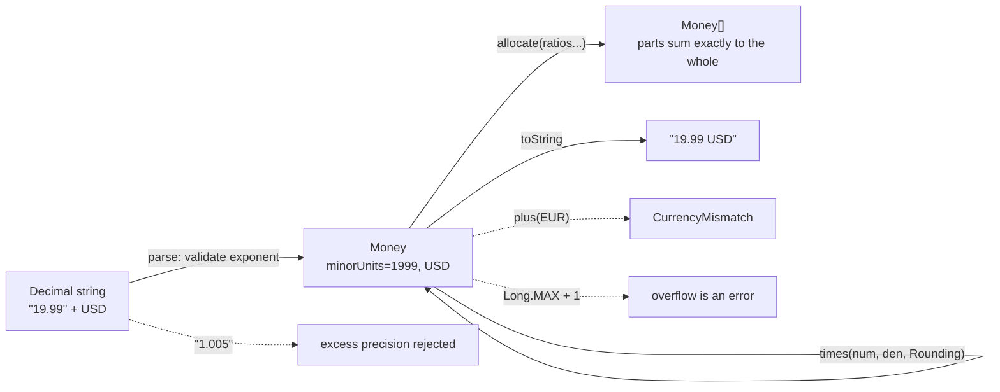

# Representing Money: Minor Units, Currencies, and Rounding

> A ledger that stores money as a float is already wrong; it just has not been audited yet.

**Type:** Build
**Languages:** Java, Python, Go
**Prerequisites:** Phase 0 Lesson 07 (Decimal and Integer Arithmetic)
**Time:** ~90 minutes

## Learning Objectives

- Explain why IEEE 754 binary floating point cannot represent most decimal amounts and show the error with a one-line program
- Build a `Money` value type that stores a signed integer count of minor units together with an ISO 4217 currency
- Implement four rounding modes on integer division and state which one a payment system should use for fees, taxes, and FX
- Split an amount into ratios so that the parts always sum to the whole, using the largest-remainder method
- Reject the three classic errors at the type level: mixing currencies, silently truncating precision, and overflowing a 64-bit integer

## The Problem

A marketplace pays its sellers 97.1% of each sale and keeps 2.9% as a fee. The code that computes the fee is one line: `fee = amount * 0.029`. On a $19.99 sale it produces `0.57971`, which someone rounds to `0.58`, and the seller receives `19.41`. It looks fine on every test, in every demo, and for the first eleven months in production.

Then finance runs the year-end reconciliation. The sum of all fees the platform recorded differs from the sum of all amounts minus all payouts by $3,412.07. Nobody stole anything. The money is simply not conserved: `amount - fee - payout` was never exactly zero on any single transaction, because `0.029` is not representable in binary, `19.99` is not representable in binary, and the product was rounded by the CPU before anyone wrote a rounding rule. Over 48 million transactions, sub-cent errors with a slight bias in one direction become thousands of dollars that exist in one table and not in another. The reconciliation team cannot sign off. The auditors ask for the rounding policy. There is none.

A second version of the same failure is simpler and more common. Two services exchange an amount as a JSON number: `{"amount": 19.99}`. One side parses it as a double and multiplies by 100 to get cents: `19.99 * 100 = 1998.9999999999998`. Cast to an integer and the customer is charged 1998 cents. A refund computed on the other service's side, which happens to round instead of truncate, returns 1999 cents. The customer is now up one cent and your ledger is down one, and your fraud team is asked to investigate a "penny-skimming" pattern that is actually your own serialization layer.

Both failures share a root cause: money was treated as a real number when it is a count. There is no such thing as half a cent in a USD account. The minor unit (cent, paisa, yen, fils) is the atom, and arithmetic on atoms is integer arithmetic. The only place a fraction ever appears is when you multiply by a rate, and at that moment you, not the CPU, must decide what happens to the remainder. This lesson builds the type that makes that decision explicit, in Java, Python, and Go, and then uses it in every later lesson of the course.

## The Concept

### Binary floats and decimal money

A `double` (Java, Go `float64`, Python `float`) stores a number as `sign * mantissa * 2^exponent` with a 53-bit mantissa. Any value that is a finite sum of powers of two is exact: `0.5`, `0.25`, `19.75`. Any value that needs a factor of five in the denominator is not: `0.1 = 1/10 = 1/(2*5)` has an infinitely repeating binary expansion, just as `1/3` repeats in decimal. The nearest double to `0.1` is `0.1000000000000000055511151231257827…`. Add ten of them and you do not get `1.0`.

The errors are tiny, around one part in 10^16, so for physics and graphics they are irrelevant. Money is different for three reasons:

1. **Legal exactness.** A balance of 10.00 USD is a legal claim on exactly 1,000 cents. There is no tolerance.
2. **Conservation.** In a ledger every debit has an equal credit (Lesson 03). Floating-point addition is not associative, so `(a + b) + c != a + (b + c)` in general, and two services summing the same postings in different orders will disagree.
3. **Accumulation and bias.** Errors do not average out when the inputs share structure. Every price ending in `.99` rounds the same direction.

The fix is not "use more bits" (a `float128` still cannot hold `0.1`), and it is not "round at the end" (by then the error has propagated). The fix is to change the number system: store an integer count of the smallest unit.

### Minor units and ISO 4217

ISO 4217 assigns each currency a three-letter code and an *exponent*: the number of decimal places in its minor unit.

| Currency | Code | Exponent | Minor unit | 12.5 major units stored as |
|----------|------|----------|------------|----------------------------|
| US dollar | USD | 2 | cent | `1250` |
| Euro | EUR | 2 | cent | `1250` |
| Indian rupee | INR | 2 | paisa | `1250` |
| Japanese yen | JPY | 0 | (none) | invalid: yen has no fraction |
| Kuwaiti dinar | KWD | 3 | fils | `12500` |
| Bahraini dinar | BHD | 3 | fils | `12500` |

Two consequences shape the type:

- **The exponent belongs to the currency, not the amount.** A `Money` value is `(minorUnits, currency)` and the currency tells you where the decimal point goes when you display it. The integer `1250` means 12.50 USD or 1.250 KWD or 1250 JPY depending on the currency it is paired with, so the pairing is mandatory.
- **Precision is a validation rule, not a rounding rule.** "1.5 JPY" is not a number that needs rounding; it is an error. Parsing must reject it. Likewise "1.005 USD" from an upstream system is almost always a bug upstream, and silently rounding it hides the bug.

### The invariant

Every operation on `Money` preserves one invariant: **the result is an exact integer count of minor units of exactly one currency.** Addition, subtraction, and negation preserve it trivially. Two operations threaten it:

- **Multiplication by a rate** (fee percentage, tax rate, FX rate) produces a fraction. The type refuses to do this without being told a rounding mode.
- **Division into parts** (splitting a payment between a seller, a platform, and a referral partner) produces fractions that, if each is rounded independently, no longer sum to the whole. The type provides an allocation operation that distributes the remainder so the parts always sum exactly.

Everything else — currency mismatch, overflow, excess precision — is rejected with an error rather than coerced.



### Exact rational multiplication

A fee of 2.9% is the rational number `29/1000`. An FX rate of 0.9217 is `9217/10000`. Rather than converting these to a float, the type multiplies by the numerator and divides by the denominator, both as integers:

```text
19.99 USD * 2.9%
= 1999 minor units * 29 / 1000
= 57971 / 1000
= 57 remainder 971        <- the only point where a rounding decision exists
```

The intermediate `57971` is exact. The remainder `971/1000 = 0.971` is more than one half, so every rounding mode except `DOWN` gives 58 cents. The decision is made once, by the caller, with a named rule, and it is the same in Java, Python, and Go.

### The four rounding modes that matter

| Mode | Rule | 12.5 → | 13.5 → | −12.5 → | When payments use it |
|------|------|--------|--------|---------|----------------------|
| `HALF_EVEN` | ties go to the even neighbour | 12 | 14 | −12 | Default. Unbiased over many operations; what accountants call banker's rounding; required by many tax authorities for rate calculations |
| `HALF_UP` | ties go away from zero | 13 | 14 | −13 | Consumer-facing prices where "round normally" is expected; some interchange fee schedules |
| `DOWN` | truncate toward zero | 12 | 13 | −12 | Payouts and amounts owed by you: never pay a fraction you were not asked to |
| `UP` | away from zero | 13 | 14 | −13 | Fees that must cover a cost; minimum charges |

The reason `HALF_EVEN` is the default is bias. `HALF_UP` rounds every exact tie upward, and in a dataset where ties are common (half-cent fee calculations on round prices) the sum drifts upward by about half a minor unit per tie. `HALF_EVEN` sends half the ties down and half up, so the expected error per operation is zero. Over 48 million transactions that is the difference between reconciling and not.

Note the handling of negatives. `DOWN` is truncation toward zero (−12.9 → −12), not toward negative infinity (−13). `HALF_UP` on −12.5 gives −13 because "up" means away from zero. Python's `//` operator floors toward negative infinity, which is a different rule from Java's and Go's `/`, so the Python implementation deliberately works on magnitudes and re-applies the sign. This is the kind of cross-language difference that produces a one-cent discrepancy between two services written in different languages.

### Allocation: the largest-remainder method

Split 100.00 USD three ways. Each share is `10000 / 3 = 3333.33…` minor units. Round each one independently and you get `3333 + 3333 + 3333 = 9999`: one cent has vanished. Round each one `HALF_UP` and you get `3333 * 3 = 9999` as well, because `.33` rounds down. Use ceilings and you get `10002`: two cents appeared from nowhere.

The largest-remainder method (also called Hamilton's method, from apportionment of legislative seats) guarantees conservation:

1. Give every share its integer floor: `3333, 3333, 3333`, total `9999`.
2. Compute what is left: `10000 − 9999 = 1`.
3. Rank the shares by their fractional remainder (here all `.33`, so ties break by index order) and give one leftover minor unit to each of the top shares: `3334, 3333, 3333`.

Worked example with uneven ratios, 0.05 USD split 70/30:

```text
magnitude = 5 minor units, ratios 70:30, total 100
share[0] = 5 * 70 / 100 = 350 / 100 = 3 remainder 50
share[1] = 5 * 30 / 100 = 150 / 100 = 1 remainder 50
distributed = 4, leftover = 1
remainders tie at 50 -> index order wins -> share[0] gets the leftover
result = [4, 1], sum = 5
```

Three properties the tests check: the parts always sum to the whole; the order of the input ratios is preserved; and the result is deterministic (ties are broken by position, never by hash order or sort instability). Determinism matters because the allocation will be recomputed by the ledger, the payout service, and the reconciliation job, and all three must agree.

### What this type does not do

- It does not convert between currencies. FX conversion is a `times` with a rate and a target currency, and belongs to Lesson 02 because the rate has a source, a timestamp, and a spread.
- It does not format for humans (`$19.99`, `19,99 €`). `toString` is a canonical machine format `"19.99 USD"`; locale formatting lives at the presentation layer.
- It does not know account semantics. Whether a negative amount is a debit or a credit is the ledger's job (Lesson 03).

## Build It

The primary walkthrough is in Java. The Python and Go files implement the same design with the same names; the subsections at the end show only what differs.

### Step 1: The currency

```java
record Currency(String code, int exponent) {
    static final Currency USD = new Currency("USD", 2);
    static final Currency JPY = new Currency("JPY", 0);
    static final Currency KWD = new Currency("KWD", 3);

    Currency {
        if (code == null || code.length() != 3 || !code.chars().allMatch(Character::isUpperCase)) {
            throw new IllegalArgumentException("currency code must be three uppercase letters: " + code);
        }
        if (exponent < 0 || exponent > 4) {
            throw new IllegalArgumentException("exponent must be 0..4: " + exponent);
        }
    }

    long minorUnitsPerMajor() {
        long scale = 1;
        for (int i = 0; i < exponent; i++) scale *= 10;
        return scale;
    }
}
```

A record gives value semantics for free: two `Currency` values with the same code and exponent are equal, which is what `requireSameCurrency` will compare. The compact constructor validates once, at construction, so every later method can trust the fields. The exponent cap of 4 is a sanity bound; no ISO 4217 currency exceeds 3, and a stray `exponent = 2000000000` would make `minorUnitsPerMajor` overflow.

**Predict:** what does `Currency.JPY.minorUnitsPerMajor()` return, and what does that mean for parsing `"1200"`?

### Step 2: The value type and its one invariant

```java
record Money(long minorUnits, Currency currency) implements Comparable<Money> {

    Money { Objects.requireNonNull(currency, "currency"); }

    static Money ofMinor(long minorUnits, Currency currency) {
        return new Money(minorUnits, currency);
    }

    private void requireSameCurrency(Money other) {
        if (!currency.equals(other.currency)) throw new CurrencyMismatchException(currency, other.currency);
    }

    Money plus(Money other) {
        requireSameCurrency(other);
        return new Money(Math.addExact(minorUnits, other.minorUnits), currency);
    }

    Money minus(Money other) {
        requireSameCurrency(other);
        return new Money(Math.subtractExact(minorUnits, other.minorUnits), currency);
    }

    Money negate() { return new Money(Math.negateExact(minorUnits), currency); }
}
```

Three deliberate choices:

- **`long`, not `BigDecimal`.** A `long` holds ±9.2 × 10^18 minor units, which is 92 quadrillion dollars. No single account will hold that, and keeping amounts in a primitive makes the ledger lessons' hot paths allocation-free. The trade-off is overflow, which brings us to the second choice.
- **`Math.addExact`, not `+`.** Plain `+` on `long` wraps silently: `Long.MAX_VALUE + 1` is a large negative number, which in a ledger means a balance flips from very positive to very negative with no error. `addExact` throws `ArithmeticException`. Overflow should be impossible in practice, so when it happens it is a bug or an attack, and an exception is the correct response.
- **A dedicated exception for currency mismatch.** Adding USD to EUR is never a runtime condition to handle gracefully; it is a programming error. A specific type lets tests assert it precisely and lets a reviewer grep for it.

### Step 3: Parsing with precision as validation

```java
static Money parse(String text, Currency currency) {
    String s = text.strip();
    boolean negative = s.startsWith("-");
    if (negative || s.startsWith("+")) s = s.substring(1);
    if (s.isEmpty()) throw new NumberFormatException("empty amount");
    String whole = s, frac = "";
    int dot = s.indexOf('.');
    if (dot >= 0) { whole = s.substring(0, dot); frac = s.substring(dot + 1); }
    if (whole.isEmpty()) whole = "0";
    if (!whole.chars().allMatch(Character::isDigit) || !frac.chars().allMatch(Character::isDigit)) {
        throw new NumberFormatException("not a decimal amount: " + text);
    }
    if (frac.length() > currency.exponent()) {
        throw new ArithmeticException(text + " has more decimals than " + currency.code()
                + " allows (" + currency.exponent() + ")");
    }
    StringBuilder padded = new StringBuilder(frac);
    while (padded.length() < currency.exponent()) padded.append('0');
    long minor = Math.addExact(
            Math.multiplyExact(Long.parseLong(whole), currency.minorUnitsPerMajor()),
            padded.length() == 0 ? 0 : Long.parseLong(padded.toString()));
    return new Money(negative ? -minor : minor, currency);
}
```

The parser never touches a `double`. It splits the string at the decimal point, validates that both halves are digits, pads the fraction to the currency's exponent (`"0.5"` becomes `"50"` cents), and combines with exact integer arithmetic. The line to notice is the `frac.length() > currency.exponent()` check: `"1.005"` in USD is rejected, not rounded. If your upstream really sends three-decimal USD amounts, the fix is a conscious `times(1, 1, Rounding.X)` at the boundary, with the rounding mode in the code where a reviewer can see it.

**Predict:** `Money.parse(".99", USD)` — what is `whole` after the empty-string fix, and what is the result?

### Step 4: Rounded division, the only place a fraction exists

```java
static long divideRounded(long dividend, long divisor, Rounding rounding) {
    long quotient = dividend / divisor;            // truncates toward zero
    long remainder = dividend % divisor;           // same sign as dividend
    if (remainder == 0) return quotient;
    int sign = (dividend < 0) ^ (divisor < 0) ? -1 : 1;
    long twiceRemainder = Math.abs(remainder) * 2;
    long absDivisor = Math.abs(divisor);
    return switch (rounding) {
        case DOWN -> quotient;
        case UP -> quotient + sign;
        case HALF_UP -> twiceRemainder >= absDivisor ? quotient + sign : quotient;
        case HALF_EVEN -> {
            if (twiceRemainder > absDivisor) yield quotient + sign;
            if (twiceRemainder < absDivisor) yield quotient;
            yield (quotient % 2 == 0) ? quotient : quotient + sign;
        }
    };
}
```

Comparing `2 * remainder` against the divisor avoids ever forming the fraction `remainder / divisor`. Exactly half means `2 * remainder == divisor`. This works for any divisor, not just powers of ten, which is what makes `times(numerator, denominator, …)` general.

Trace `divideRounded(-125, 10, HALF_EVEN)`:

```text
quotient  = -125 / 10 = -12   (truncation toward zero)
remainder = -125 % 10 = -5
sign      = -1
twice     = 10, absDivisor = 10  -> exact tie
quotient % 2 == 0 -> stay at -12
```

and `divideRounded(-135, 10, HALF_EVEN)` gives `-13` as the quotient, which is odd, so the tie moves to `-14`. Even neighbour, in both directions.

Then `times` is one line of real work:

```java
Money times(long numerator, long denominator, Rounding rounding) {
    if (denominator <= 0) throw new ArithmeticException("denominator must be positive");
    long product = Math.multiplyExact(minorUnits, numerator);
    return new Money(divideRounded(product, denominator, rounding), currency);
}
```

### Step 5: Allocation that conserves every minor unit

```java
Money[] allocate(long... ratios) {
    long total = 0;
    for (long r : ratios) {
        if (r < 0) throw new IllegalArgumentException("ratios must be non-negative");
        total = Math.addExact(total, r);
    }
    if (ratios.length == 0 || total == 0) throw new IllegalArgumentException("ratios must not all be zero");

    long[] shares = new long[ratios.length];
    long[] remainders = new long[ratios.length];
    long distributed = 0;
    long magnitude = Math.abs(minorUnits);
    for (int i = 0; i < ratios.length; i++) {
        long scaled = Math.multiplyExact(magnitude, ratios[i]);
        shares[i] = scaled / total;
        remainders[i] = scaled % total;
        distributed += shares[i];
    }
    long leftover = magnitude - distributed;           // 0 <= leftover < ratios.length

    Integer[] order = new Integer[ratios.length];
    for (int i = 0; i < order.length; i++) order[i] = i;
    Arrays.sort(order, (a, b) -> Long.compare(remainders[b], remainders[a]));   // stable sort
    for (int k = 0; k < leftover; k++) shares[order[k]]++;

    Money[] result = new Money[ratios.length];
    for (int i = 0; i < ratios.length; i++) {
        result[i] = new Money(minorUnits < 0 ? -shares[i] : shares[i], currency);
    }
    return result;
}
```

Why is `leftover` always less than the number of ratios? Each share lost strictly less than one minor unit to its floor, so the total loss across `n` shares is strictly less than `n`. That bound is why handing out one unit to each of the top-`leftover` shares is enough and never gives any share two.

Why `Arrays.sort` on a boxed `Integer[]` with a comparator? Because that sort is guaranteed stable (it is a merge sort), so equal remainders keep their index order and the result is deterministic. `Arrays.sort(long[])` is a dual-pivot quicksort with no stability guarantee and no comparator. The same concern appears in Python (`sorted` is stable) and Go (`sort.SliceStable`, not `sort.Slice`).

Negative amounts are allocated by magnitude and the sign is reapplied, so a refund of −1.00 split three ways gives `[−0.34, −0.33, −0.33]` and the parts still sum to −1.00.

### Step 6: Run it

```bash
cd phases/10-money-and-ledgers/01-representing-money/code/java
javac -d .out *.java && java -cp .out Main
java -cp .out MainTest
```

Expected output, abbreviated:

```console
== Why floats lose money ==
0.10 + 0.20 as double = 0.30000000000000004000
one million additions of 0.01 as double = 10000.0000001719 (should be exactly 10000)

== Fees: 2.9% + 30c, rounded how? ==
2.9% of 19.99 USD = 0.58 USD  (19.99 * 0.029 = 0.57971 -> 0.58)
12.5c rounded HALF_EVEN = 0.12 USD, HALF_UP = 0.13 USD

== Splitting 100.00 three ways without losing a cent ==
[33.34 USD, 33.33 USD, 33.33 USD] sum = 100.00 USD
0.05 split 70/30 = [0.04 USD, 0.01 USD]

rejected: 1.5 has more decimals than JPY allows (0)
rejected: cannot combine USD with EUR
```

Keep this output. The one-million-additions line is the evidence you show a colleague who says floats are "fine for our use case."

### In Python

The Python port (`code/python/main.py`) is the same design with three differences. **No overflow:** Python integers are arbitrary precision, so `addExact` has no equivalent and `2**63` is a legal balance; the tests assert this rather than an overflow error. **`//` floors, Java's `/` truncates:** `-125 // 10` is `-13` in Python but `-12` in Java and Go, so `divide_rounded` works on magnitudes with `divmod` and reapplies the sign, and all three languages agree on every input (the single most likely source of a cross-service penny discrepancy in a polyglot payments stack). **Floats are rejected at construction:** Python would happily accept `Money(10.0, USD)`, so `__post_init__` turns it into a `TypeError` in the first test rather than in reconciliation; `bool` is excluded because `True` is an `int`.

Run it from `code/python/` with `python3 main.py`; test with `python3 -m unittest -v`.

#### Step 1: The currency

A frozen dataclass plays the role of the Java record: two fields, validation in `__post_init__`, and the constants as module-level names. `minor_units_per_major` is `10 ** exponent`, which Python computes exactly for any exponent.

```python
@dataclass(frozen=True)
class Currency:
    """ISO 4217 currency: a three-letter code and the number of decimals in its minor unit."""

    code: str
    exponent: int

    def __post_init__(self) -> None:
        if len(self.code) != 3 or not self.code.isalpha() or not self.code.isupper():
            raise ValueError(f"currency code must be three uppercase letters: {self.code!r}")
        if not 0 <= self.exponent <= 4:
            raise ValueError(f"exponent must be 0..4: {self.exponent}")

    def minor_units_per_major(self) -> int:
        """10**exponent: 100 for USD, 1 for JPY, 1000 for KWD."""
        return 10 ** self.exponent


USD = Currency("USD", 2)
EUR = Currency("EUR", 2)
JPY = Currency("JPY", 0)
KWD = Currency("KWD", 3)
```

#### Step 2: The value type and its one invariant

`Money` is also a frozen dataclass, so every operation returns a new value. The invariant "same currency or fail" lives in `_require_same_currency`, which raises `CurrencyMismatchError` (a `ValueError` subclass, so callers that only know about `ValueError` still fail loudly). Because Python ints cannot overflow, `plus` and `minus` are one line each; the type check in `__post_init__` is the Python-specific guard.

```python
@dataclass(frozen=True)
class Money:
    minor_units: int
    currency: Currency

    def __post_init__(self) -> None:
        if not isinstance(self.minor_units, int) or isinstance(self.minor_units, bool):
            raise TypeError("minor_units must be an int; never construct Money from a float")

    def _require_same_currency(self, other: "Money") -> None:
        if self.currency != other.currency:
            raise CurrencyMismatchError(self.currency, other.currency)

    def plus(self, other: "Money") -> "Money":
        self._require_same_currency(other)
        return Money(self.minor_units + other.minor_units, self.currency)

    def minus(self, other: "Money") -> "Money":
        self._require_same_currency(other)
        return Money(self.minor_units - other.minor_units, self.currency)

    def negate(self) -> "Money":
        return Money(-self.minor_units, self.currency)
```

#### Step 3: Parsing with precision as validation

`str.partition(".")` splits the text once; the fractional part is checked against the currency's exponent *before* any arithmetic, which is the whole point of the step: `"1.5"` for JPY is rejected, not rounded. Excess precision raises `ArithmeticError` to mirror the Java exception; a malformed string raises `ValueError`.

```python
    @staticmethod
    def parse(text: str, currency: Currency) -> "Money":
        """Parse "12.34", "-0.5", "1200" exactly; reject more decimals than the currency allows."""
        s = text.strip()
        negative = s.startswith("-")
        if negative or s.startswith("+"):
            s = s[1:]
        if not s:
            raise ValueError("empty amount")
        whole, _, frac = s.partition(".")
        whole = whole or "0"
        if not whole.isdigit() or (frac and not frac.isdigit()):
            raise ValueError(f"not a decimal amount: {text!r}")
        if len(frac) > currency.exponent:
            raise ArithmeticError(f"{text} has more decimals than {currency.code} allows ({currency.exponent})")
        frac = frac.ljust(currency.exponent, "0")
        minor = int(whole) * currency.minor_units_per_major() + (int(frac) if frac else 0)
        return Money(-minor if negative else minor, currency)
```

#### Step 4: Rounded division, the only place a fraction exists

This is where Python's floor division would silently diverge from Java and Go on negative amounts, so the function never divides a signed number: it takes the sign out, uses `divmod` on magnitudes, applies the rounding rule to the remainder, and puts the sign back. `times` multiplies by an exact rational and rounds exactly once.

```python
def divide_rounded(dividend: int, divisor: int, rounding: Rounding) -> int:
    if divisor == 0:
        raise ZeroDivisionError("divisor must not be zero")
    sign = -1 if (dividend < 0) != (divisor < 0) else 1
    abs_dividend, abs_divisor = abs(dividend), abs(divisor)
    quotient, remainder = divmod(abs_dividend, abs_divisor)
    if remainder == 0:
        return sign * quotient
    twice = remainder * 2
    if rounding is Rounding.DOWN:
        pass
    elif rounding is Rounding.UP:
        quotient += 1
    elif rounding is Rounding.HALF_UP:
        if twice >= abs_divisor:
            quotient += 1
    elif rounding is Rounding.HALF_EVEN:
        if twice > abs_divisor or (twice == abs_divisor and quotient % 2 == 1):
            quotient += 1
    return sign * quotient
```

```python
    def times(self, numerator: int, denominator: int, rounding: Rounding) -> "Money":
        """Multiply by an exact rational (2.9% is 29/1000) and round once, the way you asked."""
        if denominator <= 0:
            raise ArithmeticError("denominator must be positive")
        return Money(divide_rounded(self.minor_units * numerator, denominator, rounding), self.currency)
```

#### Step 5: Allocation that conserves every minor unit

Largest-remainder allocation in Python reads almost like the specification: integer shares with `//`, remainders with `%`, and the leftover units handed to the largest remainders. `sorted(..., key=lambda i: -remainders[i])` is stable, so ties keep index order exactly as the Java comparator does; the tests pin `[33.34, 33.33, 33.33]`.

```python
    def allocate(self, *ratios: int) -> list["Money"]:
        """Split in the given ratios so the parts sum exactly to the whole (largest-remainder method)."""
        if not ratios:
            raise ValueError("need at least one ratio")
        if any(r < 0 for r in ratios):
            raise ValueError("ratios must be non-negative")
        total = sum(ratios)
        if total == 0:
            raise ValueError("ratios must not all be zero")
        magnitude = abs(self.minor_units)
        shares = [magnitude * r // total for r in ratios]
        remainders = [magnitude * r % total for r in ratios]
        leftover = magnitude - sum(shares)
        order = sorted(range(len(ratios)), key=lambda i: -remainders[i])  # stable: ties keep index order
        for i in order[:leftover]:
            shares[i] += 1
        sign = -1 if self.minor_units < 0 else 1
        return [Money(sign * s, self.currency) for s in shares]
```

#### Step 6: Run it

```bash
cd phases/10-money-and-ledgers/01-representing-money/code/python
python3 main.py
python3 -m unittest -v
```

The output matches the Java run line for line except the first section's label (`as float` rather than `as double`), because the float bug is the same IEEE 754 bug:

```console
== Why floats lose money ==
0.10 + 0.20 as float = 0.30000000000000004441
one million additions of 0.01 as float = 10000.0000001719 (should be exactly 10000)

== Exact arithmetic in minor units ==
19.99 USD x 3 = 59.97 USD
```

### In Go

The Go port (`code/go/main.go`) keeps the design and changes how failure is reported. **Errors are values:** `Plus`, `Minus`, `Times`, `Allocate`, and `Parse` return `(Money, error)`; the sentinels `ErrCurrencyMismatch` and `ErrOverflow` work with `errors.Is`. `Compare` panics on a currency mismatch because a comparison that cannot return an error has no other honest option, and the mismatch is a programming error. **Overflow is checked by hand:** `+` and `*` on `int64` wrap silently like Java primitives, and there is no `Math.addExact`, so `addChecked` and `mulChecked` implement the checks you will write again in the WAL lesson. **Constant folding hides the float bug:** `fmt.Println(0.10 + 0.20)` prints `0.3` because Go evaluates constant expressions exactly at compile time; the demo stores the values in variables first so the runtime `float64` addition is what you see.

Run it from `code/go/` with `go run .`; test with `go test ./...`.

#### Step 1: The currency

A struct with exported fields and package-level values for the common currencies. There is no constructor-time validation on a struct literal, so `NewCurrency` is the validating path and the constants are known-good. `MinorUnitsPerMajor` returns `int64` so it composes with amounts without a conversion.

```go
type Currency struct {
	Code     string
	Exponent int
}

var (
	USD = Currency{"USD", 2}
	EUR = Currency{"EUR", 2}
	JPY = Currency{"JPY", 0}
	KWD = Currency{"KWD", 3}
)

// NewCurrency validates the code and exponent; the package-level constants are known-good.
func NewCurrency(code string, exponent int) (Currency, error) {
	if len(code) != 3 || strings.ToUpper(code) != code || strings.Trim(code, "ABCDEFGHIJKLMNOPQRSTUVWXYZ") != "" {
		return Currency{}, fmt.Errorf("currency code must be three uppercase letters: %q", code)
	}
	if exponent < 0 || exponent > 4 {
		return Currency{}, fmt.Errorf("exponent must be 0..4: %d", exponent)
	}
	return Currency{code, exponent}, nil
}
```

#### Step 2: The value type and its one invariant

`Money` is a plain value struct; copying it is cheap and there is nothing to mutate. The invariant is enforced by `requireSameCurrency`, and because Go's `int64` wraps, `Plus` goes through `addChecked`, which detects a sign flip and returns `ErrOverflow` instead of a wrong balance.

```go
type Money struct {
	MinorUnits int64
	Currency   Currency
}

func (m Money) requireSameCurrency(other Money) error {
	if m.Currency != other.Currency {
		return fmt.Errorf("%w: cannot combine %s with %s", ErrCurrencyMismatch, m.Currency.Code, other.Currency.Code)
	}
	return nil
}

func addChecked(a, b int64) (int64, error) {
	sum := a + b
	if (a > 0 && b > 0 && sum < 0) || (a < 0 && b < 0 && sum >= 0) {
		return 0, ErrOverflow
	}
	return sum, nil
}

func (m Money) Plus(other Money) (Money, error) {
	if err := m.requireSameCurrency(other); err != nil {
		return Money{}, err
	}
	sum, err := addChecked(m.MinorUnits, other.MinorUnits)
	return Money{sum, m.Currency}, err
}
```

#### Step 3: Parsing with precision as validation

`strings.Cut` splits on the first `.`; the fractional length is checked against the exponent before any digits are accumulated. Go has no big integers in the fast path, so the digit loop also watches for `int64` wraparound and returns `ErrOverflow` for absurdly long inputs, something the Java version gets from `Long.parseLong` for free.

```go
func Parse(text string, currency Currency) (Money, error) {
	s := strings.TrimSpace(text)
	negative := strings.HasPrefix(s, "-")
	if negative || strings.HasPrefix(s, "+") {
		s = s[1:]
	}
	if s == "" {
		return Money{}, errors.New("empty amount")
	}
	whole, frac, _ := strings.Cut(s, ".")
	if whole == "" {
		whole = "0"
	}
	if !allDigits(whole) || (frac != "" && !allDigits(frac)) {
		return Money{}, fmt.Errorf("not a decimal amount: %q", text)
	}
	if len(frac) > currency.Exponent {
		return Money{}, fmt.Errorf("%s has more decimals than %s allows (%d)", text, currency.Code, currency.Exponent)
	}
	frac += strings.Repeat("0", currency.Exponent-len(frac))
	var minor int64
	for _, ch := range whole + frac {
		next := minor*10 + int64(ch-'0')
		if next < minor {
			return Money{}, ErrOverflow
		}
		minor = next
	}
	if negative {
		minor = -minor
	}
	return Money{minor, currency}, nil
}
```

#### Step 4: Rounded division, the only place a fraction exists

Go's `/` and `%` truncate toward zero exactly like Java's, so `DivideRounded` can work on the signed quotient directly and only needs the magnitudes of the remainder and divisor to decide the tie. `HalfEven` is the `default` arm: ties go to the even neighbour, which is what keeps a million rounded fees unbiased.

```go
func DivideRounded(dividend, divisor int64, rounding Rounding) int64 {
	quotient := dividend / divisor
	remainder := dividend % divisor
	if remainder == 0 {
		return quotient
	}
	sign := int64(1)
	if (dividend < 0) != (divisor < 0) {
		sign = -1
	}
	twice := abs64(remainder) * 2
	absDivisor := abs64(divisor)
	switch rounding {
	case Down:
		return quotient
	case Up:
		return quotient + sign
	case HalfUp:
		if twice >= absDivisor {
			return quotient + sign
		}
		return quotient
	default: // HalfEven
		if twice > absDivisor {
			return quotient + sign
		}
		if twice < absDivisor {
			return quotient
		}
		if quotient%2 == 0 {
			return quotient
		}
		return quotient + sign
	}
}
```

#### Step 5: Allocation that conserves every minor unit

The same largest-remainder method, with two Go-specific details: `magnitude * r` goes through `mulChecked` because a large balance times a large ratio can overflow `int64`, and `sort.SliceStable` on an index slice gives the stable tie-break the Java comparator provides. Every error path returns `(nil, error)`; the happy path conserves the sum by construction.

```go
func (m Money) Allocate(ratios ...int64) ([]Money, error) {
	if len(ratios) == 0 {
		return nil, errors.New("need at least one ratio")
	}
	var total int64
	for _, r := range ratios {
		if r < 0 {
			return nil, errors.New("ratios must be non-negative")
		}
		total += r
	}
	if total == 0 {
		return nil, errors.New("ratios must not all be zero")
	}
	magnitude := abs64(m.MinorUnits)
	shares := make([]int64, len(ratios))
	remainders := make([]int64, len(ratios))
	var distributed int64
	for i, r := range ratios {
		scaled, err := mulChecked(magnitude, r)
		if err != nil {
			return nil, err
		}
		shares[i] = scaled / total
		remainders[i] = scaled % total
		distributed += shares[i]
	}
	leftover := magnitude - distributed
	order := make([]int, len(ratios))
	for i := range order {
		order[i] = i
	}
	sort.SliceStable(order, func(a, b int) bool { return remainders[order[a]] > remainders[order[b]] })
	for k := int64(0); k < leftover; k++ {
		shares[order[k]]++
	}
	result := make([]Money, len(ratios))
	for i, s := range shares {
		if m.MinorUnits < 0 {
			s = -s
		}
		result[i] = Money{s, m.Currency}
	}
	return result, nil
}
```

#### Step 6: Run it

```bash
cd phases/10-money-and-ledgers/01-representing-money/code/go
go run .
go test ./...
```

```console
== Why floats lose money ==
0.10 + 0.20 as float64 = 0.30000000000000004441
one million additions of 0.01 as float64 = 10000.0000001719 (should be exactly 10000)
```

The rest of the output is identical to the Java run. If the first line ever prints `0.3`, you are looking at constant folding: the two operands were literals, not variables.

## Use It

### `java.math.BigDecimal` and `java.util.Currency`

The JDK ships `BigDecimal`, an arbitrary-precision decimal with explicit `RoundingMode` (`HALF_EVEN`, `HALF_UP`, `DOWN`, `UP`, `CEILING`, `FLOOR`, `HALF_DOWN`, `UNNECESSARY`), and `java.util.Currency`, which knows every ISO 4217 code and its `getDefaultFractionDigits()`. A production Java service would typically store `long` minor units in the database and the hot path, and use `BigDecimal` at the boundaries for parsing, rate math, and display:

```java
BigDecimal fee = new BigDecimal("19.99")
        .multiply(new BigDecimal("0.029"))
        .setScale(2, RoundingMode.HALF_EVEN);   // 0.58
```

What `BigDecimal` does for you that the from-scratch version made explicit: arbitrary precision (no overflow), eight rounding modes, and a `scale` that travels with the value. What it does *not* do: it has no idea what currency it is, so `new BigDecimal("1.00").add(eur)` compiles. It also has a trap: `new BigDecimal(0.1)` (from a `double`) is `0.1000000000000000055511151231257827…`, while `new BigDecimal("0.1")` is exactly `0.1`. Always construct from a `String` or a `long`.

Java has no built-in money type; JSR 354 (`javax.money`, reference implementation Moneta) defines one, and its `MonetaryAmount` interface looks a great deal like the record you just wrote.

### Python's `decimal` and `fractions`

```python
from decimal import Decimal, ROUND_HALF_EVEN
fee = (Decimal("19.99") * Decimal("0.029")).quantize(Decimal("0.01"), rounding=ROUND_HALF_EVEN)
```

`Decimal` is the right tool for rate math at the boundary, and `Decimal("0.1")` is exact where `Decimal(0.1)` is not, the same trap as Java. The `fractions.Fraction` type is an exact rational and is the closest standard-library analogue to the `times(numerator, denominator)` design. Neither carries a currency.

### Go: `math/big` and the absence of a decimal type

Go's standard library has `big.Int` and `big.Rat` (exact rationals) but no decimal type; the community uses `shopspring/decimal` or `cockroachdb/apd`. Most Go payment services do exactly what this lesson does: `int64` minor units everywhere, rationals or scaled integers for rates, and a decimal library only at the JSON boundary. Stripe's API, for instance, represents every amount as an integer in the currency's smallest unit (`"amount": 1999`), which means a Go client never has to parse a decimal at all.

### Databases

Store minor units in a `BIGINT` column with a separate `CHAR(3)` currency column, or use `NUMERIC(19, 4)` and round on read with an explicit rule. Never use `FLOAT`, `REAL`, or `DOUBLE PRECISION` for an amount; PostgreSQL's `money` type is locale-dependent and widely discouraged for the same reasons.

## Ship It

`outputs/checklist-money-handling.md` is a review checklist for any pull request that touches an amount: representation, boundaries, rounding, allocation, and the cross-language traps above. Attach it to your team's PR template.

## Exercises

1. **Reinforce.** Add `Rounding.HALF_DOWN` (ties toward zero) to all three implementations and write the tie tests for `125/10` and `-125/10`. Then explain in one sentence why no payment system you know of uses it.
2. **Apply.** Implement `Money.percentageOf(Money part, Money whole)` that returns the basis points (1/100 of a percent) that `part` is of `whole`, as a `long`, rounded `HALF_EVEN`. A 0.58 USD fee on 19.99 USD should return `290`. Watch the overflow when `part` is large: you need `multiplyExact`.
3. **Extend.** The largest-remainder method has a known paradox: adding one more share can take a unit away from an existing share (the Alabama paradox). Construct an amount and two ratio lists, one with three entries and one with the same three plus a fourth, where a share in the first list is larger than the same share in the second. Then decide whether this matters for payouts and write your reasoning in the test's docstring. This connects to Phase 10, Lesson 10 (Fees and Splits).

## Key Terms

| Term | What people say | What it actually means |
|------|-----------------|------------------------|
| Minor unit | "cents" | The smallest indivisible unit of a currency, defined by ISO 4217's exponent; 0, 2, or 3 decimal places depending on currency |
| ISO 4217 | "the currency code list" | The standard that assigns each currency a three-letter code, a numeric code, and an exponent; the exponent is what makes `1250` mean different things in USD and KWD |
| Banker's rounding | "round half to even" | The `HALF_EVEN` rule: exact ties go to the even neighbour, which makes the expected rounding error zero over many operations |
| Largest-remainder method | "spread the pennies" | Floor every share, then give each leftover unit to the shares with the largest fractional remainder; guarantees the parts sum to the whole |
| Exact rational | "a fraction" | A number stored as integer numerator and denominator; `29/1000` is exactly 2.9% where `0.029` as a double is not |
| Overflow | "the number got too big" | A fixed-width integer exceeding its range; `long` and `int64` wrap silently unless you use checked arithmetic, so a balance can flip sign with no error |
| Truncation vs floor | "rounding down" | Truncation moves toward zero (`-12.9 → -12`); floor moves toward negative infinity (`-12.9 → -13`); Java and Go `/` truncate, Python `//` floors |

## Further Reading

- [ISO 4217 — Currency codes](https://www.iso.org/iso-4217-currency-codes.html) — the authoritative list of codes and minor-unit exponents; the current amendments show currencies changing exponent, which is why the exponent must live in data, not in code.
- [What Every Computer Scientist Should Know About Floating-Point Arithmetic](https://docs.oracle.com/cd/E19957-01/806-3568/ncg_goldberg.html) (Goldberg, 1991) — the canonical explanation of why `0.1` is not representable and how errors propagate.
- [JSR 354: Money and Currency API](https://jcp.org/en/jsr/detail?id=354) — the Java specification for a money type; compare its `MonetaryAmount` and `MonetaryRounding` to this lesson's record.
- [Python `decimal` module documentation](https://docs.python.org/3/library/decimal.html) — the rounding-mode table and the `Decimal(0.1)` vs `Decimal("0.1")` warning.
- [Stripe API reference: amounts](https://docs.stripe.com/currencies#zero-decimal) — a production API that represents every amount as an integer in the smallest currency unit, including the zero-decimal and three-decimal special cases.
- [Apportionment paradoxes](https://en.wikipedia.org/wiki/Apportionment_paradox) — the Alabama and population paradoxes of the largest-remainder method, for Exercise 3.
