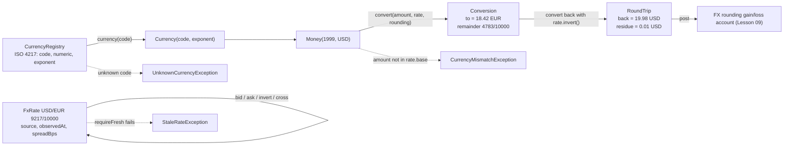

# Currencies, Exchange Rates, and FX Conversion

> ISO 4217, exponents, and where the rounding residue goes.

**Type:** Build
**Languages:** Java, Python, Go
**Prerequisites:** Phase 10 Lesson 01 (Representing Money)
**Time:** ~90 minutes

## Learning Objectives

- Read an ISO 4217 row (alphabetic code, numeric code, minor-unit exponent) and explain why the exponent must live in a registry rather than in code
- Represent an exchange rate as an exact rational with a source, an observation time, and a spread, and derive bid and ask from the mid rate without a floating-point operation
- Convert an amount between two currencies with different exponents in one exact multiplication and one explicit rounding, and report the fraction the rounding discarded
- Show by hand that a round-trip conversion does not return the original amount, name the residue, and say which account it belongs in
- Derive a cross rate between two currencies through a base currency and state what it inherits from its two parents (timestamp, spread)
- Reject a stale rate, an unknown currency code, and a conversion whose amount is not in the rate's base currency

## The Problem

A remittance service lets a customer in the United States send money to a relative in Kuwait. The product shows "1 USD = 0.308 KWD" and the customer sends 19.99 USD. The backend computes `19.99 * 0.308 = 6.15692`, rounds to two decimal places because every other currency in the system has two, and credits 6.15 KWD. The Kuwaiti dinar has three decimal places. The recipient's bank sees 6.150 KWD, the customer's statement from the partner bank later shows 6.157 KWD was due, and the 0.007 KWD difference is multiplied by forty thousand transfers a month. No individual customer complains about seven fils. The partner bank's reconciliation team does.

A second failure is quieter. The same service lets customers hold balances in EUR and convert back to USD. A customer converts 19.99 USD to EUR at 0.9217 and gets 18.42 EUR. Ten minutes later, at an unchanged rate, they convert the 18.42 EUR back and receive 19.98 USD. One cent has gone somewhere. Multiply by a popular "convert and convert back to lock in a rate" behaviour and the platform is accumulating cents in no account at all: they are not revenue, not a liability, not a fee. When finance asks where the FX rounding income is booked, the answer is that it is not booked anywhere, because nobody computed it. The cents exist only as the difference between two sums that should agree and do not.

A third failure is one line in a configuration file: `"rate": 0.9217`. The rate is parsed as a double, multiplied by an amount that was also a double, and rounded by whatever `Math.round` happens to do on that platform. Two services with the same configuration produce 18.42 in one and 18.43 in the other on a specific set of inputs because one multiplied first and the other divided first. Reconciliation between the two services fails on a few hundred transactions a day and nobody can reproduce the discrepancy in a unit test because the test uses "nice" numbers.

All three failures are the same mistake applied to the one operation Lesson 01 deliberately left out. A rate is a rational number, a conversion is a multiplication by that rational followed by exactly one rounding into the target currency's minor unit, and the amount that rounding discards is money that has to be accounted for. This lesson builds the registry that knows each currency's exponent, the rate type that is exact and carries its provenance, the converter that rounds once and reports the remainder, and the table that derives any pair through a base currency.

## The Concept

### ISO 4217 is three columns, and all three matter

ISO 4217 assigns each currency an alphabetic code, a numeric code, and a minor-unit exponent. The alphabetic code is what humans and most APIs use. The numeric code is what card networks and ISO 8583 messages carry (a card authorisation says `840`, not `USD`), and it is stable across renamings. The exponent is the one that costs money when it is wrong.

| Code | Numeric | Exponent | 1 major unit in minor units | Why it is in the registry |
|------|---------|----------|-----------------------------|---------------------------|
| USD | 840 | 2 | 100 | The default everyone assumes |
| JPY | 392 | 0 | 1 | No fraction at all; "1234.5 JPY" is an error |
| KRW | 410 | 0 | 1 | Same, and large nominal amounts stress overflow checks |
| KWD | 414 | 3 | 1000 | Three decimals; the 0.007 KWD failure above |
| BHD | 48 | 3 | 1000 | Three decimals |
| CLF | 990 | 4 | 10000 | Four decimals: a unit of account, not a circulating currency, and the reason the `Currency` exponent cap is 4 |

The exponent belongs in data because ISO 4217 is amended. Currencies have redenominated (Venezuela's bolívar repeatedly, Zimbabwe's dollar), and the amendment list changes exponents and retires codes. A system with `amount / 100` written in forty places has forty bugs waiting for the next amendment. A registry is one table, loaded from the standard, and `Currency.exponent()` is read from it. The registry is also an allow-list: a payment system that handles twelve currencies should reject the thirteenth at the parsing boundary, before an amount in an unknown currency reaches the ledger.

### A rate is a rational number with a passport

An exchange rate says how many units of a **quote** currency one unit of a **base** currency buys. `USD/EUR 0.9217` means 1 USD buys 0.9217 EUR. The decimal `0.9217` is the rational `9217/10000`, and the type stores exactly that: numerator, denominator, reduced by their greatest common divisor so that `0.50` and `0.5000` are the same rate. There is no `double` anywhere in the type.

A rate without provenance is a number without meaning. Which provider published it? When? Is it a mid-market reference rate or the rate the provider will actually deal at? The record carries:

- **source**: `"ecb-ref"`, `"provider-x-stream"`, `"treasury-manual-override"`. Reconciliation and audit need to know which rate was used, not just its value.
- **observedAt**: the time the provider published it, from an injected clock. A rate has a shelf life, and `requireFresh(now, maxAge)` is how the shelf life is enforced.
- **spreadBps**: the provider's total spread in basis points. The mid rate is what the market shows; the **bid** (what you receive when you sell the base currency) is below mid and the **ask** (what you pay when you buy it) is above. A 50 bps spread puts bid at `mid * (1 - 0.0025)` and ask at `mid * (1 + 0.0025)`, and both are computed as integers: `mid * (20000 - 50) / 20000`.

Inverting a rate is exact: `EUR/USD` is `10000/9217`, not `1.0849463...`. This matters for the round-trip analysis below, because it means the only rounding in the entire round trip happens in the two conversions, never in the rate.

### Conversion is one multiplication and one rounding

To convert an amount, multiply its minor units by the rate and then adjust for the two currencies' exponents, all as one exact rational:

```text
to_minor = from_minor * (num / den) * (10^quoteExp / 10^baseExp)
         = (from_minor * num * 10^quoteExp) / (den * 10^baseExp)
```

The numerator and denominator are computed exactly with `multiplyExact`, then `Money.divideRounded` from Lesson 01 performs the single division with a named rounding mode. The remainder of that division, expressed as a fraction of one quote minor unit, is returned alongside the result. It is the exact amount of value the rounding dropped (or, when rounding went up, invented), and it is what an auditor recomputes when they check a conversion.

Worked example, 19.99 USD to EUR at 9217/10000:

```text
from_minor = 1999, num = 9217, den = 10000, baseExp = 2, quoteExp = 2
numerator   = 1999 * 9217 * 100 = 1,842,478,300
denominator = 10000 * 100      = 1,000,000
exact       = 1842.4783 euro cents
HALF_EVEN   -> 1842 euro cents = 18.42 EUR
remainder   = 1,842,478,300 - 1842 * 1,000,000 = 478,300 / 1,000,000 = 4783/10000 of a cent (after reducing)
```

The same amount to JPY at 149.37 (14937/100):

```text
numerator   = 1999 * 14937 * 1   = 29,859,063
denominator = 100 * 100          = 10,000
exact       = 2985.9063 yen
HALF_EVEN   -> 2986 JPY
```

and to KWD at 0.30825 (30825/100000, reduced to 1233/4000):

```text
numerator   = 1999 * 1233 * 1000 = 2,464,767,000
denominator = 4000 * 100         = 400,000
exact       = 6161.9175 fils
HALF_EVEN   -> 6162 fils = 6.162 KWD
```

Three conversions, three exponents, one code path. The exponent arithmetic is `rate.quote().minorUnitsPerMajor()` and `rate.base().minorUnitsPerMajor()`, both read from the currency, never hard-coded.



### The round trip never closes, and the residue is money

Convert 19.99 USD to EUR and back at the same rate:

```text
out:  1999 USD cents * 9217/10000 = 1842.4783 -> 1842 EUR cents
back: 1842 EUR cents * 10000/9217 = 1998.481 -> 1998 USD cents
residue = 1999 - 1998 = 1 USD cent
```

The customer sent 19.99 and got 19.98. The cent did not vanish: it is the sum of two rounding decisions, each of which was correct in isolation. The residue can also be negative. Convert 0.06 USD to EUR: `6 * 0.9217 = 5.53`, rounds to 6 EUR cents; back: `6 / 0.9217 = 6.51`, rounds to 7 USD cents. The customer ends with one more cent than they started with. Over many conversions, `HALF_EVEN` makes the expected residue zero, but the realised residue on any day is a real signed amount.

Where does it go? The platform holds a USD pool and a EUR pool. After the 19.99 round trip, the customer's USD balance dropped by one cent and the platform's EUR pool did not change, so the platform's USD pool is one cent richer than the sum of what it owes. That cent is **FX rounding gain** for the platform. The negative case is **FX rounding loss**. Both are posted to a dedicated account (Lesson 09 builds the entries) so that the trial balance still sums to zero and finance can see the number. A system that does not compute the residue still has it; it just has it as an unexplained difference in reconciliation.

### Cross rates through a base currency

A provider quotes everything against one base, typically USD or EUR. To convert EUR to GBP you do not need a EUR/GBP quote; you need USD/EUR and USD/GBP:

```text
USD/EUR = 9217/10000     (1 USD = 0.9217 EUR)
USD/GBP = 7893/10000     (1 USD = 0.7893 GBP)
EUR/GBP = (USD/GBP) / (USD/EUR) = (7893/10000) / (9217/10000) = 7893/9217
```

The cross rate is exact rational division; the `10000`s cancel and nothing is rounded. Converting 50.00 EUR gives `5000 * 7893 / 9217 = 4281.76` pence, so 42.82 GBP. Had the system first rounded USD/GBP divided by USD/EUR to four decimals (`0.8564`) and then multiplied, it would have produced 42.82 here but will differ from the exact answer on other inputs, and two services that round the cross rate to different precisions will disagree.

A cross rate inherits the worst of its parents: the older of the two timestamps (it is only as fresh as its stalest input) and the larger of the two spreads. The `RateTable` applies this automatically: a direct rate is returned as is, a rate to the base is inverted, and anything else is crossed, with every input checked for freshness first.

| Operation | Exact? | Rounding | Where the error can hide |
|-----------|--------|----------|--------------------------|
| Parse `"0.9217"` to a rate | Yes | None | A double here poisons everything downstream |
| Invert | Yes | None | Pre-rounding `1/0.9217` to 1.0849 loses a part in 10^5 |
| Bid / ask from spread | Yes | None | Multiplying by `1.0025` as a double |
| Cross | Yes | None | Rounding the cross rate before using it |
| Convert | No | Exactly once, named | Rounding to two decimals for a 0- or 3-decimal currency |
| Round trip | No | Twice, named | Not computing the residue at all |

### What this lesson does not do

- It does not fetch rates. Rates arrive from a provider through some transport (Phase 12 covers the API shape); here they are constructed with an injected timestamp.
- It does not post the conversion to a ledger. The `Conversion` record has everything an entry needs (from, to, rate, rounding, remainder) and Lesson 09 turns it into a pair of balanced entries through an FX clearing account.
- It does not decide which rate applies to a customer. Mid, bid, or ask, and which provider, is a pricing decision. The type makes the decision explicit by forcing the caller to pick.
- It does not handle rate limits or hedging. A platform that quotes a rate to a customer and settles later carries market risk; that is treasury, not the ledger.

## Build It

The walkthrough is in Java; the `Money` and `Currency` types are copied verbatim from Lesson 01 at the top of `code/java/Main.java` because lessons are self-contained.

### Step 1: The registry holds the exponent

```java
record CurrencyInfo(String code, int numericCode, int exponent, String name) {
    Currency currency() { return new Currency(code, exponent); }
}

final class CurrencyRegistry {
    private final Map<String, CurrencyInfo> byCode = new LinkedHashMap<>();
    private final Map<Integer, CurrencyInfo> byNumeric = new LinkedHashMap<>();

    static CurrencyRegistry iso4217() {
        CurrencyRegistry r = new CurrencyRegistry();
        r.register("USD", 840, 2, "US Dollar");
        r.register("JPY", 392, 0, "Yen");
        r.register("KWD", 414, 3, "Kuwaiti Dinar");
        r.register("CLF", 990, 4, "Unidad de Fomento");
        // ... fifteen rows in the file
        return r;
    }

    Currency currency(String code) {
        CurrencyInfo info = byCode.get(code);
        if (info == null) throw new UnknownCurrencyException(code);
        return info.currency();
    }
}
```

`register` validates the row by constructing a `Currency` (which rejects a bad code or exponent) and refuses duplicate alphabetic or numeric codes. `currency(code)` is the only way the rest of the system should obtain a `Currency`, so an unknown code fails here, once, with a specific exception. `registry.parse("1.250", "KWD")` resolves the exponent and then delegates to `Money.parse`, which rejects `"1.5"` for JPY exactly as Lesson 01 did.

**Predict:** `registry.register("USD", 999, 2, "dup")` throws. What state is the registry in afterwards, and why does `register` remove the `byCode` entry when the numeric insert fails?

### Step 2: The rate is a reduced rational with provenance

```java
record FxRate(Currency base, Currency quote, long numerator, long denominator,
              String source, long observedAtEpochSeconds, int spreadBps) {

    FxRate {
        if (base.equals(quote)) throw new IllegalArgumentException("base and quote must differ: " + base.code());
        if (numerator <= 0 || denominator <= 0) throw new IllegalArgumentException("rate must be positive");
        if (spreadBps < 0 || spreadBps >= 10_000) throw new IllegalArgumentException("spread must be 0..9999 bps");
        long g = gcd(numerator, denominator);
        numerator /= g;
        denominator /= g;
    }

    static FxRate of(Currency base, Currency quote, String decimalRate, String source, long observedAt, int spreadBps) {
        String s = decimalRate.strip();
        int dot = s.indexOf('.');
        String whole = dot < 0 ? s : s.substring(0, dot);
        String frac = dot < 0 ? "" : s.substring(dot + 1);
        long den = 1;
        for (int i = 0; i < frac.length(); i++) den = Math.multiplyExact(den, 10);
        long num = Long.parseLong(whole + frac);
        return new FxRate(base, quote, num, den, source, observedAt, spreadBps);
    }
}
```

`of` is the Lesson 01 parser applied to a rate: split at the decimal point, the denominator is a power of ten equal to the number of fractional digits, and the numerator is the digits with the point removed. The compact constructor reduces by the gcd so that `"0.50"` and `"0.5"` produce the same record and `equals` works. The reduction also keeps numerators and denominators small, which matters when rates are multiplied together in `cross`.

**Predict:** `FxRate.of(USD, EUR, "0.9217", ...)` and then `.invert().invert()`. Is the result `equals` to the original? What about `FxRate.of(USD, EUR, "0.92170", ...)`?

### Step 3: Spread, inversion, and cross rates without rounding

```java
FxRate invert() {
    return new FxRate(quote, base, denominator, numerator, source, observedAtEpochSeconds, spreadBps);
}

FxRate bid() { return withSpreadApplied(-spreadBps); }
FxRate ask() { return withSpreadApplied(+spreadBps); }

private FxRate withSpreadApplied(int signedBps) {
    long num = Math.multiplyExact(numerator, 20_000L + signedBps);     // mid * (1 +- bps/20000)
    long den = Math.multiplyExact(denominator, 20_000L);
    return new FxRate(base, quote, num, den, source, observedAtEpochSeconds, 0);
}

FxRate cross(FxRate other) {
    if (!base.equals(other.base)) throw new IllegalArgumentException("cross rate needs a shared base");
    long num = Math.multiplyExact(other.numerator, denominator);
    long den = Math.multiplyExact(other.denominator, numerator);
    return new FxRate(quote, other.quote, num, den, source + "+" + other.source,
            Math.min(observedAtEpochSeconds, other.observedAtEpochSeconds), Math.max(spreadBps, other.spreadBps));
}
```

Half the spread sits on each side of mid, so a 50 bps spread moves bid down by 25 bps: `9217 * 19950 / (10000 * 20000)`, which the constructor reduces. The result carries `spreadBps = 0` because the spread has been applied; applying it twice would be a bug, and the zero makes that visible. `cross` is the rational division `other / this`, and the returned rate's provenance is honest about being derived: both sources, the older timestamp, the wider spread.

**Predict:** `usdEur.cross(usdGbp)` gives EUR/GBP. What does `usdGbp.cross(usdEur)` give, and how are the two related?

### Step 4: Conversion rounds once and reports the remainder

```java
static Conversion convert(Money amount, FxRate rate, Rounding rounding) {
    if (!amount.currency().equals(rate.base())) throw new CurrencyMismatchException(amount.currency(), rate.base());
    long num = Math.multiplyExact(amount.minorUnits(), rate.numerator());
    num = Math.multiplyExact(num, rate.quote().minorUnitsPerMajor());
    long den = Math.multiplyExact(rate.denominator(), rate.base().minorUnitsPerMajor());
    long rounded = Money.divideRounded(num, den, rounding);
    long remainderNum = Math.subtractExact(num, Math.multiplyExact(rounded, den));
    long g = FxRate.gcd(remainderNum, den);
    return new Conversion(amount, Money.ofMinor(rounded, rate.quote()), rounding, remainderNum / g, den / g);
}
```

The amount must be in the rate's base currency; converting EUR with a USD/EUR rate is a `CurrencyMismatchException`, the same type Lesson 01 throws for `plus`, because it is the same class of error. The two `minorUnitsPerMajor()` calls are the whole of the exponent handling: a 2-decimal to 0-decimal conversion multiplies by 1 and divides by 100, a 2-decimal to 3-decimal conversion multiplies by 1000 and divides by 100. `divideRounded` is the one rounding. The remainder `num - rounded * den` is the exact signed error in units of `1/den` of a quote minor unit, reduced for readability.

`multiplyExact` can overflow for large amounts times large rate numerators. For `19.99 USD` and `9217/10000` the intermediate is about 1.8 × 10^9; for a 10^12 minor-unit amount (10 billion dollars) times a five-digit rate numerator times 1000 it is 10^20, which overflows a `long`. The exception is the right outcome: a conversion of ten billion dollars through a retail code path is a bug, and `ArithmeticException` is better than a wrong number. A treasury system that genuinely needs this uses `BigInteger` for the intermediate, which is a two-line change here.

**Predict:** `convert(Money.parse("0.01", USD), usdEur, Rounding.DOWN)` returns 0.00 EUR with a non-zero remainder. What does `Rounding.UP` return, and which of the two should a wallet product use when a customer converts their last cent?

### Step 5: The round trip and its residue

```java
static RoundTrip roundTrip(Money amount, FxRate rate, Rounding rounding) {
    Conversion out = convert(amount, rate, rounding);
    Conversion back = convert(out.to(), rate.invert(), rounding);
    Money residue = amount.minus(back.to());
    return new RoundTrip(out, back, residue);
}
```

Five lines, and the demo output they produce is the argument for an FX rounding account. `residue` is in the original currency and is signed. The test asserts `0.01 USD` for 19.99 and `-0.01 USD` for 0.06, and also that an exactly representable rate (`1/2`) gives a zero residue, so the mechanism is not inventing error where there is none.

### Step 6: The rate table knows one base

```java
FxRate rate(Currency from, Currency to, long nowEpochSeconds) {
    if (from.equals(to)) throw new IllegalArgumentException("no rate needed for " + from.code());
    if (from.equals(baseCurrency)) return direct(to).requireFresh(nowEpochSeconds, maxAgeSeconds);
    if (to.equals(baseCurrency)) return direct(from).requireFresh(nowEpochSeconds, maxAgeSeconds).invert();
    FxRate a = direct(from).requireFresh(nowEpochSeconds, maxAgeSeconds);
    FxRate b = direct(to).requireFresh(nowEpochSeconds, maxAgeSeconds);
    return a.cross(b);
}
```

Every path checks freshness before using a rate; `requireFresh` compares the injected `now` against the rate's observation time and throws `StaleRateException` with the age in the message. A table that quotes against USD refuses to accept a EUR/GBP rate (`put` checks the base), because mixing bases is how two different EUR/GBP values end up in one system. The same-currency case is an error rather than a rate of 1, because a caller asking for USD/USD has a bug upstream.

**Predict:** `table.rate(EUR, GBP, now)` when the USD/EUR rate is 10 seconds old and the USD/GBP rate is 400 seconds old, with `maxAge = 300`. Which exception, and which pair does the message name?

### Step 7: Run it

```bash
cd phases/10-money-and-ledgers/02-currency-and-fx/code/java
javac -d .out *.java && java -cp .out Main
java -cp .out MainTest
```

Expected output, abbreviated:

```console
== ISO 4217 registry: the exponent is data ==
USD numeric=840 exponent=2  1 major = 100 minor  (US Dollar)
JPY numeric=392 exponent=0  1 major = 1 minor  (Yen)
KWD numeric=414 exponent=3  1 major = 1000 minor  (Kuwaiti Dinar)
rejected: unknown currency code: USX

== A rate is an exact rational with provenance ==
USD/EUR 0.921700 (9217/10000) from ecb-ref
inverted: EUR/USD 1.084952 (10000/9217) from ecb-ref
bid 0.919396  mid 0.921700  ask 0.924004  (50 bps spread)

== Conversion rounds exactly once, and reports what it dropped ==
19.99 USD -> 18.42 EUR  exact 18.424783, dropped 4783/10000 of a cent
19.99 USD -> 2986 JPY  (JPY has no fraction: exact 2985.9063 yen)
19.99 USD -> 6.162 KWD  (KWD has three decimals)

== Round trip: the residue is real money and needs a home ==
19.99 USD -> 18.42 EUR -> 19.98 USD   residue 0.01 USD
0.06 USD -> 0.06 EUR -> 0.07 USD   residue -0.01 USD

== Cross rates through a base currency ==
EUR/GBP via USD = EUR/GBP 0.856352 (7893/9217) from ecb-ref+ecb-ref
50.00 EUR -> 42.82 GBP  (50 * 7893/9217 = 42.8176...)

== Rates go stale ==
rejected: USD/EUR rate from ecb-ref is 3660s old; max 300s
```

### In Python

The Python port keeps the same classes (`CurrencyRegistry`, `FxRate`, `Conversion`, `FxConverter`, `RateTable`) with four differences. **The rational is still an `int` pair, reduced in `__post_init__`:** `fractions.Fraction` would reduce for free, but keeping `numerator`/`denominator` as fields keeps the design identical to Java and makes the "no intermediate rounding" argument visible in `cross()` and `convert()`; a frozen dataclass cannot assign in `__post_init__`, so the reduction uses `object.__setattr__`. **No `multiplyExact`:** `amount * numerator * 10^quoteExp` cannot overflow a Python `int`, so the checked multiplications disappear. The one place integer semantics matter is `divide_rounded`, which (as in Lesson 01) divides magnitudes with `divmod` and reapplies the sign, because `-1842478 // 1000` floors to `-1843` where Java truncates to `-1842`; `-19.99 USD` therefore converts to `-18.42 EUR` in both languages, which the tests check. **Exceptions map to built-ins:** `UnknownCurrencyError` and `CurrencyMismatchError` extend `ValueError` (Java's `IllegalArgumentException`), `StaleRateError` extends `RuntimeError` (Java's `IllegalStateException`), and `NumberFormatException` becomes a plain `ValueError`; `Conversion.from` is spelled `from_` because `from` is a keyword. **Insertion-ordered `dict`** gives the registry and the rate table the same iteration order as Java's `LinkedHashMap` with no extra bookkeeping.

Run it from `code/python/` with `python3 main.py`; test with `python3 -m unittest -v`.

#### Step 1: The registry holds the exponent

`CurrencyInfo` is a frozen dataclass whose `currency()` method builds the validated `Currency` from Lesson 01. The registry keeps two plain dicts; `register` constructs the `Currency` first so a bad code or exponent raises before anything is stored, then refuses duplicate alphabetic and numeric codes with `ValueError`. Because both duplicate checks run before either insert, a rejected row leaves the registry untouched, which is what the Java version achieves by removing the `byCode` entry on failure.

```python
class CurrencyRegistry:
    def __init__(self) -> None:
        self._by_code: Dict[str, CurrencyInfo] = {}
        self._by_numeric: Dict[int, CurrencyInfo] = {}

    def register(self, code: str, numeric_code: int, exponent: int, name: str) -> CurrencyInfo:
        info = CurrencyInfo(code, numeric_code, exponent, name)
        info.currency()  # validates code and exponent
        if code in self._by_code:
            raise ValueError(f"already registered: {code}")
        if numeric_code in self._by_numeric:
            raise ValueError(f"numeric code already registered: {numeric_code}")
        self._by_code[code] = info
        self._by_numeric[numeric_code] = info
        return info

    def currency(self, code: str) -> Currency:
        return self.info(code).currency()

    def info(self, code: str) -> CurrencyInfo:
        info = self._by_code.get(code)
        if info is None:
            raise UnknownCurrencyError(code)
        return info

    def parse(self, amount: str, code: str) -> Money:
        """Parse a decimal string in a currency known to the registry. Unknown code: rejected before the amount is read."""
        return Money.parse(amount, self.currency(code))
```

#### Step 2: The rate is a reduced rational with provenance

The record becomes a frozen dataclass with the same seven fields. Validation and gcd reduction happen in `__post_init__`, and because the instance is frozen the reduced values are written back with `object.__setattr__`. `of` is the Lesson 01 parser applied to a rate: `partition(".")` splits once, the denominator is `10 ** len(frac)`, and the numerator is the digits with the point removed; `"0.50"` and `"0.5"` reduce to the same `FxRate` and compare equal.

```python
    def __post_init__(self) -> None:
        if self.base == self.quote:
            raise ValueError(f"base and quote must differ: {self.base.code}")
        if self.numerator <= 0 or self.denominator <= 0:
            raise ValueError("rate must be positive")
        if self.spread_bps < 0 or self.spread_bps >= 10_000:
            raise ValueError("spread must be 0..9999 bps")
        g = gcd(self.numerator, self.denominator)
        object.__setattr__(self, "numerator", self.numerator // g)
        object.__setattr__(self, "denominator", self.denominator // g)

    @staticmethod
    def of(base: Currency, quote: Currency, decimal_rate: str, source: str,
           observed_at_epoch_seconds: int, spread_bps: int) -> "FxRate":
        """Build a mid rate from a decimal string such as "0.9217" or "149.37" without going through a float."""
        s = decimal_rate.strip()
        whole, _, frac = s.partition(".")
        whole = whole or "0"
        if not whole.isdigit() or (frac and not frac.isdigit()) or not (whole + frac):
            raise ValueError(f"not a decimal rate: {decimal_rate}")
        den = 10 ** len(frac)
        num = int(whole + frac)
        return FxRate(base, quote, num, den, source, observed_at_epoch_seconds, spread_bps)
```

#### Step 3: Spread, inversion, and cross rates without rounding

All three derived rates are built by constructing a new `FxRate`, so each one is reduced and validated again on the way out. The spread arithmetic is the same `(20000 ± bps) / 20000` as Java, but with plain `*` because the product cannot overflow. `cross` additionally rejects two rates with the same quote (a EUR/EUR cross), and its provenance is honest: both sources joined with `+`, the older timestamp, the wider spread.

```python
    def invert(self) -> "FxRate":
        """The same rate quoted the other way round: quote per base becomes base per quote. Exact, no rounding."""
        return FxRate(self.quote, self.base, self.denominator, self.numerator, self.source,
                      self.observed_at_epoch_seconds, self.spread_bps)

    def bid(self) -> "FxRate":
        return self._with_spread_applied(-self.spread_bps)

    def ask(self) -> "FxRate":
        return self._with_spread_applied(+self.spread_bps)

    def _with_spread_applied(self, signed_bps: int) -> "FxRate":
        # mid * (1 +- spread/2) = num/den * (20000 +- bps)/20000, all integer
        num = self.numerator * (20_000 + signed_bps)
        den = self.denominator * 20_000
        return FxRate(self.base, self.quote, num, den, self.source, self.observed_at_epoch_seconds, 0)

    def cross(self, other: "FxRate") -> "FxRate":
        if self.base != other.base:
            raise ValueError(f"cross rate needs a shared base: {self.base.code} vs {other.base.code}")
        if self.quote == other.quote:
            raise ValueError("cross rate between identical quotes")
        num = other.numerator * self.denominator
        den = other.denominator * self.numerator
        return FxRate(self.quote, other.quote, num, den, self.source + "+" + other.source,
                      min(self.observed_at_epoch_seconds, other.observed_at_epoch_seconds),
                      max(self.spread_bps, other.spread_bps))
```

#### Step 4: Conversion rounds once and reports the remainder

`convert` is a static method on `FxConverter`. The numerator and denominator are formed in one expression each; the two `minor_units_per_major()` calls carry the exponent change, and `divide_rounded` is the single rounding. The remainder `num - rounded * den` is reduced by the gcd with `//`, which is safe here because `g` divides the remainder exactly, so floor division and Java's truncating division agree even for a negative remainder.

```python
class FxConverter:
    @staticmethod
    def convert(amount: Money, rate: FxRate, rounding: Rounding) -> Conversion:
        if amount.currency != rate.base:
            raise CurrencyMismatchError(amount.currency, rate.base)
        num = amount.minor_units * rate.numerator * rate.quote.minor_units_per_major()
        den = rate.denominator * rate.base.minor_units_per_major()
        rounded = divide_rounded(num, den, rounding)
        # exact - rounded, as a fraction of one quote minor unit: (num - rounded*den) / den
        remainder_num = num - rounded * den
        g = gcd(remainder_num, den)
        # g divides remainder_num exactly, so floor division equals Java's truncating division here
        return Conversion(amount, Money.of_minor(rounded, rate.quote), rate, rounding, remainder_num // g, den // g)
```

#### Step 5: The round trip and its residue

The same five lines. `out.to` is the converted amount (the field is `to`, and the input is `from_`), the inverse rate converts it back, and `amount.minus(back.to)` is the signed residue in the original currency. The tests pin `0.01 USD` for 19.99, `-0.01 USD` for 0.06, and zero for an exactly representable `1/2` rate.

```python
    @staticmethod
    def round_trip(amount: Money, rate: FxRate, rounding: Rounding) -> RoundTrip:
        out = FxConverter.convert(amount, rate, rounding)
        back = FxConverter.convert(out.to, rate.invert(), rounding)
        residue = amount.minus(back.to)
        return RoundTrip(out, back, residue)
```

#### Step 6: The rate table knows one base

`put` refuses any rate whose base is not the table's base, and `rate` checks freshness on every path before inverting or crossing. `_direct` raises a plain `ValueError` for a missing pair; `require_fresh` raises `StaleRateError`, which names the pair, the source, and the age so the operator knows which feed to chase.

```python
    def put(self, rate: FxRate) -> None:
        if rate.base != self._base_currency:
            raise ValueError(f"table quotes against {self._base_currency.code}; got {rate.pair()}")
        self._rates[rate.quote.code] = rate

    def rate(self, from_: Currency, to: Currency, now_epoch_seconds: int) -> FxRate:
        if from_ == to:
            raise ValueError(f"no rate needed for {from_.code}")
        if from_ == self._base_currency:
            return self._direct(to).require_fresh(now_epoch_seconds, self._max_age_seconds)
        if to == self._base_currency:
            return self._direct(from_).require_fresh(now_epoch_seconds, self._max_age_seconds).invert()
        a = self._direct(from_).require_fresh(now_epoch_seconds, self._max_age_seconds)
        b = self._direct(to).require_fresh(now_epoch_seconds, self._max_age_seconds)
        return a.cross(b)

    def _direct(self, quote: Currency) -> FxRate:
        r: Optional[FxRate] = self._rates.get(quote.code)
        if r is None:
            raise ValueError(f"no {self._base_currency.code}/{quote.code} rate loaded")
        return r
```

#### Step 7: Run it

```bash
cd phases/10-money-and-ledgers/02-currency-and-fx/code/python
python3 main.py
python3 -m unittest -v
```

The output is identical to the Java run, section for section:

```console
== ISO 4217 registry: the exponent is data ==
USD numeric=840 exponent=2  1 major = 100 minor  (US Dollar)
JPY numeric=392 exponent=0  1 major = 1 minor  (Yen)
KWD numeric=414 exponent=3  1 major = 1000 minor  (Kuwaiti Dinar)
CLF numeric=990 exponent=4  1 major = 10000 minor  (Unidad de Fomento)
numeric 978 -> EUR
rejected: unknown currency code: USX

== A rate is an exact rational with provenance ==
USD/EUR 0.921700 (9217/10000) from ecb-ref
inverted: EUR/USD 1.084952 (10000/9217) from ecb-ref   (exact: 10000/9217, not 1.0849...)
bid 0.919396  mid 0.921700  ask 0.924004  (50 bps spread)
```

### In Go

The Go port is `code/go/main.go` (registry, `FxRate`, `Conversion`, `Convert`, `RoundTrip`, `RateTable`) plus `code/go/money.go`, the Phase 10, Lesson 01 `Money` unchanged. Three things differ. **Errors are values, and each failure the lesson warns about has a sentinel:** `Convert` returns `(Conversion, error)`, `FxRateOf`/`NewFxRate` return `(FxRate, error)`, and the table's `Rate` returns `(FxRate, error)`; `ErrUnknownCurrency`, `ErrStaleRate`, and `ErrCurrencyMismatch` are wrapped with `%w` so callers and tests use `errors.Is`. **Overflow is checked by hand:** every `Math.multiplyExact` in the Java (`cross`, `withSpreadApplied`, `convert`) becomes a call to `mulChecked`, which returns `ErrOverflow` instead of wrapping; `int64` `/` and `%` truncate toward zero exactly like Java, so `DivideRounded` is the same code and `-19.99 USD` converts to `-18.42 EUR` without a sign fix-up. **Insertion order is explicit:** Go's `map` iterates in random order, so `CurrencyRegistry` and `RateTable` keep a `[]string` of keys next to the map to reproduce `LinkedHashMap` ordering in `All()`. The reduction of the rational happens in `NewFxRate`, the Go stand-in for the record's compact constructor, so an `FxRate` built any other way is a bug by construction.

Run it from `code/go/` with `go run .`; test with `go test ./...`.

#### Step 1: The registry holds the exponent

The registry is a struct of two maps plus the `order` slice. `Register` validates through `NewCurrency` (the Lesson 01 validating constructor) and returns an error for a duplicate alphabetic or numeric code before touching either map, so a rejected row leaves no partial state. `Currency` wraps `ErrUnknownCurrency` with the offending code; `errors.Is(err, ErrUnknownCurrency)` is how the tests check it.

```go
type CurrencyRegistry struct {
	order     []string
	byCode    map[string]CurrencyInfo
	byNumeric map[int]CurrencyInfo
}

func (r *CurrencyRegistry) Register(code string, numericCode, exponent int, name string) (CurrencyInfo, error) {
	if _, err := NewCurrency(code, exponent); err != nil { // validates code and exponent
		return CurrencyInfo{}, err
	}
	info := CurrencyInfo{code, numericCode, exponent, name}
	if _, dup := r.byCode[code]; dup {
		return CurrencyInfo{}, fmt.Errorf("already registered: %s", code)
	}
	if _, dup := r.byNumeric[numericCode]; dup {
		return CurrencyInfo{}, fmt.Errorf("numeric code already registered: %d", numericCode)
	}
	r.byCode[code] = info
	r.byNumeric[numericCode] = info
	r.order = append(r.order, code)
	return info, nil
}

func (r *CurrencyRegistry) Currency(code string) (Currency, error) {
	info, ok := r.byCode[code]
	if !ok {
		return Currency{}, fmt.Errorf("%w: %s", ErrUnknownCurrency, code)
	}
	return info.Currency(), nil
}
```

#### Step 2: The rate is a reduced rational with provenance

`FxRate` is a value struct, and `NewFxRate` is the only sanctioned way to build one: it validates the pair, the sign, and the spread, then divides both terms by the gcd. `FxRateOf` parses the decimal string with `strings.Cut`, builds the power-of-ten denominator through `mulChecked` (a 30-digit fraction would overflow `int64`), and parses the digits with `strconv.ParseInt`, which also fails on overflow.

```go
func NewFxRate(base, quote Currency, numerator, denominator int64, source string, observedAt int64, spreadBps int) (FxRate, error) {
	if base == quote {
		return FxRate{}, fmt.Errorf("base and quote must differ: %s", base.Code)
	}
	if numerator <= 0 || denominator <= 0 {
		return FxRate{}, errors.New("rate must be positive")
	}
	if spreadBps < 0 || spreadBps >= 10_000 {
		return FxRate{}, errors.New("spread must be 0..9999 bps")
	}
	g := gcd(numerator, denominator)
	return FxRate{base, quote, numerator / g, denominator / g, source, observedAt, spreadBps}, nil
}

func FxRateOf(base, quote Currency, decimalRate, source string, observedAt int64, spreadBps int) (FxRate, error) {
	s := strings.TrimSpace(decimalRate)
	whole, frac, _ := strings.Cut(s, ".")
	if whole == "" {
		whole = "0"
	}
	if !digitsOnly(whole) || !digitsOnly(frac) || whole+frac == "" {
		return FxRate{}, fmt.Errorf("not a decimal rate: %q", decimalRate)
	}
	den := int64(1)
	for range len(frac) {
		var err error
		if den, err = mulChecked(den, 10); err != nil {
			return FxRate{}, err
		}
	}
	num, err := strconv.ParseInt(whole+frac, 10, 64)
	if err != nil {
		return FxRate{}, fmt.Errorf("not a decimal rate: %q", decimalRate)
	}
	return NewFxRate(base, quote, num, den, source, observedAt, spreadBps)
}
```

#### Step 3: Spread, inversion, and cross rates without rounding

`Invert` cannot fail (swapping a valid pair gives a valid pair), so it returns a bare `FxRate`. `Bid`, `Ask`, and `Cross` multiply, so each goes through `mulChecked` and returns `(FxRate, error)`; the final `NewFxRate` call re-reduces the result. The derived spread is `0` so applying it twice is impossible, and `Cross` carries both sources, the older timestamp, and the wider spread.

```go
func (r FxRate) Invert() FxRate {
	return FxRate{r.Quote, r.Base, r.Denominator, r.Numerator, r.Source, r.ObservedAtEpochSeconds, r.SpreadBps}
}

func (r FxRate) Bid() (FxRate, error) { return r.withSpreadApplied(-int64(r.SpreadBps)) }

func (r FxRate) Ask() (FxRate, error) { return r.withSpreadApplied(+int64(r.SpreadBps)) }

func (r FxRate) withSpreadApplied(signedBps int64) (FxRate, error) {
	// mid * (1 +- spread/2) = num/den * (20000 +- bps)/20000, all integer
	num, err := mulChecked(r.Numerator, 20_000+signedBps)
	if err != nil {
		return FxRate{}, err
	}
	den, err := mulChecked(r.Denominator, 20_000)
	if err != nil {
		return FxRate{}, err
	}
	return NewFxRate(r.Base, r.Quote, num, den, r.Source, r.ObservedAtEpochSeconds, 0)
}

func (r FxRate) Cross(other FxRate) (FxRate, error) {
	if r.Base != other.Base {
		return FxRate{}, fmt.Errorf("cross rate needs a shared base: %s vs %s", r.Base.Code, other.Base.Code)
	}
	if r.Quote == other.Quote {
		return FxRate{}, errors.New("cross rate between identical quotes")
	}
	num, err := mulChecked(other.Numerator, r.Denominator)
	if err != nil {
		return FxRate{}, err
	}
	den, err := mulChecked(other.Denominator, r.Numerator)
	if err != nil {
		return FxRate{}, err
	}
	return NewFxRate(r.Quote, other.Quote, num, den, r.Source+"+"+other.Source,
		min(r.ObservedAtEpochSeconds, other.ObservedAtEpochSeconds), max(r.SpreadBps, other.SpreadBps))
}
```

#### Step 4: Conversion rounds once and reports the remainder

`Convert` is a package-level function. Each of the Java `multiplyExact` calls is a `mulChecked` with an early return, and the remainder subtraction goes through `addChecked`, so a ten-billion-dollar conversion fails with `ErrOverflow` rather than a wrong number. `DivideRounded` from `money.go` is the single rounding, and `gcd` reduces the remainder for the audit record.

```go
func Convert(amount Money, rate FxRate, rounding Rounding) (Conversion, error) {
	if amount.Currency != rate.Base {
		return Conversion{}, fmt.Errorf("%w: cannot combine %s with %s", ErrCurrencyMismatch, amount.Currency.Code, rate.Base.Code)
	}
	num, err := mulChecked(amount.MinorUnits, rate.Numerator)
	if err != nil {
		return Conversion{}, err
	}
	if num, err = mulChecked(num, rate.Quote.MinorUnitsPerMajor()); err != nil {
		return Conversion{}, err
	}
	den, err := mulChecked(rate.Denominator, rate.Base.MinorUnitsPerMajor())
	if err != nil {
		return Conversion{}, err
	}
	rounded := DivideRounded(num, den, rounding)
	// exact - rounded, as a fraction of one quote minor unit: (num - rounded*den) / den
	product, err := mulChecked(rounded, den)
	if err != nil {
		return Conversion{}, err
	}
	remainderNum, err := addChecked(num, -product)
	if err != nil {
		return Conversion{}, err
	}
	g := gcd(remainderNum, den)
	return Conversion{amount, OfMinor(rounded, rate.Quote), rate, rounding, remainderNum / g, den / g}, nil
}
```

#### Step 5: The round trip and its residue

The result type is named `RoundTripResult` so the function can keep the Java name `RoundTrip`. Three operations can fail (two conversions and `Minus`), so the five Java lines become three guarded calls; the residue semantics are the same, signed and in the original currency.

```go
func RoundTrip(amount Money, rate FxRate, rounding Rounding) (RoundTripResult, error) {
	out, err := Convert(amount, rate, rounding)
	if err != nil {
		return RoundTripResult{}, err
	}
	back, err := Convert(out.To, rate.Invert(), rounding)
	if err != nil {
		return RoundTripResult{}, err
	}
	residue, err := amount.Minus(back.To)
	if err != nil {
		return RoundTripResult{}, err
	}
	return RoundTripResult{out, back, residue}, nil
}
```

#### Step 6: The rate table knows one base

`Rate` has the same three paths as the Java. The lookup-then-freshness pair is factored into `fresh`, which calls `direct` and then `RequireFresh`, so every path still checks staleness before inverting or crossing. A stale rate comes back wrapped in `ErrStaleRate` with the pair, source, and age in the message; a missing pair is a plain error naming the base and quote.

```go
func (t *RateTable) Rate(from, to Currency, nowEpochSeconds int64) (FxRate, error) {
	if from == to {
		return FxRate{}, fmt.Errorf("no rate needed for %s", from.Code)
	}
	if from == t.baseCurrency {
		return t.fresh(to, nowEpochSeconds)
	}
	if to == t.baseCurrency {
		r, err := t.fresh(from, nowEpochSeconds)
		if err != nil {
			return FxRate{}, err
		}
		return r.Invert(), nil
	}
	a, err := t.fresh(from, nowEpochSeconds)
	if err != nil {
		return FxRate{}, err
	}
	b, err := t.fresh(to, nowEpochSeconds)
	if err != nil {
		return FxRate{}, err
	}
	return a.Cross(b)
}

func (t *RateTable) fresh(quote Currency, now int64) (FxRate, error) {
	r, err := t.direct(quote)
	if err != nil {
		return FxRate{}, err
	}
	return r.RequireFresh(now, t.maxAgeSeconds)
}
```

#### Step 7: Run it

```bash
cd phases/10-money-and-ledgers/02-currency-and-fx/code/go
go run .
go test ./...
```

The output matches the Java and Python runs line for line; the `must` helper in `main` unwraps the `(value, error)` pairs so the demo reads like the other two.

```console
== ISO 4217 registry: the exponent is data ==
USD numeric=840 exponent=2  1 major = 100 minor  (US Dollar)
JPY numeric=392 exponent=0  1 major = 1 minor  (Yen)
KWD numeric=414 exponent=3  1 major = 1000 minor  (Kuwaiti Dinar)
CLF numeric=990 exponent=4  1 major = 10000 minor  (Unidad de Fomento)
numeric 978 -> EUR
rejected: unknown currency code: USX

== A rate is an exact rational with provenance ==
USD/EUR 0.921700 (9217/10000) from ecb-ref
inverted: EUR/USD 1.084952 (10000/9217) from ecb-ref   (exact: 10000/9217, not 1.0849...)
bid 0.919396  mid 0.921700  ask 0.924004  (50 bps spread)
```

## Use It

### `java.util.Currency`

The JDK ships the ISO 4217 table: `Currency.getInstance("KWD").getDefaultFractionDigits()` returns 3, `getNumericCode()` returns 414, and `Currency.getAvailableCurrencies()` lists everything the JDK's copy of the standard knows. It is the production replacement for the registry's data. What it does not give you is the allow-list: `getInstance` accepts any valid ISO code, so a service that should only handle twelve currencies still needs its own set. It also returns `-1` fraction digits for pseudo-currencies like `XAU` (gold) and `XXX` (no currency), which a naive `10^exponent` turns into nonsense, so wrap it. The JDK table can be overridden with the `java.util.currency.data` system property for amendments the JDK has not shipped, which is the production version of "the exponent is data".

### Reference rates and dealing rates

The European Central Bank publishes euro foreign exchange reference rates once a day around 16:00 CET, quoted as units of foreign currency per euro, for information only: the ECB says explicitly they are not for transactions. Most retail platforms use them as the mid for display and apply their own spread, exactly as `bid()` and `ask()` do. Commercial providers (Bloomberg, Refinitiv, OANDA, Open Exchange Rates) stream rates with timestamps measured in milliseconds; `observedAt` and `requireFresh` are the shape of the staleness check every one of their integration guides tells you to implement.

### Card networks

A cross-border card payment is converted by the network (Visa, Mastercard) at the network's rate on the day of processing, not authorisation, plus the issuer's markup. The settlement message carries the amount in the merchant's currency, the cardholder billing currency, and the rate used, with the currency as an ISO 4217 **numeric** code. The rate field in those messages is itself a scaled integer with an explicit exponent, which is to say it is this lesson's `FxRate` serialised.

### Payment processors

Stripe's API represents amounts as integers in the smallest unit and, for currency conversion on payouts and balance transactions, returns an `exchange_rate` and the amounts on both sides, so a client can recompute the conversion and account for the rounding. Its documentation lists the zero-decimal currencies and the three-decimal currencies by name, with a rule that three-decimal amounts must be sent as multiples of ten minor units for some rails: a production reminder that the exponent is data and that not every rail honours all of it.

## Ship It

`outputs/checklist-fx-conversion.md` is a review checklist for any code that creates, stores, or applies an exchange rate: provenance fields, exactness, the single rounding, the residue account, cross-rate derivation, and staleness. Use it when a team adds a currency, changes a rate provider, or opens a multi-currency balance product.

## Exercises

1. **Reinforce.** Add `FxRate.midpoint(FxRate other)` that averages two rates for the same pair as an exact rational (`(a/b + c/d) / 2`), reduced. Write a test that the midpoint of bid and ask equals the mid rate, and one that averaging two rates with different pairs throws. Explain in one sentence why a provider's "mid" is usually not the average of its bid and ask.

2. **Apply.** The `Conversion` record reports the remainder of a single conversion. Write `FxConverter.convertBatch(List<Money> amounts, FxRate rate, Rounding rounding)` that converts each amount independently, sums the converted results, and also converts the sum of the inputs in one step. Return both totals and their difference. Find a batch of three USD amounts at `9217/10000` where the two totals differ by one euro cent, and state which total a payout file should use and why.

3. **Extend.** Combine with Lesson 01's `allocate`. A customer converts 100.00 USD to EUR and the platform splits the EUR between three sub-wallets in ratio 50:30:20. Implement it two ways: convert then allocate, and allocate then convert each part. Show with a test that the second way can produce EUR parts whose sum differs from the first way's total, compute the difference, and write in the test's comment which account that difference belongs in and which order a ledger should use.

## Key Terms

| Term | What people say | What it actually means |
|------|-----------------|------------------------|
| ISO 4217 exponent | "how many decimals" | The number of digits after the point in the currency's minor unit, assigned by the standard; 0 for JPY, 2 for USD, 3 for KWD, 4 for CLF |
| Numeric code | "the three-digit code" | The ISO 4217 integer identifier (840 for USD) carried by card networks and ISO 8583 messages; stable across renamings |
| Base / quote | "from / to" | The rate `BASE/QUOTE = r` means 1 unit of base buys `r` units of quote; inverting swaps them exactly |
| Mid, bid, ask | "the rate" | Mid is the reference midpoint; bid is what you get selling the base, ask what you pay buying it; the gap is the spread |
| Basis point | "bps" | One hundredth of a percent, 1/10000; a 50 bps spread is 0.5% total, 0.25% each side of mid |
| Cross rate | "the EUR/GBP rate" | A rate derived from two rates against a shared base by exact division; inherits the older timestamp and wider spread |
| Rounding residue | "the FX dust" | The signed difference between an amount and the result of converting it out and back; real money that must be posted to an FX rounding gain/loss account |
| Stale rate | "an old rate" | A rate whose observation time is further in the past than the policy allows; using it is a pricing error, so the table rejects it |

## Further Reading

- [ISO 4217:2015 Codes for the representation of currencies](https://www.iso.org/standard/64758.html) — the standard itself; the maintenance agency's amendment list (hosted by SIX) shows exponents and codes changing, which is why the registry is data.
- [ECB euro foreign exchange reference rates](https://www.ecb.europa.eu/stats/policy_and_exchange_rates/euro_reference_exchange_rates/html/index.en.html) — the daily reference rates most European platforms use as mid, with the ECB's own statement that they are for information purposes only.
- [`java.util.Currency` (Java SE 21 API)](https://docs.oracle.com/en/java/javase/21/docs/api/java.base/java/util/Currency.html) — the JDK's ISO 4217 table, `getDefaultFractionDigits`, and the `java.util.currency.data` override mechanism.
- [Stripe: Supported currencies, zero-decimal and three-decimal rules](https://docs.stripe.com/currencies) — a production API's handling of exponents, including rails that cannot honour the third decimal.
- [ISO 8583 financial transaction card originated messages](https://www.iso.org/standard/79451.html) — the message format that carries currency as a numeric code and conversion rates as scaled integers with an explicit exponent.
- [Mastercard currency conversion disclosure](https://www.mastercard.us/en-us/personal/get-support/convert-currency.html) — shows network rate plus issuer markup, the real-world version of mid plus spread.
