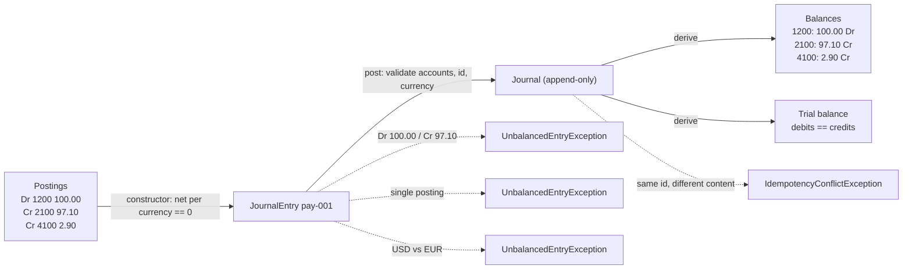

# The Double-Entry Ledger from Scratch

> Debits equal credits or the entry does not exist.

**Type:** Build
**Languages:** Java, Python, Go
**Prerequisites:** Phase 10 Lesson 01 (Representing Money), Phase 10 Lesson 02 (Currencies and FX)
**Time:** ~150 minutes

## Learning Objectives

- Explain why a single-entry balance table cannot detect its own corruption and what the second entry buys you
- Build accounts with a type and a normal balance side, postings that are positive amounts on one side, and journal entries that are rejected unless they net to zero per currency
- Implement an append-only journal whose balances are derived from postings, with cached totals that a test proves equal to a full recomputation
- Produce a trial balance and state the invariant it checks, then show why a reversal entry keeps it true where an edit would not
- Make posting idempotent by entry id, distinguishing a harmless replay from a conflicting entry under the same id
- Trace the worked example (100.00 USD payment, 2.90 fee, 97.10 payout) posting by posting and read every balance in its normal direction

## The Problem

A payment platform stores balances the obvious way: one row per account with a `balance` column, updated in place. A card payment of 100.00 USD arrives. The service adds 97.10 to the merchant's row and 2.90 to the fee-revenue row in one transaction. The receivable from the processor is tracked in a different service, which writes its own row. A payout later subtracts 97.10 from the merchant's row and tells the bank to send the money.

Eleven months later a merchant disputes their statement. Their balance says 412.33 USD. The sum of every payment they received minus every payout they were sent, recomputed from the events table, is 398.17 USD. The 14.16 difference has no explanation. Nobody can say which update produced it, because an in-place update destroys the number it replaced. Was it a retry that applied twice when a database connection dropped after commit but before the acknowledgement? A deploy that briefly ran two versions of the fee code with different rounding? A manual correction in a support tool? The balance table knows only what it is now, not how it got there, and there is no second number anywhere in the system that it has to agree with.

That is the actual defect: there is nothing for the balance to be checked against. A single-entry system records "merchant +97.10" and has no opinion about where the 97.10 came from. If the processor receivable was never decremented, or the fee was recorded as 2.90 in one place and 2.09 in another, nothing fails. The books are internally consistent with any error because there is no internal relationship to violate.

Double-entry bookkeeping, in continuous use since Luca Pacioli documented it in 1494, fixes this with one rule: every movement of value is recorded as a set of postings whose debits equal their credits, and an entry that violates the rule is not recorded at all. Money then has a source and a destination in the same atomic record. A doubled retry doubles both sides and shows up as a receivable that is twice the processor's statement. A fee recorded as 2.09 leaves 0.81 unaccounted for and the entry is rejected before it touches storage. The sum of every account, signed by side, is zero at every instant, and that single number is a continuous integrity check over the entire history. This lesson builds that ledger, and every later lesson in Phase 10 is built on top of it.

## The Concept

### Accounts, sides, and normal balances

An **account** is a named bucket of one currency with a **type**. There are five types, and each one has a **normal balance** side: the side on which an increase is recorded.

| Type | Normal balance | Increases with | Decreases with | Payments example |
|------|----------------|----------------|----------------|------------------|
| ASSET | Debit | Debit | Credit | Settlement bank account, processor receivable |
| EXPENSE | Debit | Debit | Credit | Chargeback losses, interchange paid |
| LIABILITY | Credit | Credit | Debit | Merchant payable, customer stored-value balances |
| EQUITY | Credit | Credit | Debit | Paid-in capital, retained earnings |
| REVENUE | Credit | Credit | Debit | Fee revenue, FX margin |

The words "debit" and "credit" carry no meaning of good or bad, in or out. They are the two columns of a two-column table, historically the left and right pages of a bound journal. A debit to an asset increases it; a debit to a liability decreases it. The sign convention lives in the account type, not in the posting. Phase 10, Lesson 04 covers how a payments company organizes these types into a chart of accounts; here we only need the rule that each type has one side that increases it.

### Postings and the balance rule

A **posting** is one line of an entry: an account, a side, and a positive `Money` amount. Postings are never negative. "Take 2.90 from the merchant" is a debit to the merchant payable, not a credit of -2.90. Forbidding signed postings removes a class of bug where two services disagree on whether negative means refund or means debit.

A **journal entry** is two or more postings plus an id and a description. The entry is valid when, for every currency that appears in it, the sum of debit amounts equals the sum of credit amounts:

```text
for each currency c in entry:
    sum(p.amount for p in postings if p.side == DEBIT  and p.currency == c)
  = sum(p.amount for p in postings if p.side == CREDIT and p.currency == c)
```

Three consequences follow directly and are tested:

- An entry with a single posting cannot balance (one positive amount on one side), so it is rejected.
- An entry whose debits are 100.00 and credits are 97.10 is off by 2.90 and is rejected with that number in the message.
- An entry that debits 100.00 USD and credits 100.00 EUR has a net of +100.00 in USD and -100.00 in EUR. Neither nets to zero, so it is rejected. A currency conversion is two balanced entries through an FX clearing account, which Lesson 09 builds; it is never one entry that pretends 100 USD equals 100 EUR.

The constructor enforces the rule, so a `JournalEntry` that exists is balanced by definition. Code downstream never re-checks.

### The journal is append-only; balances are derived

The **journal** is the ordered list of every entry ever accepted. It only grows. There is no update and no delete. A **balance** is not stored as a fact; it is a function of the journal:

```text
netDebit(account) = sum(debits to account) - sum(credits to account)
balance(account)  = netDebit(account)            if normal balance is DEBIT
                  = -netDebit(account)           if normal balance is CREDIT
```

Because every entry nets to zero per currency, the sum of `netDebit` over all accounts of one currency is zero after every post. That is the ledger's invariant and the trial balance is its report: list every account's net in a debit column (if positive) or a credit column (if negative), total the columns, and the totals are equal. If they are not, the storage is corrupt, because no sequence of valid entries can produce that state.

Recomputing a balance by scanning the journal is O(n) in the number of postings, which is fine for a test and useless for a hot path. The implementation also keeps two running totals per account, `debitTotals` and `creditTotals`, updated when an entry is accepted. The cache is a derived value, and the stress test posts five thousand seeded random entries and asserts that the cache equals the scan for every account. Lesson 05 replaces this cache with snapshots that survive restarts; the invariant it has to preserve is exactly the one tested here.



### Worked example: a 100.00 USD card payment

Four accounts: `1010 Settlement Bank` (asset), `1200 Processor Receivable` (asset), `2100 Merchant Payable` (liability), `4100 Fee Revenue` (revenue). The fee is 2.9% of 100.00 with `HALF_EVEN`, which is `10000 * 29 / 1000 = 290` minor units exactly, so 2.90 USD and a net of 97.10 USD.

Entry `pay-001`, the capture. The processor owes us the gross; we owe the merchant the net; the difference is ours.

```text
pay-001  card payment captured
  Dr 1200 Processor Receivable   100.00 USD
      Cr 2100 Merchant Payable    97.10 USD
      Cr 4100 Fee Revenue          2.90 USD
debits 100.00 = credits 97.10 + 2.90   -> accepted
```

Entry `stl-001`, settlement. The processor pays the gross into our bank, extinguishing the receivable.

```text
stl-001  processor settles to our bank
  Dr 1010 Settlement Bank        100.00 USD
      Cr 1200 Processor Receivable 100.00 USD
```

Entry `out-001`, payout. We pay the merchant what we owe them, extinguishing the liability.

```text
out-001  payout to merchant
  Dr 2100 Merchant Payable        97.10 USD
      Cr 1010 Settlement Bank      97.10 USD
```

Balances after all three, each read in its normal direction:

| Account | Type | Debits | Credits | Net debit | Balance (normal side) |
|---------|------|--------|---------|-----------|-----------------------|
| 1010 Settlement Bank | ASSET | 100.00 | 97.10 | +2.90 | 2.90 Dr |
| 1200 Processor Receivable | ASSET | 100.00 | 100.00 | 0.00 | 0.00 |
| 2100 Merchant Payable | LIABILITY | 97.10 | 97.10 | 0.00 | 0.00 |
| 4100 Fee Revenue | REVENUE | 0.00 | 2.90 | -2.90 | 2.90 Cr |

Net debits sum to `+2.90 + 0 + 0 - 2.90 = 0`. The trial balance has 2.90 in the debit column (bank) and 2.90 in the credit column (revenue). The story the ledger tells is complete: the only money left in the system is the fee, it sits in our bank account, and it was earned as revenue. Every intermediate claim (the processor owed us, we owed the merchant) was created and extinguished by matched postings.

### Reversal, not edit

The capture turns out to be wrong (a duplicate, or voided before the batch closed) and must be undone in full. The wrong fix is `UPDATE entries SET ... WHERE id = 'pay-001'` or, worse, deleting it. The journal is evidence. Auditors, the reconciliation job in Lesson 08, and your own incident review all depend on the journal at time T being the same journal you see later.

The right fix is a **reversal**: a new entry whose postings are the originals with every side flipped:

```text
rev-001  reversal: void pay-001   (reverses pay-001)
      Cr 1200 Processor Receivable 100.00 USD
  Dr 2100 Merchant Payable          97.10 USD
  Dr 4100 Fee Revenue                2.90 USD
```

A flipped balanced entry is still balanced, so it is accepted by the same constructor. Its effect on every balance is the exact negative of the original, so `post(e); post(reversal(e))` is the identity on every account, which the tests assert on a fresh ledger. The reversal records what it reverses (`reversalOf = "pay-001"`), the ledger refuses to reverse the same entry twice, and the original stays at position one of the journal forever. A full mirror is a reversal (a void), not a refund: a true refund after settlement is a new forward entry (Dr 2100 Merchant Payable / Cr Refunds Payable to the customer), usually with the fee retained, which is why it does not touch 4100 Fee Revenue; Phase 10, Lesson 06 builds that entry alongside partial reversals and corrections with a different amount.

### Idempotent posting by entry id

A payment service retries. A network partition between the service and the ledger after the ledger committed but before the service received the acknowledgement means the same entry arrives twice. If posting is not idempotent, the merchant is credited 97.10 twice and the fee is booked twice, and the books still balance, because the duplicate is itself a balanced entry. Double-entry does not protect you from this; it only makes it visible later when the processor statement shows one capture and your receivable shows two.

So `post` is keyed by entry id and has three outcomes:

| Situation | Result |
|-----------|--------|
| Id not seen before | Appended, returns `true` |
| Id seen before, content identical | Not appended, returns `false`; nothing changes |
| Id seen before, content different | Rejected with `IdempotencyConflictException`; nothing changes |

The third case is the important one. Silently ignoring a different entry under a reused id would hide a bug in the caller's id generation. Silently accepting it would corrupt the journal. Rejecting it is the only honest response. The caller's contract is: the id is a deterministic function of the business event (the capture id from the processor, the payout batch id), not a fresh UUID per attempt, or idempotency buys nothing. Phase 12, Lesson 01 builds the idempotency store around a whole API; this is the same principle at the ledger boundary.

### What this ledger does not do

- It does not persist. The journal is an in-memory list. Phase 7 covers write-ahead logs and Lesson 05 covers snapshots; the invariants here are what they must preserve.
- It does not handle concurrent writers. `post` is a plain method; two threads posting against the same `Ledger` will corrupt the running totals. Lesson 07 introduces a lock for holds and Lesson 11 handles hot accounts.
- It does not convert currencies. An entry nets to zero per currency and never across currencies. Lesson 09 builds the FX clearing account that lets USD and EUR appear in one business transaction as two balanced entries.
- It does not know about time. Entries have an order (journal position) but no timestamp, so there is no "balance as of Tuesday". Lesson 05 adds that.
- It does not enforce that an asset account never goes negative. A bank account overdraft is a negative asset balance, which the ledger records faithfully. Whether that is allowed is a business rule for Lesson 07's available-balance check.

## Build It

The walkthrough is in Java. The Python and Go files implement the same types with the same names; the subsections at the end cover only what differs. The `Money` and `Currency` types are copied verbatim from Lesson 01 at the top of each file, because lessons are self-contained.

### Step 1: Sides and account types

```java
enum Side {
    DEBIT, CREDIT;
    Side opposite() { return this == DEBIT ? CREDIT : DEBIT; }
}

enum AccountType {
    ASSET(Side.DEBIT), EXPENSE(Side.DEBIT), LIABILITY(Side.CREDIT), EQUITY(Side.CREDIT), REVENUE(Side.CREDIT);

    private final Side normalBalance;
    AccountType(Side normalBalance) { this.normalBalance = normalBalance; }
    Side normalBalance() { return normalBalance; }
}

record Account(String id, String name, AccountType type, Currency currency) {
    Account {
        if (id == null || id.isBlank()) throw new IllegalArgumentException("account id required");
        Objects.requireNonNull(type, "type");
        Objects.requireNonNull(currency, "currency");
    }
}
```

The normal balance is data attached to the type, so `balance()` later is one branch, not a five-way switch scattered through the code. `Side.opposite()` exists for reversals. An account has exactly one currency; a merchant who settles in USD and EUR has two accounts.

**Predict:** if a liability account has debits of 50.00 and credits of 30.00, what sign does its balance have in the normal direction, and what does that mean in business terms?

### Step 2: A posting is a positive amount on one side

```java
record Posting(String accountId, Side side, Money amount) {
    Posting {
        Objects.requireNonNull(accountId, "accountId");
        Objects.requireNonNull(side, "side");
        if (!amount.isPositive()) throw new InvalidPostingException("posting amount must be positive, got " + amount);
    }

    static Posting debit(String accountId, Money amount) { return new Posting(accountId, Side.DEBIT, amount); }
    static Posting credit(String accountId, Money amount) { return new Posting(accountId, Side.CREDIT, amount); }

    Posting flipped() { return new Posting(accountId, side.opposite(), amount); }
}
```

Zero is rejected along with negatives. A zero posting is almost always a rounding result that nobody looked at (a 0.00 fee on a 0.10 payment), and letting it through produces entries that look like three-leg sales but are not. The caller who really wants to record "no fee" omits the posting.

**Predict:** `Posting.credit("1200", Money.parse("-1.00", USD))` — what happens, and why is that preferable to interpreting it as a debit of 1.00?

### Step 3: The entry validates itself

```java
record JournalEntry(String id, String description, List<Posting> postings, String reversalOf) {
    JournalEntry {
        if (id == null || id.isBlank()) throw new IllegalArgumentException("entry id required");
        if (postings == null || postings.size() < 2) {
            throw new UnbalancedEntryException(id, "an entry needs at least two postings");
        }
        postings = List.copyOf(postings);
        Map<Currency, Long> net = new LinkedHashMap<>();
        for (Posting p : postings) {
            long signed = p.side() == Side.DEBIT ? p.amount().minorUnits() : -p.amount().minorUnits();
            net.merge(p.amount().currency(), signed, Math::addExact);
        }
        StringBuilder problems = new StringBuilder();
        for (Map.Entry<Currency, Long> e : net.entrySet()) {
            if (e.getValue() != 0) {
                if (problems.length() > 0) problems.append("; ");
                problems.append("debits minus credits in ").append(e.getKey().code()).append(" = ")
                        .append(Money.ofMinor(e.getValue(), e.getKey()));
            }
        }
        if (problems.length() > 0) throw new UnbalancedEntryException(id, problems + " (must be zero per currency)");
    }
}
```

The net is accumulated per currency as signed minor units: debits positive, credits negative. A balanced entry has every currency at zero. `List.copyOf` makes the postings immutable so a caller cannot add a leg after validation; the test `entry postings are immutable` asserts that `postings().clear()` throws. `Math::addExact` means an entry with absurd amounts overflows loudly instead of wrapping to a balanced-looking zero.

The error message reports the exact imbalance per currency. For the mixed-currency case that reads `debits minus credits in USD = 100.00 USD; debits minus credits in EUR = -100.00 EUR`, which tells the reader immediately that someone tried to net two currencies against each other.

**Predict:** an entry with `Dr A 10.00 USD, Cr B 10.00 USD, Dr C 5.00 EUR, Cr D 5.00 EUR`. Accepted or rejected? What does the ledger's `post` say about it when accounts C and D are USD accounts?

### Step 4: Reversal is a derived entry

```java
JournalEntry reversal(String newId, String description) {
    List<Posting> flipped = new ArrayList<>(postings.size());
    for (Posting p : postings) flipped.add(p.flipped());
    return new JournalEntry(newId, description, flipped, id);
}
```

The reversal goes through the same constructor as any other entry, so it is validated the same way. The fourth field records the lineage. Nothing about the original is touched.

### Step 5: The ledger validates, then mutates everything

```java
boolean post(JournalEntry entry) {
    Integer existing = indexById.get(entry.id());
    if (existing != null) {
        if (journal.get(existing).equals(entry)) return false;
        throw new IdempotencyConflictException(entry.id());
    }
    for (Posting p : entry.postings()) {
        Account account = account(p.accountId());                 // throws UnknownAccountException
        if (!account.currency().equals(p.amount().currency())) {
            throw new InvalidPostingException("entry " + entry.id() + " rejected: account " + account.id()
                    + " is " + account.currency().code() + " but posting is " + p.amount().currency().code());
        }
    }
    if (entry.reversalOf() != null) {
        if (!indexById.containsKey(entry.reversalOf())) throw new UnknownEntryException(entry.reversalOf());
        if (reversedBy.containsKey(entry.reversalOf())) throw new AlreadyReversedException(entry.reversalOf());
    }
    // Validation complete: now mutate, and mutate everything.
    journal.add(entry);
    indexById.put(entry.id(), journal.size() - 1);
    if (entry.reversalOf() != null) reversedBy.put(entry.reversalOf(), entry.id());
    for (Posting p : entry.postings()) {
        Map<String, Long> totals = p.side() == Side.DEBIT ? debitTotals : creditTotals;
        totals.merge(p.accountId(), p.amount().minorUnits(), Math::addExact);
    }
    return true;
}
```

The shape of this method is the point. Every check that can fail runs before the first write. Once the comment line is crossed, nothing below it throws for a reason the caller caused (the `addExact` can throw on overflow, which is a bug, not a validation failure). This is how you get atomicity without a database: a rejected entry leaves the journal, the index, the reversal map, and both total maps exactly as they were. The test `rejected entries left the journal untouched` posts three bad entries and asserts that the size and a balance are unchanged.

The entry already proved it balances. What the ledger adds is knowledge the entry could not have: whether the accounts exist, whether each posting's currency matches its account's currency, and whether a reversal target exists and is still unreversed. Record equality (`journal.get(existing).equals(entry)`) decides replay versus conflict, which is why `JournalEntry` is a record and `postings` is an immutable list with value equality.

**Predict:** `post` is called with an entry whose first posting is to a valid account and whose second is to account `"9999"`, which does not exist. After the exception, what is `debitTotals.get(firstAccount)`?

### Step 6: Balances in the normal direction, and the trial balance

```java
Money balance(String accountId) {
    Account account = account(accountId);
    long debits = debitTotals.get(accountId), credits = creditTotals.get(accountId);
    long signed = account.type().normalBalance() == Side.DEBIT
            ? Math.subtractExact(debits, credits)
            : Math.subtractExact(credits, debits);
    return Money.ofMinor(signed, account.currency());
}

Money netDebit(String accountId) {
    Account account = account(accountId);
    return Money.ofMinor(Math.subtractExact(debitTotals.get(accountId), creditTotals.get(accountId)), account.currency());
}

TrialBalance trialBalance(Currency currency) {
    List<TrialBalanceRow> rows = new ArrayList<>();
    Money totalDebits = Money.zero(currency), totalCredits = Money.zero(currency);
    for (Account a : accounts.values()) {
        if (!a.currency().equals(currency)) continue;
        Money net = netDebit(a.id());
        Money debit = net.isNegative() ? Money.zero(currency) : net;
        Money credit = net.isNegative() ? net.negate() : Money.zero(currency);
        rows.add(new TrialBalanceRow(a, debit, credit));
        totalDebits = totalDebits.plus(debit);
        totalCredits = totalCredits.plus(credit);
    }
    return new TrialBalance(currency, rows, totalDebits, totalCredits);
}
```

Two views of the same number. `balance` is what a product screen or a merchant statement shows: a liability of 97.10 reads as "+97.10 owed to the merchant". `netDebit` is the raw debits-minus-credits that the trial balance needs, because the trial balance is about the whole ledger summing to zero, not about any account's business meaning. `TrialBalance.balances()` compares the two column totals; the `accounts` map is a `LinkedHashMap` so the rows come out in the order accounts were opened and the printed report is deterministic.

`netDebitFromPostings` (in the file, not shown) walks the whole journal for one account. It exists only so the test can prove the cache is honest.

**Predict:** after `pay-001`, `stl-001`, and `out-001`, what does `trialBalance(USD).totalDebits()` return, and which single account contributes it?

### Step 7: Run it

```bash
cd phases/10-money-and-ledgers/03-double-entry-ledger/code/java
javac -d .out *.java && java -cp .out Main
java -cp .out MainTest
```

Expected output, abbreviated:

```console
== A customer pays a merchant 100.00 USD; we keep a 2.9% fee ==
posted=true
pay-001  card payment captured
  Dr 1200  100.00 USD
      Cr 2100  97.10 USD
      Cr 4100  2.90 USD
replay posted=false  (same id, same content: no-op)

== Trial balance ==
account                               debit         credit
1010 Settlement Bank               2.90 USD
4100 Fee Revenue                                  2.90 USD
TOTAL                              2.90 USD       2.90 USD   balances=true

== Entries that cannot exist ==
rejected: entry bad-1 rejected: debits minus credits in USD = 2.90 USD (must be zero per currency)
rejected: entry bad-2 rejected: debits minus credits in USD = 100.00 USD; debits minus credits in EUR = -100.00 EUR (must be zero per currency)
rejected: entry id pay-001 already posted with different content

== Reversal: the capture is voided; nothing is edited ==
fee revenue before reversal 2.90 USD, after 0.00 USD
journal now holds 4 entries; pay-001 is still entry #1

== 10,000 seeded random balanced entries: trial balance still sums to zero ==
entries=10004 totalDebits=66919.10 USD totalCredits=66919.10 USD balances=true
```

The last line is produced by `RandomEntries`, a generator seeded with `42` that builds entries with two to four legs where the last leg credits the sum of the others. The random totals differ between the Java, Python, and Go runs because each language's generator produces a different sequence from the same seed, but in all three `balances=true`, and within one language the output is identical on every run.

### In Python

```python
@dataclass(frozen=True)
class JournalEntry:
    id: str
    description: str
    postings: tuple[Posting, ...]
    reversal_of: str | None = None

    def __init__(self, id, description, postings, reversal_of=None):
        postings = tuple(postings)
        if len(postings) < 2:
            raise UnbalancedEntryError(id, "an entry needs at least two postings")
        ...
        object.__setattr__(self, "postings", postings)
```

Differences, all in `code/python/main.py`:

- **A frozen dataclass with a hand-written `__init__`.** The validation needs to run before the fields are set and needs to normalize `postings` to a tuple, so the constructor is explicit and assigns through `object.__setattr__`. Equality and hashing still come from the dataclass, which is what `post` uses to tell a replay from a conflict.
- **`AccountType` carries its normal balance as the enum value.** `AccountType.ASSET.value is Side.DEBIT`, exposed through a `normal_balance` property so the call sites read the same as Java.
- **No overflow checks.** Python ints are unbounded, so the `addExact` calls have no equivalent and the per-currency net is a plain `dict` sum.
- **`entries()` returns a tuple**, a snapshot that the caller cannot mutate, where Java returns an unmodifiable view.

### In Go

```go
func NewJournalEntry(id, description string, postings []Posting) (JournalEntry, error)

func (l *Ledger) Post(entry JournalEntry) (bool, error) {
    if existing, ok := l.indexByID[entry.ID]; ok {
        if l.journal[existing].Equal(entry) {
            return false, nil
        }
        return false, fmt.Errorf("%w: %s", ErrIdempotencyConflict, entry.ID)
    }
    ...
}
```

Differences, all in `code/go/main.go`:

- **Errors are values, and every rejection wraps a sentinel.** `ErrUnbalanced`, `ErrInvalidPosting`, `ErrUnknownAccount`, `ErrUnknownEntry`, `ErrIdempotencyConflict`, and `ErrAlreadyReversed` all support `errors.Is`, which is how the tests assert the failure kind.
- **The postings slice is unexported.** A Go struct cannot make a public slice field read-only, so `JournalEntry.postings` is lower-case and `Postings()` returns a copy. `Equal` is written by hand because slices are not comparable with `==`.
- **`Dr` and `Cr` panic on a non-positive amount; `NewPosting` returns an error.** The short constructors exist for the literal-heavy demo and tests; production code uses `NewPosting`.
- **Map iteration order is random in Go**, so the ledger keeps a separate `accountOrder` slice to make the trial balance rows deterministic. The Java `LinkedHashMap` and Python's insertion-ordered `dict` give this for free.

## Use It

### Relational databases: the ledger as two tables

Production ledgers are almost always a `journal_entries` table and a `postings` table in PostgreSQL or a similar store, with the balance rule enforced in application code inside a transaction and often re-checked by a deferred constraint or a trigger. The shape you built maps directly:

```sql
CREATE TABLE journal_entries (
    id           TEXT PRIMARY KEY,          -- idempotency key
    description  TEXT NOT NULL,
    reversal_of  TEXT REFERENCES journal_entries(id),
    seq          BIGSERIAL UNIQUE           -- journal position
);
CREATE TABLE postings (
    entry_id     TEXT NOT NULL REFERENCES journal_entries(id),
    account_id   TEXT NOT NULL REFERENCES accounts(id),
    side         CHAR(1) NOT NULL CHECK (side IN ('D', 'C')),
    minor_units  BIGINT NOT NULL CHECK (minor_units > 0),
    currency     CHAR(3) NOT NULL
);
```

The `PRIMARY KEY` on `id` gives you idempotency for free: a replayed insert fails with a unique violation, and the application maps that to "already posted" after confirming the content matches. What the database does for you that the in-memory version made explicit is durability and multi-writer isolation; what it does not do is check that debits equal credits, which remains your code's job (a `SUM(CASE side ...) = 0` assertion in the same transaction is the usual belt-and-braces).

### Purpose-built ledger databases

TigerBeetle is a database whose only data types are accounts and transfers, with debits-equal-credits and per-account limits enforced in the engine at millions of transfers per second. Its `transfer` is a two-leg entry with an `id` used exactly as this lesson uses entry ids: a replayed transfer with the same id and content is accepted idempotently, a different one is rejected. Reading its account structure (`debits_posted`, `credits_posted`, `debits_pending`, `credits_pending`) after this lesson is a good way to see which choices here are fundamental and which are convenience; the `pending` fields are the subject of Lesson 07.

### Payment processors' balance transaction objects

Stripe's Balance Transactions API shows the external view of the same mechanism: every charge, fee, refund, and payout is a balance transaction with an `amount`, a `fee`, a `net`, and a `type`, and the sum of `net` over a period reconciles to payouts. The processor's ledger is behind the API; what you see is the posting that hits your balance, which is why reconciliation (Lesson 08) is about matching their postings to yours.

### Accounting systems

General-ledger systems (SAP, Oracle Financials, NetSuite, QuickBooks) are double-entry ledgers with a chart of accounts, periods, and reporting on top. The trial balance you printed is the first report every one of them produces and the one an auditor asks for first. The difference between those systems and a payments ledger is scale and latency, not model: a payments ledger posts millions of three-leg entries a day and needs balances in milliseconds, while a GL posts thousands and closes monthly. Lesson 12 covers the close.

## Ship It

`outputs/checklist-ledger-entry-review.md` is a review checklist for any code that creates or posts journal entries. It covers the balance rule, posting signs, idempotency keys, reversal versus edit, and the "validate everything, then mutate everything" structure of a posting method. Use it on the pull request that introduces a new entry type (a new fee, a new payout flow) and on any change to the posting path.

## Exercises

1. **Reinforce.** Add a `Ledger.postAll(List<JournalEntry>)` that posts a batch atomically: if any entry would be rejected, none are posted. Write a test where the second of three entries references an unknown account and assert that the journal size and every balance are unchanged. Then explain in one sentence why you cannot implement this by calling `post` three times in a loop and catching the exception.

2. **Apply.** Add an `EXPENSE` account `5100 Chargeback Losses` and record a chargeback: the processor claws back 100.00 from the receivable, the merchant payable is reduced by 97.10, and the platform absorbs the 2.90 it already recognized as revenue. Write the entry (hint: it is not the reversal of `pay-001`; the fee revenue stays recognized and an expense appears). Post it after `stl-001` and `out-001` and show the trial balance. Which account went negative in its normal direction, and what does that mean?

3. **Extend.** Combine with Phase 1 (hashing) or Phase 7 (logs): give each `JournalEntry` a `prevHash` field equal to the SHA-256 of the previous entry's canonical string form, computed in `post`, so the journal becomes a hash chain. Write a test that serializes the journal, tampers with the amount of entry three, and shows that verification fails at entry four. State what this protects against and what it does not (hint: it does not protect against someone who can rewrite the whole chain).

## Key Terms

| Term | What people say | What it actually means |
|------|-----------------|------------------------|
| Debit / credit | "money in / money out" | The two columns of an entry; a debit increases asset and expense accounts and decreases the others, a credit does the reverse. No inherent meaning of good or bad |
| Normal balance | "which way is positive" | The side on which an account's increases are recorded; assets and expenses are debit-normal, liabilities, equity, and revenue are credit-normal |
| Posting | "a line item" | One account, one side, one positive amount of one currency; never signed, never zero |
| Journal entry | "a transaction" | Two or more postings with an id and description, valid only when debits equal credits in every currency it touches |
| Trial balance | "the books balance" | A report listing every account's net in a debit or credit column; the column totals are equal if and only if every entry balanced |
| Reversal | "undo" | A new entry whose postings are the original's with each side flipped; the original is never modified |
| Idempotent post | "safe to retry" | Posting the same entry id with the same content twice has the effect of posting it once; the same id with different content is a conflict, not a silent overwrite |
| Append-only journal | "immutable log" | Entries are only ever added at the end; balances are derived from the log, so any balance can be recomputed and checked |

## Further Reading

- [Pacioli, *Summa de arithmetica, geometria, proportioni et proportionalita* (1494), Particularis de computis et scripturis](https://archive.org/details/summadearithmeti00paci) — the first printed description of double-entry bookkeeping; the rule "for every debtor a creditor" has not changed in five centuries.
- [TigerBeetle: Data Model and Transfers](https://docs.tigerbeetle.com/concepts/) — a database built around exactly the accounts/transfers model in this lesson, including idempotent transfer ids and the debit/credit-balancing invariant enforced in the engine.
- [Stripe API: Balance Transactions](https://docs.stripe.com/api/balance_transactions) — the processor-side view of postings (`amount`, `fee`, `net`, `type`) that your receivable account has to reconcile against.
- [IFRS Conceptual Framework for Financial Reporting, chapter 4 (elements of financial statements)](https://www.ifrs.org/issued-standards/list-of-standards/conceptual-framework/) — the authoritative definitions of asset, liability, equity, income, and expense that the five account types encode.
- [PostgreSQL documentation: Constraints](https://www.postgresql.org/docs/current/ddl-constraints.html) — `CHECK`, `UNIQUE`, and deferred constraints, the tools for enforcing positive postings and unique entry ids once the journal lives in a database.
- [Fowler, *Accounting Patterns* (Analysis Patterns, chapter 6)](https://martinfowler.com/eaaDev/AccountingNarrative.html) — the Account, Entry, and Transaction patterns and the reasoning for immutable entries and reversing adjustments.
