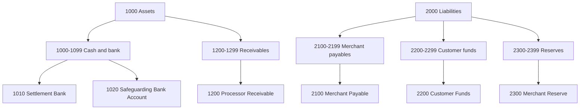

# Chart of Accounts and Account Types

> Assets, liabilities, revenue: which direction increases each.

**Type:** Learn
**Languages:** —
**Prerequisites:** Phase 10, Lesson 03 (The Double-Entry Ledger from Scratch)
**Time:** ~60 minutes

## Learning Objectives

- State the five account types, the side that increases each, and the accounting equation that ties them together
- Classify any account a payment company needs (customer funds, merchant payable, reserve, processor receivable, fee revenue, chargeback expense, FX gain/loss) and defend the classification
- Distinguish a general ledger from a sub-ledger and explain which balances must agree between them and how often
- Design an account hierarchy with numbered ranges so that reports roll up without string matching
- Post a month of representative entries by hand and produce a trial balance whose columns tie
- Explain, at a high level, what safeguarding regulations require of a payment institution's books and which accounts they constrain

## The Problem

A payments startup has a working double-entry ledger (Lesson 03). It has eleven accounts, named by whoever needed them first: `merchant_balance`, `fees`, `stripe`, `bank`, `refunds`, `fx`, `holding`, `misc`, `adjustments`, `founder_loan`, `cash`. Every entry balances. The trial balance sums to zero every night. Then two things happen in the same quarter.

First, the company applies for a payment institution licence. The regulator asks a simple question: at close of business yesterday, how much money did you hold on behalf of customers, and in which bank account was it? The ledger cannot answer. Customer wallet balances, merchant payables awaiting payout, and the company's own fee income all passed through `holding` and `bank` on their way to somewhere else. The amounts are in there, balanced to the cent, but there is no account whose balance means "funds we owe to customers" and no account whose balance means "the segregated bank account where those funds must sit". The team spends three weeks writing SQL to reconstruct the answer from entry descriptions.

Second, the finance lead tries to produce a profit-and-loss statement for the board. Revenue should be fee income minus processor costs, chargeback losses, and FX losses. But `fees` contains both the fees the company charged merchants and the fees the processor charged the company, netted. `fx` contains gains and losses together with the gross converted amounts. `adjustments` contains everything that did not fit elsewhere, including a 40,000 correction whose description is "see Slack". The books balance and nobody can say whether the company made money.

Both failures are the same failure: the ledger has entries but no **chart of accounts**. A chart of accounts is the list of accounts a business is allowed to post to, each with a type, a number, a position in a hierarchy, and a one-sentence definition of what its balance means. It is the schema of the ledger. Lesson 03 gave you the engine that enforces debits equal credits; this lesson is about choosing the accounts so that a balance answers a question someone will actually ask.

## The Concept

### The five types and the accounting equation

Every account has one of five types. The types are not arbitrary labels: they are the terms of one equation that must hold at every instant.

```text
ASSETS = LIABILITIES + EQUITY + (REVENUE - EXPENSES)
```

Assets are what the business controls (cash in the bank, money the processor owes it). Liabilities are what it owes (customer balances, merchant payouts not yet sent). Equity is the owners' residual claim. Revenue and expenses are the period's changes to equity, kept separate so they can be reported and then rolled into equity at close (Lesson 12).

Rearranged so everything is on one side, the equation reads `ASSETS + EXPENSES = LIABILITIES + EQUITY + REVENUE`. The left-hand types are **debit-normal**: a debit increases them. The right-hand types are **credit-normal**: a credit increases them. That is the whole of the sign convention, and it is why Lesson 03's `AccountType` carries a `normalBalance` side.

| Type | Normal balance | Debit does | Credit does | Balance answers |
|------|----------------|------------|-------------|-----------------|
| ASSET | Debit | Increases | Decreases | What do we hold or have a right to receive? |
| EXPENSE | Debit | Increases | Decreases | What did it cost us this period? |
| LIABILITY | Credit | Increases | Decreases | What do we owe? |
| EQUITY | Credit | Increases | Decreases | What is the owners' residual claim? |
| REVENUE | Credit | Increases | Decreases | What did we earn this period? |

A mnemonic some people use is DEALER (Dividends, Expenses, Assets are debit-normal; Liabilities, Equity, Revenue are credit-normal). A better habit is to derive it from the equation each time until it is automatic, because the mnemonic does not tell you which side an unfamiliar account belongs on and the equation does.

### A decision procedure for classifying an account

When a new account is proposed, ask four questions in order:

1. **Does its balance represent money or a claim we control?** Bank balances, receivables from processors, prepaid deposits with a scheme. Then it is an ASSET.
2. **Does its balance represent money we owe someone else?** Customer wallet balances, merchant payables, reserves we are holding back, tax collected but not yet remitted. Then it is a LIABILITY. The test is: if the company stopped trading tonight, would someone have a legal claim to this amount? If yes, it is a liability even if the money is sitting in our bank account.
3. **Is it a cost or an income of this period that will be closed to equity?** Fee revenue, interchange paid, chargeback losses, FX differences. REVENUE if it increases what the owners are entitled to, EXPENSE if it decreases it.
4. **Otherwise, is it the owners' stake?** Paid-in capital, retained earnings. EQUITY.

The two classic mistakes in payments: treating customer funds as an asset because they are in our bank account (they are; the bank balance is the asset and the obligation to the customer is the matching liability), and netting processor costs against fee revenue into one account (a 2.9% fee charged and a 1.8% cost paid are two facts; the margin is a report, not an account).

### A payment company's chart of accounts

Below is a minimal chart for a platform that lets customers hold a wallet balance and pays merchants for card sales, with the account numbers that the worked month uses. Ranges follow the near-universal convention: 1000s assets, 2000s liabilities, 3000s equity, 4000s revenue, 5000s expenses.

| Number | Account | Type | What the balance means |
|--------|---------|------|------------------------|
| 1010 | Settlement Bank (operating) | ASSET | The company's own cash: capital, earned fees, float awaiting payout |
| 1020 | Safeguarding Bank Account | ASSET | Segregated bank account holding only funds owed to customers |
| 1200 | Processor Receivable | ASSET | Captured card payments the processor has not yet settled to us |
| 2100 | Merchant Payable | LIABILITY | Net sale proceeds owed to merchants, not yet paid out |
| 2200 | Customer Funds | LIABILITY | Wallet balances owed to customers; must be covered by 1020 |
| 2300 | Merchant Reserve | LIABILITY | Portion of merchant proceeds withheld against future chargebacks; still owed to the merchant |
| 3100 | Paid-in Capital | EQUITY | What the owners put in |
| 4100 | Fee Revenue | REVENUE | Fees the platform charged merchants |
| 4900 | FX Gain/(Loss) | REVENUE | Net difference between the rate we booked and the rate we settled; a debit balance is a loss |
| 5100 | Chargeback Expense | EXPENSE | Chargeback fees and unrecoverable principal borne by the platform |
| 5200 | Processor Fees | EXPENSE | Interchange, scheme, and processor fees charged to the platform |

Three of these deserve a closer look because people get them wrong.

**Merchant Reserve (2300) is a liability, not an asset.** The platform holds back 5% of a merchant's sales for 90 days. That cash sits in the platform's bank account (an asset). But the merchant is still owed it; the platform has only delayed payment. The reserve account records the obligation. When a chargeback lands and the platform keeps 100.00 of the reserve to cover it, that is a debit to 2300 (the obligation shrinks) matched by the credit to the bank that the processor took.

**FX Gain/(Loss) (4900) is one account that swings both ways.** You could keep separate gain and loss accounts, but a single account whose balance is read with its sign is simpler and what most charts do. It is typed REVENUE so that a credit (gain) increases it; a loss appears as a debit balance, which the trial balance shows in the debit column. Lesson 09 covers how the gain or loss is computed when the ledger holds multiple currencies; the worked month below uses a deliberately simplified USD-only treatment.

**Processor Receivable (1200) is where your money is most of the time.** A card payment captured at 14:00 on Tuesday is typically settled to your bank on Thursday. Between capture and settlement the platform has a claim on the processor, and that claim is what 1200 records. It is the account that reconciliation (Lesson 08) is mostly about: your 1200 debits should match the processor's statement line by line.

### Hierarchies and roll-ups

A real chart has hundreds of accounts, and reports need totals at several levels: all cash, all customer liabilities, all revenue. The hierarchy is encoded in the numbering so a report is a range query rather than a list of hand-maintained account ids.



Two rules keep a hierarchy useful:

- **Only leaf accounts receive postings.** `1000 Assets` is a report heading, not a posting target. If someone can post to a parent, the parent's own postings and its children's sum become two different numbers and the roll-up is ambiguous.
- **Leave gaps.** Numbering 1010, 1020, 1030 instead of 1001, 1002, 1003 lets you add `1015 Safeguarding Bank Account (EUR)` without renumbering, and renumbering an account that has history is a migration nobody wants.

### General ledger versus sub-ledgers

The chart above has one `2100 Merchant Payable`. The platform has forty thousand merchants, and each one needs to see their own balance and their own history. Putting forty thousand accounts into the chart of accounts would make the trial balance unreadable and the finance team's reports unusable.

The standard answer is two levels. The **general ledger (GL)** holds the chart above: a few hundred accounts, one per meaning. A **sub-ledger** holds the detail for one GL account: a merchant payable sub-ledger with one account per merchant, a customer funds sub-ledger with one account per wallet. The GL account is called the **control account** for its sub-ledger.

| | General ledger | Sub-ledger |
|--|----------------|------------|
| Accounts | Hundreds; one per meaning | Thousands to millions; one per counterparty |
| Who reads it | Finance, auditors, regulators | Product, support, the counterparty themselves |
| Posting granularity | Often batched (one entry per day per flow) | Every individual event |
| Invariant | Trial balance sums to zero | Sum of sub-ledger balances equals the GL control account balance |
| Typical store | Accounting system or GL database | The payments platform's own ledger (what you built in Lesson 03) |

The invariant in the last row is the one engineers own. If the sum of all merchant sub-ledger balances is 1,284,311.07 and GL account 2100 says 1,284,290.07, something posted to one and not the other. In a well-run platform the check runs at least daily and a break pages someone. Many platforms avoid the problem by generating the GL postings from the sub-ledger (a nightly job sums the day's sub-ledger postings per control account and posts one GL entry), so the two cannot disagree unless the job fails, which is itself detectable.

Lesson 03's ledger can play either role. In this course it is the sub-ledger: the accounts in its examples (`2100 Merchant Payable`) stand in for one merchant's account, and the GL is the roll-up.

### What safeguarding regulation requires of the chart

A payment institution that holds customer money is, in most jurisdictions, required to **safeguard** it. The EU's second Payment Services Directive (PSD2, Article 10) and the UK's Payment Services Regulations 2017 (regulation 23) both allow two methods; the common one is **segregation**: funds received from or for payment service users must not be commingled with the institution's own funds, must be placed in a separate account at a credit institution (or invested in low-risk assets) by the end of the business day following receipt, and must be identifiable as customer funds at all times. The UK Financial Conduct Authority's approach document adds that firms must reconcile the safeguarding account to the amount owed to customers at least daily and investigate any shortfall or excess immediately. US state money transmitter laws impose a related requirement under the name "permissible investments": the licensee must hold assets of at least the value of its outstanding customer obligations.

For the chart of accounts this means two things that engineers can enforce:

1. There must be a liability account (or control account over a sub-ledger) whose balance is exactly "what we owe customers": `2200 Customer Funds`. Not mixed with merchant payables, not mixed with the company's own float.
2. There must be an asset account whose balance is exactly "the segregated bank account": `1020 Safeguarding Bank Account`. The daily reconciliation is `balance(1020) >= balance(2200)`, and when a customer spends from their wallet the matching movement out of 1020 into the operating bank is its own entry.

A chart without these two accounts cannot produce the regulator's number without reconstruction. The failure in The Problem is a chart-of-accounts failure first and a reporting failure second.

### Failure modes

- **Suspense accounts that never clear.** `9999 Suspense` or `adjustments` receives anything nobody could classify. It is legitimate as a parking place for an unidentified receipt for a day; it is a defect when its balance is non-zero at month end. Rule: every suspense balance has an owner and a clearing deadline.
- **Netting that destroys information.** One `fees` account for fees earned and fees paid. The margin is visible, the gross amounts are gone, and when the processor changes its pricing you cannot see it.
- **Accounts named after systems.** `stripe`, `adyen`, `plaid` as accounts. The processor is a counterparty; the account should be named for what the balance means (`Processor Receivable`) with the counterparty as a dimension or a sub-ledger. When you add a second processor, the chart should not change.
- **Posting to parents.** A report sums the children of `2000 Liabilities` and misses the 40,000 someone posted directly to `2000`.
- **Type drift.** An account created as REVENUE accumulates refunds as debits until its balance is negative, and someone "fixes" it by changing its type to EXPENSE. The history before the change now reads backwards. Types are immutable; if the account was wrong, open a new one and reclassify with an entry.

## Worked Example

One month of a small platform, in USD only, posting to the chart above. Every entry is written out so you can check each one balances before reading the trial balance. Entries are simplified (one entry per flow rather than per transaction) to fit on a page; the shape of each is what a real system posts thousands of times a day.

```text
d01  Owners capitalize the company
  Dr 1010 Settlement Bank            50,000.00
      Cr 3100 Paid-in Capital                     50,000.00

d03  A customer tops up their wallet by card, 500.00
  Dr 1200 Processor Receivable          500.00
      Cr 2200 Customer Funds                         500.00

d05  Processor settles the top-up; it goes to the safeguarding account
  Dr 1020 Safeguarding Bank Account     500.00
      Cr 1200 Processor Receivable                   500.00

d08  Merchant card sales, gross 10,000.00; fee 2.9%; 5% rolling reserve
  Dr 1200 Processor Receivable       10,000.00
      Cr 2100 Merchant Payable                     9,210.00
      Cr 2300 Merchant Reserve                       500.00
      Cr 4100 Fee Revenue                            290.00

d10  Processor settles the sales, keeping 1.8% (180.00) in interchange and scheme fees
  Dr 1010 Settlement Bank             9,820.00
  Dr 5200 Processor Fees                180.00
      Cr 1200 Processor Receivable                10,000.00

d12  Customer spends 120.00 from their wallet at a merchant; fee 2.9%
  Dr 2200 Customer Funds                120.00
      Cr 2100 Merchant Payable                       116.52
      Cr 4100 Fee Revenue                              3.48
d12  The 120.00 is no longer customer money: move it out of safeguarding
  Dr 1010 Settlement Bank               120.00
      Cr 1020 Safeguarding Bank Account              120.00

d15  Payout to merchant of everything owed so far
  Dr 2100 Merchant Payable            9,326.52
      Cr 1010 Settlement Bank                      9,326.52

d20  Chargeback on a 100.00 sale; processor debits us 115.00 (principal + 15.00 fee)
  Dr 2300 Merchant Reserve              100.00
  Dr 5100 Chargeback Expense             15.00
      Cr 1010 Settlement Bank                        115.00

d22  A EUR 1,000.00 sale booked in USD at the quoted rate 1.0800; fee 2.9%
  Dr 1200 Processor Receivable        1,080.00
      Cr 2100 Merchant Payable                     1,048.68
      Cr 4100 Fee Revenue                             31.32

d24  Processor settles that sale at 1.0750 = 1,075.00; the 5.00 difference is ours to bear
  Dr 1010 Settlement Bank             1,075.00
  Dr 4900 FX Gain/(Loss)                  5.00
      Cr 1200 Processor Receivable                 1,080.00

d28  Payout of the remaining merchant payable
  Dr 2100 Merchant Payable            1,048.68
      Cr 1010 Settlement Bank                      1,048.68
```

Check two of the entries by hand. `d08`: debits 10,000.00; credits 9,210.00 + 500.00 + 290.00 = 10,000.00. The fee is `10000.00 * 29 / 1000 = 290.00` exactly, the reserve is 5% of gross, and the payable is what is left. `d24`: debits 1,075.00 + 5.00 = 1,080.00; credits 1,080.00. We booked a 1,080.00 claim and received 1,075.00 for it; the FX account absorbs the difference as a debit, which for a credit-normal account is a loss. (A multi-currency ledger would hold the receivable in EUR and compute the loss at settlement; Lesson 09.)

Now total each account:

| Account | Type | Debits | Credits | Net debit | Trial balance column |
|---------|------|--------|---------|-----------|----------------------|
| 1010 Settlement Bank | ASSET | 61,015.00 | 10,490.20 | 50,524.80 | Debit 50,524.80 |
| 1020 Safeguarding Bank Account | ASSET | 500.00 | 120.00 | 380.00 | Debit 380.00 |
| 1200 Processor Receivable | ASSET | 11,580.00 | 11,580.00 | 0.00 | |
| 2100 Merchant Payable | LIABILITY | 10,375.20 | 10,375.20 | 0.00 | |
| 2200 Customer Funds | LIABILITY | 120.00 | 500.00 | -380.00 | Credit 380.00 |
| 2300 Merchant Reserve | LIABILITY | 100.00 | 500.00 | -400.00 | Credit 400.00 |
| 3100 Paid-in Capital | EQUITY | 0.00 | 50,000.00 | -50,000.00 | Credit 50,000.00 |
| 4100 Fee Revenue | REVENUE | 0.00 | 324.80 | -324.80 | Credit 324.80 |
| 4900 FX Gain/(Loss) | REVENUE | 5.00 | 0.00 | 5.00 | Debit 5.00 |
| 5100 Chargeback Expense | EXPENSE | 15.00 | 0.00 | 15.00 | Debit 15.00 |
| 5200 Processor Fees | EXPENSE | 180.00 | 0.00 | 180.00 | Debit 180.00 |
| **Totals** | | | | **0.00** | **Debit 51,104.80 / Credit 51,104.80** |

The debit column is `50,524.80 + 380.00 + 5.00 + 15.00 + 180.00 = 51,104.80`. The credit column is `380.00 + 400.00 + 50,000.00 + 324.80 = 51,104.80`. They tie, as they must, because every one of the twelve entries balanced.

Now read the chart as a set of answers:

- **Regulator's question:** customer funds owed are 380.00 (account 2200); the safeguarding account holds 380.00 (account 1020). Covered exactly, because the `d12` sweep moved the spent 120.00 out. Had the sweep been forgotten, 1020 would show 500.00 against a 380.00 liability, an excess the FCA guidance says to investigate; the reverse shortfall is a breach.
- **Board's question:** revenue 324.80, less processor fees 180.00, chargeback expense 15.00, and FX loss 5.00, gives net income of 124.80 for the month. Check against the balance sheet: assets `50,524.80 + 380.00 = 50,904.80`; liabilities `380.00 + 400.00 = 780.00`; equity `50,000.00`; `780.00 + 50,000.00 + 124.80 = 50,904.80`. The accounting equation holds.
- **Merchant's question:** payable is zero (everything paid out) and 400.00 remains in reserve after the chargeback took 100.00.

Lesson 12 covers the close: zeroing the revenue and expense accounts into retained earnings so the next month starts clean.

## Exercises

1. **Reinforce.** The platform starts collecting sales tax on behalf of merchants in one state: 8% of each sale is withheld and remitted to the tax authority monthly. Add the account(s) to the chart with number, type, and a one-sentence meaning, then rewrite entry `d08` with the tax included. Which existing balance changes and which does not?

2. **Apply.** Design the chart of accounts for a BNPL (buy now, pay later) lender: it pays the merchant immediately, less a fee, and collects from the customer in four instalments; some customers default. List at least eight leaf accounts with type and meaning, identify the control account that needs a per-customer sub-ledger, and state the daily reconciliation between them.

3. **Extend.** Using the Lesson 03 ledger in your language, encode the chart above as a list of `openAccount` calls and the twelve entries as `JournalEntry` values. Post them, print the trial balance, and assert the two column totals equal `51,104.80 USD`. Then add a `rollUp(prefix)` function that sums `netDebit` over all accounts whose id starts with a given string (`"1"`, `"2"`, `"41"`) and assert that `rollUp("1") + rollUp("2") + rollUp("3") + rollUp("4") + rollUp("5")` is zero.

## Key Terms

| Term | What people say | What it actually means |
|------|-----------------|------------------------|
| Chart of accounts | "the account list" | The schema of the ledger: every account that may be posted to, with its number, type, hierarchy position, and the meaning of its balance |
| Normal balance | "which side is positive" | The side on which increases are recorded; debit for assets and expenses, credit for liabilities, equity, and revenue, derived from the accounting equation |
| Control account | "the GL total" | A general-ledger account whose balance must equal the sum of a sub-ledger's account balances; the daily check between them is an engineering invariant |
| Sub-ledger | "the detail" | A ledger with one account per counterparty (merchant, customer) that rolls up into one control account in the general ledger |
| Safeguarding | "segregated funds" | The regulatory requirement that customer funds be held apart from the firm's own money in an identifiable account and reconciled against the customer liability at least daily |
| Reserve | "holdback" | Merchant proceeds withheld against future chargebacks; cash to the platform but a liability to the merchant until released or applied |
| Suspense account | "the parking lot" | A temporary account for amounts not yet classified; legitimate for a day, a defect when non-zero at period end |
| Leaf account | "a real account" | An account at the bottom of the hierarchy that may receive postings; parents are report headings and never receive postings |

## Further Reading

- [Directive (EU) 2015/2366 (PSD2), Article 10: Safeguarding requirements](https://eur-lex.europa.eu/eli/dir/2015/2366/oj) — the two permitted safeguarding methods and the end-of-next-business-day segregation rule; the primary source behind accounts 1020 and 2200.
- [FCA, Payment Services and Electronic Money: Our Approach, chapter 10 (Safeguarding)](https://www.fca.org.uk/publication/finalised-guidance/fca-approach-payment-services-electronic-money-2017.pdf) — the UK regulator's expectations on daily reconciliation of the safeguarding account to the customer liability and on investigating shortfalls and excesses.
- [IFRS Conceptual Framework for Financial Reporting, chapter 4](https://www.ifrs.org/issued-standards/list-of-standards/conceptual-framework/) — the definitions of asset, liability, equity, income, and expense that the decision procedure in this lesson paraphrases.
- [Pacioli, *Summa de arithmetica* (1494), Particularis de computis et scripturis](https://archive.org/details/summadearithmeti00paci) — the original description of the journal, the ledger, and the trial balance as a check that the books are in order.
- [Fowler, *Analysis Patterns*, chapter 6: Inventory and Accounting](https://martinfowler.com/eaaDev/AccountingNarrative.html) — the Account, Summary Account, and Posting Rule patterns; the summary-account pattern is the roll-up hierarchy described here.
- [FinCEN and state money transmitter regulation overview (CSBS)](https://www.csbs.org/money-transmission-modernization-act) — the Money Transmission Modernization Act's permissible-investments requirement, the US analogue of safeguarding, and the state-level licensing it sits in.
