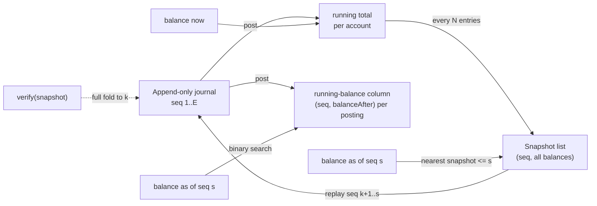

# Balances, Running Totals, and Snapshots

> Sum a million postings in milliseconds without summing a million postings.

**Type:** Build
**Languages:** Java, Python
**Prerequisites:** Phase 10, Lesson 01 (Representing Money), Phase 10, Lesson 03 (The Double-Entry Ledger), Phase 10, Lesson 04 (Chart of Accounts)
**Time:** ~90 minutes

## Learning Objectives

- Define an account balance as a fold over postings and state the invariant every faster read path must preserve: `snapshot + delta == full fold`
- Build three read paths over one append-only journal: an O(1) running total, an O(log n) per-account running-balance column, and an O(interval) snapshot-plus-replay
- Answer "what was this balance as of time T" by binary-searching the journal for a position and reading at that position
- Choose a snapshot interval from the cost model (replay work per read versus snapshot storage) and justify it with numbers
- Verify snapshots against the journal so a corrupted or forged snapshot is detected rather than trusted

## The Problem

A payments platform holds funds for 40,000 merchants. Each merchant has a `Merchant Payable` account in the ledger from Lesson 03. The dashboard shows "your balance" and the payout job needs "balance as of 23:59:59 UTC yesterday" to compute the daily payout. In the first year, both are computed the obvious way: `SELECT SUM(CASE side WHEN 'C' THEN amount ELSE -amount END) FROM postings WHERE account_id = ?`. With a few thousand postings per merchant, the query takes 3 ms.

Two years later the largest merchant, a ticketing company, has 38 million postings. Its dashboard query takes 11 seconds and times out. The payout job, which runs the same query for every merchant with an `effective_at <= cutoff` filter, now runs for four hours and overlaps with the next day's settlement window. An engineer adds a `balance` column to the `accounts` table and updates it on every post. The dashboard is fast again. Then finance asks for the balance of that merchant as of the end of last quarter, for a dispute. The `balance` column only knows "now". The answer requires the 11-second scan again, and the scan disagrees with the column by 412.00 USD, because a hotfix last spring updated the column without posting an entry. Nobody can say which number is right.

There are three distinct needs hiding here, and one invariant that ties them together:

1. **Current balance**, read thousands of times per second: needs O(1).
2. **Balance as of an arbitrary past moment**, read for payouts, statements, disputes, and audits: needs to be fast without storing every balance at every moment.
3. **Proof that the fast numbers are right**: every cached number must be reproducible from the journal, because the journal is the only source of truth (Lesson 03).

This lesson builds all three on one append-only journal: a running total, a per-account running-balance column, and periodic snapshots with bounded replay. Each one is checked against the slow definition, and the demo reads one merchant's balance out of a million postings by touching fourteen thousand of them, or nine.

## The Concept

### A balance is a fold

In Lesson 03 a balance was derived: the journal is the truth, and an account's balance is a function of the postings that touch it. Write that function down precisely. Number journal entries by position, `seq = 1, 2, 3, ...`. For an account `a` and a position `s`, define the **net debit**:

```text
netDebit(a, s) = sum over entries e with seq(e) <= s,
                 sum over postings p in e with p.account == a,
                 (+p.amount if p.side == DEBIT, -p.amount if p.side == CREDIT)
```

`netDebit(a, 0) = 0` for every account. This is a left fold over the journal prefix of length `s`, and it is the **definition** of a balance. Everything else in this lesson is a faster way to compute the same number. The balance shown to humans is the net debit for debit-normal accounts (assets, expenses) and its negation for credit-normal accounts (liabilities, equity, revenue), exactly as in Lesson 03.

Because the fold is a sum, it has the one algebraic property that makes caching possible: it splits. For any `k <= s`,

```text
netDebit(a, s) = netDebit(a, k) + (sum of a's signed postings in entries k+1 .. s)
```

That identity is the whole lesson. Store `netDebit(a, k)` for some `k` (a snapshot), and any later balance is that stored value plus a delta you compute by replaying only the entries after `k`. The invariant every test checks is the identity itself, for every account and every position:

```text
snapshot(k).netDebit(a) + replay(a, k+1 .. s) == fold(a, s)
```

It holds only if two things are true: entries after `k` are never inserted before `k` (the journal is append-only in position order), and the snapshot was computed from the same journal (it is not a number someone typed in). The first is why `post` rejects backdated entries; the second is why `verify(snapshot)` exists.

### Three read paths

| Path | Stored state | Read cost for "now" | Read cost for "as of s" | Write cost per posting | Extra storage |
|------|--------------|---------------------|--------------------------|------------------------|---------------|
| Full fold | nothing | O(P) | O(P) | 0 | 0 |
| Running total | 1 number per account | O(1) | not supported | O(1) | O(A) |
| Running-balance column | 1 number per posting | O(1) | O(log P_a) | O(1) | O(P) |
| Snapshot + replay | A numbers every N entries | O(1) via running total | O(N * legs) | O(1), plus O(A) every N entries | O(A * E / N) |

`P` is the total number of postings, `P_a` the postings of one account, `A` the number of accounts, `E` the number of entries, `N` the snapshot interval, and `legs` the average postings per entry.

- **Running total.** Keep `running[a]`, add each posting's signed amount on post. The current balance is one map lookup. It answers exactly one question.
- **Running-balance column.** On each posting, also record `(seq, balanceAfter)` in a per-account list. The list is sorted by `seq` because seqs only grow. "Balance of `a` as of `s`" is the `balanceAfter` of the last element with `seq <= s`: a binary search. This is the "running balance" column a bank statement prints next to each line, and it is what ledger databases such as Modern Treasury's and many core-banking systems store per posting. It costs one extra number per posting forever.
- **Snapshot + replay.** Every `N` entries, copy every account's running total into an immutable `Snapshot(seq, values)`. To read `a` as of `s`, binary-search the snapshot list for the last snapshot at or before `s`, then replay entries `snapshot.seq + 1 .. s`. Replay touches at most `N - 1` entries. Storage is `A` numbers every `N` entries, which is independent of how busy any single account is.



The column and the snapshots are not competitors. A production ledger typically keeps a running total for "now", a per-posting running balance for statements (because a statement prints every line anyway), and snapshots for the bulk questions: "every merchant's balance at end of day" for payouts, "every account at period end" for the trial balance in Lesson 12. The bulk question is where snapshots shine: one end-of-day snapshot answers 40,000 merchants' balances at once, where the column needs 40,000 binary searches into 40,000 separate lists.

### Worked example by hand

Three accounts from Lesson 03: `1200 Processor Receivable` (asset), `2100 Merchant Payable` (liability), `4100 Fee Revenue` (revenue). Five card payments, each with a 2.9% fee rounded `HALF_EVEN`, one hour apart, snapshot interval `N = 3`:

| seq | gross | fee (2.9%, HALF_EVEN) | 2100 credited | 2100 net debit after |
|-----|-------|-----------------------|---------------|----------------------|
| 1 | 100.00 | 2.90 | 97.10 | -97.10 |
| 2 | 25.00 | 0.72 (0.725, tie to even) | 24.28 | -121.38 |
| 3 | 40.00 | 1.16 | 38.84 | -160.22 |
| 4 | 19.99 | 0.58 (0.57971) | 19.41 | -179.63 |
| 5 | 75.00 | 2.18 (2.175, tie to even) | 72.82 | -252.45 |

After `post` returns seq 3, `3 % 3 == 0` triggers a snapshot: `{1200: +16500, 2100: -16022, 4100: -478}` in minor units. Snapshot 0, the empty ledger, always exists. The snapshot list is `[0, 3]`.

Now read `2100` as of seq 5 three ways:

```text
full fold:  scan entries 1..5, 3 postings each   = 15 postings
            -9710 - 2428 - 3884 - 1941 - 7282     = -25245  -> -252.45

snapshot:   nearest snapshot <= 5 is seq 3         = -16022
            replay entries 4..5 (6 postings)      = -1941 - 7282
            -16022 - 9223                         = -25245  -> -252.45

column:     2100's column: seqs [1,2,3,4,5], after [-9710,-12138,-16022,-17963,-25245]
            binary search for last seq <= 5       = index 4, 3 probes
                                                  = -25245  -> -252.45
```

The balance shown to the merchant is the negation, `252.45 USD`, because the account is credit-normal.

Now a time query: "what did we owe the merchant at 02:30?" Entries are at 00:00, 01:00, 02:00, 03:00, 04:00. Binary-search the journal for the last entry with `effectiveAt <= 02:30`: that is seq 3. Read at seq 3: the snapshot itself, zero replay, `160.22 USD`. A time query is always "translate time to a journal position, then read at that position", which is why timestamps must never decrease along the journal.

### Choosing the snapshot interval

Replay cost is at most `(N - 1) * legs` postings; storage is `A` numbers per snapshot. For the demo's million-posting ledger (`E = 500,000` two-leg entries, `A = 1,001` accounts):

| Interval N | Snapshots | Stored numbers | Worst replay (postings) |
|------------|-----------|----------------|-------------------------|
| 1,000 | 501 | 501,501 | 1,998 |
| 10,000 | 51 | 51,051 | 19,998 |
| 100,000 | 6 | 6,006 | 199,998 |
| none | 1 | 0 | 1,000,000 |

`N = 10,000` stores 5% as many numbers as there are postings and caps replay at 2% of the journal. The general rule: set `N` so that the worst-case replay fits your read latency budget at your measured scan rate, then check the storage. A Java loop scans roughly 30 to 50 million postings per second in memory, so 20,000 postings is well under a millisecond; a database scanning postings from disk is a thousand times slower and wants smaller `N` or time-based snapshots (one per account per day). Production systems usually snapshot on a time boundary (end of day, end of month) rather than every `N` entries, because those are the moments people ask about; the cost model is the same.

There is a second, subtler reason to prefer time-based snapshots per account: **sparse accounts**. A global snapshot copies all `A` accounts, including the 39,000 merchants who had no activity since the last snapshot. A per-account snapshot is written only when the account changed, which is O(active accounts). The demo uses global snapshots because they are simpler to verify; Exercise 2 asks you to make them sparse.

### Why backdating is rejected

Suppose entry 6 arrives with an `effectiveAt` of 01:30, earlier than entries 2 through 5. Appending it at seq 6 leaves the journal order and the time order disagreeing: `seqAsOf(01:45)` can no longer binary-search, because effective times are no longer sorted along the journal. Inserting it at position 2 instead would shift every later seq, and every snapshot after position 2 would become wrong, silently. Both options break the identity.

This ledger therefore treats posting time as the only time: `post` throws `LedgerException` for any entry whose timestamp is earlier than the last one. Real systems do need backdated business events (a chargeback that "belongs" to last month). They handle it with two timestamps, `posted_at` (monotonic, journal order) and `effective_at` (business time), and either (a) recompute affected snapshots, (b) post the adjustment in the current open period with a reference to the original date, or (c) keep bitemporal balances. Option (b) is what accountants do and what Lesson 12's period close formalizes: a closed period is never reopened; the correction lands in the current period.

### Verification

A snapshot is a cache, and a cache can be wrong: a bug in the snapshot writer, a partial write, a restore from the wrong backup, or someone "fixing" a balance by hand as in the problem statement. `verify(snapshot)` recomputes the full fold for every account at the snapshot's seq and compares. It is O(P), so it runs offline (nightly, or on the snapshot right after it is written, by a separate process), never on the read path. A snapshot that fails verification is quarantined and recomputed from the journal or the previous verified snapshot; it is never "corrected" in place.

The same check applies to the running total: at any moment, `running[a]` must equal `fold(a, head)`. Lesson 03's tests asserted this for the debit and credit totals; the tests here assert it for all three read paths at every seq of a small ledger and at 300 random `(account, seq)` pairs of a 5,000-entry ledger.

### What this does not do

- It does not persist snapshots or the journal. Phase 7's write-ahead log and checkpointing lessons are the durable version of exactly this design: a checkpoint is a snapshot, and recovery is "load the last checkpoint and replay the log after it".
- It does not support concurrent writers. `post` mutates three maps without a lock. Lesson 11 handles hot accounts and concurrent posting.
- It does not handle backdated entries; see above. It also does not handle holds and pending amounts, which Lesson 07 layers on top of posted balances.
- It does not compress or archive the journal. With snapshots, old entries are no longer needed to compute current balances, which tempts teams to delete them. Do not: they are still needed for statements, audits, disputes, and to verify the snapshots themselves (Lesson 12).

## Build It

The full program is `code/java/Main.java`; the tests are `code/java/MainTest.java`. The `Money` and `Currency` types are copied from Lesson 01 and the entry shape from Lesson 03.

### Step 1: Postings carry a signed contribution

```java
record Posting(String accountId, Side side, Money amount) {
    Posting {
        Objects.requireNonNull(accountId, "accountId");
        if (!amount.isPositive()) throw new LedgerException("posting amount must be positive, got " + amount);
    }

    /** Debits count positive, credits negative: the "net debit" convention used by every fold below. */
    long signedMinor() { return side == Side.DEBIT ? amount.minorUnits() : -amount.minorUnits(); }
}

record JournalEntry(String id, long effectiveAt, List<Posting> postings) { /* balanced per currency */ }
```

A posting is still a positive amount on a side, as in Lesson 03. `signedMinor` is the one place the side becomes a sign, so every read path folds the same quantity. The entry gains an `effectiveAt` in epoch seconds, supplied by the caller. The ledger never calls `System.currentTimeMillis()`; a test or a demo passes the time in, which is what makes the time queries deterministic.

**Predict:** for the 25.00 USD sale, what are the three postings' `signedMinor` values, and what do they sum to?

### Step 2: Snapshots and readings are values

```java
record Snapshot(long seq, long effectiveAt, Map<String, Long> netDebits) {
    Snapshot { netDebits = Map.copyOf(netDebits); }

    long netDebit(String accountId) { return netDebits.getOrDefault(accountId, 0L); }
}

record Reading(Money balance, long postingsScanned) {}
```

`Map.copyOf` is load-bearing. `takeSnapshot` passes the live `running` map; without the copy the snapshot would be a view that keeps changing as entries are posted, and every snapshot would equal "now". An immutable copy is the snapshot. `getOrDefault(..., 0L)` encodes the fact that an account opened after the snapshot had a zero balance at that point.

`Reading` returns the cost alongside the answer. That is how the tests assert that replay is bounded and how the demo shows the difference between 874,246 postings and 14,246 without timing anything.

### Step 3: Post updates every derived structure, after validating

```java
long post(JournalEntry entry) {
    for (Posting p : entry.postings()) {
        if (!account(p.accountId()).currency().equals(p.amount().currency())) {
            throw new LedgerException("entry " + entry.id() + ": currency does not match account " + p.accountId());
        }
    }
    if (!journal.isEmpty() && entry.effectiveAt() < journal.get(journal.size() - 1).effectiveAt()) {
        throw new LedgerException("entry " + entry.id() + " is backdated; post a correction at the current time instead");
    }
    journal.add(entry);
    long seq = journal.size();
    for (Posting p : entry.postings()) {
        long after = Math.addExact(running.get(p.accountId()), p.signedMinor());
        running.put(p.accountId(), after);
        columnSeq.get(p.accountId()).add(seq);
        columnAfter.get(p.accountId()).add(after);
    }
    if (seq % snapshotInterval == 0) takeSnapshot();
    return seq;
}
```

The structure is Lesson 03's "validate everything, then mutate everything". Every check that can fail runs before `journal.add`, so a rejected entry leaves no trace in the journal, the running totals, or the column. Equal timestamps are allowed (`<`, not `<=`): two payments in the same second are normal, and `seqAsOf` includes all of them.

The column is two parallel `LongList`s per account rather than a `List<long[]>` or a list of records. A million postings as boxed objects would cost tens of megabytes of object headers; two primitive arrays cost 16 bytes per posting. This is the same reason TigerBeetle stores accounts as fixed 128-byte structs.

**Predict:** if an entry has two postings to the same account (a debit and a credit to `2100`), how many elements does it add to `2100`'s column, and does the binary search in Step 5 still return the right value?

### Step 4: Taking a snapshot

```java
Snapshot takeSnapshot() {
    long seq = head();
    Snapshot last = snapshots.get(snapshots.size() - 1);
    if (last.seq() == seq) return last;
    Snapshot s = new Snapshot(seq, journal.get((int) seq - 1).effectiveAt(), running);
    snapshots.add(s);
    return s;
}
```

A snapshot is the running totals at a journal position, copied. The early return makes it idempotent: calling it twice at the same head does not add a duplicate, which keeps the snapshot list strictly increasing in `seq` and the binary search below correct. The constructor seeds the list with `Snapshot(0, ...)` holding no accounts, so there is always a snapshot at or before any seq.

### Step 5: Three reads, one answer

The snapshot read finds the base and replays:

```java
Reading snapshotNetDebit(String accountId, long seq) {
    Account a = account(accountId);
    requireSeq(seq);
    Snapshot base = nearestSnapshot(seq);
    long acc = base.netDebit(accountId), scanned = 0;
    for (long s = base.seq(); s < seq; s++) {
        for (Posting p : journal.get((int) s).postings()) {
            scanned++;
            if (p.accountId().equals(accountId)) acc = Math.addExact(acc, p.signedMinor());
        }
    }
    return new Reading(Money.ofMinor(acc, a.currency()), scanned);
}

Snapshot nearestSnapshot(long seq) {
    int lo = 0, hi = snapshots.size() - 1;
    while (lo < hi) {
        int mid = (lo + hi + 1) >>> 1;
        if (snapshots.get(mid).seq() <= seq) lo = mid; else hi = mid - 1;
    }
    return snapshots.get(lo);
}
```

Index arithmetic: `journal.get(i)` has seq `i + 1`, so replaying "entries after `base.seq()` up to and including `seq`" is the index range `base.seq() .. seq - 1`. The binary search is the "last element satisfying a predicate" form; `(lo + hi + 1) >>> 1` rounds the midpoint up so that `lo = mid` always makes progress. Getting either of these off by one produces a balance that is wrong by exactly one entry, only for reads that land on a snapshot boundary, which is why the tests read at every seq including the boundaries.

The column read is a binary search over one account's postings:

```java
Reading columnNetDebit(String accountId, long seq) {
    Account a = account(accountId);
    requireSeq(seq);
    LongList seqs = columnSeq.get(accountId), after = columnAfter.get(accountId);
    int lo = 0, hi = seqs.size() - 1, found = -1, probes = 0;
    while (lo <= hi) {
        int mid = (lo + hi) >>> 1;
        probes++;
        if (seqs.get(mid) <= seq) { found = mid; lo = mid + 1; } else hi = mid - 1;
    }
    return new Reading(Money.ofMinor(found < 0 ? 0 : after.get(found), a.currency()), probes);
}
```

`found = -1` means the account had no postings at or before `seq`, so the balance was zero. If an entry posts to the same account twice, the column has two elements with the same seq, and "last element with `seq <= s`" picks the second, whose `balanceAfter` includes both. That answers the Predict in Step 3.

**Predict:** in the demo, merchant `m0042` has about 500 postings. Why does the column need only 9 probes, and how many would it need with 38 million postings?

### Step 6: Time becomes a position

```java
long seqAsOf(long timestamp) {
    int lo = 0, hi = journal.size();
    while (lo < hi) {
        int mid = (lo + hi + 1) >>> 1;
        if (journal.get(mid - 1).effectiveAt() <= timestamp) lo = mid; else hi = mid - 1;
    }
    return lo;
}

Money balanceAsOf(String accountId, long timestamp) {
    Account a = account(accountId);
    return toNormal(a, snapshotNetDebit(accountId, seqAsOf(timestamp)).balance().minorUnits());
}
```

The answer is a count of entries in `[0, size]`, and the search is valid only because `post` guarantees timestamps never decrease along the journal. A timestamp before the first entry gives seq 0 and a zero balance; a timestamp in the future gives the head.

### Step 7: Verify against the definition

```java
boolean verify(Snapshot s) {
    for (String id : accounts.keySet()) {
        if (s.netDebit(id) != foldNetDebit(id, s.seq()).balance().minorUnits()) return false;
    }
    for (String id : s.netDebits().keySet()) if (!accounts.containsKey(id)) return false;
    return true;
}
```

Two failure shapes are checked: a wrong value for a known account, and a value for an account that does not exist (a snapshot restored from a different ledger). The tests build a forged snapshot at seq 2 with plausible numbers and assert it fails.

### Step 8: Run it

```bash
cd phases/10-money-and-ledgers/05-balances-and-snapshots/code/java
javac -d .out *.java && java -cp .out Main
java -cp .out MainTest
java -cp .out Main --timing      # optional: wall-clock numbers, which vary by machine
```

Expected output, abbreviated:

```console
== A small ledger, snapshot every 3 entries ==
seq 2  t=+1h  gross 25.00 USD   fee 0.72 USD   payable now 121.38 USD
snapshots at seq [0, 3]
2100 net debit after seq 3: fold -160.22 USD  ( 9 postings)  snapshot -160.22 USD  (0)  column -160.22 USD  (2 probes)
2100 net debit after seq 5: fold -252.45 USD  (15 postings)  snapshot -252.45 USD  (6)  column -252.45 USD  (3 probes)
payable as of t=+2h30m: 160.22 USD (seq 3)
rejected: entry late is backdated; post a correction at the current time instead

== One million postings, 1,000 merchants, snapshot every 10,000 entries ==
entries=500000 snapshots=51
merchant m0042 as of seq 437123:
  full fold      -116054.22 USD  postings scanned 874246
  snapshot+delta -116054.22 USD  postings scanned 14246  (from snapshot at seq 430000)
  running column -116054.22 USD  binary-search probes 9
  all three agree: true
receivable 125347982.56 USD == sum of merchant payables 125347982.56 USD: true
```

The counts are deterministic because the payment stream is a seeded `Random` with an injected clock. With `--timing` on a laptop the fold takes tens of milliseconds, snapshot replay a couple of milliseconds, and the column tens of microseconds; the ratios matter more than the absolute numbers, and they track the posting counts.

### In Python

The full port is `code/python/main.py` (same `Ledger`, `Snapshot`, `Reading`, `LongList`, `PaymentStream`; tests in `code/python/test_main.py`). Three things differ:

- **The seeded stream reproduces `java.util.Random`.** The demo's numbers (`-116054.22 USD`, `125347982.56 USD`, `14246` postings scanned) come from the seed, so the port ships a `JavaRandom` with the JDK's 48-bit LCG and its `nextInt(bound)` rejection loop. The same seed therefore yields the same ledger in both languages, and the tests assert the JDK's own values for `Random(42)`:

```python
class JavaRandom:
    MULTIPLIER, ADDEND, MASK = 0x5DEECE66D, 0xB, (1 << 48) - 1

    def __init__(self, seed: int) -> None:
        self._seed = (seed ^ self.MULTIPLIER) & self.MASK

    def next(self, bits: int) -> int:
        self._seed = (self._seed * self.MULTIPLIER + self.ADDEND) & self.MASK
        r = self._seed >> (48 - bits)
        return r - (1 << 32) if r >= (1 << 31) else r  # Java's (int) cast
```

- **Memory and speed.** `LongList` wraps `array('q')` (8 bytes per value, not a 28-byte `int` object each), and the record types are `@dataclass(frozen=True, slots=True)` so a million postings do not each carry a `__dict__`. `Math.addExact` disappears because `int` never overflows. Pure Python is still 5-10x slower than the JVM on this demo: posting 500,000 entries takes about six seconds, and the cyclic garbage collector accounts for a third of that. The three read paths have the same complexity and the same scan counts; only the wall-clock numbers behind `--timing` differ.
- **The column search is written out, not `bisect`ed.** `bisect.bisect_right(seqs, seq) - 1` returns the same index, but the hand-written loop is kept so `Reading.postings_scanned` reports the same probe count as Java (9 for the demo's lookup). `LedgerError` extends `ValueError`, and `Snapshot.__post_init__` copies the dict for the same reason Java's canonical constructor calls `Map.copyOf`: the copy is the snapshot.

```bash
cd phases/10-money-and-ledgers/05-balances-and-snapshots/code/python
python3 main.py            # add --timing for wall-clock numbers
python3 -m unittest -v
```

### Porting notes

Go maps iterate in random order, so `verify` and any printed snapshot must sort account ids first; use `sort.Search` for both binary searches and `[]int64` for the column. The Go port needs no lock in this lesson; Lesson 11 is where Java's `synchronized` and Go's `sync.Mutex` start to differ.

## Use It

### Event sourcing and checkpointing

The design is event sourcing with snapshots: the journal is the event log, balances are a projection, snapshots bound the replay. Kafka Streams state stores, Akka Persistence, and EventStoreDB all offer "snapshot every N events" for the same reason. Databases do it at a lower level: PostgreSQL's checkpoint writes dirty pages so that crash recovery replays only the WAL written after the last checkpoint; `checkpoint_timeout` and `max_wal_size` are the `N` of this lesson, trading checkpoint I/O against recovery time.

### Ledger databases

TigerBeetle keeps `debits_posted` and `credits_posted` on every account (the running total) and, for accounts created with the `history` flag, stores balance history per transfer so that `get_account_balances` can return balances as of past transfers: the running-balance column. Stripe's Balance Transactions carry the per-transaction effect, and Stripe computes balances at payout cutoffs. Modern Treasury's Ledgers API returns account balances "as of" an effective time and versions balances on every entry, which is the column again, plus a `lock_version` for concurrency (Lesson 11).

### SQL

In a relational ledger the running total is an `account_balances` row updated in the same transaction as the postings insert; the column is a `balance_after` column on `postings` with an index on `(account_id, seq)`, and an as-of read is:

```sql
SELECT balance_after
FROM postings
WHERE account_id = $1 AND seq <= $2
ORDER BY seq DESC
LIMIT 1;
```

That query is the binary search of Step 5, executed by the B-tree. End-of-day snapshots are a `balance_snapshots(account_id, as_of_date, net_debit)` table filled by a job, and the payout job reads it instead of scanning postings. The trap in SQL is the same as in Java: the running total and the snapshot table are caches, and any `UPDATE account_balances` that is not accompanied by a postings insert, as in the Problem section, makes them disagree with the journal. Run the verification query nightly.

## Ship It

`outputs/runbook-balance-snapshot-mismatch.md` is an operational runbook for the day a nightly verification reports that a snapshot or a cached balance disagrees with the journal: how to scope the damage, which number to trust, how to recompute, and what not to do (edit the cache to match a guess). Keep it next to the payout job's on-call docs.

## Exercises

1. **Reinforce.** Add `Ledger.balancesAt(long seq)` that returns every account's net debit at `seq` as a `Map<String, Long>` using one nearest-snapshot lookup and one replay pass over the delta, not one replay per account. Assert that it equals calling `foldNetDebit` per account for ten random seqs, and that its `postingsScanned` is the same as a single-account `snapshotNetDebit` at that seq.

2. **Apply.** Make snapshots sparse: instead of copying all accounts, record only the accounts whose running total changed since the previous snapshot, and resolve `netDebit(a)` by walking back to the latest snapshot that mentions `a`. Measure stored numbers for 1,000 merchants where 90% of payments go to 20 merchants. Then state the new worst-case read cost and how a per-account "last snapshot index" removes the walk.

3. **Extend.** Combine with Lesson 06 and Lesson 12: allow a backdated adjustment by giving entries both `postedAt` (monotonic, used for seq) and `effectiveAt` (business time). Implement `balanceAsOfEffective(account, t)` that includes every entry with `effectiveAt <= t` regardless of when it was posted, and show a test where the as-of-effective balance for a closed period changes after a late adjustment while the as-of-posted balance does not. Explain which of the two the payout job should use and which the auditor will ask for.

## Key Terms

| Term | What people say | What it actually means |
|------|-----------------|------------------------|
| Balance | "the number in the account" | A fold of the account's signed postings up to a journal position; a derived value, never an independent fact |
| Running total | "the balance column" | A cached fold at the head of the journal, updated on every post; answers "now" in O(1) and nothing else |
| Running-balance column | "balance after" | The account's balance stored next to each of its postings; makes as-of reads a binary search at the cost of one number per posting |
| Snapshot | "checkpoint" | An immutable copy of every account's balance at one journal position; a cache that must be reproducible from the journal |
| Replay | "catch up from the snapshot" | Folding only the entries after the snapshot's position; bounded by the snapshot interval |
| As-of query | "balance on date X" | Translate a time to the last journal position at or before it, then read the balance at that position |
| Snapshot interval | "how often we checkpoint" | The number of entries between snapshots; sets the worst-case replay cost and the snapshot storage |

## Further Reading

- [Fowler, *Event Sourcing*](https://martinfowler.com/eaaDev/EventSourcing.html) — the pattern of deriving state from an append-only event log, including snapshots to bound rebuild time.
- [PostgreSQL documentation: WAL Configuration and checkpoints](https://www.postgresql.org/docs/current/wal-configuration.html) — how a production database trades checkpoint frequency against recovery replay, the same interval trade-off as this lesson.
- [TigerBeetle: Accounts and `get_account_balances`](https://docs.tigerbeetle.com/reference/account/) — running totals (`debits_posted`, `credits_posted`) and per-transfer balance history in a purpose-built ledger.
- [Modern Treasury Ledgers: Account balances and effective time](https://docs.moderntreasury.com/ledgers/docs/ledger-account-balances) — as-of balances by effective time and balance versioning in a production ledger API.
- [Bentley, *Programming Pearls*, Column 4 "Writing Correct Programs"](https://dl.acm.org/doi/book/10.5555/315594) — the classic treatment of binary-search invariants and why off-by-one errors at boundaries survive testing.
