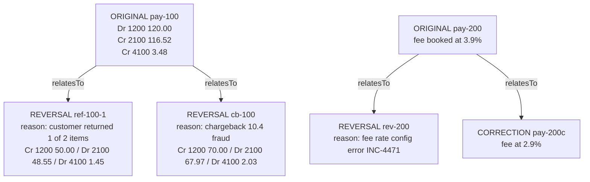

# Immutability, Reversals, and Corrections

> You never update a posting; you post its opposite.

**Type:** Build
**Languages:** Java, Python, Go
**Prerequisites:** Phase 10, Lesson 01 (Representing Money), Phase 10, Lesson 03 (The Double-Entry Ledger), Phase 10, Lesson 05 (Balances and Snapshots)
**Time:** ~75 minutes

## Learning Objectives

- Explain why an append-only journal is a requirement of the balance caches, the reconciliation job, and the auditor, not a style preference
- Build full reversals, partial reversals, and corrections as new entries linked to the entry they undo, each carrying a mandatory reason
- Allocate a partial reversal across an entry's legs in proportion to what remains, so no leg is ever over-reversed and the reversal always balances
- Make every undo operation idempotent on its own id, and reject the same id reused for a different undo
- Detect an edited or deleted journal record with a SHA-256 hash chain, and state what that chain does and does not prove

## The Problem

A marketplace books a 120.00 USD card payment: debit `Processor Receivable` 120.00, credit `Merchant Payable` 116.52, credit `Fee Revenue` 3.48. Two days later the customer returns one of two items and the merchant issues a 50.00 refund. The engineer on the refunds team writes the obvious code: `UPDATE postings SET amount = amount - 5000 WHERE entry_id = 'pay-100' AND account_id = '1200'`, and the same for the other two legs with hand-computed amounts. The balances are now right. The entry now says the customer paid 70.00.

Three things break, each owned by a different team. The reconciliation job (Lesson 08) matches the processor's settlement file, which still shows a 120.00 capture and a separate 50.00 refund, against a ledger that shows one 70.00 capture and no refund: two breaks, both false. The balance snapshot from Lesson 05 taken the night before the update still says the receivable was 120.00 at that point; replaying the edited journal to the same position gives 70.00, so the nightly verification flags a snapshot that was correct and a journal that is not. And at quarter end the auditor samples `pay-100`, asks for the evidence that 70.00 was captured, and receives a processor record showing 120.00. The fee revenue reported in last month's close, 3.48, no longer matches the ledger's own history for last month, because last month's history was rewritten this month.

Then the merchant gets a chargeback on the remaining 70.00. The refunds engineer's update leaves no record of how much has already been refunded, so the chargeback handler reverses the original 120.00 and the merchant's payable goes 50.00 negative. Nobody notices for three weeks.

The fix is the rule accountants have followed since the fifteenth century: a posted entry is never changed. A refund, a chargeback, and a fix for a wrong fee are all new entries, posted now, that point at the entry they undo and say why. This lesson builds those three operations, makes each one safe to retry, bounds partial reversals so the total undone can never exceed the original, and adds a hash chain so an edit like the one above is detected mechanically.

## The Concept

### Why the journal must be append-only

Lesson 03 called the journal "evidence" and Lesson 05 made the reason precise: every cached balance is defined as `fold(journal prefix)`. Editing an entry at position `k` changes the fold for every position at or after `k`, which silently invalidates every snapshot, every running-balance column value, every statement already sent, and every period already closed. Appending never does: a new entry at position `n + 1` changes nothing at or before `n`.

| Consumer | What it assumes about the past | What an in-place edit breaks |
|----------|-------------------------------|------------------------------|
| Snapshots and as-of balances (Lesson 05) | `fold(k)` never changes once `k` is in the past | Every snapshot after the edited position becomes wrong |
| Reconciliation (Lesson 08) | One ledger entry per external event (capture, refund, chargeback) | Refund disappears; capture amount no longer matches |
| Statements and payouts | A line once shown to a merchant stays true | The merchant's downloaded statement disagrees with today's |
| Financial close (Lesson 12) | Closed periods are frozen | Last month's revenue changes after it was reported |
| Idempotency (Lesson 03) | Same id means same content forever | A replayed original no longer equals the stored, edited one |

The same reasoning applies to deletes. A deleted entry is an edit to zero, with the added defect that the evidence of the edit is gone too.

### Three undo operations

All three produce new entries with `kind`, `relatesTo`, and `reason`:

| Operation | When | Entry posted | Effect on the original's legs |
|-----------|------|--------------|-------------------------------|
| Full reversal | Chargeback, void after capture, duplicate posting, refund of the whole amount | `REVERSAL` with each remaining leg flipped | Every leg reversed to zero |
| Partial reversal | Partial refund, partial chargeback | `REVERSAL` with a balanced subset of each leg, flipped | Each leg reduced in proportion |
| Correction | The original was wrong when posted (bad fee rate, wrong account) | `REVERSAL` of the whole original, then a `CORRECTION` with the right postings | Original reversed to zero; replacement carries the true effect |

A refund and a correction look similar in the balances and mean different things. A refund says "this happened, and then this other thing happened"; the original was true. A correction says "the original was never true, and here is what was". An auditor treats them differently: a refund is a business event with external evidence (the processor's refund record), a correction is an internal control event that needs an approval and an incident reference. That is why `reason` is mandatory on both and why the kinds are distinct.

### The link invariant

For every original entry `o` with legs `o.legs[i]`, the ledger tracks `reversed[o][i]`, the amount of leg `i` already undone. Three invariants hold after every operation:

1. `0 <= reversed[o][i] <= o.legs[i].amount` for every leg. No leg is ever over-reversed.
2. Every `REVERSAL` entry's legs are attributed to legs of the entry it names, on the opposite side of the same account.
3. The sum of the original and all its reversals, per account, equals `o.legs[i].amount - reversed[o][i]` on the original side. In particular, a fully reversed entry and its reversals net to zero on every account.

Invariant 1 is what the refunds engineer in the Problem section lacked: with `reversed` tracked, a chargeback after a 50.00 refund reverses exactly the remaining 70.00, not 120.00.



### Worked example: partial refund, then chargeback

The original `pay-100`: gross 120.00, fee `12000 * 29 / 1000 = 348` minor units (exact), payable `12000 - 348 = 11652`.

**Partial refund of 50.00.** The refund must reverse 50.00 of the receivable (the debit side) and 50.00 spread across the payable and the fee (the credit side), so that the reversal balances. The credit side split is proportional to what remains on each credit leg, using the largest-remainder allocation from Lesson 01:

```text
debit legs:  [1200: 12000 remaining]          allocate 5000 by [12000]        -> [5000]
credit legs: [2100: 11652, 4100: 348 remaining] allocate 5000 by [11652, 348]
             2100: 5000 * 11652 / 12000 = 58260000 / 12000 = 4855 remainder 0
             4100: 5000 *   348 / 12000 =  1740000 / 12000 =  145 remainder 0
             -> [4855, 145], sum 5000
reversal ref-100-1:  Cr 1200 50.00   Dr 2100 48.55   Dr 4100 1.45
reversed[pay-100] = [5000, 4855, 145]
```

The platform gives back the proportional fee: 1.45 of the 3.48. Whether a platform refunds its fee on a refund is a business policy (many processors do not); the mechanism here reverses proportionally, and Exercise 2 changes the policy.

**A retry of the same refund** (same id `ref-100-1`, same amount) returns the existing entry and posts nothing. **A refund of 80.00** is rejected: only `12000 - 5000 = 7000` remains on the debit side.

**Chargeback of the remainder.** `reverse` flips whatever remains on each leg:

```text
1200: 12000 - 5000 = 7000   -> Cr 1200 70.00
2100: 11652 - 4855 = 6797   -> Dr 2100 67.97
4100:   348 -  145 =  203   -> Dr 4100 2.03
reversed[pay-100] = [12000, 11652, 348]   -> fully reversed
```

Every account nets to zero across the three entries: `1200: +120.00 - 50.00 - 70.00 = 0`, `2100: -116.52 + 48.55 + 67.97 = 0`, `4100: -3.48 + 1.45 + 2.03 = 0`. A second chargeback notice under a new id is rejected with `AlreadyReversedException` instead of driving the payable negative.

Why allocate by *remaining* rather than by the original ratios? Because after several partial reversals, rounding can leave one leg with less remaining than its original proportion implies. Allocating by remaining guarantees each share is at most what remains on its leg: when `amount <= totalRemaining`, each exact share `amount * rem_i / totalRemaining` is at most `rem_i`, and the largest-remainder step only adds a unit to a share whose exact value had a fractional part, so it stays at most `rem_i`. A leg with nothing remaining has ratio zero and receives nothing. The property test runs 200 random refund sequences and checks conservation after every step.

### Worked example: correction

`pay-200` was posted with a fee of 3.9% because of a configuration error: gross 80.00, fee `8000 * 39 / 1000 = 312`, payable 76.88. The correct fee is `8000 * 29 / 1000 = 232`. The correction is two entries, appended together after both are validated:

```text
REVERSAL   rev-200  -> pay-200  (fee rate config error INC-4471)
      Cr 1200  80.00     Dr 2100  76.88     Dr 4100  3.12
CORRECTION pay-200c -> pay-200  (fee rate config error INC-4471)
  Dr 1200  80.00     Cr 2100  77.68     Cr 4100  2.32
```

A tempting shortcut is a single "delta" entry: `Dr 4100 0.80, Cr 2100 0.80`. It produces the same balances in one entry. It is worse evidence: the journal now has an entry for 80.00 at 3.9% that is still "live", plus an unexplained 0.80 movement, and anyone reading `pay-200` alone gets the wrong fee. Reverse-and-replace makes the original visibly dead and the replacement self-contained, at the cost of two extra entries. Reserve delta adjustments for cases where the original was right and something new happened (an interchange fee adjustment from the network, for example), which is a new original, not a correction.

### Idempotency of undo operations

Undo operations are retried as often as originals: a refund API call times out, a chargeback webhook is delivered twice. Each undo is keyed by its own id, chosen by the caller from the external event (the processor's refund id, the dispute id), with these outcomes:

| Call | State | Result |
|------|-------|--------|
| `reverse(o, id)` | `id` unused, `o` has something left | Reversal of the remainder appended |
| `reverse(o, id)` | `id` already a reversal of `o` | Existing entry returned, nothing appended |
| `reverse(o, id)` | `id` is something else | `IdempotencyConflictException` |
| `reverse(o, id2)` | `o` already fully reversed | `AlreadyReversedException` |
| `reversePartially(o, id, amt)` | `id` exists with a different amount | `IdempotencyConflictException` |
| `reverse(r, id)` where `r` is a reversal | any | Rejected: post a new original instead |

The last row deserves a sentence. Reversing a reversal recreates the original's effect under an id that is not the business event's id; reconciliation then sees a capture with no external counterpart. If a refund was posted in error, the honest record is a new original (with a reason) that re-books the sale, which is a correction of the refund's business meaning, not a mechanical undo.

### Hash chaining: making edits detectable

Append-only is a promise the code makes; a database administrator with `UPDATE` privileges can still break it. A hash chain makes a break detectable. Each `JournalRecord` stores `hash = SHA-256(prevHash | seq | canonical(entry))`, with `prevHash` of the first record equal to 64 zeros. Verification recomputes every hash from the start:

- **Editing** record `k` (amount, description, link) changes its recomputed hash, so verification fails at `k`.
- **Deleting** record `k` makes record `k + 1` sit at position `k` with a `prevHash` that no longer matches, so verification fails at `k`.
- **Reordering** changes `seq` and `prevHash` and fails at the first moved record.

What it does not prove: someone who can rewrite the whole chain from `k` onward can recompute every later hash. The defence is to publish the head hash somewhere the attacker cannot write: in the daily close evidence (Lesson 12), to a write-once object store, or to an external timestamping service (RFC 3161). Then any rewrite of history before a published head is detectable by comparing heads. This is the same idea as Certificate Transparency logs and Git commit ids.

### Failure modes this design prevents

Each row is a bug class that shows up in real refund and dispute code, and the mechanism in this lesson that stops it:

| Failure | How it happens | What stops it here |
|---------|----------------|--------------------|
| Double refund | Refund API times out, client retries with a new request id | Idempotency on the caller's refund id; `reversePartially` returns the existing entry |
| Over-refund | Partial refund, then a full refund of the original amount | `reversedSoFar` per leg; `ExcessiveReversalException` |
| Chargeback after refund drives payable negative | Dispute handler reverses the original, unaware of refunds | `reverse` flips only the remainder; a fully reversed entry rejects further reversals |
| Half-applied correction | Reversal posted, replacement fails validation | Replacement built and validated before either entry is appended |
| Silent history rewrite | Hotfix `UPDATE` on a posting | Append-only API, plus the hash chain flags the edited record |
| Orphan adjustment | "Fix" entry with no link to what it fixes | `relatesTo` and `reason` required by the entry constructor |
| Undo of an undo | Support tool reverses a refund to "cancel" it | Reversals are not reversible; re-booking is a new original |

Every row has at least one test in `MainTest.java`.

### What this does not do

- It does not persist the journal or the hash chain; Phase 7's write-ahead log lesson is where durability lives. The chain is computed in memory to show the mechanism.
- It does not decide refund policy (whether the fee is refunded, whether a refund can exceed the capture for goodwill). It enforces the mechanical bound `reversed <= original` per leg; policy belongs to the payment service.
- It does not correct an entry that already has partial reversals. That requires choosing what the partial reversals meant in the corrected world; the code refuses and asks for an explicit correction of the remainder.
- It does not handle concurrent undo requests on the same original. Two refunds racing could both read the same `reversed` state; Lesson 11 adds the locking that makes the bound hold under concurrency.

## Build It

The full program is `code/java/Main.java` and the tests are `code/java/MainTest.java`. `Money`, `Currency`, and `allocate` are copied from Lesson 01.

### Step 1: An entry knows what kind it is and what it undoes

```java
enum EntryKind { ORIGINAL, REVERSAL, CORRECTION }

record JournalEntry(String id, String description, List<Posting> postings, EntryKind kind, String relatesTo, String reason) {
    JournalEntry {
        // ... id, description, at least two postings, balanced per currency (Lesson 03)
        postings = List.copyOf(postings);
        if (kind == EntryKind.ORIGINAL && relatesTo != null) throw new LedgerException("an original entry relates to nothing");
        if (kind != EntryKind.ORIGINAL && (relatesTo == null || reason == null || reason.isBlank())) {
            throw new LedgerException(kind + " " + id + " must name the entry it relates to and a reason");
        }
    }
}
```

Immutability at the value level comes from three things: a `record` (final fields, no setters), `List.copyOf` (the caller's list can change afterwards without affecting the entry, and the stored list throws `UnsupportedOperationException` on `clear`), and `Money` and `Posting` themselves being records. The compact constructor makes "an undo without a link or a reason" unrepresentable.

**Predict:** a caller builds a `List<Posting>` with `new ArrayList<>()`, constructs an entry, then calls `list.add(...)`. Does the entry's balance check still hold? Why?

### Step 2: The record and its hash

```java
record JournalRecord(long seq, JournalEntry entry, String prevHash, String hash) {
    static final String GENESIS = "0".repeat(64);

    static String hashOf(long seq, JournalEntry entry, String prevHash) {
        MessageDigest sha = MessageDigest.getInstance("SHA-256");
        byte[] digest = sha.digest((prevHash + "|" + seq + "|" + entry.canonical()).getBytes(StandardCharsets.UTF_8));
        return HexFormat.of().formatHex(digest);
    }
}
```

`canonical()` is a deterministic string of every field that matters: id, kind, link, reason, description, and each posting as `account:side:minorUnits:currency`. It deliberately uses minor units, not `Money.toString()`, so the hash does not depend on formatting. Encoding is pinned to UTF-8 so the hash is the same on every JVM.

### Step 3: Append is the only mutation

```java
private void append(JournalEntry entry) {
    long seq = journal.size() + 1;
    String prev = journal.isEmpty() ? JournalRecord.GENESIS : journal.get(journal.size() - 1).hash();
    journal.add(new JournalRecord(seq, entry, prev, JournalRecord.hashOf(seq, entry, prev)));
    indexById.put(entry.id(), (int) seq - 1);
    for (Posting p : entry.postings()) netDebits.merge(p.accountId(), p.signedMinor(), Math::addExact);
    if (entry.kind() != EntryKind.REVERSAL) reversedSoFar.put(entry.id(), new long[entry.postings().size()]);
    if (entry.relatesTo() != null) {
        children.computeIfAbsent(entry.relatesTo(), k -> new ArrayList<>()).add(entry.id());
        if (entry.kind() == EntryKind.REVERSAL) applyReversal(entry);
    }
}
```

Every public write method ends here and nowhere else touches `journal`. There is no `remove`, no `set`, no `update`. Originals and corrections get a zeroed `reversedSoFar` array, which is what makes them reversible; reversals do not, which is how "cannot reverse a reversal" is enforced. The `children` map is the reverse index from an entry to everything that undoes or replaces it, used by `history`.

### Step 4: Attribute a reversal to the original's legs

```java
private void applyReversal(JournalEntry reversal) {
    JournalEntry original = entry(reversal.relatesTo());
    long[] done = reversedSoFar.get(original.id());
    for (Posting r : reversal.postings()) {
        long left = r.amount().minorUnits();
        for (int i = 0; i < original.postings().size() && left > 0; i++) {
            Posting o = original.postings().get(i);
            if (!o.accountId().equals(r.accountId()) || o.side() != r.side().opposite()) continue;
            long take = Math.min(left, o.amount().minorUnits() - done[i]);
            done[i] += take;
            left -= take;
        }
        if (left != 0) throw new IllegalStateException("reversal " + reversal.id() + " exceeds original " + original.id());
    }
}
```

Each reversal leg is matched to original legs on the same account and the opposite side, consuming at most what remains on each. The `IllegalStateException` is an assertion: the public methods compute reversals that always fit, so reaching it means a bug, not bad input.

### Step 5: Full reversal of the remainder

```java
JournalEntry reverse(String originalId, String reversalId, String reason) {
    JournalEntry existing = existingChild(reversalId, originalId, EntryKind.REVERSAL);
    if (existing != null) return existing;
    JournalEntry original = reversible(originalId);
    long[] done = reversedSoFar.get(originalId);
    List<Posting> flipped = new ArrayList<>();
    for (int i = 0; i < original.postings().size(); i++) {
        Posting p = original.postings().get(i);
        long remaining = p.amount().minorUnits() - done[i];
        if (remaining > 0) flipped.add(new Posting(p.accountId(), p.side().opposite(), Money.ofMinor(remaining, p.amount().currency())));
    }
    if (flipped.isEmpty()) throw new AlreadyReversedException(originalId);
    JournalEntry reversal = new JournalEntry(reversalId, "reversal of " + originalId, flipped, EntryKind.REVERSAL, originalId, reason);
    append(reversal);
    return reversal;
}
```

The idempotency check comes first, before any validation that depends on current state. Order matters: if the check came after "is it already fully reversed?", a retry of the very reversal that fully reversed the entry would be rejected as `AlreadyReversedException` instead of returning the original result. A retry must see the same answer as the first call.

**Predict:** what does `reverse("pay-100", "cb-100", ...)` return if it is called a second time, and how many entries does the journal hold afterwards?

### Step 6: Partial reversal allocated by what remains

```java
for (Side side : Side.values()) {
    List<Integer> legs = new ArrayList<>();
    for (int i = 0; i < original.postings().size(); i++) if (original.postings().get(i).side() == side) legs.add(i);
    long[] ratios = new long[legs.size()];
    for (int k = 0; k < legs.size(); k++) {
        int i = legs.get(k);
        ratios[k] = original.postings().get(i).amount().minorUnits() - done[i];
    }
    Money[] parts = amount.allocate(ratios);
    for (int k = 0; k < legs.size(); k++) {
        if (parts[k].isZero()) continue;
        Posting p = original.postings().get(legs.get(k));
        flipped.add(new Posting(p.accountId(), side.opposite(), parts[k]));
    }
}
```

Each side is allocated independently and each side's parts sum to `amount`, so the reversal balances by construction: debits flipped to credits total `amount`, credits flipped to debits total `amount`. Zero parts are skipped because a posting must be positive. Before this loop, the method checks the amount against the remaining debit total and throws `ExcessiveReversalException` if it is too large.

**Predict:** an original has one debit leg of 0.03 and credit legs of 0.02 and 0.01. A partial reversal of 0.01 is requested. What does each credit leg receive, and why does the 0.01 leg not get it?

### Step 7: Correction is reverse plus replace, validated first

```java
JournalEntry correct(String originalId, String reversalId, String replacementId, List<Posting> replacementPostings, String reason) {
    JournalEntry replacement = new JournalEntry(replacementId, "correction of " + originalId, replacementPostings,
            EntryKind.CORRECTION, originalId, reason);
    // ... idempotent replay check on (reversalId, replacementId)
    JournalEntry original = reversible(originalId);
    // ... refuse if the original already has partial reversals
    validateAccounts(replacement);
    List<Posting> flipped = new ArrayList<>();
    for (Posting p : original.postings()) flipped.add(new Posting(p.accountId(), p.side().opposite(), p.amount()));
    JournalEntry reversal = new JournalEntry(reversalId, "reversal of " + originalId + " for correction", flipped,
            EntryKind.REVERSAL, originalId, reason);
    append(reversal);
    append(replacement);
    return replacement;
}
```

The replacement is constructed (and therefore balance-checked) on the first line, and its accounts are validated before the reversal is appended. If the replacement is unbalanced, the method throws before either entry exists. A correction that posts the reversal and then fails on the replacement would leave the original reversed with nothing in its place: the merchant's payable would drop to zero until someone noticed. The test `failed correction left no trace` covers this.

### Step 8: Run it

```bash
cd phases/10-money-and-ledgers/06-immutability-and-reversals/code/java
javac -d .out *.java && java -cp .out Main
java -cp .out MainTest
```

Expected output, abbreviated:

```console
== Partial refund of 50.00: fee and payable reversed in proportion ==
REVERSAL ref-100-1 -> pay-100 (customer returned 1 of 2 items)
      Cr 1200  50.00 USD
  Dr 2100  48.55 USD
  Dr 4100  1.45 USD
retry of ref-100-1 returns the same entry: true, journal size 2
remaining refundable: 70.00 USD
rejected: cannot reverse 80.00 USD of pay-100: only 70.00 USD remains

== Full reversal of what remains (chargeback) ==
fully reversed: true; balances 1200 0.00 USD, 2100 0.00 USD, 4100 0.00 USD
rejected: entry pay-100 is already fully reversed

== Audit view: nothing was edited, everything is linked ==
#1 ORIGINAL   pay-100                                                 debits 120.00 USD  hash 8174feecf4c1
#2 REVERSAL   ref-100-1 -> pay-100    customer returned 1 of 2 items  debits 50.00 USD   hash 4528535bf0f6
#5 REVERSAL   rev-200   -> pay-200    fee rate config error INC-4471  debits 80.00 USD   hash 9016213e4b12
#6 CORRECTION pay-200c  -> pay-200    fee rate config error INC-4471  debits 80.00 USD   hash a628f9c8e615
hash chain intact: true
after editing record #3 in a copy, first broken seq = 3
```

### In Python

The full port is `code/python/main.py` (same `JournalEntry`, `JournalRecord`, `Ledger` with `post`, `reverse`, `reverse_partially`, `correct`, `history`, `audit_view`, `verify_chain`; tests in `code/python/test_main.py`). Three things differ:

- **Immutability is a `tuple`, not `List.copyOf`.** A frozen dataclass holding a list is still mutable through the list, so `JournalEntry` converts its postings to a tuple in a hand-written `__init__` (the validation needs to run before the fields are set, and a frozen class assigns through `object.__setattr__`). `records()` returns a tuple as well; the tests check that `clear()` and `del` fail rather than that an `UnsupportedOperationException` is thrown.

```python
@dataclass(frozen=True)
class JournalEntry:
    id: str
    description: str
    postings: Tuple[Posting, ...]
    kind: EntryKind
    relates_to: Optional[str]
    reason: Optional[str]

    def __init__(self, id, description, postings, kind, relates_to, reason) -> None:
        postings = tuple(postings)
        if len(postings) < 2:
            raise LedgerError(f"entry {id} needs at least two postings")
        ...  # balance per currency, link and reason rules
        object.__setattr__(self, "postings", postings)
```

- **The hash chain is byte-identical.** `hashlib.sha256` replaces `MessageDigest`, and the canonical string spells enum members with `.name` (`REVERSAL`, `DEBIT`) and a missing link or reason as the literal `null`, because that is what Java's string concatenation produces. The twelve-character hash prefixes in the demo's audit view are therefore the same in both languages, and a chain written by one implementation verifies in the other.
- **Identity and errors.** Idempotent replays return the very same object, so the demo and tests use `is` where Java uses `==`. `LedgerError` extends `ValueError`; `IdempotencyConflictError`, `AlreadyReversedError`, and `ExcessiveReversalError` extend it, mirroring the Java hierarchy, and the internal over-reversal guard raises `RuntimeError` (Java's `IllegalStateException`). The property test ships a tiny `JavaRandom` so it draws the same 200 refund sequences as `MainTest.java`.

```bash
cd phases/10-money-and-ledgers/06-immutability-and-reversals/code/python
python3 main.py
python3 -m unittest -v
```

### In Go

The full port is `code/go/main.go` (same `Ledger`, `JournalEntry`, `JournalRecord`, `Post`/`Reverse`/`ReversePartially`/`Correct`, `VerifyChain`), with `money.go` (the Lesson 01 `Money`, whose `Allocate` does the proportional split) and `javarandom.go` for the seeded property test. Tests are in `code/go/main_test.go`. Three things differ:

- **Immutability is by encapsulation, not by type.** Go has no read-only slice, so `JournalEntry` keeps `postings` unexported and `Postings()` returns a copy; `Ledger.Records()` returns a copy of the journal too. The tamper demo edits that copy, which is exactly why `VerifyChain` takes the records as an argument instead of reading the ledger's own slice. Java record equality becomes an explicit `Equal` method, used for idempotent replays and for "the retry returned the same entry".
- **One root error, three specific sentinels.** Every ledger rule wraps `ErrLedger`; `ErrIdempotencyConflict`, `ErrAlreadyReversed`, and `ErrExcessiveReversal` wrap it in turn, so `errors.Is(err, ErrLedger)` matches any of them and `errors.Is(err, ErrExcessiveReversal)` matches only the refund that was too large. The demo's `rejected:` lines branch on these:

```go
if _, err := ledger.ReversePartially("pay-100", "ref-100-2", refund, "refund too large"); errors.Is(err, ErrExcessiveReversal) {
    fmt.Println("rejected:", err)
}
```

- **The hash chain is byte-identical.** `crypto/sha256` over the same canonical string gives the same digests as Java's `MessageDigest`, so the twelve-character hash prefixes in the audit view match across languages. The one trap is Java's `null`: an original entry has no `relatesTo` or `reason`, and `StringBuilder.append(null)` writes the four letters `null`, so `Canonical()` writes `null` for an original's empty link and reason. A test pins the canonical string of the first record to make the cross-language guarantee explicit.

```bash
cd phases/10-money-and-ledgers/06-immutability-and-reversals/code/go
go run .
go test ./...
```

## Use It

### Processors model refunds as new objects

Stripe never edits a charge when it is refunded: a `Refund` object is created that references the charge, `amount_refunded` on the charge accumulates, and a refund larger than `amount - amount_refunded` is rejected. Each refund produces its own balance transaction. Disputes are separate `Dispute` objects with their own balance transactions for the withdrawn amount and the fee. Adyen's modifications (`refund`, `cancel`, `capture`) are likewise new requests with their own PSP references that point at the original payment. The shape you built, a linked entry plus a running "already reversed" amount, is what those APIs expose.

### Databases that enforce append-only

In PostgreSQL the usual enforcement is privileges plus a trigger: the application role has `INSERT` and `SELECT` on `journal_entries` and `postings` but not `UPDATE` or `DELETE`, and a `BEFORE UPDATE OR DELETE` trigger raises an exception for any role. Amazon QLDB built the hash chain into the engine (a journal with a SHA-256 digest you can export and verify) before AWS announced its end of support; immudb and Azure SQL Database ledger tables offer the same idea today. TigerBeetle has no update operation for transfers at all, and expresses a reversal as a new transfer in the opposite direction.

### Accounting standards and practice

General-ledger systems call these reversing entries and correcting entries, and most have a "reverse" action that creates the flipped entry with a reference to the original, often dated in the current open period. Correction of a material error in a prior, already-reported period is governed by accounting standards (IAS 8 under IFRS, ASC 250 under US GAAP) and may require restating prior statements; the ledger's job is to make the correction traceable, which the `relatesTo` link and reason provide.

## Ship It

`outputs/checklist-reversals-and-corrections.md` is a review checklist for any code path that undoes money movement: refunds, chargebacks, voids, manual corrections, and back-office "fix" tools. Use it on the pull request that adds a new refund flow and on any internal admin tool that can touch the ledger.

## Exercises

1. **Reinforce.** Add `Ledger.netEffect(String originalId)` that returns, per account, the net debit of the original plus all its reversals and corrections. Assert that it is zero on every account for a fully reversed entry, and equal to the replacement's effect for a corrected one.

2. **Apply.** Implement a refund policy where the platform keeps its fee: a partial refund of `x` reverses `x` from the receivable and `x` from the merchant payable only, leaving fee revenue untouched. Decide what happens when `x` exceeds the remaining payable (the merchant has already been paid out part of it) and write a test that shows the merchant's payable going negative is rejected or recorded as a receivable from the merchant. Explain which of the invariants in this lesson you had to change.

3. **Extend.** Combine with Lesson 05: add a `Snapshot` every 2 entries and a `verify` method, then write a test that edits an entry in place (simulate it by building a tampered copy of the records, as `verifyChain` tests do) and show that both the hash chain and the snapshot verification detect it, at different positions. Which check would detect an edit made before the first snapshot? Which would detect an edit that also rewrote every later hash?

## Key Terms

| Term | What people say | What it actually means |
|------|-----------------|------------------------|
| Immutable entry | "we don't change the ledger" | A posted entry's content and position never change; every cache and report depends on that |
| Reversal | "undo" | A new entry whose postings are the original's (or part of them) with sides flipped, linked to the original and carrying a reason |
| Partial reversal | "partial refund" | A balanced reversal of part of an entry, allocated across its legs so no leg is reversed beyond what it posted |
| Correction | "fix the entry" | A full reversal of a wrong entry plus a replacement entry with the right postings, both linked to the original |
| Reversed-so-far | "amount refunded" | Per-leg running total of what has been undone; bounds every later reversal |
| Hash chain | "tamper-evident log" | Each record's hash covers the previous record's hash, so editing, deleting, or reordering any record breaks verification from that point |
| Head hash | "the digest" | The hash of the latest record; publishing it externally prevents an undetected rewrite of all history before it |

## Further Reading

- [Pacioli, *Summa de arithmetica* (1494), Particularis de computis et scripturis](https://archive.org/details/summadearithmeti00paci) — the original description of correcting errors by contra entries rather than erasure.
- [Stripe API: Refunds](https://docs.stripe.com/api/refunds) — a refund as a new object linked to a charge, with `amount_refunded` bounding further refunds.
- [NIST FIPS 180-4, Secure Hash Standard](https://csrc.nist.gov/pubs/fips/180-4/upd1/final) — the SHA-256 specification used for the chain.
- [RFC 6962, Certificate Transparency](https://www.rfc-editor.org/rfc/rfc6962) — a production append-only log with published heads, the same defence against history rewriting this lesson describes.
- [RFC 3161, Time-Stamp Protocol](https://www.rfc-editor.org/rfc/rfc3161) — how to obtain an external, signed timestamp over a head hash.
- [IFRS IAS 8, Accounting Policies, Changes in Accounting Estimates and Errors](https://www.ifrs.org/issued-standards/list-of-standards/ias-8-accounting-policies-changes-in-accounting-estimates-and-errors/) — how prior-period errors are corrected and disclosed, the accounting-side counterpart of correction entries.
