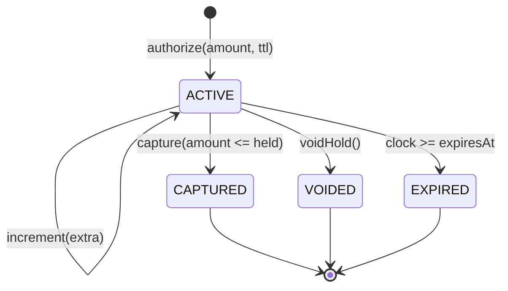

# Holds, Pending Transactions, and Available Balance

> Authorized is not settled; available is not ledger balance.

**Type:** Build
**Languages:** Java, Python, Go
**Prerequisites:** Phase 10, Lesson 01 (Representing Money), Phase 10, Lesson 03 (Double-Entry Ledger), Phase 4, Lesson 02 (Locks and Atomic Counters)
**Time:** ~90 minutes

## Learning Objectives

- Distinguish ledger balance, held (pending) amount, and available balance, and state the invariant that ties the three together
- Build an account that places, increments, captures (fully or partially), voids, and expires authorization holds against an injected clock
- Reject any hold, debit, or incremental authorization that would push available below zero, and show that a rejected operation leaves no trace
- Explain why a partial capture and an expiry both release money without touching the ledger balance, while a capture moves the ledger by exactly the captured amount
- Make the check-then-reserve step atomic under a per-account lock so that fifty concurrent authorizations against one balance admit exactly the number the balance can cover
- Map the from-scratch model onto card-network authorization rules and TigerBeetle's pending transfers

## The Problem

A neobank issues debit cards and keeps one number per customer: `balance`. A customer with 500.00 USD checks into a hotel. The hotel authorizes 300.00 USD, an estimate for the room plus incidentals. The issuer's authorization service checks `300.00 <= 500.00`, approves, and does nothing else, because nothing has settled yet and the ledger (Lesson 03) only records settled postings. The customer's app still shows 500.00. On the way home the customer fills up the car: the pump pre-authorizes 125.00. Check: `125.00 <= 500.00`, approved. Then a 150.00 online order: approved. Then a 60.00 restaurant bill: approved. Four approvals, 635.00 USD authorized against a 500.00 USD balance.

Three days later the hotel captures 287.40, the fuel station captures 41.17, the online merchant captures 150.00, and the restaurant captures 60.00. Total 538.57 against 500.00. The ledger goes to -38.57. For a credit card that is a normal day; for a debit card backed by a deposit account, the bank has just extended an overdraft it never agreed to, must decide whether to bounce the last capture (and eat a dispute from a merchant who holds a valid authorization), and in several jurisdictions owes the customer a disclosure it did not make. Multiply by the fraction of customers whose spending clusters at month end and the exposure is material.

The second version of the failure is the opposite and more common: the bank does track authorizations, but as debits against the one balance. The hotel's 300.00 is subtracted on authorization. The customer sees 200.00, spends accordingly, and when the hotel captures 287.40 the bank adds back 300.00 and subtracts 287.40. Now the hotel's authorization expires unused on a different trip: the bank forgets to add the 300.00 back, or adds it back twice, because "expiry" is a cron job over a table with no invariant to check. Customers see money disappear for a week and reappear, or not; support tickets say "pending charge never dropped off". Regulation E complaints follow.

Both failures come from collapsing three numbers into one. The **ledger balance** is what has settled: the sum of posted entries, the number Lesson 03's trial balance proves. The **held amount** is what has been promised but not settled: the sum of active authorizations. The **available balance** is what can still be promised: ledger minus held. These are different quantities with different lifecycles, and the authorization decision must be made against available, never against ledger. This lesson builds an account that keeps all three, proves after every operation that `available == ledger - sum(active holds)` and `available >= 0`, and makes the check-and-reserve step atomic so that concurrent authorizations cannot slip through the gap between reading the balance and writing the hold.

## The Concept

### Three balances, one invariant

| Quantity | Changes when | Visible to | Phase 10 source of truth |
|----------|--------------|-----------|---------------------------|
| Ledger balance | A settled posting hits the account: capture, deposit, fee, refund | Statements, reconciliation (Lesson 08), the trial balance | The journal (Lesson 03) |
| Held (pending) | A hold is placed, incremented, captured, voided, or expires | Customer app as "pending", risk engine | The hold set in this lesson |
| Available | Either of the above | The authorization decision, the customer's "you can spend" number | Derived, never stored |

The invariant is:

```text
available(t) == ledger(t) - sum(h.amount for h in holds if h.status == ACTIVE at time t)
available(t) >= 0
```

The first line says available is a derived quantity. The implementation computes it on every read instead of caching it, and `checkInvariant()` recomputes both sides independently so a test can call it after every operation. The second line is the business rule: the account never promises more than it has. Both lines are checked against the current time, because a hold's status depends on the clock.

### The hold lifecycle

A hold has four states. Only `ACTIVE` reduces available.



| Transition | Ledger moves by | Available moves by | Who triggers it in a card system |
|------------|-----------------|--------------------|----------------------------------|
| `authorize(300.00)` | 0 | -300.00 | Issuer approves the merchant's authorization request |
| `increment(45.00)` | 0 | -45.00 | Merchant sends an incremental authorization (hotel extends the stay) |
| `capture(287.40)` of a 300.00 hold | -287.40 | +12.60 | Clearing record arrives; the uncaptured 12.60 is released in the same step |
| `voidHold()` of a 4.50 hold | 0 | +4.50 | Merchant sends an authorization reversal (order cancelled) |
| expiry of a 300.00 hold | 0 | +300.00 | Nobody did anything; the clock passed `expiresAt` |

Two of the five transitions move the ledger, and only one of those (capture) moves it by an amount that depends on the hold. The others redistribute between held and available while the ledger stands still. That asymmetry is the whole design: a hold is a claim on future settlement, not a settlement. In Lesson 03's terms, the capture is the journal entry (`Dr Customer Deposits 287.40 / Cr Settlement Payable 287.40`); the hold never appears in the journal at all. TigerBeetle, which you will meet in Use It, encodes exactly this split as `debits_pending` versus `debits_posted`.

### Why partial capture releases the remainder immediately

The hotel authorized 300.00 and captured 287.40. The remaining 12.60 was never going to settle; the authorization is consumed by the capture. Under card network rules a single authorization supports a single clearing (a hotel that wants more sends an incremental authorization *before* checkout, not a second capture after), so the right moment to release the 12.60 is the capture itself. Holding it for the original expiry window is the "pending charge never dropped off" complaint from The Problem.

So `capture` does three things in one step: decrement ledger by the captured amount, mark the hold `CAPTURED`, and return the released remainder to the caller for the event log. The invariant holds trivially afterward because a `CAPTURED` hold contributes zero to the held sum.

Over-capture (capturing 300.01 against a 300.00 hold) is rejected. Card networks do tolerate a capture above the authorized amount for some merchant categories (restaurants with tips, fuel), but that tolerance is a scheme rule applied by the issuer with a known percentage, not an accident. The from-scratch version makes the strict rule the default and leaves the tolerance to Exercise 2, where it is a named parameter a reviewer can see.

### Expiry is a function of the clock, not a job

A hold carries `expiresAt = createdAt + ttl`. The account does not run a background sweeper; instead, every public method first calls `expireStale()`, which marks any `ACTIVE` hold with `expiresAt <= now` as `EXPIRED`. Expiry therefore happens lazily, on the next read or write, and the result is identical whether that next access comes one second or one month after the deadline.

This is why the clock is injected. `ManualClock` has `now()` and `advance(seconds)`; the demo and the tests move it by hand. The test `one second before expiry the hold is still active / at expiry the hold is released` advances the clock to `expiresAt - 1`, checks, advances by 1, and checks again. There is no `Thread.sleep`, no flaky "wait 2 seconds and hope", and the expiry boundary is tested exactly. A production system would use a real clock plus a periodic sweep so that the customer's app updates without waiting for the customer to do something; the lazy sweep is still there as the correctness backstop, because the sweep job will one day be late.

Expiry windows in production are set by the network and the merchant category: typically 7 days for most card-present authorizations, up to 30 days for hotels and car rentals, and as little as a few hours for fuel pre-authorizations. The lesson's demo uses 7 days, 2 hours, and 1 day.

### The check-then-reserve race

`authorize` reads available, compares, and inserts a hold. Between the read and the insert, another thread can do the same thing:

```text
thread A: available = 100.00            thread B: available = 100.00
thread A: 100.00 <= 100.00, ok          thread B: 100.00 <= 100.00, ok
thread A: insert hold 100.00            thread B: insert hold 100.00
                      available is now -100.00
```

Each thread saw a consistent snapshot and made a correct decision on it; the error is that the two decisions were made on the same snapshot. The invariant `available >= 0` cannot be restored after the fact without voiding someone's approved authorization, which is a dispute. So the check and the insert must be one atomic step, and the lock that makes them atomic is per account: holds on different accounts never contend.

The tests prove this with a race. Fifty threads each try to authorize 20.00 against 500.00 at the same instant, released by a latch so they really do collide. Exactly 25 must succeed and exactly 25 must be rejected, and available must be exactly zero afterward. With the lock removed the test fails on most runs with 26 to 50 acceptances; with the lock it passes every time, which is the difference between "about right" and an invariant. Go runs the same test under `-race`, which also catches unsynchronized reads of the clock.

Phase 4, Lesson 02 covers why a lock is the right tool here and Phase 10, Lesson 11 covers what to do when one account is hot enough that a lock becomes the bottleneck.

### Worked example by hand

Start: a debit card account with 500.00 USD settled, nothing held, clock at `t = 1,700,000,000`.

| Step | Operation | Ledger | Held | Available | Note |
|------|-----------|--------|------|-----------|------|
| 1 | `credit(500.00)` | 500.00 | 0.00 | 500.00 | payroll lands |
| 2 | `authorize(hotel, 300.00, 7d)` | 500.00 | 300.00 | 200.00 | expires at t + 604,800 |
| 3 | `authorize(fuel, 125.00, 2h)` | 500.00 | 425.00 | 75.00 | two holds stack |
| 4 | `debit(80.00)` | 500.00 | 425.00 | 75.00 | **rejected**: 80.00 > 75.00 even though ledger is 500.00 |
| 5 | `capture(fuel, 42.17)` | 457.83 | 300.00 | 157.83 | ledger down 42.17; 82.83 released |
| 6 | clock += 8 days | 457.83 | 0.00 | 457.83 | hotel hold expired on the next read |
| 7 | `capture(hotel, 300.00)` | 457.83 | 0.00 | 457.83 | **rejected**: hold is EXPIRED |
| 8 | `authorize(hotel-2, 310.00, 7d)` | 457.83 | 310.00 | 147.83 | hotel re-authorizes |
| 9 | `increment(hotel-2, 45.00)` | 457.83 | 355.00 | 102.83 | incremental authorization |
| 10 | `capture(hotel-2, 400.00)` | 457.83 | 355.00 | 102.83 | **rejected**: over-capture |
| 11 | `capture(hotel-2, 355.00)` | 102.83 | 0.00 | 102.83 | full capture; nothing released |
| 12 | `authorize(coffee, 4.50, 1d)` | 102.83 | 4.50 | 98.33 | |
| 13 | `voidHold(coffee)` | 102.83 | 0.00 | 102.83 | authorization reversal |

Check the invariant at step 5: `457.83 - 300.00 = 157.83`, matches. At step 6 the only active hold is gone, so `457.83 - 0 = 457.83`. At every rejected step (4, 7, 10) the three numbers are unchanged from the previous row, which the tests assert explicitly: a rejection is not an operation that happens to throw, it is a no-op.

Step 7 is the one that surprises people. At step 2 the issuer approved a 300.00 authorization; at step 7 the hotel presents a clearing record for exactly that amount and the account refuses it. In a real card system the issuer would in most cases still honour a late presentment and the customer's ledger would go to 157.83, because the network rules give the merchant that right. What has been lost is the *guarantee*: the issuer approved against funds that are no longer reserved. The from-scratch model rejects so that the learner sees exactly where the guarantee ended; Exercise 3 adds the "honour late presentment as a forced post" path.

### Complexity

| Operation | Cost | Why |
|-----------|------|-----|
| `authorize`, `increment`, `capture`, `voidHold` | O(h) where h = holds ever placed on this account | `expireStale` and `heldTotal` scan the hold map |
| `availableBalance`, `checkInvariant` | O(h) | same scan |
| `credit` | O(h) | only because it sweeps expiries first; the credit itself is O(1) |

O(h) per operation is fine for a card account (tens of holds) and wrong for a merchant settlement account with a million pending payouts. Exercise 2 of Lesson 11 replaces the scan with a cached held total plus an expiry-ordered heap (Phase 1), bringing `authorize` to O(log h). The invariant does not change; only the data structure that maintains it does, and `checkInvariant()` remains the O(h) oracle that proves the cache honest, exactly as `netDebitFromPostings` did for the ledger in Lesson 03.

### What this account does not do

- **It does not post journal entries.** `ledger` is a single `Money` field standing in for the balance Lesson 03 derives from postings. Wiring `capture` to emit a `JournalEntry` is a two-line change the lesson leaves to you so that the hold mechanics stay in view.
- **It does not persist.** Holds live in memory. A durable version writes the hold and the ledger movement in one transaction (Phase 7), and the `expiresAt` column gets an index so the sweep job can find stale rows.
- **It does not model the network's partial-authorization or capture-tolerance rules.** Strict `capture <= held` is the default; tolerances are Exercise 2.
- **It does not know about multiple currencies.** An account has one currency, and a hold in another currency is a `CurrencyMismatch`. A card used abroad has its authorization converted to the account currency by the issuer before it reaches this code (Lesson 02 and Lesson 09).
- **It does not distinguish hold types.** Card authorizations, ACH debit pre-notes, and internal risk freezes are all holds with a TTL here. Production systems tag them, because a risk freeze should not expire on a timer.

## Build It

The walkthrough is in Java. The Python and Go files implement the same types with the same names; the subsections at the end cover only what differs. The `Money` and `Currency` types are copied from Lesson 01 at the top of each file.

### Step 1: The injected clock

```java
interface Clock {
    long now();
}

final class ManualClock implements Clock {
    private volatile long now;

    ManualClock(long start) { this.now = start; }

    @Override public long now() { return now; }

    synchronized void advance(long seconds) {
        if (seconds < 0) throw new IllegalArgumentException("clocks do not run backwards in this lesson");
        now += seconds;
    }
}
```

Whole seconds since the epoch, as a `long`. The interface exists so that production code can pass `System::currentTimeMillis / 1000` and the tests can pass a `ManualClock`. The field is `volatile` because fifty threads read it during the race test while nobody writes; `advance` is synchronized so that a writer and a reader never tear. Refusing negative advances is a test aid: a hold that was `EXPIRED` can never become `ACTIVE` again, and a clock that runs backwards would make that assertion false for a reason that has nothing to do with holds.

**Predict:** if `advance` were allowed to go negative, which of the four hold states could appear to "un-happen" and which could not?

### Step 2: The hold

```java
enum HoldStatus { ACTIVE, CAPTURED, VOIDED, EXPIRED }

final class Hold {
    final String id;
    final long createdAt;
    final long expiresAt;
    private Money amount;
    private HoldStatus status = HoldStatus.ACTIVE;
    private Money captured;

    Hold(String id, Money amount, long createdAt, long expiresAt) {
        if (id == null || id.isBlank()) throw new IllegalArgumentException("hold id required");
        if (!amount.isPositive()) throw new IllegalArgumentException("hold amount must be positive, got " + amount);
        if (expiresAt <= createdAt) throw new IllegalArgumentException("hold must expire after it is created");
        this.id = id; this.amount = amount; this.createdAt = createdAt; this.expiresAt = expiresAt;
        this.captured = Money.zero(amount.currency());
    }

    boolean isActive() { return status == HoldStatus.ACTIVE; }
    boolean isStale(long now) { return status == HoldStatus.ACTIVE && now >= expiresAt; }

    void increment(Money extra) { amount = amount.plus(extra); }
    void markCaptured(Money capturedAmount) { captured = capturedAmount; status = HoldStatus.CAPTURED; }
    void markVoided() { status = HoldStatus.VOIDED; }
    void markExpired() { status = HoldStatus.EXPIRED; }
}
```

The hold is mutable, unlike every type in Lessons 01 and 03, because it has a lifecycle. The transitions are package-private and have no guards of their own: `Account` is the only caller and it checks the invariant before calling. `isStale` is the one piece of time logic in the class, and it is a pure function of `(status, now)`, which is why expiry can be lazy. A `CAPTURED` hold remembers both the authorized `amount` and the `captured` amount; the difference is what was released, and a statement line reads "authorized 300.00, settled 287.40".

**Predict:** `isStale` returns false for a `CAPTURED` hold whose `expiresAt` is in the past. Why is that the right answer, and what would go wrong in `expireStale` if it returned true?

### Step 3: The account, and the three balances

```java
final class Account {
    final String id;
    final Currency currency;
    private final Clock clock;
    private Money ledger;
    private final Map<String, Hold> holds = new LinkedHashMap<>();
    private final List<String> events = new ArrayList<>();

    synchronized int expireStale() {
        long now = clock.now();
        int released = 0;
        for (Hold h : holds.values()) {
            if (h.isStale(now)) { h.markExpired(); released++; events.add("t=" + now + " EXPIRED " + h.id + " released " + h.amount()); }
        }
        return released;
    }

    synchronized Money ledgerBalance() { return ledger; }

    synchronized Money heldTotal() {
        expireStale();
        Money total = Money.zero(currency);
        for (Hold h : holds.values()) if (h.isActive()) total = total.plus(h.amount());
        return total;
    }

    synchronized Money availableBalance() { return ledger.minus(heldTotal()); }
}
```

`ledger` is one `Money`; `heldTotal` is computed; `availableBalance` is the difference. Nothing is cached, so there is nothing to get out of sync. `heldTotal` sweeps expiries first, which is what makes "the hotel hold expired on read" in the worked example true: step 6 is a plain `availableBalance()` call after the clock moved. The hold map is a `LinkedHashMap` so the event log and the active-hold list come out in insertion order in every run.

Every method is `synchronized`. Java's monitor is reentrant, so `availableBalance` calling `heldTotal` calling `expireStale` takes the same lock three times without deadlocking; Go has no reentrant mutex and the Go section shows what that costs.

**Predict:** `availableBalance()` is called on an account with two holds, one of which expired an hour ago. How many times does the lock get acquired, and how many holds does the method report as active?

### Step 4: Authorize is check-then-reserve under one lock

```java
synchronized Hold authorize(String holdId, Money amount, long ttlSeconds) {
    requirePositive(amount);
    if (holds.containsKey(holdId)) throw new DuplicateHoldException(holdId);
    Money available = availableBalance();
    if (amount.compareTo(available) > 0) throw new InsufficientAvailableException(amount, available);
    long now = clock.now();
    Hold h = new Hold(holdId, amount, now, now + ttlSeconds);
    holds.put(holdId, h);
    events.add("t=" + now + " AUTHORIZE " + holdId + " " + amount + " until t=" + h.expiresAt);
    return h;
}

synchronized Hold increment(String holdId, Money extra) {
    requirePositive(extra);
    Hold h = requireActive(holdId);
    Money available = availableBalance();
    if (extra.compareTo(available) > 0) throw new InsufficientAvailableException(extra, available);
    h.increment(extra);
    events.add("t=" + clock.now() + " INCREMENT " + holdId + " +" + extra + " -> " + h.amount());
    return h;
}
```

The shape is the same as `Ledger.post` in Lesson 03: every check that can fail runs before the first write. `requirePositive` rejects zero, negative, and wrong-currency amounts; the duplicate-id check turns a retried authorization into an error rather than a second hold (the caller's contract is that the hold id is the network's authorization id, not a fresh UUID per attempt); the available check is the business rule. Only then does the hold enter the map. Because the method is `synchronized`, no other thread can run its own check between this thread's check and its insert, which is the race from The Concept.

`increment` is hold stacking by another name: the hold grows, available shrinks, and the check is identical. The alternative design, a second hold linked to the first, makes capture harder (which hold does the clearing record consume?) and is how "pending charges" multiply on a customer's statement.

**Predict:** two threads call `authorize` for different hold ids with `amount = available` at the same instant. One wins. What exception does the other see, and what does `availableBalance()` return in the message?

### Step 5: Capture, void, and the settled debit

```java
synchronized Money capture(String holdId, Money amount) {
    requirePositive(amount);
    Hold h = requireActive(holdId);
    if (amount.compareTo(h.amount()) > 0) throw new OverCaptureException(holdId, amount, h.amount());
    ledger = ledger.minus(amount);
    h.markCaptured(amount);
    Money released = h.amount().minus(amount);
    events.add("t=" + clock.now() + " CAPTURE " + holdId + " " + amount + " released " + released);
    return released;
}

synchronized Money voidHold(String holdId) {
    Hold h = requireActive(holdId);
    h.markVoided();
    events.add("t=" + clock.now() + " VOID " + holdId + " released " + h.amount());
    return h.amount();
}

synchronized void debit(Money amount) {
    requirePositive(amount);
    Money available = availableBalance();
    if (amount.compareTo(available) > 0) throw new InsufficientAvailableException(amount, available);
    ledger = ledger.minus(amount);
    events.add("t=" + clock.now() + " DEBIT " + amount);
}
```

`capture` is the only method that moves `ledger` in response to a hold, and it moves it by the captured amount, not the held amount. Notice there is no available check in `capture`: the money was reserved at authorization time, so the capture cannot fail for insufficient funds. That is what the hold bought. `voidHold` moves nothing but the status. `debit` is a settled movement with no prior authorization (a monthly fee, a direct debit) and it must fit inside available, not ledger: step 4 of the worked example, where 80.00 is rejected against a 500.00 ledger, is this method.

`requireActive` (in the file) sweeps expiries, looks up the hold, and throws `HoldNotActiveException` with the actual status in the message, so "capture an expired hold" and "void a captured hold" both fail with a message that says which state the hold is in.

**Predict:** `capture("h", 100.00)` on a 100.00 hold returns what, and what does the hold's `captured()` report afterward?

### Step 6: The invariant as an oracle

```java
synchronized boolean checkInvariant() {
    expireStale();
    Money sum = Money.zero(currency);
    for (Hold h : holds.values()) if (h.status() == HoldStatus.ACTIVE) sum = sum.plus(h.amount());
    Money available = availableBalance();
    return available.equals(ledger.minus(sum)) && !available.isNegative();
}
```

This recomputes the held sum independently of `heldTotal` and compares. In this lesson the two are the same loop, so the check looks tautological; its value is that it stays the same when Exercise 1 of Lesson 11 replaces `heldTotal` with a cached counter. The randomized test calls it after each of 2,000 seeded operations (authorize, capture, void, debit, advance the clock) and the race test calls it after fifty threads have finished.

### Step 7: The race

```java
static int[] raceAuthorizations(Account account, int threads, Money amount) {
    CountDownLatch start = new CountDownLatch(1);
    AtomicInteger accepted = new AtomicInteger(), rejected = new AtomicInteger();
    List<Thread> workers = new ArrayList<>();
    for (int i = 0; i < threads; i++) {
        final String holdId = "race-" + i;
        Thread t = new Thread(() -> {
            try {
                start.await();
                account.authorize(holdId, amount, 3600);
                accepted.incrementAndGet();
            } catch (InsufficientAvailableException e) {
                rejected.incrementAndGet();
            } catch (InterruptedException e) { Thread.currentThread().interrupt(); }
        });
        workers.add(t); t.start();
    }
    start.countDown();
    for (Thread t : workers) t.join();
    return new int[] {accepted.get(), rejected.get()};
}
```

All fifty threads block on the latch, then are released together, which maximizes the chance of collision. The test asserts `accepted == 25 && rejected == 25` for 50 x 20.00 against 500.00, and `accepted == 1 && rejected == 7` for eight threads each asking for the whole 100.00 balance. Delete the `synchronized` keyword from `authorize` and run the test ten times to see the failure for yourself.

### Step 8: Run it

```bash
cd phases/10-money-and-ledgers/07-holds-and-available-balance/code/java
javac -d .out *.java && java -cp .out Main
java -cp .out MainTest
```

Expected output, abbreviated:

```console
== A debit card account: payroll lands, then two authorizations ==
payroll credit 500.00                        ledger=500.00 USD  held=0.00 USD    available=500.00 USD  invariant=true
hotel authorizes 300.00 (7-day hold)         ledger=500.00 USD  held=300.00 USD  available=200.00 USD  invariant=true
fuel pump pre-authorizes 125.00 (2-hour hold) ledger=500.00 USD  held=425.00 USD  available=75.00 USD   invariant=true

== Available, not ledger, is what the next request sees ==
rejected: requested 80.00 USD but only 75.00 USD is available  (ledger still says 500.00)

== Partial capture releases the remainder in the same step ==
fuel captures 42.17, released 82.83 USD
after fuel capture                           ledger=457.83 USD  held=300.00 USD  available=157.83 USD  invariant=true

== Expiry: the clock moves 8 days; nobody captured the hotel hold ==
8 days later (hotel hold expired on read)    ledger=457.83 USD  held=0.00 USD    available=457.83 USD  invariant=true
rejected: hold auth-hotel is EXPIRED, not ACTIVE

== Concurrency: 50 threads race to authorize 20.00 against 500.00 ==
accepted=25 rejected=25 available=0.00 USD invariant=true

final: 102.83 USD ledger, 102.83 USD available, invariant=true
```

The test run prints `passed 44, failed 0`.

### In Python

```python
class Account:
    def __init__(self, account_id, currency, clock):
        ...
        self._lock = threading.RLock()

    def authorize(self, hold_id: str, amount: Money, ttl_seconds: int) -> Hold:
        with self._lock:
            self._require_positive(amount)
            if hold_id in self._holds:
                raise DuplicateHoldError(hold_id)
            available = self.available_balance()
            ...
```

Differences, all in `code/python/main.py`:

- **`threading.RLock`, not `Lock`.** `authorize` calls `available_balance` calls `held_total` calls `expire_stale`, and each takes the lock. A plain `Lock` would deadlock on the second acquisition; `RLock` is Python's reentrant monitor, the equivalent of Java's `synchronized` on `this`.
- **The GIL does not save you.** Python runs one bytecode at a time, but `amount > available` and `self._holds[hold_id] = h` are different bytecodes with a context switch allowed between them. The race test fails without the lock on CPython just as it does in Java.
- **Comparison uses `>`**, via `functools.total_ordering` on `Money`, where Java uses `compareTo`. Both raise on a currency mismatch.
- **`ManualClock` has its own lock** because the race test reads `now()` from fifty threads; a bare `int` read is atomic in CPython today but the lesson does not rely on an implementation detail.

### In Go

```go
type Account struct {
    mu     sync.Mutex
    ledger Money
    holds  map[string]*Hold
    order  []string
    ...
}

func (a *Account) Authorize(id string, amount Money, ttlSeconds int64) (*Hold, error) {
    if err := a.requirePositive(amount); err != nil { return nil, err }
    a.mu.Lock()
    defer a.mu.Unlock()
    ...
    available := a.availableLocked()
    ...
}
```

Differences, all in `code/go/main.go`:

- **`sync.Mutex` is not reentrant.** `Authorize` holds the lock and must compute available, but calling the exported `AvailableBalance` would try to lock again and deadlock. So the file has pairs: `AvailableBalance` (locks, delegates) and `availableLocked` (assumes the lock is held), likewise `heldTotalLocked`, `expireStaleLocked`, `holdLocked`, `requireActiveLocked`. The naming convention is the documentation; Go has no way to enforce it.
- **Errors are values and wrap sentinels.** `ErrInsufficientAvailable`, `ErrOverCapture`, `ErrHoldNotActive`, `ErrUnknownHold`, `ErrDuplicateHold`, `ErrInvalidAmount`, and `ErrCurrencyMismatch` all support `errors.Is`, which is how the tests assert the failure kind and how the race counts rejections.
- **Map iteration is random**, so the account keeps an `order` slice of hold ids for deterministic sweeps, event logs, and `ActiveHolds()`.
- **`go test -race ./...` is part of the contract.** The race detector flags unsynchronized access to `ManualClock.now` from fifty goroutines, which is why the clock has its own mutex. Run the tests with `-race` or the concurrency test proves less than it claims.

## Use It

### Card networks: authorization, incremental, reversal, clearing

The five transitions in this lesson are the five message types an issuer processes for a dual-message card transaction (Phase 11, Lesson 02). The authorization request (ISO 8583 `0100`) creates the hold; an incremental authorization is another `0100` referencing the original; an authorization reversal (`0400`) voids it; the clearing record that arrives in the daily batch file captures it; and the network's rules set the expiry window after which the issuer may release the hold. Visa and Mastercard both publish rules requiring merchants to reverse unused authorizations within a set period and allowing issuers to expire them, which is the regulatory version of `expiresAt`.

What the network does for you that the from-scratch version made explicit: it defines the hold id (the authorization code plus the network reference), carries the TTL in its rules, and tells you which clearing record belongs to which hold. What it does not do is protect your available balance: that computation happens entirely inside the issuer, and an issuer that gets it wrong is the bank in The Problem.

### TigerBeetle: pending transfers

TigerBeetle's account record has four balance fields: `debits_pending`, `debits_posted`, `credits_pending`, `credits_posted`. A two-phase transfer with the `pending` flag increments the pending side; a later `post_pending_transfer` moves the amount (or a smaller amount, exactly like partial capture) from pending to posted and releases the rest; `void_pending_transfer` releases it all; and a `timeout` on the pending transfer expires it. The account flag `debits_must_not_exceed_credits` is `available >= 0` enforced in the database engine. Every concept in this lesson has a field or a flag there, and reading that documentation after building this is the fastest way to see which parts of the design are fundamental.

### Stripe: `authorization` and `capture`

Stripe's PaymentIntents API with `capture_method: manual` exposes the merchant side of the same lifecycle: `requires_capture` is `ACTIVE`, `capture` with an `amount_to_capture` below the authorized amount is partial capture with immediate release, `cancel` is void, and uncaptured intents expire after seven days by default. Stripe Issuing exposes the issuer side, where an `authorization` object has `pending_request`, approved and declined states, and the `balance` your program must defend. Both APIs make the authorized and captured amounts separate fields, as `Hold.amount` and `Hold.captured` do.

### Regulation E and "pending"

In the United States, Regulation E (12 CFR 1005) governs consumer electronic fund transfers and is the reason a debit card app shows pending transactions separately from the posted balance: an authorization hold that reduces available without being disclosed is a frequent source of supervisory findings, and the CFPB has published guidance on overdraft fees charged against "authorize positive, settle negative" transactions, which is precisely the scenario where available was computed against ledger instead of against held. The three-balance model is not just good engineering; in consumer banking it is compliance.

## Ship It

`outputs/checklist-holds-and-available-balance.md` is a review checklist for any code that authorizes, captures, or releases funds: the three balances, the invariant, the atomicity of check-then-reserve, the five transitions, the clock, and the tests that must exist. Use it on the pull request that adds a new hold type or touches the authorization path.

## Exercises

1. **Reinforce.** Add a `Hold.kind` field with values `CARD_AUTH`, `ACH_PRENOTE`, and `RISK_FREEZE`, and make `expireStale` skip `RISK_FREEZE` holds regardless of `expiresAt` (they are released only by an explicit `voidHold`). Add a test where a 50.00 risk freeze and a 50.00 card authorization are placed with the same TTL, the clock passes it, and available recovers exactly 50.00.

2. **Apply.** Card networks allow some merchant categories to capture above the authorized amount: restaurants up to 20% for tips, fuel up to a fixed amount. Add a `captureTolerance` parameter to `Account` expressed in basis points (use `Money.times(bps, 10_000, HALF_EVEN)` from Lesson 01), make `capture` accept `amount <= held + held * tolerance`, and move the ledger by the full captured amount. Then write the test that shows available can go negative after such a capture, and decide, in a comment, whether that violates the invariant or is a sanctioned exception to it. This connects to Phase 11, Lesson 07 (Interchange and Scheme Fees).

3. **Extend.** Replace the `Money ledger` field with a `Ledger` from Lesson 03. `credit` posts `Dr Customer Cash / Cr Customer Deposits`, `capture` posts `Dr Customer Deposits / Cr Settlement Payable`, and `ledgerBalance()` becomes `ledger.balance("deposits")`. Then add `forcePost(holdId, amount)`, the path an issuer uses to honour a late presentment on an expired hold: it posts the capture entry even though no active hold covers it, and records a `LATE_PRESENTMENT` event. Write the test from step 7 of the worked example both ways and show which balances differ.

## Key Terms

| Term | What people say | What it actually means |
|------|-----------------|------------------------|
| Ledger balance | "the balance" | The sum of settled postings to the account; the number the trial balance proves and the statement shows |
| Available balance | "what I can spend" | Ledger balance minus the sum of active holds; the only number an authorization decision may be made against |
| Authorization hold | "pending charge" | A reservation of funds against a future capture, with an amount, an expiry, and no effect on the ledger |
| Capture | "the charge went through" | The settlement of a hold: the ledger moves by the captured amount, the hold is consumed, and any uncaptured remainder is released at once |
| Void / authorization reversal | "the hold dropped off" | Cancellation of a hold before capture; the full amount returns to available and the ledger never moved |
| Incremental authorization | "they added to the hold" | Growing an existing hold, subject to the same available check; the alternative (a second hold) makes capture matching ambiguous |
| Check-then-reserve race | "two requests got through" | Two callers reading the same available balance and both reserving against it; prevented only by making the read and the write one atomic step |
| Lazy expiry | "the hold expires after 7 days" | A hold becomes `EXPIRED` the first time any operation observes the clock past its `expiresAt`; no background job is required for correctness, only for freshness |

## Further Reading

- [Visa Core Rules and Visa Product and Service Rules](https://usa.visa.com/support/consumer/visa-rules.html) — the authorization, incremental authorization, reversal, and hold-release rules an issuer implements; search for "authorization reversal" and "estimated authorization".
- [TigerBeetle: Two-Phase Transfers](https://docs.tigerbeetle.com/coding/two-phase-transfers/) — pending, post, void, and timeout on transfers, plus the `debits_must_not_exceed_credits` flag: this lesson's model as a database primitive.
- [Stripe API: PaymentIntents, `capture_method: manual`](https://docs.stripe.com/payments/place-a-hold-on-a-payment-method) — the merchant-side lifecycle of a hold, including partial capture and the seven-day default expiry.
- [12 CFR Part 1005, Regulation E](https://www.consumerfinance.gov/rules-policy/regulations/1005/) — the US rule on consumer electronic fund transfers and the reason pending and posted balances are disclosed separately.
- [CFPB Circular 2022-06: Unanticipated overdraft fee assessment practices](https://www.consumerfinance.gov/compliance/circulars/circular-2022-06-unanticipated-overdraft-fee-assessment-practices/) — the "authorize positive, settle negative" problem described by the regulator; the failure in The Problem, from the other side.
- [Java Language Specification, chapter 17: Threads and Locks](https://docs.oracle.com/javase/specs/jls/se21/html/jls-17.html) — the memory model behind `synchronized` and `volatile`, for why the clock field is volatile and why reentrancy is guaranteed.
