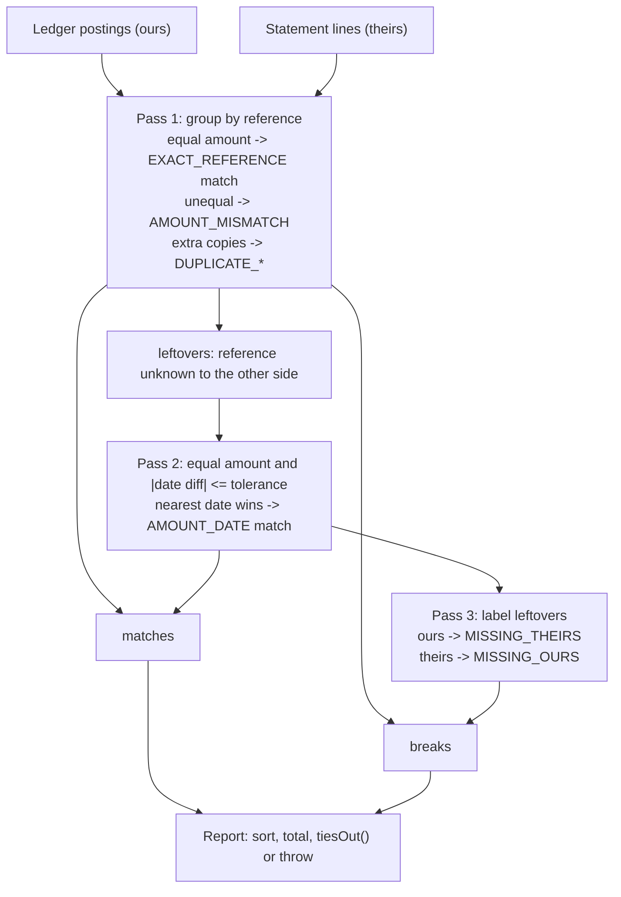

# Reconciliation: Matching Your Ledger Against Theirs

> The processor says 10,000 transactions; you have 9,998. Find the two.

**Type:** Build
**Languages:** Java, Python
**Prerequisites:** Phase 10, Lesson 01 (Representing Money), Phase 10, Lesson 03 (The Double-Entry Ledger), Phase 10, Lesson 07 (Holds and Available Balance)
**Time:** ~120 minutes

## Learning Objectives

- Explain why a double-entry ledger that balances internally can still be wrong, and what an external statement adds that no internal check can
- Build a three-pass matcher: exact match on reference id, then amount-plus-date tolerance matching, then classification of everything left
- Classify every unmatched record into one of five break kinds (missing ours, missing theirs, amount mismatch, duplicate ours, duplicate theirs) with no record left in limbo
- Produce a reconciliation report whose totals tie out by construction, and state the identity that makes a controller willing to sign it
- Make the whole run deterministic so that two machines, or the same machine on two days, produce byte-identical reports from the same inputs

## The Problem

A payments company settles card transactions through a processor. Every day the processor sends a settlement file: one line per captured transaction, with the processor's transaction id, the settlement date, and the amount it is crediting to the company's bank account. The company's own ledger, built in Lesson 03, recorded each capture as a debit to `1200 Processor Receivable` and, when the settlement webhook arrived, a debit to `1010 Settlement Bank` with the processor's id as the reference. The ledger balances. Every entry nets to zero. The trial balance has been clean for two years.

On a Tuesday in March the finance team notices that the cash in the bank is 41.78 USD less than the ledger says it should be. Not a lot. Nobody panics. The next day it is 118.40 USD. By Friday, 312.90 USD. The ledger is still perfectly balanced, because double entry checks that money moved from somewhere to somewhere inside your own books. It cannot check that the somewhere agrees with the outside world. A webhook that was delivered twice posts twice, and both postings are balanced. A webhook that was never delivered posts zero times, and the receivable sits there forever, balanced. A processor file that reports 21.00 where you captured 12.00 is an unbalanced relationship between two systems, and no single-system invariant can see it.

The team pulls the settlement file and the ledger postings for the week into a spreadsheet and starts matching rows by hand. Ten thousand lines. They find a transaction the processor settled that nobody recorded (a webhook lost during a deploy), one the company recorded that the processor never settled (declined at capture, but the optimistic posting was never reversed), a transposed digit, and a line the processor's file contained twice. The sum of the four explains the difference to the cent. It took three people two days, and the next file arrives tomorrow.

Reconciliation is the mechanism that does this every day, automatically, and tells you exactly which records are unexplained. It is the only control that checks the ledger against reality. The matcher in this lesson is small, around two hundred lines, but it carries one property that the spreadsheet did not: its totals tie out by construction. Every input record is in exactly one match or exactly one break, so `ledger total = matched + ours unmatched` and `statement total = matched + theirs unmatched` are identities, not things to hope for. When the report says the difference is 41.78 and lists four breaks whose differences sum to 41.78, that is not a coincidence that someone checked; it is a theorem the code enforces.

## The Concept

### Two books, one truth

Reconciliation compares two independent records of the same events. In payments the pairs are always the same shape:

| Our side ("ours") | Their side ("theirs") | What a break means |
|-------------------|----------------------|--------------------|
| Ledger postings to the settlement bank account | Bank statement (ISO 20022 camt.053, BAI2, MT940) | Cash we think we have vs cash the bank says we have |
| Ledger postings to the processor receivable | Processor settlement report | Captures we expect to be paid vs captures the processor will pay |
| Payout entries to merchants | Payout provider's confirmation file | Money we think left vs money that actually left |
| Internal transfers between two of our services | The other service's ledger | Two of our own systems disagreeing |

The two sides are produced by different systems, at different times, from different inputs, and that independence is the point. If both sides were derived from the same event stream, agreeing would prove nothing. The ledger from Lesson 03 is internally consistent by construction; reconciliation is the external consistency check, and it is the control auditors ask about first, because it is the one that catches the errors double entry cannot.

### What a match is

A **match** pairs one record of ours with one record of theirs and asserts they describe the same event. Two kinds of evidence support that assertion, and they are not equally strong:

1. **A shared reference id.** The processor's transaction id appears in both records because we stored it when their webhook arrived. If the ids are equal and the amounts are equal, the match is as strong as the id is unique. This is pass 1.
2. **Equal amount and a nearby date.** When the ids do not line up (we stored our internal id, they used theirs; a field was blank; a format changed), the amount and the date are the only fields left. Equal amounts on dates within a tolerance are good evidence for a single record, but as the file grows the chance of two unrelated 20.00 USD transactions on adjacent days approaches one. This is pass 2, and it is a heuristic that a reviewer should be able to see and override.

The `Match` record stores which rule produced it. A report where 99% of matches are `EXACT_REFERENCE` and 1% are `AMOUNT_DATE` is healthy. A report where the proportions reverse means the reference plumbing broke, and that is itself a finding, before any break is examined.

### The five breaks

Everything that is not matched is a **break**, and every break has a kind. There are exactly five, and the kind tells the analyst where to look:

| Kind | Where the record is | Typical cause | Resolution |
|------|---------------------|---------------|------------|
| `MISSING_OURS` | On their statement, not in our ledger | Lost webhook; event consumed but posting failed after commit; capture made outside our system | Post it with a dated adjusting entry after confirming the underlying transaction |
| `MISSING_THEIRS` | In our ledger, not on their statement | Settlement still in transit (timing); capture declined but optimistically posted; our duplicate posting with a fresh id | Carry forward if timing; reverse (Lesson 03) if it will never settle |
| `AMOUNT_MISMATCH` | Both sides, same reference, different amount | Partial capture; currency conversion on their side; fee netted on one side only; transposed digits | Investigate the difference; the sign tells you who recorded more |
| `DUPLICATE_OURS` | Our ledger has more copies of a reference than their statement | Webhook retried without an idempotency key; replayed event stream | Reverse the extra; fix the idempotency gap (Phase 12) |
| `DUPLICATE_THEIRS` | Their statement has more copies than our ledger | Their file double-posted; a reversal they encoded as a second line | Dispute with the counterparty; never book it |

Two things about this list are deliberate. First, the kinds are mutually exclusive and exhaustive: an unmatched record lands in exactly one row. Second, they are ordered. The enum order is the report order, and it is the order an operations analyst works a break list: money that is genuinely missing before bookkeeping noise.

### The partition invariant and the tie-out

Here is the property that makes a reconciliation report trustworthy. Let `L` be the set of our postings and `S` the set of their lines. The matcher produces a set of matches `M` (pairs) and a set of breaks `B`. The invariant:

```text
every l in L appears in exactly one match or exactly one break
every s in S appears in exactly one match or exactly one break
no match and no break contains a record that is not in L or S
```

If that holds, then summing amounts gives three identities for free:

```text
ledger total     = matched total + ours unmatched
statement total  = matched total + theirs unmatched
ledger total - statement total = ours unmatched - theirs unmatched
```

where `matched total` sums the (equal) amount of each match, `ours unmatched` sums our side of every break (zero for `MISSING_OURS` and `DUPLICATE_THEIRS`), and `theirs unmatched` sums their side. The third identity is the one a controller cares about: the unexplained difference between the two books equals the sum of the listed breaks. If the report lists 41.78 USD of difference and four breaks, the breaks' differences sum to 41.78 USD, and there is nothing else to find.

`ReconciliationReport.tiesOut()` checks all three identities, and `Reconciler.reconcile` throws if they fail, because a report that does not tie out is not a report with a finding; it is a bug in the matcher. The identities are a consequence of the partition, so a failure means a record was dropped or double-counted somewhere in the three passes.



### Worked example by hand

Ten postings of ours against eleven lines of theirs, all USD, tolerance one day. Seven pairs share a reference and an amount and are uninteresting. The interesting records:

```text
ours                                  theirs
int_8841  2026-03-04   64.00          txn_77f2  2026-03-05   64.00    <- different ids, one day apart
ch_1009   2026-03-04   88.88          (absent)                        <- we have it, they do not
ch_1010   2026-03-05   12.00          ch_1010   2026-03-05   21.00    <- same id, 12 vs 21
ch_1007   2026-03-04   33.10          ch_1007   2026-03-04   33.10    <- they list it twice
                                      ch_1007   2026-03-04   33.10
(absent)                              ch_1011   2026-03-05    5.00    <- they have it, we do not
```

Pass 1 groups by reference. `ch_1001` through `ch_1006` pair exactly: six `EXACT_REFERENCE` matches. `ch_1007` has one copy on our side and two on theirs: the first pair matches, the second copy of theirs becomes `DUPLICATE_THEIRS`. `ch_1010` pairs but the amounts differ: `AMOUNT_MISMATCH`, difference `12.00 - 21.00 = -9.00`. `int_8841`, `ch_1009`, `txn_77f2`, and `ch_1011` have references the other side has never seen, so they go to the leftover lists.

Pass 2 walks our leftovers in sorted order. `int_8841` at 64.00 on 2026-03-04 looks for a 64.00 line within one day: `txn_77f2` on 2026-03-05 qualifies, distance one, `AMOUNT_DATE` match. `ch_1009` at 88.88 finds nothing.

Pass 3 labels what is left: `ch_1009` is `MISSING_THEIRS`, `ch_1011` is `MISSING_OURS`.

Totals:

```text
ledger total     = 19.99 + 250.00 + 7.50 + 120.00 + 49.95 + 1500.00 + 33.10 + 64.00 + 88.88 + 12.00 = 2145.42
statement total  = same seven + 33.10 (dup) + 64.00 + 21.00 + 5.00                                = 2103.64
matched total    = 1980.54 (seven exact) + 64.00 (one fuzzy)                                       = 2044.54
ours unmatched   = 88.88 (missing theirs) + 12.00 (mismatch, our side)                             =  100.88
theirs unmatched = 5.00 (missing ours) + 21.00 (mismatch, their side) + 33.10 (duplicate)          =   59.10

2145.42 = 2044.54 + 100.88   (ties)
2103.64 = 2044.54 +  59.10   (ties)
2145.42 - 2103.64 = 41.78 = 100.88 - 59.10   (ties)
```

The 41.78 USD that finance noticed on Tuesday is fully explained by four records, and the report says which four.

### Complexity

Pass 1 is a group-by on reference: `O((n + m) log(n + m))` with a `TreeMap`, or linear with a hash map (the tree is used for deterministic iteration order, discussed below). Pass 2 as written is `O(a * b)` where `a` and `b` are the leftover counts after pass 1. For a healthy book, leftovers are a fraction of a percent of the file, so quadratic on the leftovers is fine for files of millions of lines. If references are systematically absent (a new counterparty that does not echo ids), index their leftovers by amount into a `TreeMap<Money, List<StatementLine>>` and pass 2 becomes `O(a log b)`. Exercise 2 asks for that.

### Why determinism matters here specifically

A reconciliation report is evidence. It will be rerun by the controller to confirm the engineer's numbers, rerun by an auditor six months later, and compared line by line against yesterday's run to see which breaks cleared. If two runs on identical inputs produce different reports, the report is worthless as evidence even if both are "correct". Three places where nondeterminism creeps in:

- **Hash-map iteration order.** `HashMap` iteration order depends on capacity and insertion history and is explicitly unspecified. The grouping uses `TreeMap`, so references are visited in string order.
- **Input order.** Files arrive in whatever order the sender wrote them. Both sides are sorted by `(date, reference, amount)` before any decision, so a reshuffled file produces the same decisions. The test shuffles the demo inputs with a seeded `Random` and asserts the rendered reports are byte-identical.
- **Tie-breaking in pass 2.** When two candidate lines are equally distant in date, the one earlier in sorted order wins because the comparison is strict `<`. A `<=` would silently pick the last one and still "work", but the choice would depend on the sort being stable, which `Collections.sort` guarantees and a different sort might not.

### What this matcher does not do

- It does not reconcile across currencies. A posting in EUR against a USD statement throws `CurrencyMismatchException` at the totals step. Multi-currency statements are reconciled per currency bucket; FX differences belong to Lesson 09.
- It does not do one-to-many matching. A processor that nets three captures into one settlement line, or a bank that batches a day's payouts into a single debit, needs a subset-sum pass that this lesson leaves as Exercise 3.
- It does not find the globally optimal fuzzy matching. Pass 2 is greedy in sorted order. A bipartite matching (Hungarian algorithm) could pair more leftovers in adversarial cases, at the cost of being harder to explain to the analyst who has to trust it. Greedy nearest-date is what most production systems do.
- It does not post corrections. The report lists breaks; a human or a rule engine decides which become adjusting entries, and those are new journal entries (Lesson 03), never edits.
- It does not know about timing windows. A `MISSING_THEIRS` on the last day of the period is almost always a settlement that will arrive tomorrow. Carrying forward unmatched items across runs is Exercise 1.

## Build It

### Step 1: The two sides and their records

```java
record LedgerPosting(String reference, LocalDate date, Money amount, String account) { ... }

record StatementLine(String reference, LocalDate date, Money amount, String description) { ... }
```

Two distinct types rather than one `Record` with a `side` field. They are produced by different systems and carry different extra fields (our account id; their free-text description), and a matcher that could accidentally pair two of our own postings together is a matcher with a class of bugs the compiler could have prevented. Both compact constructors reject nulls so that the sort comparators never see one.

The `Money` type is the Lesson 01 design copied in: `long` minor units plus a `Currency`, exact `plus`/`minus`, `parse` that rejects excess precision. Amounts in a settlement file arrive as decimal strings; `Money.parse` turns `"1500.00"` into `150000` without a `double` ever existing.

**Predict:** both records have a `reference` field. Which one is the source of truth for the id, and what does that imply about where the id was first written?

### Step 2: Matches carry their evidence

```java
enum MatchRule { EXACT_REFERENCE, AMOUNT_DATE }

record Match(LedgerPosting ours, StatementLine theirs, MatchRule rule) {
    Match {
        if (!ours.amount().equals(theirs.amount())) {
            throw new IllegalArgumentException("a Match must have equal amounts; got " + ours.amount() + " vs " + theirs.amount());
        }
    }
}
```

A `Match` with unequal amounts is a contradiction, so the constructor refuses to build one. This matters for the tie-out: `matchedTotal()` sums `ours().amount()` only, and the identities depend on that being equal to their side. Putting the check in the constructor makes the invariant local; no code path can produce a match whose two sides disagree, so the totals code does not have to defend against it.

### Step 3: Breaks are five kinds, each with a shape

```java
enum BreakKind { MISSING_OURS, MISSING_THEIRS, AMOUNT_MISMATCH, DUPLICATE_OURS, DUPLICATE_THEIRS }

record Break(BreakKind kind, LedgerPosting ours, StatementLine theirs) {
    Break {
        switch (kind) {
            case MISSING_OURS, DUPLICATE_THEIRS -> { if (ours != null || theirs == null) throw new IllegalArgumentException(kind + " needs theirs only"); }
            case MISSING_THEIRS, DUPLICATE_OURS -> { if (ours == null || theirs != null) throw new IllegalArgumentException(kind + " needs ours only"); }
            case AMOUNT_MISMATCH -> { if (ours == null || theirs == null) throw new IllegalArgumentException(kind + " needs both sides"); }
        }
    }

    Money oursAmount(Currency currency)   { return ours == null ? Money.zero(currency) : ours.amount(); }
    Money theirsAmount(Currency currency) { return theirs == null ? Money.zero(currency) : theirs.amount(); }
    Money difference(Currency currency)   { return oursAmount(currency).minus(theirsAmount(currency)); }
}
```

Each kind has a fixed shape (which side is present), and the constructor enforces it. The three accessors are what the totals use: a `MISSING_OURS` contributes zero to `oursUnmatched` and its full amount to `theirsUnmatched`; an `AMOUNT_MISMATCH` contributes to both. `difference` is signed `ours - theirs`, so a positive number means our book is higher. In the worked example the `-9.00` on `ch_1010` says the processor recorded more than we did.

A sealed interface with five record types would express the shapes more precisely. The single record with a validating constructor was chosen because the report code treats breaks uniformly (sort, total, print), and a flat shape keeps that code short. Either design is defensible; what is not defensible is a `Break` with both sides null.

**Predict:** `DUPLICATE_THEIRS` and `MISSING_OURS` have the same shape (their side only). What distinguishes them, and why does the analyst need to know?

### Step 4: The report and the identities it must satisfy

```java
record ReconciliationReport(Currency currency, List<Match> matches, List<Break> breaks,
                            Money ledgerTotal, Money statementTotal) {

    Money matchedTotal()    { /* sum of m.ours().amount() */ }
    Money oursUnmatched()   { /* sum of b.oursAmount(currency) */ }
    Money theirsUnmatched() { /* sum of b.theirsAmount(currency) */ }
    Money netDifference()   { return ledgerTotal.minus(statementTotal); }

    boolean tiesOut() {
        return ledgerTotal.equals(matchedTotal().plus(oursUnmatched()))
                && statementTotal.equals(matchedTotal().plus(theirsUnmatched()))
                && netDifference().equals(oursUnmatched().minus(theirsUnmatched()));
    }
}
```

`ledgerTotal` and `statementTotal` are computed directly from the inputs before any matching happens, so they are independent of the matcher. The three derived totals come from the output. `tiesOut()` is the bridge: it is true if and only if the output is a partition of the input (plus the amounts-equal property of `Match`). That is why it is a check, not a definition. If it were computed as `ledgerTotal = matched + oursUnmatched` by definition, it would always be true and tell you nothing.

### Step 5: Pass 1, grouping by reference

```java
private void matchByReference(List<LedgerPosting> ours, List<StatementLine> theirs,
                              List<Match> matches, List<Break> breaks,
                              List<LedgerPosting> oursLeft, List<StatementLine> theirsLeft) {
    Map<String, List<LedgerPosting>> oursByRef = new TreeMap<>();
    Map<String, List<StatementLine>> theirsByRef = new TreeMap<>();
    for (LedgerPosting p : ours) oursByRef.computeIfAbsent(p.reference(), k -> new ArrayList<>()).add(p);
    for (StatementLine l : theirs) theirsByRef.computeIfAbsent(l.reference(), k -> new ArrayList<>()).add(l);

    for (Map.Entry<String, List<LedgerPosting>> e : oursByRef.entrySet()) {
        List<LedgerPosting> o = e.getValue();
        List<StatementLine> t = theirsByRef.getOrDefault(e.getKey(), List.of());
        if (t.isEmpty()) { oursLeft.addAll(o); continue; }
        int pairs = Math.min(o.size(), t.size());
        for (int i = 0; i < pairs; i++) {
            if (o.get(i).amount().equals(t.get(i).amount())) matches.add(new Match(o.get(i), t.get(i), MatchRule.EXACT_REFERENCE));
            else breaks.add(new Break(BreakKind.AMOUNT_MISMATCH, o.get(i), t.get(i)));
        }
        for (int i = pairs; i < o.size(); i++) breaks.add(new Break(BreakKind.DUPLICATE_OURS, o.get(i), null));
        for (int i = pairs; i < t.size(); i++) breaks.add(new Break(BreakKind.DUPLICATE_THEIRS, null, t.get(i)));
    }
    for (Map.Entry<String, List<StatementLine>> e : theirsByRef.entrySet()) {
        if (!oursByRef.containsKey(e.getKey())) theirsLeft.addAll(e.getValue());
    }
}
```

The duplicate rule is the subtle part. For a reference with `k` copies on our side and `m` on theirs, the first `min(k, m)` pairs are compared (match or mismatch) and the excess on the longer side is a duplicate. Two copies on each side is two matches, not a duplicate, because a legitimate partial capture can produce two lines under one id on both books. A reference known to only one side is not a duplicate even if it appears twice; it goes to pass 2, because the other side may hold it under a different id. The lists were sorted by `(date, reference, amount)` before grouping, and `ArrayList.add` preserves that order within each group, so "the first copy" is well defined.

**Predict:** our side has `ch_1007` once and theirs has it three times. How many matches and how many breaks result, and of which kind?

### Step 6: Pass 2, equal amount within a date window

```java
private void matchByAmountAndDate(List<LedgerPosting> oursLeft, List<StatementLine> theirsLeft, List<Match> matches) {
    List<LedgerPosting> stillOurs = new ArrayList<>();
    for (LedgerPosting p : oursLeft) {
        int best = -1;
        long bestDistance = Long.MAX_VALUE;
        for (int j = 0; j < theirsLeft.size(); j++) {
            StatementLine l = theirsLeft.get(j);
            if (!l.amount().equals(p.amount())) continue;
            long distance = Math.abs(ChronoUnit.DAYS.between(p.date(), l.date()));
            if (distance > toleranceDays) continue;
            if (distance < bestDistance) { best = j; bestDistance = distance; }
        }
        if (best >= 0) matches.add(new Match(p, theirsLeft.remove(best), MatchRule.AMOUNT_DATE));
        else stillOurs.add(p);
    }
    oursLeft.clear();
    oursLeft.addAll(stillOurs);
}
```

Amount equality is exact: `64.00` matches `64.00` and never `64.01`. A one-cent tolerance on amount sounds harmless and is how reconciliation systems start booking rounding noise as matches; if the counterparty really does round differently, that is an `AMOUNT_MISMATCH` with a known cause, and it should be visible, not absorbed. The tolerance is on the date only, because settlement dates legitimately drift across time zones and cut-off times.

The `remove(best)` is what keeps the output a partition: a statement line that has been matched cannot be matched again. `remove` on an `ArrayList` is `O(b)`, which is fine at leftover scale.

### Step 7: Assemble, sort, verify

```java
ReconciliationReport reconcile(List<LedgerPosting> ledger, List<StatementLine> statement) {
    // totals from raw input, before any matching
    Money ledgerTotal = Money.zero(currency);
    for (LedgerPosting p : ours) ledgerTotal = ledgerTotal.plus(p.amount());
    ...
    Collections.sort(ours, OURS_ORDER);
    Collections.sort(theirs, THEIRS_ORDER);

    matchByReference(ours, theirs, matches, breaks, oursLeft, theirsLeft);
    matchByAmountAndDate(oursLeft, theirsLeft, matches);
    for (LedgerPosting p : oursLeft) breaks.add(new Break(BreakKind.MISSING_THEIRS, p, null));
    for (StatementLine l : theirsLeft) breaks.add(new Break(BreakKind.MISSING_OURS, null, l));

    matches.sort(...date, reference, amount...);
    breaks.sort(Comparator.comparing(Break::kind).thenComparing(Break::date).thenComparing(Break::reference));
    ReconciliationReport report = new ReconciliationReport(currency, matches, breaks, ledgerTotal, statementTotal);
    if (!report.tiesOut()) throw new IllegalStateException("reconciliation report does not tie out; this is a bug in the matcher");
    return report;
}
```

The `plus` in the totals loop is where a foreign-currency posting is caught: `Money.plus` throws `CurrencyMismatchException` before any matching starts. Pass 3 is the two `for` loops. The final `tiesOut()` check is the matcher checking its own work; the test suite also asserts the partition directly by counting records.

### Step 8: Run it

```bash
cd phases/10-money-and-ledgers/08-reconciliation/code/java
javac -d .out *.java && java -cp .out Main
java -cp .out MainTest
```

Expected output, abbreviated:

```console
== Reconciling 10 ledger postings against 11 statement lines (tolerance 1 day) ==
MATCHES (8)
  EXACT_REFERENCE  2026-03-02    19.99 USD  ch_1001
  ...
  AMOUNT_DATE      2026-03-04    64.00 USD  int_8841 <-> txn_77f2
BREAKS (4)
  MISSING_OURS     2026-03-05 ours=    0.00 USD theirs=    5.00 USD diff=   -5.00 USD  ch_1011
  MISSING_THEIRS   2026-03-04 ours=   88.88 USD theirs=    0.00 USD diff=   88.88 USD  ch_1009
  AMOUNT_MISMATCH  2026-03-05 ours=   12.00 USD theirs=   21.00 USD diff=   -9.00 USD  ch_1010
  DUPLICATE_THEIRS 2026-03-04 ours=    0.00 USD theirs=   33.10 USD diff=  -33.10 USD  ch_1007
TOTALS
  ledger total         2145.42 USD
  statement total      2103.64 USD
  matched              2044.54 USD
  ours unmatched        100.88 USD
  theirs unmatched       59.10 USD
  net difference         41.78 USD  (ours unmatched - theirs unmatched = 41.78 USD)
  ties out          YES
```

The test harness prints `42 passed, 0 failed`. The determinism test shuffles both inputs with seeded `Random` instances and compares the rendered text of the two reports with `equals`.

### In Python

The full port is `code/python/main.py` (same `Reconciler` with three passes, `ReconciliationReport`, `Match`, `Break`, `BreakKind`; tests in `code/python/test_main.py`). Three things differ:

- **Ordering is a key tuple, not a `Comparator`.** `list.sort` is stable like `Collections.sort`, so `ours.sort(key=lambda p: (p.date, p.reference, p.amount.minor_units))` keeps input order for equal keys exactly as the Java does. `BreakKind` carries its report position as the enum value, and the final `breaks.sort` keys on `(kind.value, date, reference)` because Python enums are not ordered by declaration the way Java's `compareTo` is:

```python
class BreakKind(Enum):
    MISSING_OURS = 0
    MISSING_THEIRS = 1
    AMOUNT_MISMATCH = 2
    DUPLICATE_OURS = 3
    DUPLICATE_THEIRS = 4

breaks.sort(key=lambda b: (b.kind.value, b.date(), b.reference()))
```

- **Dates and grouping.** `datetime.date` replaces `LocalDate`, and the distance in pass 2 is `abs((l.date - p.date).days)` instead of `ChronoUnit.DAYS.between`. Grouping uses a plain `dict` and iterates `sorted(ours_by_ref)`, which visits references in the same order as Java's `TreeMap`; the output would be identical with insertion order as well, since both inputs are sorted first, but the explicit sort keeps the parity obvious.
- **Shape checks live in `__post_init__`.** `Match` and `Break` are frozen dataclasses whose `__post_init__` raises `ValueError` (Java's `IllegalArgumentException`) when the amounts differ or the wrong side is present; the tie-out failure raises `RuntimeError` (Java's `IllegalStateException`). `Money` here has no overflow checks because `int` cannot overflow, and the determinism test shuffles with `random.Random(7)` rather than Java's `Random`, since the assertion is that any input order renders the same report.

```bash
cd phases/10-money-and-ledgers/08-reconciliation/code/python
python3 main.py
python3 -m unittest -v
```

### Porting notes

A Go port would return `(ReconciliationReport, error)` from `Reconcile` instead of throwing on a foreign currency, use `sort.SliceStable` (not `sort.Slice`) for both input sorts and for the final ordering, and iterate the grouping map over a separately sorted key slice, because Go map iteration order is deliberately randomized. The tie-out failure, which is a programmer error, would be a `panic` in Go rather than a returned error.

## Use It

### Bank statement formats

The "theirs" side in production is a file in one of a few formats. ISO 20022 `camt.053` (end-of-day statement) and `camt.052` (intraday) are XML with one `Ntry` element per movement, each carrying an `Amt`, a `BookgDt`, a `ValDt`, and a `NtryRef` or `EndToEndId` that is the reference to match on. The older BAI2 (US banks) and SWIFT MT940 formats carry the same information with less structure; the reference in MT940 is field `:61:` subfield 7 and is the field most often blank or truncated, which is why pass 2 exists. Card processors have their own report formats (Stripe's balance transaction and payout reports, Adyen's settlement detail report), each with a column that corresponds to this lesson's `reference`.

### Purpose-built reconciliation systems

Tools such as BlackLine, Duco, and ReconArt, and the reconciliation modules of ERP systems, do exactly the three passes here with a rules engine on top: match keys configurable per counterparty, tolerance windows, many-to-one matching (one settlement line against a group of captures), and a workflow that assigns each break to a person with an SLA. What they add that the from-scratch version lacks is carry-forward across runs (a break that was open yesterday and clears today is tracked as one item, not two), and an audit trail of who resolved each break with what adjusting entry. What they do not change is the invariant: a serious tool refuses to close a period until the tie-out holds.

### Payment processors' own reconciliation

Stripe exposes `balance_transaction` objects, each with an `id`, an `amount`, a `fee`, a `net`, and an `available_on` date, and every payout lists the balance transactions it contains. The documented reconciliation procedure is this lesson's pass 1: match your records to balance transactions by id, then check that the payout amount equals the sum of its balance transactions' `net`. Adyen's settlement detail report is a CSV with a `Psp Reference` column for the same purpose. The point of these ids is to make pass 2 unnecessary; when you find yourself relying on pass 2 against a processor that supplies ids, the bug is in how you store the id, not in the matcher.

### Databases

At scale, pass 1 is a `FULL OUTER JOIN` on `reference`:

```sql
SELECT o.reference, o.amount AS ours, t.amount AS theirs
FROM ledger_postings o
FULL OUTER JOIN statement_lines t ON o.reference = t.reference
WHERE o.reference IS NULL OR t.reference IS NULL OR o.amount <> t.amount;
```

Duplicates need a `GROUP BY reference HAVING COUNT(*) > 1` on each side first, and the fuzzy pass needs a self-join on `amount` with a date range predicate. The SQL version is faster on millions of rows; the in-memory version is easier to make deterministic and to unit test. Production systems typically do the joins in SQL and the classification and tie-out in code.

## Ship It

`outputs/runbook-reconciliation-breaks.md` is an operations runbook: for each of the five break kinds, the first three things to check, the adjusting entry (if any) to post, and the question to ask the counterparty. It also contains the tie-out identities as a one-line check for anyone reviewing a report by hand. Give it to whoever is on the finance-operations rotation.

## Exercises

1. **Reinforce.** Add a `Carryforward` step: `reconcile` takes the previous run's `MISSING_THEIRS` breaks as an extra input, includes them on our side with their original dates, and reports which of them cleared (matched this run) versus aged (still open, with the age in days). Keep `tiesOut()` true, which means the carried-forward amounts must appear in `ledgerTotal`.
2. **Apply.** Pass 2 is `O(a * b)`. Index `theirsLeft` by amount in a `TreeMap<Long, List<StatementLine>>` (minor units as the key) so that each of our leftovers inspects only the lines with the same amount. Prove with a test that the matches chosen are identical to the quadratic version on the demo data and on a seeded random book of 2,000 lines where 5% of references are blanked.
3. **Extend.** Processors often net a day's captures into a single settlement line. Implement a one-to-many pass: for each of their leftovers, search our leftovers on the same date for a subset whose amounts sum exactly to theirs, up to a size limit of 6. This is subset-sum (Phase 2, dynamic programming); use the bounded size and the exact-integer amounts to keep it tractable, and extend `Match` to hold a list of our postings. Update `tiesOut()` and show it still holds.

## Key Terms

| Term | What people say | What it actually means |
|------|-----------------|------------------------|
| Reconciliation | "checking the numbers match" | Pairing every record in one system with its counterpart in an independent system and classifying what will not pair; the only control that checks a ledger against the outside world |
| Break | "a discrepancy" | One unmatched record, with a kind that says which side has it and why it is likely there; every break has an owner and a resolution |
| Tie-out | "the totals agree" | The identity `ledger total - statement total = ours unmatched - theirs unmatched`; true by construction when every record is in exactly one match or break |
| Timing difference | "it will show up tomorrow" | A `MISSING_THEIRS` caused by settlement lag, not error; resolved by carrying it forward, never by booking an adjustment |
| Adjusting entry | "fixing the ledger" | A new, dated journal entry that posts a confirmed break into the books; the original entries are never edited (Lesson 03) |
| Match key | "the id we join on" | The field present on both sides that identifies one event; its uniqueness determines how much pass 1 can be trusted |
| Fuzzy match | "close enough" | A pairing made on amount and a date window when no key is shared; a heuristic that must be labelled as such in the report |
| camt.053 | "the bank file" | The ISO 20022 end-of-day account statement message; each `Ntry` is one line on the "theirs" side |

## Further Reading

- [ISO 20022 Cash Management messages (camt.052/053/054)](https://www.iso20022.org/iso-20022-message-definitions?business-domain=1) — the message definitions for bank statements and debit/credit notifications; read the `Ntry` and `TxDtls` structure to see where the reference and amounts live.
- [Stripe: Reconciling payouts with balance transactions](https://docs.stripe.com/reports/payout-reconciliation) — a processor's own description of matching by id and summing `net` to the payout amount; this lesson's pass 1 and tie-out in a vendor's words.
- [Adyen: Settlement details report](https://docs.adyen.com/reporting/settlement-detail-report/) — the column-by-column description of a settlement file, including the `Psp Reference` match key and the fee columns that cause `AMOUNT_MISMATCH` when netted on one side only.
- [SWIFT MT940 Customer Statement Message](https://www2.swift.com/knowledgecentre/publications/us9m_20230720/2.0) — the legacy statement format; field `:61:` shows why references are so often truncated and pass 2 is needed.
- [Pacioli, Particularis de Computis et Scripturis (1494), English translation](https://archive.org/details/ancientdoubleent00geij) — the chapter on comparing the ledger with the journal is the earliest written reconciliation procedure and reads surprisingly like this lesson.
- [BAI2 Cash Management Balance Reporting Specification](https://www.bai.org/libraries/site-assets/pdfs/bai2-cash-management-balance-reporting-specifications.pdf) — the US bank statement format; type-code tables show how banks classify the same movement differently from a ledger.
