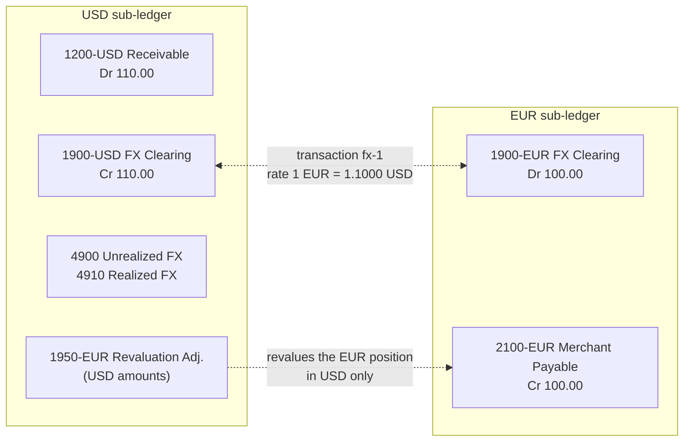

# Multi-Currency Ledgers and Revaluation

> One ledger, many currencies, no mixing.

**Type:** Build
**Languages:** Java, Python, Go
**Prerequisites:** Phase 10, Lesson 02 (Currencies and FX Conversion), Phase 10, Lesson 03 (The Double-Entry Ledger), Phase 10, Lesson 06 (Immutability and Reversals)
**Time:** ~90 minutes

## Learning Objectives

- Explain why "debits equal credits" is only meaningful within one currency, and enforce single-currency entries at the type level
- Build per-currency sub-ledgers and post a cross-currency business event as one transaction of single-currency entries joined through FX clearing accounts
- Track a foreign-currency position and its functional-currency basis, and state the invariant that ties functional clearing to the open bases
- Revalue an open position at a closing rate and book unrealized gain or loss without ever posting a mixed-currency entry
- Close a position and separate realized from unrealized gain or loss, unwinding earlier revaluations

## The Problem

A US marketplace starts paying out to sellers in Germany. A US customer pays 110.00 USD for an item; the German seller is owed EUR at the day's rate of 1 EUR = 1.1000 USD. The engineer extends the Lesson 03 ledger in the obvious way: one entry, `Dr Processor Receivable 110.00 USD`, `Cr Merchant Payable 100.00 EUR`. The entry validator sums debits and credits, gets `110.00 - 100.00 = 10.00`, and rejects it. So the validator is "fixed" to convert everything to USD before comparing: `110.00 USD - (100.00 EUR * 1.10) = 0`. The entry posts.

A month later finance asks for the EUR trial balance to reconcile against the German bank account. There is none: EUR postings are spread across entries that balance only in USD, so the EUR column on its own sums to whatever the rates of the day made it sum to. Then the rate table service has an outage and returns yesterday's rate for an hour; the validator now accepts entries that are off by the day's rate movement, and nothing in the ledger shows it. When the EUR strengthens to 1.1200, the platform still owes the seller exactly 100.00 EUR, but the ledger has no place to record that this obligation now costs 112.00 USD to meet. The 2.00 USD loss shows up three weeks later, as an unexplained shortfall in the USD operating account after treasury bought EUR to fund the payout.

Three separate mistakes are packed into that story: mixing currencies inside one entry (so no per-currency balance check exists), embedding an exchange rate in the validator (so the ledger's correctness depends on a rate service), and having no account where the exchange itself lives (so currency risk is invisible until it becomes cash). This lesson fixes all three. Every entry has one currency. A cross-currency event is two entries, each balanced in its own currency, joined by an FX clearing account per currency. The open foreign position is tracked with its historical cost in the functional currency, and month-end revaluation books the unrealized gain or loss as an ordinary single-currency entry.

## The Concept

### Debits equal credits, per currency

Lesson 03's balance rule was "for every currency, sum of debits equals sum of credits". It allowed several currencies in one entry as long as each netted to zero on its own. That is correct and also almost useless for a cross-currency event, because a payment in USD that creates an obligation in EUR does not net to zero in either currency. Something has to absorb 110.00 USD and supply 100.00 EUR.

That something is an **FX clearing account**: one per currency, owned by the platform, representing "currency handed to or received from the exchange". The cross-border payment becomes:

```text
USD sub-ledger, entry fx-1/USD
  Dr 1200-USD Processor Receivable  110.00 USD
      Cr 1900-USD FX Clearing USD   110.00 USD
EUR sub-ledger, entry fx-1/EUR
  Dr 1900-EUR FX Clearing EUR       100.00 EUR
      Cr 2100-EUR Merchant Payable  100.00 EUR
```

Each entry balances in its own currency without any rate. The rate appears exactly once, in the transaction that groups the two entries, as data with a source and a timestamp (Lesson 02). The ledger's correctness no longer depends on a rate service: a wrong rate produces a wrong EUR amount, which reconciliation catches against the seller's payout, but it can never produce an unbalanced sub-ledger.

Now the rule can be strict: **an entry has exactly one currency**. `JournalEntry` carries a `currency` field and its constructor rejects any posting in another currency with `MixedCurrencyException`. With that rule each currency's postings form an independent **sub-ledger** with its own journal and its own trial balance, which is the shape treasury, reconciliation, and auditors need: the EUR sub-ledger reconciles against EUR bank statements in EUR, with no rate anywhere.



### The position and its basis

The platform now owes 100.00 EUR and holds 110.00 USD. That is an open **foreign-currency position**: short 100.00 EUR. Define, for each foreign currency `c`:

- **Position** `P(c)`: the sum of net debits of every non-clearing account in `c`. Here `2100-EUR` has net debit `-100.00`, so `P(EUR) = -100.00 EUR`. A negative position means the platform owes `c`; positive means it holds `c`. Because the EUR sub-ledger balances, `P(EUR) = -netDebit(1900-EUR)` always.
- **Basis** `B(c)`: the functional-currency value of that position at the rates at which it was created, with the same sign. Taking on a 100.00 EUR obligation in exchange for 110.00 USD gives `B(EUR) = -110.00 USD`.

Each exchange updates both. When currency `A` is debited by `amountA` and currency `B` is credited by `amountB`, the non-clearing position in `A` rises by `amountA` and in `B` falls by `amountB`. If `A` is foreign and `B` is functional, `B(A) += amountB` (the USD given up for the foreign currency). If `A` is functional and `B` is foreign, `B(B) -= amountA`. Requiring one side of every exchange to be the functional currency makes the basis exact, with no second rate; a EUR-to-GBP conversion is routed as EUR-to-USD then USD-to-GBP, which is also how most treasury desks quote crosses (Lesson 02).

The **clearing invariant** follows directly. Every exchange moves the functional clearing account by the functional leg and moves the foreign basis by the same amount and sign, so at all times:

```text
netDebit(1900-USD) == sum over foreign c of B(c)
```

The tests assert it after each of 500 random exchanges. It is the multi-currency analogue of "the trial balance sums to zero": a single number that proves the clearing accounts and the position tracking agree.

### Revaluation: marking to the closing rate

At month end the closing rate is 1 EUR = 1.1200 USD. The platform still owes exactly 100.00 EUR (the EUR sub-ledger does not change), but meeting that obligation now costs 112.00 USD. Accounting standards (IAS 21 under IFRS, ASC 830 under US GAAP) require foreign-currency **monetary items**, such as cash, receivables, and payables, to be reported at the closing rate, with the difference recognized as an exchange gain or loss.

```text
fair value      = P(EUR) * closing rate = -100.00 EUR * 1.12 = -112.00 USD
carrying value  = B(EUR) + revalued(EUR) = -110.00 + 0.00   = -110.00 USD
unrealized gain = fair - carrying                            =   -2.00 USD  (a loss)
```

The revaluation entry is posted **in the functional currency only**:

```text
USD sub-ledger, entry reval-1-EUR
  Dr 4900 Unrealized FX Gain/Loss          2.00 USD
      Cr 1950-EUR FX Revaluation Adj.      2.00 USD
revalued(EUR) = -2.00 USD; carrying value = -112.00 USD = fair value
```

`1950-EUR` is a USD-denominated account whose only job is to hold the cumulative revaluation of the EUR position. The EUR amounts are untouched, so the EUR sub-ledger still reconciles to EUR statements. In a USD-reporting view, the merchant payable is shown at its EUR balance translated at historical rates plus the `1950-EUR` adjustment, which equals its value at the closing rate.

Revaluation is idempotent by construction: it books `fair - carrying`, and after booking, carrying equals fair. Running it twice at the same rate books zero the second time. If EUR then falls to 1.0900, the next revaluation books `-109.00 - (-112.00) = +3.00`, a gain that partly reverses the earlier loss. Cumulatively, the position always carries at the latest closing rate.

The sign conventions are easiest to check on the opposite case. Suppose treasury pre-funds EUR payouts by buying 500.00 EUR at 1.0900, paying 545.00 USD. The platform now **holds** EUR, so the position is long:

```text
fx-pre/EUR:  Dr 1010-EUR Operating Bank 500.00   Cr 1900-EUR FX Clearing 500.00
fx-pre/USD:  Dr 1900-USD FX Clearing    545.00   Cr 1010-USD Operating Bank 545.00
P(EUR) = +500.00 EUR, B(EUR) = +545.00 USD, netDebit(1900-USD) = +545.00 = B(EUR)

closing rate 1.1200:  fair = 500.00 * 1.12 = 560.00 USD
                      gain = 560.00 - (545.00 + 0.00) = +15.00 USD
reval:                Dr 1950-EUR 15.00   Cr 4900 Unrealized FX Gain/Loss 15.00
```

Same formula, opposite sign: a long EUR position gains when EUR strengthens, a short one loses. No branch in the code distinguishes the two; the sign of `P(c)` carries through the conversion and the subtraction.

### Realization: when the position closes

The processor settles 110.00 USD into the operating bank. Treasury buys 100.00 EUR at the bank's quote of 1.1150, paying 111.50 USD, and pays the merchant:

```text
fx-2/EUR:  Dr 1010-EUR Operating Bank 100.00   Cr 1900-EUR FX Clearing 100.00
fx-2/USD:  Dr 1900-USD FX Clearing    111.50   Cr 1010-USD Operating Bank 111.50
out-1/EUR: Dr 2100-EUR Merchant Payable 100.00 Cr 1010-EUR Operating Bank 100.00
```

`P(EUR)` is now zero (bank +100, payable +100 debit cancels the -100 credit). `B(EUR) = -110.00 + 111.50 = +1.50 USD`: the platform holds no EUR, and getting there cost 1.50 USD more than the rate at which it took on the obligation. The functional clearing account holds exactly that, `netDebit(1900-USD) = -110.00 + 111.50 = 1.50`, as the invariant says.

A flat position with a non-zero basis is a **realized** gain or loss. `realize(EUR)` books it and unwinds the unrealized revaluations, which are no longer unrealized:

```text
realize-2-EUR/pnl:    Dr 4910 Realized FX Gain/Loss 1.50   Cr 1900-USD FX Clearing 1.50
realize-2-EUR/unwind: Dr 1950-EUR Revaluation Adj.  2.00   Cr 4900 Unrealized FX   2.00
```

Final state: `4900 = 0.00`, `4910 = -1.50` (a loss, shown negative on a revenue account), `1950-EUR = 0.00`, `1900-USD = 0.00`, `1900-EUR = 0.00`, and the operating bank is at `-1.50 USD`. The total FX result is the 1.50 USD the round trip actually cost. The 2.00 USD unrealized loss reported at month end was a correct statement about that month and was reversed when the true outcome became known, which is exactly the accounting treatment: unrealized amounts are estimates that realization replaces.

| Moment | P(EUR) | B(EUR) | revalued | 1900-USD net debit | 4900 | 4910 |
|--------|--------|--------|----------|--------------------|------|------|
| After fx-1 | -100.00 | -110.00 | 0.00 | -110.00 | 0.00 | 0.00 |
| Revalue at 1.12 | -100.00 | -110.00 | -2.00 | -110.00 | -2.00 | 0.00 |
| After fx-2 and payout | 0.00 | +1.50 | -2.00 | +1.50 | -2.00 | 0.00 |
| After realize | 0.00 | 0.00 | 0.00 | 0.00 | 0.00 | -1.50 |

### Choosing the functional currency

The functional currency is not a preference; it is a fact about the legal entity: the currency of the primary economic environment in which it operates (IAS 21's definition), usually the currency its costs and revenues are denominated in. A US company paying EU sellers has USD as functional currency; its Irish subsidiary that holds EU merchant balances may have EUR. A platform with several entities therefore has several functional currencies, one per entity ledger, and the same EUR payable can be a foreign-currency item in the US entity and a functional-currency item in the Irish one. The design here assumes one entity; the code takes the functional currency as a constructor argument so each entity ledger can set its own.

Two practical consequences follow. First, revaluation results belong to the entity, so a group with entities in several currencies runs one revaluation per entity, not one per group. Second, the choice must be made before the first transaction, because the basis of every position is measured in it; changing it later is a restatement, not a configuration change.

### Where multi-currency ledgers go wrong

| Failure | Symptom | What prevents it here |
|---------|---------|-----------------------|
| Mixed-currency entry balanced through a rate | Sub-ledger totals drift with rates; no per-currency trial balance | `MixedCurrencyException` in the entry constructor |
| Rate embedded in validation | A stale rate makes wrong entries pass | Rates appear only as transaction data, never in a balance check |
| Exchange with no clearing account | Currency risk invisible until treasury buys currency | Every exchange passes through `1900-c`; the position is computed from it |
| Revaluation posted in the foreign sub-ledger | EUR balances no longer match EUR bank statements | Revaluation entries are functional-currency only |
| Unrealized loss never reversed | FX loss counted twice when the position closes | `realize` unwinds `revalued(c)` in the same transaction |
| Exponent ignored in conversion | JPY amounts off by a factor of 100 | `convert` shifts by `10^(exp(to) - exp(from))`; tests use JPY |
| Replayed exchange double-counts basis | Clearing and basis disagree after a retry | Basis updates only when `post` appends; the invariant check catches drift |

### Rounding and exponents

Every conversion rounds once, `HALF_EVEN`, at the moment the converted amount becomes a posting. There is no residue to park: each entry balances in its own currency with whatever amount rounding produced, and any economic effect of rounding lands in the basis and, eventually, in realized gain or loss. That is a feature: rounding becomes a measured FX cost instead of a stray cent in a suspense account.

Exponents differ across currencies (Lesson 01), so the conversion multiplies minor units by the rate and by `10^(exp(to) - exp(from))`. At 1 USD = 157.25 JPY, 10.00 USD is `1000 * 15725 / 100 / 100 = 1572.5` JPY, an exact tie that `HALF_EVEN` sends to 1572. Converting 5000 JPY to USD gives 31.80, and converting 31.80 USD back gives 5001 JPY: the round trip never closes, as Lesson 02 showed, and the difference is a real FX result, not an error.

### What the design promises, and what it does not

It promises: every entry is single-currency and balanced; every sub-ledger nets to zero in its own currency at all times; the functional clearing account equals the sum of open bases; after a revaluation the position carries at fair value; after realization the realized result equals the functional cash actually gained or lost.

It does not:

- Support partial realization. Closing half a position needs a cost-flow assumption (average cost or FIFO lots) to decide how much basis leaves with it. `realize` refuses unless the position is flat; Exercise 3 adds average cost.
- Revalue non-monetary items (inventory, prepaid expenses), which accounting standards keep at historical rates. A payments platform's foreign balances are almost all monetary.
- Fetch rates. Rates are values passed in, with a source and timestamp, so tests are deterministic and the ledger never calls a network service.
- Handle concurrency. Lesson 11 does.

## Build It

The program is `code/java/Main.java`; tests are `code/java/MainTest.java`. `Money` is copied from Lesson 01 and the `FxRate` shape (exact rational with provenance) from Lesson 02.

### Step 1: An entry has one currency

```java
record JournalEntry(String id, Currency currency, List<Posting> postings) {
    JournalEntry {
        if (postings == null || postings.size() < 2) throw new LedgerException("entry " + id + " needs at least two postings");
        postings = List.copyOf(postings);
        long net = 0;
        for (Posting p : postings) {
            if (!p.amount().currency().equals(currency)) {
                throw new MixedCurrencyException(id, currency, p.amount().currency());
            }
            net = Math.addExact(net, p.signedMinor());
        }
        if (net != 0) throw new LedgerException("entry " + id + " unbalanced by " + Money.ofMinor(net, currency));
    }
}
```

Compare with Lesson 03, which kept a `Map<Currency, Long>` of nets. With one currency per entry the check collapses to a single `long`, and a whole class of bug (an entry that balances in USD and EUR separately but was meant to be two events) disappears. The specific exception type makes the mistake easy to assert and to search for in logs.

**Predict:** Lesson 03 accepted an entry with `Dr A 10 USD, Cr B 10 USD, Dr C 5 EUR, Cr D 5 EUR`. What happens to it here, and how should it be posted instead?

### Step 2: The rate converts minor units across exponents

```java
Money convert(Money amount, Rounding rounding) {
    Currency from = amount.currency();
    Currency to = from.equals(base) ? quote : from.equals(quote) ? base : null;
    if (to == null) throw new CurrencyMismatchException(amount.currency(), base);
    long num = from.equals(base) ? numerator : denominator;
    long den = from.equals(base) ? denominator : numerator;
    int shift = to.exponent() - from.exponent();
    for (int i = 0; i < Math.abs(shift); i++) {
        if (shift > 0) num = Math.multiplyExact(num, 10); else den = Math.multiplyExact(den, 10);
    }
    return Money.ofMinor(Money.divideRounded(Math.multiplyExact(amount.minorUnits(), num), den, rounding), to);
}
```

The rate is `1 base = numerator/denominator quote`. Converting from quote to base inverts the fraction without ever computing `1/rate` as a decimal. The exponent shift goes into the numerator or denominator so the whole conversion is one integer multiplication and one rounded division: one rounding, at the end.

### Step 3: Sub-ledgers and the ledger that routes to them

```java
final class SubLedger {
    final Currency currency;
    private final List<JournalEntry> journal = new ArrayList<>();
    private final Map<String, Long> netDebits = new LinkedHashMap<>();

    void append(JournalEntry e) {
        journal.add(e);
        for (Posting p : e.postings()) netDebits.merge(p.accountId(), p.signedMinor(), Math::addExact);
    }

    long trialBalanceNet() { /* sum of netDebits, always zero */ }
}
```

A `SubLedger` knows nothing about other currencies. `MultiCurrencyLedger.addCurrency(c)` creates one, opens `1900-c` (clearing), and for foreign currencies opens `1950-c` in the functional currency and initializes `basis[c]` and `revalued[c]` to zero. Opening any account in a new currency calls it, so the structure appears on demand.

`post(Transaction)` validates every entry's postings against the accounts' currencies before appending any entry to any sub-ledger. A transaction is the unit of atomicity; a sub-ledger entry is the unit of balance.

### Step 4: Exchange through clearing, and track the basis

```java
Money converted = rate.convert(amount, Rounding.HALF_EVEN);
Transaction tx = new Transaction(txId, description, List.of(
        JournalEntry.of(txId + "/" + a.code(), Posting.debit(debitAccount, amount), Posting.credit(clearingId(a), amount)),
        JournalEntry.of(txId + "/" + b.code(), Posting.debit(clearingId(b), converted), Posting.credit(creditAccount, converted))),
        rate);
if (post(tx)) {
    if (b.equals(functional)) basis.merge(a, converted.minorUnits(), Math::addExact);
    else basis.merge(b, -amount.minorUnits(), Math::addExact);
}
```

The basis update runs only when `post` returns `true`, so an idempotent replay of the same transaction id does not double-count the basis even though it returns the same transaction. The guard above this chunk rejects same-currency exchanges and pairs that do not include the functional currency.

**Predict:** treasury buys 100.00 EUR paying 111.50 USD (`a = EUR`, `b = USD`). Which branch runs, and what is `basis[EUR]` afterwards if it was -110.00?

### Step 5: The position is computed, not stored

```java
Money position(Currency c) {
    long acc = 0;
    for (Account a : accounts.values()) {
        if (a.currency().equals(c) && !a.clearing()) acc = Math.addExact(acc, subLedger(c).netDebit(a.id()));
    }
    return Money.ofMinor(acc, c);
}
```

The position is derived from balances on every call, like every balance in this course, so it cannot drift from the journal. The basis cannot be derived from the EUR sub-ledger alone, because it depends on the rates at which the position was built; it is the one piece of state this ledger keeps outside the journals, and `clearingMatchesBasis()` checks it against the functional clearing account, which is in the journal. A production system would store the basis as entries too (for example, a memo ledger in functional currency per foreign currency) so that it is rebuildable; Exercise 3 moves in that direction.

### Step 6: Revalue in the functional currency

```java
Money revalue(Currency c, FxRate closingRate) {
    requireForeign(c);
    Money fair = closingRate.convert(position(c), Rounding.HALF_EVEN);
    long gain = Math.subtractExact(fair.minorUnits(), Math.addExact(basis.get(c), revalued.get(c)));
    if (gain != 0) {
        Money g = Money.ofMinor(Math.abs(gain), functional);
        String id = "reval-" + (++adjustmentCounter) + "-" + c.code();
        JournalEntry e = gain > 0
                ? JournalEntry.of(id, Posting.debit(revaluationId(c), g), Posting.credit(UNREALIZED, g))
                : JournalEntry.of(id, Posting.debit(UNREALIZED, g), Posting.credit(revaluationId(c), g));
        post(new Transaction(id, "revalue " + c.code() + " at " + closingRate, List.of(e), closingRate));
        revalued.merge(c, gain, Math::addExact);
    }
    return Money.ofMinor(gain, functional);
}
```

`position(c)` sums net debits of non-clearing accounts in `c`, which is negative for a net obligation; converting a negative `Money` keeps the sign, so `fair` is negative too and the subtraction gives the right sign without special cases. Both postings are USD; the EUR sub-ledger's size is unchanged, which a test asserts. Posting nothing when `gain == 0` keeps repeated revaluations from cluttering the journal with zero entries (which `Posting` would reject anyway).

### Step 7: Realize a flat position

```java
Money realize(Currency c) {
    requireForeign(c);
    if (!position(c).isZero()) throw new LedgerException("position in " + c.code() + " is " + position(c) + "; realize only a flat position");
    long realizedGain = -basis.get(c);
    // entry 1: move -basis from 1900-USD to 4910 Realized FX
    // entry 2: unwind revalued(c) between 4900 and 1950-c
    // both in one Transaction, then basis[c] = revalued[c] = 0
}
```

The realized gain is `-basis`: a flat position whose basis is `+1.50` cost 1.50 to close, a loss. The first entry empties the functional clearing account's share for `c`, which is why `1900-USD` ends at zero. The second entry reverses every unrealized adjustment for `c`, following the Lesson 06 rule: earlier entries are not edited, they are offset by new ones.

**Predict:** if EUR had fallen to 1.0800 at month end instead of rising, what would `revalue` have booked, and what would `realize` unwind?

### Step 8: Run it

```bash
cd phases/10-money-and-ledgers/09-multi-currency-ledgers/code/java
javac -d .out *.java && java -cp .out Main
java -cp .out MainTest
```

Expected output, abbreviated:

```console
== A US customer pays 110.00 USD; the German merchant is owed EUR at 1 EUR = 1.1000 USD ==
fx-1  cross-border card payment  @ 1 EUR = 11000/10000 USD (rate-desk)
  [USD sub-ledger] fx-1/USD
    Dr 1200-USD  110.00 USD
        Cr 1900-USD  110.00 USD
  [EUR sub-ledger] fx-1/EUR
    Dr 1900-EUR  100.00 EUR
        Cr 2100-EUR  100.00 EUR
  EUR position -100.00 EUR (we owe EUR), basis -110.00 USD (its USD value when booked)

rejected: entry bad is USD but has a EUR posting; use one entry per currency

== Month end: EUR strengthens to 1.1200 USD; revalue the open EUR position ==
unrealized gain/loss booked: -2.00 USD
revalue again at the same rate: 0.00 USD (idempotent: nothing left to book)

EUR position now 0.00 EUR; functional clearing holds 1.50 USD
realized gain/loss: -1.50 USD
  4900 Unrealized 0.00 USD, 4910 Realized -1.50 USD, 1950-EUR 0.00 USD, 1900-USD 0.00 USD
  every sub-ledger balances: true; clearing matches basis: true

5000 JPY -> 31.80 USD; 31.80 USD -> 5001 JPY
```

### In Python

The full port is `code/python/main.py` (same `SubLedger`, `MultiCurrencyLedger` with `exchange`, `revalue`, `realize`, `position_report`, and the two invariants; tests in `code/python/test_main.py`). Three things differ:

- **Rounding negative positions.** `fractions.Fraction` would make `FxRate` exact for free, but the design keeps the `numerator`/`denominator` pair from Lesson 02, and the one place arithmetic can diverge is the final division. Positions are often negative (a short EUR position is `-100.00 EUR`), and Python's `//` floors toward negative infinity where Java's `/` truncates toward zero, so `convert` goes through `divide_rounded`, which works on magnitudes and reapplies the sign. The exponent shift is a single power of ten rather than a `multiplyExact` loop, since `int` cannot overflow:

```python
def convert(self, amount: Money, rounding: Rounding) -> Money:
    from_ = amount.currency
    if from_ == self.base:
        to, num, den = self.quote, self.numerator, self.denominator
    elif from_ == self.quote:
        to, num, den = self.base, self.denominator, self.numerator
    else:
        raise CurrencyMismatchError(amount.currency, self.base)
    shift = to.exponent - from_.exponent
    if shift > 0:
        num *= 10 ** shift
    else:
        den *= 10 ** (-shift)
    return Money.of_minor(divide_rounded(amount.minor_units * num, den, rounding), to)
```

- **`MixedCurrencyError` stays distinct.** It extends `LedgerError` (which extends `ValueError`), so a caller can catch the specific "one entry per currency" violation separately from a generic validation failure, exactly as the Java hierarchy allows. `Transaction.rate` is `Optional[FxRate]` with `None` for single-currency events.
- **Ordered dictionaries do the bookkeeping.** `dict` preserves insertion order, so the sub-ledger map, the account map, and the balance report iterate in the same order as Java's `LinkedHashMap` without extra lists. `JournalEntry` validates in a hand-written `__init__` and stores its postings as a tuple, and the property test ships a small `JavaRandom` (with `next_boolean`) so it replays the same 500 exchanges as `MainTest.java`.

```bash
cd phases/10-money-and-ledgers/09-multi-currency-ledgers/code/python
python3 main.py
python3 -m unittest -v
```

### In Go

The full port is `code/go/main.go` (same `SubLedger`, `MultiCurrencyLedger`, `FxRate`, `Transaction`, `Position`; `Exchange`, `Revalue`, `Realize`) with `money.go` (the Lesson 01 `Money`) and `javarandom.go` for the seeded property test. Tests are in `code/go/main_test.go`. Three things differ:

- **`ErrMixedCurrency` is its own sentinel, wrapped around `ErrLedger`.** Every ledger rule returns an error that wraps `ErrLedger`; the one the lesson is about, a EUR posting inside a USD entry, wraps `ErrMixedCurrency`, which itself wraps `ErrLedger`, so `errors.Is` matches either. The demo's `rejected:` line branches on the specific one:

```go
if _, err := NewJournalEntry("bad", USD, postings); errors.Is(err, ErrMixedCurrency) {
    fmt.Println("rejected:", err)
}
```

- **Checked arithmetic everywhere `Math.*Exact` was.** `FxRate.Convert` scales by `10^(exp(to) - exp(from))` with `mulChecked`, `SubLedger.Append` checks every running total before mutating any of them, and `Exchange` only moves the basis after `Post` reports a genuinely new transaction. `int64 / %` truncate toward zero exactly like Java, so `DivideRounded` is shared with Lesson 01 and the tie-to-even cases (`1572.5 -> 1572 JPY`) agree.
- **Insertion order is kept by hand.** Java's `LinkedHashMap` gives `accounts()`, `currencies()`, and the sub-ledger's trial balance a stable order; Go's `map` does not, so each map has a companion slice (`accountOrder`, `currencyOrder`) and `Position`-style reports iterate the slice. `Transaction.Rate` is a `*FxRate` because single-currency transactions have no rate (Java's `null`); `Equal` methods stand in for record equality in the idempotent-replay checks.

```bash
cd phases/10-money-and-ledgers/09-multi-currency-ledgers/code/go
go run .
go test ./...
```

## Use It

### Processors and multi-currency balances

Stripe keeps a separate balance per currency for each account (`available` and `pending` are arrays of `{amount, currency}`), and a charge in one currency settled in another produces a balance transaction carrying `exchange_rate`, with the converted amount, not a mixed entry. Adyen's balance platform likewise keeps balances per currency per account and records conversions as transfers with a rate. Both are the sub-ledger model with clearing done inside the processor; when you receive their reports, your clearing account per currency is what you reconcile against their conversion records (Lesson 08).

### General ledgers and treasury systems

ERP general ledgers (SAP S/4HANA, Oracle Fusion, NetSuite) store every line in transaction currency and in one or more ledger currencies, and run a periodic "foreign currency valuation" or "revaluation" job that posts unrealized gain or loss to configured accounts and reverses it at the start of the next period: the same mechanism as `revalue` plus the unwind in `realize`, scheduled. The accounts this lesson calls `1950-c` and `4900` correspond to the balance-sheet adjustment account and the unrealized exchange gain/loss account in those systems' configuration.

### Ledger databases

TigerBeetle's documentation describes currency exchange exactly as this lesson does: accounts have a single `ledger` (currency), transfers can only move value between accounts on the same ledger, and an exchange is two linked transfers through liquidity accounts on each ledger, committed atomically. Modern Treasury's Ledgers API requires each ledger account to have one currency and entries in a transaction to balance per currency. The rule "no mixing" is enforced by the engine, which is what you just built in a constructor.

## Ship It

`outputs/design-doc-multi-currency-ledger.md` is a design-review template for adding a currency or a cross-currency flow: functional currency, account plan per currency, clearing and revaluation accounts, rate sources and their timestamps, rounding policy, revaluation schedule, and the invariants to monitor. Fill it in before the first non-USD payout ships.

## Exercises

1. **Reinforce.** Add `MultiCurrencyLedger.trialBalance(Currency)` that returns rows of (account, debit, credit) for one sub-ledger, as in Lesson 03, and a test that the EUR trial balance after the demo has equal column totals and contains no USD accounts. Then add a `functionalReport(Map<Currency, FxRate> closing)` that translates every foreign account at its closing rate and asserts the translated foreign rows plus the `1950-c` accounts equal the positions' fair values.

2. **Apply.** Support EUR-to-GBP conversions without routing through USD cash: post the EUR and GBP entries through their clearing accounts and update both bases using a USD rate for each leg passed in as an argument. Write the test that shows the basis invariant still holds, and explain where the cross-rate's rounding residue ends up.

3. **Extend.** Combine with Lesson 05 and Lesson 06: allow partial realization using average cost. When `P(c)` moves toward zero by `x` (but does not cross it), release `B(c) * x / P(c)` of basis (rounded `HALF_EVEN`) as realized gain or loss, and release the same proportion of `revalued(c)`. Post the release as linked entries with reasons, and assert with a property test that after any sequence the realized plus unrealized results equal fair value minus total functional cash paid.

## Key Terms

| Term | What people say | What it actually means |
|------|-----------------|------------------------|
| Sub-ledger | "the EUR books" | The journal and balances of one currency; balances to zero on its own and reconciles in that currency |
| FX clearing account | "the conversion account" | A per-currency account through which every exchange passes, so each side of a conversion is a balanced single-currency entry |
| Functional currency | "our base currency" | The currency the business reports in; every basis, revaluation, and realized result is measured in it |
| Position | "our EUR exposure" | Net debit of all non-clearing accounts in a foreign currency: positive if held, negative if owed |
| Basis | "what it cost us" | The functional-currency value of the position at the rates at which it was created |
| Revaluation | "mark to market" | Booking the difference between the position's value at the closing rate and its carrying value, in functional currency only |
| Unrealized vs realized | "paper vs actual FX" | Unrealized is the revaluation of an open position; realized is the basis left when the position is closed, which replaces the unrealized amount |

## Further Reading

- [IFRS IAS 21, The Effects of Changes in Foreign Exchange Rates](https://www.ifrs.org/issued-standards/list-of-standards/ias-21-the-effects-of-changes-in-foreign-exchange-rates/) — the definitions of functional currency, monetary items, closing rate, and exchange differences that this lesson's revaluation implements.
- [FASB ASC 830, Foreign Currency Matters](https://asc.fasb.org/830/tableOfContent) — the US GAAP counterpart, including transaction gains and losses on monetary items.
- [ISO 4217 — Currency codes](https://www.iso.org/iso-4217-currency-codes.html) — the exponents that make cross-currency minor-unit conversion need an exponent shift.
- [TigerBeetle: Currency exchange](https://docs.tigerbeetle.com/coding/recipes/currency-exchange/) — two linked transfers through per-ledger liquidity accounts, the production version of the clearing-account design.
- [Stripe API: Balance Transactions, `exchange_rate`](https://docs.stripe.com/api/balance_transactions/object) — how a processor exposes a cross-currency settlement as a per-currency balance transaction with its rate.
- [European Central Bank: Euro foreign exchange reference rates](https://www.ecb.europa.eu/stats/policy_and_exchange_rates/euro_reference_exchange_rates/html/index.en.html) — a widely used closing-rate source for revaluation, and its documented publication time.
