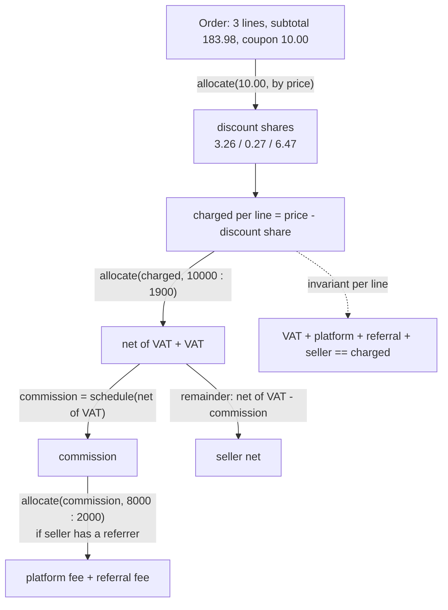

# Fees, Splits, and Platform Payments

> Marketplace payouts with fee allocation that always sums.

**Type:** Build
**Languages:** Java, Python, Go
**Prerequisites:** Phase 10 Lesson 01 (Representing Money), Phase 10 Lesson 03 (The Double-Entry Ledger), Phase 10 Lesson 06 (Immutability and Reversals)
**Time:** ~90 minutes

## Learning Objectives

- Build a fee schedule of percent plus fixed with minimum and maximum caps, and state the order in which rounding, caps, and the "never more than the base" rule apply
- Split a multi-seller order into tax, platform fee, referral share, and seller net so that the parts sum exactly to what the customer paid, at line and order level
- Use largest-remainder allocation for every proportional split (discounts, tax-inclusive prices, revenue shares) and a computed remainder for exactly one part per split
- Post the whole split as one balanced journal entry and compute payouts with a rolling reserve, a payout fee, and a minimum payout threshold
- Test conservation with a property test over thousands of random orders rather than a handful of examples

## The Problem

A marketplace sells a 59.99 EUR lamp, a 4.99 EUR bulb, and a 119.00 EUR rug in one checkout. Two sellers, one of whom was brought in by a referral partner who earns 20% of the platform's commission. Prices include 19% German VAT, which the marketplace must collect and remit. The customer applies a 10.00 EUR coupon. The platform charges sellers 12% plus 0.30 per line, minimum 0.50, maximum 25.00.

The first implementation computes each number independently with the right formula: `vat = charged * 19/119`, `commission = net * 0.12 + 0.30`, `referral = commission * 0.20`, `seller = charged - vat - commission`, each rounded to the cent. Every value is individually correct to the cent. Summed across the 3.1 million orders of the first quarter, the platform's receivable exceeds the sum of VAT payable, commission revenue, referral payable, and seller payables by 6,904.11 EUR. The finance team cannot close the quarter: the money exists in the processor's settlement, but no account in the ledger says whose it is.

The culprit is rounding each part independently. `0.10 / 3` rounded is `0.03`, and three of them are `0.09`: a cent belongs to no one. Discounts make it worse: a 10.00 coupon spread across three lines in proportion to price produces three fractional shares, each rounded, which can sum to 9.99 or 10.01. Tax-inclusive prices add another split. Every one of those splits can lose or invent a cent, and with several splits per line and several lines per order, the error is a few cents per thousand orders, always in the same direction for a given price mix.

The fix is a discipline, not a formula: every proportional split goes through the largest-remainder `allocate` from Lesson 01, which guarantees the parts sum to the whole, and every split has exactly one part that is computed as "whatever is left". This lesson builds the fee schedule, the splitter, and the payout calculator with that discipline, posts the result as one balanced entry, and proves conservation on 2,000 random orders.

## The Concept

### Fee schedules: percent, fixed, caps

A platform or processor fee is almost always `percent * base + fixed`, clamped:

```text
fee(base) = min(base, clamp(round(base * bps / 10000) + fixed, minimum, maximum))
```

The order matters and is a policy decision, so the code fixes it and the tests pin it:

1. **Percent first, rounded once.** `bps` is basis points (1 bp = 0.01%), so 12% is `1200/10000`, an exact rational. The rounding mode is part of the schedule (`HALF_EVEN` by default, Lesson 01).
2. **Then the fixed part.** It is already in minor units; no rounding.
3. **Then the minimum and maximum.** A 0.50 minimum turns a 0.42 fee on a 1.00 sale into 0.50. A 25.00 maximum caps a 36.30 fee on a 300.00 sale.
4. **Finally, never more than the base.** A 0.40 sale with a 0.50 minimum would produce a negative seller net. The schedule caps the fee at the base, so the seller gets zero, not minus ten cents. Some platforms instead reject sales below the minimum; either way the rule must exist, because a negative payable is a debt owed by the seller that nobody intended to create.

| Base | 12% | + 0.30 | after min 0.50 / max 25.00 | after cap at base |
|------|-----|--------|----------------------------|-------------------|
| 0.40 | 0.05 | 0.35 | 0.50 | 0.40 |
| 1.00 | 0.12 | 0.42 | 0.50 | 0.50 |
| 2.00 | 0.24 | 0.54 | 0.54 | 0.54 |
| 50.00 | 6.00 | 6.30 | 6.30 | 6.30 |
| 300.00 | 36.00 | 36.30 | 25.00 | 25.00 |

Card processors publish schedules in exactly this shape (a blended rate such as "1.4% + 0.25 EUR" for European consumer cards is typical), payout providers charge a fixed fee per payout, and marketplaces combine a percentage commission with per-order fixed fees and category-specific minimums.

### The split invariant

A **split** divides one amount into named parts. The invariant is the same everywhere in this lesson:

```text
sum(parts) == whole, exactly, in minor units, and no part is negative
```

Two techniques satisfy it, and every split uses one of them:

- **Allocation.** When the parts are proportional to known weights (prices, tax rates, revenue shares), use `allocate(weights)`. Largest-remainder hands out floors and then gives the leftover units to the largest fractional remainders, so the sum is exact.
- **Remainder.** When one part is defined as "what is left" (the seller's net), compute every other part first and set the last one to `whole - sum(others)`. It is exact by definition.

What is not allowed is computing two parts of the same split independently with their own rounding. That is the bug in the Problem section.

### The order of splits for one line



Each arrow is either an allocation or a remainder. Composing conserving steps conserves: if `charged = net + vat` exactly and `commission = platform + referral` exactly and `seller = net - commission` exactly, then `vat + platform + referral + seller = vat + commission + (net - commission) = charged`.

### Worked example by hand

**Discount allocation.** Subtotal `5999 + 499 + 11900 = 18398` cents. Allocate `1000` cents by weights `[5999, 499, 11900]`:

```text
lamp: 1000 * 5999  / 18398 =  5999000 / 18398 = 326 remainder  1252
bulb: 1000 * 499   / 18398 =   499000 / 18398 =  27 remainder  2254
rug:  1000 * 11900 / 18398 = 11900000 / 18398 = 646 remainder 14892
floors sum to 999; one cent left; largest remainder is the rug -> 647
discount shares: 3.26, 0.27, 6.47   (sum 10.00)
charged:         56.73, 4.72, 112.53 (sum 173.98)
```

**Tax-inclusive VAT.** A price that includes 19% VAT is `net * 1.19`, so `net : vat = 100 : 19`, or `10000 : 1900` in the code. For the lamp's 56.73:

```text
net: 5673 * 10000 / 11900 = 4767 remainder 2700
vat: 5673 *  1900 / 11900 =  905 remainder 9200
floors sum to 5672; the leftover cent goes to VAT (larger remainder) -> net 47.67, VAT 9.06
check: 47.67 * 19% = 9.0573, which rounds to 9.06
```

**Commission and seller net.** `fee(47.67) = round(4767 * 1200 / 10000) + 30 = round(572.04) + 30 = 602`, inside the bounds, so 6.02. No referrer for seller-A. Seller net is the remainder: `4767 - 602 = 4165`, 41.65. Line check: `9.06 + 6.02 + 0.00 + 41.65 = 56.73`.

**The rug with a referral.** Charged 112.53. Net/VAT: `11253 * 10000 / 11900 = 9456 r 3600`, `11253 * 1900 / 11900 = 1796 r 8400`, leftover to VAT: net 94.56, VAT 17.97. Commission `round(9456 * 0.12) + 30 = round(1134.72) + 30 = 1165`. Referral split `allocate(1165, 8000 : 2000)`: `932 r 0` and `233 r 0`, so platform 9.32, referral 2.33. Seller `9456 - 1165 = 8291`, 82.91. Line check: `17.97 + 9.32 + 2.33 + 82.91 = 112.53`.

| Line | Charged | VAT | Platform | Referral | Seller net |
|------|---------|-----|----------|----------|------------|
| lamp (A) | 56.73 | 9.06 | 6.02 | 0.00 | 41.65 |
| bulb (A) | 4.72 | 0.75 | 0.78 | 0.00 | 3.19 |
| rug (B) | 112.53 | 17.97 | 9.32 | 2.33 | 82.91 |
| **Order** | **173.98** | **27.78** | **16.12** | **2.33** | **127.75** |

The processor's own fee, 1.4% + 0.25 on the 173.98 charge, is `round(243.57) + 25 = 269`, 2.69. It is a cost to the platform, not a part of the customer's payment split: it reduces what the processor settles, not what anyone else is owed.

### Posting the split

The split becomes one journal entry (Lesson 03). Every part is a credit to the party it belongs to; the customer's payment is the debit:

```text
cap-o-1
  Dr 1200 Receivable                   173.98
      Cr 2300 VAT Payable                 27.78
      Cr 4100 Commission Revenue          16.12
      Cr 2400 Referral Payable partner-P   2.33
      Cr 2100 Seller Payable seller-A     44.84
      Cr 2100 Seller Payable seller-B     82.91
  Dr 5100 Processing Expense             2.69
      Cr 1200 Receivable                   2.69
```

If any split had lost a cent, this entry would be unbalanced and the ledger would reject it. That is the strongest test of the splitter: the double-entry rule checks it on every order, in production, for free.

### Payouts

The seller payable is what the platform owes the seller. A payout moves it to the bank, after three deductions that are each a split of the available balance:

- **Rolling reserve**: a percentage held back for refunds and chargebacks (Lesson 06), released later. Rounded `UP`, because the reserve protects the platform and a cent short is a cent of unprotected risk.
- **Payout fee**: a fee schedule applied to what is left after the reserve.
- **Minimum payout**: if the net would be below a threshold, nothing moves this cycle and the whole balance carries over. Partial payouts below the threshold would cost more in bank fees than they deliver.

```text
seller-A available 44.84
reserve  = 44.84 * 10%, rounded UP  = 4.484 -> 4.49
fee      = 0.25
net      = 44.84 - 4.49 - 0.25      = 40.10
invariant: reserve + fee + net + carried = 4.49 + 0.25 + 40.10 + 0.00 = 44.84
```

The payout entry debits the seller payable by the full 44.84 and credits `2150 Seller Reserve seller-A` 4.49, `4200 Payout Fee Revenue` 0.25, and `1010 Bank` 40.10. The reserve stays a liability to the seller; it is not revenue. A seller whose balance is negative (more refunds than sales) is never paid out; the negative balance carries over and is netted against future sales or collected.

### Splits that look right and are not

| Pattern | Why it is tempting | What breaks |
|---------|--------------------|-------------|
| Round every part independently | Each part is "correct to the cent" | Parts sum to the whole plus or minus a few cents; the capture entry does not balance |
| Give the leftover cent to the last line | Simple, conserves | Biased: the last line in every cart absorbs all residue, and line order is often arbitrary (sorted by SKU, by add-to-cart time) |
| Compute VAT as `gross * rate` | Reads like the tax rate | Overstates VAT on tax-inclusive prices (19% of 56.73 is 10.78, the true VAT is 9.06) |
| Commission on the pre-discount price | The price list is easy to find | Seller pays commission on money nobody paid; disputes follow |
| Two remainders ("seller gets the rest, platform gets the rest") | Each piece of code is locally reasonable | Whichever runs second silently absorbs the other's rounding |
| Negative seller net allowed | Minimum fees are rare | A 0.40 sale creates a 0.10 debt from the seller, and payouts start subtracting it |

### Stability: will the same order split the same way tomorrow?

The split is recomputed by more than one system: checkout shows it, the ledger posts it, the payout service reads it, the refund service reverses it, and the reconciliation job compares all of them with the processor's records. Every one must get the same cents. Three properties make that true. **Determinism**: allocation breaks ties by line position with a stable sort, never by hash order. **Pure inputs**: the split depends only on the order, the policy, and the referral map, all passed in, never on the current time or a database read in the middle. **Versioned policy**: when commission rates change, old orders keep the policy version they were captured under; recomputing last month's split with this month's rate is a guaranteed break. Store the policy version (or the computed split itself) with the capture.

Largest-remainder allocation also has a known oddity, the Alabama paradox (Lesson 01, Exercise 3): adding a line can move a cent from one existing line to another. For payments this is harmless as long as the split is computed once per order and stored, because nobody re-allocates an order after adding a line; a changed cart is a new order. It is harmful if a system re-splits historical orders, which is one more reason to store the split rather than recompute it.

### What this does not do

- It does not handle refunds of split orders. A refund reverses parts of the capture entry; Lesson 06's partial reversal allocates it across the same legs in proportion to what remains, which is exactly the right behaviour for VAT, commission, referral, and seller net.
- It does not compute VAT on the platform's own commission (the platform invoices the seller for commission plus VAT in many jurisdictions). That is a second split on the commission line, built the same way.
- It does not round VAT at invoice level. Some jurisdictions allow or require VAT to be computed on the invoice total rather than per line, which can differ by a cent; the per-line approach here is common and conservative, and the choice must match the tax invoice the customer receives.
- It does not settle cross-currency payouts. Lesson 09 does.

## Build It

The program is `code/java/Main.java`; the tests are `code/java/MainTest.java`. `Money` and `allocate` are copied from Lesson 01, and the ledger is a trimmed Lesson 03.

### Step 1: The fee schedule

```java
record FeeSchedule(String name, long bps, Money fixed, Money minimum, Money maximum, Rounding rounding) {
    Money feeFor(Money amount) {
        if (amount.isNegative()) throw new IllegalArgumentException("fee base must not be negative: " + amount);
        Money fee = amount.times(bps, 10_000, rounding).plus(fixed);
        if (minimum != null && fee.compareTo(minimum) < 0) fee = minimum;
        if (maximum != null && fee.compareTo(maximum) > 0) fee = maximum;
        if (fee.compareTo(amount) > 0) fee = amount;     // a fee never exceeds what it is charged on
        return fee;
    }
}
```

The compact constructor (not shown) rejects `bps` outside `0..10000`, a negative fixed fee, and a minimum above the maximum. `times(bps, 10_000, rounding)` is Lesson 01's exact rational multiplication: the only rounding in the schedule. `compareTo` throws on a currency mismatch, so a USD minimum on a EUR schedule fails the first time it is used.

**Predict:** with this schedule, what is the fee on 4.20? On 0.30? Which rule decided each?

### Step 2: Allocate the discount across lines

```java
long[] weights = new long[order.lines().size()];
for (int i = 0; i < weights.length; i++) {
    Money price = order.lines().get(i).price();
    if (!price.isPositive()) throw new IllegalArgumentException("line price must be positive: " + price);
    weights[i] = price.minorUnits();
}
Money[] discountShares = order.discount().isZero() ? zeros(cur, weights.length) : order.discount().allocate(weights);
```

The weights are the prices themselves, so a line with twice the price absorbs twice the discount. A discount larger than the subtotal is rejected before this point; a zero discount skips the allocation. Line prices must be positive because a zero weight would still be a legal ratio but a zero-price line has nothing to split and usually indicates an upstream bug.

### Step 3: Split one line

```java
Money charged = line.price().minus(discountShares[i]);
Money[] taxParts = charged.isZero() ? zeros(cur, 2) : charged.allocate(10_000, policy.taxBps());
Money netOfTax = taxParts[0], tax = taxParts[1];
Money commission = policy.commission().feeFor(netOfTax);
String referrer = policy.referrerBySeller().get(line.sellerId());
Money platform = commission, referral = Money.zero(cur);
if (referrer != null && !commission.isZero()) {
    Money[] parts = commission.allocate(10_000 - policy.referralShareBps(), policy.referralShareBps());
    platform = parts[0];
    referral = parts[1];
}
Money sellerNet = netOfTax.minus(commission);
```

Three allocations and one remainder. The VAT split uses ratios `10000 : 1900` rather than computing `charged * 1900 / 11900` with its own rounding, so net and VAT always sum to charged. The commission is computed on `netOfTax`, which is a policy choice (many marketplaces charge on the tax-exclusive amount; some charge on the gross); changing it is one argument. `sellerNet` is the remainder, and because `feeFor` caps at its base, it is never negative.

**Predict:** a 0.01 EUR line for seller-B. What are the VAT, commission, referral, and seller net, and do they sum to 0.01?

### Step 4: Post the split as one entry

```java
static JournalEntry captureEntry(OrderSplit s) {
    List<Posting> ps = new ArrayList<>();
    ps.add(Posting.debit("1200 Receivable", s.order().charged()));
    addCredit(ps, "2300 VAT Payable", s.total(LineSplit::tax));
    addCredit(ps, "4100 Commission Revenue", s.total(LineSplit::platformFee));
    s.referralFees().forEach((partner, fee) -> addCredit(ps, "2400 Referral Payable " + partner, fee));
    s.sellerNets().forEach((seller, net) -> addCredit(ps, "2100 Seller Payable " + seller, net));
    if (s.processorFee().isPositive()) {
        ps.add(Posting.debit("5100 Processing Expense", s.processorFee()));
        ps.add(Posting.credit("1200 Receivable", s.processorFee()));
    }
    return new JournalEntry("cap-" + s.order().id(), ps);
}
```

Parts are aggregated per party (all of seller-A's lines become one credit) because the ledger cares about who is owed, not which line it came from; the line-level detail stays in the split record for statements and refunds. `addCredit` skips zero amounts because a posting must be positive. The `JournalEntry` constructor checks the balance, so a splitter bug becomes an exception here rather than a reconciliation break next quarter.

### Step 5: Payouts

```java
static Payout compute(String sellerId, Money available, PayoutPolicy policy) {
    Currency cur = available.currency();
    Money zero = Money.zero(cur);
    if (!available.isPositive()) return new Payout(sellerId, available, zero, zero, zero, available);
    Money reserve = available.times(policy.reserveBps(), 10_000, Rounding.UP);
    Money afterReserve = available.minus(reserve);
    Money fee = policy.payoutFee().feeFor(afterReserve);
    Money net = afterReserve.minus(fee);
    if (net.compareTo(policy.minimumPayout()) < 0) {
        return new Payout(sellerId, available, zero, zero, zero, available);
    }
    return new Payout(sellerId, available, reserve, fee, net, zero);
}
```

The same pattern: one rounded part (the reserve), one schedule (the fee), one remainder (the net). The early returns keep the invariant `available == reserve + fee + net + carriedOver` true in every branch, and the tests assert it.

**Predict:** seller-B has 82.91 available. What are the reserve, fee, and net?

### Step 6: Aggregate per party

```java
Map<String, Money> sellerNets() {
    Map<String, Money> out = new LinkedHashMap<>();
    for (LineSplit l : lines) out.merge(l.line().sellerId(), l.sellerNet(), Money::plus);
    return out;
}

Map<String, Money> referralFees() {
    Map<String, Money> out = new LinkedHashMap<>();
    for (LineSplit l : lines) if (l.referrer() != null && !l.referralFee().isZero()) out.merge(l.referrer(), l.referralFee(), Money::plus);
    return out;
}
```

`Money::plus` as the merge function means a currency mismatch between two lines of one order throws instead of producing a nonsense total. `LinkedHashMap` keeps first-seen order so the capture entry's postings come out in the same order every time, which matters if the entry is hashed (Lesson 06) or compared byte-for-byte across services.

### Step 7: The property test

```java
for (int i = 0; i < 2_000; i++) {
    // 1-5 lines, prices from 0.01 to 500.00, a random discount on a quarter of orders
    OrderSplit os = new Splitter(policy()).split(new Order("o" + i, lines, discount));
    Money total = os.total(LineSplit::tax).plus(os.total(LineSplit::platformFee))
            .plus(os.total(LineSplit::referralFee)).plus(os.total(LineSplit::sellerNet));
    conserve &= total.equals(os.order().charged()) && os.total(LineSplit::discountShare).equals(discount);
    // ... every part non-negative, commission <= maximum, capture entry balances
}
```

Example tests check the numbers you thought of; the property test checks the ones you did not. Half the generated prices are below 5.00, where minimum fees and the cap at the base interact, and a quarter of orders carry a discount up to the full subtotal, which produces zero-charged lines. The seed is fixed (`new Random(23)`) so a failure is reproducible: rerun, and the same order fails.

### Step 8: Run it

```bash
cd phases/10-money-and-ledgers/10-fees-and-splits/code/java
javac -d .out *.java && java -cp .out Main
java -cp .out MainTest
```

Expected output, abbreviated:

```console
== Fee schedule: 12% + 0.30, min 0.50, max 25.00 ==
  fee on 1.00 EUR    = 0.50 EUR
  fee on 300.00 EUR  = 25.00 EUR
  fee on 0.40 EUR    = 0.40 EUR

== Order o-1: three lines, two sellers, 10.00 coupon, prices include 19% VAT ==
  sku   seller       price  discount   charged      VAT  platform  referral seller net   sums
  lamp  seller-A     59.99      3.26     56.73     9.06      6.02      0.00      41.65   true
  bulb  seller-A      4.99      0.27      4.72     0.75      0.78      0.00       3.19   true
  rug   seller-B    119.00      6.47    112.53    17.97      9.32      2.33      82.91   true
  processor fee on the charge: 2.69 EUR

== Posted as one balanced entry ==
  trial balance nets to 0

== Payouts: 10% rolling reserve (rounded up), payout fee 0.25, minimum payout 20.00 ==
  seller-A: available 44.84 EUR -> reserve 4.49 EUR, fee 0.25 EUR, to bank 40.10 EUR, carried 0.00 EUR
  seller-B: available 82.91 EUR -> reserve 8.30 EUR, fee 0.25 EUR, to bank 74.36 EUR, carried 0.00 EUR
  seller-C: available 12.40 EUR -> below minimum, carried 12.40 EUR

== Why allocate, not round each part: 0.10 split three ways ==
  rounding each third: 0.03 EUR x 3 = 0.09 EUR (a cent lost)
  allocate(1,1,1): [0.04 EUR, 0.03 EUR, 0.03 EUR] sum 0.10 EUR
```

### In Python

The full port is `code/python/main.py` (same `FeeSchedule`, `Splitter`, `OrderSplit`, `PayoutCalculator`, `Ledger.capture_entry`; tests in `code/python/test_main.py`). Three things differ:

- **Allocation ties are broken by a stable sort.** `Money.allocate` sorts the line indices by descending remainder with `sorted(..., key=...)`, which is stable like Java's `Arrays.sort` on objects, so equal remainders still go to the lower index and the discount shares come out `3.26, 0.27, 6.47` in both languages. `int` cannot overflow, so the `multiplyExact` in the Java version disappears; `fractions.Fraction` is tempting for the fee math, but the single explicit rounding in `fee_for` is the lesson, so it stays an integer `times(bps, 10_000, rounding)`:

```python
def fee_for(self, amount: Money) -> Money:
    if amount.is_negative():
        raise ValueError(f"fee base must not be negative: {amount}")
    fee = amount.times(self.bps, 10_000, self.rounding).plus(self.fixed)
    if self.minimum is not None and fee < self.minimum:
        fee = self.minimum
    if self.maximum is not None and fee > self.maximum:
        fee = self.maximum
    if fee > amount:  # a fee never exceeds what it is charged on
        fee = amount
    return fee
```

- **Optional bounds and per-party totals.** `minimum` and `maximum` are `Optional[Money]` (`None` where Java has `null`), and `OrderSplit.total` takes any callable, so `s.total(lambda l: l.tax)` replaces `s.total(LineSplit::tax)`. `seller_nets()` and `referral_fees()` return insertion-ordered `dict`s, which gives `capture_entry` the same posting order as Java's `LinkedHashMap`. Money comparisons use the operators (`fee < self.minimum`) that `@total_ordering` derives from `__lt__`, which raise `CurrencyMismatchError` like `compareTo`.
- **The property test replays Java's randomness.** `MainTest.java` draws 2,000 orders from `Random(23)`, including `nextLong(bound)`; the Python test ships a `JavaRandom` with the same LCG, `nextBoolean`, and the `boundedNextLong` rejection loop, so it exercises exactly the same orders rather than a different seeded stream.

```bash
cd phases/10-money-and-ledgers/10-fees-and-splits/code/python
python3 main.py
python3 -m unittest -v
```

### In Go

The full port is `code/go/main.go` (same `FeeSchedule`, `Splitter`, `OrderSplit`, `PayoutCalculator` as `ComputePayout`, `CaptureEntry`, `PayoutEntry`) with `money.go` (the Lesson 01 `Money`, whose `Allocate` does every split) and `javarandom.go` so the 2,000-order property test generates the same orders as Java (including `Random.nextLong(bound)`, pinned against JDK values). Tests are in `code/go/main_test.go`. Three things differ:

- **Optional bounds are pointers.** `FeeSchedule.Minimum` and `Maximum` are `*Money`, nil meaning "no bound" (Java's `null`), and `WithBounds` sets both. `LineSplit.Referrer` is `""` for a seller without a partner. Every constructor that validates (`NewFeeSchedule`, `NewOrder`, `NewSplitPolicy`, `NewJournalEntry`) returns `(T, error)`; `FeeFor` and `Split` return errors too, because `Money.Times`/`Plus` can overflow.
- **Party aggregation keeps first-seen order by hand.** Java's `LinkedHashMap` makes `sellerNets()` and the capture entry's credits deterministic for free; Go's map does not, so `MoneyByParty` is a key slice plus a map, and `CaptureEntry` walks `Keys`. Its `String()` renders `{seller-A=44.84 EUR, seller-B=82.91 EUR}` exactly as Java prints a map, so the demo output matches:

```go
sellers := s.SellerNets()
for _, seller := range sellers.Keys {               // insertion order, never map order
    ps = addCredit(ps, "2100 Seller Payable "+seller, sellers.Values[seller])
}
```

- **`Total` takes a function.** `OrderSplit.Total(func(l LineSplit) Money { return l.Tax })` replaces Java's method references (`LineSplit::tax`); Go has no implicit getter functions, so the field accessor is written out. `Compare` is used for the clamps exactly as `compareTo` is, and it panics on a currency mismatch for the same reason the Java throws.

```bash
cd phases/10-money-and-ledgers/10-fees-and-splits/code/go
go run .
go test ./...
```

## Use It

### Stripe Connect and application fees

Stripe Connect models a marketplace charge as a payment on the platform with `application_fee_amount` (an integer in minor units, computed by the platform) and `transfer_data.destination` (the connected seller account). Stripe moves `amount - application_fee_amount` to the seller and the fee to the platform, so the two always sum to the charge: Stripe enforces the remainder rule for you, but only for a two-way split. Multi-party splits (referral partners, multiple sellers per order) use "separate charges and transfers", where the platform creates individual `Transfer` objects and is responsible for making them sum, which is exactly the splitter you built.

### Adyen for Platforms, PayPal, and split instructions

Adyen's split payments take an explicit list of `splits`, each with an `amount`, a `type` (`BalanceAccount`, `Commission`, `PaymentFee`, `VAT`, and so on), and an account; the API rejects a request whose splits do not sum to the payment amount. PayPal's multiparty payments similarly accept `platform_fees` per purchase unit. Both push the conservation invariant to the API boundary: the platform must send parts that sum exactly, which means the platform needs largest-remainder allocation on its side.

### Tax engines

Avalara, Vertex, and similar engines compute tax per line with jurisdiction-specific rounding rules (per line or per invoice, half-up or half-even). When a marketplace facilitator law makes the platform responsible for collecting tax, the tax engine's line amounts become one part of the split, and the remainder discipline still applies to everything else.

### Ledger databases and multi-leg entries

TigerBeetle's transfers are two-legged, so a five-party split is expressed as a chain of linked transfers that commit or fail together; Modern Treasury's ledger transactions take any number of entries and reject the transaction unless debits equal credits per currency. Either way, the database enforces that the capture balances, and the platform still has to produce parts that sum, which is the splitter. The design choice to aggregate per party before posting keeps the number of legs bounded by the number of parties rather than the number of lines, which matters for large carts.

## Ship It

`outputs/checklist-fee-and-split-review.md` is a review checklist for any change to fee schedules, split logic, discounts, tax handling, or payout rules. It covers rounding order, caps, the one-remainder-per-split rule, negative-part guards, and the property test every splitter should have.

## Exercises

1. **Reinforce.** Add a `FeeSchedule` field `perUnitFixed` charged per quantity (a line with quantity 3 pays three fixed fees) and a `quantity` on `LineItem`. Show that the tests still pass and add a case where the per-unit fee hits the maximum.

2. **Apply.** Implement VAT on the platform's commission: the commission is now tax-exclusive and the platform charges the seller `commission * 1.19`, remitting the extra 19% as output VAT. The seller net becomes `net of tax - commission - commission VAT`. Write the line split, show the worked numbers for the lamp, and add a `2310 Output VAT on Fees` credit to the capture entry. State which parts are allocations and which is the remainder.

3. **Extend.** Combine with Lesson 06: implement `refund(OrderSplit, LineItem, Money amount)` that produces the partial reversal of the capture entry for one line, allocating the refund across VAT, platform fee, referral fee, and seller net in proportion to what remains on that line. Then decide whether the processor fee is refunded (most processors keep it) and how the platform books that loss. Property-test that any sequence of refunds on any line never reverses more than was captured, and that a full refund of every line returns every party's balance to zero except the processing expense.

## Key Terms

| Term | What people say | What it actually means |
|------|-----------------|------------------------|
| Basis point | "bps" | One hundredth of a percent; 12% is 1200 bps, stored as the exact rational 1200/10000 |
| Fee schedule | "our pricing" | percent * base + fixed, rounded once, then clamped to a minimum and maximum, then capped at the base |
| Split | "who gets what" | Dividing one amount into named parts that sum exactly to it, with no negative part |
| Allocation | "pro rata" | Largest-remainder division by weights; the only allowed way to compute proportional parts |
| Remainder part | "the plug" | The one part of a split defined as whole minus the others, usually the seller's net |
| Tax-inclusive price | "VAT included" | A price containing tax; net and tax are split from it in the ratio 100 : rate, not computed separately |
| Rolling reserve | "holdback" | A share of the seller's balance held for refunds and chargebacks; a liability to the seller, not revenue |

## Further Reading

- [Stripe Connect: Collect application fees](https://docs.stripe.com/connect/direct-charges#collect-fees) — `application_fee_amount` as an integer the platform computes, and the two-way split Stripe enforces.
- [Adyen: Split payments for platforms](https://docs.adyen.com/platforms/online-payments/split-transactions/split-payments-at-authorization) — split instructions by type, and the requirement that splits sum to the payment amount.
- [Council Directive 2006/112/EC (EU VAT Directive)](https://eur-lex.europa.eu/legal-content/EN/TXT/?uri=CELEX:32006L0112) — the taxable amount and the definition of tax-inclusive consideration that the 100 : 19 split implements.
- [Balinski and Young, *Fair Representation: Meeting the Ideal of One Man, One Vote*](https://www.brookings.edu/books/fair-representation-2/) — the apportionment methods (including Hamilton's largest remainder) and their paradoxes, the mathematics under every split here.
- [ISO 4217 — Currency codes](https://www.iso.org/iso-4217-currency-codes.html) — minor-unit exponents, which define the "cent" that every split must conserve.
