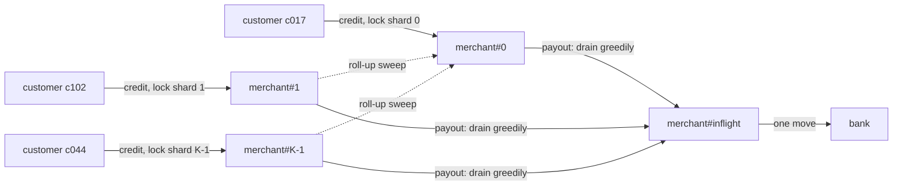

# Ledger Concurrency: Hot Accounts and Balance Checks

> Ten thousand payments into one merchant account per second.

**Type:** Build
**Languages:** Java, Python, Go
**Prerequisites:** Phase 10 Lesson 03 (The Double-Entry Ledger), Phase 10 Lesson 05 (Balances and Snapshots), Phase 10 Lesson 07 (Holds and Available Balance), Phase 4 Lesson 02 (Locks and Atomics)
**Time:** ~90 minutes

## Learning Objectives

- Explain the lost-update and double-spend anomalies on a balance, and find them mechanically by exploring every interleaving of a few operations
- Build pessimistic (ordered locks), optimistic (versioned read, validate, retry), and sharded (sub-accounts with roll-up) ledgers behind one interface
- Explain why a single hot account caps throughput at one over the critical-section time, and which of the three designs raises that cap
- Prove conservation under real concurrency with a multithreaded stress test whose expected final state is computed from the scripts alone, plus an auditor thread taking consistent totals mid-run
- Avoid deadlock with a global lock order, and state what each design gives up (latency, retries, read cost, balance-check precision)

## The Problem

A ticketing platform opens sales for a stadium tour. For eleven minutes, every purchase credits the same account: `2100 Merchant Payable: TourCo`. The ledger runs on PostgreSQL, and each posting does what Lesson 03 described: insert the postings, then `UPDATE account_balances SET balance = balance + $1 WHERE account_id = 'TourCo'` in the same transaction. The `UPDATE` takes a row lock until commit. Each transaction holds that lock for about 4 ms (two network round trips to the database plus the fsync at commit). That is a hard ceiling of 250 transactions per second on that one row, no matter how many application servers or database cores exist. Demand is 9,000 per second. Requests queue, time out at 5 seconds, are retried by clients, and the retries queue too.

An engineer under pressure removes the lock: read the balance with a plain `SELECT`, add in the application, write it back. Throughput recovers. The next morning the payable is 31,448.20 USD lower than the sum of the postings: two transactions read the same balance, each added its own amount, and the second write overwrote the first. That is a **lost update**. The same pattern on the payout side, where the code checks `balance >= amount` before debiting, let two payout jobs each see 50,000.00 and each pay out 40,000.00: a **double spend** that drove the payable to -30,000.00 and paid money the platform did not owe.

There are three honest ways out, and each moves the cost somewhere different. Lock pessimistically but keep the critical section tiny. Read optimistically, validate a version at commit, and retry on conflict. Or stop having one hot row: split the account into shards that take credits in parallel and roll up into one balance. This lesson builds all three on one interface, uses an exhaustive interleaving checker to show exactly which anomalies the naive version has and the others do not, and runs a multithreaded stress test that proves every unit of money is conserved.

## The Concept

### The anomalies, precisely

A balance update is read-modify-write: read `b`, compute `b + x`, write it. Two such operations on the same account can interleave:

```text
T1: read b = 100.00
T2: read b = 100.00
T1: write 100.00 - 60.00 = 40.00      (check 100.00 >= 60.00 passed)
T2: write 100.00 - 60.00 = 40.00      (check 100.00 >= 60.00 passed)
result: balance 40.00, but 120.00 was paid out of 100.00
```

Two distinct invariants broke. **Conservation**: the balance should equal the initial balance plus every applied operation (`100 - 60 - 60 = -20`), and it is 40, so 60.00 was created from nothing. **The balance check**: a payout must not drive the balance below zero, and two payouts that each passed the check together overdraw it. Both come from the same root cause: the check and the write used a value that was stale by the time of the write.

### Finding anomalies by exhaustive interleaving

Testing concurrency by running threads and hoping is weak: the bad interleaving might occur once in a million runs. For a handful of operations you can do better and enumerate **every** interleaving. Model each operation as a small state machine whose steps are single shared-memory actions, then do a depth-first search over "which thread takes the next step", checking the invariants at every terminal state. This is model checking in miniature, the same idea TLA+ and Java PathFinder apply at scale.

Three strategies, each written as steps:

| Strategy | Steps per operation | What makes it safe |
|----------|---------------------|--------------------|
| NAIVE | `read`, then `check+write` | Nothing |
| VERSIONED | `read (balance, version)`, then `validate+check+write` as one atomic step; if the version changed, go back to `read` | A write commits only if no other write happened since the read |
| LOCKED | `lock`, `read`, `check+write`, `unlock`; `lock` blocks while another thread holds it | Only one thread is between `read` and `write` at a time |

The VERSIONED commit step is atomic: it models a single `UPDATE ... SET balance = ?, version = version + 1 WHERE id = ? AND version = ?`, or a compare-and-set, which hardware and databases provide.

Worked counts for initial balance 100.00 with two payouts of 60.00 and one deposit of 30.00:

| Strategy | Complete schedules | Schedules violating an invariant |
|----------|--------------------|----------------------------------|
| NAIVE | 90 | 76 |
| VERSIONED | 498 | 0 |
| LOCKED | 6 | 0 |

The NAIVE count is the number of ways to interleave three 2-step sequences, `6! / (2! 2! 2!) = 90`. Only 14 of them are correct, and those are the ones where no read is separated from its write by another write. VERSIONED has more schedules than NAIVE because a conflict sends a thread back to `read`, creating new branches, but every one ends correctly. LOCKED has exactly `3! = 6`: once a thread holds the lock, no other thread can take a step until it unlocks, so the only freedom left is the order in which the three operations run, which is serial execution.

The checker's first counterexample for NAIVE is the trace a reviewer needs:

```text
P1:read P2:read P1:write P2:write D:read D:write
lost update: balance 7000 but applied ops imply 1000
```

Both payouts read 100.00, both wrote 40.00, the deposit raised it to 70.00; the applied operations imply `100 - 60 - 60 + 30 = 10`.

### The hot account

With correctness settled, the problem is throughput. Any design that serializes updates to one account, whether by lock or by version check, has a ceiling:

```text
max updates per second on one account = 1 / (time the account is exclusively held)
```

With a database row lock held across a 4 ms transaction, the ceiling is 250 per second. With an in-memory lock held for 200 ns, it is 5 million per second, and the hot account is no longer the bottleneck. This is why production ledgers move the balance update as late and as short as possible: validate and compute everything first, then take the lock, apply, and release, ideally without a network round trip inside the critical section.

Optimistic concurrency does not escape the ceiling; it changes how the ceiling feels. Every conflicting writer retries, so at high contention most work is wasted re-reading and re-validating, and latency becomes unpredictable. Optimistic wins when conflicts are rare (many accounts, low contention) because readers never block and nothing waits on a lock; it loses badly on exactly the hot-account workload.

A trace makes the wasted work concrete. Three credits to the merchant start at the same moment under optimistic control, each reading version 7:

```text
C1: read (v7, 1000.00)   C2: read (v7, 1000.00)   C3: read (v7, 1000.00)
C1: validate v7 == v7 -> commit (v8, 1010.00)
C2: validate v8 != v7 -> conflict, re-read (v8, 1010.00)
C3: validate v8 != v7 -> conflict, re-read (v8, 1010.00)
C2: validate v8 == v8 -> commit (v9, 1030.00)
C3: validate v9 != v8 -> conflict, re-read (v9, 1030.00)
C3: validate v9 == v9 -> commit (v10, 1035.00)
```

Three commits cost six reads and three wasted validations. With `n` simultaneous writers on one account, the last one can retry `n - 1` times, so total work grows roughly with `n^2` while useful work grows with `n`. Pessimistic locking does the same `n` commits with `n` reads; the others simply wait.

### Sharding the hot account

The ceiling is per account, so the structural fix is to have more than one account. Split `merchant` into `K` sub-accounts `merchant#0 .. merchant#K-1`:

- **Credits** pick one shard (round-robin, or hash of the payment id) and lock only that shard. `K` credits proceed in parallel, so the ceiling is `K` times higher.
- **Balance reads** sum the shards. For a consistent value, lock all shards (in order) for the read; for a dashboard, a lock-free approximate sum is often enough.
- **Debits with a balance check** are the hard part. No single shard knows the total. The implementation drains shards greedily into an in-flight account, one two-account locked move at a time, and if the shards come up short it moves every unit back and rejects the payout. A payout can therefore be rejected while concurrent credits are arriving that would have covered it: the balance check is conservative, never wrong in the dangerous direction.
- **Roll-up** periodically sweeps shards `1..K-1` into shard 0, with ordinary transfers, so the number of non-zero shards stays small and reports stay simple.



The in-flight account is what keeps conservation exact at every instant. Without it, money taken from a shard but not yet credited to the bank would exist in no account, and an auditor summing balances at that moment would see a shortfall. With it, every step is a two-account move under both locks, so any consistent cut sees each unit in exactly one account.

Why does greedy draining always succeed when total funds cover total demand? A payout fails only if every shard it visited was empty at the moment of the visit. Shards only gain money from credits, so at the end of that pass the shards hold at most what arrived after each visit. Meanwhile other payouts have taken at most their own demand. If the float covered all demand, the money not taken by others must still be in some shard, which contradicts every shard having been empty when visited. The stress test relies on this: with a float larger than all payouts, no payout ever fails, in any interleaving.

### Comparing the three designs

| Property | Pessimistic (ordered locks) | Optimistic (version, retry) | Sharded (K sub-accounts) |
|----------|-----------------------------|------------------------------|--------------------------|
| Hot-account credit ceiling | `1 / lock hold time` | Same, plus wasted retries | `K / lock hold time` |
| Behaviour under contention | Threads wait in line | Threads spin and retry | Contention divided by `K` |
| Exact balance check on debit | Yes, one lock | Yes, validated version | Conservative: may reject when funds are in flight |
| Consistent balance read | Lock one account | Read one version | Lock `K` shards, or approximate |
| Deadlock risk | Yes, prevented by global lock order | Commit phase locks in order; no waiting during read | Same as pessimistic |
| Fits when | Moderate contention, simple code | Many accounts, rare conflicts | A few known hot accounts |

A fourth design deserves a sentence because it is what most high-volume ledgers end up doing for the credit side: **do not check credits at all**. A credit to a liability account cannot violate a non-negative balance rule, so it needs no balance read. Append the posting (an insert, no row lock on a balance) and compute or cache the balance asynchronously (Lesson 05). Only debits, which need a check, take a lock or a version. That turns the hot-account problem into a pure append problem, which logs handle at millions per second.

### Deadlock and lock order

A transfer locks two accounts. If thread 1 transfers `p -> q` and locks `p` then `q`, while thread 2 transfers `q -> p` and locks `q` then `p`, each can hold one lock and wait forever for the other. The fix is a **global lock order**: always lock the account with the smaller id first, regardless of transfer direction. A cycle of waits then needs some thread to hold a larger id while waiting for a smaller one, which the order forbids. The tests run 20,000 transfers in each direction on the same pair concurrently and assert both threads finish.

### Proving conservation under real threads

The stress test is designed so that the correct final state is known without running anything concurrently:

1. Each thread gets a **deterministic script** from a seeded `Random`: which customer pays how much, and every 20th operation a payout from the merchant to the bank.
2. Floats are large enough that **every operation succeeds in any order**: customers never run out, and the merchant float exceeds all payouts.
3. Therefore the final balance of every account is a pure function of the scripts, computed by `Workload.expected()` with a simple loop.
4. Run the scripts on 8 real threads released together by a `CountDownLatch`, then compare every balance with the expected value and check `totalMinor()` equals the initial total.
5. Meanwhile an **auditor thread** repeatedly calls `totalMinor()`, which locks every account in order to take a consistent cut, and asserts each cut equals the initial total. That checks conservation not just at the end but at every instant the auditor observed.

Contention counters (lock waits, retries) and elapsed time differ run to run and machine to machine, so `main` prints them only with `--stats`. The balances, totals, and pass/fail lines are deterministic.

### What this does not do

- It does not persist anything. In a database, the pessimistic design is `SELECT ... FOR UPDATE` in a consistent order, the optimistic design is a `version` column in the `WHERE` clause, and sharding is several balance rows per account; durability and isolation levels add their own anomalies (Phase 8 covers them).
- It does not implement holds (Lesson 07). A production debit usually checks *available* balance (posted minus holds), which is one more number under the same lock.
- It does not batch. Grouping many credits to the hot account into one balance update per millisecond is another way to raise the ceiling; Exercise 3 builds it.
- The interleaving checker explores a model, not the Java code itself. It proves the algorithms are correct for the modelled steps; the stress test is the evidence that the Java implements those steps.

## Build It

The program is `code/java/Main.java`; tests are `code/java/MainTest.java`. `Money` is copied from Lesson 01.

### Step 1: Steps as state machines

```java
case VERSIONED -> {
    if (w.pc[t] == 0) {
        w.localBalance[t] = w.balance; w.localVersion[t] = w.version; w.pc[t] = 1;
        w.trace.append(who).append(":read ");
    } else if (w.version != w.localVersion[t]) {
        w.pc[t] = 0;                                               // stale read: retry from the top
        w.trace.append(who).append(":conflict ");
    } else {                                                        // validate + write, one atomic step
        long next = w.localBalance[t] + op.amount();
        if (next >= 0) { w.balance = next; w.version++; w.applied[t] = true; w.trace.append(who).append(":commit "); }
        else w.trace.append(who).append(":reject ");
        w.pc[t] = DONE;
    }
}
```

Each branch is one atomic action on shared state. The program counter `pc[t]` says where thread `t` is; locals hold what it read. The rejection happens only when the version matches, which matters: rejecting based on a stale read would be a false "insufficient funds".

**Predict:** in the NAIVE model, why can a deposit that reads after both payouts wrote still end with the wrong balance?

### Step 2: Explore every schedule

```java
private static void dfs(Strategy s, long initial, List<Op> ops, World w, int[] counts, String[] first, int depth) {
    boolean anyEnabled = false;
    for (int t = 0; t < ops.size(); t++) {
        if (w.pc[t] == DONE || !enabled(s, w, t)) continue;
        anyEnabled = true;
        World next = w.copy();
        step(s, next, t, ops.get(t));
        dfs(s, initial, ops, next, counts, first, depth + 1);
    }
    if (!anyEnabled) {
        counts[0]++;
        String violation = check(initial, ops, w);
        // ... count it and keep the first trace
    }
}
```

At each state, every thread that can move is tried, on a copy of the world. A state where no thread can move is terminal: all done, or (in a buggy lock design) deadlocked, which `check` would also report. `enabled` returns false for a LOCKED thread at `pc == 0` while another holds the lock, which is how blocking is modelled. The search is exponential in the number of steps, so it is for three or four operations, which is enough: almost every concurrency bug in a balance update shows up with two or three.

### Step 3: Pessimistic transfer with a global lock order

```java
public void transfer(String from, String to, Money amount) {
    Cell a = cell(from), b = cell(to);
    validate(a, b, amount);
    Cell first = a.id.compareTo(b.id) < 0 ? a : b, second = first == a ? b : a;
    lock(first);
    try {
        lock(second);
        try {
            long m = amount.minorUnits();
            if (!a.overdraftAllowed && a.balance < m) throw new InsufficientFundsException(a.id, a.balance, m);
            a.balance = Math.subtractExact(a.balance, m);
            b.balance = Math.addExact(b.balance, m);
        } finally {
            second.lock.unlock();
        }
    } finally {
        first.lock.unlock();
    }
}
```

Validation that does not depend on balances (currencies, same account, positive amount) runs before any lock. The balance check runs inside both locks, so the value it checks is the value it writes against. `lock` uses `tryLock` first and counts a wait when it fails, which is the contention number `--stats` prints. Nested `try/finally` guarantees both locks are released on every path, including the exception for insufficient funds.

**Predict:** if `first` were always `a` (the debit side) instead of the smaller id, which test would hang?

### Step 4: Optimistic transfer: read, check, validate, commit, retry

```java
while (true) {
    AccountState sa = a.state().get(), sb = b.state().get();          // read phase: no locks
    boolean insufficient = !a.overdraftAllowed() && sa.balance() < m;  // business check on the read
    first.commit().lock();
    second.commit().lock();
    try {
        if (a.state().get() == sa && b.state().get() == sb) {          // validate: nothing changed since the read
            if (insufficient) throw new InsufficientFundsException(a.id(), sa.balance(), m);
            a.state().set(new AccountState(sa.version() + 1, Math.subtractExact(sa.balance(), m)));
            b.state().set(new AccountState(sb.version() + 1, Math.addExact(sb.balance(), m)));
            return;
        }
    } finally {
        second.commit().unlock();
        first.commit().unlock();
    }
    retries.incrementAndGet();
    Thread.onSpinWait();
}
```

This is Kung and Robinson's optimistic concurrency control with serial validation: a read phase with no locks, then a short validate-and-write phase. `AccountState` is an immutable record, so reference equality (`==`) on the `AtomicReference` value is an exact "nothing changed" test: every write installs a new object. The insufficient-funds decision is made on the read but only acted on after validation, so a rejection is never based on a stale balance. In a database the commit block is one `UPDATE ... WHERE version = ?` per row inside a short transaction, and "retry" is a loop in the application.

### Step 5: Sharded credits and greedy debits

```java
public void transfer(String from, String to, Money amount) {
    if (isHot(from) && isHot(to)) throw new IllegalArgumentException("hot-to-hot transfers are not supported");
    if (isHot(to)) {
        int k = (int) Math.floorMod(routing.getAndIncrement(), shards(to));       // spread credits across shards
        super.transfer(from, shardId(to, k), amount);
    } else if (isHot(from)) {
        debitHot(from, to, amount);
    } else {
        super.transfer(from, to, amount);
    }
}

private void debitHot(String hot, String to, Money amount) {
    Cell inflight = cell(hot + "#inflight"), dest = cell(to);
    long remaining = amount.minorUnits();
    long[] taken = new long[shards(hot)];
    int n = shards(hot), start = (int) Math.floorMod(routing.getAndIncrement(), n);
    for (int i = 0; i < n && remaining > 0; i++) {
        int k = (start + i) % n;
        long got = moveUpTo(cell(shardId(hot, k)), inflight, remaining);
        taken[k] += got;
        remaining -= got;
    }
    if (remaining > 0) {
        for (int k = 0; k < n; k++) if (taken[k] > 0) moveUpTo(inflight, cell(shardId(hot, k)), taken[k]);
        throw new InsufficientFundsException(hot, amount.minorUnits() - remaining, amount.minorUnits());
    }
    moveUpTo(inflight, dest, amount.minorUnits());
}
```

`ShardedLedger` extends `PessimisticLedger`, so every shard is an ordinary locked cell and every move reuses the ordered two-lock pattern through `moveUpTo`. Payouts start at a rotating shard so concurrent payouts do not all fight over shard 0. `openHotAccount` splits the initial float across shards with Lesson 01's `allocate`, so 0.10 over four shards is `3, 3, 2, 2` cents, not four rounded quarters.

**Predict:** a payout of 6.00 runs while the shards hold 2.00, 2.00, 0.50, 0.50 and no credits arrive. What do the in-flight account and the shards hold after the rejection?

### Step 6: The stress test with an auditor

```java
Thread auditor = new Thread(() -> {
    while (running.get()) {
        cuts.incrementAndGet();
        if (l.totalMinor() != initialTotal) badCuts.incrementAndGet();
    }
});
auditor.start();
long failed = w.run(l);
running.set(false);
auditor.join();
```

`totalMinor()` locks every account in id order and sums, which is a consistent cut: no transfer can be half-applied while all locks are held. The test asserts zero bad cuts, zero failed operations, conservation at the end, and every balance equal to `Workload.expected()`. A bug that briefly loses money (such as debiting a shard before crediting anything) passes the end-state check and fails the auditor.

### Step 7: Run it

```bash
cd phases/10-money-and-ledgers/11-ledger-concurrency/code/java
javac -d .out *.java && java -cp .out Main
java -cp .out MainTest
java -cp .out Main --stats      # contention counters and timings; these vary by run and machine
```

Expected output:

```console
== Exhaustive interleavings: balance 100.00, payouts of 60.00 and 60.00, deposit of 30.00 ==
NAIVE     schedules   90  violations   76
          e.g. lost update: balance 7000 but applied ops imply 1000 via P1:read P2:read P1:write P2:write D:read D:write
VERSIONED schedules  498  violations    0
LOCKED    schedules    6  violations    0

== 8 threads x 20,000 ops: customers pay one hot merchant account; every 20th op pays out ==
payouts requested 395807.83 USD against a merchant float of 20000000.00 USD (every op can succeed in any order)
pessimistic  failures 0  total conserved true   every balance as expected true   merchant 27204989.39 USD
optimistic   failures 0  total conserved true   every balance as expected true   merchant 27204989.39 USD
sharded      failures 0  total conserved true   every balance as expected true   merchant 27204989.39 USD

== A payout that would overdraw is rejected atomically, in every strategy ==
pessimistic: rejected; merchant still 100.00 USD, bank 0.00 USD
optimistic: rejected; merchant still 100.00 USD, bank 0.00 USD
sharded: rejected; merchant still 100.00 USD, bank 0.00 USD
```

With `--stats`, expect the sharded ledger to report far fewer lock waits than the pessimistic one, and the optimistic ledger to report retries that grow with thread count. On a two-core laptop the elapsed times are close because the critical sections are tiny; the contention counters are the signal.

### In Python

The full port is `code/python/main.py` (same `InterleavingChecker`, `PessimisticLedger`, `OptimisticLedger`, `ShardedLedger`, `Workload`; tests in `code/python/test_main.py`). Three things differ, and the first one is the lesson:

- **The GIL hides the race; the checker reproduces it.** CPython runs one thread's bytecode at a time and only switches every few milliseconds, so a naive read-modify-write on a Python `int` attribute almost never loses an update under the stress workload: the race is real but not observable on demand. That is why Part 1 is the teaching tool here. `InterleavingChecker` is an explicit scheduler that enumerates every interleaving of the step machines, so the 76 violating schedules out of 90 for `NAIVE` are reproduced deterministically on every run, in every language. The real-thread ledgers in Part 2 are still exercised by 8 threads and an auditor taking consistent cuts, because lock ordering, atomic rejection, and conservation hold or fail regardless of the GIL.
- **Primitives map one to one.** `ReentrantLock` becomes `threading.Lock` (no reentrancy is needed: the two locks taken in a transfer are different cells), `tryLock()` is `acquire(blocking=False)`, `CountDownLatch` is a `threading.Event`, and `AtomicLong` is a tiny class with its own lock because `+=` on a shared attribute is not atomic across threads. `AtomicReference<AccountState>` is a plain attribute that is only ever replaced, never mutated, so the optimistic validate step compares identity with `is`, exactly as Java compares references with `==`. Round-robin routing uses `itertools.count()`, whose `next()` is atomic under the GIL.

```python
while True:
    sa, sb = a.state, b.state                                   # read phase: no locks
    insufficient = not a.overdraft_allowed and sa.balance < m
    first.commit.acquire()
    second.commit.acquire()
    try:
        if a.state is sa and b.state is sb:                      # validate: nothing changed since the read
            if insufficient:
                raise InsufficientFundsError(a.id, sa.balance, m)
            a.state = AccountState(sa.version + 1, sa.balance - m)
            b.state = AccountState(sb.version + 1, sb.balance + m)
            return
    finally:
        second.commit.release()
        first.commit.release()
    self._retries.increment_and_get()                           # stale read: go again
```

- **Same scripts, same balances.** `Workload.script` seeds a `JavaRandom` (the JDK's 48-bit LCG) with `seed * 31 + thread`, so the per-thread scripts, the expected balances, and the demo's `merchant 27204989.39 USD` are identical to Java's. Contention counters and elapsed times behind `--stats` are the only numbers that differ. `InsufficientFundsError` extends `RuntimeError`; argument errors are `ValueError`.

```bash
cd phases/10-money-and-ledgers/11-ledger-concurrency/code/python
python3 main.py            # add --stats for contention counters and timings
python3 -m unittest -v
```

### In Go

The full port is `code/go/main.go` (same `InterleavingChecker` as `Explore`, `PessimisticLedger`, `OptimisticLedger`, `ShardedLedger`, `Workload`) with `money.go` (the Lesson 01 `Money`) and `javarandom.go`, so seed 42 produces the same 160,000 scripted transfers and the same `395807.83 USD` of payouts. Tests are in `code/go/main_test.go` and must pass under `go test -race ./...`. Three things differ:

- **Goroutines and `sync` replace threads and `ReentrantLock`.** `Cell.lock` is a `sync.Mutex`; `TryLock` (Go 1.18+) counts the lock waits exactly as `tryLock()` did. `Workload.Run` releases every goroutine at once by closing a channel instead of a `CountDownLatch`, and a `sync.WaitGroup` stands in for `join()`. The deadlock-freedom test waits on a done channel with a ten-second `select` timeout rather than `join(10_000)`.
- **The optimistic row is an `atomic.Pointer[AccountState]`.** Validation compares pointers, not values: a stale read is detected because a commit stores a *new* `AccountState`, so `a.state.Load() != sa` is the Go spelling of Java's `a.state().get() == sa` reference check. The validate-and-write section is a closure with deferred unlocks so every exit path releases both commit locks in order:

```go
for {
    sa, sb := a.state.Load(), b.state.Load()                 // read phase: no locks
    committed, err := func() (bool, error) {
        first.commit.Lock(); defer first.commit.Unlock()
        second.commit.Lock(); defer second.commit.Unlock()
        if a.state.Load() != sa || b.state.Load() != sb {    // validate: nothing changed since the read
            return false, nil
        }
        ...
    }()
    if err != nil || committed {
        return err
    }
    l.retries.Add(1)                                          // stale read: go again
}
```

- **No inheritance, so `ShardedLedger` embeds `*PessimisticLedger`.** Calls through the `ConcurrentLedger` interface reach the sharded `Transfer` and `Balance`; `RollUp` calls `l.PessimisticLedger.Transfer` explicitly where Java wrote `super.transfer`. `Math.floorMod` on the routing counter becomes a two-line `floorMod` helper, `ErrInsufficientFunds` is a sentinel checked with `errors.Is`, and the `ConcurrentHashMap`s become plain maps behind a `sync.RWMutex`, which the race detector would flag if any path forgot.

```bash
cd phases/10-money-and-ledgers/11-ledger-concurrency/code/go
go run .                   # add --stats for contention counters and timings
go test -race ./...
```

## Use It

### `java.util.concurrent`

`ReentrantLock.tryLock` and `lock` are the primitives used here; `StampedLock` adds an optimistic read mode (`tryOptimisticRead` then `validate`) that is the single-object version of Step 4. `AtomicReference.compareAndSet` is the hardware compare-and-swap that makes single-account optimistic updates lock-free; two-account transfers need either locks or a software transactional scheme. `LongAdder` is the JDK's own sharded counter: it stripes increments across cells to avoid a hot `AtomicLong` and sums them on read, which is exactly the sharded credit design without the balance check.

### Databases

PostgreSQL gives you all three designs. Pessimistic: `SELECT ... FOR UPDATE` on both account rows, ordered by id, then update. Optimistic: a `version` column and `UPDATE accounts SET balance = $1, version = version + 1 WHERE id = $2 AND version = $3`, retrying when zero rows are updated; or run at `SERIALIZABLE` and retry on serialization failures (SQLSTATE `40001`). Sharded: several rows per hot account and a periodic sweep. Under default `READ COMMITTED`, `UPDATE ... SET balance = balance + $1` is safe from lost updates for pure credits because the row lock serializes them, but a separate `SELECT` followed by an `UPDATE` with the computed value is not; that is the bug in the Problem section.

### Purpose-built ledgers

TigerBeetle processes transfers in batches through a single-threaded state machine: there are no locks because there is no concurrency inside the engine, and the hot-account ceiling is the engine's in-memory throughput, millions of transfers per second. Debit limits are enforced with account flags (`debits_must_not_exceed_credits`) checked in that serial loop. Several payment companies have published accounts of sharding hot merchant balances into sub-accounts or buffering credits to a hot account and applying them in batches; the mechanisms are the ones built here.

## Ship It

`outputs/design-doc-hot-account-strategy.md` is a design-review template for choosing a concurrency strategy for a ledger account class: expected peak write rate, critical-section time, which operations need balance checks, the chosen design, its failure behaviour under contention, and the tests (interleaving model, stress with auditor) that prove it.

## Exercises

1. **Reinforce.** Add a `TRANSFER_TWO` operation to the interleaving checker that moves money between two accounts in the NAIVE, VERSIONED, and LOCKED models (the LOCKED model needs two locks). Show that LOCKED with locks taken in transfer direction deadlocks for some schedule (a terminal state where threads are not DONE), and that ordering locks by account id removes it.

2. **Apply.** Implement `PessimisticLedger.transferAll(List<Transfer>)` that applies a multi-leg journal entry atomically: lock every account involved in sorted order, check every debit, apply all or nothing. Stress-test it with 8 threads posting three-leg entries (customer, merchant, fee revenue) and an auditor, and assert the fee revenue equals the sum of fees in the scripts.

3. **Extend.** Combine with Lesson 05 and Lesson 07: build a `BufferedHotAccount` that accepts credits into a lock-free queue and applies them to the balance in batches of up to 1,000 by a single applier thread, while debits take a lock, drain the queue first, then check available balance (posted minus holds). Prove with the stress test and auditor that the conservation invariant holds when "in queue" is counted as its own account, and measure lock waits against the sharded design.

## Key Terms

| Term | What people say | What it actually means |
|------|-----------------|------------------------|
| Lost update | "the balance is off" | Two read-modify-write operations read the same value and the second write discards the first |
| Double spend | "we paid it twice" | Two debits each pass a balance check on the same stale balance and together overdraw the account |
| Hot account | "the merchant row is slow" | An account updated so often that exclusive access to it bounds total throughput at one over the hold time |
| Pessimistic locking | "lock it first" | Acquire exclusive access before reading, so no other writer can intervene between read and write |
| Optimistic concurrency | "check the version" | Read without locks, validate at commit that nothing changed, retry otherwise |
| Sharded account | "sub-accounts" | One logical account split into several physical ones that take writes in parallel and are summed for reads |
| Global lock order | "lock by id" | Every thread acquires locks in the same total order, which makes a wait cycle, and so deadlock, impossible |
| Consistent cut | "a snapshot of all balances" | A set of balances read while no transfer is half-applied; the only kind of total that must equal the conserved amount |

## Further Reading

- [Kung and Robinson, "On Optimistic Methods for Concurrency Control", ACM TODS 6(2), 1981](https://dl.acm.org/doi/10.1145/319566.319567) — the read, validation, and write phases implemented in Step 4.
- [Java Language Specification, Chapter 17: Threads and Locks](https://docs.oracle.com/javase/specs/jls/se21/html/jls-17.html) — the memory model that makes values written under a lock visible to the next holder.
- [PostgreSQL documentation: Explicit Locking and Transaction Isolation](https://www.postgresql.org/docs/current/explicit-locking.html) — row locks, `FOR UPDATE`, and the isolation levels behind the database versions of all three designs.
- [Berenson et al., "A Critique of ANSI SQL Isolation Levels", SIGMOD 1995](https://arxiv.org/abs/cs/0701157) — precise definitions of lost update and the other anomalies, with the interleavings that produce them.
- [TigerBeetle: Concepts and account flags](https://docs.tigerbeetle.com/concepts/) — a ledger that avoids lock contention with a serial, batched state machine and enforces debit limits inside it.
- [Lamport, *Specifying Systems* (TLA+)](https://lamport.azurewebsites.net/tla/book.html) — exhaustive state exploration at scale, the industrial version of the interleaving checker in Step 2.
