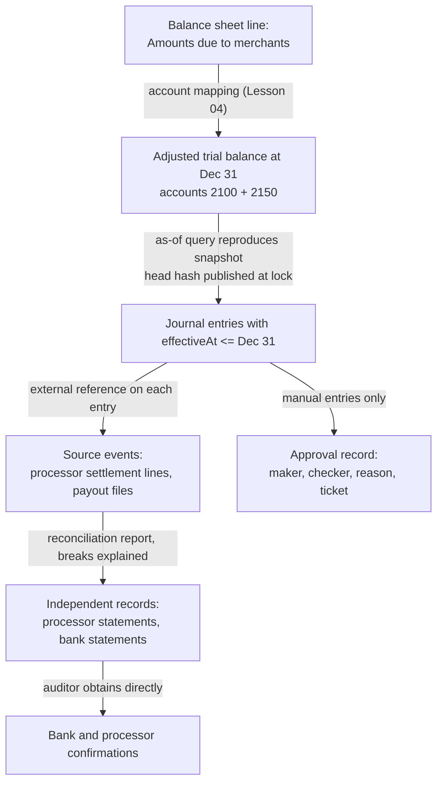

# Audit Trails, Trial Balance, and Financial Close

> What the auditor asks for and how the ledger answers.

**Type:** Learn
**Languages:** —
**Prerequisites:** Phase 10, Lesson 04 (Chart of Accounts), Phase 10, Lesson 05 (Balances and Snapshots), Phase 10, Lesson 06 (Immutability and Reversals), Phase 10, Lesson 08 (Reconciliation), Phase 10, Lesson 09 (Multi-Currency Ledgers), Phase 10, Lesson 11 (Ledger Concurrency)
**Time:** ~60 minutes

## Learning Objectives

- Distinguish the unadjusted, adjusted, and post-closing trial balances, and produce each by hand for a month of payment activity
- Walk through a month-end close for a payments company: cutoff, reconciliations, accruals, revaluation, closing entries, period lock, and sign-off
- Map each financial-statement assertion an auditor tests (existence, completeness, accuracy, cutoff, valuation) to the ledger mechanism and the evidence that answers it
- Describe SOX-style IT general controls and application controls in engineering terms, including segregation of duties and maker-checker for manual entries
- Build an evidence chain from a reported balance back to source events, and explain what makes a report reproducible enough to be relied on

## The Problem

A payments company with a well-built ledger (Lessons 03 to 11) prepares for its first external audit. The ledger is append-only, entries balance, reversals are linked, and the trial balance ties every night. The auditors arrive with a request list of 140 items. On day three they sample 60 merchant payouts from the year and ask, for each one, for the journal entry, the event that caused it, the bank statement line that shows the money leaving, and evidence that someone authorized it. Engineering can produce the entries in seconds. The bank lines take a week, because the payout service stored the bank's reference in a log line, not in the ledger. Authorization evidence does not exist for 9 of the 60: they were manual payouts entered through an internal admin tool by a single support engineer.

On day five the auditors ask for the trial balance as of December 31, the date of the financial statements. Engineering runs the trial-balance query and gets a number that differs from the one finance used in the draft statements by 18,400.00. The difference is entries posted in January with December effective dates: late chargebacks the processor reported after year end. Nobody can say which version of December is the one that was reported, because the query reads the live tables and December was never frozen. On day eight the auditors ask who could change the ledger code and the ledger database during the year. The answer is "everyone on the payments team, via the deploy pipeline and a shared database credential".

None of these are bugs in the ledger engine. They are missing answers to the questions an auditor is professionally required to ask. This lesson is about those questions: what a trial balance is at each stage of close, what a month-end close actually does, what the auditor tests and why, which engineering controls make the answers trustworthy, and how to build the evidence chain from a number on a financial statement down to the source events that produced it.

## The Concept

### The trial balance at three moments

A trial balance (Lesson 03) lists every account's net balance in a debit or credit column; the columns are equal if and only if every entry balanced. In a close there are three of them, and confusing them is a common source of "the numbers changed":

| Trial balance | When | What it includes | Used for |
|---------------|------|------------------|----------|
| Unadjusted | End of the last day of the period, after cutoff | Every entry posted with an effective date in the period | Starting point; reviewed for anything unexpected |
| Adjusted | After period-end adjustments | Plus accruals, reconciliation corrections, revaluation, reserve movements | The financial statements are drawn from this |
| Post-closing | After closing entries (at fiscal year end) | Revenue and expense accounts zeroed into retained earnings | Opening balances for the next year; only balance-sheet accounts remain |

A balanced trial balance proves arithmetic consistency, nothing more. An entry posted to the wrong account, an entry that should not exist, or an entry that is missing all leave the trial balance balanced. That is why the close does not stop at "it ties".

### Cutoff and the period lock

Every entry has a position in the journal and an effective date (Lesson 05 separated `postedAt` from `effectiveAt`). A period such as January is a set of effective dates. **Cutoff** is the rule that an event belongs to the period in which it occurred, not the period in which it was recorded. A chargeback the processor initiated on January 30 and reported on February 2 belongs to January.

The **period lock** is the control that makes a period's numbers stable once reported. After sign-off, the ledger rejects any new entry with an effective date in the locked period. A late January event discovered in March is posted in March, referencing January, exactly as Lesson 06 posts a correction as a new entry rather than an edit:

```java
void post(JournalEntry e) {
    if (!e.effectiveDate().isAfter(lockedThrough)) {
        throw new PeriodLockedException("period through " + lockedThrough + " is closed; post in the open period with a reference");
    }
    // ... validate and append as in Lesson 03
}
```

This removes the 18,400.00 problem from the opening story. December's trial balance after lock is a fixed set of entries; anything later is February's (or March's) adjustment with a pointer back. If an error is material enough that previously issued statements must change, that is a restatement, a deliberate accounting decision governed by standards (IAS 8, ASC 250), not a side effect of someone posting late.

Two related techniques make "the December numbers" reproducible forever. First, an **as-of query** that filters on both effective date and posting position (Lesson 05): "every entry with `effectiveAt <= Dec 31` and `seq <= the seq at which December was locked`". Second, the **close snapshot**: the adjusted trial balance stored as an immutable record, along with the journal's head hash at lock time (Lesson 06). Re-running the as-of query must reproduce the snapshot exactly; if it does not, either the journal was altered or the query changed, and both are findings.

### What the auditor is testing

An external auditor forms an opinion on whether the financial statements are free of material misstatement. To do that they test **assertions**, the implicit claims management makes by publishing a number. Engineers rarely hear these words, but every ledger feature in this phase exists to support one:

| Assertion | The claim behind a balance | Ledger mechanism | Evidence the auditor asks for |
|-----------|----------------------------|------------------|-------------------------------|
| Existence / occurrence | Every recorded entry corresponds to a real event | Entries carry an external reference (processor id, bank reference) and are idempotent on it (Lesson 03) | Sample entries, trace each to the source document (settlement line, bank statement) |
| Completeness | Every real event is recorded | Reconciliation against processor and bank files with zero unexplained breaks (Lesson 08) | Reconciliations with break aging; sample source documents and trace them into the ledger |
| Accuracy | Amounts are right | Integer minor units, explicit rounding, allocation that conserves (Lessons 01, 10) | Recalculation of fees and splits on samples; rounding policy |
| Cutoff | Events are in the right period | `effectiveAt`, period lock, late events posted with references | Entries around period end; post-close entries referencing the closed period |
| Valuation | Balances are stated at the right amount | Revaluation at closing rates; reserves and allowances (Lessons 09, 07) | Rate sources and timestamps; recalculation of revaluation |
| Rights and obligations | Assets are ours, liabilities are owed | Chart of accounts separates customer funds from own funds (Lesson 04) | Safeguarding reconciliations, bank confirmations, account agreements |
| Presentation | Accounts are classified and disclosed correctly | Account types and hierarchy roll-ups (Lesson 04) | Mapping of ledger accounts to statement lines |

Completeness is the hardest and the one engineers can help with most. Existence is tested by tracing from the ledger outward; completeness by tracing from the outside world inward. A ledger that only records what the application chose to record cannot prove nothing is missing; a reconciliation against an independent source (the processor's settlement file, the bank's statement) can.

### The evidence chain

An **evidence chain** links a number on a financial statement to the events that produced it, with each link reproducible and each artifact protected from alteration. For a merchant payable balance it looks like this:



Each arrow is something an auditor will test on a sample, and each one fails in a specific way when it is missing. No account mapping: the auditor cannot tell which accounts make up the statement line. No reproducible as-of: the trial balance is "whatever the query returns today". No external reference on entries: existence testing becomes a manual search. No reconciliation: completeness cannot be shown. No approval record: manual entries are a fraud risk with no mitigating control.

The last arrow is the one that matters most, and it is outside your system on purpose. Auditing standards place more weight on evidence obtained directly by the auditor from an independent third party than on documents the company provides. The Wirecard collapse in 2020 is the canonical modern example: about 1.9 billion euros of cash reported as held in trustee accounts did not exist, and investigations found that for years the evidence for those balances had been documents and confirmations routed through intermediaries rather than confirmations obtained directly from the banks. A ledger cannot prevent fraud at that level, but an evidence chain that ends in independently confirmed bank balances, reconciled daily, is exactly what makes such a gap visible.

### SOX-style controls, for engineers

The Sarbanes-Oxley Act section 404 requires management of US public companies to assess, and auditors to attest to, the effectiveness of **internal control over financial reporting** (ICFR). Private companies and payment institutions outside the US face similar expectations from auditors, regulators, and bank partners. The controls fall into two groups, and engineers own most of both for a payments ledger.

**IT general controls (ITGCs)** cover the environment the financial systems run in. Auditors usually group them into four domains:

| Domain | What it means for a ledger | Typical evidence |
|--------|----------------------------|------------------|
| Access to programs and data | Who can change ledger data directly. Production database writes only through the ledger service; no shared credentials; break-glass access logged and reviewed | Quarterly access reviews, list of users with production write access, break-glass log |
| Program changes | Every change to ledger code is reviewed by someone other than the author, tested, and deployed through a controlled pipeline | Pull requests with approvals, CI results, deploy logs tied to commits |
| Program development | New financial systems are designed, tested, and migrated with controls (data migration reconciled) | Design reviews, migration reconciliation reports |
| Computer operations | Batch jobs (reconciliation, revaluation, snapshots) run, failures are detected and resolved | Job run history, alert and incident records |

**Application controls** are the automated checks inside the system. Every invariant in this phase is one: entries must balance (Lesson 03), postings are append-only (Lesson 06), idempotency on external ids (Lesson 03), period lock (this lesson), reversal bounds (Lesson 06), automated reconciliation with tolerance thresholds (Lesson 08), and non-negative balance checks (Lesson 11). An application control is valuable to an auditor because, once its design is tested and the ITGCs show the code cannot be changed without review, it works on every transaction, so the auditor can test it once instead of sampling thousands of transactions.

**Segregation of duties** means no single person can both initiate and approve, or both change and deploy, something that moves money or alters the books. For engineers that translates to: no one merges their own change to the ledger service; no one with production database write access also approves manual journal entries; and manual entries use **maker-checker**, where one person creates an entry in a pending state and a different person approves it before it posts. The nine unapproved manual payouts in the opening story are a segregation-of-duties failure, and the remedy is a code change: the admin tool creates a pending entry and the ledger refuses to post it until a second, distinct user approves.

```java
record ManualEntryRequest(String id, JournalEntry entry, String maker, String reason, String ticket) {}

JournalEntry approve(ManualEntryRequest req, String checker) {
    if (checker.equals(req.maker())) throw new SegregationOfDutiesException("maker cannot approve own entry " + req.id());
    if (req.reason().isBlank() || req.ticket().isBlank()) throw new IllegalArgumentException("manual entries need a reason and a ticket");
    post(req.entry());                 // the normal path: balance rule, period lock, idempotency all apply
    auditLog.append(req.id(), req.maker(), checker, req.reason(), req.ticket());
    return req.entry();
}
```

**Information produced by the entity (IPE)** is the auditor's term for reports your system generates that they rely on: the trial balance export, the reconciliation report, the list of manual entries. For each one they will ask how they know it is complete and accurate. The engineering answer is a report whose query is version-controlled, whose parameters (as-of date, seq) are recorded in the output, whose row count and totals tie to a control total (the trial balance), and which can be re-run to produce identical output.

### The request list, answered by the ledger

Every audit begins with a "provided by client" (PBC) list. The items vary by firm, but for a payments ledger the core is predictable, and each item should map to something the system can produce on demand rather than something assembled by hand:

| Request | What the ledger produces | Built in |
|---------|--------------------------|----------|
| Trial balance at period end | As-of trial balance at the locked cutoff seq, matching the close snapshot | Lessons 03, 05, this lesson |
| General ledger detail for selected accounts | Every posting with entry id, kind, reason, external reference, effective date, seq | Lessons 03, 06 |
| Roll-forward of customer and merchant balances | Opening + activity by category = closing, per account | This lesson |
| Bank, processor, and safeguarding reconciliations | Reconciliation reports with breaks, owners, and aging | Lesson 08 |
| Listing of manual journal entries | Entries created through the manual path, with maker, checker, reason, ticket | This lesson |
| Revaluation support | Positions, closing rates with source and timestamp, recalculated gain or loss | Lesson 09 |
| Refund, chargeback, and correction listing | Reversal and correction entries linked to originals, with reasons | Lesson 06 |
| Fee and split recalculation for a sample | The stored split per order and the policy version used | Lesson 10 |
| Users with access to ledger code and data | Access review export and change history | This lesson (ITGCs) |
| Evidence the journal was not altered | Hash chain verification from genesis to the published head hash | Lesson 06 |

The pattern is that each answer is a query over immutable data plus a stored artifact that proves the query's result has not changed since close. Anything on this list that today requires an engineer to write a one-off script is a gap worth closing before the auditors arrive.

### Correction, adjustment, or restatement?

When something is found to be wrong, three different mechanisms exist and choosing the wrong one creates its own finding:

| Situation | Mechanism | Where it is posted |
|-----------|-----------|--------------------|
| Error found before the period is locked | Correction entry (reverse and replace, Lesson 06) | In the period being closed |
| Event belongs to a locked period but is not material to issued statements | Adjustment in the open period, referencing the original period | Current open period |
| Error is material to statements already issued | Restatement decided by finance and auditors under IAS 8 or ASC 250 | Prior-period figures re-presented; the ledger still records the correcting entries as new entries |

Engineering never decides materiality. Engineering guarantees that whichever path is chosen leaves the original entries intact and the correcting entries linked, so that both the old and the new numbers can be reproduced.

### Roll-forwards

A **roll-forward** proves that a balance moved from opening to closing only through recorded activity:

```text
opening balance (post-closing TB of prior period)
  + activity by category (captures, refunds, chargebacks, payouts, fees, adjustments)
  = closing balance (adjusted TB of this period)
```

For a merchant payable, the categories come from entry kinds and source types, which is one more reason entries carry a `kind` and a `reason` (Lesson 06). A roll-forward that does not tie means an entry was posted without a category, posted into the prior period after its close, or the opening balance was not the prior period's locked closing balance. The SQL is short, and its existence as a version-controlled query is itself a control:

```sql
SELECT category, SUM(CASE side WHEN 'C' THEN minor_units ELSE -minor_units END) AS credit_net
FROM postings p
JOIN journal_entries e ON e.id = p.entry_id
WHERE p.account_id = '2100'
  AND e.effective_date BETWEEN DATE '2027-01-01' AND DATE '2027-01-31'
  AND e.seq <= :january_lock_seq
GROUP BY category
ORDER BY category;
```

## Worked Example

A month-end close for January on a USD ledger, abbreviated to the accounts that move. Amounts in USD.

**Step 1: Cutoff and the unadjusted trial balance.** At 00:00 UTC on February 1 the close job records the journal's current seq (say 48,112,907) as the January cutoff position, and computes the trial balance of all entries with `effectiveAt` in or before January:

| Account | Type | Debit | Credit |
|---------|------|-------|--------|
| 1010 Operating Bank | Asset | 412,300.00 | |
| 1020 Safeguarded Customer Funds Bank | Asset | 2,180,000.00 | |
| 1200 Processor Receivable | Asset | 655,450.00 | |
| 2100 Merchant Payable | Liability | | 2,410,950.00 |
| 2150 Merchant Reserve | Liability | | 240,000.00 |
| 3000 Share Capital | Equity | | 500,000.00 |
| 3100 Retained Earnings | Equity | | 41,000.00 |
| 4100 Fee Revenue | Revenue | | 125,400.00 |
| 5100 Processing Expense | Expense | 61,200.00 | |
| 5200 Chargeback Losses | Expense | 8,400.00 | |
| **Total** | | **3,317,350.00** | **3,317,350.00** |

It ties. That proves only that every entry balanced.

**Step 2: Reconciliations.** The processor reconciliation (Lesson 08) for January shows one unmatched processor record: a 1,200.00 chargeback dated January 30, reported in the February 2 file. It belongs to January (cutoff). The merchant bears it under the contract, so the adjustment is `Dr 2100 Merchant Payable 1,200.00 / Cr 1200 Processor Receivable 1,200.00`, with the processor's dispute id as its reference. The bank reconciliations for 1010 and 1020 show no breaks. The safeguarding reconciliation compares amounts owed to merchants with funds held in the safeguarded account and in transit at the processor, and is reviewed and signed by the finance owner.

**Step 3: Accruals.** The processor invoices January's scheme and processing fees on February 5. The ledger recorded per-transaction fees as they occurred; the monthly invoice adds 4,850.00 of fixed and scheme fees not yet recorded. They are January's expense: `Dr 5100 Processing Expense 4,850.00 / Cr 2500 Accrued Processing Fees 4,850.00`. When the invoice arrives and is paid in February, the payment debits 2500, not expense.

**Step 4: Revaluation.** The EUR merchant payables are revalued at the January 31 closing rate (Lesson 09), producing an unrealized loss of 2,300.00: `Dr 4900 Unrealized FX Gain/Loss 2,300.00 / Cr 1950-EUR FX Revaluation Adjustment 2,300.00`. The rate, its source, and its timestamp are attached to the entry.

**Step 5: Reserve release.** Reserves older than 90 days with no open disputes are released to merchants by policy: `Dr 2150 Merchant Reserve 30,000.00 / Cr 2100 Merchant Payable 30,000.00`.

**Step 6: The adjusted trial balance.**

| Account | Debit | Credit | Change from unadjusted |
|---------|-------|--------|------------------------|
| 1010 Operating Bank | 412,300.00 | | |
| 1020 Safeguarded Customer Funds Bank | 2,180,000.00 | | |
| 1200 Processor Receivable | 654,250.00 | | -1,200.00 (chargeback) |
| 1950-EUR FX Revaluation Adjustment | | 2,300.00 | revaluation |
| 2100 Merchant Payable | | 2,439,750.00 | -1,200.00 + 30,000.00 |
| 2150 Merchant Reserve | | 210,000.00 | -30,000.00 |
| 2500 Accrued Processing Fees | | 4,850.00 | accrual |
| 3000 Share Capital | | 500,000.00 | |
| 3100 Retained Earnings | | 41,000.00 | |
| 4100 Fee Revenue | | 125,400.00 | |
| 4900 Unrealized FX Gain/Loss | 2,300.00 | | revaluation |
| 5100 Processing Expense | 66,050.00 | | +4,850.00 accrual |
| 5200 Chargeback Losses | 8,400.00 | | |
| **Total** | **3,323,300.00** | **3,323,300.00** | |

The income statement for January comes from this table: fee revenue 125,400.00 less processing expense 66,050.00, chargeback losses 8,400.00, and unrealized FX loss 2,300.00, for a net income of **48,650.00**.

**Step 7: Lock and evidence.** The finance owner reviews the adjusted trial balance, the reconciliations, and the list of manual entries for January (each with maker, checker, reason, ticket). On sign-off, the close job sets `lockedThrough = 2027-01-31`, stores the adjusted trial balance as an immutable snapshot with the cutoff seq and the journal head hash, and writes the head hash to a write-once evidence store outside the ledger's own database. From this moment, any January-dated entry is rejected and must be posted in February with a reference.

**Step 8: Closing entries (at fiscal year end).** Many ledgers keep revenue and expense balances running through the year and close them into retained earnings only at year end; monthly closes lock periods without zeroing them. To show the mechanics on one set of numbers, assume January is the last month of the fiscal year. The closing entry zeroes every revenue and expense account into retained earnings:

```text
close-FY  (reason: fiscal year close; approved by controller)
  Dr 4100 Fee Revenue                 125,400.00
      Cr 5100 Processing Expense          66,050.00
      Cr 5200 Chargeback Losses            8,400.00
      Cr 4900 Unrealized FX Gain/Loss      2,300.00
      Cr 3100 Retained Earnings           48,650.00
```

The post-closing trial balance contains only balance-sheet accounts: debits 1010, 1020, 1200 totalling 3,246,550.00; credits 1950-EUR 2,300.00, 2100 2,439,750.00, 2150 210,000.00, 2500 4,850.00, 3000 500,000.00, and 3100 89,650.00 (41,000.00 plus 48,650.00), also totalling 3,246,550.00. The accounting equation holds: assets net of the revaluation adjustment are 3,244,250.00, liabilities are 2,654,600.00, and equity is 589,650.00.

**Step 9: What the auditor will sample.** From this one month: the 1,200.00 chargeback adjustment (cutoff and existence, traced to the processor's dispute record), the 4,850.00 accrual (traced to the February 5 invoice), the revaluation (recalculated from the rate source), the reserve release (policy and aging report), every manual entry (maker-checker evidence), and the snapshot (re-run the as-of query at the recorded seq and compare totals and head hash).

**Step 10: Flux review.** Before sign-off, the finance owner compares each account with the prior month and investigates any change above a threshold (for example 10% and 10,000.00). Processing expense up 8% with transaction volume up 7% needs no comment; a 2,300.00 unrealized FX loss on an account that was zero last month needs one sentence explaining the new EUR payables. Flux review is a detective control: it finds the misclassified entry or the missing accrual that a balanced trial balance cannot.

The whole close, as a schedule the finance and engineering owners can both read:

```mermaid
gantt
    title January close (business days after period end)
    dateFormat  X
    axisFormat  Day %s
    section Engineering
    Cutoff seq and unadjusted TB        :a1, 0, 1
    Settlement and bank file ingestion  :a2, 0, 2
    Reconciliation runs and break triage:a3, 1, 3
    section Finance
    Accruals and reserve releases       :b1, 2, 4
    Revaluation at closing rates        :b2, 2, 3
    Adjusted TB, roll-forwards, flux    :b3, 3, 5
    section Sign-off
    Review, lock, snapshot, publish hash:c1, 5, 6
```



## Failure Modes

| Failure | How it shows up in an audit | Engineering remedy |
|---------|-----------------------------|--------------------|
| Live-table reporting | "The December numbers changed" | Period lock plus close snapshot with cutoff seq and head hash |
| Manual entries without approval | Segregation-of-duties deficiency | Maker-checker in the ledger API, not in a spreadsheet |
| Shared production credentials | ITGC access deficiency; every control relying on data integrity is weakened | Per-user access, break-glass with logging, quarterly access reviews |
| Unreviewed changes to ledger code | ITGC change-management deficiency | Required reviews, protected branches, deploy only from the pipeline |
| Suspense account with growing balance | Completeness and accuracy questions on everything that passed through it | Reconciliation breaks have owners and aging; suspense is cleared at every close |
| Report that cannot be re-run identically | IPE cannot be relied on | Version-controlled queries, parameters recorded in output, totals tied to the trial balance |
| Source references kept in logs, not entries | Existence testing becomes manual and slow | External ids as first-class fields on entries, indexed |

## Exercises

1. **Reinforce.** Using the worked example, write the roll-forward of account 2100 Merchant Payable for January if the opening balance was 2,150,000.00 and January's activity before adjustments was captures net of fees 3,920,950.00, refunds 210,000.00, chargebacks 31,000.00, payouts 3,419,000.00, and reserve additions 0.00. Show that it ties to the unadjusted 2,410,950.00, then add the two adjustments and tie it to the adjusted balance.

2. **Apply.** Extend the Lesson 06 ledger with a `PeriodLock`: entries carry an `effectiveDate`, the ledger rejects any entry dated on or before `lockedThrough`, and a `close(LocalDate through, String approver)` method stores an immutable snapshot (trial balance, cutoff seq, head hash). Write tests that (a) a late January chargeback posted after close is rejected, (b) the same event posted in February with a reference succeeds, and (c) re-running the January as-of trial balance after February activity reproduces the snapshot exactly.

3. **Extend.** Design the evidence package for one sampled payout: list every artifact from the financial statement line down to the bank's confirmation, the system that produces each, the identifier that links it to the next, and how its integrity is protected (hash chain, write-once storage, third-party origin). Then identify which link in your current or a hypothetical system is weakest, and write the control (objective, frequency, owner, evidence) that would close the gap. This combines Lesson 06 (hash chains), Lesson 08 (reconciliation), and Lesson 11 (consistent cuts).

## Key Terms

| Term | What people say | What it actually means |
|------|-----------------|------------------------|
| Trial balance | "the books balance" | Every account's net in a debit or credit column; equal totals prove every entry balanced, and nothing else |
| Adjusted trial balance | "the final numbers" | The trial balance after period-end adjustments; the source of the financial statements |
| Period close | "month end" | Cutoff, reconciliations, adjustments, review, sign-off, and lock, after which the period's entries cannot change |
| Cutoff | "which month it goes in" | Recording each event in the period it occurred, regardless of when it was learned |
| Assertion | "what the auditor checks" | An implicit claim behind a reported number: existence, completeness, accuracy, cutoff, valuation, rights and obligations, presentation |
| Evidence chain | "the paper trail" | Linked, reproducible, tamper-evident artifacts from a reported number down to independent third-party records |
| ITGC | "IT controls" | Controls over access, program changes, development, and operations that make automated application controls trustworthy |
| Maker-checker | "four eyes" | A manual entry is created by one person and posts only after approval by a different person |

## Further Reading

- [Sarbanes-Oxley Act of 2002, Section 404](https://www.govinfo.gov/content/pkg/PLAW-107publ204/pdf/PLAW-107publ204.pdf) — the statutory requirement for management's assessment of internal control over financial reporting.
- [PCAOB Auditing Standard 2201, An Audit of Internal Control Over Financial Reporting](https://pcaobus.org/oversight/standards/auditing-standards/details/AS2201) — how auditors scope, test, and evaluate controls, including IT general controls and the use of system-generated reports.
- [PCAOB Auditing Standard 1105, Audit Evidence](https://pcaobus.org/oversight/standards/auditing-standards/details/AS1105) — the relevance and reliability of evidence, including why directly obtained third-party evidence carries more weight.
- [COSO, Internal Control — Integrated Framework (2013)](https://www.coso.org/guidance-on-ic) — the control framework most ICFR programs are built on: control environment, risk assessment, control activities, information, and monitoring.
- [IFRS IAS 8, Accounting Policies, Changes in Accounting Estimates and Errors](https://www.ifrs.org/issued-standards/list-of-standards/ias-8-accounting-policies-changes-in-accounting-estimates-and-errors/) — when a prior-period error requires restatement rather than a current-period correction.
- [Bundestag inquiry committee report on Wirecard (Drucksache 19/30900)](https://dserver.bundestag.de/btd/19/309/1930900.pdf) — the parliamentary investigation into how nonexistent cash balances went undetected, including the audit evidence obtained for trustee accounts.
