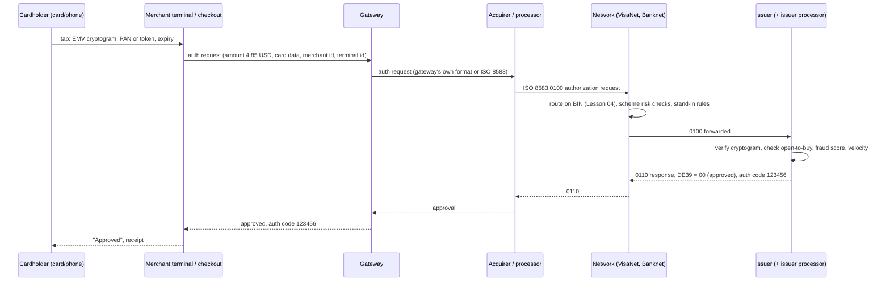

# How a Card Payment Works: Issuer, Acquirer, Network, Processor

> Follow one tap through seven parties in two seconds.

**Type:** Learn
**Languages:** —
**Prerequisites:** Phase 10, Lesson 01 (Representing Money), Phase 10, Lesson 03 (Double-Entry Ledger), Phase 10, Lesson 07 (Holds and Available Balance)
**Time:** ~75 minutes

## Learning Objectives

- Name the parties in a card transaction (cardholder, merchant, gateway, acquirer/processor, network, issuer) and state what each one is contractually responsible for
- Trace an authorization request and response hop by hop with a realistic latency budget, and explain what an approval does and does not guarantee
- Distinguish authorization, clearing, and settlement as three separate flows with three different timings and three different message formats
- Explain the difference between dual-message and single-message systems and why PIN debit and credit behave differently
- Allocate a $100 purchase among merchant, acquirer, network, and issuer to the cent using integer minor units
- Identify which party holds which risk at each step, and what shifts that risk (EMV chip, 3-D Secure, authorization expiry)

## The Problem

A customer taps a card at a coffee shop in Dublin, California. The terminal shows "Approved" in about 1.3 seconds. The customer leaves with the coffee. Nothing has moved yet. The coffee shop's bank account will not change for a day or two. The customer's statement will show a "pending" line that may change amount, or vanish, before it posts. Four companies the customer has never heard of each took a fraction of a cent to a few cents for their part, and if the customer later says "I never bought that coffee", a fifth process starts that can take 120 days and reverse everything.

Engineers who build payment products without this picture make a predictable set of mistakes. They treat an approved authorization as money received and recognise revenue on it; then a batch of uncaptured authorizations expires and the month's numbers are wrong. They capture more than they authorized and are surprised by a decline at clearing. They build a refund flow that issues a refund before the original capture has cleared, and the acquirer rejects it. They store the full card number because "we need it for the retry" and put the whole company into PCI DSS scope. They reconcile the gateway's "success" webhook against the bank deposit and cannot explain why the deposit is 2.4% smaller, arrives 2 days later, and nets several days of refunds against several days of sales.

Every one of those mistakes comes from collapsing three distinct flows, authorization, clearing, and settlement, into one imaginary event called "the payment". This lesson separates them, names every party, follows the messages and the money through each step, and writes down who is on the hook when something goes wrong. The next three lessons build the pieces: the authorization state machine (Lesson 02), the ISO 8583 wire format the messages travel in (Lesson 03), and the card number itself (Lesson 04).

## The Concept

### The parties

A "four-party" card scheme (Visa, Mastercard, and the domestic schemes modelled on them such as RuPay, Interac, and Cartes Bancaires) has four principal roles plus the intermediaries who do the technical work. American Express and Discover are "three-party" schemes where the network is also the issuer and the acquirer; the message flow is the same, with fewer contracts.

| Party | Who they are | Contract with | What they are responsible for |
|-------|--------------|---------------|-------------------------------|
| Cardholder | The person with the card | Issuer | Paying the issuer back (credit) or having funds on deposit (debit) |
| Merchant | The coffee shop | Acquirer | Delivering goods, following the scheme rules the acquirer passes down, absorbing chargebacks it loses |
| Gateway | Software that connects the terminal or checkout page to the processor (Stripe, Adyen, Braintree, Cybersource) | Merchant | Message formatting, tokenization, retries, routing to one or more processors; often the same company as the processor |
| Acquirer | A bank licensed by the scheme to sponsor merchants (Worldpay, Fiserv, JPMorgan Merchant Services, Elavon) | Merchant and network | Underwriting the merchant, funding the merchant, settling with the network, paying interchange |
| Processor | The technical platform that runs the acquirer's or issuer's connection to the network (often the acquirer itself, or Fiserv, TSYS, Marqeta on the issuing side) | Acquirer or issuer | Switching messages, stand-in rules, batch files |
| Network (scheme) | Visa, Mastercard | Issuers and acquirers (members) | The rulebook, the message switch (VisaNet, Banknet), clearing and net settlement between members, dispute arbitration, setting interchange |
| Issuer | The cardholder's bank | Cardholder and network | Authorizing against the account, extending credit, fraud losses on card-present counterfeit, paying the acquirer at settlement |

The distinction that confuses newcomers most is acquirer versus processor versus gateway. Legally, only the acquirer is a scheme member and only it can hold merchant funds; everything in front of it (gateway, processor) is a technology vendor operating under the acquirer's licence. Commercially, one company often plays all three roles (Adyen is a gateway, processor, and licensed acquirer in most regions; Stripe uses its own acquiring licences in some regions and partner acquirers in others). When you read "the processor declined it", find out whether that means the issuer declined and the processor relayed it, or the processor's own risk rules declined it before the network ever saw the request. The response code will tell you (Lesson 03, DE39).

### Flow 1: Authorization

Authorization answers one question in real time: will the issuer stand behind this amount on this card right now? It is a request-response pair, carried over persistent connections, in ISO 8583 (Lesson 03) between acquirer, network, and issuer, and in whatever the gateway's API shape is (JSON over HTTPS) between merchant and gateway.



A realistic latency budget for a card-present tap in the United States, in milliseconds:

| Hop | Typical | What takes the time |
|-----|---------|---------------------|
| Card to terminal (EMV kernel, cryptogram) | 100-300 | Contactless EMV exchange; the card computes an ARQC |
| Terminal to gateway | 50-150 | TLS over the merchant's internet connection |
| Gateway to acquirer | 10-50 | Usually same data centre or private link |
| Acquirer to network | 20-60 | Dedicated circuits to the scheme's access points |
| Network routing and risk | 10-30 | BIN lookup, scheme-level fraud scoring, stand-in decision |
| Network to issuer, issuer decision, back | 100-500 | The issuer's host: cryptogram verification, balance check, fraud model, rules; the slowest and most variable hop |
| Return path | 100-300 | Symmetric with the request |
| Total | 400-1,400 | What the cardholder experiences as "a second or so" |

Each party on the path runs a timeout. If the issuer does not answer VisaNet within its configured window (a few seconds), the network may approve on the issuer's behalf under stand-in processing (STIP) using limits the issuer pre-agreed, or return response code 91 (issuer unavailable). If the acquirer times out waiting for the network, it must send a reversal (0400) so the issuer does not hold funds for a transaction the merchant never completed. Timeouts and reversals are not edge cases: a well-run acquirer sees them on a measurable fraction of traffic every day, which is why the state machine in Lesson 02 has an explicit path for them.

What an approval means: the issuer has placed a hold on the cardholder's open-to-buy (credit) or available balance (debit) for the authorized amount and has agreed to pay the acquirer that amount at settlement if the merchant clears the transaction correctly and within the scheme's time limit. What it does not mean: that money has moved, that the cardholder is who they say they are, that the merchant will get to keep the money after a dispute, or even that the transaction will be paid at all if the merchant clears it late or for a materially different amount.

On the issuer's side an approval is a hold in the sense of Phase 10, Lesson 07: a reservation against available balance that is not a posting. The cardholder's ledger balance is unchanged; the available balance is reduced by the authorized amount; and the hold carries the authorization code, the merchant, the amount, and an expiry. When the clearing record arrives the issuer matches it to the hold (by authorization code, PAN, and amount within tolerance), releases the hold, and posts the cleared amount to the account. If the clearing never arrives the hold expires and available balance is restored. This is why a cardholder sees "pending" amounts that change or disappear: they are looking at holds, not postings.

```text
issuer view of one authorization, in cents
  before:   ledger 0        available 240000   holds []
  0110 00:  ledger 0        available 230000   holds [10000 @ auth 123456, expires day 7]
  clearing: ledger -10000   available 230000   holds []
  no clearing by day 7:
            ledger 0        available 240000   holds []
```

The hold has a lifetime. Visa's rule for most merchant categories is 7 days, extended to 30 days for hotels, car rentals, and cruise lines; Mastercard uses 7 and 30 similarly. After that the issuer releases the hold, and a late clearing is a "clearing without a valid authorization" for which the issuer can charge back and the scheme can fine the acquirer. Visa's Misuse of Authorization fees and Mastercard's Processing Integrity fees exist specifically to penalise acquirers whose merchants authorize and never capture, or never reverse. This is why an uncaptured authorization in your system must expire, in code, against an injected clock.

### Card-present and card-not-present are different authorizations

The same 0100 message carries very different evidence depending on how the card data was captured, and the issuer's decision, the interchange rate, and the fraud liability all depend on that evidence. ISO 8583 records it in the point-of-service entry mode (DE22) and the scheme-specific condition codes.

| Capture method | Evidence the issuer receives | Fraud liability by default | Typical interchange |
|----------------|------------------------------|----------------------------|---------------------|
| EMV chip, contact or contactless | A cryptogram (ARQC) computed by the card with a key only the issuer shares; proves the genuine card was present | Issuer | Lowest for the product |
| Magnetic stripe | Track data that can be copied; a CVV1 in the track | Merchant, if the card had a chip (fallback) | Higher |
| Card-not-present with CVV2, AVS, and 3-D Secure | Cardholder-entered data plus an issuer authentication result | Issuer, when authentication succeeded | Mid |
| Card-not-present, no authentication | PAN, expiry, CVV2, maybe billing address | Merchant | Highest |
| Network token (Apple Pay, Google Pay, merchant tokens) | A token PAN plus a cryptogram from the token service provider | Depends on the channel; often treated like chip | Often lower than raw PAN |

Two consequences follow. First, "approved" from an issuer means less for a keyed-in card-not-present transaction than for a chip tap, because the issuer had less to check; the approval rate is also lower, which is why e-commerce merchants invest in 3-D Secure and network tokens (Lessons 05 and 06). Second, the interchange rate is decided at clearing from the data in the authorization and the clearing record, so a merchant that captures with less data than it authorized with (for example, dropping the AVS result) can pay a higher rate on the same approved transaction. Downgrades of this kind are a routine line item on acquirer statements.

### Reading the answer: response codes and message types

The authorization response carries a two-character response code (ISO 8583 DE39). Engineers who treat everything other than `00` as "declined" lose information that decides the retry policy, the customer message, and the fraud signal.

| DE39 | Meaning | Who decided | Retry? |
|------|---------|-------------|--------|
| `00` | Approved | Issuer (or network under stand-in) | Not applicable |
| `05` | Do not honor | Issuer, reason withheld; often a fraud rule | Not on the same card without a change; ask for another method |
| `14` | Invalid card number | Network or issuer; Luhn or BIN failure (Lesson 04) | Never; the number is wrong |
| `51` | Insufficient funds | Issuer | Later, or for a smaller amount; a soft decline |
| `54` | Expired card | Issuer | With updated expiry, or via an account updater service |
| `57` | Transaction not permitted to cardholder | Issuer; product restriction | Not for this merchant category |
| `91` | Issuer or switch inoperative | Network, after an issuer timeout | Yes, shortly; the card is fine |
| `96` | System malfunction | Network or acquirer | Yes, with backoff |

The message type indicators you will meet in logs, and build in Lesson 03:

| MTI | Name | Direction | Used for |
|-----|------|-----------|----------|
| `0100` / `0110` | Authorization request / response | Acquirer to issuer and back | Dual-message approval; no clearing |
| `0120` / `0130` | Authorization advice / response | Acquirer or network to issuer | Telling the issuer about a stand-in approval after the fact |
| `0200` / `0210` | Financial request / response | Acquirer to issuer and back | Single-message: authorize and clear in one |
| `0400` / `0410` | Reversal request / response | Acquirer to issuer | Undo an authorization or financial request that the merchant did not complete, or that timed out |
| `0420` / `0430` | Reversal advice / response | Acquirer or network | Reversal where the sender does not need to wait for approval |
| `0800` / `0810` | Network management | Any member and the switch | Sign-on, sign-off, echo test, key exchange |

The reversal family is the one newcomers underestimate. Every acquirer runs a store-and-forward queue of reversals: when an authorization request times out, the acquirer does not know whether the issuer approved it, so it sends a 0400 with the same STAN and amount until the issuer acknowledges it, which releases any hold the issuer may have placed. A payment system that does not generate reversals on timeout leaves cardholders with phantom pending charges and the merchant with misuse-of-authorization fees.

### When the switch fails: Visa Europe, 1 June 2018

On Friday 1 June 2018 at 14:35 London time, a switch in one of Visa Europe's two UK data centres suffered a partial hardware failure. The failover to the second centre, designed to be automatic, did not complete cleanly because the failed switch was still partly alive and kept accepting some traffic. For the next ten hours, according to Visa's own account to the UK Treasury Committee, about 5.2 million transactions failed across the UK and Europe, roughly 10% of the attempts in the worst hour; the rest were approved because they happened to be routed through the healthy centre.

Three details from that incident matter to the engineer building on top of the rails:

- The failure mode was not "down"; it was "partially up". Merchants saw a mix of approvals, `91` responses, and timeouts for the same card within minutes. Any logic that interprets one decline as "the card is bad" would have blocked good customers for the evening.
- Timed-out authorizations had to be reversed. Acquirers' store-and-forward reversal queues spent the weekend clearing holds on cardholders' accounts for purchases that never completed; cardholders saw pending amounts that took days to disappear.
- Nothing about clearing or settlement was affected. Transactions that had been approved cleared and settled normally over the following days. Authorization is a real-time system with real-time failure modes; clearing and settlement are batch systems with their own, and an outage in one does not imply an outage in the other.

### Flow 2: Clearing

Clearing is the merchant saying "I delivered; here is the final amount; please move the money". It is not real time. In a dual-message system the merchant (through gateway and acquirer) sends a clearing record hours later, typically in a nightly batch. The acquirer assembles the records into a clearing file in the scheme's clearing format (Visa BASE II TC05 records, Mastercard IPM via the Global Clearing Management System) and submits it to the network. The network validates each record against the matching authorization, computes interchange for each one, and forwards the records to each issuer.

The clearing amount may legitimately differ from the authorized amount:

- Restaurants and taxis add a tip after authorization; schemes allow clearing up to 20% above the authorized amount for these merchant category codes.
- Hotels and car rentals authorize an estimate and clear the actual bill, with incremental authorizations along the way.
- Fuel pumps authorize a fixed amount (for example 1.00 USD or 125.00 USD) and clear the actual fill.
- E-commerce merchants capture less than authorized when an item is out of stock (partial capture) and may capture in several pieces as a split shipment goes out (multiple captures), where the scheme and acquirer permit it.

Clearing is also where the issuer learns the details that go on the statement: the merchant descriptor, the merchant category code, the transaction date, and the amount in the cardholder's billing currency after the scheme's FX conversion (Phase 10, Lesson 02).

### Flow 3: Settlement

Settlement is the movement of money. Each scheme runs a daily settlement cycle in which it nets every member's clearing records: the total an issuer owes for its cardholders' purchases, minus the interchange it is owed, minus refunds and chargebacks flowing the other way. The network then instructs its settlement bank to debit or credit each member's settlement account for one net figure per currency per day. Visa and Mastercard are not themselves banks; they are the netting engine, and the actual funds move through accounts at settlement banks (in the US, through Fedwire or an agent bank).

From the merchant's point of view there is a fourth step: the acquirer funds the merchant. The acquirer has received net settlement from the network and now pays the merchant the clearing amount minus the merchant discount rate, on the funding schedule in the merchant agreement: next business day (T+1) for large merchants, T+2 or T+3 for small ones, and sometimes with a rolling reserve held back for high-risk merchants. This is where the "deposit is smaller and later than the webhook said" confusion comes from: the webhook was the authorization or capture; the deposit is settlement, net of fees, net of refunds, batched by day.

| Flow | Question it answers | Timing | Message or file | Reversible by |
|------|--------------------|--------|-----------------|---------------|
| Authorization | Will the issuer stand behind this? | 0.4-1.4 s, real time | ISO 8583 0100/0110 | Reversal (0400) or expiry |
| Clearing | What is the final amount to move? | Hours to days, batch | BASE II / IPM clearing files | Refund (new clearing record), chargeback |
| Settlement | Who owes whom, net, today? | Daily cycle; merchant funding T+1 to T+3 | Settlement reports, Fedwire or agent bank transfers | Only by a later offsetting entry |

### Dual-message versus single-message

Everything above describes a dual-message system: one message to authorize (0100/0110), a separate clearing record later. Visa and Mastercard credit, and signature debit (a debit card run as "credit" without a PIN), work this way.

Single-message systems were built for PIN debit and ATMs: the US PIN debit networks (Interlink, Maestro, STAR, NYCE, Pulse, Accel), most ATM traffic, and several domestic debit schemes. The terminal sends a 0200 financial transaction request. If the issuer approves with 0210, that one message is both the authorization and the clearing: the issuer posts the debit immediately, the amount is final, and settlement follows from the 0200 log. There is no later clearing file and no tip adjustment; if the amount changes, the merchant sends a new transaction or a reversal.

| | Dual-message | Single-message |
|-|--------------|----------------|
| Messages | 0100 authorization, then clearing record (batch) | 0200 financial request; it authorizes and clears |
| Typical products | Credit, signature debit, most e-commerce | PIN debit, ATM, many domestic debit schemes |
| Amount can change after approval | Yes, within tolerance, via clearing or incremental auth | No; reverse and redo |
| Partial and multiple capture | Supported where the acquirer allows | Not a concept; the transaction is final |
| Cardholder statement | "Pending" until clearing posts, then final | Posted immediately |
| Reversal of an unused approval | Required (0400) or the hold ages out | Required (0400); money has already moved |
| Interchange | Set per product, typically higher | Typically lower, often regulated (US Regulation II for debit) |

The engineering consequence: a payment system that supports both must model "authorized but not captured" for dual-message rails and must not pretend that state exists for single-message rails. The state machine in Lesson 02 is the dual-message model; a single-message rail collapses `authorize` and `capture` into one transition.

### Who holds the risk, step by step

Risk in a card transaction is not one thing. It is several distinct exposures, each held by a different party, and each one moves when a specific event happens.

| Moment | Exposure | Who holds it | What moves it |
|--------|----------|--------------|---------------|
| Before authorization | Cardholder has no funds or the card is stolen | Merchant (if it delivers without authorizing, it has no claim) | Getting an approval |
| Approval received, not yet captured | Hold expires; merchant clears late | Merchant and acquirer (late clearing can be charged back) | Capturing within the window, or reversing |
| Card-present, EMV chip read | Counterfeit card | Issuer (EMV liability shift, US from October 2015) | Merchant falling back to magnetic stripe moves it back to the merchant |
| Card-present, magnetic stripe or keyed | Counterfeit or stolen card | Merchant | Chip acceptance |
| Card-not-present, no 3-D Secure | Fraud, "I did not authorize this" | Merchant (through the acquirer) | 3-D Secure authentication shifts fraud liability to the issuer (Lesson 06) |
| Card-not-present with 3-D Secure | Fraud | Issuer | A failed or exempted authentication may leave it with the merchant |
| After clearing, dispute window open (typically 120 days) | Chargeback for fraud, non-delivery, not as described | Merchant first; acquirer if the merchant cannot pay | Merchant evidence, representment, arbitration |
| Merchant insolvency with open disputes | Chargebacks with no one to debit | Acquirer | Reserves, delayed funding, underwriting |
| Cardholder default (credit) | Cardholder never pays the statement | Issuer | Credit underwriting; this is why issuers earn most of the interchange |
| Member insolvency at settlement | A member bank fails owing net settlement | Network (it guarantees settlement to the other members) | Collateral and settlement guarantee requirements on members |

Notice two patterns. First, the party that can best prevent a loss is given the loss: the issuer can verify a chip cryptogram, so it eats counterfeit chip fraud; the merchant chose not to authenticate a card-not-present customer, so it eats that fraud. Second, the acquirer is the backstop for everything the merchant does, which is why acquirers underwrite merchants like a lender and hold reserves against the ones whose chargebacks might exceed what they can recover.

## Worked Example

A cardholder buys a 100.00 USD jacket online with a US consumer rewards credit card. The merchant's acquirer charges a blended merchant discount rate of 2.50%. Follow the messages, then follow the money, all in integer cents.

**Day 0, 14:02:11.** The checkout page sends the gateway a payment request: amount `10000` minor units, currency `USD`, a network token in place of the PAN, a cryptogram from the token service, and an idempotency key. The gateway forwards it to the acquirer, which builds an ISO 8583 0100 with DE4 `000000010000` (amount, 12 digits, minor units), DE49 `840` (USD), DE2 the token, DE18 the merchant category code `5651` (family clothing), DE41 the terminal id, DE42 the merchant id. VisaNet reads the first digits of the account number, finds the issuer's BIN range, runs its own risk scoring, and forwards the message. The issuer verifies the cryptogram, sees open-to-buy of 2,400.00 USD, runs a fraud model, approves, and places a hold of 100.00 USD. The 0110 comes back with DE39 `00` and an authorization code in DE38. Elapsed: about 900 ms. Cardholder's open-to-buy is now 2,300.00 USD. No money has moved anywhere.

**Day 0, 23:30.** The merchant's fulfilment system ships the jacket and sends a capture for the full `10000`. The gateway marks the payment captured. The acquirer adds a clearing record to tonight's BASE II file.

**Day 1, 03:00.** The acquirer submits the clearing file. VisaNet validates each record against its authorization log, matches this one to the 0100 by acquirer reference number (DE37 in Lesson 03), and computes interchange. For this card product and merchant category, suppose the published rate is 1.80% + 0.10 USD:

```text
interchange = 10000 * 180 / 10000 + 10 = 180 + 10 = 190 cents     (1.90 USD)
```

VisaNet also assesses its own scheme fee, say 0.13% of the amount, rounded HALF_EVEN:

```text
assessment  = 10000 * 13 / 10000 = 13 cents                        (0.13 USD)
```

**Day 1, settlement cycle.** VisaNet nets every member's positions. Among thousands of other records, the issuer owes 100.00 USD for this purchase and is owed 1.90 USD interchange, so its net contribution for this transaction is a debit of 98.10 USD. The acquirer is owed 100.00 USD and owes 1.90 USD interchange plus 0.13 USD assessment, so its net is a credit of 97.97 USD. VisaNet is owed 0.13 USD. The settlement bank moves one net amount per member for the whole day.

**Day 2.** The acquirer funds the merchant on T+2. The merchant discount rate is 2.50%:

```text
merchant discount = 10000 * 250 / 10000 = 250 cents              (2.50 USD)
merchant receives = 10000 - 250 = 9750 cents                     (97.50 USD)
acquirer margin   = 250 - 190 - 13 = 47 cents                    (0.47 USD)
```

Conservation check, in cents:

| Party | Receives | Pays | Net |
|-------|----------|------|-----|
| Cardholder | the jacket | 10000 to the issuer on the statement (credit) | -10000 |
| Issuer | 10000 from cardholder, 190 interchange | 10000 at settlement | +190 |
| Network | 13 assessment | | +13 |
| Acquirer | 10000 at settlement, 250 discount | 190 interchange, 13 assessment, 9750 to merchant | +47 |
| Merchant | 9750 | the jacket | +9750 |
| Total | | | 0 |

`190 + 13 + 47 + 9750 = 10000`. Every cent is accounted for, which is only possible because every figure was computed as an integer in minor units with an explicit rounding rule (Phase 10, Lesson 01). Lesson 07 of this phase computes the real interchange tables; the point here is the shape: interchange goes from acquirer to issuer, the assessment goes to the network, the acquirer keeps the spread, and the merchant sees only the discount rate.

**Day 45.** The cardholder disputes the charge as "not received". The issuer provisionally credits the cardholder 100.00 USD, files a chargeback through VisaNet, and the acquirer debits the merchant 100.00 USD plus a chargeback fee. The merchant produces the signed delivery confirmation and represents. If the issuer accepts, the money flows back. The interchange from Day 1 is not necessarily returned; this is why disputes are expensive even when won (Phase 12, Lesson 07).

Now vary one input. If the cardholder had paid with a PIN debit card at a store on a single-message network, Day 0 14:02:11 would have posted the debit to the checking account immediately, there would have been no "pending" and no Day 0 23:30 capture, the interchange would have been capped by Regulation II at roughly 0.21 USD + 0.05% (about 26 cents), and the merchant's net would have been correspondingly higher. Same card number format, same cardholder, same merchant; a different rail, a different message flow, and different economics.

### A decision procedure for "the payment failed"

When someone says a payment failed, the first job is to find out which of the three flows failed, because the fix lives in a different team and a different system for each. Work down the list and stop at the first match.

1. **Did the authorization get a response?** No response within the timeout means a connectivity or switch problem (acquirer, network, or issuer processor). Expected actions: the acquirer sends a 0400 reversal; the merchant retries after a backoff; nobody tells the customer "card declined".
2. **Was the response a decline?** Read DE39. `05`, `51`, `54`, `57` are issuer decisions about this card; the fix is a different card or a later retry, and your fraud and retry policy should key off the specific code. `14` is a bad number: look at your own input handling. `91` and `96` are infrastructure: retry.
3. **Was it approved but never captured?** The merchant's order flow failed after authorization. The hold will age out in 7 or 30 days unless you reverse it; reverse it. Revenue was never earned.
4. **Was it captured but rejected at clearing?** The clearing record did not match a valid authorization (wrong amount beyond tolerance, too late, wrong reference). This appears as a chargeback or a clearing reject report from the acquirer days later, not as an API error. The fix is in capture timing and amount rules (Lesson 02).
5. **Was it cleared but the deposit is wrong?** Settlement and funding: fees, refunds, reserves, and funding delay. Reconcile the acquirer's settlement report against clearing records (Phase 10, Lesson 08) before assuming money is missing.

Each step down this list moves the problem from milliseconds to days, from the merchant's code to the acquirer's batch systems, and from "the customer sees an error" to "finance sees a discrepancy". Knowing which flow you are in is most of the diagnosis.

### What this model does not cover

It does not cover the authentication step that can precede authorization for card-not-present transactions (3-D Secure, Lesson 06); the cryptography inside the EMV exchange between card and terminal; the tokenization that replaces the PAN before any of this starts (Lesson 05); or the exact interchange tables, which run to hundreds of rows per scheme per region (Lesson 07). It also does not model the domestic schemes whose rules differ in detail (for example, Interac in Canada is single-message and has no interchange in the Visa sense). The structure, four parties plus a switch, three flows with three clocks, is what carries over.

## Exercises

1. **Reinforce.** Draw the sequence diagram for a declined authorization where the issuer returns response code 51 (insufficient funds), and then a second diagram for an acquirer-side timeout where the network never answered. Mark on each diagram where a 0400 reversal is required and who sends it. State in one sentence what the cardholder's available balance looks like in each case five minutes later.
2. **Apply.** Recompute the Worked Example for a 19.99 USD purchase with interchange 1.65% + 0.10 USD, assessment 0.14%, and merchant discount rate 2.9% + 0.30 USD, in integer cents with HALF_EVEN rounding. Produce the conservation table and confirm the parties net to zero. Then recompute for a 2.00 USD purchase and explain why the merchant's effective rate is now far above 2.9%.
3. **Extend.** Using the `Money` type and the `Hold` mechanism from Phase 10, Lesson 07, write down (in prose or pseudocode) the ledger postings an issuer records at each of the four moments in the Worked Example: authorization (a hold, not a posting), clearing (a posting against the cardholder's account and against a settlement receivable), settlement (receivable cleared by cash), and the Day 45 chargeback (provisional credit). Identify which postings are double-entry and which one is merely a reservation, and explain why the hold must never appear in the general ledger.

## Key Terms

| Term | What people say | What it actually means |
|------|-----------------|------------------------|
| Authorization | "the payment went through" | A real-time issuer promise to pay a specific amount if the merchant clears correctly and in time; places a hold, moves no money |
| Capture / clearing | "settling the transaction" | The merchant's instruction to move the final amount; sent in batch, carries the final amount and statement details; still not money movement |
| Settlement | "the payout" | The daily net movement of funds between network members through a settlement bank; followed separately by the acquirer funding the merchant |
| Interchange | "the card fee" | The fee the acquirer pays the issuer per transaction, set by the network's published tables; the largest piece of the merchant discount rate but not the whole of it |
| Merchant discount rate | "the processing fee" | The all-in percentage (plus fixed fee) the acquirer charges the merchant: interchange plus scheme fees plus the acquirer's margin |
| Dual-message system | "credit card processing" | A rail where authorization and clearing are separate messages at separate times, so the final amount can differ from the authorized amount |
| Single-message system | "PIN debit" | A rail where one financial request both authorizes and clears, so the amount is final the moment it is approved |
| Stand-in processing (STIP) | "the network approved it" | The network authorizing on the issuer's behalf, within issuer-set limits, when the issuer does not respond in time |
| Liability shift | "we're not liable for fraud" | A scheme rule moving fraud loss from one party to another when a control is used (EMV chip, 3-D Secure) or skipped (magstripe fallback) |

## Further Reading

- [Visa Core Rules and Visa Product and Service Rules](https://usa.visa.com/support/consumer/visa-rules.html) — the public rulebook; search for "authorization", "clearing record", and the hold-period and misuse-of-authorization sections to see the exact time limits summarised above.
- [Mastercard Transaction Processing Rules](https://www.mastercard.us/en-us/business/overview/support/rules.html) — Mastercard's equivalent, including the dual-message and single-message (Maestro) processing chapters.
- [ISO 8583-1:2003 — Financial transaction card originated messages](https://www.iso.org/standard/31628.html) — the standard for the 0100/0110/0200/0400 messages named in this lesson; Lesson 03 parses the 1987 edition.
- [Federal Reserve: Regulation II (Debit Card Interchange Fees and Routing)](https://www.federalreserve.gov/paymentsystems/regii-about.htm) — the US cap on debit interchange and the routing requirement that keeps single-message PIN debit networks in business.
- [Visa Interchange Reimbursement Fees (US)](https://usa.visa.com/support/small-business/regulations-fees.html) — the published tables the Worked Example's 1.80% + 0.10 USD rate is modelled on; compare rates across card products and merchant categories.
- [EMVCo: EMV Specifications](https://www.emvco.com/specifications/) — the card-to-terminal protocol that produces the cryptogram the issuer verifies during authorization, and the basis for the chip liability shift.
