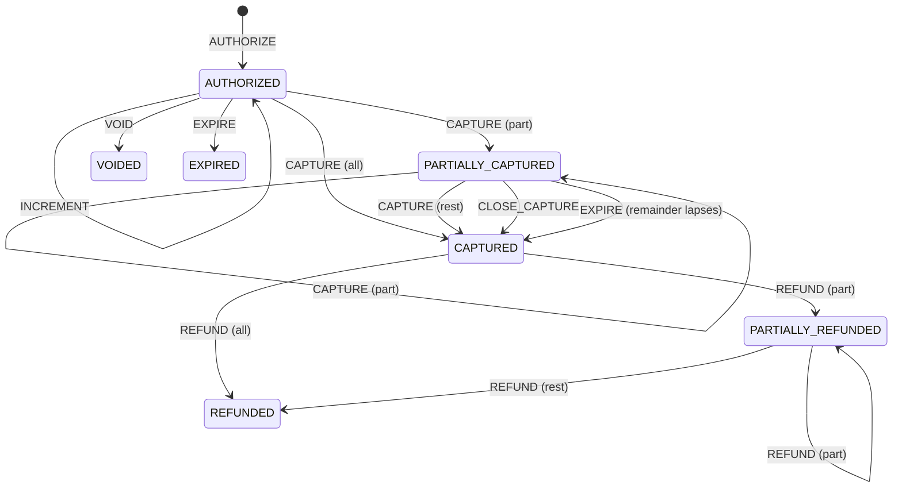

# Authorization, Capture, Void, Refund: The Card Lifecycle State Machine

> An approval is a promise, a capture is a claim, and the gap between them is where merchants lose money.

**Type:** Build
**Languages:** Java, Python, Go
**Prerequisites:** Phase 11 Lesson 01 (How a Card Payment Works), Phase 10 Lesson 01 (Representing Money), Phase 10 Lesson 07 (Holds and Available Balance), Phase 8 Lesson 05 (Event Sourcing)
**Time:** ~120 minutes

## Learning Objectives

- Draw the seven-state lifecycle of a card transaction and name every legal and illegal transition
- Build a `CardTransaction` whose only mutation path is a single `transition` method guarded by a legal-move table and an amount rule
- Enforce the two conservation invariants: cumulative captures never exceed the authorization ceiling, cumulative refunds never exceed captured
- Implement incremental authorization, partial and multiple captures, close-capture, and void with the correct ledger effect for each (hold versus settled)
- Expire authorizations from an injected clock so that a stale capture fails with a recorded reason instead of silently succeeding
- Explain what each transition does to the cardholder's available balance and the merchant's expected settlement

## The Problem

A hotel chain's property management system authorizes 120.00 USD at check-in: one estimated night plus a buffer for incidentals. The guest stays two nights, orders from the minibar, and checks out with a folio of 230.00 USD. The front desk clicks "charge" and the payment service sends a capture for 230.00 against the 120.00 authorization. The acquirer accepts the message because it does not validate business rules, forwards it to the network, and the issuer processes a clearing record for 230.00 against a 120.00 hold. Three weeks later the chargeback arrives: "amount differs from authorization." Under the network rules the merchant has no representment case, because the capture exceeded the authorized amount without an incremental authorization, and the 110.00 difference was never approved by the issuer. The hotel eats the loss plus a chargeback fee. Multiply by a few hundred checkouts a week.

A second failure is quieter. An e-commerce platform authorizes at order time and captures at shipment. A warehouse backlog means some orders ship on day 9. The capture is sent anyway. Some issuers accept it with a downgraded interchange rate (the "late presentment" penalty); others decline it, and the item is already in the customer's hands. Nobody wrote the rule "an authorization is valid for seven days, after that re-authorize" into the code, because the state machine had two states, `authorized` and `captured`, and no concept of time.

A third failure is in the refund path. A support agent refunds 100.00 USD on a transaction where only 89.60 was captured, because the refund form was pre-filled from the authorization amount. The processor rejects it, but the support tool had already marked the ticket resolved and emailed the customer. In a worse version the processor accepts it as a standalone credit and the merchant has given away 10.40 that it never received.

All three failures have the same shape: the system allowed a transition that the card lifecycle forbids. The fix is a state machine where every move is checked against an explicit table, every amount rule is checked before any state changes, and time is an input rather than something that happens to you. This lesson builds that machine and tests every legal and every illegal edge.

## The Concept

### Seven states, seven actions

A card transaction starts with an **authorization**: the issuer confirms the card is valid and places a hold on the cardholder's available balance. No money has moved. The merchant then has a window, typically seven days for a standard purchase and up to thirty for travel and lodging, to **capture**: to present a clearing record that says "I delivered, pay me." Capture is what turns the hold into a settlement obligation. If the merchant captures nothing, the hold **expires** and the issuer releases it. If the merchant decides not to proceed, it **voids** the authorization, which releases the hold immediately rather than waiting for expiry. After capture, money can flow back to the cardholder only through a **refund**, which is a new transaction referencing the original, and can never return more than was captured.

Two refinements make the machine realistic. First, a capture can be **partial**: an order with three items ships in two boxes, and each shipment captures its share. A partially captured authorization can be captured again or **closed**, which releases whatever was not captured. If the merchant does neither and the window runs out, the uncaptured remainder lapses on its own and the transaction lands in the same place a close would have put it: `CAPTURED`, with the captured amount intact and still refundable. Only an authorization that was never captured at all becomes `EXPIRED`. Second, the authorization can be **incremented** while it is still open: a hotel guest extends the stay and the merchant asks the issuer for an additional 30.00 against the same transaction, which the issuer approves or declines on its own merits.

| State | Meaning | Hold on cardholder | Merchant's expected settlement |
|-------|---------|-------------------|-------------------------------|
| `AUTHORIZED` | Issuer approved; nothing captured yet | authorized | 0 |
| `PARTIALLY_CAPTURED` | Some captured; hold still open for the rest | authorized minus captured | captured |
| `CAPTURED` | Capturing is finished (fully captured or closed) | 0 | captured |
| `VOIDED` | Released before any capture; terminal | 0 | 0 |
| `EXPIRED` | Validity window passed with nothing captured; terminal | 0 | 0 |
| `PARTIALLY_REFUNDED` | Some captured money returned | 0 | captured minus refunded |
| `REFUNDED` | Everything captured has been returned; terminal | 0 | 0 |

The third and fourth columns are the **ledger effect**, and they are the reason this state machine matters to a payments team rather than only to a protocol team. The hold column is the number the issuer subtracts from the cardholder's available balance (Phase 10, Lesson 07). The settlement column is what the acquirer will eventually pay the merchant. Every transition changes at least one of them, and the machine's `remainingAuthorization()` and `netSettled()` methods compute exactly these two numbers from the current totals.



Every arrow not in this diagram is an illegal transition. The ones people most often get wrong:

- **VOID after any capture.** Once money has been captured, the hold for that portion is gone and the only way back is a refund. Some processors expose "void" on a captured-but-unsettled transaction; under the hood that is a reversal of the clearing record, a different message with different rules, and this lesson treats it as out of scope.
- **INCREMENT after a partial capture.** The networks define incremental authorization as an operation on an open authorization in a defined set of merchant categories. Once the merchant has begun capturing, the amount is fixed; a further charge needs a new authorization.
- **REFUND before capture.** You cannot return money you have not received. A refund request against an `AUTHORIZED` transaction is almost always a client bug (the hotel's pre-filled form) and must be rejected, not converted to a void.
- **Anything from a terminal state.** `VOIDED`, `EXPIRED`, and `REFUNDED` accept no actions. A second void is not idempotent success; it is an error that tells the caller its model of the world is stale.
- **EXPIRED after a partial capture.** Captured funds must always be refundable, so a terminal state can never hold captured money. When the remainder of a `PARTIALLY_CAPTURED` hold lapses, the `EXPIRE` event moves the transaction to `CAPTURED`, not `EXPIRED`; a refund is still legal afterwards and a further capture is not.

### The two amount invariants

State alone is not enough. A capture from `AUTHORIZED` is a legal move, but a capture of 230.00 against 120.00 is still wrong. The machine enforces two inequalities on cumulative totals, before any state changes:

```text
captured_total  <=  ceiling(authorized)       for every CAPTURE
refunded_total  <=  captured_total            for every REFUND
```

The capture ceiling is `authorized` for most merchants. For a defined set of merchant category codes where the final amount is routinely unknown at authorization time (restaurants with tips, taxis, bars, beauty salons) the networks grant a tolerance, historically up to 20 percent in some regions and categories, now largely replaced by requirements to authorize the final amount. The exact figures and category lists are scheme-specific, change over time, and belong in configuration. The code models this as `LifecyclePolicy.overCaptureToleranceBps`, and computes the ceiling with `Money.times(10000 + bps, 10000, Rounding.DOWN)`. The rounding direction matters: on a 0.33 USD authorization with 15 percent tolerance, the exact ceiling is 37.95 cents. Rounding down to 37 means the tolerance can never favour the merchant by even a fraction of a cent; rounding up to 38 would let a capture exceed the rule.

Both invariants are checked against **cumulative** totals, not the individual capture. Three captures of 40.00 against a 100.00 authorization fail on the third, not on none of them. This is the difference between a check and an invariant: a check validates one request; an invariant constrains the sum of all requests ever accepted.

### Time is an input

Authorizations expire. The validity period depends on the network, the region, the merchant category, and whether the authorization was flagged as an estimate; seven days is the common default for a final-amount purchase and the policy object carries it. The machine has no background job that scans for expired holds. Instead, every merchant-initiated action first calls `expireIfDue`, which compares the injected clock against the stored expiry and, if the window has passed and the current state allows `EXPIRE`, appends an `EXPIRE` event before the requested action is evaluated. From `AUTHORIZED` the move is to `EXPIRED`; from `PARTIALLY_CAPTURED` it is to `CAPTURED`, because the captured portion is settled money and only the open remainder lapses. The late capture then fails as `CAPTURE is not allowed in state EXPIRED` (or `in state CAPTURED`), and the log shows exactly when and why.

Incrementing an authorization resets the window, because the issuer has just re-approved the transaction. Capturing part of it does not: the original approval is the one being drawn down.

The clock is an interface. Production injects the system clock; tests and the demo inject a `FakeClock` that moves only when told. The expiry boundary tests advance to one second before the deadline (still valid), then one more second (expired). There is no `sleep` anywhere, and the whole suite runs in milliseconds.

### The log is the transaction

Each accepted transition appends a `TransactionEvent`: sequence number, action, amount, from-state, to-state, timestamp, and a mandatory free-text reason. The current state and the three totals (`authorized`, `captured`, `refunded`) are derivable by replaying the log, and the tests assert exactly that: the sum of `AUTHORIZE` and `INCREMENT` amounts equals `authorizedAmount()`, the sum of `CAPTURE` amounts equals `capturedAmount()`, and so on. This is event sourcing (Phase 8, Lesson 05) at the scale of one transaction, and it is what makes the dispute conversation possible: "we captured 89.60 at 15:00 on March 5 with reason 'bill 80.00 plus 9.60 tip', against an authorization of 80.00 under a 15 percent tolerance policy" is a sentence you can only say if every one of those facts was written down at the time.

The reason is mandatory because the question in a dispute or an incident is never "what happened" but "why did the system think that was right." A blank reason is rejected at construction.

### Worked example: the hotel stay

Start with the clock at 2026-03-01 09:00 UTC and a standard policy (7 days, no tolerance).

```text
#1 AUTHORIZE      120.00  (new) -> AUTHORIZED          hold 120.00, settle 0.00     expires 03-08 09:00
   clock +1 day
#2 INCREMENT       30.00  AUTHORIZED -> AUTHORIZED     hold 150.00, settle 0.00     expires 03-09 09:00 (reset)
   clock +6 hours
#3 CAPTURE        100.00  AUTHORIZED -> PARTIALLY_CAPTURED   hold 50.00, settle 100.00
#4 CLOSE_CAPTURE   50.00  PARTIALLY_CAPTURED -> CAPTURED     hold 0.00, settle 100.00
   clock +3 days
#5 REFUND          20.00  CAPTURED -> PARTIALLY_REFUNDED     hold 0.00, settle 80.00
```

Check the invariants at each step: captured (100.00) never exceeded the ceiling (150.00 after the increment); refunded (20.00) never exceeded captured (100.00). The event amounts replay to the totals: 120.00 + 30.00 = 150.00 authorized; 100.00 captured; 20.00 refunded; net settled 80.00. The `CLOSE_CAPTURE` event's amount is the 50.00 released, not a capture; it changes the hold column, not the settlement column.

Now the same machine, restaurant policy (MCC 5812, 15 percent tolerance): authorize 80.00, capture 89.60. Ceiling is 80.00 × 11500 / 10000 = 92.00, so 89.60 passes and the state goes directly to `CAPTURED` because captured (89.60) is at least authorized (80.00). A refund request for 100.00 then fails: refunded would be 100.00, captured is 89.60. The same capture under the standard policy fails at the ceiling check with the message naming all four numbers: amount, resulting total, ceiling, and authorized.

### Complexity and what the machine does not do

Every operation is O(1): a map lookup for the legal-move table, two integer comparisons for the amount rule, one append. The event log grows linearly in the number of transitions, which for a card transaction is bounded by a handful. There is no algorithmic content here; the content is the completeness of the table and the ordering of the checks.

What this machine does not do:

- It does not talk to a network. Authorization approval, incremental approval, and the decision to decline are the issuer's; this object records what the issuer said and enforces what the merchant may do next. Lesson 03 builds the ISO 8583 messages that carry these requests.
- It does not post to a ledger. It computes the ledger effect (`remainingAuthorization`, `netSettled`) so that a ledger (Phase 10, Lesson 03) can post the right entries; wiring the two together is Phase 12, Lesson 02.
- It does not model reversals of a clearing record, chargebacks, or representments. Those are new transactions with their own lifecycle that reference this one.
- It does not persist. The event list is in memory; a real implementation writes each event in the same database transaction as the state change, or derives state from the event table.

## Build It

The primary walkthrough is in Java. Python and Go implement the same design with the same names.

### Step 1: Money, copied, not imported

```java
record Money(long minorUnits, Currency currency) implements Comparable<Money> {
    Money plus(Money other) { requireSameCurrency(other); return new Money(Math.addExact(minorUnits, other.minorUnits), currency); }
    Money minus(Money other) { requireSameCurrency(other); return new Money(Math.subtractExact(minorUnits, other.minorUnits), currency); }
    Money times(long numerator, long denominator, Rounding rounding) { ... }
    boolean isPositive() { return minorUnits > 0; }
}
```

The `Money` and `Currency` records are the Phase 10, Lesson 01 design, trimmed to the operations this lesson uses. Lessons are self-contained, so the type is copied into `Main.java` rather than shared. Every amount in this lesson is a `Money`; there is no `double` anywhere in the file.

**Predict:** `capture` compares `captured.plus(amount)` to the ceiling. What happens if `amount` is in EUR and the authorization is in USD, and where is it caught?

### Step 2: The clock

```java
interface Clock {
    Instant now();
}

final class FakeClock implements Clock {
    private Instant current;
    FakeClock(Instant start) { this.current = start; }
    @Override public Instant now() { return current; }
    void advance(Duration d) { current = current.plus(d); }
}
```

Two lines of interface and a test double. Production passes `Instant::now`. Everything that reads time goes through `clock.now()`, which is what makes the expiry tests exact to the second.

### Step 3: States, actions, and the legal-move table

```java
enum TransactionState {
    AUTHORIZED, PARTIALLY_CAPTURED, CAPTURED, VOIDED, EXPIRED, PARTIALLY_REFUNDED, REFUNDED;
    boolean isTerminal() { return this == VOIDED || this == EXPIRED || this == REFUNDED; }
}

enum Action { AUTHORIZE, INCREMENT, CAPTURE, CLOSE_CAPTURE, VOID, EXPIRE, REFUND }

static final Map<TransactionState, Set<Action>> LEGAL = new EnumMap<>(TransactionState.class);
static {
    LEGAL.put(TransactionState.AUTHORIZED, EnumSet.of(Action.INCREMENT, Action.CAPTURE, Action.VOID, Action.EXPIRE));
    LEGAL.put(TransactionState.PARTIALLY_CAPTURED, EnumSet.of(Action.CAPTURE, Action.CLOSE_CAPTURE, Action.EXPIRE));
    LEGAL.put(TransactionState.CAPTURED, EnumSet.of(Action.REFUND));
    LEGAL.put(TransactionState.PARTIALLY_REFUNDED, EnumSet.of(Action.REFUND));
    LEGAL.put(TransactionState.VOIDED, EnumSet.noneOf(Action.class));
    LEGAL.put(TransactionState.EXPIRED, EnumSet.noneOf(Action.class));
    LEGAL.put(TransactionState.REFUNDED, EnumSet.noneOf(Action.class));
}
```

The table is data, not a cascade of `if` statements spread across seven methods. Every state has an entry, including the terminal ones with empty sets, so a missing row is impossible and a reviewer can read the whole policy in nine lines. `EnumMap` and `EnumSet` are array-backed, so the lookup is an index, not a hash.

**Predict:** which rows would you have to change to allow a void of a fully captured but not yet settled transaction, and what would the ledger effect column of that new edge be?

### Step 4: The policy

```java
record LifecyclePolicy(Duration authValidity, long overCaptureToleranceBps) {
    static final LifecyclePolicy STANDARD = new LifecyclePolicy(Duration.ofDays(7), 0);

    static LifecyclePolicy forMcc(String mcc) {
        return switch (mcc) {
            case "5812", "5813", "5814", "4121", "7230" -> new LifecyclePolicy(Duration.ofDays(7), 1500);
            default -> STANDARD;
        };
    }

    Money captureCeiling(Money authorized) {
        return authorized.times(10_000 + overCaptureToleranceBps, 10_000, Rounding.DOWN);
    }
}
```

The validity window and the tolerance are per-merchant configuration, keyed here by merchant category code for illustration. `captureCeiling` is the only arithmetic in the lesson that can produce a fraction, and it names its rounding mode. `Rounding.DOWN` is "toward the merchant's disadvantage": the ceiling is never a fraction above what the rule permits.

### Step 5: The event

```java
record TransactionEvent(int sequence, Action action, Money amount, TransactionState from, TransactionState to,
                        Instant at, String reason) {
    TransactionEvent {
        if (reason == null || reason.isBlank()) throw new IllegalArgumentException("every transition needs a reason");
    }
}
```

`from` is `null` only for the creating `AUTHORIZE` event. The compact constructor rejects a blank reason, so there is no code path that writes an unexplained transition.

### Step 6: The single choke point

```java
private void require(Action action) {
    if (!LEGAL.get(state).contains(action)) throw new IllegalTransitionException(state, action);
}

private void requirePositive(Money amount) {
    if (!amount.currency().equals(authorized.currency())) throw new CurrencyMismatchException(authorized.currency(), amount.currency());
    if (!amount.isPositive()) throw new LimitExceededException("amount must be positive: " + amount);
}

private void transition(Action action, Money amount, TransactionState to, String reason) {
    TransactionState from = state;
    events.add(new TransactionEvent(events.size() + 1, action, amount, from, to, clock.now(), reason));
    state = to;
}
```

Every public method follows the same order: `expireIfDue`, `require(action)`, `requirePositive(amount)`, the amount-rule check, update the total, `transition`. Nothing is mutated until every check has passed, so a failed call leaves the object exactly as it was. The tests assert this directly: after a rejected capture, the state is still `AUTHORIZED` and the log still has one event.

**Predict:** `IllegalTransitionException` carries `from` and `action` as fields. Why would a caller want those as data rather than parsing them out of the message string?

### Step 7: Capture, with both invariants visible

```java
void capture(Money amount, String reason) {
    expireIfDue(reason);
    require(Action.CAPTURE);
    requirePositive(amount);
    Money ceiling = policy.captureCeiling(authorized);
    Money total = captured.plus(amount);
    if (total.compareTo(ceiling) > 0) {
        throw new LimitExceededException("capture of " + amount + " would bring total to " + total
                + ", above ceiling " + ceiling + " (authorized " + authorized + ", tolerance "
                + policy.overCaptureToleranceBps() + " bps)");
    }
    captured = total;
    TransactionState next = captured.compareTo(authorized) >= 0 ? TransactionState.CAPTURED : TransactionState.PARTIALLY_CAPTURED;
    transition(Action.CAPTURE, amount, next, reason);
}
```

The ceiling check is on `total`, the cumulative figure, not on `amount`. The next state is decided by comparing `captured` to `authorized` (not to the ceiling): once the merchant has captured at least what was authorized, there is nothing left to hold, and the transaction is `CAPTURED` even if the tolerance would have allowed more. The error message names every number a support engineer needs.

`refund` has the same shape with `captured` as the ceiling and `REFUNDED` when `refunded` equals `captured` exactly. `closeCapture` records the released remainder as its event amount and moves to `CAPTURED` without changing `captured`. `voidAuthorization` records the full authorized amount as released.

### Step 8: Expiry from the clock

```java
boolean expireIfDue(String attemptedReason) {
    if (!LEGAL.get(state).contains(Action.EXPIRE)) return false;
    if (clock.now().isBefore(expiresAt)) return false;
    TransactionState next = state == TransactionState.PARTIALLY_CAPTURED ? TransactionState.CAPTURED : TransactionState.EXPIRED;
    transition(Action.EXPIRE, remainingAuthorization(), next,
            "authorization validity of " + policy.authValidity().toDays() + " days elapsed (while attempting: " + attemptedReason + ")");
    return true;
}
```

Expiry is itself a transition through the same choke point, so it is in the log with the amount released (the uncaptured remainder) and a reason that names what the merchant was trying to do when the system noticed. The target state depends on whether anything was captured: a bare authorization becomes `EXPIRED`, while a partial capture becomes `CAPTURED` with `captured` unchanged, the same end state `closeCapture` produces, so the captured funds remain refundable. `isBefore` makes the boundary exact: at `expiresAt` itself the hold is expired. The method is safe to call on any state, so it is also the probe the tests use.

### Step 9: Run it

```bash
cd phases/11-payment-rails/02-card-authorization-lifecycle/code/java
javac -d .out *.java && java -cp .out Main
java -cp .out MainTest
```

Expected output, abbreviated:

```console
== Hotel stay: estimated auth, incremental auth, partial capture, refund ==
transaction txn-hotel-001 [PARTIALLY_REFUNDED] authorized=150.00 USD captured=100.00 USD refunded=20.00 USD net=80.00 USD
  #1 AUTHORIZE       120.00 USD  (new) -> AUTHORIZED  @2026-03-01T09:00:00Z  "check-in: estimated one night plus incidentals"
  #2 INCREMENT        30.00 USD  AUTHORIZED -> AUTHORIZED  @2026-03-02T09:00:00Z  "minibar and late checkout"
  #3 CAPTURE         100.00 USD  AUTHORIZED -> PARTIALLY_CAPTURED  @2026-03-02T15:00:00Z  "folio: room night 100.00"
  #4 CLOSE_CAPTURE    50.00 USD  PARTIALLY_CAPTURED -> CAPTURED  @2026-03-02T15:00:00Z  "checkout complete; release the unused 50.00 hold"
  #5 REFUND           20.00 USD  CAPTURED -> PARTIALLY_REFUNDED  @2026-03-05T15:00:00Z  "goodwill: noisy room complaint"

== Restaurant (MCC 5812): tip pushes the capture 12% above the authorization ==
  capture ceiling with 15% tolerance: 92.00 USD
  rejected: refund of 100.00 USD would bring total refunded to 100.00 USD, above captured 89.60 USD

== Same merchant without the tolerance flag ==
  rejected: capture of 89.60 USD would bring total to 89.60 USD, above ceiling 80.00 USD (authorized 80.00 USD, tolerance 0 bps)

== Forgotten authorization: capture attempted on day 8 ==
  rejected: CAPTURE is not allowed in state EXPIRED
  #2 EXPIRE           45.00 USD  AUTHORIZED -> EXPIRED  @2026-03-13T15:00:00Z  "authorization validity of 7 days elapsed (while attempting: order shipped)"
```

The test file has 60-plus assertions: one per legal edge, one per illegal edge, the ceiling at and one cent above the limit, the refund at and one cent above captured, expiry one second before and at the deadline, a partial capture whose hold expires and is then fully refunded, and the replay of the log to the totals.

### In Python

The Python port keeps the same names (`CardTransaction`, `LifecyclePolicy`, `TransactionEvent`, `LEGAL`) with four differences. **Time is `datetime` with `tzinfo=timezone.utc`:** a naive `datetime` compared with an aware one raises, so every timestamp in the lesson is aware; `timedelta.days` replaces `Duration.toDays()`. **`Money` is `@total_ordering`**, so `total > ceiling` reads naturally; the comparison still raises `CurrencyMismatchError` on mixed currencies because `__lt__` checks. **The legal table is a `dict` of `frozenset`:** immutable, so no method can accidentally add a legal edge at runtime, and the test `test_terminal_states_accept_nothing` asserts the three terminal rows are empty. **`events` returns a `tuple`**, the idiomatic read-only view, where Java returns `Collections.unmodifiableList`. `IllegalTransitionError` extends `RuntimeError` and `LimitExceededError` extends `ValueError`.

Run it from `code/python/` with `python3 main.py`; test with `python3 -m unittest -v`.

#### Step 1: Money, copied, not imported

The Phase 10, Lesson 01 `Money` as a frozen dataclass, trimmed to what this lesson needs. There is no `addExact` because Python ints do not overflow; `times` is the single rounded operation and the comparison operators come from `@total_ordering` on `__lt__`.

```python
    def _require_same_currency(self, other: "Money") -> None:
        if self.currency != other.currency:
            raise CurrencyMismatchError(self.currency, other.currency)

    def plus(self, other: "Money") -> "Money":
        self._require_same_currency(other)
        return Money(self.minor_units + other.minor_units, self.currency)

    def minus(self, other: "Money") -> "Money":
        self._require_same_currency(other)
        return Money(self.minor_units - other.minor_units, self.currency)

    def is_zero(self) -> bool:
        return self.minor_units == 0

    def is_positive(self) -> bool:
        return self.minor_units > 0

    def times(self, numerator: int, denominator: int, rounding: Rounding) -> "Money":
        if denominator <= 0:
            raise ArithmeticError("denominator must be positive")
        return Money(divide_rounded(self.minor_units * numerator, denominator, rounding), self.currency)
```

#### Step 2: The clock

`Clock` is a base class with an abstract `now()`; `FakeClock` stores an aware `datetime` and moves it by a `timedelta`. Production wraps `datetime.now(timezone.utc)`.

```python
class Clock:
    """Injected time source. Production wraps datetime.now(timezone.utc); tests and the demo use FakeClock."""

    def now(self) -> datetime:
        raise NotImplementedError


class FakeClock(Clock):
    def __init__(self, start: datetime) -> None:
        self._current = start

    def now(self) -> datetime:
        return self._current

    def advance(self, delta: timedelta) -> None:
        self._current = self._current + delta
```

#### Step 3: States, actions, and the legal-move table

Two `Enum`s whose values are their display names, and a module-level `dict` keyed by state whose values are `frozenset`s of actions. Every state has a row, the terminal ones empty, exactly as the `EnumMap` does.

```python
class TransactionState(Enum):
    AUTHORIZED = "AUTHORIZED"
    PARTIALLY_CAPTURED = "PARTIALLY_CAPTURED"
    CAPTURED = "CAPTURED"
    VOIDED = "VOIDED"
    EXPIRED = "EXPIRED"
    PARTIALLY_REFUNDED = "PARTIALLY_REFUNDED"
    REFUNDED = "REFUNDED"

    def is_terminal(self) -> bool:
        return self in (TransactionState.VOIDED, TransactionState.EXPIRED, TransactionState.REFUNDED)
```

```python
LEGAL: dict[TransactionState, frozenset[Action]] = {
    TransactionState.AUTHORIZED: frozenset({Action.INCREMENT, Action.CAPTURE, Action.VOID, Action.EXPIRE}),
    TransactionState.PARTIALLY_CAPTURED: frozenset({Action.CAPTURE, Action.CLOSE_CAPTURE, Action.EXPIRE}),
    TransactionState.CAPTURED: frozenset({Action.REFUND}),
    TransactionState.PARTIALLY_REFUNDED: frozenset({Action.REFUND}),
    TransactionState.VOIDED: frozenset(),
    TransactionState.EXPIRED: frozenset(),
    TransactionState.REFUNDED: frozenset(),
}
```

#### Step 4: The policy

A frozen dataclass with validation in `__post_init__`. `for_mcc` is an `if` on a tuple of codes instead of a `switch`, and `STANDARD` is a module constant defined after the class. `capture_ceiling` names its rounding mode, `Rounding.DOWN`.

```python
@dataclass(frozen=True)
class LifecyclePolicy:
    auth_validity: timedelta
    over_capture_tolerance_bps: int = 0

    def __post_init__(self) -> None:
        if self.auth_validity <= timedelta(0):
            raise ValueError("validity must be positive")
        if not 0 <= self.over_capture_tolerance_bps <= 10_000:
            raise ValueError("tolerance must be 0..10000 bps")

    @staticmethod
    def for_mcc(mcc: str) -> "LifecyclePolicy":
        """Illustrative mapping: gratuity-heavy categories get a 15% tolerance; everyone else gets none."""
        if mcc in ("5812", "5813", "5814", "4121", "7230"):
            return LifecyclePolicy(timedelta(days=7), 1500)
        return STANDARD

    def capture_ceiling(self, authorized: Money) -> Money:
        """The most that may be captured in total, rounded toward the merchant's disadvantage."""
        return authorized.times(10_000 + self.over_capture_tolerance_bps, 10_000, Rounding.DOWN)


STANDARD = LifecyclePolicy(timedelta(days=7), 0)
```

#### Step 5: The event

`from_state` is `Optional` and `None` only for the creating event (`from` is a keyword, hence the suffix). `__post_init__` rejects a blank reason.

```python
@dataclass(frozen=True)
class TransactionEvent:
    sequence: int
    action: Action
    amount: Money
    from_state: Optional[TransactionState]
    to_state: TransactionState
    at: datetime
    reason: str

    def __post_init__(self) -> None:
        if not self.reason or not self.reason.strip():
            raise ValueError("every transition needs a reason")
```

#### Step 6: The single choke point

The three private helpers. `_require` indexes `LEGAL` by the current state; `_require_positive` checks currency then sign; `_transition` appends the event with the clock's timestamp and only then updates `_state`.

```python
    def _require(self, action: Action) -> None:
        if action not in LEGAL[self._state]:
            raise IllegalTransitionError(self._state, action)

    def _require_positive(self, amount: Money) -> None:
        if amount.currency != self._authorized.currency:
            raise CurrencyMismatchError(self._authorized.currency, amount.currency)
        if not amount.is_positive():
            raise LimitExceededError(f"amount must be positive: {amount}")

    def _transition(self, action: Action, amount: Money, to_state: TransactionState, reason: str) -> None:
        self._events.append(TransactionEvent(len(self._events) + 1, action, amount, self._state, to_state,
                                             self._clock.now(), reason))
        self._state = to_state
```

#### Step 7: Capture, with both invariants visible

The same order: expire, require, positive, ceiling check on the cumulative total, then update and transition. `total > ceiling` and `self._captured >= self._authorized` are the `compareTo` calls spelled as operators.

```python
    def capture(self, amount: Money, reason: str) -> None:
        """Capture part or all of the authorization. Cumulative captures may not exceed the policy's ceiling."""
        self.expire_if_due(reason)
        self._require(Action.CAPTURE)
        self._require_positive(amount)
        ceiling = self._policy.capture_ceiling(self._authorized)
        total = self._captured.plus(amount)
        if total > ceiling:
            raise LimitExceededError(
                f"capture of {amount} would bring total to {total}, above ceiling {ceiling} "
                f"(authorized {self._authorized}, tolerance {self._policy.over_capture_tolerance_bps} bps)")
        self._captured = total
        nxt = TransactionState.CAPTURED if self._captured >= self._authorized else TransactionState.PARTIALLY_CAPTURED
        self._transition(Action.CAPTURE, amount, nxt, reason)
```

#### Step 8: Expiry from the clock

`self._clock.now() < self._expires_at` is `isBefore`, exact to the second because both datetimes are aware. `auth_validity.days` gives the number for the reason string, and the target state depends on whether a partial capture exists.

```python
    def expire_if_due(self, attempted_reason: str) -> bool:
        if Action.EXPIRE not in LEGAL[self._state]:
            return False
        if self._clock.now() < self._expires_at:
            return False
        days = self._policy.auth_validity.days
        # A never-captured authorization becomes EXPIRED (terminal). A partially captured one keeps its captured
        # funds: the remainder lapses and it becomes CAPTURED, as close_capture would leave it, so refunds still work.
        nxt = TransactionState.CAPTURED if self._state is TransactionState.PARTIALLY_CAPTURED else TransactionState.EXPIRED
        self._transition(Action.EXPIRE, self.remaining_authorization(), nxt,
                         f"authorization validity of {days} days elapsed (while attempting: {attempted_reason})")
        return True
```

#### Step 9: Run it

```bash
cd phases/11-payment-rails/02-card-authorization-lifecycle/code/python
python3 main.py
python3 -m unittest -v
```

The output matches the Java run except that `datetime.isoformat()` prints the UTC offset as `+00:00` where Java prints `Z`:

```console
== Hotel stay: estimated auth, incremental auth, partial capture, refund ==
transaction txn-hotel-001 [PARTIALLY_REFUNDED] authorized=150.00 USD captured=100.00 USD refunded=20.00 USD net=80.00 USD
  #1 AUTHORIZE       120.00 USD  (new) -> AUTHORIZED  @2026-03-01T09:00:00+00:00  "check-in: estimated one night plus incidentals"
  #2 INCREMENT        30.00 USD  AUTHORIZED -> AUTHORIZED  @2026-03-02T09:00:00+00:00  "minibar and late checkout"
  #3 CAPTURE         100.00 USD  AUTHORIZED -> PARTIALLY_CAPTURED  @2026-03-02T15:00:00+00:00  "folio: room night 100.00"

== Illegal moves are exceptions, not silent no-ops ==
  rejected: VOID is not allowed in state PARTIALLY_REFUNDED
  rejected: CAPTURE is not allowed in state PARTIALLY_REFUNDED
```

### In Go

The Go port keeps the design with four differences. **Errors are values:** every write method returns `error`. `IllegalTransitionError` is a struct carrying `From` and `Action`, and implements `Is(ErrIllegalTransition)` so callers can match the category with `errors.Is` or extract the fields with `errors.As`; amount-rule failures wrap `ErrLimitExceeded` with `%w`. **`From` is a `*TransactionState`**, nil for the creating event, because Go has no `null` for value types and an `Optional` would be ceremony. **`Events()` returns a copy:** Go slices alias their backing array, so returning `t.events` would let a caller mutate the log; the test tampers with the returned slice and checks the original is unchanged. **`time.Time` and `time.Duration`** replace `Instant` and `Duration`; `Before` gives the same exact boundary as `isBefore`.

Run it from `code/go/` with `go run .`; test with `go test ./...`.

#### Step 1: Money, copied, not imported

The Lesson 01 `Money` struct with `Plus` and `Minus` returning `(Money, error)`: `int64` wraps silently, so `addChecked` stands in for `Math.addExact`, and a currency mismatch is an error value rather than an exception.

```go
func (m Money) Plus(other Money) (Money, error) {
	if err := m.requireSameCurrency(other); err != nil {
		return Money{}, err
	}
	sum, err := addChecked(m.MinorUnits, other.MinorUnits)
	return Money{sum, m.Currency}, err
}

func (m Money) Minus(other Money) (Money, error) {
	if err := m.requireSameCurrency(other); err != nil {
		return Money{}, err
	}
	diff, err := addChecked(m.MinorUnits, -other.MinorUnits)
	return Money{diff, m.Currency}, err
}

func (m Money) IsZero() bool     { return m.MinorUnits == 0 }
func (m Money) IsPositive() bool { return m.MinorUnits > 0 }
```

#### Step 2: The clock

A one-method interface and a pointer-receiver fake. `Advance` uses `time.Time.Add` with a `time.Duration`.

```go
type Clock interface {
	Now() time.Time
}

// FakeClock is a clock that only moves when the test tells it to.
type FakeClock struct {
	current time.Time
}

func NewFakeClock(start time.Time) *FakeClock { return &FakeClock{current: start} }
func (c *FakeClock) Now() time.Time           { return c.current }
func (c *FakeClock) Advance(d time.Duration)  { c.current = c.current.Add(d) }
```

#### Step 3: States, actions, and the legal-move table

Go has no enums, so both types are `int`s with `iota` constants and name tables for `String()`. The legal table is a map of maps; a missing inner key reads as `false`, and the terminal rows are explicit empty maps so every state has an entry.

```go
type TransactionState int

const (
	Authorized TransactionState = iota
	PartiallyCaptured
	Captured
	Voided
	Expired
	PartiallyRefunded
	Refunded
)

var stateNames = [...]string{"AUTHORIZED", "PARTIALLY_CAPTURED", "CAPTURED", "VOIDED", "EXPIRED", "PARTIALLY_REFUNDED", "REFUNDED"}

func (s TransactionState) String() string { return stateNames[s] }

func (s TransactionState) IsTerminal() bool { return s == Voided || s == Expired || s == Refunded }
```

```go
var Legal = map[TransactionState]map[Action]bool{
	Authorized:        {ActIncrement: true, ActCapture: true, ActVoid: true, ActExpire: true},
	PartiallyCaptured: {ActCapture: true, ActCloseCapture: true, ActExpire: true},
	Captured:          {ActRefund: true},
	PartiallyRefunded: {ActRefund: true},
	Voided:            {},
	Expired:           {},
	Refunded:          {},
}
```

#### Step 4: The policy

A value struct; `NewLifecyclePolicy` validates and returns an error, `Standard` is a package-level value, and `PolicyForMCC` is a `switch` with a multi-value case. `CaptureCeiling` panics if `Times` overflows, because an authorization large enough to overflow `int64` is a bug upstream.

```go
type LifecyclePolicy struct {
	AuthValidity            time.Duration
	OverCaptureToleranceBps int64
}

// Standard is seven days of validity and no over-capture tolerance.
var Standard = LifecyclePolicy{AuthValidity: 7 * 24 * time.Hour, OverCaptureToleranceBps: 0}

func PolicyForMCC(mcc string) LifecyclePolicy {
	switch mcc {
	case "5812", "5813", "5814", "4121", "7230":
		return LifecyclePolicy{7 * 24 * time.Hour, 1500}
	}
	return Standard
}

// CaptureCeiling is the most that may be captured in total, rounded toward the merchant's disadvantage.
func (p LifecyclePolicy) CaptureCeiling(authorized Money) Money {
	ceiling, err := authorized.Times(10_000+p.OverCaptureToleranceBps, 10_000, Down)
	if err != nil {
		panic(err)
	}
	return ceiling
}
```

#### Step 5: The event

`From` is a pointer so the creating event can carry `nil`. The blank-reason check lives in `transition` rather than in a constructor, since a struct literal has no hook.

```go
type TransactionEvent struct {
	Sequence int
	Action   Action
	Amount   Money
	From     *TransactionState // nil for the creating AUTHORIZE event
	To       TransactionState
	At       time.Time
	Reason   string
}

func (e TransactionEvent) String() string {
	origin := "(new)"
	if e.From != nil {
		origin = e.From.String()
	}
	return fmt.Sprintf("#%d %-13s %12s  %s -> %s  @%s  %q", e.Sequence, e.Action, e.Amount, origin, e.To,
		e.At.Format(time.RFC3339), e.Reason)
}
```

#### Step 6: The single choke point

`require` returns a typed `*IllegalTransitionError`; `requirePositive` wraps the two sentinels; `transition` is where the blank-reason rule lives, takes the address of a local copy of the state for `From`, and appends before updating `t.state`.

```go
func (t *CardTransaction) require(action Action) error {
	if !Legal[t.state][action] {
		return &IllegalTransitionError{From: t.state, Action: action}
	}
	return nil
}

func (t *CardTransaction) requirePositive(amount Money) error {
	if amount.Currency != t.authorized.Currency {
		return fmt.Errorf("%w: cannot combine %s with %s", ErrCurrencyMismatch, t.authorized.Currency.Code, amount.Currency.Code)
	}
	if !amount.IsPositive() {
		return fmt.Errorf("%w: amount must be positive: %v", ErrLimitExceeded, amount)
	}
	return nil
}

func (t *CardTransaction) transition(action Action, amount Money, to TransactionState, reason string) error {
	if strings.TrimSpace(reason) == "" {
		return errors.New("every transition needs a reason")
	}
	from := t.state
	t.events = append(t.events, TransactionEvent{len(t.events) + 1, action, amount, &from, to, t.clock.Now(), reason})
	t.state = to
	return nil
}
```

#### Step 7: Capture, with both invariants visible

Each guard is an early `return err`. `Plus` can fail (overflow or currency), so it is checked; `Compare` replaces `compareTo` for both the ceiling test and the next-state decision.

```go
func (t *CardTransaction) Capture(amount Money, reason string) error {
	t.ExpireIfDue(reason)
	if err := t.require(ActCapture); err != nil {
		return err
	}
	if err := t.requirePositive(amount); err != nil {
		return err
	}
	ceiling := t.policy.CaptureCeiling(t.authorized)
	total, err := t.captured.Plus(amount)
	if err != nil {
		return err
	}
	if total.Compare(ceiling) > 0 {
		return fmt.Errorf("%w: capture of %v would bring total to %v, above ceiling %v (authorized %v, tolerance %d bps)",
			ErrLimitExceeded, amount, total, ceiling, t.authorized, t.policy.OverCaptureToleranceBps)
	}
	t.captured = total
	next := PartiallyCaptured
	if t.captured.Compare(t.authorized) >= 0 {
		next = Captured
	}
	return t.transition(ActCapture, amount, next, reason)
}
```

#### Step 8: Expiry from the clock

`Before` is the exact boundary. The day count is integer division of the `time.Duration`, and the `transition` error is discarded because the reason is never blank here.

```go
func (t *CardTransaction) ExpireIfDue(attemptedReason string) bool {
	if !Legal[t.state][ActExpire] {
		return false
	}
	if t.clock.Now().Before(t.expiresAt) {
		return false
	}
	days := int64(t.policy.AuthValidity / (24 * time.Hour))
	// A never-captured authorization becomes Expired (terminal). A partially captured one keeps its captured
	// funds: the remainder lapses and it becomes Captured, as CloseCapture would leave it, so refunds still work.
	next := Expired
	if t.state == PartiallyCaptured {
		next = Captured
	}
	_ = t.transition(ActExpire, t.RemainingAuthorization(), next,
		fmt.Sprintf("authorization validity of %d days elapsed (while attempting: %s)", days, attemptedReason))
	return true
}
```

#### Step 9: Run it

```bash
cd phases/11-payment-rails/02-card-authorization-lifecycle/code/go
go run .
go test ./...
```

The output matches the Java run (RFC 3339 timestamps with `Z`); the final section's heading says "errors" rather than "exceptions":

```console
== Forgotten authorization: capture attempted on day 8 ==
  rejected: CAPTURE is not allowed in state EXPIRED
transaction txn-stale-004 [EXPIRED] authorized=45.00 USD captured=0.00 USD refunded=0.00 USD net=0.00 USD

== Illegal moves are errors, not silent no-ops ==
  rejected: VOID is not allowed in state PARTIALLY_REFUNDED
  rejected: CAPTURE is not allowed in state PARTIALLY_REFUNDED
```

## Use It

### Processor APIs

Stripe's PaymentIntent exposes this machine with different names: `requires_capture` is `AUTHORIZED`, `capture` with an `amount_to_capture` below the authorized amount performs a partial capture and releases the rest in one call (the equivalent of `capture` followed by `closeCapture`), `cancel` is `VOID`, and refunds are separate objects that reference the charge and are rejected when the cumulative total exceeds the captured amount. Stripe also exposes `capture_method: manual` versus automatic, which is whether the merchant or the processor decides when to capture. Adyen's API has `/payments/{id}/captures`, `/payments/{id}/cancels`, `/payments/{id}/refunds`, and `/payments/{id}/amountUpdates` (incremental authorization), one endpoint per action in this lesson's enum. Both reject the illegal transitions you tested with specific error codes rather than generic 400s, and both let you capture multiple times against one authorization if the merchant account is configured for it.

What the processor does that the from-scratch version made explicit: it knows the real validity window per network and merchant category, it knows which MCCs have tolerance, it issues the incremental authorization message to the issuer and reports the decline, and it persists the event log. What it does not do: it does not stop your order-management system from believing a transaction is captured when the capture call failed, and it does not know that your refund form pre-fills from the wrong field. The state machine on your side is what keeps your records and the processor's in the same state.

### Databases and the event log

A production implementation stores the `TransactionEvent` rows in an append-only table and either stores the current state alongside (updated in the same transaction as the insert) or derives it on read. The `sequence` column with a unique constraint on `(transaction_id, sequence)` is what makes concurrent writers safe: two processes that both try to append event 4 cannot both succeed, which is the optimistic-concurrency pattern from Phase 10, Lesson 11. The reason column is `NOT NULL`.

### Network rules

The rules this machine encodes come from the scheme rulebooks: Visa Core Rules and Visa Product and Service Rules, and Mastercard Transaction Processing Rules. They define authorization validity periods by merchant category, when an incremental authorization is permitted, which categories may clear above the authorized amount and by how much, and what "late presentment" costs. The numbers in `LifecyclePolicy` are illustrative; the shape is faithful.

## Ship It

`outputs/checklist-card-lifecycle-review.md` is a review checklist for any code that creates, captures, voids, or refunds a card transaction. It covers the legal-move table, the two cumulative invariants, clock injection, the event log, and the integration points with order management and support tooling that caused the three failures in The Problem. Use it on the pull request that adds partial capture to your checkout, and again on the one that adds a refund button to the support console.

## Exercises

1. **Reinforce.** Add a `REVERSED` state reachable only from `CAPTURED` while a `settlementCutoff` on the policy has not passed (a reversal of the clearing record before the batch closes). Add the row to the legal-move table, the method, the ledger-effect columns, and tests for the edge at and after the cutoff in all three languages.
2. **Apply.** Implement `replay(List<TransactionEvent>)` that reconstructs a `CardTransaction` from its log alone, without the policy or the original calls, and add a test that `replay(t.events())` produces the same state and totals as `t` for every scenario in the demo. Then introduce a deliberate corruption (swap two events) and make `replay` reject it with the first inconsistent sequence number.
3. **Extend.** Connect this machine to the double-entry ledger from Phase 10, Lesson 03. For each transition, post the entries that move amounts between `cardholder:available`, `cardholder:held`, `merchant:receivable`, and `merchant:settled`, and assert after every step that the ledger's balances equal `remainingAuthorization()` and `netSettled()`. The `CLOSE_CAPTURE` and `EXPIRE` events move money only between the two cardholder accounts; make sure your test notices if someone posts them to the merchant side.

## Key Terms

| Term | What people say | What it actually means |
|------|-----------------|------------------------|
| Authorization | "the charge went through" | The issuer's approval and a hold on available balance; no funds move until capture |
| Capture | "settling the payment" | The merchant's presentment of a clearing record against an authorization; what creates the settlement obligation |
| Incremental authorization | "adding to the auth" | A second approval request against an open authorization, raising the held amount; resets the validity window; permitted only in defined merchant categories and only before any capture |
| Void | "cancelling the payment" | Releasing the hold before any capture; after capture the equivalent is a reversal or a refund with different rules |
| Refund | "giving the money back" | A new credit transaction referencing the original, bounded by the captured amount, never by the authorized amount |
| Over-capture tolerance | "you can go 15% over" | A scheme-granted allowance for specific MCCs to clear above the authorized amount; computed here as `authorized * (10000 + bps) / 10000` rounded down |
| Late presentment | "the capture was late" | A clearing record presented after the authorization's validity window; downgraded interchange or a chargeback right for the issuer |
| Ledger effect | "what it does to the balance" | The change a transition makes to the cardholder's hold and the merchant's expected settlement; the two numbers `remainingAuthorization()` and `netSettled()` compute |

## Further Reading

- [Visa Core Rules and Visa Product and Service Rules](https://www.visa.com/content/dam/VCOM/download/about-visa/visa-rules-public.pdf) — the public rulebook; the sections on authorization validity, estimated and incremental authorizations, and clearing amount tolerances are the primary source for the policy object.
- [Mastercard Transaction Processing Rules](https://www.mastercard.us/content/dam/public/mastercardcom/na/global-site/documents/transaction-processing-rules.pdf) — the parallel Mastercard rulebook, including the authorization and clearing matching requirements that drive "amount differs" chargebacks.
- [ISO 8583:1987 — Financial transaction card originated messages](https://www.iso.org/standard/15870.html) — the message classes (01xx authorization, 02xx financial, 04xx reversal) that carry each transition over the wire; Lesson 03 parses them.
- [Stripe API: PaymentIntents, capture and cancel](https://docs.stripe.com/api/payment_intents/capture) — a production API that exposes the same state machine; compare `amount_to_capture` to this lesson's `capture` plus `closeCapture`.
- [Adyen API: Modifications (captures, cancels, refunds, amountUpdates)](https://docs.adyen.com/api-explorer/Checkout/latest/post/payments/(paymentPspReference)/captures) — one endpoint per action in this lesson's `Action` enum, including incremental authorization as `amountUpdates`.
- [Fowler, Event Sourcing](https://martinfowler.com/eaaDev/EventSourcing.html) — the pattern behind "the log is the transaction"; read it alongside Exercise 2.
