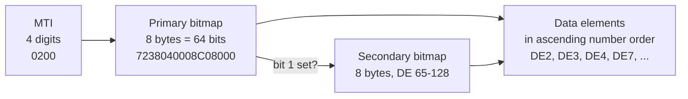

# ISO 8583: Parsing the Card Network Message

> The bitmap is the schema: if you cannot say which bit means which field, you cannot say what the message means.

**Type:** Build
**Languages:** Java, Python, Go
**Prerequisites:** Phase 11, Lesson 02 (The Card Lifecycle State Machine), Phase 10, Lesson 01 (Representing Money), Phase 0, Lesson 05 (Bits, Bytes, and Encodings)
**Time:** ~150 minutes

## Learning Objectives

- Decode a four-digit Message Type Indicator into its version, class, function, and origin, and derive the response MTI from a request
- Build and read the 64-bit primary bitmap and the secondary bitmap it announces, computing the hex by hand for a given field set
- Encode and decode fixed-length, LLVAR, and LLLVAR data elements for a practical subset of the ISO 8583-1:1987 dictionary
- Guarantee byte-identical round trips (decode then encode) and reject every malformed input with a specific error rather than a guess
- Interpret DE4 and DE49 together as a `Money` value in integer minor units, and explain why the message never carries a decimal point
- Mask the PAN before any message reaches a log

## The Problem

An acquirer's switch receives a 0200 financial request from a point-of-sale terminal and forwards it to the issuer. The terminal vendor has just shipped a firmware update that adds a loyalty identifier in a private-use data element. The switch's parser was written against a field list rather than against the bitmap: it reads the MTI, skips sixteen characters it calls "the bitmap", and then reads fields in a hard-coded order. The new element appears after the currency code, so the parser reads it as trailing garbage, logs a warning, and forwards the message with the original bytes. The issuer's parser is bitmap-driven, sees bit 63 set, finds no definition for DE63 in its configuration, and declines the whole message with response code 30, format error. Every transaction from every updated terminal is declined for four hours until someone reads the raw bytes.

A different switch has the opposite bug. It parses the bitmap correctly but trusts the LLVAR length prefix on DE2 without checking it against the maximum. A malformed message announces a 99-digit PAN. The parser reads 99 characters, which runs past the end of the amount, the dates, and into the terminal identifier, and the "PAN" it extracts contains the merchant's name. It is forwarded for authorization. The issuer declines it, correctly, but the switch has now written a 99-character string into a column sized for 19, and the database rejects the audit insert. The transaction is declined and not logged, which the compliance team discovers during the next PCI DSS assessment when they cannot account for a gap in the sequence of system trace audit numbers.

A third failure is quieter. A gateway converts DE4, the twelve-digit transaction amount, into a floating-point number of major units: `000000001999` becomes `19.99`. It later rebuilds the message for a reversal and formats the float back to twelve digits. For most amounts it works. For `000000000029` on a JPY transaction it produces `0.29`, formats to `000000000029` by luck, and for a KWD amount of `000000012345` (12.345 dinars) it produces `12.345`, which is reformatted using the gateway's default two-decimal rule as `000000001235`. The reversal is for the wrong amount by one fils, and the issuer's matching logic rejects it because the reversal amount does not equal the original.

All three systems failed to treat the message as what it is: a self-describing binary record whose structure is decided by the bitmap, whose field lengths are decided by a dictionary, and whose amounts are integers. This lesson builds a parser and a builder that get those three things right, prove it with byte-identical round trips, and refuse everything else.

## The Concept

### What ISO 8583 is and is not

ISO 8583-1:1987, "Financial transaction card originated messages, Interchange message specifications, Part 1: Messages, data elements and code values," defines a message format and a dictionary of 128 data elements for card transactions between an acquirer and an issuer. Visa, Mastercard, and most domestic networks and processors use a dialect of it for authorization and, in some cases, clearing. The standard was revised in 1993 (ISO 8583-2) and 2003 (ISO 8583-3), with each revision changing the first digit of the MTI and reshuffling parts of the dictionary. Most live traffic is still the 1987 version or a network variant of it.

ISO 8583 is a format, not a protocol. It does not say how messages are framed on a TCP connection (networks typically prefix a two-byte length), how a connection is authenticated, what the response codes mean beyond a table of suggestions, or how private-use elements are structured. Every network publishes its own specification on top of the standard, and those documents, not the ISO text, are what you implement against in production. The structure you learn here is the part that every dialect shares.

### The three parts of a message



**The MTI** is four digits: version, message class, message function, and transaction originator.

| Position | Meaning | Values this lesson uses |
|----------|---------|-------------------------|
| 1 | Version | 0 = ISO 8583-1:1987; 1 = 1993; 2 = 2003 |
| 2 | Class | 1 = authorization, 2 = financial, 4 = reversal, 8 = network management |
| 3 | Function | 0 = request, 1 = request response, 2 = advice, 3 = advice response |
| 4 | Origin | 0 = acquirer, 1 = acquirer repeat, 2 = issuer, 3 = issuer repeat |

So `0200` is a 1987 financial request from an acquirer, `0210` is its response, `0420` is a reversal advice, `0430` its response, and `0800` is a network-management request (sign-on, echo test). The response MTI is the request MTI with the function digit incremented by one. That rule is why a parser can match a response to a request by MTI without a lookup table, and why a `0210` arriving with no outstanding `0200` is an error.

**The bitmap** is the schema of this particular message. Sixty-four bits, one per data element. Bit `n` set means data element `n` is present. Bit 1 is special: it does not correspond to a field but announces that a second 64-bit bitmap follows, covering elements 65 to 128. The second bitmap's first bit would announce a third (elements 129 to 192), which the 1987 standard reserves and which no mainstream network uses; this lesson rejects it.

**The data elements** follow in ascending element number. There are no delimiters and no field tags. The parser knows where each element starts because it knows the length of every preceding element, and it knows those lengths from the dictionary.

### Three kinds of length

| Type | How the length is known | Wire form | Example |
|------|-------------------------|-----------|---------|
| Fixed | Dictionary says so | value only | DE4 amount: always 12 digits |
| LLVAR | Two-digit length prefix | `LL` + value, max 99 | DE2 PAN: `16` + `4111111111111111` |
| LLLVAR | Three-digit length prefix | `LLL` + value, max 999 | DE123 private use: `250` + data |

The dictionary row for each element gives its number, its length rule, its length (exact for fixed, maximum for variable), and its character class: `n` numeric, `an` alphanumeric, `ans` alphanumeric and special characters, `b` binary. The practical subset this lesson implements:

| DE | Name | Format | Why it is in the subset |
|----|------|--------|-------------------------|
| 2 | Primary account number | LLVAR n..19 | The card. Variable because PANs are 12 to 19 digits |
| 3 | Processing code | n 6 | Transaction type and account types: `000000` is a purchase from the default account |
| 4 | Amount, transaction | n 12 | Minor units, zero-padded, no decimal point |
| 7 | Transmission date and time | n 10 | `MMDDhhmmss` in UTC, set by the sender |
| 11 | System trace audit number | n 6 | The STAN: the sender's sequence number, used to match responses and reversals |
| 12 | Time, local transaction | n 6 | `hhmmss` at the terminal |
| 13 | Date, local transaction | n 4 | `MMDD` at the terminal |
| 22 | Point of service entry mode | n 3 | How the card data was read: `051` is chip, `021` magnetic stripe, `071` contactless chip |
| 37 | Retrieval reference number | an 12 | The RRN: the acquirer's reference that follows the transaction into clearing and disputes |
| 39 | Response code | an 2 | `00` approved, `05` do not honour, `51` insufficient funds, `30` format error |
| 41 | Card acceptor terminal ID | ans 8 | Which terminal |
| 42 | Card acceptor ID | ans 15 | Which merchant |
| 49 | Currency code, transaction | n 3 | ISO 4217 numeric: `840` USD, `978` EUR, `392` JPY, `356` INR |
| 102 | Account identification 1 | LLVAR ans..28 | Above 64, so it forces a secondary bitmap |
| 123 | Reserved for private use | LLLVAR ans...999 | The LLLVAR case, and where networks put their proprietary data |

### Worked example: the bitmap by hand

A purchase request carries DE2, 3, 4, 7, 11, 12, 13, 22, 37, 41, 42, and 49. Each byte of the bitmap covers eight consecutive elements with the lowest-numbered element in the most significant bit.

```text
byte 1  bits  1- 8   present: 2,3,4,7      -> 0 1 1 1 0 0 1 0 = 0x72
byte 2  bits  9-16   present: 11,12,13     -> 0 0 1 1 1 0 0 0 = 0x38
byte 3  bits 17-24   present: 22           -> 0 0 0 0 0 1 0 0 = 0x04
byte 4  bits 25-32   present: none         -> 0 0 0 0 0 0 0 0 = 0x00
byte 5  bits 33-40   present: 37           -> 0 0 0 0 1 0 0 0 = 0x08
byte 6  bits 41-48   present: 41,42        -> 1 1 0 0 0 0 0 0 = 0xC0
byte 7  bits 49-56   present: 49           -> 1 0 0 0 0 0 0 0 = 0x80
byte 8  bits 57-64   present: none         -> 0 0 0 0 0 0 0 0 = 0x00

primary bitmap = 72 38 04 00 08 C0 80 00 -> "7238040008C08000" in the ASCII variant
```

Bit 1 is clear because no element above 64 is present. When the issuer responds, it drops DE22 (the entry mode is the acquirer's business) and adds DE39. Byte 3 becomes `0x00` and byte 5 gains bit 39, which is the seventh position in that byte: `0 0 0 0 1 0 1 0 = 0x0A`. The response bitmap is `723800000AC08000`. Two hex digits changed, and a reader who knows the layout can see exactly which fields moved without decoding anything else.

Now add DE102 to the request. Bit 1 is set, so byte 1 becomes `0xF2`. The secondary bitmap covers elements 65 to 128; DE102 is bit `102 - 64 = 38`, which is byte 5, position 6: `0 0 0 0 0 1 0 0 = 0x04`. The secondary bitmap is `0000000004000000`.

### Worked example: the whole message

Field values for the purchase: PAN `4111111111111111` (a published Visa test number; this lesson never uses a real PAN), processing code `000000`, amount 19.99 USD, transmitted at 14:30:15 on 12 October, STAN `000123`, local time `143015`, local date `1012`, chip entry `051`, RRN `123456789012`, terminal `TERM0001`, merchant `MERCHANT0000001`, currency `840`.

```text
0200                 MTI
7238040008C08000     primary bitmap
16 4111111111111111  DE2  LLVAR: two-digit length then the PAN
000000               DE3  fixed 6
000000001999         DE4  fixed 12, minor units: 19.99 USD is 1999 cents
1012143015           DE7  fixed 10
000123               DE11 fixed 6
143015               DE12 fixed 6
1012                 DE13 fixed 4
051                  DE22 fixed 3
123456789012         DE37 fixed 12
TERM0001             DE41 fixed 8
MERCHANT0000001      DE42 fixed 15
840                  DE49 fixed 3

total: 4 + 16 + 18 + 6 + 12 + 10 + 6 + 6 + 4 + 3 + 12 + 8 + 15 + 3 = 123 bytes
```

The parser walks this left to right. After the MTI and bitmap it knows bits 2, 3, 4, 7, 11, 12, 13, 22, 37, 41, 42, and 49 are set, in that order. DE2 is LLVAR, so read two digits (`16`), check `16 <= 19`, read sixteen characters. DE3 is fixed 6, read six. DE4 is fixed 12, read twelve. And so on until the last present element. At that point the position must equal the message length; if bytes remain, the message is malformed, because nothing in the bitmap accounts for them.

### The invariant

Encoding and decoding are exact inverses: `decode(encode(m))` has the same MTI and the same field map as `m`, and `encode(decode(bytes))` reproduces `bytes` exactly. The second half is the stronger claim and the one that catches bugs. It fails if the encoder reorders fields, if a length prefix is padded differently, if a fixed field is trimmed, or if the decoder silently accepted something the encoder would never produce. The tests assert byte equality, not field equality, for exactly this reason.

The invariant holds only for well-formed input. For everything else the decoder raises a specific error naming the element and the problem: a non-hex bitmap, a bit set for an element the dictionary does not define, a variable-length prefix that is not numeric or exceeds the maximum, a fixed element that runs past the end of the message, trailing bytes, a secondary bitmap announced but absent, or a tertiary bitmap. The decoder never skips, never pads, and never guesses a length. A guessed field is a wrong field forwarded to an issuer under your signature.

### Amounts and the absence of a decimal point

DE4 is twelve numeric characters in the minor unit of the currency in DE49. There is no decimal point in the message, and there is no place for one. `000000001999` with DE49 `840` is 19.99 USD. `000000001999` with DE49 `392` is 1999 yen. `000000012345` with DE49 `414` is 12.345 Kuwaiti dinars. The exponent lives in the ISO 4217 table, not in the message, which is exactly the design of the `Money` type from Phase 10, Lesson 01: an integer count of minor units paired with a currency. The message's `amount()` accessor is the only place the two elements are combined into a typed value, and the `setAmount(Money)` builder is the only place a typed value is split back into DE4 and DE49. No code path ever holds a decimal or a float.

Negative amounts do not exist in DE4. The direction of money is encoded in the MTI (a 0400 reversal returns funds) and in the processing code (DE3 starting `20` is a refund), not in a sign. The builder rejects a negative `Money` for that reason.

### Complexity and encoding variants

Encoding and decoding are linear in message length, with a single pass and no backtracking. The bitmap is sixty-four fixed bits, so presence checks are constant time. A production parser handles several thousand messages per second per core without effort; latency is dominated by the network, not the parsing.

This lesson implements the **ASCII variant**: the MTI is four ASCII digits, each bitmap is sixteen hex characters, length prefixes are ASCII digits, and all values are ASCII. Many networks instead use the **binary variant**: an 8-byte bitmap, BCD-packed numeric fields (two digits per byte, so a 12-digit amount takes six bytes), and sometimes EBCDIC for alphanumeric fields on mainframe-connected links. The structure is identical; only the byte-level encoding of each part changes, which is why the code separates the dictionary (`FieldSpec`) from the wire encoding. Exercise 2 asks you to add the binary bitmap.

### What this parser does not do

- It does not frame messages. On a TCP link the sender prefixes each message with a two-byte big-endian length so the receiver knows where one message ends and the next begins. That is a transport concern; the parser receives one complete message.
- It does not know what the values mean. It validates that DE39 is two characters, not that `00` means approved. Code tables belong to the network specification and to the lesson on authorization responses.
- It does not implement the full dictionary. Fifteen elements are enough to build and parse real request and response shapes; the `Iso8583Spec` type is where a production system would load the other hundred from configuration.
- It does not compute or verify a MAC (DE64 or DE128). Message authentication is Phase 12.

## Build It

The primary walkthrough is in Java. The Python and Go files implement the same design with the same names.

### Step 1: The dictionary row

```java
enum FieldType {
    FIXED(0), LLVAR(2), LLLVAR(3);
    final int prefixDigits;
    FieldType(int prefixDigits) { this.prefixDigits = prefixDigits; }
}

record FieldSpec(int number, FieldType type, int length, boolean numeric, String name) {
    void validate(String value) {
        if (value == null || value.isEmpty()) throw new Iso8583Exception("DE" + number + " must not be empty");
        if (type == FieldType.FIXED && value.length() != length) {
            throw new Iso8583Exception("DE" + number + " must be exactly " + length + " chars, got " + value.length());
        }
        if (type != FieldType.FIXED && value.length() > length) {
            throw new Iso8583Exception("DE" + number + " exceeds max length " + length);
        }
        if (numeric && !value.chars().allMatch(Character::isDigit)) {
            throw new Iso8583Exception("DE" + number + " must be numeric");
        }
    }
}
```

The enum carries the number of prefix digits so the encoder and decoder never hard-code `2` and `3`. `validate` is called twice in the life of a value: when the caller sets it, so the error points at the caller's line, and again at encode time, so a message can never be serialized with a value that would not parse. The character-class check is deliberately simple (`numeric` or not); a production dictionary distinguishes `an` from `ans` and checks `b` separately.

**Predict:** `new FieldSpec(2, FieldType.LLVAR, 19, true, "PAN").validate("4111111111111111")` passes. What about `"411111111111111A"`, and what about a 20-digit string?

### Step 2: The bitmap

```java
final class Bitmap {
    private final boolean[] bits = new boolean[65]; // index 1..64

    void set(int bit) { bits[bit] = true; }
    boolean isSet(int bit) { return bits[bit]; }

    String toHex() {
        StringBuilder sb = new StringBuilder(16);
        for (int b = 0; b < 8; b++) {
            int value = 0;
            for (int i = 0; i < 8; i++) {
                if (bits[b * 8 + i + 1]) value |= 1 << (7 - i);
            }
            sb.append(String.format("%02X", value));
        }
        return sb.toString();
    }
}
```

The array is indexed from 1 so that `set(49)` means data element 49 and no caller has to subtract one. In `toHex`, byte `b` covers bits `8b+1` through `8b+8`, and position `i` within the byte maps to `1 << (7 - i)` so that the lowest-numbered element is the most significant bit. That is the convention the standard fixes and the one the worked example used. `fromHex` is the mirror image and throws `Iso8583Exception` on anything that is not sixteen hex characters.

**Predict:** a bitmap with only bit 1 and bit 64 set. What is the hex?

### Step 3: The message and the MTI

```java
final class Iso8583Message {
    private final String mti;
    private final Iso8583Spec spec;
    private final TreeMap<Integer, String> fields = new TreeMap<>();

    Iso8583Message(String mti, Iso8583Spec spec) {
        if (mti == null || mti.length() != 4 || !mti.chars().allMatch(Character::isDigit)) {
            throw new Iso8583Exception("MTI must be four digits: " + mti);
        }
        this.mti = mti;
        this.spec = Objects.requireNonNull(spec);
    }

    int mtiClass() { return mti.charAt(1) - '0'; }
    int mtiFunction() { return mti.charAt(2) - '0'; }

    String responseMti() {
        int function = mtiFunction();
        if (function != 0 && function != 2) throw new Iso8583Exception("MTI " + mti + " is not a request or advice");
        return mti.substring(0, 2) + (function + 1) + mti.substring(3);
    }

    Iso8583Message set(int number, String value) {
        spec.require(number).validate(value);
        fields.put(number, value);
        return this;
    }
}
```

A `TreeMap` keeps the elements in ascending order for free, which is the order the wire format demands. `set` goes through the dictionary: an element the spec does not define cannot be set, which is what stops the first failure in The Problem from ever being encoded. `responseMti` encodes the rule that a response is the request with its function digit incremented, and refuses to compute a response for a message that is already a response.

**Predict:** what does `new Iso8583Message("0420", spec).responseMti()` return, and what does `new Iso8583Message("0210", spec).responseMti()` do?

### Step 4: Money in, DE4 and DE49 out

```java
Money amount() {
    Currency currency = Currency.fromNumeric(get(49));
    return Money.ofMinor(Long.parseLong(get(4)), currency);
}

Iso8583Message setAmount(Money money) {
    if (money.minorUnits() < 0) throw new Iso8583Exception("DE4 cannot carry a negative amount");
    set(4, String.format("%012d", money.minorUnits()));
    set(49, String.format("%03d", money.currency().numericCode()));
    return this;
}
```

This is the whole of the lesson's money handling, and it is the fix for the third failure in The Problem. `Currency` here carries the ISO 4217 numeric code in addition to the alphabetic code and exponent, because DE49 is numeric. `%012d` zero-pads to the fixed width; `Long.parseLong` on the way back accepts leading zeros. No division by 100, no decimal, no float, anywhere.

### Step 5: Encode

```java
byte[] encode() {
    Bitmap primary = new Bitmap(), secondary = new Bitmap();
    boolean needSecondary = false;
    for (int n : fields.keySet()) {
        if (n <= 64) primary.set(n);
        else { secondary.set(n - 64); needSecondary = true; }
    }
    if (needSecondary) primary.set(1);
    StringBuilder out = new StringBuilder();
    out.append(mti).append(primary.toHex());
    if (needSecondary) out.append(secondary.toHex());
    for (Map.Entry<Integer, String> e : fields.entrySet()) {
        FieldSpec fs = spec.require(e.getKey());
        fs.validate(e.getValue());
        if (fs.type() != FieldType.FIXED) {
            out.append(String.format("%0" + fs.type().prefixDigits + "d", e.getValue().length()));
        }
        out.append(e.getValue());
    }
    return out.toString().getBytes(StandardCharsets.US_ASCII);
}
```

The first loop decides which bitmaps exist. Bit 1 is set only after the loop, because its meaning ("a secondary bitmap follows") depends on the whole field set. The second loop writes each element, prefixing variable-length ones with their actual length zero-padded to two or three digits. The result is bytes, not a string, because that is what goes on the wire; the tests convert to a string only to compare.

**Predict:** a message with DE2, DE3, DE4, DE11, DE49, and DE102. How many hex characters of bitmap does `encode` write, and what is the first hex digit?

### Step 6: Decode, with every failure named

```java
static Iso8583Message decode(byte[] raw, Iso8583Spec spec) {
    String s = new String(raw, StandardCharsets.US_ASCII);
    if (s.length() < 20) throw new Iso8583Exception("message too short for MTI and primary bitmap");
    Iso8583Message msg = new Iso8583Message(s.substring(0, 4), spec);
    int pos = 4;
    Bitmap primary = Bitmap.fromHex(s.substring(pos, pos + 16));
    pos += 16;
    boolean[] present = new boolean[129];
    for (int bit = 2; bit <= 64; bit++) present[bit] = primary.isSet(bit);
    if (primary.isSet(1)) {
        if (s.length() < pos + 16) throw new Iso8583Exception("bit 1 set but no secondary bitmap follows");
        Bitmap secondary = Bitmap.fromHex(s.substring(pos, pos + 16));
        pos += 16;
        if (secondary.isSet(1)) throw new Iso8583Exception("tertiary bitmap (bit 65) is not supported");
        for (int bit = 2; bit <= 64; bit++) present[64 + bit] = secondary.isSet(bit);
    }
    // ... element loop below
}
```

The header is parsed in a fixed order: MTI, primary bitmap, then the secondary bitmap if and only if bit 1 says so. The `present` array merges both bitmaps into one 128-entry view so the element loop does not care which bitmap a bit came from.

```java
    for (int n = 2; n <= 128; n++) {
        if (!present[n]) continue;
        FieldSpec fs = spec.require(n);
        int length = fs.length();
        if (fs.type() != FieldType.FIXED) {
            int digits = fs.type().prefixDigits;
            if (pos + digits > s.length()) throw new Iso8583Exception("truncated length prefix for DE" + n);
            String prefix = s.substring(pos, pos + digits);
            if (!prefix.chars().allMatch(Character::isDigit)) throw new Iso8583Exception("length prefix for DE" + n + " is not numeric");
            length = Integer.parseInt(prefix);
            if (length > fs.length()) throw new Iso8583Exception("DE" + n + " announces " + length + " chars, max is " + fs.length());
            pos += digits;
        }
        if (pos + length > s.length()) throw new Iso8583Exception("truncated: DE" + n + " needs " + length + " chars");
        msg.set(n, s.substring(pos, pos + length));
        pos += length;
    }
    if (pos != s.length()) throw new Iso8583Exception((s.length() - pos) + " trailing bytes after the last data element");
    return msg;
```

Every check in this loop corresponds to a failure a real switch has shipped. `spec.require(n)` rejects a bit for an undefined element instead of guessing a length. The prefix is checked for digits before `parseInt` so a corrupted byte produces an ISO 8583 error, not a `NumberFormatException` from deep inside the runtime. The `length > fs.length()` check is the fix for the 99-digit PAN. The final `pos != s.length()` check is the fix for the parser that silently ignored trailing bytes. And `msg.set` re-runs `validate`, so a fixed-length numeric element containing a letter is rejected even though its length was right.

**Predict:** the bitmap says DE2 is present, and the next two bytes are `1A`. Which exception message does the decoder produce, and at which line?

### Step 7: Run it

```bash
cd phases/11-payment-rails/03-iso-8583/code/java
javac -d .out *.java && java -cp .out Main
java -cp .out MainTest
```

Expected output, abbreviated:

```console
== Building a 0200 financial request ==
MTI 0200
  DE2   primary account number                   411111******1111
  DE3   processing code                          000000
  DE4   amount, transaction                      000000001999
  ...
encoded 123 bytes:
  02007238040008C0800016411111111111111100000000000000199910121430150001231430151012051123456789012TERM0001MERCHANT0000001840
  MTI=0200 bitmap=7238040008C08000 DE2 prefix=16

== Decoding it back ==
amount = 19.99 USD, STAN = 000123, RRN = 123456789012
round trip equal: true

== The issuer answers with a 0210 ==
MTI 0210 bitmap=723800000AC08000 (bit 39 added, bit 22 dropped)

== A secondary bitmap appears when any DE above 64 is present ==
primary   = F020000000008000  (first hex digit F: bit 1 set)
secondary = 0000000004000000  (bit 38 = DE 102)

== Malformed input is rejected, never guessed ==
rejected: truncated: DE7 needs 10 chars, 4 remain
rejected: 3 trailing bytes after the last data element
rejected: bitmap is not hexadecimal: ZZ38040008C08000
rejected: DE2 announces 99 chars, max is 19
```

Note the `dump()` output: DE2 is printed masked. The message object holds the full PAN because it has to encode it, but nothing that writes to a log is allowed to see more than the first six and last four digits. That rule is PCI DSS Requirement 3.4, and it is enforced here by making the masked form the only one `dump()` knows how to print.

### In Python

```python
def encode(self) -> bytes:
    ...
    for n, value in sorted(self._fields.items()):
        fs = self.spec.require(n)
        fs.validate(value)
        if fs.type is not FieldType.FIXED:
            out.append(str(len(value)).zfill(fs.type.prefix_digits))
        out.append(value)
    return "".join(out).encode("ascii")
```

Differences, all in `code/python/main.py`:

- **`bytes` versus `str`.** Python distinguishes the two, and the wire is `bytes`. `encode` returns `bytes` and `decode` takes `bytes` and calls `.decode("ascii", errors="strict")`, so a non-ASCII byte fails at the boundary instead of becoming a stray code point inside a field.
- **A plain `dict` plus `sorted`.** There is no `TreeMap`; the field map is a `dict` and every walk sorts the keys. For fifteen elements that is free, and it keeps the ordering rule visible at the point of use.
- **`int(prefix, 16)` raises `ValueError`.** `Bitmap.from_hex` catches it and re-raises `Iso8583Error`, with `from None` to drop the misleading inner traceback. `Iso8583Error` subclasses `ValueError` so callers who only know the standard hierarchy still catch it.

### In Go

```go
func (m *Message) Set(number int, value string) error {
    fs, err := m.spec.Require(number)
    if err != nil {
        return err
    }
    if err := fs.Validate(value); err != nil {
        return err
    }
    m.fields[number] = value
    return nil
}
```

Differences, all in `code/go/main.go`:

- **Errors are values, wrapped around one sentinel.** Every failure is `fmt.Errorf("%w: ...", ErrMalformed, ...)`, so a caller can `errors.Is(err, ErrMalformed)` without parsing the message and still read the specific reason. The tests use exactly that check.
- **No method chaining.** Because `Set` returns an `error`, the fluent `set(...).set(...)` style of the Java and Python versions is replaced by a small `setAll` helper in `main` and explicit error checks in the tests. The design is the same; the surface is Go's.
- **A fixed-size array for the bitmap.** `[65]bool` is a value type, so `var bm Bitmap` is a complete, zeroed bitmap with no allocation, and `Encode` builds two of them on the stack.
- **`strconv.ParseUint(hex, 16, 8)`** parses one byte of the bitmap and rejects anything outside `00`..`FF`, which replaces Java's `Integer.parseInt(s, 16)` plus the range that two hex characters already imply.

## Use It

### jPOS, and why production parsers are configuration

jPOS is the Java library most acquirers and processors use for ISO 8583. Its central idea is the one this lesson built: a `GenericPackager` loads an XML dictionary describing each field's number, length, type (`IFA_LLNUM` for ASCII LLVAR numeric, `IFB_BITMAP` for binary bitmaps, `IFE_CHAR` for EBCDIC), and a packer and unpacker walk the bitmap against that dictionary. What jPOS gives you that the from-scratch version did not: dozens of field encodings (ASCII, BCD, EBCDIC, binary, with every combination of length-prefix encoding), transport framing with the length header, channel implementations for the Visa, Mastercard, and domestic network link-level protocols, and a configuration-driven dictionary so a network's specification change is an XML edit rather than a release. What it does not do for you: tell you which dialect a given network speaks. Every acquirer connection starts with the network's specification document and a packager written to match it.

### Network dialects

Visa's authorization interface (historically BASE I) and Mastercard's authorization network use ISO 8583-1987-derived formats with binary bitmaps and extensive private-use elements. Mastercard's clearing format, IPM, is based on the 1993 version (MTI `1240` for a first presentment). American Express and Discover publish their own dialects. Domestic networks (RuPay and NPCI's UPI switch in India, Interac in Canada, EFTPOS in Australia) each publish their own. The structure of every one of them is MTI, bitmap, elements; the differences are in the dictionary, the encoding, and the private-use fields.

### ISO 20022

ISO 20022 (Phase 11, Lesson 09) is the XML and JSON-based successor used for bank-to-bank payments and increasingly for card clearing. It replaces the bitmap with element tags and the dictionary with an XML schema, which is self-describing at the cost of being roughly ten times larger on the wire. Card authorization has not moved to it; the latency and volume requirements of a point-of-sale approval still favour a 123-byte message over a 2-kilobyte one.

### What the standard library gives you

Nothing specific. Java's `java.nio.ByteBuffer`, Python's `struct` and `bytes`, and Go's `encoding/binary` give you the primitives for the binary variant (big-endian lengths, packed bytes). The bitmap logic, the dictionary, and the length rules are always yours or a library's.

## Ship It

`outputs/checklist-iso8583-parser-review.md` is a review checklist for any code that builds, parses, forwards, or logs an ISO 8583 message. It covers the bitmap, the dictionary, variable-length handling, the round-trip test, amount handling, and PAN masking. Use it when onboarding a new acquirer connection, and again when a network sends a specification update.

## Exercises

1. **Reinforce.** Add DE35 (track 2 data, LLVAR ans..37) and DE52 (PIN block, fixed 16 hex characters in the ASCII variant) to the dictionary in all three languages, build a message that includes both, and verify the bitmap by hand before running the test. Then add a test that a message with DE52 cannot be `dump()`ed with the PIN block visible.
2. **Apply.** Implement the binary bitmap variant: `encode` writes the bitmap as 8 raw bytes instead of 16 hex characters, and `decode` reads it the same way. Keep the ASCII variant and select between them with a flag on `Iso8583Spec`. The round-trip test must pass for both variants, and a message encoded in one variant must fail to decode in the other with a specific error, not a wrong field.
3. **Extend.** Connect this parser to the card lifecycle state machine from Phase 11, Lesson 02. Write a `Terminal` that produces a 0100 authorization request from an `authorize` call, an `Issuer` that decodes it, applies a balance check, and produces a 0110 with DE39 `00` or `51`, and a 0400 reversal when the lifecycle's `void` is called. Assert that DE4 in the reversal equals DE4 in the original request, and that the STAN in the 0110 matches the 0100. Use the in-memory `Network` from Phase 5 so the whole exchange is deterministic.

## Key Terms

| Term | What people say | What it actually means |
|------|-----------------|------------------------|
| MTI | "the message type" | Four digits: version, class, function, origin. `0200` is a 1987 financial request from an acquirer; the response is the same with the third digit plus one |
| Bitmap | "the field header" | 64 bits, one per data element, lowest-numbered element in the most significant bit; bit 1 announces a second bitmap for elements 65 to 128 |
| Data element | "a field" | One of 128 numbered values whose length rule and character class come from the dictionary, present only if its bit is set |
| LLVAR / LLLVAR | "variable-length field" | A value preceded by a two- or three-digit length; the parser must check the announced length against the dictionary's maximum |
| STAN | "the trace number" | DE11, a six-digit sequence number assigned by the sender and echoed in the response and in any reversal; the key for matching |
| RRN | "the reference number" | DE37, a twelve-character reference assigned by the acquirer that follows the transaction into clearing and disputes |
| Processing code | "transaction type" | DE3, six digits: two for the transaction type (`00` purchase, `20` refund, `31` balance inquiry) and two each for the from and to account types |
| Round trip | "it parses" | `encode(decode(bytes)) == bytes`, byte for byte; the test that proves the encoder and decoder agree on every length and ordering rule |

## Further Reading

- [ISO 8583-1:1987 — Financial transaction card originated messages, Part 1](https://www.iso.org/standard/15870.html) — the standard itself: the MTI table, the bitmap definition, and the full data element dictionary. The 1993 and 2003 revisions are ISO 8583-2 and ISO 8583-3.
- [ISO 4217 — Currency codes](https://www.iso.org/iso-4217-currency-codes.html) — the numeric codes DE49 carries and the exponents that turn DE4 into a `Money`.
- [PCI DSS v4.0, Requirement 3](https://www.pcisecuritystandards.org/document_library/) — the rule that the PAN is masked to at most the first six and last four digits wherever it is displayed, which is why `dump()` works the way it does.
- [jPOS Programmer's Guide](https://jpos.org/doc/proguide-draft.pdf) — how a production packager is configured, and the catalogue of field encodings (ASCII, BCD, EBCDIC, binary) that a real network dialect combines.
- [Mastercard Customer Interface Specification](https://developer.mastercard.com/) and [Visa Developer: authorization](https://developer.visa.com/) — the public entry points to the network-specific dictionaries; the actual message specifications are distributed to licensed members and are the documents you implement against.
- [RFC 20 — ASCII format for Network Interchange](https://www.rfc-editor.org/rfc/rfc20) — the character set this lesson's variant uses, and the printable range `0x20`..`0x7E` the validator enforces.
