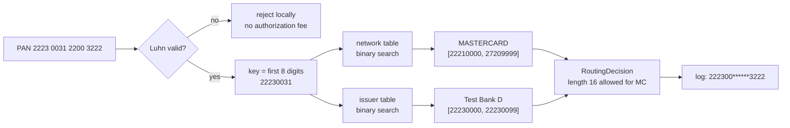

# PANs, Luhn, and BIN Range Routing

> Validate a card number and route it to the right network.

**Type:** Build
**Languages:** Java, Python, Go
**Prerequisites:** Phase 2 Lesson 02 (Binary Search and Its Variants), Phase 2 Lesson 15 (Numerical Algorithms), Phase 11 Lesson 01 (How a Card Payment Works)
**Time:** ~75 minutes

## Learning Objectives

- Decompose a primary account number into its ISO/IEC 7812 parts (major industry identifier, issuer identification number, account number, check digit) and state what each is for
- Implement the Luhn mod-10 algorithm for both validation and check-digit generation, and name the one error class it cannot detect
- Build a BIN range table that holds 6-digit and 8-digit BINs in one normalized key space and answers lookups with binary search
- Detect the card network from public prefix rules (Visa 4; Mastercard 51-55 and 2221-2720; Amex 34 and 37; Discover 6011, 644-649, 65) and apply the per-network length rules
- Mask a PAN the way PCI DSS requires and make the masked form the only one that can reach a log

## The Problem

A checkout page accepts a card number, sends it to the payments service, and the payments service forwards it to the acquirer for authorization. The acquirer charges a fee for every authorization request, approved or declined. One morning the decline rate for a large merchant jumps from 4% to 31%. The acquirer's response codes are all the same: `14 Invalid card number`. The merchant had shipped a redesigned checkout form that dropped the digit-count validation; customers were submitting numbers with a missing or doubled digit, and every one of those reached the acquirer, cost an authorization fee, returned a decline, and showed the customer an error that said nothing useful. The fix the merchant wanted was "tell me before I pay for the request", and the mechanism for that has existed since 1960: a check digit.

The second failure is quieter and more expensive. The same payments service routes every card to one acquirer. A cost analysis shows that debit cards issued by three large banks could be routed through a cheaper debit network for roughly 40 basis points less per transaction, and that corporate cards from two issuers should be flagged for level-2 data to qualify for lower interchange. All of that depends on knowing, from the card number alone and before authorization, who issued the card and what kind of product it is. The leading digits of the number encode exactly that, but the service treats the number as an opaque string. Routing on the first digit ("4 is Visa, 5 is Mastercard") worked until Mastercard activated the 2221-2720 range in 2017; the service sent 2-series cards to the Visa endpoint, which rejected them, for eleven days before anyone noticed.

The third failure is the one that ends careers. A debugging log line, `log.info("authorizing card {}", request.getPan())`, writes full card numbers to a log aggregator that is retained for ninety days and searchable by two hundred employees. Under PCI DSS that is a storage of cardholder data outside the cardholder data environment, a reportable incident, and a forensic investigation that costs more than the quarter's revenue from the merchant whose cards were logged.

This lesson builds the three pieces of code that stand between a typed card number and an authorization request: the Luhn check that rejects typos locally, the BIN range table that says who issued the card and which network to route it to, and a `Pan` type whose `toString` is its mask so that the third failure cannot happen by accident.

## The Concept

### Anatomy of a PAN

ISO/IEC 7812-1 defines the structure of a primary account number: 12 to 19 digits, in three parts.

| Part | Digits | Meaning |
|------|--------|---------|
| Major Industry Identifier (MII) | 1 | The first digit. 3 is travel and entertainment (Amex, Diners, JCB), 4 and 5 are banking and financial, 6 is merchandising and banking (Discover, UnionPay), 1 and 2 are airlines (Mastercard's 2-series is an exception granted by ISO) |
| Issuer Identification Number (IIN, "BIN") | first 6 or 8 | Identifies the issuing institution and often the product. ISO 7812 expanded IINs from 6 to 8 digits in 2017; the networks completed migration in 2022 |
| Individual account identifier | the rest, minus the last | Assigned by the issuer; up to 12 digits |
| Check digit | last 1 | Computed by the Luhn algorithm over everything before it |

A PAN is an identifier, not a number. It is never subject to arithmetic, has leading-zero-sensitive prefixes, and is stored and compared as a digit string. The only place this lesson converts digits to a `long` is the BIN lookup key, and that is a fixed-width prefix, never the whole PAN.

### The Luhn algorithm

Hans Peter Luhn's 1960 patent describes a check digit that detects every single-digit error and almost every transposition of adjacent digits. Starting from the rightmost digit (the check digit) and moving left, double every second digit; if doubling gives a two-digit number, subtract 9 (equivalently, add the two digits). Sum everything. The number is valid when the sum is a multiple of 10.

Validation of `4111 1111 1111 1111`, rightmost digit at position 0:

```text
position:  15 14 13 12 11 10  9  8  7  6  5  4  3  2  1  0
digit:      4  1  1  1  1  1  1  1  1  1  1  1  1  1  1  1
double?:    y  n  y  n  y  n  y  n  y  n  y  n  y  n  y  n
value:      8  1  2  1  2  1  2  1  2  1  2  1  2  1  2  1
sum = 8 + 7*2 + 8*1 = 8 + 14 + 8 = 30   -> 30 mod 10 = 0, valid
```

Generation inverts the rule. For the partial number `411111111111111` (fifteen digits, no check digit yet), the digit that will be at position 1 after the check digit is appended is the current rightmost digit, so doubling starts at the current position 0: weighted sum 29, and the check digit is `(10 - 29 mod 10) mod 10 = 1`. The outer `mod 10` handles the case where the sum is already a multiple of ten, when the check digit is 0, not 10.

What it catches and what it does not:

- **Every single-digit error.** Changing one digit changes the sum by a non-zero amount less than 10 (for a doubled position, the mapping `d -> 2d, minus 9 if over 9` is a bijection on 0-9, so distinct digits give distinct contributions).
- **Adjacent transpositions, except `09` and `90`.** Swapping two adjacent digits swaps which one is doubled. For most pairs that changes the sum; for `0` and `9` it does not, because `0 -> 0` and `9 -> 9` under the doubling rule. `091` and `901` are both valid Luhn numbers. The demo prints this.
- **Nothing about twin errors** (`22 -> 55`), jump transpositions (`123 -> 321`), or the number simply belonging to someone else. Luhn is a typo detector for a human typing at a keyboard, not a security control. A valid Luhn number is trivially generated, which is why `Luhn.complete` exists in this lesson and why no fraud system treats a Luhn pass as evidence of anything.

### BINs, ranges, and why a prefix tree is the wrong structure

The issuer identification number tells you who issued the card, and the networks publish range tables to their members: for each range of account numbers, the issuer, the product (consumer credit, commercial debit, prepaid), the country, and the funding type. Visa publishes 9-digit account ranges; Mastercard publishes 11-digit ranges; both tables change monthly as issuers add products and portfolios move between banks.

The structural fact that shapes the data structure is that **ranges are not prefixes**. A range like `222100` to `272099` cannot be expressed as any finite set of prefixes shorter than itself without enumerating thousands of them. Mastercard's 2-series is defined as the range 2221 through 2720; `2720` is in, `2721` is out, and `27` by itself is not a prefix of anything meaningful. A trie keyed on digits would need to expand every range into prefixes, which is large and brittle. An interval table, sorted by low bound and searched with binary search, is the right structure: it holds a range as two numbers, and the lookup is `O(log n)` for any number of ranges.

Mixing 6-digit and 8-digit BINs in one table needs one normalization. Choose a fixed width `W` (this lesson uses 8, the current IIN length) and expand every prefix to a closed interval of width-`W` numbers:

```text
prefix "411111"   (6 digits)  -> [41111100, 41111199]   pad low with 0s, high with 9s
prefix "55555555" (8 digits)  -> [55555555, 55555555]   a single point
prefix "4"        (network)   -> [40000000, 49999999]
range  "2221".."2720"         -> [22210000, 27209999]
```

The lookup key of a PAN is its first `W` digits as a number. A PAN starting `41111120` has key `41111120`, which falls inside `[41111100, 41111199]`, so a 6-digit BIN still matches an 8-digit key. A table with both `411111` and `41111120` as separate rows is rejected at construction because the intervals overlap; real tables resolve that by splitting the 6-digit range around the 8-digit one, and Exercise 2 implements the split.



### Binary search on intervals

The table is sorted by `low`. Because the intervals do not overlap, at most one can contain any key, and it is the one with the largest `low` that is still `<= key`. Binary search for that candidate (the standard "rightmost element not greater than" search), then check `key <= high`. If the candidate's `high` is below the key, the key falls in a gap and the lookup returns empty. The invariant that makes this correct is non-overlap, which is why the constructor checks adjacent pairs after sorting: if no two neighbours overlap in a sorted list, no two intervals overlap at all.

Complexity: construction `O(n log n)` for the sort, lookup `O(log n)`. A full industry BIN table has on the order of 10^5 to 10^6 rows; `log2` of that is about 20 comparisons per lookup, which is why routing decisions are made in microseconds on the authorization path.

Three structures could hold a BIN table. The interval list wins on the property that matters, which is that the source data is ranges:

| Structure | Lookup | Handles `2221-2720` as | Mixed 6/8-digit BINs | Update cost |
|-----------|--------|------------------------|----------------------|-------------|
| Hash set of 6-digit prefixes | `O(1)` | 500 enumerated prefixes `222100`..`272099` | Needs a second set and two lookups | Re-enumerate on every range change |
| Digit trie (Phase 1, Lesson 13) | `O(W)` | Same enumeration, or a range-aware trie that is no longer simple | Natural, but ranges still expand | Insert per prefix |
| Sorted interval list | `O(log n)` | One row `[22210000, 27209999]` | One normalized key space | Re-sort, `O(n log n)` |

Trace the lookup of key `22230031` (the first eight digits of the 2-series test PAN) through the sorted network table. The rows by `low`: `22210000` (MC 2-series), `34000000` (Amex), `37000000` (Amex), `40000000` (Visa), `51000000` (MC 5-series), `60110000` (Discover), `64400000` (Discover), `65000000` (Discover). Indices 0 through 7.

```text
lo=0 hi=7  mid=3  low[3]=40000000 > key          -> hi=2
lo=0 hi=2  mid=1  low[1]=34000000 > key          -> hi=0
lo=0 hi=0  mid=0  low[0]=22210000 <= key         -> candidate=0, lo=1
lo=1 hi=0  stop
candidate=0, high[0]=27209999 >= 22230031        -> MASTERCARD
```

Three comparisons. The same key against the issuer table lands on `[22230000, 22230099]`, Test Bank D. A key of `27210000` would end with `candidate=0` as well, but `high[0] = 27209999 < key`, so the lookup returns empty: the key is in the gap between the 2-series and Amex's `34`, and the card is `UNKNOWN`. That gap check is the line most often forgotten in interval binary searches, and it is the one the boundary tests exercise.

### Network detection and length rules

The networks' top-level prefixes are public and stable enough to hard-code, with the understanding that the 2017 Mastercard change happened and another will:

| Network | Prefixes | Lengths issued |
|---------|----------|----------------|
| Visa | 4 | 13, 16, 19 |
| Mastercard | 51-55, 2221-2720 | 16 |
| American Express | 34, 37 | 15 |
| Discover | 6011, 644-649, 65 | 16, 19 |

Network detection is a lookup in a table of these ranges, built with the same `BinRange` type and the same binary search as the issuer table. Length is a second, independent check: a 15-digit number starting with 4 passes Luhn and matches Visa's prefix but is not a card Visa has ever issued, and sending it for authorization is a wasted fee. The `RoutingDecision` carries both results so the caller can decide whether an unusual length is a hard reject or a flag.

### Masking and PCI DSS

PCI DSS Requirement 3.4.1 says the PAN must be masked when displayed, with at most the BIN and the last four digits visible, so that only personnel with a business need see more. Under 6-digit BINs the common rule was "first six, last four"; with 8-digit BINs the standard permits the first eight, and the implementation parameterizes the prefix length with a hard cap of 8. A second guard refuses any mask that would leave fewer than one hidden digit, so a 12-digit PAN cannot be fully revealed by asking for an 8-digit prefix.

The design choice that prevents the logging incident is making `Pan.toString()` return the mask. Logging frameworks, string concatenation, debuggers, and exception messages all call `toString`. A developer who writes `log.info("card {}", pan)` gets `411111******1111` in the log without having to remember anything. The full digits are available only through the explicitly named `digits()` accessor, which a code reviewer can grep for.

### What this lesson does not do

- It does not tokenize. Replacing the PAN with a surrogate that is useless outside your vault is how storage is kept out of PCI scope, and it is Phase 11, Lesson 05 (Tokenization and PCI DSS Scope Reduction).
- It does not carry a real BIN table. The ranges here are published test BINs with invented issuer names. Production tables are licensed from the networks or a BIN data provider and refreshed on a schedule; a stale table misroutes cards.
- It does not validate expiry, CVV, or cardholder name. Those are checked by the issuer during authorization and cannot be verified locally.
- It does not handle co-badged cards (a card carrying two network brands, common in the EU and India, where the merchant or cardholder chooses the network). That is a routing policy on top of detection.

## Build It

### Step 1: Luhn, both directions

```java
static int sum(String digits, boolean rightmostIsCheckDigit) {
    int total = 0;
    boolean dbl = !rightmostIsCheckDigit;
    for (int i = digits.length() - 1; i >= 0; i--) {
        int d = digits.charAt(i) - '0';
        if (dbl) { d *= 2; if (d > 9) d -= 9; }
        total += d;
        dbl = !dbl;
    }
    return total;
}

static boolean isValid(String digits) {
    requireDigits(digits);
    if (digits.length() < 2) return false;
    return sum(digits, true) % 10 == 0;
}

static int checkDigit(String partial) {
    requireDigits(partial);
    return (10 - sum(partial, false) % 10) % 10;
}
```

One weighted-sum function serves both validation and generation; the flag says whether the rightmost digit is the check digit (so doubling starts one position to its left) or the last account digit (so doubling starts immediately). `requireDigits` throws on anything that is not `0`-`9`, including spaces, so the caller is forced to normalize input before validation rather than having the validator silently skip characters it does not understand.

**Predict:** `Luhn.checkDigit("0")` is 0. What is `Luhn.checkDigit("5")`, and why is the outer `% 10` needed for exactly one of these?

### Step 2: The `Pan` type

```java
record Pan(String digits) {
    Pan {
        if (digits.length() < 12 || digits.length() > 19) throw new IllegalArgumentException(...);
        if (!Luhn.isValid(digits)) throw new IllegalArgumentException("PAN fails the Luhn check");
    }

    static Pan parse(String text) {
        StringBuilder sb = new StringBuilder();
        for (char c : text.toCharArray()) {
            if (c >= '0' && c <= '9') sb.append(c);
            else if (c != ' ' && c != '-') throw new IllegalArgumentException("PAN contains a non-digit character");
        }
        return new Pan(sb.toString());
    }

    String masked(int prefix) {
        if (prefix < 0 || prefix > 8) throw new IllegalArgumentException("may show at most 8 leading digits");
        if (prefix + 4 >= digits.length()) throw new IllegalArgumentException("mask would reveal the whole PAN");
        ...
    }

    @Override public String toString() { return masked(); }
}
```

A `Pan` that exists is a Luhn-valid 12-to-19-digit string; nothing downstream has to re-check. `parse` accepts the two separators people actually type and rejects everything else, so `4111 1111 1111 111a` is an error and not a 15-digit number. The `toString` override is the control discussed above; note that the record's default `toString` would have printed `Pan[digits=4111111111111111]`, which is precisely the log line the lesson is trying to prevent.

### Step 3: Ranges normalized to one width

```java
record BinRange(long low, long high, Network network, String issuer, String product) {
    static final int WIDTH = 8;

    static BinRange ofPrefixRange(String fromPrefix, String toPrefix, Network network, String issuer, String product) {
        if (fromPrefix.length() != toPrefix.length()) throw new IllegalArgumentException("prefix range bounds must have the same length");
        return new BinRange(normalizeLow(fromPrefix), normalizeHigh(toPrefix), network, issuer, product);
    }

    static long normalizeLow(String prefix)  { return pad(prefix, '0'); }
    static long normalizeHigh(String prefix) { return pad(prefix, '9'); }

    static long keyOf(Pan pan) { return Long.parseLong(pan.digits().substring(0, WIDTH)); }

    boolean contains(long key) { return low <= key && key <= high; }
    boolean overlaps(BinRange other) { return low <= other.high && other.low <= high; }
}
```

Padding the low bound with zeros and the high bound with nines is the whole normalization. It works for a single prefix (`ofPrefix` calls `ofPrefixRange` with the same prefix twice) and for a range of prefixes of equal length. The equal-length requirement matters: `"51".."555"` would normalize to `[51000000, 55599999]`, which is almost certainly not what the author meant, so it is rejected.

**Predict:** what interval does `ofPrefixRange("644", "649", ...)` produce, and does the key of `6450000000000000` fall inside it?

### Step 4: The table and its binary search

```java
final class BinTable {
    BinTable(List<BinRange> input) {
        List<BinRange> sorted = new ArrayList<>(input);
        sorted.sort(Comparator.comparingLong(BinRange::low).thenComparingLong(BinRange::high));
        for (int i = 1; i < sorted.size(); i++) {
            if (sorted.get(i - 1).overlaps(sorted.get(i))) throw new IllegalArgumentException("overlapping BIN ranges: ...");
        }
        this.ranges = Collections.unmodifiableList(sorted);
    }

    Optional<BinRange> lookup(long key) {
        int lo = 0, hi = ranges.size() - 1, candidate = -1;
        while (lo <= hi) {
            int mid = (lo + hi) >>> 1;
            if (ranges.get(mid).low() <= key) { candidate = mid; lo = mid + 1; }
            else hi = mid - 1;
        }
        if (candidate >= 0 && ranges.get(candidate).contains(key)) return Optional.of(ranges.get(candidate));
        return Optional.empty();
    }
}
```

The search keeps the last index whose `low` was not above the key and moves right; when it terminates, `candidate` is the rightmost such index or -1. `>>> 1` instead of `/ 2` is the overflow-safe midpoint, a habit worth keeping even when `lo + hi` cannot overflow an `int` here. The test `binarySearchMatchesLinear` compares this against a brute-force scan on ten thousand keys, half of them deliberately clustered near range boundaries, because off-by-one errors in interval search hide at the edges.

**Predict:** the table has `[41111100, 41111199]` and `[42424200, 42424299]`. For key `41111200`, what is `candidate`, and what does `lookup` return?

### Step 5: Network detection as a table lookup

```java
static BinTable networkRanges() {
    return new BinTable(List.of(
            BinRange.ofPrefix("4", Network.VISA, "network", "Visa"),
            BinRange.ofPrefixRange("51", "55", Network.MASTERCARD, "network", "Mastercard 5-series"),
            BinRange.ofPrefixRange("2221", "2720", Network.MASTERCARD, "network", "Mastercard 2-series"),
            BinRange.ofPrefix("34", Network.AMEX, "network", "American Express"),
            BinRange.ofPrefix("37", Network.AMEX, "network", "American Express"),
            BinRange.ofPrefix("6011", Network.DISCOVER, "network", "Discover"),
            BinRange.ofPrefixRange("644", "649", Network.DISCOVER, "network", "Discover"),
            BinRange.ofPrefix("65", Network.DISCOVER, "network", "Discover")));
}

static Network detectNetwork(Pan pan) {
    return networkRanges().lookup(pan).map(BinRange::network).orElse(Network.UNKNOWN);
}
```

The network rules are data in the same structure as the issuer table, not a chain of `startsWith` calls. When a network announces a new range, the change is one added row and a test, and the overlap check in the constructor catches a rule that collides with an existing one. The tests pin the boundaries: `2720xxxx` is Mastercard, `2721xxxx` and `2220xxxx` are not.

### Step 6: Routing

```java
record RoutingDecision(Pan pan, Network network, Optional<BinRange> issuerRange, boolean lengthOk) { ... }

final class CardRouter {
    RoutingDecision route(String rawPan) {
        Pan pan = Pan.parse(rawPan);
        Network network = BinTable.detectNetwork(pan);
        return new RoutingDecision(pan, network, issuerTable.lookup(pan), BinTable.lengthAllowed(network, pan.length()));
    }
}
```

Parse (which validates), detect, look up the issuer, check the length. An unknown issuer BIN is `Optional.empty()`, not an error: the card may be from an issuer not in your table, and the network is still known, so authorization can proceed on the default route. `describe()` uses `pan.masked()`, and the test asserts that the full digits do not appear in it.

### Step 7: Run it

```bash
cd phases/11-payment-rails/04-pan-luhn-and-bin-ranges/code/java
javac -d .out *.java && java -cp .out Main
java -cp .out MainTest
```

Expected output, abbreviated:

```console
== Luhn by hand: 4111 1111 1111 111? ==
sum of weighted digits (no check digit) = 29
check digit = (10 - 9) mod 10 = 1
complete PAN = 4111111111111111  valid=true
single-digit typo 4111111111111112 valid=false
adjacent transposition 4242424242424242 -> 4422424242424242 valid=false
09 <-> 90 transposition is the one Luhn misses: 091 valid=true, 901 valid=true

== BIN table normalized to 8 digits ==
411111 (6-digit)   -> [41111100, 41111199]
55555555 (8-digit) -> [55555555, 55555555]
2221-2720 (network) -> [22210000, 27209999]

== Routing test PANs ==
411111******1111  len=16  VISA  issuer=Test Bank A product=Visa Classic credit
222300******3222  len=16  MASTERCARD  issuer=Test Bank D product=Mastercard 2-series credit
378282*****0005  len=15  AMEX  issuer=Amex (test) product=Amex Green
400005******5556  len=16  VISA  issuer=unknown BIN
630400******0000  len=16  UNKNOWN  issuer=unknown BIN
```

The test harness prints `65 passed, 0 failed`.

### In Python

The full port is `code/python/main.py` (same `Luhn`, `Pan`, `BinRange`, `BinTable`, `CardRouter`; tests in `code/python/test_main.py`). Three things differ:

- **The mask has to cover `repr`, not just `str`.** Java has one `toString`; Python has two rendering paths. A `@dataclass(frozen=True)` generates a `__repr__` that prints every field, so `print([pan])`, an f-string with `!r`, a debugger, or a failing `assertEqual` would all leak the digits even with `__str__` masked. The port overrides both, and the tests assert that `repr(pan)` and a list containing a `Pan` print the mask:

```python
@dataclass(frozen=True)
class Pan:
    digits: str

    def masked(self, prefix: int = 6) -> str:
        if prefix < 0 or prefix > 8:
            raise ValueError("may show at most 8 leading digits")
        if prefix + 4 >= len(self.digits):
            raise ValueError("mask would reveal the whole PAN")
        return self.digits[:prefix] + "*" * (len(self.digits) - 4 - prefix) + self.last_four()

    def __str__(self) -> str:
        return self.masked()

    __repr__ = __str__
```

- **Keys are plain `int`s and the search is written out.** `int(digits[:8])` replaces `Long.parseLong`, and normalisation is `int(prefix.ljust(8, "0"))`. `bisect.bisect_right` on a list of low bounds would find the same candidate, but the hand-written loop is kept so the lesson's binary search (and the "last range whose low <= key, then check high" argument) reads the same in every language; the 10,000-key comparison against a linear scan replays Java's `Random(7)` sequence, `nextLong(bound)` included, through a small `JavaRandom` in the test file.
- **`Optional` becomes `None`, overloads become one method.** `BinTable.lookup` accepts either an `int` key or a `Pan` and returns `Optional[BinRange]`; `detect_network` maps a `None` to `Network.UNKNOWN`. `IllegalArgumentException` is `ValueError` throughout, and `RoutingDecision.describe` prints `network.name` so the output matches Java's enum rendering.

```bash
cd phases/11-payment-rails/04-pan-luhn-and-bin-ranges/code/python
python3 main.py
python3 -m unittest -v
```

### In Go

The full port is `code/go/main.go` (same `Luhn*` functions, `Pan`, `BinRange`, `BinTable`, `CardRouter`; tests in `code/go/main_test.go`). Three things differ:

- **The digits live in an unexported field.** `fmt.Stringer` covers `%v` and `%s`, but `%+v` on a struct with an exported `Digits` field would still print it. The port keeps `digits` unexported, reaches it through `Digits()`, and the test asserts that `%v`, `%s` and `%+v` all render the mask:

```go
type Pan struct {
	digits string // unexported: %+v cannot reach it, so every fmt verb prints the mask
}

// String is the mask on purpose: a Pan that ends up in a log line is masked.
func (p Pan) String() string { return p.Masked() }
```

- **`IllegalArgumentException` becomes an `error` return.** `ParsePan`, `NewPan`, `LuhnValid`, `MaskedPrefix`, `BinRangeOfPrefixRange` and `NewBinTable` return `(T, error)`; `Masked()` (the 6+4 default) cannot fail for a 12-19 digit PAN, so it panics on the impossible branch instead of forcing an error check at every log site. `Optional<BinRange>` becomes the `(BinRange, bool)` pair from `Lookup`, and a `*BinRange` that is `nil` when the issuer is unknown on `RoutingDecision`.
- **The binary search is written out, not `sort.Search`.** `sort.Search` would find the same candidate, but the loop stays so the "last range whose low <= key, then check high" argument reads identically in all three languages; `int(uint(lo+hi) >> 1)` is Java's `>>> 1`. The 10,000-key comparison against a linear scan replays Java's `Random(7)`, `nextLong(bound)` included, through `javarandom.go`.

```bash
cd phases/11-payment-rails/04-pan-luhn-and-bin-ranges/code/go
go run .
go test ./...
```

## Use It

### Where this runs in production

Every payment service provider runs this logic at the edge, before authorization: Stripe's `card.brand` and `card.funding` fields, Adyen's `paymentMethod.brand`, and the `cardType` returned by Braintree's client SDK are all BIN lookups against licensed range tables. Front-end SDKs (Stripe Elements, Adyen Drop-in) run Luhn and network detection in the browser so the card logo appears as the customer types and typos are caught before a request is sent.

The issuer tables themselves come from the networks (Visa's Account Range Definition files, Mastercard's Account Range Table) under member agreements, or from BIN data vendors that aggregate them. They are updated monthly and the update is a routing change: a portfolio moving from one bank to another changes which acquirer relationship and which interchange rate apply.

### `java.util.Arrays.binarySearch` and `TreeMap.floorEntry`

The JDK's `Arrays.binarySearch` finds an exact key, not the containing interval, so it is not a drop-in replacement; the standard idiom is `TreeMap<Long, BinRange>.floorEntry(key)` followed by the `contains` check, which is `O(log n)` and does the same "largest low not above key" search. The from-scratch loop makes the candidate logic visible; `floorEntry` is what to use once you can explain it.

### Debit routing and the Durbin Amendment

In the United States, Regulation II requires that debit cards be enabled on at least two unaffiliated networks, and merchants may choose which to route to. Choosing requires knowing from the BIN that the card is debit and which secondary networks it carries, which is exactly the product and network data in the range table. The 40-basis-point saving in The Problem is this choice. Co-badging in the EU under the Interchange Fee Regulation creates the same decision for different reasons.

### Test PANs and why only they appear here

Every processor publishes test card numbers that behave deterministically in sandbox mode: `4242424242424242` approves, `4000000000000002` declines, `4000000000009995` returns insufficient funds, and so on. They are Luhn-valid, sit in BIN ranges the networks have reserved so they can never be issued to a cardholder, and are safe to commit to a repository. The numbers in this lesson are drawn from those lists and from the ISO 7812 worked example.

The discipline this implies for a team:

- Fixtures, documentation, screenshots, and bug reports contain only published test PANs. A CI grep for any other Luhn-valid 15-19 digit number in the repository is cheap and catches the "I copied a real one from the dashboard to reproduce the bug" incident before it becomes a breach report.
- `Luhn.complete` is a generator of valid numbers and is in this lesson so you understand the algorithm. It is not a tool for making up test data; a generated number may be a real cardholder's. Use the published lists.
- A sandbox that accepts arbitrary Luhn-valid numbers is a sandbox in which developers will eventually type a real card to "see what happens". Processors reject non-test PANs in test mode for that reason.

### What a tokenization vault changes

Once a PAN is tokenized (Lesson 05), most of your systems hold only the token and the first six or eight plus last four. The BIN lookup still works, because the BIN is deliberately preserved in the clear, and the Luhn check has already happened at the edge. Network tokens (Visa Token Service, Mastercard MDES) go further: the token itself is a Luhn-valid 16-digit number in a token BIN range, so your routing code must know that `4895xx` is a Visa token range, not an issuer.

## Ship It

`outputs/checklist-pan-handling.md` is a review checklist for any code that touches a card number: input normalization, Luhn at the edge, BIN table freshness, network and length rules, masking in every `toString`, and the grep for `digits()` that a reviewer runs before approving. It is written for a PCI scoping conversation as much as a code review.

## Exercises

1. **Reinforce.** The Verhoeff algorithm (1969) catches all adjacent transpositions, including `09`/`90`, and most twin errors, using a dihedral group table instead of mod 10. Implement `Verhoeff.isValid` and `checkDigit`, confirm it catches `091` versus `901`, and write a sentence on why the card industry has never switched.
2. **Apply.** Support an 8-digit BIN that lies inside a 6-digit range: given rows `411111 -> Test Bank A` and `41111120 -> Test Bank A Platinum`, build a `BinTable.withSplits` that splits the 6-digit range around the 8-digit one into `[41111100, 41111119]`, `[41111120, 41111120]`, `[41111121, 41111199]` so the constructor's overlap check still passes and the most specific row wins. Test the three boundaries.
3. **Extend.** Combine with Phase 10, Lesson 01 (Representing Money) and look ahead to Phase 11, Lesson 07 (Interchange, Scheme Fees, and Merchant Pricing): add an `Interchange` table keyed by `(Network, product)` holding a rate in basis points plus a fixed fee in minor units, and compute the fee for a `Money` amount with `HALF_EVEN` rounding. Route the eight demo PANs for a 47.50 USD purchase and print the fee per card. Then add a "debit routing" rule that picks the cheaper of two networks when the issuer row lists both, and show the saving on a 10,000-transaction seeded sample.

## Key Terms

| Term | What people say | What it actually means |
|------|-----------------|------------------------|
| PAN | "the card number" | The primary account number: 12-19 digits per ISO/IEC 7812 consisting of MII, IIN, account identifier, and Luhn check digit; an identifier, never an arithmetic value |
| BIN / IIN | "the first six" | The issuer identification number, 6 digits historically and 8 since 2017; identifies the issuing institution and usually the product |
| Luhn check | "mod 10" | A check digit scheme that detects every single-digit error and every adjacent transposition except 09/90; a typo detector, not a security control |
| BIN range | "the BIN table" | An inclusive interval of account-number prefixes mapped to issuer, product, network, and country; ranges, not prefixes, which is why the table is an interval list |
| Network detection | "is it Visa or Mastercard" | A lookup of the PAN's leading digits against public network ranges, with a separate per-network length rule |
| PCI DSS masking | "star out the number" | Requirement 3.4.1: display at most the BIN and last four; everything else hidden, and only to roles with a need |
| Co-badged card | "two logos on the card" | A card enrolled in two networks, where routing is a choice made by the merchant or cardholder rather than a function of the BIN alone |

## Further Reading

- [ISO/IEC 7812-1:2017, Identification cards, Part 1: Numbering system](https://www.iso.org/standard/70484.html) — the normative definition of PAN structure, the 8-digit IIN, and the Luhn formula in Annex B.
- [US Patent 2,950,048, Computer for Verifying Numbers (Luhn, 1960)](https://patents.google.com/patent/US2950048A) — the original description of the mod-10 check; short, and the mechanical drawings make the doubling rule memorable.
- [PCI DSS v4.0.1, Requirement 3](https://www.pcisecuritystandards.org/document_library/) — the current rules for masking (3.4.1) and rendering stored PAN unreadable (3.5.1); read the applicability notes on BIN length.
- [Mastercard 2-Series BIN Expansion](https://www.mastercard.us/en-us/business/overview/support/2-series-bin-expansion.html) — the announcement that broke every `startsWith("5")` check; the range 222100-272099 is defined here.
- [Federal Reserve Regulation II (Debit Card Interchange Fees and Routing)](https://www.federalreserve.gov/paymentsystems/regii-about.htm) — why US debit routing is a choice and therefore why product data in the BIN table has a price attached.
- [Verhoeff, Error Detecting Decimal Codes (1969)](https://ir.cwi.nl/pub/13045) — the algorithm that closes Luhn's 09/90 gap, for Exercise 1.
