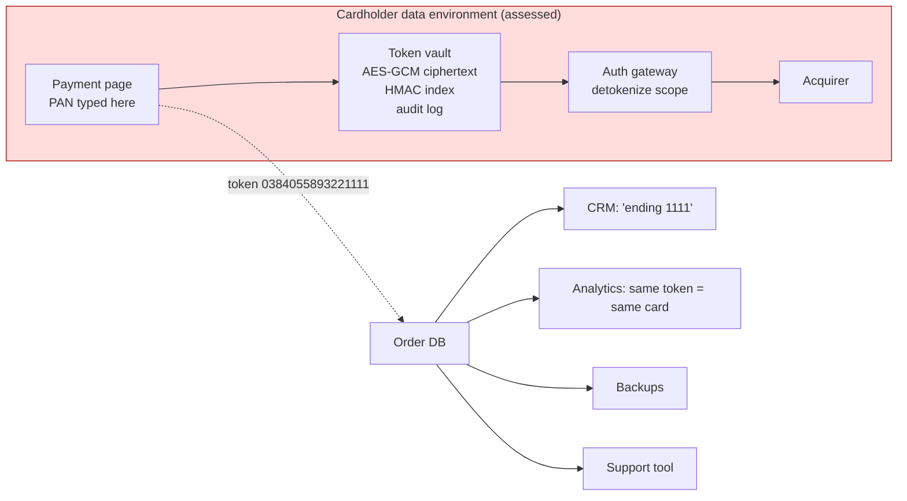

# Tokenization and PCI DSS Scope Reduction

> Never store the PAN; here is what you store instead.

**Type:** Build
**Languages:** Java, Python, Go
**Prerequisites:** Phase 11 Lesson 04 (PANs, Luhn, and BIN Range Routing), Phase 1 Lesson 07 (Hash Functions and Collisions)
**Time:** ~90 minutes

## Learning Objectives

- Explain what the PCI DSS cardholder data environment is, why every system that can read a PAN is inside it, and how a token vault moves the boundary
- Build a token vault that mints format-preserving tokens (same length, same last four, Luhn-invalid by construction) and maps them to PANs encrypted at rest with AES-256-GCM
- Bind each ciphertext to its token with GCM additional authenticated data and show that a moved or edited record fails authentication
- Enforce detokenization authorization with scoped principals, an expiring token lifecycle (active, suspended, revoked), and an audit log that never contains a PAN
- Dedupe PANs through a keyed HMAC index and explain why an unkeyed hash of a PAN is not a secret
- Estimate the scope reduction for a real estate: which systems leave the cardholder data environment and which cannot

## The Problem

An online retailer stores card numbers so returning customers can pay with one click. The number lives in the `orders` table in a column called `card_number`, next to `shipping_address`. Twelve systems read that table: the checkout API, the order management system, the warehouse picker, the returns desk, the CRM, the analytics warehouse, two reporting dashboards, the nightly backup, a support tool, a fraud scoring job, and the data science sandbox. A contractor exports the table to a laptop to debug a shipping report. The laptop is stolen. Four hundred thousand PANs, with expiry dates and names, are now for sale.

Under the PCI Data Security Standard, every one of those twelve systems, every network path between them, every admin who can log in to them, and that laptop were inside the *cardholder data environment* (CDE): the set of people, processes, and technology that store, process, or transmit cardholder data. A merchant of this size must have an annual assessment of the entire CDE against roughly 250 requirements, from network segmentation and quarterly vulnerability scans to key management and log retention. The retailer could not afford to assess twelve systems properly, so it attested on a self-assessment questionnaire that it did, and the breach will cost it fines from the card brands, forensic investigation under their rules, card reissuance costs charged back by issuers, and possibly the right to accept cards at all.

Notice what the twelve systems actually needed. The warehouse needed an order ID. The CRM needed "card ending in 1111" so an agent could confirm which card a customer meant. Analytics needed to know whether two orders used the same card. Only one system needed the real number: the gateway that sends the authorization request to the acquirer. Everything else was storing the PAN because it was there.

Tokenization replaces the PAN with a surrogate value that has no exploitable relationship to it, and confines the mapping from surrogate to PAN to one hardened system: the token vault. Eleven systems now hold a sixteen-digit string that is useless to a thief, and the PCI assessment covers the vault, the gateway, and the page where the number is typed. This lesson builds that vault: minting tokens, storing the mapping under authenticated encryption, deciding who may reverse it, and expiring and destroying what is no longer needed. The Luhn check and the BIN table from Lesson 04 are the tools that let the token look like a card number without ever being one.

## The Concept

### What the PCI DSS is protecting

PCI DSS v4.0.1 Requirement 3 governs stored account data. The PAN is the element that matters: it must be rendered unreadable anywhere it is stored (Req. 3.5.1), using one-way hashes of the *entire* PAN with a key, truncation, index tokens, or strong cryptography with key management. Full track data, the card verification code (CVV2), and the PIN block may never be stored after authorization at all (Req. 3.3.1). Cardholder name, expiry date, and service code may be stored but must be protected. The PAN may be displayed truncated to at most the first six and last four digits (Req. 3.4.1), which is why every receipt in the world says `411111******1111`.

The consequence engineers underestimate: scope is defined by *access to PAN*, not by *intent to use PAN*. A log aggregator that receives a request body with a PAN in it is in scope. A backup of a database that contains a PAN column is in scope. A JVM heap dump is in scope. The assessment boundary follows the data, and the only durable way to shrink the boundary is to make sure the data is not there.

### Tokens, hashes, and ciphertext are three different things

| Approach | What is stored | Reversible? | Safe to hold outside the CDE? | Problem |
|----------|----------------|-------------|-------------------------------|---------|
| Encrypt in place | AES ciphertext of the PAN in the `orders` row | Yes, by anyone with the key | No: a system holding ciphertext plus a path to the key is in scope | Keys sprawl to every reader; every reader stays in scope |
| Hash (SHA-256) | 32-byte digest of the PAN | No, but brute-forceable | No | Given a six-digit BIN, there are 10^9 possible accounts; 10^9 SHA-256 operations takes a laptop GPU seconds |
| Keyed hash (HMAC) | HMAC-SHA256 under a vault key | No | Yes, as a dedup index | Cannot recover the PAN for a charge; good for "same card?" questions only |
| Vault token | Random surrogate; the vault holds token to PAN | Only by the vault, for authorized callers | Yes | Vault is a single point of trust and must be the best-defended system you run |

The PCI SSC's *Tokenization Product Security Guidelines* classify tokens as *irreversible* (no mapping exists; essentially a keyed hash) or *reversible*, and reversible tokens as *cryptographic* (the token is ciphertext of the PAN, format-preserving encryption) or *non-cryptographic* (the token is a random value and a lookup table holds the mapping). This lesson builds a reversible, non-cryptographic token with the mapping table encrypted. That design means a token leaked from the CRM gives an attacker exactly nothing: no key can turn it back into a PAN because the token was never derived from the PAN. The attacker must breach the vault.

### Format preservation without impersonation

Downstream systems have `VARCHAR(19)` columns, regular expressions that expect digits, and UIs that print the last four. A token that is a UUID breaks all of them. So the token keeps the PAN's *shape*: the same length, all digits, and the same last four, so "card ending 1111" still works without a vault call.

That creates a new danger: a sixteen-digit string that passes Luhn and starts with a plausible BIN *is* a card number as far as any downstream system can tell, and one day someone will send a token to an acquirer by mistake, or a token will collide with a real card. Our mint rule removes the ambiguity: **every token fails the Luhn check**. After filling the non-preserved positions with random digits, the vault runs Luhn; if the candidate happens to pass (one in ten does), it adds one to a single non-preserved digit. From Lesson 04 you know the Luhn doubling map `d -> 2d mod 9` (with `9 -> 9`) is a permutation of the digits, so changing any one digit always changes the checksum modulo 10, and one bump always turns a valid number into an invalid one. The result is a value that looks like a card number to a column type and never to a card network.



### The vault's invariants

1. **A token can never be mistaken for a PAN.** Same length and last four, random elsewhere, Luhn-invalid.
2. **One PAN, one token.** Tokenizing the same card twice returns the same token, so "did this customer use this card before?" is a string equality on tokens outside the CDE. The vault finds the existing token through an index keyed by `HMAC-SHA256(indexKey, PAN)`, so the index itself holds no PAN and cannot be brute-forced without the key.
3. **The mapping is encrypted and authenticated.** The PAN is stored as `AES-256-GCM(dataKey, nonce, PAN, aad = token)`. GCM produces a 16-byte authentication tag; any change to the ciphertext, the nonce, or the AAD makes decryption fail. Using the token as AAD means a record cannot be re-pointed: copying the ciphertext from token A's row into token B's row fails authentication.
4. **The nonce never repeats under one key.** GCM with a repeated nonce leaks the XOR of two plaintexts and the authentication key. The vault builds its 96-bit nonce from 32 random bits and a 64-bit counter, so uniqueness is guaranteed within a process and a key rotation is required across restarts in production.
5. **Detokenization is a privilege, not an API.** Every caller is a `Principal` with scopes. `TOKENIZE` is cheap to grant: it adds data to the vault. `DETOKENIZE` is the dangerous one and should be held by the gateway alone. `MANAGE` changes lifecycle. Every attempt, allowed or denied, writes an audit line that contains the token and never the PAN.
6. **Tokens have a lifecycle.** `ACTIVE` tokens expire after a TTL. `SUSPENDED` tokens (a disputed card, a locked account) cannot be detokenized but can be reactivated. `REVOKED` tokens have their ciphertext overwritten with zeros, which is a *crypto-shred*: even a later compromise of the data key cannot recover that PAN. The record stays as a tombstone so the audit trail is complete.

### Worked example by hand

Tokenize the Visa test PAN `4111 1111 1111 1111` with the demo's seeded random source.

```text
PAN            = 4111111111111111       (16 digits, Luhn-valid: sum 30)
preserve       = last four "1111"
random digits  = 0 3 8 4 0 5 5 8 9 3 2 2 (12 positions)
candidate      = 0384055893221111
Luhn(candidate): doubled positions from the right -> 1,2,2,9,5,0,... sum = 47, 47 mod 10 != 0 -> invalid, keep
index          = HMAC-SHA256(indexKey, "4111111111111111") = 9f1c...  (not stored anywhere else)
nonce          = 5e688e99 || 0000000000000000           (random || counter 0)
ciphertext     = AES-GCM(dataKey, nonce, "4111111111111111", aad="0384055893221111")
               = 707c786e...6a30  (32 bytes: 16 of PAN, 16 of tag)
record         = {token, nonce, ciphertext, lastFour="1111", length=16, createdAt, expiresAt, ACTIVE}
```

The order database now stores `0384055893221111`. The CRM prints `ending 1111` from the token's own digits. Analytics groups orders by token. When the gateway needs to authorize a recurring charge it calls `detokenize("0384055893221111", gateway, "authorization")`, the vault checks the gateway's scope, the record's status and expiry, decrypts with the token as AAD, and returns a `Pan` whose `toString` is the mask, so even the gateway's own logs cannot leak it without a deliberate call to `digits()`.

### Complexity and capacity

Every operation is a hash-map lookup plus one AES-GCM pass over at most 19 bytes: O(1) time per call, a few microseconds dominated by the cipher setup. Storage is roughly 120 bytes per token. The constraint that matters is not asymptotic: the token space for a given last-four is 10^12 for a sixteen-digit PAN, and the mint loop retries on collision, so the vault stays well inside the birthday bound until it holds hundreds of millions of tokens per last-four suffix, which no single merchant approaches.

### What this vault does not do

- It does not replace the PAN in the authorization message. The gateway still sends a real PAN to the acquirer, so the gateway stays in scope. Network tokens (Visa Token Service, Mastercard MDES) go one step further and let the *issuer* accept a surrogate, which is Lesson 06's territory for 3-D Secure and a later lesson for network tokenization.
- It does not manage keys. The demo derives keys from a seed so the output is reproducible; a production vault holds the data key in an HSM or cloud KMS, rotates it by re-encrypting records under a new key version, and stores the key version in the record.
- It does not survive a restart with the same nonce counter. The counter is in memory; production persists it or derives nonces from a persisted sequence.
- It does not defend against an attacker who already has `DETOKENIZE` scope. Authorization decides who may reverse a token; rate limiting, anomaly detection on the audit log, and purpose binding are the controls layered on top.

## Build It

The implementation is one file, `code/java/Main.java`, with the types `Pan`, `Luhn`, `Principal`, `TokenRecord`, `AuditEntry`, `TokenVault`, and `SystemInventory`. Tests live in `MainTest.java`.

### Step 1: A PAN that cannot be printed

```java
final class Pan {
    private final String digits;
    private Pan(String digits) { this.digits = digits; }

    static Pan of(String raw) {
        String s = raw.replace(" ", "").replace("-", "");
        if (s.length() < 12 || s.length() > 19 || !s.chars().allMatch(Character::isDigit)) {
            throw new IllegalArgumentException("PAN must be 12-19 digits");
        }
        if (!Luhn.isValid(s)) throw new IllegalArgumentException("PAN fails the Luhn check");
        return new Pan(s);
    }

    String digits() { return digits; }
    String lastFour() { return digits.substring(digits.length() - 4); }
    String masked() { /* first six, stars, last four */ }
    @Override public String toString() { return masked(); }
}
```

The class is the first line of defence against the most common PCI finding: a PAN in a log file. String concatenation, `String.format("%s")`, loggers, and debuggers all call `toString`, and `toString` returns `411111******1111`. The only way to get the digits out is to call `digits()` by name, which is a one-line grep in a code review. Equality uses `MessageDigest.isEqual` so a comparison against an attacker-supplied value does not leak timing information about how many leading digits matched.

**Predict:** `"card=" + Pan.of("4111111111111111")` — does the resulting string contain the PAN?

### Step 2: Keys, clock, randomness: injected, not ambient

```java
TokenVault(byte[] dataKey, byte[] indexKey, Random random, Clock clock, long ttlSeconds) {
    if (dataKey.length != 32) throw new IllegalArgumentException("data key must be 32 bytes (AES-256)");
    if (indexKey.length < 32) throw new IllegalArgumentException("index key must be at least 32 bytes");
    this.dataKey = new SecretKeySpec(dataKey, "AES");
    this.indexKey = new SecretKeySpec(indexKey, "HmacSHA256");
    this.random = Objects.requireNonNull(random);
    this.clock = Objects.requireNonNull(clock);
    this.ttlSeconds = ttlSeconds;
}
```

Two keys, not one. The data key encrypts PANs; the index key authenticates the dedup hash. Compromise of the index key lets an attacker test guesses against the index (is this PAN in the vault?) but not decrypt anything; compromise of the data key without the ciphertext is useless; a reviewer can reason about each separately. `Random` is injected so the tests and the demo produce the same tokens every run; production passes `SecureRandom`. The `Clock` is injected so expiry is tested by advancing a number, not by sleeping.

### Step 3: Minting a token that fails Luhn

```java
String mintToken(Pan pan) {
    for (int attempt = 0; attempt < 100; attempt++) {
        char[] t = new char[pan.length()];
        for (int i = 0; i < t.length - 4; i++) t[i] = (char) ('0' + random.nextInt(10));
        pan.lastFour().getChars(0, 4, t, t.length - 4);
        String candidate = new String(t);
        if (Luhn.isValid(candidate)) {
            int pos = t.length - 5;
            t[pos] = (char) ('0' + ((t[pos] - '0' + 1) % 10));
            candidate = new String(t);
        }
        if (!byToken.containsKey(candidate)) return candidate;
    }
    throw new IllegalStateException("token space exhausted for this last-four");
}
```

The candidate is random in every non-preserved position. If it passes Luhn, the digit immediately left of the preserved suffix is incremented modulo 10. Because a single-digit change always moves the Luhn sum by a non-zero amount modulo 10, the bumped candidate is guaranteed invalid, and because the bump only touches a random position, no structure is introduced that an observer could use. The collision check against existing tokens makes the mint safe even when two PANs share a last-four. The test mints a thousand tokens for one PAN and asserts every one fails Luhn and all are distinct.

**Predict:** why does the bump touch position `length - 5` rather than position 0?

### Step 4: Idempotent tokenize through an HMAC index

```java
String tokenize(Pan pan, Principal who) {
    if (!who.has(Scope.TOKENIZE)) {
        log(who, "TOKENIZE", "-", false, "missing scope TOKENIZE");
        throw new AuthorizationException(who.id() + " may not tokenize");
    }
    String index = hmacHex(pan.digits());
    String existing = tokenByPanHmac.get(index);
    if (existing != null && byToken.get(existing).status != TokenStatus.REVOKED) {
        log(who, "TOKENIZE", existing, true, "existing");
        return existing;
    }
    String token = mintToken(pan);
    long now = clock.nowEpochSeconds();
    byte[] nonce = nextNonce();
    byte[] ciphertext = encrypt(pan.digits().getBytes(StandardCharsets.US_ASCII), nonce, token);
    byToken.put(token, new TokenRecord(token, nonce, ciphertext, pan.lastFour(), pan.length(), now, now + ttlSeconds));
    tokenByPanHmac.put(index, token);
    log(who, "TOKENIZE", token, true, "new");
    return token;
}
```

The dedup index maps `HMAC(PAN)` to token. Why not `SHA-256(PAN)`? Because a PAN has almost no entropy: the first six digits are a public BIN, the last is a check digit, and the remaining nine digits give 10^9 candidates per BIN. A GPU computes 10^9 SHA-256 hashes in under a second, so an unkeyed hash table of PANs is a lookup table of PANs with a thin disguise. PCI DSS Req. 3.5.1.1 says exactly this: hashes of PAN must be keyed. With the key held only by the vault, the index reveals nothing to anyone who exfiltrates it.

**Predict:** two merchants share a vault. Should they share an index key? What does sharing let one merchant learn about the other?

### Step 5: Authenticated encryption bound to the token

```java
byte[] nextNonce() {
    ByteBuffer buf = ByteBuffer.allocate(NONCE_BYTES);        // 12 bytes
    buf.putInt(random.nextInt());                              // 4 random
    buf.putLong(nonceCounter++);                               // 8 counter
    return buf.array();
}

byte[] encrypt(byte[] plaintext, byte[] nonce, String aad) {
    Cipher cipher = Cipher.getInstance("AES/GCM/NoPadding");
    cipher.init(Cipher.ENCRYPT_MODE, dataKey, new GCMParameterSpec(GCM_TAG_BITS, nonce));
    cipher.updateAAD(aad.getBytes(StandardCharsets.US_ASCII));
    return cipher.doFinal(plaintext);                          // ciphertext || 16-byte tag
}
```

AES-GCM is authenticated encryption with associated data (NIST SP 800-38D). The *associated data* is not encrypted but is covered by the authentication tag. Passing the token as AAD ties the ciphertext to its row: the test copies a valid ciphertext and nonce and tries to decrypt them under a different token, and `doFinal` throws `AEADBadTagException`. The same happens when one bit of ciphertext is flipped or a different key is used. The vault converts all three into `SecurityException` so callers see "this record is not what it claims to be" rather than a cipher internals message.

The nonce rule is the part that bites in production. GCM is a counter-mode cipher: encrypting two plaintexts under the same key and nonce XORs them with the same keystream, so `c1 XOR c2 = p1 XOR p2`, and with PANs being mostly known digits that is enough to recover both. Worse, nonce reuse leaks the GHASH key and allows forgery. Twelve random bytes give a birthday bound around 2^48 encryptions, which a busy vault reaches in years; the counter removes the question entirely for one key within one process.

**Predict:** the demo output shows the first nonce as `5e688e99 0000000000000000`. What does the second nonce look like, and why is only the first word random?

### Step 6: Detokenize is where the controls live

```java
Pan detokenize(String token, Principal who, String purpose) {
    if (!who.has(Scope.DETOKENIZE)) {
        log(who, "DETOKENIZE", token, false, "missing scope DETOKENIZE");
        throw new AuthorizationException(who.id() + " may not detokenize");
    }
    TokenRecord rec = byToken.get(token);
    if (rec == null) { log(who, "DETOKENIZE", token, false, "unknown token"); throw new TokenStateException("unknown token"); }
    if (rec.status != TokenStatus.ACTIVE) { log(...); throw new TokenStateException("token is " + rec.status); }
    if (clock.nowEpochSeconds() >= rec.expiresAt) { log(...); throw new TokenStateException("token expired"); }
    byte[] plain = decrypt(rec.ciphertext, rec.nonce, token);
    log(who, "DETOKENIZE", token, true, "purpose=" + purpose);
    return Pan.of(new String(plain, StandardCharsets.US_ASCII));
}
```

Four gates in order: scope, existence, status, expiry. Each denial is logged with its reason before the exception is thrown, because the audit log's job is to answer "who tried to get PANs and failed" as much as "who got them". The `purpose` string is recorded so an investigator can see that `auth-gateway` detokenized for `authorization` ten thousand times a day and once for `export`. The returned `Pan` is the masked type again: the gateway must call `digits()` to put the number in an ISO 8583 field, and that call is the one place in the gateway that a PCI assessor reads line by line.

### Step 7: Lifecycle and crypto-shredding

```java
void revoke(String token, Principal who) {
    TokenRecord rec = require(token, who, "REVOKE");
    if (rec.status == TokenStatus.REVOKED) throw new TokenStateException("already revoked");
    Arrays.fill(rec.ciphertext, (byte) 0);
    rec.status = TokenStatus.REVOKED;
    tokenByPanHmac.values().removeIf(token::equals);
    log(who, "REVOKE", token, true, "ciphertext shredded");
}
```

`suspend` and `reactivate` move between `ACTIVE` and `SUSPENDED` and reject any other transition. `revoke` overwrites the ciphertext with zeros and removes the index entry, so re-tokenizing the same PAN later mints a fresh token. Overwriting rather than deleting leaves a tombstone: the audit log references the token, and an investigator can still see that it existed, when, and who revoked it. In a database-backed vault the equivalent is `UPDATE ... SET ciphertext = NULL`, plus a deletion from any backups within the retention window your PCI policy promises.

### Step 8: Run it

```bash
cd phases/11-payment-rails/05-tokenization-and-pci-scope/code/java
javac -d .out *.java && java -cp .out Main
java -cp .out MainTest
```

Expected output, abbreviated:

```console
== Tokenize test PANs ==
PAN 411111******1111 -> token 0384055893221111 (Luhn valid? false)
PAN 555555******4444 -> token 2626039036334444 (Luhn valid? false)
PAN 378282*****0005 -> token 087606057730005 (length 15)
same PAN again -> 0384055893221111 (idempotent)

== What is stored ==
nonce      = 5e688e990000000000000000
ciphertext = 707c786e...be916a30 (32 bytes = 16 PAN + 16 tag)

== Detokenize: authorization decides ==
auth-gateway detokenized 0384055893221111 -> 411111******1111 (equals original: true)
checkout-api denied: checkout-api may not detokenize

== Audit log (tokens, never PANs) ==
  1700000000 checkout-api TOKENIZE 0384055893221111 ALLOW new
  1700000000 checkout-api DETOKENIZE 0384055893221111 DENY missing scope DETOKENIZE
  ...
== PCI scope: before and after ==
systems storing PAN before tokenization: 8 [...]
systems storing PAN after tokenization:  3 [auth-gateway, token-vault, web-checkout]
```

The last two lines are the business case. Eight systems in scope became three, and the three are the ones that cannot be removed: where the PAN is typed, where it is stored, and where it is sent to the acquirer.

### In Python

The Python port has the same `Pan`, `Principal`, `TokenRecord`, `TokenVault`, and `SystemInventory`, with one substitution and two smaller differences. **The standard library has no AES, so the AEAD is built from HMAC-SHA256.** The course is stdlib-only and `cryptography` is not available, so `encrypt`/`decrypt` keep AES-GCM's *shape and properties* with a different primitive: two subkeys are derived from the data key by HMAC with labels; the plaintext is XORed with a PRF keystream `HMAC(enc_key, nonce || block)` (the same construction as CTR mode, with HMAC as the block function); and a 16-byte tag `HMAC(mac_key, nonce || len(aad) || aad || ciphertext)` is appended, encrypt-then-MAC. The stored record is still `nonce` (4 random bytes + counter, identical to Java's) plus `ciphertext || tag`, 32 bytes for a 16-digit PAN. Every property the lesson relies on is kept under test: the ciphertext does not contain the PAN, flipping one bit of the body or the tag fails authentication, the ciphertext is bound to its token through the AAD, a different data key fails, the same PAN under two nonces gives two ciphertexts, and revocation zeroes the bytes. The one visible difference is the ciphertext hex in the demo, which cannot match a real GCM output; tokens, nonces, audit lines and scope counts are byte-identical to Java. In production you would use a real AEAD (an HSM, a KMS, or `cryptography`'s `AESGCM`); the lesson's point is what the vault stores and who may unwrap it, not the block cipher. **`Pan` masks both `__str__` and `__repr__`**, because f-strings with `!r`, containers, debuggers and failing assertions call `repr`; the digits live in a slot reached only through `digits()`, and equality uses `hmac.compare_digest` like Java's `MessageDigest.isEqual`. `TokenRecord.ciphertext` is a `bytearray` so `revoke` can shred it in place, as `Arrays.fill` does. **Randomness is the JDK's:** `JavaRandom` ports `java.util.Random` including `nextBytes` and the unbounded `nextInt`, so `demo_key(seed)`, the minted tokens (`0384055893221111`) and the nonce (`5e688e99…`) match the Java demo exactly; the test asserts those values. Errors map to `AuthorizationError` and `TokenStateError` (both `RuntimeError`), `SecurityError` for authentication failures, and `ValueError` for bad arguments.

Run it from `code/python/` with `python3 main.py`; test with `python3 -m unittest -v`.

#### Step 1: A PAN that cannot be printed

`__slots__` keeps the digits in one private attribute, `of` is the validating factory, and `digits()` is the only accessor. `__str__` returns the mask and `__repr__` is bound to the same method; `__eq__` compares in constant time.

```python
class Pan:
    __slots__ = ("_digits",)

    def __init__(self, digits: str) -> None:
        self._digits = digits

    @staticmethod
    def of(raw: str) -> "Pan":
        s = raw.replace(" ", "").replace("-", "")
        if len(s) < 12 or len(s) > 19 or not s.isdigit() or not s.isascii():
            raise ValueError("PAN must be 12-19 digits")
        if not Luhn.is_valid(s):
            raise ValueError("PAN fails the Luhn check")
        return Pan(s)

    def digits(self) -> str:
        """The full PAN. Only the vault's encrypt path and an authorized detokenize caller should call this."""
        return self._digits

    def last_four(self) -> str:
        return self._digits[-4:]

    def masked(self) -> str:
        """First six and last four visible, as PCI DSS Requirement 3.4 allows for display; the rest masked."""
        return self.bin() + "*" * (len(self._digits) - 10) + self.last_four()

    def __str__(self) -> str:
        return self.masked()

    __repr__ = __str__

    def __eq__(self, other: object) -> bool:
        return isinstance(other, Pan) and hmac.compare_digest(self._digits.encode("ascii"), other._digits.encode("ascii"))
```

#### Step 2: Keys, clock, randomness: injected, not ambient

The constructor validates both key lengths and, instead of a `SecretKeySpec`, derives the two HMAC subkeys (`_enc_key`, `_mac_key`) from the data key with distinct labels. The index key, `JavaRandom`, and clock are stored as given.

```python
    def __init__(self, data_key: bytes, index_key: bytes, random: JavaRandom, clock: Clock, ttl_seconds: int) -> None:
        if len(data_key) != 32:
            raise ValueError("data key must be 32 bytes (256-bit)")
        if len(index_key) < 32:
            raise ValueError("index key must be at least 32 bytes")
        # Key separation, as a KMS would do for AES-GCM: one subkey for the keystream, one for the tag.
        self._enc_key = hmac.new(data_key, b"pefs-vault-keystream", hashlib.sha256).digest()
        self._mac_key = hmac.new(data_key, b"pefs-vault-tag", hashlib.sha256).digest()
        self._index_key = index_key
        self._random = random
        self._clock = clock
        self._ttl_seconds = ttl_seconds
        self._by_token: Dict[str, TokenRecord] = {}
        self._token_by_pan_hmac: Dict[str, str] = {}
        self._audit: List[AuditEntry] = []
        self._nonce_counter = 0
```

#### Step 3: Minting a token that fails Luhn

A list of characters stands in for the `char[]`. Because `JavaRandom.next_int(10)` reproduces the JDK's sequence, the minted tokens are the same as Java's; the bump at `len(t) - 5` and the collision check are unchanged.

```python
    def mint_token(self, pan: Pan) -> str:
        """Format-preserving: same length, same last four, random middle, and Luhn-INVALID by construction."""
        for _ in range(100):
            t = [chr(48 + self._random.next_int(10)) for _ in range(pan.length() - 4)] + list(pan.last_four())
            candidate = "".join(t)
            if Luhn.is_valid(candidate):
                # bump one non-preserved digit: a single-digit change always flips the Luhn sum mod 10
                pos = len(t) - 5
                t[pos] = chr(48 + (ord(t[pos]) - 48 + 1) % 10)
                candidate = "".join(t)
            if candidate not in self._by_token:
                return candidate
        raise RuntimeError("token space exhausted for this last-four")
```

#### Step 4: Idempotent tokenize through an HMAC index

Scope check, keyed-hash lookup, early return for a live existing token, then mint, nonce, encrypt, store, index, log. `hmac_hex` is `hmac.new(index_key, pan, sha256).hexdigest()`.

```python
    def tokenize(self, pan: Pan, who: Principal) -> str:
        """Returns the existing token for this PAN or mints a new one. Idempotent per PAN."""
        if not who.has(Scope.TOKENIZE):
            self._log(who, "TOKENIZE", "-", False, "missing scope TOKENIZE")
            raise AuthorizationError(f"{who.id} may not tokenize")
        index = self.hmac_hex(pan.digits())
        existing = self._token_by_pan_hmac.get(index)
        if existing is not None and self._by_token[existing].status is not TokenStatus.REVOKED:
            self._log(who, "TOKENIZE", existing, True, "existing")
            return existing
        token = self.mint_token(pan)
        now = self._clock.now_epoch_seconds()
        nonce = self.next_nonce()
        ciphertext = self.encrypt(pan.digits().encode("ascii"), nonce, token)
        self._by_token[token] = TokenRecord(token, nonce, ciphertext, pan.last_four(), pan.length(), now, now + self._ttl_seconds)
        self._token_by_pan_hmac[index] = token
        self._log(who, "TOKENIZE", token, True, "new")
        return token
```

#### Step 5: Authenticated encryption bound to the token

The nonce is the same 4-byte random word plus 8-byte counter. The AEAD substitution: `_keystream` concatenates `HMAC(enc_key, nonce || block)` blocks, `encrypt` XORs and appends the 16-byte `_tag` over `nonce || len(aad) || aad || body`, and `decrypt` verifies the tag with `compare_digest` before touching the body.

```python
    def next_nonce(self) -> bytes:
        """96-bit nonce: 4 random bytes || 64-bit counter. Never repeats under one key within this process."""
        nonce = (self._random.next_int() & 0xFFFFFFFF).to_bytes(4, "big") + self._nonce_counter.to_bytes(8, "big")
        self._nonce_counter += 1
        return nonce

    def _keystream(self, nonce: bytes, length: int) -> bytes:
        """HMAC-SHA256(enc_key, nonce || block counter) blocks, concatenated: a PRF keystream, as AES-CTR uses AES."""
        out = bytearray()
        block = 0
        while len(out) < length:
            out += hmac.new(self._enc_key, nonce + block.to_bytes(4, "big"), hashlib.sha256).digest()
            block += 1
        return bytes(out[:length])

    def _tag(self, nonce: bytes, aad: bytes, ciphertext: bytes) -> bytes:
        """HMAC-SHA256(mac_key, nonce || len(aad) || aad || ciphertext), truncated to 16 bytes like a GCM tag."""
        msg = nonce + len(aad).to_bytes(4, "big") + aad + ciphertext
        return hmac.new(self._mac_key, msg, hashlib.sha256).digest()[: self.TAG_BYTES]

    def encrypt(self, plaintext: bytes, nonce: bytes, aad: str) -> bytearray:
        """Encrypt-then-MAC with the token as additional authenticated data. Output: ciphertext || 16-byte tag."""
        stream = self._keystream(nonce, len(plaintext))
        body = bytes(p ^ k for p, k in zip(plaintext, stream))
        return bytearray(body + self._tag(nonce, aad.encode("ascii"), body))

    def decrypt(self, ciphertext: bytes, nonce: bytes, aad: str) -> bytes:
        if len(ciphertext) < self.TAG_BYTES:
            raise SecurityError("ciphertext failed authentication: tampered record or wrong key")
        body, tag = bytes(ciphertext[: -self.TAG_BYTES]), bytes(ciphertext[-self.TAG_BYTES:])
        if not hmac.compare_digest(tag, self._tag(nonce, aad.encode("ascii"), body)):
            raise SecurityError("ciphertext failed authentication: tampered record or wrong key")
        stream = self._keystream(nonce, len(body))
        return bytes(c ^ k for c, k in zip(body, stream))
```

#### Step 6: Detokenize is where the controls live

The four gates in the same order, each denial logged before its `AuthorizationError` or `TokenStateError`. The decrypted bytes go back through `Pan.of`, so the caller receives the masked type.

```python
    def detokenize(self, token: str, who: Principal, purpose: str) -> Pan:
        if not who.has(Scope.DETOKENIZE):
            self._log(who, "DETOKENIZE", token, False, "missing scope DETOKENIZE")
            raise AuthorizationError(f"{who.id} may not detokenize")
        rec = self._by_token.get(token)
        if rec is None:
            self._log(who, "DETOKENIZE", token, False, "unknown token")
            raise TokenStateError("unknown token")
        if rec.status is not TokenStatus.ACTIVE:
            self._log(who, "DETOKENIZE", token, False, f"status {rec.status.name}")
            raise TokenStateError(f"token is {rec.status.name}")
        if self._clock.now_epoch_seconds() >= rec.expires_at:
            self._log(who, "DETOKENIZE", token, False, "expired")
            raise TokenStateError("token expired")
        plain = self.decrypt(rec.ciphertext, rec.nonce, token)
        self._log(who, "DETOKENIZE", token, True, f"purpose={purpose}")
        return Pan.of(plain.decode("ascii"))
```

#### Step 7: Lifecycle and crypto-shredding

`rec.ciphertext[:] = bytes(len(...))` overwrites the `bytearray` in place, the Python `Arrays.fill`; the index is rebuilt without the revoked token. `suspend` and `reactivate` share `_transition`, which refuses any move not from the expected status.

```python
    def revoke(self, token: str, who: Principal) -> None:
        """Revocation is a crypto-shred: zero the ciphertext so no future key compromise can recover the PAN."""
        rec = self._require(token, who, "REVOKE")
        if rec.status is TokenStatus.REVOKED:
            raise TokenStateError("already revoked")
        rec.ciphertext[:] = bytes(len(rec.ciphertext))
        rec.status = TokenStatus.REVOKED
        self._token_by_pan_hmac = {k: v for k, v in self._token_by_pan_hmac.items() if v != token}
        self._log(who, "REVOKE", token, True, "ciphertext shredded")

    def _transition(self, token: str, who: Principal, from_: TokenStatus, to: TokenStatus, action: str) -> None:
        rec = self._require(token, who, action)
        if rec.status is not from_:
            raise TokenStateError(f"cannot {action} a token that is {rec.status.name}")
        rec.status = to
        self._log(who, action, token, True, "")
```

#### Step 8: Run it

```bash
cd phases/11-payment-rails/05-tokenization-and-pci-scope/code/python
python3 main.py
python3 -m unittest -v
```

Tokens, nonce, audit log, and scope counts match the Java run; only the ciphertext hex differs, because the HMAC-based AEAD cannot reproduce a GCM output:

```console
== Tokenize test PANs ==
PAN 411111******1111 -> token 0384055893221111 (Luhn valid? false)
PAN 555555******4444 -> token 2626039036334444 (Luhn valid? false)
PAN 378282*****0005 -> token 087606057730005 (length 15)
same PAN again -> 0384055893221111 (idempotent)

== What is stored ==
nonce      = 5e688e990000000000000000
ciphertext = e1bd68be49097c5654fda33e230f707b6a57ad60b6f82a5a56c51ccd6e99b4f0 (32 bytes = 16 PAN + 16 tag)
last four  = 1111, status = ACTIVE
```

### In Go

The Go port has the same `Pan`, `Principal`, `TokenRecord`, `TokenVault`, and `SystemInventory`. Unlike Python, Go's standard library has real AES-GCM, so there is no substitution: the demo prints the same ciphertext hex as Java, byte for byte. Three things differ. **The AEAD is a `cipher.AEAD` built once in the constructor:** `aes.NewCipher` plus `cipher.NewGCM` replaces `Cipher.getInstance("AES/GCM/NoPadding")` on every call; `Seal` appends the 16-byte tag and `Open` verifies it in constant time before returning any plaintext. The token is passed as the additional data, so a record moved to another token fails to open. **Exceptions become sentinel errors:** `AuthorizationException` is `ErrUnauthorized`, `TokenStateException` is `ErrTokenState`, `SecurityException` is `ErrAuthentication` and `IllegalArgumentException` is `ErrInvalidArgument`; every path wraps one with `fmt.Errorf("%w: ...")` so callers test `errors.Is` and the tests assert the kind of failure, not just that one happened. `Suspend`, `Reactivate` and `Revoke` return `error` instead of `void`. **The mask has to cover four `fmt` verbs:** `String()` handles `%v` and `%s`, the unexported `digits` field keeps `%+v` honest, and `GoString()` handles `%#v`, which bypasses `Stringer` and would otherwise print the struct in Go syntax with the field. `Equal` uses `crypto/subtle.ConstantTimeCompare` like Java's `MessageDigest.isEqual`. Randomness is the JDK's: `javarandom.go` ports `java.util.Random` including `nextBytes`, so `DemoKey`, the minted tokens and the nonces match the Java demo and the test pins those values.

Run it from `code/go/` with `go run .`; test with `go test ./...`.

#### Step 1: A PAN that cannot be printed

`PanOf` is the validating factory, wrapping `ErrInvalidArgument`. The field is unexported; `String` and `GoString` both return the mask; `Equal` is constant-time.

```go
type Pan struct {
	digits string
}

func PanOf(raw string) (Pan, error) {
	s := strings.ReplaceAll(strings.ReplaceAll(raw, " ", ""), "-", "")
	if len(s) < 12 || len(s) > 19 || !allDigits(s) {
		return Pan{}, fmt.Errorf("%w: PAN must be 12-19 digits", ErrInvalidArgument)
	}
	if !LuhnValid(s) {
		return Pan{}, fmt.Errorf("%w: PAN fails the Luhn check", ErrInvalidArgument)
	}
	return Pan{s}, nil
}

// Digits is the full PAN. Only the vault's encrypt path and an authorized detokenize caller should call this.
func (p Pan) Digits() string   { return p.digits }
func (p Pan) LastFour() string { return p.digits[len(p.digits)-4:] }
func (p Pan) Bin() string      { return p.digits[:6] }
func (p Pan) Length() int      { return len(p.digits) }

// Masked shows the first six and last four, as PCI DSS Requirement 3.4 allows for display; the rest is masked.
func (p Pan) Masked() string {
	return p.Bin() + strings.Repeat("*", len(p.digits)-10) + p.LastFour()
}

func (p Pan) String() string { return p.Masked() }

// GoString covers %#v, which bypasses Stringer and would otherwise print the unexported field in Go syntax.
func (p Pan) GoString() string { return p.Masked() }

// Equal is constant-time, like Java's MessageDigest.isEqual.
func (p Pan) Equal(o Pan) bool {
	return subtle.ConstantTimeCompare([]byte(p.digits), []byte(o.digits)) == 1
}
```

#### Step 2: Keys, clock, randomness: injected, not ambient

`NewTokenVault` validates both keys, builds the AES block and the GCM `AEAD` once, copies the index key, and stores the injected `*JavaRandom` and `Clock`.

```go
func NewTokenVault(dataKey, indexKey []byte, random *JavaRandom, clock Clock, ttlSeconds int64) (*TokenVault, error) {
	if len(dataKey) != 32 {
		return nil, fmt.Errorf("%w: data key must be 32 bytes (AES-256)", ErrInvalidArgument)
	}
	if len(indexKey) < 32 {
		return nil, fmt.Errorf("%w: index key must be at least 32 bytes", ErrInvalidArgument)
	}
	block, err := aes.NewCipher(dataKey)
	if err != nil {
		return nil, err
	}
	aead, err := cipher.NewGCM(block)
	if err != nil {
		return nil, err
	}
	return &TokenVault{aead: aead, indexKey: append([]byte(nil), indexKey...), random: random, clock: clock, ttlSeconds: ttlSeconds,
		byToken: map[string]*TokenRecord{}, tokenByPanHmac: map[string]string{}}, nil
}
```

#### Step 3: Minting a token that fails Luhn

A `[]byte` of ASCII digits, `copy` for the preserved suffix, the same bump, and a map lookup for collisions. `MintToken` returns an error instead of throwing when the space is exhausted.

```go
func (v *TokenVault) MintToken(pan Pan) (string, error) {
	for attempt := 0; attempt < 100; attempt++ {
		t := make([]byte, pan.Length())
		for i := 0; i < len(t)-4; i++ {
			t[i] = byte('0' + v.random.NextInt(10))
		}
		copy(t[len(t)-4:], pan.LastFour())
		if LuhnValid(string(t)) {
			// bump one non-preserved digit: a single-digit change always flips the Luhn sum mod 10
			pos := len(t) - 5
			t[pos] = byte('0' + (t[pos]-'0'+1)%10)
		}
		candidate := string(t)
		if _, taken := v.byToken[candidate]; !taken {
			return candidate, nil
		}
	}
	return "", errors.New("token space exhausted for this last-four")
}
```

#### Step 4: Idempotent tokenize through an HMAC index

The same sequence with `(string, error)` returns; the comma-ok map read combines the existence and status checks into one condition, and the record is stored as a pointer so `Revoke` can mutate it later.

```go
func (v *TokenVault) Tokenize(pan Pan, who Principal) (string, error) {
	if !who.Has(Tokenize) {
		v.log(who, "TOKENIZE", "-", false, "missing scope TOKENIZE")
		return "", fmt.Errorf("%w: %s may not tokenize", ErrUnauthorized, who.ID)
	}
	index := v.HmacHex(pan.Digits())
	if existing, ok := v.tokenByPanHmac[index]; ok && v.byToken[existing].Status != Revoked {
		v.log(who, "TOKENIZE", existing, true, "existing")
		return existing, nil
	}
	token, err := v.MintToken(pan)
	if err != nil {
		return "", err
	}
	now := v.clock.NowEpochSeconds()
	nonce := v.NextNonce()
	ciphertext := v.Encrypt([]byte(pan.Digits()), nonce, token)
	v.byToken[token] = &TokenRecord{Token: token, Nonce: nonce, Ciphertext: ciphertext, LastFour: pan.LastFour(),
		PanLength: pan.Length(), CreatedAt: now, ExpiresAt: now + v.ttlSeconds, Status: Active}
	v.tokenByPanHmac[index] = token
	v.log(who, "TOKENIZE", token, true, "new")
	return token, nil
}
```

#### Step 5: Authenticated encryption bound to the token

`binary.BigEndian` writes the random word and the counter into the 12-byte nonce. `Encrypt` is one `Seal` call with the token as additional data; `Decrypt` maps any `Open` failure to `ErrAuthentication` because GCM does not distinguish a flipped bit, a wrong token, or a wrong key.

```go
func (v *TokenVault) NextNonce() []byte {
	buf := make([]byte, NonceBytes)
	binary.BigEndian.PutUint32(buf[:4], uint32(v.random.NextInt32()))
	binary.BigEndian.PutUint64(buf[4:], uint64(v.nonceCounter))
	v.nonceCounter++
	return buf
}

func (v *TokenVault) Encrypt(plaintext, nonce []byte, aad string) []byte {
	return v.aead.Seal(nil, nonce, plaintext, []byte(aad))
}

func (v *TokenVault) Decrypt(ciphertext, nonce []byte, aad string) ([]byte, error) {
	plain, err := v.aead.Open(nil, nonce, ciphertext, []byte(aad))
	if err != nil {
		return nil, ErrAuthentication
	}
	return plain, nil
}

// HmacHex is the keyed hash of the PAN for the dedup index. Unkeyed SHA-256 would be brute-forceable: 10^15 PANs per BIN.
func (v *TokenVault) HmacHex(pan string) string {
	mac := hmac.New(sha256.New, v.indexKey)
	mac.Write([]byte(pan))
	return hex.EncodeToString(mac.Sum(nil))
}
```

#### Step 6: Detokenize is where the controls live

Four gates, each logging before it returns its wrapped sentinel; the `Decrypt` error (already `ErrAuthentication`) is passed through, and the plaintext is rebuilt into a masked `Pan` with `PanOf`.

```go
func (v *TokenVault) Detokenize(token string, who Principal, purpose string) (Pan, error) {
	if !who.Has(Detokenize) {
		v.log(who, "DETOKENIZE", token, false, "missing scope DETOKENIZE")
		return Pan{}, fmt.Errorf("%w: %s may not detokenize", ErrUnauthorized, who.ID)
	}
	rec, ok := v.byToken[token]
	if !ok {
		v.log(who, "DETOKENIZE", token, false, "unknown token")
		return Pan{}, fmt.Errorf("%w: unknown token", ErrTokenState)
	}
	if rec.Status != Active {
		v.log(who, "DETOKENIZE", token, false, "status "+rec.Status.String())
		return Pan{}, fmt.Errorf("%w: token is %v", ErrTokenState, rec.Status)
	}
	if v.clock.NowEpochSeconds() >= rec.ExpiresAt {
		v.log(who, "DETOKENIZE", token, false, "expired")
		return Pan{}, fmt.Errorf("%w: token expired", ErrTokenState)
	}
	plain, err := v.Decrypt(rec.Ciphertext, rec.Nonce, token)
	if err != nil {
		return Pan{}, err
	}
	v.log(who, "DETOKENIZE", token, true, "purpose="+purpose)
	return PanOf(string(plain))
}
```

#### Step 7: Lifecycle and crypto-shredding

`Revoke` zeroes the ciphertext slice in place (the record is a pointer, so the stored bytes change), flips the status, and deletes the index entries that point at the token; deleting from a map while ranging over it is safe in Go.

```go
func (v *TokenVault) Revoke(token string, who Principal) error {
	rec, err := v.require(token, who, "REVOKE")
	if err != nil {
		return err
	}
	if rec.Status == Revoked {
		return fmt.Errorf("%w: already revoked", ErrTokenState)
	}
	for i := range rec.Ciphertext {
		rec.Ciphertext[i] = 0
	}
	rec.Status = Revoked
	for k, t := range v.tokenByPanHmac {
		if t == token {
			delete(v.tokenByPanHmac, k)
		}
	}
	v.log(who, "REVOKE", token, true, "ciphertext shredded")
	return nil
}
```

#### Step 8: Run it

```bash
cd phases/11-payment-rails/05-tokenization-and-pci-scope/code/go
go run .
go test ./...
```

With real AES-GCM and the JDK's random sequence, the output is byte-identical to the Java run, ciphertext included:

```console
== What is stored ==
nonce      = 5e688e990000000000000000
ciphertext = 707c786e63d25a369cfcafbec8ce1f2cfdbbfcc18cbce85acf35752dbe916a30 (32 bytes = 16 PAN + 16 tag)
last four  = 1111, status = ACTIVE

== PCI scope: before and after ==
systems storing PAN before tokenization: 8 [analytics, auth-gateway, backup, crm, order-db, support-tool, token-vault, web-checkout]
systems storing PAN after tokenization:  3 [auth-gateway, token-vault, web-checkout]
```

## Use It

### Tokenization as a service

Stripe, Adyen, Braintree, and every modern payment service provider run a vault exactly like this one behind their client-side SDKs. Stripe Elements renders the card input inside an iframe served from `js.stripe.com`, so the PAN goes from the customer's browser to Stripe's vault and the merchant's server receives a `PaymentMethod` ID (`pm_1Hh...`). Adyen's Client-Side Encryption encrypts the PAN in the browser with the merchant's public key so that the merchant's server relays ciphertext it cannot read. In both designs the merchant's servers never see a PAN, which qualifies them for SAQ A, the shortest PCI self-assessment (about two dozen requirements instead of 250). The difference from this lesson's token is that provider tokens are opaque IDs, not format-preserving digits, because the provider controls every system that stores them and has no legacy `VARCHAR(19)` to satisfy.

### Network tokens

Visa Token Service and Mastercard Digital Enablement Service issue tokens that *the network itself* maps back to the PAN during authorization. A network token looks like a PAN (it passes Luhn and has a token BIN range), is bound to a device or merchant, and arrives with a cryptogram. Apple Pay and Google Pay are network tokens; so are the "card on file" tokens many large merchants now request through the network's token requestor APIs. When a card is reissued the network updates the token-to-PAN mapping and the merchant's stored token keeps working, which solves the lifecycle problem this lesson left to `revoke`.

### Hardware security modules and KMS

In production the data key never exists in application memory. The vault asks an HSM (Thales payShield, AWS CloudHSM) or a cloud KMS to perform the AES-GCM operation, or uses envelope encryption: a per-record data key encrypted by a KMS master key, with the KMS enforcing who may unwrap. The `TokenVault` constructor in this lesson is where that boundary would sit. What the HSM gives you that the demo cannot: the key cannot be exfiltrated by dumping the process, every key use is logged by hardware, and key rotation is a KMS operation rather than a re-encryption job you have to write.

### PCI DSS requirements this design addresses

| Requirement (v4.0.1) | What it demands | Where this lesson meets it |
|----------------------|-----------------|----------------------------|
| 3.4.1 | PAN masked when displayed; max first six / last four | `Pan.toString`, token last-four |
| 3.5.1 | PAN unreadable wherever stored | AES-256-GCM ciphertext in the vault; tokens elsewhere |
| 3.5.1.1 | Hashes of PAN must be keyed | HMAC-SHA256 index |
| 3.6, 3.7 | Key management: generation, distribution, rotation, destruction | Injected keys; crypto-shred on revoke; KMS boundary in production |
| 7.2 | Access by business need to know | `Scope.DETOKENIZE` on the gateway only |
| 10.2 | Audit all access to cardholder data | `AuditEntry` for every attempt, allowed or denied |

## Ship It

`outputs/checklist-tokenization-review.md` is a design-review checklist for any system that proposes to store card numbers, from the question "do you need the PAN at all?" through key management, nonce handling, authorization scopes, lifecycle, logging, and the scope boundary. Bring it to the first architecture review of any card-on-file feature.

## Exercises

1. **Reinforce.** Add a `TokenVault.rotateDataKey(byte[] newKey)` method that re-encrypts every active record under the new key with a fresh nonce and records a key version in `TokenRecord`. Write a test that tokenizes under key A, rotates to key B, and detokenizes successfully, and a second test that proves a record encrypted under A fails authentication when decrypted with B.
2. **Apply.** Implement per-principal rate limiting on `detokenize`: at most `n` successful detokenizations per principal per rolling minute, using the injected `Clock` and a deque of timestamps (Phase 1, Lesson 03). A principal that exceeds the limit is denied and the denial is audited with reason `rate-limited`. Decide, and justify in a comment, whether a denied attempt counts toward the limit.
3. **Extend.** Combine this vault with the BIN routing table from Phase 11, Lesson 04. The CRM needs to show the card *brand* (Visa, Mastercard) next to "ending 1111" without detokenizing. Store the brand in `TokenRecord` at tokenization time, expose `brand(token)`, and then answer: does exposing the brand plus last four materially increase what an attacker learns from a stolen token database? Quantify the remaining search space.

## Key Terms

| Term | What people say | What it actually means |
|------|-----------------|------------------------|
| PAN | "the card number" | Primary account number, 12-19 digits per ISO/IEC 7812; the element whose storage defines PCI scope |
| Cardholder data environment | "PCI scope" | Every system, network path, and person that stores, processes, or transmits cardholder data, plus anything connected to them without segmentation |
| Token | "a fake card number" | A surrogate with no mathematical relationship to the PAN; reversible only by the vault that holds the mapping |
| Format-preserving | "looks like a card number" | Same length, character set, and usually last four as the PAN so legacy columns and displays keep working |
| AEAD | "encrypted" | Authenticated encryption with associated data; AES-GCM produces a tag that fails verification if ciphertext, nonce, or associated data change |
| Nonce | "the IV" | A 96-bit value that must be unique per key for GCM; reuse leaks plaintext XORs and the authentication key |
| Crypto-shredding | "deleting the data" | Destroying the ciphertext or its key so the plaintext is unrecoverable even from backups that still hold the record |
| Network token | "Apple Pay token" | A PAN-shaped surrogate issued by the card network (VTS, MDES) and mapped back to the PAN by the network during authorization |

## Further Reading

- [PCI DSS v4.0.1](https://www.pcisecuritystandards.org/document_library/) — Requirement 3 (protect stored account data), 7 (restrict access), and 10 (log access); read the "Applicability Information" table that says what may be stored at all.
- [PCI SSC Tokenization Product Security Guidelines](https://www.pcisecuritystandards.org/documents/Tokenization_Product_Security_Guidelines.pdf) — the taxonomy of reversible and irreversible tokens and the requirements for a token vault, including token generation and mapping storage.
- [NIST SP 800-38D: Recommendation for GCM](https://csrc.nist.gov/publications/detail/sp/800-38d/final) — the definition of AES-GCM, the 96-bit nonce recommendation, and section 8 on why the nonce must be unique.
- [RFC 2104: HMAC](https://www.rfc-editor.org/rfc/rfc2104) — the keyed-hash construction used for the dedup index.
- [Java Cryptography Architecture: Cipher and GCMParameterSpec](https://docs.oracle.com/en/java/javase/21/docs/api/java.base/javax/crypto/Cipher.html) — the `javax.crypto` API used here; note the warning about reusing a `Cipher` instance with the same IV.
- [Visa Token Service overview](https://developer.visa.com/capabilities/vts) — how network tokens differ from merchant tokens and what the token requestor flow looks like.
