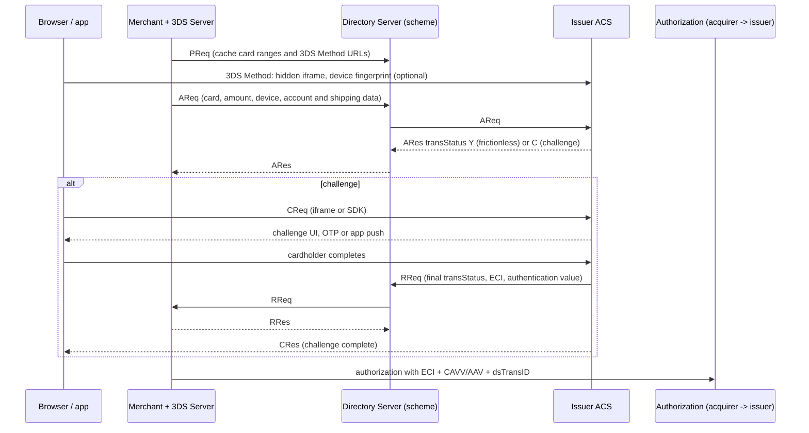

# 3-D Secure and Strong Customer Authentication

> Frictionless vs challenge flows and liability shift.

**Type:** Learn
**Languages:** —
**Prerequisites:** Phase 11, Lesson 01 (How a Card Payment Works); Phase 11, Lesson 02 (Authorization, Capture, Void, Refund); Phase 11, Lesson 03 (ISO 8583)
**Time:** ~75 minutes

## Learning Objectives

- Trace an EMV 3-D Secure 2 authentication through the 3DS Server, Directory Server, and ACS, naming the AReq/ARes, CReq/CRes, and RReq/RRes messages and what each carries
- Distinguish frictionless from challenge flows, explain how the issuer's risk-based authentication decides between them, and read the `transStatus` and ECI values that come back
- State when fraud chargeback liability shifts from merchant to issuer, and when it does not (exemptions, attempts, data-only, soft declines)
- Apply the PSD2 strong customer authentication rules: the three factor categories, dynamic linking, the scope boundaries, and the main exemptions with their thresholds
- Decide, for a given European card-not-present transaction, whether to request authentication, which exemption to claim, and who carries the fraud loss
- Name the common failure modes of 3DS integrations and their effect on conversion

## The Problem

An online electronics retailer in Amsterdam sells headphones to customers across the EEA. In 2019 it added 3-D Secure to every transaction because its acquirer told it to "get ready for PSD2". It integrated the acquirer's hosted 3DS page as a full-page redirect and challenged every customer. Conversion on card payments fell from 71% to 58% within a week. Customers on mobile got an SMS one-time password that arrived after the bank's page had timed out; customers of one German bank were shown a password page they had never registered for; and a share of customers simply closed the tab when the bank's page appeared, because it looked like phishing. The retailer turned 3DS off.

Then the regulation started to be enforced. From January 2021, issuers across the EEA began soft-declining card-not-present transactions that arrived without strong customer authentication and without a valid exemption. The retailer's authorization approval rate on card-not-present traffic dropped by several points, overnight, with decline code `1A` (Visa) and `65` (Mastercard): "additional customer authentication required". Its payments engineer now had to answer a set of questions nobody on the team could answer: which transactions need SCA, which can be exempted and by whom, what happens to fraud liability in each case, and how to get authentication without losing a fifth of checkouts again.

The answers live in two documents that a payments engineer has to hold in their head at once. The EMV 3-D Secure specification defines the protocol: who sends what to whom, and what comes back. PSD2 and its Regulatory Technical Standards on SCA define the law: when authentication is required, what counts as authentication, and which exemptions apply. The card schemes' rules sit on top and define the money: who pays for fraud. This lesson connects all three.

## The Concept

### What 3-D Secure is for

On a card-present transaction the chip proves the card is present (an EMV cryptogram) and the PIN, if used, proves the cardholder knows a secret. On the web neither exists: the merchant sees a card number, an expiry date, and a CVV, all of which are stolen together in a data breach. Card-not-present fraud therefore sits by default with the merchant: if the cardholder says "that was not me", the issuer raises a fraud chargeback (Visa reason code 10.4, Mastercard 4837) and the merchant loses the sale and the goods.

3-D Secure lets the **issuer** authenticate its own cardholder during an online purchase, using whatever the issuer knows about the cardholder and the device. The "three domains" in the name are the acquirer domain (merchant and its 3DS Server), the interoperability domain (the scheme's Directory Server), and the issuer domain (the Access Control Server). If the issuer authenticates the cardholder and the merchant then sends proof of that authentication in the authorization, the issuer cannot later claim the transaction was unauthorized fraud. Liability for fraud chargebacks shifts to the issuer.

### From 3DS1 to EMV 3DS

The first version (Visa's Verified by Visa and Mastercard SecureCode, early 2000s) redirected the cardholder to an issuer page and asked for a static password. It had two fatal properties: every transaction was challenged, and the issuer saw almost nothing about the transaction or device, so it could not tell a risky purchase from a routine one. Abandonment was high and the static password was itself phishable. The schemes retired 3DS1 in October 2022.

EMV 3-D Secure (version 2.1 in 2017, 2.2 in 2018, 2.3.1 in 2022) changed the model. The merchant sends the issuer a rich data set, on the order of 100 to 150 fields: device and browser characteristics, shipping and billing addresses, account age, purchase history with the merchant, whether the shipping address matches billing, and the amount. The issuer's ACS scores the risk and decides. Most transactions are approved without any interaction (**frictionless**). Only risky ones get a **challenge**: a one-time password, a push notification to the bank app, or biometric confirmation. Version 2.2 added fields to request or indicate exemptions, decoupled authentication, and 3RI (requestor-initiated) for merchant-initiated transactions. Version 2.3 added Secure Payment Confirmation and better out-of-band flows.

### The components

| Component | Domain | Operated by | Job |
|-----------|--------|-------------|-----|
| 3DS Requestor | Acquirer | The merchant | Collects checkout data, starts authentication |
| 3DS Server (3DSS) | Acquirer | Merchant's PSP or a 3DS vendor | Builds the AReq, talks to the DS, receives the RReq |
| 3DS SDK | Acquirer | Embedded in the merchant's mobile app | Collects device data and renders native challenge UI |
| Directory Server (DS) | Interoperability | The scheme (Visa, Mastercard Identity Check, Amex SafeKey...) | Routes by card range to the right ACS; stands in when the ACS is unavailable |
| Access Control Server (ACS) | Issuer | The issuer or its vendor | Risk-scores, decides frictionless or challenge, runs the challenge, signs the result |

### The message flow



The pairs:

- **PReq/PRes** (preparation): the 3DS Server periodically downloads the card ranges each DS supports and each range's ACS protocol versions and 3DS Method URL. It is a cache, not a per-transaction call.
- **3DS Method**: before the AReq, the browser loads the ACS's 3DS Method URL in a hidden iframe so the ACS can fingerprint the device directly. The 3DS Server records whether it completed (`threeDSCompInd` = `Y`, `N`, or `U`).
- **AReq/ARes** (authentication request and response): the main exchange, merchant to ACS via the DS. The ARes says frictionless success, failure, or "challenge required".
- **CReq/CRes** (challenge request and response): between the cardholder's browser or app and the ACS directly, not through the merchant. The merchant cannot see the OTP.
- **RReq/RRes** (results request and response): after a challenge, the ACS sends the final result to the 3DS Server via the DS. The merchant learns the outcome from the RReq, not from the browser, so a cardholder who manipulates the browser cannot forge success.

### What comes back: transStatus, ECI, and the cryptogram

| `transStatus` | Meaning | Typical next step |
|---------------|---------|-------------------|
| `Y` | Authenticated (frictionless or after challenge) | Authorize with ECI 05 (Visa) / 02 (Mastercard) and the authentication value |
| `A` | Attempted: issuer or ACS not participating, DS issued a proof of attempt | Authorize with ECI 06 / 01; liability rules vary by scheme and region |
| `C` | Challenge required | Run the challenge; final result arrives in the RReq |
| `D` | Decoupled: the issuer will authenticate out of band (app, call) | Wait for the RReq within the agreed time |
| `N` | Not authenticated, or transaction denied | Do not authorize, or authorize without liability shift if your risk allows |
| `U` | Unable to authenticate (technical problem) | Authorize without shift, or retry later |
| `R` | Rejected by the issuer; do not authorize | Stop |
| `I` | Informational only (a data-only request or an exemption acknowledged) | Authorize; no liability shift |

The **ECI** (Electronic Commerce Indicator) summarises the result for the authorization message. The values differ by scheme, which is a frequent source of bugs in code that was written for one network and extended to another:

| Result | Visa, Amex, Discover ECI | Mastercard ECI |
|--------|--------------------------|----------------|
| Fully authenticated | 05 | 02 |
| Attempted | 06 | 01 |
| Not authenticated, or no 3DS | 07 | 00 |
| Acquirer exemption, data-only, or MIT without authentication | 07 | Separate values for data-only (04), acquirer exemption (06), and recurring MIT (07) |

Scheme rules revise these values; check the current Visa and Mastercard 3DS program guides. Store the ECI exactly as the RReq or ARes delivered it, together with the network, and never derive it from `transStatus` with a single mapping. The **authentication value**, called CAVV at Visa and AAV (carried in UCAF) at Mastercard, is a cryptogram the ACS generates over the transaction; the issuer verifies it during authorization, which ties the authentication to this card, this amount, and this merchant. Both travel in the authorization request (Lesson 03 covers where in ISO 8583; the gateway's API usually exposes them as `eci`, `cavv`, and `ds_transaction_id`).

### Risk-based authentication

The ACS decides frictionless or challenge from a risk score. Inputs: device fingerprint match with past purchases, IP geolocation against billing country, account age at the merchant, shipping address history, transaction amount against the cardholder's usual spend, velocity across merchants, and the issuer's own fraud models. The merchant's data is the lever it controls: a 3DS integration that fills only the mandatory fields gets more challenges than one that sends account age, shipping indicator, and prior authentication data. Issuers publish frictionless rates by merchant data quality; the difference is large.

The merchant can also express a preference with `threeDSRequestorChallengeInd`: no preference, no challenge requested, challenge requested (for example on the first use of a stored card), or challenge mandated (when local regulation requires it). The issuer has the final say; "no challenge requested" is a request, not an instruction.

### Liability shift

The default for card-not-present fraud is that the merchant pays. Authentication moves that liability to the issuer, under conditions that scheme rules define precisely and change regularly:

| Situation | Who carries a fraud chargeback (typical) |
|-----------|------------------------------------------|
| No 3DS, no exemption | Merchant |
| 3DS `Y`, authorization carries ECI 05/02 and a valid CAVV/AAV | Issuer |
| 3DS `A` (attempt) | Usually issuer, with scheme and region exceptions |
| 3DS `N`, `U`, or `R`, merchant authorizes anyway | Merchant |
| Exemption applied by the acquirer (TRA, low value) | Merchant / acquirer |
| Exemption applied by the issuer during 3DS (frictionless under its own TRA) | Issuer |
| Data-only (`I`, no authentication) | Merchant |
| Authorized amount differs materially from authenticated amount | Merchant (the cryptogram no longer matches) |

Liability shift covers only fraud chargebacks. A "goods not received" or "not as described" dispute is unaffected by 3DS. A merchant that sees 3DS as a cure for all chargebacks will be disappointed.

### PSD2 strong customer authentication

The revised Payment Services Directive (Directive (EU) 2015/2366, PSD2), Article 97, requires a payment service provider to apply strong customer authentication when the payer initiates an electronic payment transaction. The Regulatory Technical Standards (Commission Delegated Regulation (EU) 2018/389, "the RTS") define what that means.

**Two of three independent factors.** Knowledge (something only the user knows: a PIN, a password), possession (something only the user has: a phone bound to the account, a hardware token), and inherence (something the user is: a fingerprint, a face). The elements must be independent, so the breach of one does not compromise the others. An SMS OTP counts as possession of the phone number; a CVV printed on the card does not count as knowledge, because it is on the card.

**Dynamic linking.** For remote payments, Article 97(2) and RTS Article 5 require that the authentication code be specific to the amount and the payee, and that the payer be shown both. An OTP that would work for any amount at any merchant is not SCA. This is why the 3DS cryptogram covers the amount, and why authorizing a different amount than was authenticated is a problem.

**Who must apply it.** SCA is the issuer's obligation (the payer's PSP). The merchant cannot perform SCA; it can only give the issuer the chance to, via 3DS, or claim an exemption through its acquirer.

**Scope.** SCA applies to payer-initiated electronic payments where both issuer and acquirer are in the EEA (in the UK, under the UK's onshored version, from March 2022). Out of scope:

- **Merchant-initiated transactions** (MITs): subscription renewals, usage-based charges, delayed charges. The first transaction that sets up the mandate needs SCA; subsequent MITs do not, provided they reference the original.
- **MOTO**: mail and telephone orders are not electronic payments initiated by the payer.
- **One-leg-out**: issuer or acquirer outside the EEA. SCA is applied on a best-effort basis.
- **Anonymous prepaid cards** within limits.

### The exemptions

Exemptions are defined in RTS Articles 10 to 18. Each has an owner: some can be applied only by the issuer, others by either the issuer or the acquirer. When the acquirer applies an exemption, the acquirer (and so the merchant) keeps fraud liability. The issuer may always refuse an exemption and soft-decline, asking for SCA.

| Exemption | RTS article | Condition | Who can apply |
|-----------|-------------|-----------|---------------|
| Low-value remote payment | 16 | Amount at most 30 EUR, and since the last SCA either cumulative amount at most 100 EUR or at most 5 consecutive exempted payments | Issuer or acquirer (the issuer tracks the counters) |
| Contactless at point of sale | 11 | At most 50 EUR, cumulative 150 EUR or 5 consecutive | Issuer |
| Trusted beneficiary (whitelisting) | 13 | Payer added the merchant to a trusted list with SCA | Issuer (merchant can request) |
| Recurring transactions | 14 | Same amount, same payee, after the first with SCA | Issuer |
| Transaction risk analysis (TRA) | 18 | Real-time risk analysis shows low risk, and the PSP's fraud rate is below the threshold for the amount band | Issuer or acquirer, each against its own fraud rate |
| Secure corporate payments | 17 | Dedicated corporate processes (lodged cards, virtual cards in travel systems) | Issuer, with supervisory approval |
| Unattended terminals for transport and parking | 12 | Unattended terminal, transport fare or parking fee | Issuer |

The TRA thresholds for remote card payments (RTS Annex) are the ones engineers memorise:

| Exemption threshold value | PSP's reference fraud rate must be at most |
|---------------------------|--------------------------------------------|
| 100 EUR | 0.13% |
| 250 EUR | 0.06% |
| 500 EUR | 0.01% |

The fraud rate is calculated over the PSP's whole card-not-present volume, not per merchant, and published quarterly to the supervisor. An acquirer with a 0.05% fraud rate can exempt transactions up to 250 EUR; one with 0.08% only up to 100 EUR.

### Flagging an exemption

There are two places to claim an exemption, and they behave differently.

1. **In the authorization, without 3DS.** The acquirer flags the exemption in the authorization request (for example, TRA or low value). It is fast and frictionless. If the issuer accepts, the payment is approved without authentication, and fraud liability stays with the merchant. If the issuer disagrees, it soft-declines and the merchant must run 3DS and retry.
2. **Inside 3DS.** The merchant sends the AReq with a challenge indicator saying an exemption applies (or "no challenge requested"). The issuer can honour it frictionlessly. If the issuer applies its own TRA and returns `Y`, liability shifts to the issuer. The cost is the 3DS round-trip.

The engineering consequence: a checkout that claims exemptions must handle the soft decline and retry with full 3DS automatically, within the same customer session.

### The app channel and the 3DS SDK

In a mobile app (`deviceChannel` 01) there is no browser to load an iframe. The merchant embeds a certified 3DS SDK that collects device data, encrypts it to the Directory Server's public key (so the merchant cannot read or tamper with it), and renders the challenge in native UI that the ACS describes with a defined set of templates: single-select, multi-select, OTP entry, out-of-band ("approve in your bank app"), and HTML as a fallback. The SDK and ACS set up an encrypted channel with an ephemeral key exchange during the ARes, and CReq/CRes then flow directly between them. Two consequences: the app channel converts better because the challenge never leaves the app, and a merchant that implements app checkout through a WebView with the browser flow inherits all the browser flow's failure modes inside a small screen.

### Merchant-initiated transactions and 3RI

Subscriptions, instalments, and "charge the card when the item ships" are merchant-initiated: the cardholder is not present to authenticate. The rules split the lifecycle:

1. The **first** transaction, or the zero-amount setup that stores the card, is customer-initiated and goes through 3DS. The merchant stores the scheme's transaction identifier from the authorization response (Visa calls it the transaction ID, Mastercard the trace ID).
2. **Subsequent** charges are flagged as MITs and reference that identifier. They are out of SCA scope and are not authenticated.
3. When a merchant needs a fresh authentication value without the cardholder present, for example a split shipment that exceeds the original authentication's amount, EMV 3DS 2.2 provides **3RI** (3DS Requestor Initiated): an AReq with `deviceChannel` 03 that the ACS answers from the original authentication.

The common bug is storing the card without authenticating the setup transaction; every later MIT then lacks a valid reference, and issuers decline them as SCA-missing.

### Beyond OTPs: passkeys and delegated authentication

An SMS OTP is possession of a phone number, which SIM-swap fraud defeats. The industry is moving to authentication bound to a device key. EMV 3DS 2.3 supports **Secure Payment Confirmation** (SPC), a W3C standard built on WebAuthn: the browser shows the amount and payee in its own trusted dialog and the cardholder confirms with a platform passkey (fingerprint or face on the phone or laptop). That satisfies possession plus inherence with dynamic linking enforced by the browser, not by a page the merchant could spoof. Visa and Mastercard have each launched passkey programs on top of this. In **delegated authentication**, the issuer allows a trusted party (a wallet, a large merchant) to perform SCA and pass the result in the AReq; the issuer keeps the legal obligation and the liability decision.

### How enforcement actually arrived

PSD2 applied from January 2018 and the RTS from 14 September 2019. The industry was not ready: most merchants still ran 3DS1 and many issuers had no risk-based ACS. In October 2019 the European Banking Authority published an opinion (EBA-Op-2019-11) giving national authorities room to delay enforcement for card-not-present e-commerce until 31 December 2020. Issuers then ramped soft declines during the first half of 2021. The UK's Financial Conduct Authority set its own date, 14 March 2022, after two postponements. The episode is the reason "SCA readiness" was a multi-year program at most European merchants, and the reason every checkout must treat a soft decline as routine rather than exceptional.

### Failure modes

| Failure | What the customer sees | Cause | Mitigation |
|---------|------------------------|-------|------------|
| Challenge abandoned | Closes the bank page | Unfamiliar UI, full-page redirect, slow OTP | Use the in-page iframe or SDK native UI; send rich data to reduce challenges |
| OTP arrives late | Code expired | SMS routing delays, roaming | Prefer app-based push; ACS-side retry; do not shorten timeouts |
| ACS timeout or outage | Payment fails or is unauthenticated | Issuer ACS down or slow | DS stand-in produces `A` or `U`; decide per risk whether to authorize without shift |
| 3DS Method not completed | More challenges | Iframe blocked, ad blockers, 10 second limit | Report `threeDSCompInd` honestly; do not wait indefinitely |
| Amount changes after authentication | Decline or lost liability shift | Shipping recalculated, split shipment | Authenticate the final amount; use the scheme's tolerance rules |
| Soft decline loop | Repeated failure | Exemption claimed, issuer soft-declines, retry also flags exemption | On `1A`/`65`, always retry with full 3DS, never with another exemption |
| Stored card first use without SCA | Later MITs declined | Mandate created without authentication | Authenticate the cardholder-initiated transaction that sets up the mandate, store the scheme transaction id |

### Conversion

3DS1 abandonment was commonly reported in the range of 10% to 25% of challenged transactions. EMV 3DS made most transactions frictionless and moved challenges into the checkout page, and frictionless rates now vary widely by issuer and by merchant data quality. Two levers dominate. The first is data: every optional field the merchant fills (account age, shipping indicator, prior authentication) lowers the issuer's risk score. The second is exemptions: low-value and acquirer TRA exemptions remove 3DS entirely for a large share of transactions, at the price of keeping fraud liability. A payments team measures four rates per issuer and per channel: share sent to 3DS, frictionless rate, challenge success rate, and authorization approval rate after authentication. A drop in any one points to a different fix.

### What 3DS does not do

It does not stop all card-not-present fraud: an issuer can authenticate a fraudster who has taken over the cardholder's phone, and friendly fraud ("I did not buy this" from the real cardholder) still happens. It does not protect against non-fraud disputes. It does not authorize the payment: authentication and authorization are separate steps, and an authenticated transaction can still be declined for insufficient funds. And it does not apply where the cardholder is not present to authenticate: merchant-initiated transactions rely on the authentication of the original mandate.

## Worked Example

A cardholder with a French-issued Visa card buys headphones for 180.00 EUR from the Amsterdam retailer. The acquirer's card-not-present fraud rate last quarter was 0.05%. The cardholder has an account with the merchant created 400 days ago and has bought from it twice.

**Step 1: Is SCA required?** Issuer (France) and acquirer (Netherlands) are both in the EEA, the cardholder initiates the payment, and it is not MOTO. SCA applies unless an exemption does.

**Step 2: Which exemptions are available?** Low value: no, 180 > 30. Recurring: no. TRA by the acquirer: 0.05% is at most 0.06%, so the acquirer may exempt up to 250 EUR; 180 qualifies, if the acquirer's real-time risk analysis scores the transaction low risk.

**Step 3: Choose.** The merchant can (a) flag acquirer TRA in the authorization and skip 3DS, keeping fraud liability, or (b) run 3DS with rich data and request no challenge, hoping for a frictionless `Y` that shifts liability to the issuer. For a 180 EUR order of easily resold electronics, the merchant chooses (b).

**Step 4: The AReq.** An abridged AReq as the 3DS Server sends it:

```json
{
  "messageType": "AReq",
  "messageVersion": "2.2.0",
  "threeDSServerTransID": "8a880dc0-d2d2-4067-bcb1-b08d1690b26e",
  "deviceChannel": "02",
  "messageCategory": "01",
  "purchaseAmount": "18000",
  "purchaseCurrency": "978",
  "purchaseExponent": "2",
  "acctNumber": "4000001234567899",
  "threeDSRequestorChallengeInd": "02",
  "threeDSCompInd": "Y",
  "acctInfo": { "chAccAgeInd": "05", "chAccDate": "20250909", "nbPurchaseAccount": "2" },
  "merchantRiskIndicator": { "shipIndicator": "01", "deliveryTimeframe": "03" },
  "browserIP": "203.0.113.24",
  "browserLanguage": "fr-FR"
}
```

`purchaseAmount` is in minor units with an explicit exponent and an ISO 4217 numeric currency (978 is EUR): the same integer-minor-units discipline as Phase 10, Lesson 01. `deviceChannel` 02 is browser, `messageCategory` 01 is a payment authentication, `threeDSRequestorChallengeInd` 02 is "no challenge requested", and `shipIndicator` 01 says ship to the billing address.

**Step 5: The ARes.** The issuer's ACS scores the device as new (the cardholder switched phones), so it returns `transStatus: "C"` with an `acsURL`. The merchant opens the challenge in an iframe inside the checkout. The browser posts a CReq to the ACS; the bank app on the cardholder's new phone shows "Approve 180.00 EUR at Amsterdam Electronics?" The cardholder approves with a fingerprint: possession of the enrolled device plus inherence, and the screen shows amount and payee, satisfying dynamic linking.

**Step 6: The RReq.** The ACS sends the final result through the DS to the 3DS Server: `transStatus: "Y"`, `eci: "05"`, and an `authenticationValue` (the CAVV). The merchant stores them with the order.

**Step 7: Authorization.** The merchant authorizes 180.00 EUR with ECI 05, the CAVV, and the DS transaction id. The issuer verifies the CAVV and approves.

**Step 8: Three weeks later.** The cardholder disputes the charge as fraud. The issuer's chargeback is blocked by the liability shift: the transaction was fully authenticated. Had the merchant chosen (a), the same dispute would have cost it 180.00 EUR plus a chargeback fee, and had the authorization been for 195.00 EUR (shipping added after authentication), the CAVV would not have covered the amount and the shift would have failed.

### A decision procedure for European card-not-present payments

| Question | If yes | If no |
|----------|--------|-------|
| Is it merchant-initiated, referencing a mandate set up with SCA? | Out of scope; send as MIT with the original scheme transaction id | Continue |
| Is it MOTO or one-leg-out? | Out of scope or best effort; 3DS optional | Continue |
| Is the amount at most 30 EUR? | Claim low value; handle soft decline by retrying with 3DS | Continue |
| Is the acquirer's fraud rate below the TRA threshold for this amount, and is real-time risk low? | Choose: acquirer TRA (merchant keeps liability) or 3DS (liability to issuer) | Run 3DS |
| Did the issuer soft-decline (`1A`, `65`)? | Retry once with full 3DS, challenge allowed | Done |

## Exercises

1. **Reinforce.** For each `transStatus` value (`Y`, `A`, `C`, `D`, `N`, `U`, `R`, `I`), write the action your checkout takes and who carries fraud liability if the payment is authorized anyway. Then list which of them can arrive in an ARes, which in an RReq, and which in both.
2. **Apply.** An acquirer's quarterly card-not-present fraud rate is 0.09%. A merchant sells a 28 EUR item, a 95 EUR item, and a 240 EUR item. For each, state which exemptions the acquirer may claim, which the issuer may apply, and the expected liability holder if the merchant claims every exemption available to it. Then compute the fraud rate the acquirer would need to exempt the 240 EUR item.
3. **Extend.** Combine with Lesson 02 (the authorization state machine): add an `AUTHENTICATING` state before `AUTHORIZED`, with transitions for frictionless success, challenge, challenge timeout, soft decline after an exemption, and retry. Specify which data (ECI, CAVV, dsTransID, exemption flag) must be persisted on each transition so that a dispute six months later can prove which party carried liability.

## Key Terms

| Term | What people say | What it actually means |
|------|-----------------|------------------------|
| 3DS Server | "the 3DS provider" | The acquirer-domain component that builds the AReq, talks to the Directory Server, and receives the RReq |
| ACS | "the bank's 3DS page" | Access Control Server: the issuer's component that risk-scores the AReq, runs the challenge, and signs the result |
| Frictionless flow | "3DS without 3DS" | Authentication completed by the issuer from data alone, with no cardholder interaction; still an authentication with a cryptogram |
| Challenge | "the OTP step" | Active cardholder authentication by the issuer via CReq/CRes: OTP, app push, biometrics |
| CAVV / AAV | "the 3DS token" | The authentication value the ACS generates; passed in the authorization so the issuer can verify that this transaction was authenticated |
| Liability shift | "3DS protects us" | Fraud chargeback liability moving from merchant to issuer when the transaction was authenticated; does not cover non-fraud disputes |
| SCA | "two-factor for payments" | PSD2 strong customer authentication: two independent factors from knowledge, possession, inherence, with dynamic linking for remote payments |
| Soft decline | "a decline" | An issuer response (`1A`, `65`) meaning "authenticate and retry", not "refuse"; the transaction can still succeed |

## Further Reading

- [EMVCo EMV 3-D Secure Protocol and Core Functions Specification](https://www.emvco.com/emv-technologies/3-d-secure/) — the protocol itself: message definitions, every data element, `transStatus` and challenge indicator values
- [Directive (EU) 2015/2366 (PSD2), Article 97](https://eur-lex.europa.eu/eli/dir/2015/2366/oj) — the legal requirement for strong customer authentication and dynamic linking
- [Commission Delegated Regulation (EU) 2018/389 (RTS on SCA)](https://eur-lex.europa.eu/eli/reg_del/2018/389/oj) — the factors, dynamic linking, every exemption, and the TRA fraud-rate table
- [EBA Opinion on the elements of strong customer authentication (EBA-Op-2019-06)](https://www.eba.europa.eu/publications-and-media/press-releases/eba-publishes-opinion-elements-strong-customer-authentication) — what counts as knowledge, possession, and inherence, including why the CVV does not
- [EBA Q&A tool on PSD2](https://www.eba.europa.eu/single-rule-book-qa) — hundreds of answered questions on scope, MITs, one-leg-out, and exemptions; search before guessing
- [W3C Secure Payment Confirmation](https://www.w3.org/TR/secure-payment-confirmation/) — the WebAuthn-based authentication that EMV 3DS 2.3 can use, with dynamic linking shown by the browser
