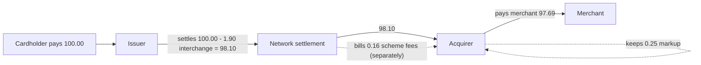

# Interchange, Scheme Fees, and Merchant Pricing

> Who gets paid on a $100 transaction, to the cent.

**Type:** Build
**Languages:** Java, Python, Go
**Prerequisites:** Phase 10 Lesson 01 (Representing Money), Phase 11 Lesson 01 (How a Card Payment Works), Phase 11 Lesson 04 (PANs, Luhn, and BIN Range Routing)
**Time:** ~75 minutes

## Learning Objectives

- Split one card payment into interchange, scheme fees, acquirer margin, and merchant net, and prove that the four parts sum to the gross amount to the minor unit
- Look up interchange by card type, region, and channel from a rate table, and explain why those three attributes (and not the merchant's name) drive the price
- Enforce the two regulatory caps that bound interchange, Regulation II in the US and the Interchange Fee Regulation in the EEA, at table-load time
- Compare IC++ and blended pricing on the same transactions and show where blended pricing loses the acquirer money
- Represent percentage-plus-fixed rates exactly in parts per million and round each fee component exactly once
- Attribute an aggregate fee back to the transactions that caused it with largest-remainder allocation so that the parts sum to the bill

## The Problem

A B2B marketplace signs up with a payment facilitator at 2.9% + 0.30 USD per card transaction, the same blended price every startup gets. For a year the arrangement works for both sides: the marketplace's buyers are small businesses paying with consumer debit and personal credit cards, and the payfac's cost on those cards is well under 2.9%. Then the marketplace lands three enterprise customers whose procurement teams pay with corporate purchasing cards. Average ticket climbs from 80 USD to 4,200 USD. Volume triples. Six weeks later the payfac's finance team flags the account: on commercial cards the interchange alone is 2.70% + 0.10, scheme fees add another 0.14% + 0.02, and on a 4,200 USD ticket the payfac's cost is 119.40 USD against the 122.10 USD it charges. The 2.70 USD left over has to pay for fraud screening, chargeback handling, support, and the payfac's own sponsor bank, and it does not. On a consumer debit card the same ticket would have left the payfac more than 100 USD. The payfac is losing money on the marketplace's best customers.

The marketplace's own finance team has the mirror-image problem. Their CFO asks a reasonable question: "What does a card payment actually cost us, and who gets the money?" The processor's monthly statement shows one line, `Processing fees: 41,812.07`. Nobody can say how much of that went to the card-issuing banks, how much to Visa and Mastercard, and how much the processor kept. Without that split there is nothing to negotiate, no way to know whether steering buyers to ACH would save money, and no way to check whether a sudden cost increase came from a rate change, a card-mix shift, or a processing mistake that pushed transactions into a more expensive category.

Both problems have the same root. A card payment's cost is not a percentage. It is a sum of three components set by three different parties, each with its own rate table, its own rounding, and its own rules about which transactions qualify. This lesson builds the fee engine that computes that sum per transaction: interchange from a table keyed by card type, region, and channel; scheme fees on top; and the acquirer's price on top of that, in both the IC++ and blended models. The engine's one invariant is the subtitle of the lesson: every cent of the gross amount is assigned to exactly one party.

## The Concept

### Four parties, three fees

Lesson 01 of this phase followed the messages. This lesson follows the money. When a cardholder pays 100.00 USD, the merchant does not receive 100.00 USD. Three deductions happen, and they are taken by different parties at different moments.

| Fee | Paid by | Paid to | Set by | When it is taken |
|-----|---------|---------|--------|------------------|
| Interchange | Acquirer | Issuer | The network (Visa, Mastercard), within regulatory caps | At clearing: the issuer settles the purchase amount minus interchange |
| Scheme fees (assessments, network fees) | Acquirer, and separately the issuer | The network | The network | Billed by the network daily or monthly, not netted per transaction |
| Acquirer markup | Merchant | Acquirer | Contract between merchant and acquirer | Netted from the merchant's payout, or debited monthly |

The merchant pays all three in the end, because the acquirer passes interchange and scheme fees through in its price. The sum of the three is the **merchant discount**, and the merchant discount as a percentage of volume is the **merchant discount rate (MDR)** or **merchant service charge (MSC)** in EU regulatory language.



Two things in this picture surprise newcomers. First, **interchange flows from acquirer to issuer**, not from the network. The network sets the rate and runs the settlement, but it never touches interchange itself; the issuer simply pays the acquirer less than the purchase amount. Second, **interchange is the largest component** by a wide margin on credit cards. It is the issuer's revenue for extending credit, carrying fraud risk, and funding rewards. Premium rewards cards exist because interchange pays for the points.

### Why interchange is a table, not a rate

There is no single interchange rate. Visa's US interchange schedule has well over a hundred categories, and Mastercard's is comparable. Each category is a rate (a percentage plus a fixed amount) that applies to transactions matching a set of conditions. The conditions fall into a few families:

| Attribute | Why it changes the price | Examples |
|-----------|--------------------------|----------|
| Card product | Who carries the credit risk and funds rewards | Regulated debit, exempt debit, prepaid, consumer credit, rewards/premium, commercial, purchasing |
| Region | Regulation and cross-border cost | US domestic, intra-EEA, inter-regional, UK-EEA |
| Channel | Fraud liability and evidence | Card present with chip, contactless, card not present, card not present with 3-D Secure (Lesson 06) |
| Merchant category (MCC) | Negotiated industry programs | Supermarkets, utilities, government, charities, airlines |
| Data quality | Evidence that reduces issuer cost | Level 2/3 data on commercial cards (tax amount, line items), AVS results, timely clearing |

A production engine keys on a dozen attributes. This lesson keys on three (card type, region, channel), because those three already produce a factor of ten in price between the cheapest and dearest card for the same 100.00 USD, and because they teach the structure: a deterministic lookup into a table owned by someone else, with a defined failure when no row matches.

The card type comes from the BIN (Lesson 04): the first six to eight digits of the PAN identify the issuer, the product, and the country. The region comes from comparing the issuer country to the acquirer country. The channel comes from the authorization itself (POS entry mode, ISO 8583 field 22, Lesson 03). Every one of those inputs is known at clearing time, which is when interchange is assessed.

### Interchange downgrades

The category a transaction lands in is decided at clearing, not at authorization, and it depends on conditions the merchant controls. If a transaction misses a condition, it falls into a more expensive fallback category. Card people call this a **downgrade**. The common causes:

- **Late clearing.** Many lower-rate categories require clearing within a short window after authorization (often one to two days). A merchant that captures on shipment, five days later, pays a higher "standard" rate.
- **Missing data.** Commercial-card categories with lower rates require Level 2 data (tax amount, customer code) or Level 3 data (line items). Without it, the transaction takes the standard commercial rate.
- **Amount mismatch.** Clearing for more than the authorized amount outside the scheme's tolerance, or without an incremental authorization, can disqualify the transaction.
- **Missing authentication or verification.** No AVS result, no CVV2 match, or no 3-D Secure on a card-not-present transaction in a region where the lower rate requires it.

A downgrade is invisible at authorization. The customer is charged the same amount, the approval looks the same, and the extra cost shows up weeks later on the acquirer's interchange report. An engine that records which category it expected and compares with the category the network assigned is how payments teams find downgrades.

### The regulatory caps

Two regulations bound interchange, and a fee engine must know both because they produce the cheapest rows in the table.

**Regulation II (United States).** The Durbin Amendment to the Dodd-Frank Act (2010) directed the Federal Reserve to cap debit interchange. Regulation II, 12 CFR 235.3, sets the cap at 21 cents plus 5 basis points (0.05%) of the transaction, and 235.4 allows a further 1 cent fraud-prevention adjustment for issuers that meet the Board's standards. The cap applies only to issuers that, with their affiliates, have consolidated assets of 10 billion USD or more. Debit cards from smaller banks and credit unions are **exempt** and earn ordinary, much higher debit interchange. That is why a debit card issued by a community bank costs a merchant several times more than one issued by a megabank. Credit cards are not capped in the US. The Federal Reserve proposed lowering the debit cap in 2023; treat the numbers in this lesson as illustrative and read the current rule before you load them into production.

**Interchange Fee Regulation (European Economic Area).** Regulation (EU) 2015/751 caps interchange on consumer debit at 0.2% and consumer credit at 0.3% of the transaction value, with no fixed component, for transactions where issuer and acquirer are both in the EEA. Premium consumer cards are capped like any other consumer card, which is why European rewards programs are thin. Commercial cards are not capped. Separately, Visa and Mastercard made commitments to the European Commission in 2019 to cap **inter-regional** interchange on transactions at EEA merchants with cards issued outside the EEA: 0.2% debit and 0.3% credit card-present, 1.15% debit and 1.50% credit card-not-present. After Brexit, UK-EEA transactions became inter-regional, and both schemes raised card-not-present rates on them to the 1.15%/1.50% levels in 2021; the UK Payment Systems Regulator has since investigated that increase.

A cap is an invariant on the table, not on a transaction. The table in this lesson rejects an over-cap row when it is loaded. That turns a compliance requirement into a startup failure, which is the cheapest possible time to find it.

### Scheme fees

The networks charge both acquirers and issuers for using the network. Scheme fees are smaller than interchange but more numerous: a US acquirer's Visa invoice has dozens of line items. They group into three kinds:

- **Assessments**: a percentage of volume, on the order of 0.13% to 0.15% for US domestic transactions.
- **Per-transaction fees**: a fixed amount per authorization or clearing message, on the order of 2 cents, often quoted to four decimal places of a dollar (0.0195 USD).
- **Cross-border and currency fees**: an additional percentage when the issuer and acquirer are in different countries or regions, and another when the transaction currency differs from the card's billing currency. These can add 0.4% to more than 1%.

This lesson models scheme fees as an assessment rate (0.14% + 0.02) plus a cross-border rate (0.60%) that applies to inter-regional transactions. Real scheme fees are billed in aggregate, monthly, often with fractional-cent unit prices; exercise 2 makes the engine handle that.

### Merchant pricing: IC++ and blended

The acquirer decides how to package the three components for the merchant. There are three common models.

| Model | Merchant pays | Acquirer margin | Who carries card-mix risk | Typical customer |
|-------|---------------|-----------------|---------------------------|------------------|
| **Blended** (flat) | One rate for every card, e.g. 2.9% + 0.30 | Price minus actual interchange minus scheme fees: varies per transaction, can be negative | Acquirer | Small merchants, startups, payfac sub-merchants |
| **Tiered** (qualified / mid-qualified / non-qualified) | Two or three buckets, with the acquirer deciding which bucket each transaction falls into | Varies, opaque | Mostly the merchant | Legacy US merchant accounts |
| **IC++** (interchange plus plus) | Actual interchange + actual scheme fees + a disclosed markup | The markup, exactly | Merchant | Large merchants; mandatory to offer in the EEA |

The name IC++ is literal: interchange, plus scheme fees, plus the acquirer's markup. Under IC++ the acquirer's margin is predictable and the merchant's cost varies with card mix. Under blended pricing the merchant's cost is predictable and the acquirer's margin varies. Article 9 of the IFR requires EEA acquirers to offer merchant service charges broken down by card category and brand, with separate interchange and scheme fee amounts, unless the merchant asks in writing for blended pricing.

Neither model is wrong. Blended pricing is a risk transfer, and the acquirer prices it with the expected card mix in mind. The marketplace in The Problem broke the assumption the price was built on.

### Worked example by hand: 100.00 USD

Take the demo table and a US consumer credit card used online (card not present), priced IC++ with a markup of 0.20% + 0.05.

```text
gross                                             10000 minor units (100.00 USD)

interchange   1.80% + 0.10:  10000 x 18000 / 1000000 = 180       + 10 = 190   (1.90)
scheme fees   0.14% + 0.02:  10000 x  1400 / 1000000 =  14       +  2 =  16   (0.16)
markup        0.20% + 0.05:  10000 x  2000 / 1000000 =  20       +  5 =  25   (0.25)
merchant discount                                     190 + 16 + 25    = 231   (2.31)
merchant net                                          10000 - 231      = 9769  (97.69)

check: 190 + 16 + 25 + 9769 = 10000
```

Now the same 100.00 USD on each card type, card not present:

| Card type | Interchange rate | Interchange | Scheme | IC++ merchant net | Blended 2.9%+0.30 acquirer margin |
|-----------|------------------|-------------|--------|-------------------|-----------------------------------|
| Regulated debit | 0.05% + 0.22 | 0.27 | 0.16 | 99.32 | 2.77 |
| Exempt debit | 1.65% + 0.15 | 1.80 | 0.16 | 97.79 | 1.24 |
| Consumer credit | 1.80% + 0.10 | 1.90 | 0.16 | 97.69 | 1.14 |
| Premium credit | 2.40% + 0.10 | 2.50 | 0.16 | 97.09 | 0.54 |
| Commercial credit | 2.70% + 0.10 | 2.80 | 0.16 | 96.79 | 0.24 |

Under blended pricing the merchant always nets 96.80. Under IC++ the merchant nets anywhere from 96.79 to 99.32. The blended acquirer's margin on regulated debit is more than eleven times its margin on commercial credit. If the card mix shifts toward commercial, a blended contract that was profitable becomes marginal; at a large ticket with a slightly lower blended rate, it goes negative. The tests construct exactly that: 10,000.00 USD on commercial credit priced at a flat 2.70% leaves the acquirer paying 270.10 interchange and 14.02 scheme fees out of 270.00 revenue, a loss of 14.12.

### Rounding: once per component

Interchange is computed per transaction and rounded per transaction; the network settles exact minor units. The engine therefore rounds each component once, HALF_EVEN, and derives the merchant net by subtraction so that the four parts sum exactly. The alternative, rounding the merchant net independently, produces a split that sums to 99.99 or 100.01 on some amounts, and that cent has to be posted somewhere in a double-entry ledger (Phase 10, Lesson 03).

For 37.77 USD on consumer credit, card not present:

```text
interchange proportional part = 3777 x 18000 / 1000000 = 67.986  -> HALF_EVEN -> 68
interchange                    = 68 + 10                          = 78   (0.78)
scheme proportional part       = 3777 x  1400 / 1000000 = 5.2878 -> 5
scheme                         = 5 + 2                            = 7    (0.07)
markup                         = 3777 x  2000 / 1000000 = 7.554  -> 8, + 5 = 13 (0.13)
merchant net                   = 3777 - 78 - 7 - 13               = 3679 (36.79)
```

Percentages are stored as **parts per million**: 1.80% is 18,000 ppm, 0.05% is 500 ppm, and a four-decimal rate such as 0.0013% is 13 ppm. That keeps every published rate an exact integer, so the only rounding in the system is the one HALF_EVEN step per component. A rate stored as the double `0.018` is already wrong before the first multiplication (Phase 10, Lesson 01).

### Attributing an aggregate fee

Some fees are not per transaction: a 25.00 USD monthly scheme participation fee, a statement fee, a chargeback program fee. Finance teams still want a per-transaction cost, to compute margin per order or per customer. Proportional attribution with naive rounding fails the same way the split fails: three shares rounded independently can sum to 24.99. The engine uses the largest-remainder `allocate` from Phase 10, Lesson 01, with each transaction's amount as its weight.

```text
fee 2500 minor units, weights 10000, 3777, 200 (total 13977)
floor shares:   2500 x 10000 / 13977 = 1788 rem 9124
                2500 x  3777 / 13977 =  675 rem 8025
                2500 x   200 / 13977 =   35 rem 10805
distributed 2498, leftover 2: give to the two largest remainders (c: 10805, a: 9124)
result:         1789, 675, 36  -> 17.89 + 6.75 + 0.36 = 25.00
```

### Complexity

A quote is one hash lookup and a constant number of integer multiplications and divisions: O(1) time and space per transaction. The table has one entry per (card type, region, channel) combination, at most 5 x 3 x 2 = 30 rows here and a few thousand in a production engine that keys on MCC and data level as well. Attribution over n transactions is O(n log n) for the sort inside `allocate`. Overflow is the only numeric risk: `amount x ppm` overflows a 64-bit long above about 9.2 x 10^12 minor units at a 100% rate, and `Money.times` uses `Math.multiplyExact` so that case fails loudly rather than wrapping.

### What this engine does not do

It does not decide the interchange category from raw transaction data. A real engine evaluates qualification rules (clearing timeliness, data level, authentication result, MCC program) to choose among dozens of categories per card type; this one assumes the three key attributes are already known. It does not handle refunds, on which interchange is usually returned to the merchant partially or not at all, depending on scheme and region. It does not model the issuer's own scheme fees, currency conversion fees, chargeback fees, or the scheme incentives and rebates that large merchants and acquirers negotiate privately. It does not compute surcharges: in the US a merchant may add a capped surcharge to credit transactions under scheme rules and state law, while PSD2 Article 62(4) forbids surcharging IFR-capped consumer cards in the EEA. And it does not move money; it produces the numbers a ledger (Phase 10) and a reconciliation job (Phase 12) consume.

## Build It

The code is in `code/java/`. `Money.java` is the Phase 10, Lesson 01 design copied unchanged. Everything else is in `Main.java`.

### Step 1: Rates in parts per million

```java
record Rate(long ppm, long fixedMinor) {
    static final long PPM = 1_000_000;

    static Rate of(String percent, long fixedMinor) {
        int dot = percent.indexOf('.');
        String whole = dot < 0 ? percent : percent.substring(0, dot);
        StringBuilder frac = new StringBuilder(dot < 0 ? "" : percent.substring(dot + 1));
        if (frac.length() > 4) throw new IllegalArgumentException("at most 4 decimals of a percent: " + percent);
        while (frac.length() < 4) frac.append('0');
        return new Rate(Long.parseLong(whole) * 10_000 + Long.parseLong(frac.toString()), fixedMinor);
    }

    Money applyTo(Money amount) {
        Money proportional = amount.times(ppm, PPM, Rounding.HALF_EVEN);
        return proportional.plus(Money.ofMinor(fixedMinor, amount.currency()));
    }
}
```

A rate is published as a string such as "1.80% + $0.10", so `Rate.of` parses the percentage as a string. One percent is 10,000 ppm, so the integer part is multiplied by 10,000 and up to four fractional digits are padded and added. A fifth decimal is rejected rather than truncated; truncating a published rate is a silent price change. `applyTo` is the single place a fee is rounded.

Predict: what does `Rate.of("0.05", 22).applyTo(2.00 USD)` return, and what fraction of the ticket is that?

### Step 2: The interchange table and its caps

```java
final class InterchangeTable {
    static final long IFR_DEBIT_CAP_PPM = 2_000;
    static final long IFR_CREDIT_CAP_PPM = 3_000;
    static final Rate REG_II_CAP = new Rate(500, 22);

    private final Map<RateKey, Rate> rates = new HashMap<>();

    InterchangeTable put(CardType type, Region region, Channel channel, Rate rate) {
        RateKey key = new RateKey(type, region, channel);
        checkCaps(key, rate);
        rates.put(key, rate);
        return this;
    }

    Rate lookup(CardType type, Region region, Channel channel) {
        RateKey key = new RateKey(type, region, channel);
        Rate rate = rates.get(key);
        if (rate == null) throw new NoRateException(key);
        return rate;
    }
}
```

`RateKey` is a record, so its `equals` and `hashCode` cover all three fields and it works directly as a `HashMap` key. A missing row throws `NoRateException`, which is deliberate: a default rate hides a hole in the table, and the hole is usually a product the business did not expect to see (an EEA card on a US-only merchant, a new commercial product). The caps are checked in `put`:

```java
static void checkCaps(RateKey key, Rate rate) {
    if (key.region() == Region.EEA_DOMESTIC && key.cardType().isConsumer()) {
        long cap = key.cardType().isDebit() ? IFR_DEBIT_CAP_PPM : IFR_CREDIT_CAP_PPM;
        if (rate.ppm() > cap || rate.fixedMinor() > 0) {
            throw new IllegalArgumentException("IFR cap exceeded for " + key + ": " + rate);
        }
    }
    if (key.region() == Region.US_DOMESTIC && key.cardType() == CardType.CONSUMER_DEBIT_REGULATED) {
        if (rate.ppm() > REG_II_CAP.ppm() || rate.fixedMinor() > REG_II_CAP.fixedMinor()) {
            throw new IllegalArgumentException("Regulation II cap exceeded for " + key + ": " + rate);
        }
    }
}
```

The IFR check rejects any fixed component on consumer cards, because the regulation caps the fee as a percentage of value; a 0.20% + 0.01 debit rate would exceed the cap on every ticket under 5.00 EUR.

Predict: the demo table has no row for `CONSUMER_DEBIT_EXEMPT` in the EEA. Is that a bug in the table, or is it modelling something true about the EEA?

### Step 3: Scheme fees

```java
record SchemeFees(Rate assessment, long crossBorderPpm) {
    Money feeFor(Money amount, Region region) {
        Money fee = assessment.applyTo(amount);
        if (region == Region.INTER_REGIONAL) {
            fee = fee.plus(amount.times(crossBorderPpm, Rate.PPM, Rounding.HALF_EVEN));
        }
        return fee;
    }
}
```

The scheme fee is computed independently of interchange because it is billed independently. The cross-border part is a second rounded term rather than being added to the assessment ppm; that mirrors how networks list it as its own line item, and it means the cross-border fee can be reported on its own.

Predict: on 100.00 EUR inter-regional, what are the two terms, and what is their sum?

### Step 4: Pricing as a sealed interface

```java
sealed interface Pricing permits Pricing.IcPlusPlus, Pricing.Blended {
    record IcPlusPlus(Rate markup) implements Pricing {}
    record Blended(Rate merchantRate) implements Pricing {}
}
```

A sealed interface with two records makes the pricing model a closed set. The `switch` in Step 6 has no `default` branch, so adding a third model (tiered pricing, exercise 1) is a compile error at every place that must handle it.

Predict: under which model can `acquirerMargin` be negative, and what does a negative margin mean in ledger terms?

### Step 5: The breakdown and its invariant

```java
record FeeBreakdown(Money gross, Rate interchangeRate, Money interchange, Money schemeFees,
                    Money acquirerMargin, Money merchantNet) {
    FeeBreakdown {
        Money total = Money.sum(gross.currency(), interchange, schemeFees, acquirerMargin, merchantNet);
        if (!total.equals(gross)) {
            throw new IllegalStateException("fee split does not sum to gross: " + total + " != " + gross);
        }
    }

    Money merchantDiscount() { return gross.minus(merchantNet); }
}
```

The invariant lives in the compact constructor, so no code path can produce a breakdown that loses or invents a cent. `Money.sum` also enforces a single currency, so a breakdown with a USD gross and an EUR interchange cannot exist either.

Predict: why is `merchantDiscount` derived rather than stored?

### Step 6: The engine

```java
FeeBreakdown quote(Transaction tx, Pricing pricing) {
    Money gross = tx.amount();
    Rate icRate = table.lookup(tx.cardType(), tx.region(), tx.channel());
    Money interchange = icRate.applyTo(gross);
    Money schemeFees = scheme.feeFor(gross, tx.region());
    Money merchantDiscount = switch (pricing) {
        case Pricing.IcPlusPlus p -> interchange.plus(schemeFees).plus(p.markup().applyTo(gross));
        case Pricing.Blended b -> b.merchantRate().applyTo(gross);
    };
    Money acquirerMargin = merchantDiscount.minus(interchange).minus(schemeFees);
    Money merchantNet = gross.minus(merchantDiscount);
    return new FeeBreakdown(gross, icRate, interchange, schemeFees, acquirerMargin, merchantNet);
}
```

The two models differ in exactly one line: how the merchant discount is computed. Under IC++ it is built bottom-up from costs; under blended it is the contract rate. Everything else is derived by subtraction, which is what makes the invariant hold by construction rather than by luck. The breakdown records the `Rate` that was applied, so a downstream report can show which category was used and a reconciliation job can compare it with the network's interchange report.

Predict: for 2.00 USD regulated debit card present, compute the IC++ and the blended merchant net by hand before running the demo.

### Step 7: Attribution with allocate

```java
static Money[] attribute(Money aggregateFee, List<Transaction> txs) {
    long[] weights = new long[txs.size()];
    for (int i = 0; i < weights.length; i++) {
        Money amount = txs.get(i).amount();
        if (!amount.currency().equals(aggregateFee.currency())) throw new CurrencyMismatchException(amount.currency(), aggregateFee.currency());
        weights[i] = amount.minorUnits();
    }
    return aggregateFee.allocate(weights);
}
```

The weights are minor units, which are exact integers, so `allocate` can use them as ratios directly. The currency check runs before allocation because a weight in the wrong currency is meaningless as a ratio even though it is a valid number.

Predict: if all three transactions were 33.33 USD and the fee 1.00 USD, which transaction gets the extra cent?

### Step 8: Run it

```bash
cd phases/11-payment-rails/07-interchange-and-scheme-fees/code/java
javac -d .out *.java && java -cp .out Main
java -cp .out MainTest
```

Expected output, abbreviated:

```console
== Who gets paid on 100.00 USD (US consumer credit, card-not-present, IC++) ==
issuer   (interchange 1.80% + 0.10)   1.90 USD
network  (assessment 0.14% + 0.02)    0.16 USD
acquirer (markup 0.20% + 0.05)        0.25 USD
merchant (net settlement)             97.69 USD
sum                                   100.00 USD

== Small tickets: 2.00 USD regulated debit ==
regulated debit IC++     gross 2.00 USD  IC 0.22 USD  scheme 0.02 USD acquirer 0.05 USD  merchant 1.71 USD (1450 bps ...)
regulated debit blended  gross 2.00 USD  IC 0.22 USD  scheme 0.02 USD acquirer 0.12 USD  merchant 1.64 USD (1800 bps ...)

== EEA: IFR caps and cross-border ==
EEA premium credit CP    gross 100.00 EUR  IC 0.30 EUR  scheme 0.16 EUR ...
inter-regional credit CNP gross 100.00 EUR IC 1.50 EUR  scheme 0.76 EUR ...
rejected: IFR cap exceeded for RateKey[cardType=CONSUMER_CREDIT, region=EEA_DOMESTIC, channel=CARD_PRESENT]: 0.35% + 0
rejected: no interchange rate for RateKey[cardType=CONSUMER_DEBIT_EXEMPT, region=EEA_DOMESTIC, channel=CARD_PRESENT]

== Attributing a 25.00 USD monthly scheme fee to three transactions ==
a 100.00 USD -> 17.89 USD
b 37.77 USD -> 6.75 USD
c 2.00 USD -> 0.36 USD
sum = 25.00 USD
33 passed, 0 failed
```

The small-ticket lines are worth a second look. A "low" regulated debit rate of 0.05% + 0.22 is 11% of a 2.00 USD ticket, because the fixed part dominates. That is why coffee shops prefer credit for small tickets in some markets, and why schemes publish separate small-ticket categories.

### In Python

The full port is `code/python/main.py` (same `Rate`, `InterchangeTable`, `SchemeFees`, `FeeBreakdown`, `FeeEngine`; tests in `code/python/test_main.py`). Lessons are self-contained, so `Money` is copied into the same file rather than a second module. Three things differ:

- **The sealed interface becomes two frozen dataclasses and a `match`.** `Pricing` is a plain base class with `IcPlusPlus(markup)` and `Blended(merchant_rate)` as its only subclasses (also reachable as `Pricing.IcPlusPlus` and `Pricing.Blended`, as in Java). Python cannot forbid a third subclass at compile time, so `quote` keeps a `case _` that raises `TypeError`, which is the runtime equivalent of the exhaustiveness check the Java `switch` gets for free:

```python
match pricing:
    case IcPlusPlus(markup=markup):
        merchant_discount = interchange.plus(scheme_fees).plus(markup.apply_to(gross))
    case Blended(merchant_rate=merchant_rate):
        merchant_discount = merchant_rate.apply_to(gross)
    case _:
        raise TypeError(f"unknown pricing model: {pricing!r}")
```

- **No overflow, same rounding.** `amount x ppm` cannot overflow an `int`, so `multiplyExact` disappears, but every proportional fee still goes through `divide_rounded` (Phase 10, Lesson 01), which truncates toward zero on magnitudes rather than using `//`; `effective_rate_bps` uses it too. `Rate.of` parses the percent with `str.partition` and `ljust(4, "0")`, never through a float, and `Rate.__str__` reproduces Java's `1.80% + 10` rendering so the demo output is identical line for line.
- **Messages match Java's record rendering.** `RateKey.__str__` prints `RateKey[cardType=..., region=..., channel=...]` so the `NoRateError` and cap-violation messages read the same in both languages. `NoRateError` extends `RuntimeError`, the `FeeBreakdown` invariant raises `RuntimeError` (Java's `IllegalStateException`), and argument errors are `ValueError`.

```bash
cd phases/11-payment-rails/07-interchange-and-scheme-fees/code/python
python3 main.py
python3 -m unittest -v
```

### In Go

The full port is `code/go/main.go` (same `Rate`, `InterchangeTable`, `SchemeFees`, `FeeBreakdown`, `FeeEngine`; tests in `code/go/main_test.go`). `Money` is the canonical Go `Money` from Phase 10, Lesson 01, copied into `code/go/money.go`. Three things differ:

- **The sealed interface is an interface with an unexported marker method.** Only types in this package can implement `pricing()`, so `IcPlusPlus` and `Blended` are the whole set, as `permits` guarantees in Java. Go's type switch is not checked for exhaustiveness, so `Quote` keeps a `default` branch that returns an error instead of silently charging nothing:

```go
type Pricing interface{ pricing() }

type IcPlusPlus struct{ Markup Rate }
type Blended struct{ MerchantRate Rate }

func (IcPlusPlus) pricing() {}
func (Blended) pricing()    {}
```

- **Every arithmetic step returns an error, so overflow is impossible to ignore.** `Money.Times` and `Plus` return `(Money, error)` where Java's `multiplyExact` and `addExact` throw, so `Rate.ApplyTo`, `SchemeFees.FeeFor`, `Quote`, `Attribute` and `Total` all return `(T, error)` and the chain stops at the first failure. `NoRateException` is `ErrNoRate`, the `FeeBreakdown` invariant is `ErrInvariant`, cap and argument violations are `ErrInvalidArgument`, and the mixed-currency attribution is `Money`'s own `ErrCurrencyMismatch`; the tests assert the kind with `errors.Is`. `MerchantDiscount()` and `EffectiveRateBps()` stay error-free because the constructor already proved the parts share a currency and sum to gross.
- **Enums are typed integer constants with a `String()`.** `CardType`, `Region` and `Channel` print their Java names, `CardTypes` and `Channels` stand in for `values()`, and `RateKey.String()` prints `RateKey[cardType=..., region=..., channel=...]`, so the demo output, including the two `rejected:` lines, is byte-identical to Java. `RateOf` parses the percent with `strings.Cut` and zero-padding, never through a `float64`.

```bash
cd phases/11-payment-rails/07-interchange-and-scheme-fees/code/go
go run .
go test ./...
```

## Use It

**Scheme schedules.** Visa and Mastercard publish their US interchange schedules (Visa USA Interchange Reimbursement Fees, Mastercard U.S. Region Interchange Programs and Rates) twice a year, in April and October. They are PDFs with hundreds of rows and qualification footnotes. Acquirers transcribe them into tables like this one, keyed on far more attributes. The European Commission and national central banks publish IFR implementation guidance, and the schemes publish EEA rates per country.

**Acquirer reports.** Adyen's Settlement details report and Interchange++ reports, Stripe's balance transactions with fee details (and its IC+ pricing for large accounts), Worldpay and Fiserv's interchange qualification reports all expose the same three components per transaction. The single most useful column is the interchange category actually assigned, because comparing it with the category you expected is how downgrades are found.

**Interchange optimisation.** Processors sell "Level 2/3 data" and "interchange optimisation" products for commercial-card merchants. They populate tax, customer code, and line-item fields on clearing records so that transactions qualify for lower commercial categories. The savings are real on B2B volume, typically several tenths of a percent, and are a direct application of the table in this lesson.

**Least-cost routing.** Regulation II (12 CFR 235.7) requires US debit cards to support at least two unaffiliated networks, and lets the merchant choose. PIN-less debit networks (Star, NYCE, Pulse, Accel) often have lower fees than the card's front-of-card brand. A fee engine that can quote the same transaction on two networks is the core of a least-cost routing decision.

**The trap.** Every production fee engine ends up with a "default" category for rows nobody loaded. Keep the `NoRateException` and route it to an alert rather than a fallback rate. The default is where a brand-new card product sits for six months, priced wrong, until finance notices.

## Ship It

`outputs/checklist-card-fee-engine.md` is a review checklist for any system that computes, reports, or reconciles card processing fees: numeric representation, table ownership and caps, rounding policy, the sum-to-gross invariant, downgrade detection, and blended-pricing margin monitoring. Use it when designing a merchant pricing system, when reviewing a reconciliation job against an acquirer's fee report, or before signing a blended pricing contract with a mix you have not measured.

## Exercises

1. **Reinforce.** Add a third pricing model, `Tiered(Rate qualified, Rate midQualified, Rate nonQualified)`, where the bucket is chosen from the interchange rate: below 1.70% is qualified, below 2.30% is mid-qualified, everything else non-qualified. Because `Pricing` is sealed, the compiler will show every place that must change. Add tests that the invariant still holds and that a premium card always lands in non-qualified.
2. **Apply.** Real per-transaction scheme fees are quoted to fractions of a cent (0.0195 USD) and billed monthly. Change `SchemeFees` to accumulate the per-transaction fee in a finer unit (ten-thousandths of a dollar) across a month of transactions, round once on the monthly total, and then use `attribute` to push the rounded total back onto transactions. Show that the per-transaction sum equals the invoice and that rounding per transaction instead would over- or under-charge by up to half a cent per transaction.
3. **Extend.** Combine this lesson with Lesson 04 (BIN ranges): build a `classify(String pan, String acquirerCountry, Channel channel)` that derives `CardType` and `Region` from a BIN table with issuer country and product fields, then quotes the transaction. Feed it a month of synthetic transactions with a card mix that shifts from 10% to 40% commercial over four weeks, and report the blended acquirer margin per week. At what commercial share does the 2.9% + 0.30 contract stop covering a 0.25% operating cost?

## Key Terms

| Term | What people say | What it actually means |
|------|-----------------|------------------------|
| Interchange | "Visa's fee" | The fee the acquirer pays the issuer on each purchase, set by the network within regulatory caps; the network does not keep it |
| Scheme fees | "network fees", "assessments" | Fees the network charges acquirers and issuers for using the network: volume assessments, per-transaction fees, cross-border fees |
| Merchant discount rate | "the processing rate" | Everything the merchant pays as a share of volume: interchange plus scheme fees plus the acquirer's markup |
| IC++ | "interchange plus" | Pricing that passes actual interchange and scheme fees through and adds a disclosed acquirer markup; the merchant carries card-mix risk |
| Blended pricing | "flat rate" | One price for every card; the acquirer's margin absorbs card-mix variation and can be negative |
| Downgrade | "we got hit with non-qualified" | A transaction that cleared into a more expensive interchange category because it missed a qualification condition |
| Regulated debit | "Durbin debit" | US debit issued by a bank with at least 10 billion USD in assets; interchange capped at 0.05% + 0.21 + 0.01 by Regulation II |
| IFR caps | "the EU cap" | Regulation 2015/751 limits on consumer card interchange in the EEA: 0.2% debit, 0.3% credit, percentage only |

## Further Reading

- [Regulation II, 12 CFR Part 235](https://www.ecfr.gov/current/title-12/chapter-II/subchapter-A/part-235) — the US debit interchange cap, the fraud-prevention adjustment, and the network exclusivity and routing rules, in the regulation's own text
- [Regulation (EU) 2015/751 on interchange fees for card-based payment transactions](https://eur-lex.europa.eu/eli/reg/2015/751/oj) — the EEA caps (Articles 3-4), the exclusions for commercial cards, and the unblending requirement in Article 9
- [Visa USA Interchange Reimbursement Fees](https://usa.visa.com/support/small-business/regulations-fees.html) — the published US schedule, with qualification criteria for each category; read the footnotes, not just the rates
- [Mastercard Interchange Rates and Programs](https://www.mastercard.us/en-us/business/overview/support/merchant-interchange-rates.html) — the corresponding Mastercard schedules, including commercial Level 2 and Level 3 programs
- [European Commission decision on Visa and Mastercard inter-regional interchange commitments (cases AT.39398 and AT.40049, 2019)](https://ec.europa.eu/competition/elojade/isef/case_details.cfm?proc_code=1_39398) — the source of the 0.2/0.3/1.15/1.50 inter-regional caps
- [Federal Reserve Regulation II debit interchange data collections](https://www.federalreserve.gov/paymentsystems/regii-data-collections.htm) — the biennial reports on issuer costs, interchange revenue, and fraud losses that the cap is calibrated against
