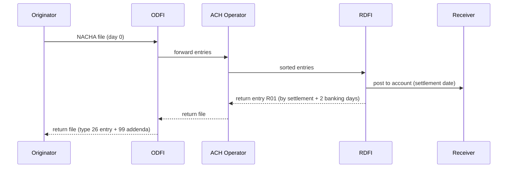

# ACH and the NACHA File Format

> Fixed-width records, batch headers, and returns that arrive days later.

**Type:** Build
**Languages:** Java, Python, Go
**Prerequisites:** Phase 10 Lesson 01 (Representing Money), Phase 11 Lesson 04 (PANs, Luhn, and BIN Range Routing), Phase 0 Lesson 06 (Reading a Spec)
**Time:** ~120 minutes

## Learning Objectives

- Lay out the six Nacha record types as 94-character fixed-width lines and explain why every position is 1-based, padded, and never truncated for numbers
- Compute the entry hash, the entry/addenda count, and the debit and credit totals, and verify a received file by recomputing them
- Pad a file to a multiple of ten records with 9-filler and derive the block count that the File Control record declares
- Validate an ABA routing number with the 3-7-1 mod-10 check digit and explain what it catches that Luhn would not
- Distinguish SEC codes (PPD, CCD, WEB) from transaction codes (22, 27, 32, 37) and build a return entry that carries a reason code and the original trace number
- State the two return windows (two banking days, sixty calendar days) and decide whether an R01 can be re-presented

## The Problem

A payroll provider sends an ACH file to its bank (the ODFI) every Thursday at 17:00 for Friday settlement. One week the file carries 4,812 direct deposits totalling 9,406,118.44 USD. At 17:04 the bank's ingestion system rejects the whole file with a one-line reason: `BATCH 1 ENTRY HASH MISMATCH`. Nothing settles on Friday. Four thousand employees do not get paid, the provider's support queue fills in an hour, and the engineer on call is reading a PDF of record layouts for the first time.

The cause was a change to the employee onboarding form the previous Monday. It began accepting routing numbers with a leading space, which the entry writer passed through unchanged. The space landed in position 4 of one Entry Detail record. The receiving DFI identification field (positions 4 to 11) now read ` 0119999` instead of `01199999`. The bank's parser read it as a different eight-digit number, summed it into its own entry hash, and compared that hash with the one the provider had written in the Batch Control record. They differed by exactly the difference between those two numbers. The parser was right to reject: a file whose declared totals do not match its contents is a file nobody should settle.

The second failure is slower and more expensive. A subscription business debits customers' bank accounts through WEB entries. Settlement arrives Tuesday and the business ships the goods. Thursday afternoon a return file arrives: forty-one entries came back `R01 Insufficient Funds`, two came back `R02 Account Closed`, and one, from a customer who signed up eight weeks earlier, came back `R10 Not Authorized`. The business had treated "settled" as "final". ACH has no such moment. An RDFI has two banking days to return most entries and sixty calendar days to return an unauthorized consumer debit, and the Originator who ignores that calendar discovers it one return at a time.

Both failures are format failures in the strict sense. ACH is not an API. It is a batch file whose grammar is a set of tables in the Nacha Operating Rules, and the only error message the rail gives you is a rejection or a return. This lesson builds a writer and a verifying parser for that grammar so that the file you send is one the bank will accept, and so that the return file the bank sends you is one your system understands.

## The Concept

### What ACH is

The Automated Clearing House network moves money between US bank accounts in batches. An Originator (a payroll company, a utility, a merchant) hands entries to its bank, the Originating Depository Financial Institution (ODFI). The ODFI forwards them to an ACH Operator (the Federal Reserve's FedACH or The Clearing House's EPN), which sorts them by receiving bank and delivers them to each Receiving Depository Financial Institution (RDFI). The RDFI posts them to its customers' accounts. Settlement between banks happens on the books of the Federal Reserve, on the settlement date, in net.

Two consequences matter for an engineer:

- **There is no synchronous response.** The ODFI accepts or rejects the file; after that, the only feedback is a return entry, days later, in another file.
- **The rail carries a credit or a debit, never both in one entry.** A payroll deposit is a credit to the employee's account. A bill payment pulled from a customer is a debit. Direction lives in the transaction code, and the amount is always a non-negative count of cents.



### The file as a grammar

A Nacha file is a sequence of 94-character records. The first character is the record type and determines the layout of the remaining 93. There are six types, nested like brackets:

| Type | Name | Count | Role |
|------|------|-------|------|
| 1 | File Header | one | Who sends, who receives, when, and the format parameters (`094` record size, `10` blocking factor, format code `1`) |
| 5 | Batch Header | one per batch | The company, the SEC code, the entry description shown on statements, the effective entry date |
| 6 | Entry Detail | one per payment | Transaction code, receiving DFI, account, amount in cents, receiver name, trace number |
| 7 | Addenda | zero or one per entry here | Type 05: free text that rides with the payment. Type 99: a return reason and the original trace |
| 8 | Batch Control | one per batch | Entry/addenda count, entry hash, total debits, total credits |
| 9 | File Control | one | Batch count, block count, and the same totals for the whole file |

After the File Control, the file is padded with lines of 94 nines until the total number of lines is a multiple of ten. The padding is a leftover from magnetic tape blocking, and it is still mandatory: the File Control record declares the block count, and a file whose line count does not match is malformed.

Fields are described by 1-based inclusive positions. "Positions 30-39, Amount, numeric, right-justified, zero-filled" means characters 30 through 39, which in a zero-based language is `line[29:39]`. Two field classes have different padding rules:

- **Alphameric** fields are left-justified, space-filled, and may be truncated. A 30-character company name goes into a 16-character field as its first 16 characters.
- **Numeric** fields are right-justified and zero-filled. A number that does not fit is an error. Truncating an amount from the left would silently change the money; this is the one place where the writer must refuse rather than coerce.

### The invariant: declared totals equal computed totals

The Batch Control record carries four numbers that are redundant with the entries above it: the entry/addenda count, the entry hash, the total debit amount, and the total credit amount. The File Control repeats them for the whole file and adds the batch count and block count. The receiver recomputes every one and compares. Any mismatch rejects the batch or the file.

This redundancy is the whole integrity model of the format. There is no checksum over the bytes and no signature inside the file (the 19-character Message Authentication Code field in the Batch Control is reserved and almost always blank). What the format protects against is the class of failure in The Problem: a line dropped, a line duplicated, a field shifted, a digit changed. Each of those changes at least one of the four totals.

The **entry hash** deserves attention because it is unusual. It is the arithmetic sum of the eight-digit receiving DFI identification numbers of every Entry Detail record in the batch, truncated to its rightmost ten digits. The ninth digit of each routing number (the check digit) is excluded. For the three-entry payroll batch in the code:

```text
01199999
06199999
12199999
--------
19599997   -> entry hash 0019599997 (fits in 10 digits, no truncation)
```

Why sum routing numbers and not amounts? Because the amounts are already totalled, and the entry hash catches a different error: an entry routed to the wrong bank with the right amount. Why truncate to ten digits rather than reject overflow? Because the field is ten digits wide, and a batch of 100,000 entries to banks with routing prefixes near 99999999 sums past 10^10. The truncation is a modulus: `sum mod 10,000,000,000`. Both sides apply the same rule, so both sides agree.

```text
entryHash([99999999, 99999999, 00000003])
= 199999998 + 3 = 200000001          <- 9 digits, fits
entryHash(101 copies of 99999999)
= 10099999899  -> mod 10^10 -> 0099999899
```

### Trace numbers

Every Entry Detail carries a 15-digit trace number: the ODFI's eight-digit routing prefix followed by a seven-digit sequence that the ODFI (or the Originator, with the ODFI's agreement) assigns in ascending order within the batch. The trace number is the only identifier that survives the trip. When an RDFI returns an entry, the type 99 addenda carries the original entry's trace number in positions 7-21, and that is how the Originator's system matches the return to the payment it sent. A system that does not persist its trace numbers cannot process its own returns.

### SEC codes and transaction codes

Learners conflate these because both are "codes on the entry". They answer different questions.

The **Standard Entry Class code** (three letters, in the Batch Header, one per batch) answers "under which chapter of the rules was this authorized?" It determines what evidence of authorization the Originator must keep, what the RDFI may return, and what the statement description must look like.

| SEC | Name | Receiver | Authorization | Typical use |
|-----|------|----------|---------------|-------------|
| PPD | Prearranged Payment and Deposit | Consumer | Written or similarly authenticated, standing | Payroll credits, recurring bill debits |
| CCD | Corporate Credit or Debit | Business | Agreement between the two companies | Vendor payments, intercompany sweeps |
| WEB | Internet-Initiated/Mobile Entry | Consumer | Online, with Originator fraud detection and account validation required by the rules | E-commerce debits, subscription billing |

The **transaction code** (two digits, in each Entry Detail) answers "which kind of account, and which direction?" The tens digit is the account type: 2 for checking, 3 for savings. The ones digit is the direction and purpose:

| Code | Account | Meaning |
|------|---------|---------|
| 22 | Checking | Credit (deposit) |
| 23 | Checking | Prenotification of a credit; zero amount |
| 27 | Checking | Debit (withdrawal) |
| 28 | Checking | Prenotification of a debit; zero amount |
| 21 / 26 | Checking | Return of a credit / return of a debit |
| 32 / 37 | Savings | Credit / debit |
| 33 / 38 | Savings | Prenote credit / prenote debit |
| 31 / 36 | Savings | Return of a credit / return of a debit |

A prenote (code 23 or 28) is a zero-dollar entry sent to verify that the account exists before the first live entry; the code enforces the zero amount. The Batch Header's service class code (200 mixed, 220 credits only, 225 debits only) must agree with the transaction codes inside the batch; a debit in a 220 batch is a format error.

### Returns

A return is a new Entry Detail record, transaction code 21, 26, 31, or 36, sent by the RDFI back toward the Originator, followed by a mandatory type 99 addenda record that carries:

- the three-character **return reason code** (positions 4-6),
- the **original entry trace number** (positions 7-21),
- the **original receiving DFI identification** (positions 28-35),
- optional addenda information, and the trace number of the return itself.

The reason codes that a payments team sees most, from Nacha's Appendix Four:

| Code | Reason | Window | Re-present? |
|------|--------|--------|-------------|
| R01 | Insufficient funds | 2 banking days | Yes, at most twice more |
| R02 | Account closed | 2 banking days | No; stop and ask for a new account |
| R03 | No account / unable to locate | 2 banking days | No |
| R04 | Invalid account number structure | 2 banking days | No |
| R07 | Authorization revoked by customer | 60 calendar days | No; the authorization is dead |
| R08 | Payment stopped | 2 banking days | No |
| R09 | Uncollected funds | 2 banking days | Yes, at most twice more |
| R10 | Customer advises not authorized / originator not known | 60 calendar days | No; counts toward the unauthorized return rate threshold |
| R11 | Entry not in accordance with the authorization | 60 calendar days | No; may be re-initiated only after correcting the error |
| R29 | Corporate customer advises not authorized | 2 banking days | No |

Two windows exist because the rules distinguish operational failures from authorization disputes. A bank knows within a day whether an account exists or has funds, so it gets two banking days after the settlement date. A consumer may not notice an unauthorized debit until the next statement, so the RDFI gets sixty calendar days from settlement for R05, R07, R10, and R11. A return transmitted after its window is itself a rule violation and the ODFI may dishonour it.

Worked example: an entry settles on Thursday 2026-10-15. The two-banking-day deadline counts Friday the 16th as day one, skips Saturday and Sunday, and lands on Monday the 19th as day two. A return dated the 19th is timely; one dated the 20th is late. The sixty-calendar-day deadline for an R10 is 2026-12-14. The code computes both and the tests pin them down.

Re-presentment is restricted. Only R01 and R09 may be re-presented, up to two more times, within 180 days of the original settlement date, and the entry description must say `RETRY PYMT`. Every other reason means stop. The rules also cap an Originator's unauthorized return rate (R05, R07, R10, R11, R29, R51) at 0.5 percent and its overall return rate at 15 percent, measured over sixty days; an Originator that exceeds them is investigated by its ODFI. A system that does not classify its returns cannot tell whether it is approaching those thresholds.

### Same-day ACH and settlement windows

Standard ACH entries settle on the next banking day or the one after, depending on when the ODFI received them. Since 2016 the operators also run Same Day ACH: an entry whose Effective Entry Date (Batch Header, positions 70-75) is today's date and which reaches the operator before one of the same-day submission deadlines settles that afternoon or evening. The windows (Eastern Time, FedACH schedule) are:

| Window | Operator deadline | Settlement | Typical use |
|--------|-------------------|------------|-------------|
| Same Day 1 | 10:30 | 13:00 | Payroll corrections, urgent payouts |
| Same Day 2 | 14:45 | 17:00 | Bill payments received that morning |
| Same Day 3 | 16:45 | 18:00 | Late-day settlement; added in 2021 |
| Next Day (standard) | after 16:45 (varies by ODFI) | Next banking day | Scheduled payroll, recurring debits |

Three rules follow from this that a file writer has to respect. The Effective Entry Date must be a valid banking day; an operator that receives a date on a weekend or a Federal Reserve holiday rolls it forward and may charge for the correction. A same-day entry is capped at 1,000,000.00 USD; a larger entry in a same-day batch is rejected or reclassified as next-day. And the ODFI's own cutoff is earlier than the operator's, usually by thirty to sixty minutes, because the ODFI needs time to run the validation this lesson implements, so the deadline your system plans around is the one in your ODFI agreement, not the one on the Federal Reserve's page.

The return windows do not shrink for same-day entries. An R01 on an entry settled at 13:00 today is still timely two banking days from today, so a system that releases goods the moment a same-day debit settles is taking exactly the same risk as one that waits for next-day settlement. Same-day buys speed on the forward leg, not finality.

### Routing numbers and the 3-7-1 check digit

An ABA routing transit number is nine digits. The first eight identify the bank; the ninth is a check digit chosen so that

```text
3*d1 + 7*d2 + 1*d3 + 3*d4 + 7*d5 + 1*d6 + 3*d7 + 7*d8 + 1*d9 == 0 (mod 10)
```

Given the first eight digits, the check digit is `(10 - (weighted sum of the eight) mod 10) mod 10`. For the fictitious prefix `02199999`:

```text
3*0 + 7*2 + 1*1 + 3*9 + 7*9 + 1*9 + 3*9 + 7*9
= 0 + 14 + 1 + 27 + 63 + 9 + 27 + 63 = 204
204 mod 10 = 4 -> check digit (10 - 4) mod 10 = 6 -> 021999996
```

Compare this with Luhn from Lesson 04. Both are mod-10 schemes; both catch every single-digit error. Luhn's doubling scheme catches every adjacent transposition except `09 <-> 90`. The 3-7-1 scheme catches adjacent transpositions whenever the two weights differ, which they always do for adjacent positions (3 and 7 differ by 4, 7 and 1 by 6, 1 and 3 by 2), so a transposition changes the sum by a multiple of the digit difference times 2, 4, or 6, which is never a multiple of 10 unless the digits differ by 5. `021999969` (the last two digits of `021999996` swapped) fails, as the demo shows. Neither scheme detects two independent errors reliably, and neither says anything about whether the bank exists; that requires a routing directory, which the next lesson leaves to the Federal Reserve's E-Payments Routing Directory.

The code uses fictitious routing numbers whose prefixes start with real Federal Reserve district digits (`01`, `02`, `06`, `12`) followed by `199999`, so they pass the check digit but cannot collide with a live bank.

### Complexity and sizing

Writing and parsing are linear in the number of records. The only arithmetic that can overflow is the entry hash, which is reduced modulo 10^10 as it accumulates, and the amount totals, which are 12-digit fields holding cents: 9,999,999,999.99 USD per batch and per file. A single entry is capped at 10 digits of cents, 99,999,999.99 USD. Larger amounts are split across entries or sent by wire.

### What this format does not do

- It does not authenticate the sender or protect the bytes. Integrity comes from the redundant totals; confidentiality and authentication come from the transport (SFTP with key exchange, or a bank API) and from the ODFI agreement.
- It does not carry a currency. Every amount is US cents. The code pairs amounts with `Currency.USD` anyway, because the ledger that produced them is multi-currency and a file writer that accepts a `Money` in EUR should fail loudly.
- It does not tell you when money is final. Settlement is a date, not a confirmation. The return windows above are the closest thing to finality the rail offers.
- It does not carry rich remittance data. The type 05 addenda is 80 characters of free text per entry; structured remittance belongs to ISO 20022 (Lesson 09).

## Build It

The primary walkthrough is in Java. The Python and Go files implement the same design with the same names; the subsections at the end show only what differs.

### Step 1: Fixed-width fields with the spec's own numbering

```java
final class Fixed {
    static String alpha(String value, int width) {
        String s = value == null ? "" : value.toUpperCase();
        if (s.length() > width) s = s.substring(0, width);
        return s + " ".repeat(width - s.length());
    }

    static String numeric(long value, int width) {
        if (value < 0) throw new NachaFormatException("numeric field cannot be negative: " + value);
        String s = Long.toString(value);
        if (s.length() > width) throw new NachaFormatException("value " + value + " does not fit in " + width + " digits");
        return "0".repeat(width - s.length()) + s;
    }

    static String field(String line, int start, int end) { return line.substring(start - 1, end); }
}
```

Three decisions. `alpha` truncates, because the rules say alphameric fields may be truncated and a 30-character name is not a reason to reject a payment. `numeric` refuses, because a truncated number is a different number. `field` takes 1-based inclusive positions so that the code can be checked against the layout tables line by line without anyone doing off-by-one arithmetic in their head. The rest of the file reads `Fixed.field(line, 30, 39)` for the amount, exactly as the table says.

**Predict:** what does `Fixed.numeric(1234567, 6)` do, and why is that the right behaviour for an amount field?

### Step 2: The routing number check digit

```java
final class RoutingNumber {
    private static final int[] WEIGHTS = {3, 7, 1, 3, 7, 1, 3, 7};

    static int checkDigit(String first8) {
        int sum = 0;
        for (int i = 0; i < 8; i++) sum += WEIGHTS[i] * (first8.charAt(i) - '0');
        return (10 - sum % 10) % 10;
    }

    static boolean isValid(String routing) {
        if (routing == null || routing.length() != 9 || !routing.chars().allMatch(Character::isDigit)) return false;
        return checkDigit(routing.substring(0, 8)) == routing.charAt(8) - '0';
    }
}
```

The outer `% 10` handles the case where the weighted sum is already a multiple of ten: `10 - 0 = 10`, and the check digit must be `0`, not `10`. Every constructor that receives a routing number (`FileHeader`, `EntryDetail`) calls `RoutingNumber.require`, so a bad routing number never reaches a line. That is the fix for The Problem: the leading space would have failed `isValid` at the form, not at the bank.

**Predict:** `checkDigit("01199999")`: compute the weighted sum by hand and state the digit before you run it.

### Step 3: Transaction codes that know their own direction

```java
enum TransactionCode {
    CHECKING_RETURN_CREDIT(21), CHECKING_CREDIT(22), CHECKING_PRENOTE_CREDIT(23),
    CHECKING_RETURN_DEBIT(26), CHECKING_DEBIT(27), CHECKING_PRENOTE_DEBIT(28),
    SAVINGS_RETURN_CREDIT(31), SAVINGS_CREDIT(32), SAVINGS_PRENOTE_CREDIT(33),
    SAVINGS_RETURN_DEBIT(36), SAVINGS_DEBIT(37), SAVINGS_PRENOTE_DEBIT(38);

    final int code;
    TransactionCode(int code) { this.code = code; }

    boolean isCredit() { int d = code % 10; return d >= 1 && d <= 4; }
    boolean isDebit() { int d = code % 10; return d >= 6 && d <= 9; }
    boolean isPrenote() { int d = code % 10; return d == 3 || d == 8; }
    boolean isReturn() { int d = code % 10; return d == 1 || d == 6; }
}
```

The direction is derived from the ones digit rather than stored per constant so that the rule is visible: 1-4 credit, 6-9 debit, with 3/8 for prenotes and 1/6 for returns. `Batch.totalDebit()` and `totalCredit()` call `isDebit()` and `isCredit()`; a return of a debit (26) counts as a debit in the control totals, which is what the rules require and what trips up hand-written summing code.

### Step 4: The Entry Detail record

```java
record EntryDetail(TransactionCode transactionCode, String receivingDfi, String accountNumber, Money amount, String individualId,
                   String individualName, String discretionaryData, Addenda addenda, String traceNumber) {
    EntryDetail {
        RoutingNumber.require(receivingDfi);
        if (!amount.currency().equals(Currency.USD)) throw new NachaFormatException("ACH carries USD only");
        if (amount.isNegative()) throw new NachaFormatException("amount must not be negative; direction is the transaction code");
        if (amount.minorUnits() > 9_999_999_999L) throw new NachaFormatException("amount exceeds 10 digits of cents");
        if (transactionCode.isPrenote() && !amount.isZero()) throw new NachaFormatException("prenote entries must carry a zero amount");
    }

    String receivingDfiId() { return receivingDfi.substring(0, 8); }

    String toLine() {
        String line = "6" + Fixed.numeric(transactionCode.code, 2) + receivingDfi + Fixed.alpha(accountNumber, 17)
                + Fixed.numeric(amount.minorUnits(), 10) + Fixed.alpha(individualId, 15) + Fixed.alpha(individualName, 22)
                + Fixed.alpha(discretionaryData, 2) + (addenda == null ? "0" : "1") + traceNumber;
        return Fixed.require94(line);
    }
}
```

Read `toLine` against the layout: `1 + 2 + 9 + 17 + 10 + 15 + 22 + 2 + 1 + 15 = 94`. `require94` is the last line of every `toLine` in the file; it turns a miscounted field width into an exception at write time instead of a rejection at the bank. The amount is `Money` from Phase 10, written as its integer minor units; no decimal point ever appears in the file. `receivingDfiId()` returns the first eight digits for the entry hash, and the comment in the code says why the ninth is excluded.

**Predict:** an entry with addenda indicator `1` is followed by no type 7 record. Where in the code is that caught, and with what message?

### Step 5: Return reasons and the return window

```java
record ReturnReason(String code, String description, boolean extendedWindow, boolean representable) {
    int windowDays() { return extendedWindow ? 60 : 2; }

    LocalDate deadline(LocalDate settlementDate) {
        if (extendedWindow) return settlementDate.plusDays(60);
        LocalDate d = settlementDate;
        int remaining = 2;
        while (remaining > 0) {
            d = d.plusDays(1);
            if (d.getDayOfWeek() != DayOfWeek.SATURDAY && d.getDayOfWeek() != DayOfWeek.SUNDAY) remaining--;
        }
        return d;
    }

    boolean isTimely(LocalDate settlementDate, LocalDate returnDate) { return !returnDate.isAfter(deadline(settlementDate)); }
}
```

The table in `ReturnReason.TABLE` holds thirteen codes with the two flags that drive behaviour: whether the window is extended and whether re-presentment is allowed. `deadline` counts banking days by skipping weekends; Federal Reserve holidays are deliberately out of scope and the Ship It checklist tells you to add them. An `Addenda` of type 99 exposes `reason()`, so a parsed return file yields, for each entry, a decision: retry (R01, R09), ask for new details (R02, R03, R04), or stop and investigate an authorization problem (R07, R10, R11).

**Predict:** settlement on a Friday. What is the two-banking-day deadline?

### Step 6: Batch totals and the entry hash

```java
record Batch(BatchHeader header, List<EntryDetail> entries) {
    static final long HASH_MODULUS = 10_000_000_000L;

    static long entryHash(List<String> receivingDfiIds) {
        long sum = 0;
        for (String id : receivingDfiIds) sum = Math.addExact(sum, Long.parseLong(id));
        return sum % HASH_MODULUS;
    }

    int entryAddendaCount() { return entries.stream().mapToInt(EntryDetail::recordCount).sum(); }

    Money totalDebit() {
        Money total = Money.ofMinor(0, Currency.USD);
        for (EntryDetail e : entries) if (e.transactionCode().isDebit()) total = total.plus(e.amount());
        return total;
    }

    BatchControl control() {
        return new BatchControl(header.serviceClassCode(), entryAddendaCount(), entryHash(), totalDebit(), totalCredit(),
                header.companyId(), header.odfiId(), header.batchNumber());
    }
}
```

The compact constructor (not shown; see the file) assigns trace numbers as `odfiId + sequence` to any entry that lacks one, and rejects a debit in a 220 batch or a credit in a 225 batch. `control()` is computed, never stored, so the writer cannot emit a Batch Control that disagrees with its entries. The parser builds a `Batch` from the entries it read and then calls `declaredControl.verifyAgainst(batch.control())`, which names the first field that differs. The error message in the demo, `batch 1 total credit mismatch: declared 7387.88 USD, computed 7387.87 USD`, is the one you want in your logs at 17:04 on a Thursday.

### Step 7: Blocking and the file

```java
record AchFile(FileHeader header, List<Batch> batches) {
    static final int BLOCKING_FACTOR = 10;
    static final String FILLER = "9".repeat(94);

    int recordCount() { return 2 + batches.stream().mapToInt(b -> 2 + b.entryAddendaCount()).sum(); }
    int blockCount() { return (recordCount() + BLOCKING_FACTOR - 1) / BLOCKING_FACTOR; }

    List<String> toLines() {
        List<String> lines = new ArrayList<>();
        lines.add(header.toLine());
        for (Batch b : batches) lines.addAll(b.toLines());
        lines.add(control().toLine());
        while (lines.size() % BLOCKING_FACTOR != 0) lines.add(FILLER);
        return lines;
    }
}
```

`recordCount` counts the File Header, the File Control, and for each batch its header, its control, and its entries plus addenda. `blockCount` is the ceiling division. The payroll file has 8 records, so 1 block and 2 filler lines; nine entries in one batch give 13 records, 2 blocks, 7 filler lines; six entries give exactly 10 and no filler. The tests check all three. The parser skips filler lines and verifies the declared block count against the recomputed one, so a file with the wrong number of filler lines is rejected too.

### Step 8: Run it

```bash
cd phases/11-payment-rails/08-ach-and-nacha/code/java
javac -d .out *.java && java -cp .out Main
java -cp .out MainTest
```

Expected output, abbreviated:

```console
== Routing number check digit (ABA mod-10, weights 3-7-1) ==
02199999 -> check digit 6  (021999996 valid: true)
021999969 valid? false  (two digits transposed)

== A payroll file: 1 batch, 3 PPD credits, 1 addenda ==
101 02199999612345678902610110930A094101FIRST FICTIONAL BANK   ACME PAYROLL INC
5220ACME PAYROLL                        1234567890PPDPAYROLL   OCT 15261013   1021999990000001
622011999993000123456789     0000251237EMP0001        ADA LOVELACE            0021999990000001
...
822000000400195999970000000000000000007387871234567890                         021999990000001
9000001000001000000040019599997000000000000000000738787
9999999999999999999999999999999999999999999999999999999999999999999999999999999999999999999999
entry hash   = 19599997  (01199999 + 06199999 + 12199999)
records = 8, blocks = 1, lines written = 10

== Round trip ==
parse(write(file)) == file ? true

== A return: R01 Insufficient Funds on a WEB debit ==
626011999993000123456789     0000004999ORD-7781       ADA LOVELACE            1011999990000001
799R01021999990000001      02199999                                            011999990000001
R01 Insufficient funds: window 2 banking days, deadline 2026-10-19, re-presentable true

== Rejections ==
rejected: invalid routing number (check digit): 021999969
rejected: batch 1 total credit mismatch: declared 7387.88 USD, computed 7387.87 USD
```

Count the characters in any line: 94. Read the Batch Control line against the layout: `8`, `220`, `000004`, `0019599997`, twelve zeros of debit, `000000738787` of credit.

### In Python

```python
@dataclass(frozen=True)
class Batch:
    header: BatchHeader
    entries: tuple[EntryDetail, ...]

    def __post_init__(self) -> None:
        traced = tuple(e if e.trace_number else e.with_trace(self.header.odfi_id, i + 1) for i, e in enumerate(self.entries))
        object.__setattr__(self, "entries", traced)
```

Differences, all in `code/python/main.py`:

- **Frozen dataclasses stand in for records.** Trace assignment in the constructor needs `object.__setattr__` because the dataclass is frozen; `dataclasses.replace` implements `with_addenda` and `with_trace`.
- **No integer overflow**, so `entry_hash` is a plain `sum(...) % HASH_MODULUS`. The modulus still matters: it is the format's rule, not a workaround for a 64-bit limit.
- **Enums carry the code as their value.** `TransactionCode(27)` and `SecCode("WEB")` parse directly; the parser wraps the `ValueError` from an unknown SEC code into a `NachaFormatError` so callers catch one type.
- **The clock is a callable** (`Callable[[], datetime]`) rather than `java.time.Clock`; the demo passes `fixed_clock`.

### In Go

```go
func ParseAchFile(text string) (AchFile, error) {
    for _, raw := range strings.Split(strings.ReplaceAll(text, "\r\n", "\n"), "\n") {
        if err := require94(raw); err != nil {
            return AchFile{}, err
        }
        // ...
    }
}
```

Differences, all in `code/go/main.go`:

- **Errors are values.** Every constructor returns `(T, error)`, and `IsFormatError` uses `errors.As` to recognise a `*NachaFormatError` through wrapping. `ToLine` methods panic on a 94-character miscount because the constructors have already validated every field; a panic there is a bug in the writer, not bad input.
- **`EntryDetail.Addenda` is a pointer**, so an optional addenda is `nil`. That makes `==` on `AchFile` unreliable (pointer identity), so `Equal` compares the written text, which is the canonical form anyway.
- **`must` in the demo** turns `(T, error)` into `T` or a panic; it is a demo convenience and the tests do not use it.
- **`time.Time` for dates**; `AddDate(0, 0, 1)` and `Weekday()` implement the banking-day count.

## Use It

### What production ACH stacks look like

Most teams do not write a Nacha parser; they adopt one. Moov's `ach` library (Go, Apache 2.0) implements every record type, every SEC code, IAT (international) entries, and the Nacha validation rules, and exposes them as a Go package and an HTTP server. Its `File.Validate()` recomputes the same control totals this lesson recomputes and its `File.Create()` assigns trace numbers and pads blocks. In the JVM world the choice is thinner; many banks' SDKs and payment processors (Modern Treasury, Increase, Column) expose ACH as a JSON API and generate the file on their side, which is the right choice for a company that is not itself an ODFI.

What those libraries do that this lesson left out: the IAT format with its seven mandatory addenda, the CTX format whose addenda carry an EDI 820 payment advice, the Notification of Change (COR) entries that tell an Originator to fix an account number, same-day ACH windows and their 1,000,000 USD per-entry limit, Federal Reserve holiday calendars for the return deadline, and the many optional fields this lesson blanked (settlement date, originator status code variations, discretionary data conventions).

What they still cannot do for you: decide what to do with an R10. Classifying returns, pausing a customer after an R02, retrying an R01 at most twice, and watching the unauthorized return rate are business rules that live in your payment state machine (Phase 12, Lesson 02), fed by the parsed return file.

### The ODFI's rejection is your test suite

Every bank publishes a file validation tool or a test endpoint. Before the first production file, send a file with one of every record type and one of every error in the tests: a bad check digit, a mismatched hash, a short line, a debit in a credits-only batch. Record the bank's error text for each. Your parser's messages should map one to one; if the bank rejects something your parser accepts, your parser is wrong.

### Where the same ideas reappear

The fixed-width, header/detail/control structure with redundant totals is older than ACH and still everywhere: BAI2 bank statements (Lesson 14), card network settlement files, SWIFT MT940, and most payroll and tax submissions. Once you can read a Nacha layout table, you can read all of them.

## Ship It

`outputs/checklist-ach-origination.md` is a pre-flight checklist for a service that originates or receives ACH files: field validation at the edge, control totals, blocking, trace number persistence, return classification, the two windows, and re-presentment limits. Use it as the acceptance criteria for an ACH integration ticket, and as the agenda for the call with your ODFI's implementation team.

## Exercises

1. **Reinforce.** Add the `TEL` (telephone-initiated) and `CTX` (corporate trade exchange) SEC codes to all three implementations. CTX batches carry up to 9,999 addenda records per entry; change the addenda indicator and `recordCount()` to allow a list of type 05 addenda, update the Batch Control count, and extend the round-trip test. Keep the Nacha layout: positions 84-87 of a type 05 addenda are the addenda sequence number.
2. **Apply.** Build the return side of the Originator. Given the payroll file's entries and a return file containing one R01, one R02, and one R10, write `classifyReturns(sent, returned)` that matches each return to its original by trace number and produces three lists: `retry` (re-present allowed and under the two-retry limit), `collect_new_details` (R02, R03, R04), and `stop_and_investigate` (extended-window reasons). Test that a return whose original trace is not in `sent` is reported, not silently dropped.
3. **Extend.** The entry hash is a sum mod 10^10, so two errors that cancel (one routing number too high by 1,000, another too low by 1,000) pass undetected. Using the hash-function analysis from Phase 1, Lesson 07, estimate the probability that a random two-line swap between two batches goes undetected by all four control totals combined, then design a stronger per-batch digest that would fit in the 19-character Message Authentication Code field, and argue whether the ODFI could verify it without a key exchange.

## Key Terms

| Term | What people say | What it actually means |
|------|-----------------|------------------------|
| ODFI / RDFI | "our bank" / "their bank" | Originating and Receiving Depository Financial Institutions: the bank that accepts your file and the bank that posts the entry; both are rule-bound participants with their own obligations |
| Entry hash | "the checksum" | The sum of the eight-digit receiving DFI identifiers in a batch, truncated to ten digits; it detects a misrouted entry, not a changed amount |
| Trace number | "the transaction ID" | ODFI routing prefix plus a seven-digit sequence; the only identifier that returns carry back, so it must be persisted on send |
| SEC code | "the payment type" | The Standard Entry Class in the Batch Header: which authorization rules apply (PPD consumer standing, CCD business, WEB internet) |
| Transaction code | "credit or debit" | Two digits on each entry: account type (2x checking, 3x savings) and direction (2 credit, 7 debit, 3/8 prenote, 1/6 return) |
| Blocking factor | "the padding" | Records are grouped in blocks of ten; the file is padded with 9-filler lines and the File Control declares the block count |
| Return window | "how long until it is final" | Two banking days after settlement for most reasons; sixty calendar days for an unauthorized consumer debit (R05, R07, R10, R11) |
| Re-presentment | "retry the debit" | Resending an entry returned R01 or R09, at most two more times within 180 days, with the description RETRY PYMT; forbidden for every other reason |

## Further Reading

- [Nacha Operating Rules & Guidelines](https://www.nachaoperatingrulesonline.org/) — the rulebook; Appendix Three has the record layouts this code implements position by position, Appendix Four the return reason codes.
- [Nacha: ACH Network Return Reason Codes](https://www.nacha.org/content/ach-return-reason-codes) — the public summary of return codes, windows, and re-initiation rules.
- [Federal Reserve Financial Services: FedACH](https://www.frbservices.org/financial-services/ach) — the operator's processing schedules, same-day windows, and the E-Payments Routing Directory for validating that a routing number belongs to a live institution.
- [ABA Routing Number](https://www.aba.com/about-us/routing-number) — the American Bankers Association's description of the routing number and its 3-7-1 check digit.
- [Moov ACH library](https://github.com/moov-io/ach) — an open-source Go implementation of the full format; compare its `Validate` with `verifyAgainst` here.
- [Phase 11, Lesson 04 (PANs, Luhn, and BIN Ranges)](../../04-pan-luhn-and-bin-ranges/docs/en.md) — the other mod-10 check digit in this phase, for the comparison in The Concept.
