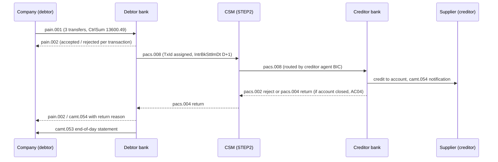

# SEPA, Wires, and ISO 20022 (pain.001, pacs.008)

> The XML message format the whole world is migrating to.

**Type:** Build
**Languages:** Java, Python, Go
**Prerequisites:** Phase 10 Lesson 01 (Representing Money), Phase 11 Lesson 08 (ACH and the NACHA File Format)
**Time:** ~120 minutes

## Learning Objectives

- Place pain, pacs, and camt messages in the life of a credit transfer and say which party sends each one to whom
- Generate a pain.001.001.09 customer credit transfer initiation with `javax.xml` and parse it back, verifying `NbOfTxs` and `CtrlSum` against the transactions
- Map a pain.001 into a pacs.008.001.08 interbank message field by field, and state which identifiers pass through unchanged and which the bank creates
- Validate the SEPA Credit Transfer rules that a schema alone does not enforce: EUR only, amount range, character set, identifier lengths, IBAN check digits, and BIC format
- Parse untrusted XML safely (no DOCTYPE, no external entities) and explain why a payment file is an attack surface
- Compare ISO 20022 with fixed-width formats such as Nacha and with SWIFT MT, and explain what the migration from MT103 to pacs.008 changes for an engineer

## The Problem

A German robotics company pays its suppliers every Tuesday. Its ERP produces a file of credit transfers, the treasury team uploads it to the bank portal, and the bank executes it. One Tuesday the upload is rejected with `CtrlSum does not match sum of InstdAmt`. The ERP had been upgraded the week before, and the new export computed the control sum by adding the amounts as `double` values and formatting the result with two decimals. For 3 transactions the result was right. For 1,184 transactions it was 0.01 EUR off, because the float sum had accumulated an error that crossed a rounding boundary. The bank is right to refuse a file whose declared total disagrees with its contents; it cannot know which number is wrong. This lesson pairs with Phase 11 Lesson 11 (IBAN, BIC, and Account Number Validation), which comes later.

A month later a different failure: the file is accepted, the payments execute, and one supplier in Lyon writes to say it never received 1,250.00 EUR. The bank's status report (pain.002) says the transaction was rejected by the receiving bank with reason code `AC01`, incorrect account number. The ERP did not process pain.002 files, so nobody noticed for three weeks. The IBAN in the supplier master had a transposed pair of digits. An IBAN check digit would have caught it before the file left the building, and an end-to-end identifier that the ERP could match on would have connected the rejection to the invoice automatically.

Both failures come from treating a payment file as a text export rather than as a message with a grammar, a set of business rules, and a lifecycle. ISO 20022 is that grammar for most of the world's bank payments: SEPA in Europe since 2014, the Eurosystem's T2 RTGS since March 2023, the UK's CHAPS since 2023, the Fedwire Funds Service since July 2025, and SWIFT's cross-border traffic, which moved from MT103 to pacs.008 when the coexistence period ended in November 2025. This lesson builds a writer and a validating parser for the two messages a payments engineer meets first: pain.001, which a company sends its bank, and pacs.008, which the bank sends onward to the clearing system.

## The Concept

### SEPA and the credit transfer schemes

The Single Euro Payments Area is a set of payment schemes run by the European Payments Council (EPC) and a set of EU regulations that make them mandatory. A **scheme** is a rulebook: who may participate, what messages they exchange, how fast, and what happens when something goes wrong. There are four in use:

| Scheme | What it does | Speed | Typical use |
|--------|--------------|-------|-------------|
| SCT (SEPA Credit Transfer) | Push payment from payer's account to payee's account | Funds credited at most one business day after the payer's bank receives the order (D+1) | Supplier payments, payroll |
| SCT Inst | Instant push payment | Funds available to the payee within 10 seconds, 24/7/365 | Person-to-person, e-commerce, urgent supplier payments |
| SDD Core | Pull payment from a consumer account under a mandate | Settles on the due date | Utilities, subscriptions |
| SDD B2B | Pull payment between businesses, no refund right for the payer | Settles on the due date | Business invoicing |

Regulation (EU) 260/2012 (the "SEPA Regulation") made these schemes the only way to send euro credit transfers and direct debits within the EU, and required ISO 20022 XML for interbank messages and for business customers who send payments in bulk. Regulation (EU) 2024/886 (the "Instant Payments Regulation") added a requirement that euro-area payment service providers offer SCT Inst at no higher price than SCT and check the payee's name against the IBAN (Verification of Payee) before an instant or regular transfer is sent; the sending obligations took effect in October 2025.

A **clearing and settlement mechanism** (CSM) carries the interbank messages: STEP2 (EBA CLEARING) for SCT batches, RT1 (EBA CLEARING) and TIPS (Eurosystem) for SCT Inst, and several national ACHs. The CSM nets or settles positions between banks on T2, the Eurosystem's RTGS.

### ISO 20022 in one table

ISO 20022 is a methodology plus a catalogue. The methodology defines a business model and a way to derive message schemas from it. The catalogue is a few hundred messages, each identified by a four-letter **business area**, a three-digit message number, a variant, and a version: `pain.001.001.09` is business area `pain`, message 001, variant 001, version 09.

| Business area | Meaning | Messages a payments engineer meets |
|---------------|---------|------------------------------------|
| pain | Payments initiation (customer to bank) | pain.001 credit transfer initiation; pain.002 status report; pain.008 direct debit initiation |
| pacs | Payments clearing and settlement (bank to bank) | pacs.008 customer credit transfer; pacs.009 bank-to-bank transfer; pacs.002 status; pacs.004 return; pacs.028 status request |
| camt | Cash management | camt.052 intraday report; camt.053 statement (Lesson 14); camt.054 debit/credit notification; camt.056 cancellation (recall) request; camt.029 resolution of investigation |
| head | Business application header | head.001, the envelope that carries sender, receiver, and message type alongside the document |
| acmt, remt, auth, reda | Accounts, remittance advice, regulatory reporting, reference data | Account opening, separately sent remittance, regulator reports |

The version suffix matters. A bank that accepts `pain.001.001.03` (the 2009 version that SEPA used for a decade) will reject `pain.001.001.09` (the 2019 version SEPA moved to in November 2023), and vice versa, because the namespace URI differs and elements were renamed: `BIC` became `BICFI` in version 04, and the requested execution date became a choice between `Dt` and `DtTm` in version 08. Every parser checks the namespace first.

### The life of a SEPA credit transfer



Three properties follow from this picture.

**Identifiers have owners.** `MsgId` belongs to whoever sends that message and is unique per sender. `PmtInfId` groups transactions that share a debtor account and execution date. `EndToEndId` is set by the debtor and must travel unchanged through every hop to the creditor; it is the one identifier both companies see, and it is how the supplier matches the incoming credit to the invoice. `TxId` is set by the debtor bank for the interbank leg and is how banks refer to the transaction in returns and investigations. `UETR`, a UUID, is the SWIFT gpi tracking identifier for cross-border payments.

**Totals are redundant on purpose.** `NbOfTxs` and `CtrlSum` in the group header and in each payment information block repeat what the transactions already say, exactly as the Nacha Batch Control record does (Lesson 08). The receiver recomputes them. A mismatch rejects the file or the block.

**Failure is a message, not an exception.** A rejected transaction comes back as a pain.002 or pacs.002 with a status (`RJCT`) and an ISO reason code (`AC01` incorrect account number, `AC04` closed account, `AM04` insufficient funds, `RC01` bank identifier incorrect). A transaction rejected after settlement comes back as a pacs.004 return. A payer who wants money back asks via camt.056 (recall), and the creditor bank answers with camt.029. Your system needs a handler for each, keyed on `EndToEndId`.

### pain.001 structure

A pain.001 has one group header and one or more payment information blocks, each with one or more transactions:

```xml
<Document xmlns="urn:iso:std:iso:20022:tech:xsd:pain.001.001.09">
  <CstmrCdtTrfInitn>
    <GrpHdr>          <!-- MsgId, CreDtTm, NbOfTxs, CtrlSum, InitgPty -->
    <PmtInf>          <!-- PmtInfId, PmtMtd=TRF, NbOfTxs, CtrlSum, PmtTpInf/SvcLvl/Cd=SEPA,
                           ReqdExctnDt, Dbtr, DbtrAcct, DbtrAgt, ChrgBr=SLEV -->
      <CdtTrfTxInf>   <!-- PmtId/EndToEndId, Amt/InstdAmt Ccy, CdtrAgt?, Cdtr, CdtrAcct, RmtInf -->
      <CdtTrfTxInf>
    </PmtInf>
  </CstmrCdtTrfInitn>
</Document>
```

The nesting expresses a factoring: everything common to a set of payments (debtor, account, date, service level, charge bearer) is stated once in `PmtInf`, and each `CdtTrfTxInf` carries only what differs. A company that pays from two accounts or on two dates sends two `PmtInf` blocks.

`ChrgBr` is `SLEV` ("following service level") in SEPA: each party pays its own bank, and the principal is transferred in full. The cross-border values `DEBT`, `CRED`, and `SHAR` correspond to SWIFT MT103 field 71A `OUR`, `BEN`, and `SHA`.

### pacs.008 and the field mapping

The debtor bank turns each `CdtTrfTxInf` into a `CdtTrfTxInf` in a pacs.008 sent to the CSM. Most fields carry over; a few are created or changed.

| pain.001.001.09 | pacs.008.001.08 | What happens |
|-----------------|-----------------|--------------|
| `GrpHdr/MsgId` | (not carried) | The bank's pacs.008 has its own `GrpHdr/MsgId` |
| `PmtInf/PmtInfId` | (not carried) | Batching inside the bank is the bank's business |
| `CdtTrfTxInf/PmtId/EndToEndId` | `CdtTrfTxInf/PmtId/EndToEndId` | Unchanged, mandatory pass-through |
| (none) | `CdtTrfTxInf/PmtId/TxId` | Created by the debtor bank, unique for the interbank leg |
| `CdtTrfTxInf/Amt/InstdAmt` | `CdtTrfTxInf/IntrBkSttlmAmt` | Same amount and currency in SEPA (no FX, no deducted fees) |
| `PmtInf/ReqdExctnDt/Dt` | `GrpHdr/IntrBkSttlmDt` | The settlement date, at most D+1 for SCT |
| (sum of amounts) | `GrpHdr/TtlIntrBkSttlmAmt` | Total of the interbank message, recomputed by the receiver |
| `PmtInf/Dbtr`, `DbtrAcct`, `DbtrAgt` | `CdtTrfTxInf/Dbtr`, `DbtrAcct`, `DbtrAgt` | Moved from block level to each transaction |
| `CdtTrfTxInf/CdtrAgt` (optional) | `CdtTrfTxInf/CdtrAgt` (mandatory) | If the customer gave only an IBAN, the bank derives the BIC from its directory |
| `PmtInf/ChrgBr` | `CdtTrfTxInf/ChrgBr` | `SLEV` |
| `CdtTrfTxInf/RmtInf/Ustrd` | `CdtTrfTxInf/RmtInf/Ustrd` | Unchanged, at most 140 characters in SEPA |

The `CdtrAgt` row is the IBAN-only rule. Since 2016, SEPA customers are not required to give the creditor's BIC; the IBAN identifies the bank. The interbank message still needs the BIC for routing, so the debtor bank looks it up in a directory keyed by the national bank code inside the IBAN (the SWIFT BIC directory or the EPC's own register). The code in this lesson injects that directory as a function, so the demo uses a three-entry map and a production system uses the real file.

### SEPA rules the schema does not check

The ISO 20022 XSD says `InstdAmt` is a decimal with up to five fraction digits, `Nm` is up to 140 characters, and `EndToEndId` is up to 35 characters of any Unicode. The EPC implementation guidelines narrow every one of those. A schema-valid file can still be rejected by every SEPA bank. The rules this lesson enforces:

| Rule | Source | Example of a violation |
|------|--------|------------------------|
| Currency is EUR | SCT rulebook | `Ccy="USD"` |
| Amount 0.01 to 999,999,999.99, two decimals | SCT implementation guidelines | `0.00`, `349.999` |
| Names at most 70 characters | SCT implementation guidelines | A 90-character legal name |
| Remittance `Ustrd` at most 140 characters, one occurrence | SCT implementation guidelines | Two `Ustrd` lines, or 141 characters |
| Identifiers 1-35 characters, no leading or trailing `/`, no `//` | SCT implementation guidelines | `ACME/BAD//1` |
| Basic Latin character set: `a-z A-Z 0-9 / - ? : ( ) . , ' +` and space | EPC217-08 | `Zürich` (U+00FC) |
| IBAN check digits and length per country | ISO 13616 | `DE89370400440532013001` |
| BIC format 8 or 11 characters | ISO 9362 | `COBADEFFX` |
| Execution date not before creation date | Common sense, enforced by banks | Requested 12 October, created 13 October |

The character set rule surprises people the most. EPC217-08 lets banks accept wider character sets by bilateral agreement and recommends transliteration (`ü` to `ue` or `u`), but the only set every SEPA bank must accept is basic Latin. A system that sends `Zürich` unconverted may work with one bank and fail with another.

### Worked example by hand

The demo initiation has three transfers.

```text
INV-2026-0912   1250.00 EUR   to FR1420041010050500013M02606  (BIC given: PSSTFRPPLYO)
INV-2026-0913    349.99 EUR   to NL91ABNA0417164300           (BIC given: ABNANL2A)
INV-2026-0914  12000.50 EUR   to ES9121000418450200051332     (IBAN only)

NbOfTxs = 3
CtrlSum = 125000 + 34999 + 1200050 = 1360049 minor units = 13600.49
```

Check the debtor IBAN `DE89370400440532013000` by hand. Move the first four characters to the end, replace letters with numbers (A=10 ... Z=35), and take the result mod 97:

```text
rearranged:  370400440532013000 DE89
letters:     D=13, E=14   ->  370400440532013000131489
mod 97, piecewise:
  370400440           mod 97 = 23
  23 5320130 -> 235320130 mod 97 = 70    (carry the remainder, append the next 7 digits)
  70 0013148 -> 700013148 mod 97 = 38
  38 9       -> 389       mod 97 = 1
final remainder = 1   -> valid
```

The code does the same thing one character at a time: `remainder = (remainder * 10 + digit) % 97`, or `* 100` for a two-digit letter value, which never exceeds an `int`.

The pacs.008 for the third transfer gets `TxId COBA-20261013-7781-0003`, settlement date 2026-10-14, and a creditor agent of `CAIXESBBXXX`, derived from bank code `2100` in positions 5-8 of the Spanish IBAN.

### Parsing XML from a counterparty safely

A pain.001 arrives from a customer, a pacs.008 from a CSM, a camt.053 from a bank. All are XML from outside your trust boundary, and the default Java XML parser will process a `DOCTYPE` with external entities. A file that contains `<!ENTITY x SYSTEM "file:///etc/passwd">` and references `&x;` inside `Ustrd` makes your parser read a local file into the remittance field, which then flows into logs, a database, and maybe back out in a status report. That is XML External Entity injection (XXE), and it has been found in real payment and banking systems. The defence is configuration, not code: disallow DOCTYPE declarations entirely (ISO 20022 messages never need one), disable external entities and XInclude, and turn on secure processing limits. The parser in this lesson rejects the example above before any entity is resolved.

### Complexity and sizing

Writing and parsing are O(n) in the number of transactions. DOM parsing holds the whole document in memory, roughly 5 to 10 times the file size. A bulk pain.001 with 100,000 transactions is about 100 MB of XML, which a DOM parser handles but not comfortably. Production systems that process large files use StAX (`javax.xml.stream`), which streams elements in constant memory; the field paths in this lesson carry over directly. Totals verification needs one pass and constant extra memory beyond the parsed transactions.

### What this lesson does not do

It does not validate against the official XSD; production systems do, and then apply the business rules in this lesson on top, because the XSD is necessary and not sufficient. It handles one `PmtInf` per pain.001 and one currency. It does not produce the business application header (head.001) that wraps messages on SWIFT and many CSMs, nor the status (pain.002, pacs.002), return (pacs.004), or recall (camt.056) messages, though they reuse the same identifiers. It does not transliterate non-Latin characters; it reports them. It does not implement structured postal addresses, which SWIFT CBPR+ makes mandatory for cross-border pacs.008 from November 2026, and it does not compute SCT Inst timeouts or Verification of Payee checks.

## Build It

The code is in `code/java/`. `Money.java` is the Phase 10, Lesson 01 type copied unchanged. Everything else is in `Main.java`.

### Step 1: Identifiers before XML

```java
static boolean isValid(String iban) {
    if (iban == null || iban.length() < 15 || iban.length() > 34) return false;
    if (!iban.chars().allMatch(c -> (c >= 'A' && c <= 'Z') || (c >= '0' && c <= '9'))) return false;
    Integer expected = LENGTHS.get(iban.substring(0, 2));
    if (expected == null || expected != iban.length()) return false;
    String rearranged = iban.substring(4) + iban.substring(0, 4);
    int remainder = 0;
    for (char c : rearranged.toCharArray()) {
        int value = Character.isDigit(c) ? c - '0' : c - 'A' + 10;
        remainder = (value < 10 ? remainder * 10 + value : remainder * 100 + value) % 97;
    }
    return remainder == 1;
}
```

This is a compact version of Lesson 11's validator: a length table for twelve SEPA countries and the mod-97 check. It rejects lowercase input on purpose; normalisation (strip spaces, uppercase) belongs at the edge where the user typed it, not inside the message builder. `Bic.isValid` is a single regular expression for the 8- or 11-character ISO 9362 format.

Predict: a user types `NL91 ABNA 0417 1643 00`. Which check fails, and where in your system should the spaces be removed?

### Step 2: The domain model

```java
record Party(String name, String iban, String bic) { ... }
record CreditTransfer(String endToEndId, Money amount, Party creditor, String remittance) {}
record PaymentInitiation(String messageId, LocalDateTime createdAt, String initiatingParty, String paymentInfoId,
                         LocalDate requestedExecutionDate, Party debtor, List<CreditTransfer> transfers) {
    int numberOfTransactions() { return transfers.size(); }
    Money controlSum() { ... sum of transfer amounts ... }
}
record InterbankTransfer(String endToEndId, String transactionId, Money amount, Party debtor, Party creditor, String remittance) {}
record InterbankMessage(String messageId, LocalDateTime createdAt, LocalDate settlementDate, List<InterbankTransfer> transfers) { ... }
```

The model is plain records, independent of XML. `NbOfTxs` and `CtrlSum` are derived, never stored, so the writer cannot emit a total that disagrees with the transactions. That alone fixes the first failure in The Problem. Amounts are `Money`, so `CtrlSum` is an exact integer sum.

Predict: why does `InterbankTransfer` carry the debtor on every transaction when `PaymentInitiation` carries it once?

### Step 3: SEPA rules as a list of violations

```java
static List<String> violations(PaymentInitiation p) {
    List<String> v = new ArrayList<>();
    id(v, "MsgId", p.messageId());
    id(v, "PmtInfId", p.paymentInfoId());
    text(v, "InitgPty/Nm", p.initiatingParty(), 70);
    party(v, "Dbtr", p.debtor());
    ...
    for (CreditTransfer t : p.transfers()) {
        String where = "CdtTrfTxInf[" + t.endToEndId() + "]";
        id(v, where + "/EndToEndId", t.endToEndId());
        if (!seen.add(t.endToEndId())) v.add(where + ": duplicate EndToEndId in message");
        if (!t.amount().currency().equals(Currency.EUR)) v.add(where + ": SEPA amounts must be EUR, got " + ...);
        if (t.amount().minorUnits() < 1 || t.amount().minorUnits() > MAX_AMOUNT_MINOR) v.add(...);
        party(v, where + "/Cdtr", t.creditor());
        ...
    }
    return v;
}
```

Validation returns every violation rather than throwing on the first. A treasury user fixing a 400-line payment run wants all problems in one report, not one per upload. Each message names the XML path, so it can be shown next to the field. Character-set violations report the code point (`U+00FC at index 1`) so logs stay ASCII and the culprit is unambiguous.

Predict: the rule `MAX_AMOUNT_MINOR = 99_999_999_999L` is a `long`. What would go wrong if it were an `int`?

### Step 4: Writing with DOM

```java
static String write(PaymentInitiation p) {
    List<String> violations = SepaRules.violations(p);
    if (!violations.isEmpty()) throw new Iso20022Exception("SEPA rule violations: " + violations);
    Document doc = Xml.newDocument();
    Element root = doc.createElementNS(NS, "Document");
    doc.appendChild(root);
    Element init = Xml.el(root, "CstmrCdtTrfInitn");
    Element grp = Xml.el(init, "GrpHdr");
    Xml.el(grp, "MsgId", p.messageId());
    Xml.el(grp, "CreDtTm", Xml.DATE_TIME.format(p.createdAt()));
    Xml.el(grp, "NbOfTxs", Integer.toString(p.numberOfTransactions()));
    Xml.el(grp, "CtrlSum", Xml.decimal(p.controlSum()));
    ...
}
```

`Xml.el(parent, name, text)` creates an element in the parent's namespace and appends it, so the whole tree inherits the pain.001 namespace from the root without repeating it. Text content is escaped by the serializer: an `&` in a supplier name becomes `&amp;` without any code here, which is the main reason to build XML with an API rather than string concatenation. Amounts are written by `Xml.decimal`, which takes the `Money` string form (`12000.50 EUR`) and drops the currency: ISO 20022 puts the currency in the `Ccy` attribute and uses `.` as the separator with no grouping.

The order of elements matters. ISO 20022 schemas are `xs:sequence`, so `DbtrAgt` after `ChrgBr` is a schema violation even though a lenient parser would accept it. The writer emits elements in schema order.

Predict: `LocalDateTime.toString()` on 09:30:00 returns `2026-10-13T09:30`. Why does the writer use an explicit formatter instead?

### Step 5: Parsing with namespace checks and totals

```java
static PaymentInitiation parse(String xml) {
    Element init = Xml.parseRoot(xml, NS, "CstmrCdtTrfInitn");
    Element grp = Xml.child(init, "GrpHdr");
    ...
    for (Element tx : Xml.children(pmt, "CdtTrfTxInf")) {
        Party creditor = new Party(Xml.text(tx, "Cdtr", "Nm"), Xml.text(tx, "CdtrAcct", "Id", "IBAN"),
                Xml.optText(tx, "CdtrAgt", "FinInstnId", "BICFI"));
        transfers.add(new CreditTransfer(Xml.text(tx, "PmtId", "EndToEndId"),
                Xml.amount(Xml.child(tx, "Amt", "InstdAmt")), creditor, Xml.optText(tx, "RmtInf", "Ustrd")));
    }
    PaymentInitiation p = new PaymentInitiation(...);
    checkTotals("GrpHdr", grp, p);
    checkTotals("PmtInf", pmt, p);
    return p;
}
```

`parseRoot` checks that the root element is `Document` in the expected namespace before reading anything else. A pacs.008 handed to the pain.001 parser fails with a message naming both namespaces. `Xml.child(e, "CdtrAcct", "Id", "IBAN")` walks direct children by local name, so the path in the code reads like the path in the implementation guidelines, and a missing mandatory element produces an error naming the path. `Xml.amount` reads the `Ccy` attribute and calls `Money.parse`, which rejects a third decimal: `349.999` fails as an amount, before any business rule runs.

Totals are checked at both levels because both are declared. A file whose group header is right but whose block total is wrong is still wrong.

Predict: the parser uses local names and ignores prefixes. Would a file that declares `xmlns:p="urn:...pain.001.001.09"` and writes `<p:Document>` parse?

### Step 6: The secure parser

```java
static DocumentBuilderFactory factory() {
    DocumentBuilderFactory f = DocumentBuilderFactory.newInstance();
    f.setNamespaceAware(true);
    f.setFeature("http://apache.org/xml/features/disallow-doctype-decl", true);
    f.setFeature(XMLConstants.FEATURE_SECURE_PROCESSING, true);
    f.setXIncludeAware(false);
    f.setExpandEntityReferences(false);
    return f;
}
```

`disallow-doctype-decl` is the setting that matters: with it, any document containing `<!DOCTYPE` fails to parse, which blocks external entities, the "billion laughs" entity expansion attack, and DTD-based tricks in one step. `FEATURE_SECURE_PROCESSING` adds limits on entity expansion and element depth. These five lines belong in every XML parser your payments system builds; a helper like `Xml.factory()` makes it hard to build one without them.

Predict: if you remove `disallow-doctype-decl` but keep `setExpandEntityReferences(false)`, is the XXE example still blocked?

### Step 7: Mapping to pacs.008

```java
static InterbankMessage fromPain001(PaymentInitiation p, String messageId, LocalDateTime createdAt,
                                    Function<String, String> bicDirectory) {
    List<InterbankTransfer> out = new ArrayList<>();
    int seq = 1;
    for (CreditTransfer t : p.transfers()) {
        Party creditor = t.creditor();
        if (creditor.bic() == null) {
            String bic = bicDirectory.apply(creditor.iban());
            if (bic == null) throw new Iso20022Exception("no BIC for IBAN " + creditor.iban() + " in directory");
            creditor = new Party(creditor.name(), creditor.iban(), bic);
        }
        String txId = messageId + "-" + String.format("%04d", seq++);
        out.add(new InterbankTransfer(t.endToEndId(), txId, t.amount(), p.debtor(), creditor, t.remittance()));
    }
    return new InterbankMessage(messageId, createdAt, p.requestedExecutionDate(), out);
}
```

This is the mapping table from The Concept as code. `EndToEndId` is copied, `TxId` is minted, the settlement date is the requested execution date, and the debtor is pushed down to each transaction. The BIC directory is injected; the demo directory keys on country plus national bank code (`ES` + `2100`), which `Iban.bankCode` extracts. A creditor whose bank is not in the directory fails the mapping, which is the right outcome: a pacs.008 without a creditor agent cannot be routed.

`Pacs008.write` and `Pacs008.parse` mirror the pain.001 code. The parser checks `NbOfTxs` and `TtlIntrBkSttlmAmt` against the transactions.

Predict: the debtor bank receives two pain.001 files from different customers with the same `EndToEndId`. Is that an error? What about the same `TxId`?

### Step 8: Run it

```bash
cd phases/11-payment-rails/09-sepa-and-iso-20022/code/java
javac -d .out *.java && java -cp .out Main
java -cp .out MainTest
```

Expected output, abbreviated:

```console
== SEPA validation ==
violations: []
NbOfTxs 3, CtrlSum 13600.49 EUR

== pain.001.001.09 (customer -> debtor bank) ==
<?xml version="1.0" encoding="UTF-8"?>
<Document xmlns="urn:iso:std:iso:20022:tech:xsd:pain.001.001.09">
  <CstmrCdtTrfInitn>
    <GrpHdr>
      <MsgId>ACME-20261013-001</MsgId>
      <CreDtTm>2026-10-13T09:30:00</CreDtTm>
      <NbOfTxs>3</NbOfTxs>
      <CtrlSum>13600.49</CtrlSum>
...
round trip equal: true

== pacs.008.001.08 (debtor bank -> clearing) ==
...
INV-2026-0914 -> TxId COBA-20261013-7781-0003, 12000.50 EUR to CAIXESBBXXX

== Rejections ==
rule: MsgId must not start or end with '/' or contain '//'
rule: DbtrAcct/IBAN invalid: DE89370400440532013001
rule: ReqdExctnDt 2026-10-12 is before CreDtTm 2026-10-13
rule: CdtTrfTxInf[INV-1]: SEPA amounts must be EUR, got USD
rule: CdtTrfTxInf[INV-1]/Cdtr/Nm has characters outside the SEPA set: U+00FC at index 1
rejected: GrpHdr CtrlSum 13600.50 != computed 13600.49
rejected: bad amount 349.999: 349.999 has more decimals than EUR allows (2)
rejected: expected Document in urn:iso:std:iso:20022:tech:xsd:pacs.008.001.08, got urn:iso:std:iso:20022:tech:xsd:pain.001.001.09
rejected: DOCTYPE (XXE guard)
```

`MainTest` runs 42 checks: identifier validation, each SEPA rule, both round trips, every totals mismatch, the namespace check, the XXE guard, and the IBAN-only BIC derivation.

### In Python

The port in `code/python/main.py` keeps every class and method (`Iban.is_valid`, `SepaRules.violations`, `Pain001.write`, `Pacs008.from_pain001`) and produces byte-identical XML. Four things differ:

- **The XXE guard is a string check, not a parser feature.** `xml.etree.ElementTree` never fetches external entities, but it still expands internal ones, and it has no `disallow-doctype-decl` switch. The parser therefore refuses any input that contains `<!DOCTYPE` before `ET.fromstring` sees it, which closes both the file-read and the billion-laughs case with one line:

```python
if Xml.DOCTYPE.search(xml):
    raise Iso20022Exception("malformed XML: DOCTYPE is disallowed when processing a payment file")
try:
    root = ET.fromstring(xml)
except ET.ParseError as e:
    raise Iso20022Exception(f"malformed XML: {e}") from e
```

- **Namespaces live in the tag.** ElementTree spells a namespaced element `{urn:iso:std:iso:20022:tech:xsd:pain.001.001.09}Document`, so `Xml.local_name` and `Xml.namespace_uri` split the tag at `}` where the Java called `getLocalName()` and `getNamespaceURI()`. The `child`/`children` walk is otherwise the same loop over direct children.
- **Serialization needs a registered default namespace.** `ET.tostring(..., default_namespace=NS)` refuses the unqualified `Ccy` attribute, so `Xml.serialize` calls `ET.register_namespace("", NS)` and `ET.indent(root, space="  ")` to get the same `xmlns="urn:..."` root and two-space layout the Java `Transformer` prints.
- **Records are frozen dataclasses with tuples.** `PaymentInitiation.transfers` is normalized to a `tuple` in `__post_init__` (the equivalent of `List.copyOf`) so the round-trip equality `Pain001.parse(pain) == p` compares by value. Dates are naive `datetime`/`date`, formatted with `"%Y-%m-%dT%H:%M:%S"` and `isoformat()`; amounts go through the same integer `Money.parse`, and the exception hierarchy is one class, `Iso20022Exception`, raised `from` the underlying `ParseError` or `ArithmeticError`.

```bash
cd phases/11-payment-rails/09-sepa-and-iso-20022/code/python
python3 main.py
python3 -m unittest -v
```

The Python tests port all 42 checks (43 assertions) and the demo output is identical to the Java run, XML included.

### In Go

The port in `code/go/main.go` (with `money.go`, the Phase 10 `Money` copied unchanged) keeps every type and method: `Iban.IsValid`, `SepaRules.Violations`, `Pain001.Write`, `Pacs008.FromPain001`, and the same `Xml` helpers, and it prints byte-identical XML. Four things differ:

- **The DOM is a struct you write yourself.** `encoding/xml` is a token stream, not a tree, so `Xml.decode` builds a small `Element{Namespace, Name, Attrs, Text, Children}` from `StartElement`/`EndElement`/`CharData` tokens and `Xml.Serialize` prints it with the two-space indent the Java `Transformer` uses. The decoder resolves `xmlns`, so `Name.Space` is the namespace URI the root check compares against.
- **The XXE guard is a prescan plus Strict mode.** Go's decoder never fetches external entities, but it has no `disallow-doctype-decl`, so `ParseRoot` refuses any input containing `<!DOCTYPE` before decoding, and `Strict = true` makes an undefined `&x;` a parse error instead of literal text:

```go
if doctype.MatchString(doc) {
    return nil, isoErr("malformed XML: DOCTYPE is disallowed when processing a payment file")
}
d := xml.NewDecoder(strings.NewReader(doc))
d.Strict = true
```

- **One error type, matched with `errors.Is`.** `Iso20022Error` carries the message and wraps the cause; `errors.Is(err, ErrIso20022)` is what the tests check. `Write`, `Parse`, `FromPain001`, `ControlSum`, and `Xml.Child` all return `(T, error)`. Inside the two `Parse` functions a `need(...)` helper panics with that error and a deferred `catch` converts it back into the return value, so forty field reads do not each need an `if err != nil`; nothing escapes the function.
- **Optional fields are empty strings, records are structs with `Equals`.** `Party.Bic` and `Remittance` use `""` where Java used `null`, dates are `time.Time` in UTC formatted with `"2006-01-02T15:04:05"`, and `PaymentInitiation.Equals` compares the transfer slices element by element because a struct holding a slice is not comparable with `==`.

```bash
cd phases/11-payment-rails/09-sepa-and-iso-20022/code/go
go run .
go test ./...
```

The Go tests port all 42 checks (44 assertions, including an undefined-entity case) and the demo output is identical to the Java run, XML included.

## Use It

**Bank and ERP integrations.** SAP, Oracle, and Microsoft Dynamics export pain.001 through payment medium formats configured per bank; treasury management systems (Kyriba, FIS Quantum) generate them for multiple banks. Each bank publishes its own implementation guide on top of the EPC guidelines (which optional fields it requires, whether it accepts multiple `PmtInf` blocks, what character set it allows), and most offer a test portal that returns a pain.002 for an uploaded file. Use it with the files from this lesson's tests before going live.

**Libraries.** Prowide ISO 20022 (Java, Apache 2.0) generates JAXB model classes for the full catalogue and validates against the XSDs; Moov's `iso20022` (Go) does the same for Go. Both handle every message and version; neither knows your bank's implementation guide or the SEPA business rules beyond what the schema says, which is why the rules in Step 3 exist in every production system.

**Cross-border and RTGS.** SWIFT's CBPR+ usage guidelines define how pacs.008 is used for cross-border payments, with structured remittance and postal addresses that MT103 could not carry. The Federal Reserve's Fedwire Funds Service and the Bank of England's CHAPS use pacs.008 and pacs.009 with their own market practice. The XML is the same family; the usage rules differ, so the validation layer is per rail.

**Open source CSMs and simulators.** The ECB publishes TIPS user detailed functional specifications with full pacs.008 examples for SCT Inst, which make good test fixtures.

## Ship It

`outputs/checklist-iso20022-integration.md` is a checklist for building or reviewing an ISO 20022 integration: message version and namespace, identifier ownership, totals, SEPA business rules, secure parsing, and the status and return messages you must process. Use it as the acceptance criteria for a bank connectivity project and as the review list for any code that writes or reads pain, pacs, or camt files.

## Exercises

1. **Reinforce.** Support multiple `PmtInf` blocks in pain.001: group transactions by (debtor account, requested execution date), write one block per group with its own `NbOfTxs` and `CtrlSum`, and check that the group header totals equal the sum of the block totals. Add a test where one block's `CtrlSum` is tampered and the group header's is not.
2. **Apply.** Build the pain.002 handler from The Problem. Write a pain.002.001.10 parser that extracts, per transaction, `OrgnlEndToEndId`, `TxSts` (`ACCP`, `ACSC`, `RJCT`), and `StsRsnInf/Rsn/Cd`, and a function that joins those results to the original `PaymentInitiation` by `EndToEndId`, returning rejected transactions with their reason. Report any status for an `EndToEndId` that was never sent.
3. **Extend.** Combine with Lesson 14: generate the camt.053 statement the debtor's bank would produce on the settlement date, with one debit entry per transfer carrying the `EndToEndId` in `NtryDtls/TxDtls/Refs`, then parse it with Lesson 14's parser and reconcile each statement line back to the pain.001 transaction. What should happen when the bank books the three transfers as one batch entry of 13,600.49?

## Key Terms

| Term | What people say | What it actually means |
|------|-----------------|------------------------|
| ISO 20022 | "the XML format" | A methodology and catalogue of financial messages; XML is the usual syntax, but the standard is the business model and message definitions |
| pain.001 | "the payment file" | Customer Credit Transfer Initiation: what a company sends its bank to request credit transfers |
| pacs.008 | "the MT103 replacement" | FI to FI Customer Credit Transfer: the interbank message carrying a customer's payment between banks and clearing systems |
| EndToEndId | "the reference" | The debtor's identifier for one payment, passed unchanged to the creditor; the key for matching statuses, returns, and incoming credits |
| CtrlSum | "the total" | The declared sum of instructed amounts, redundant with the transactions so the receiver can detect a missing or altered one |
| SLEV | "SEPA charges" | Charge bearer "following service level": each party pays its own bank and the principal moves in full |
| IBAN-only | "no BIC needed" | The SEPA rule that customers need not supply the creditor's BIC; the debtor bank derives it from the IBAN for routing |
| XXE | "an XML bug" | XML External Entity injection: a DOCTYPE entity that makes the parser read files or URLs; blocked by disallowing DOCTYPE |

## Further Reading

- [ISO 20022 message catalogue](https://www.iso20022.org/iso-20022-message-definitions) — the official message definitions and XSDs for pain, pacs, and camt; download pain.001.001.09 and pacs.008.001.08 and compare them to the code
- [EPC SEPA Credit Transfer Rulebook and Implementation Guidelines](https://www.europeanpaymentscouncil.eu/what-we-do/epc-payment-schemes/sepa-credit-transfer/sepa-credit-transfer-rulebook-and-implementation) — the business rules, field usage, character set, and R-transaction reason codes that narrow the ISO schema
- [EPC217-08 SEPA Requirements for an Extended Character Set](https://www.europeanpaymentscouncil.eu/document-library/guidance-documents/sepa-requirements-extended-character-set-unicode-subset-best) — the basic Latin set and the transliteration guidance
- [Regulation (EU) No 260/2012 (SEPA Regulation)](https://eur-lex.europa.eu/eli/reg/2012/260/oj) and [Regulation (EU) 2024/886 (Instant Payments)](https://eur-lex.europa.eu/eli/reg/2024/886/oj) — why the format is mandatory, and the instant payment and Verification of Payee obligations
- [OWASP XML External Entity Prevention Cheat Sheet](https://cheatsheetseries.owasp.org/cheatsheets/XML_External_Entity_Prevention_Cheat_Sheet.html) — the parser settings per language, including the Java `DocumentBuilderFactory` features used here
- [SWIFT ISO 20022 programme and CBPR+ usage guidelines](https://www.swift.com/standards/iso-20022) — how pacs.008 replaced MT103 for cross-border payments and what changed in data richness
