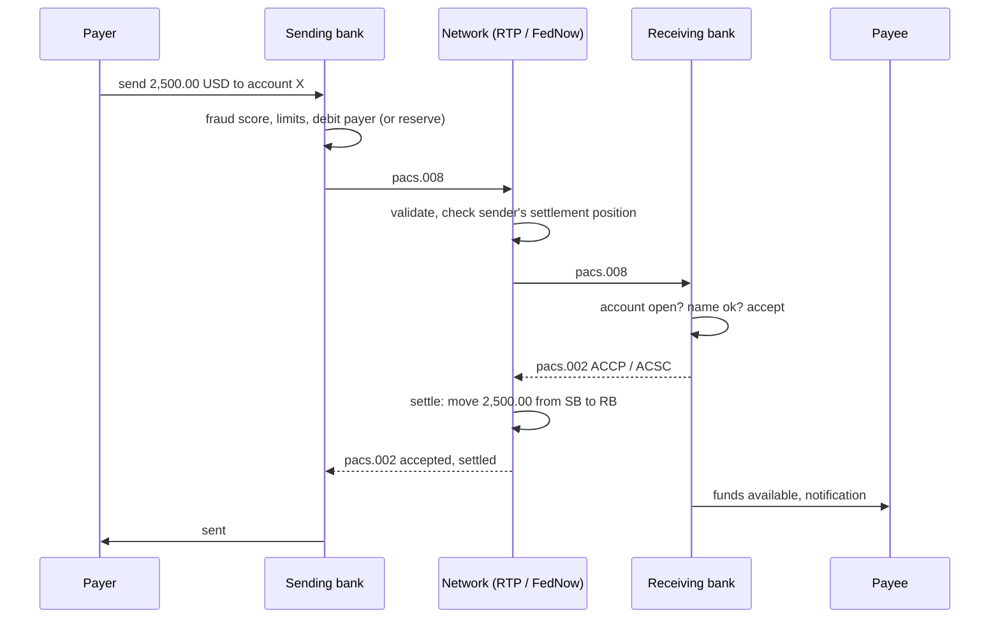
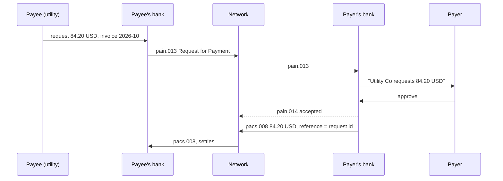

# Real-Time Payments: RTP, FedNow, UPI, Faster Payments

> Irrevocable in seconds changes every fraud control.

**Type:** Learn
**Languages:** —
**Prerequisites:** Phase 11, Lesson 08 (ACH and the NACHA File Format); Phase 11, Lesson 09 (SEPA, Wires, and ISO 20022); Phase 5, Lesson 08 (Timeouts and Deadline Propagation); Phase 5, Lesson 09 (Idempotency Keys)
**Time:** ~75 minutes

## Learning Objectives

- Compare RTP, FedNow, UPI, and Faster Payments on operator, settlement model, limits, addressing, message format, and request-to-pay support
- Explain why real-time credit transfers are irrevocable and how that differs from card chargebacks and ACH returns
- Distinguish prefunded, real-time gross, and deferred net settlement, and calculate the liquidity a participant needs in each over a weekend
- Trace a request-to-pay flow and identify the fraud patterns it enables
- Redesign a fraud control for a real-time rail: move it before the payment, fit it into the scheme timeout, and decide what happens on a timeout with unknown status
- Explain authorized push payment fraud and the UK's mandatory reimbursement regime as the first regulatory answer to it

## The Problem

A US neobank adds instant transfers through RTP. Its fraud system was built for ACH: outgoing payments are scored in a nightly batch, suspicious ones are held for review the next morning, and if fraud is confirmed the bank sends an ACH reversal or relies on the receiving bank's return. In the first month of RTP, a fraud ring takes over 140 customer accounts through phishing and SIM swaps, adds a new payee to each, and sends between 2,000 and 9,500 USD from each account in a burst at 02:00 on a Sunday. Every payment settles in under five seconds. The receiving accounts are at four different banks, and by the time the nightly fraud batch runs on Sunday night, the money has been moved on from those mule accounts to a crypto exchange. The neobank sends Requests for Return of Funds to the receiving banks. They are requests: the receiving banks may decline, and the funds are gone anyway. The neobank absorbs 610,000 USD of losses and its customers' trust.

A UK bank has the mirror problem. One of its customers is persuaded by a scammer posing as the bank's own fraud team to move 12,000 GBP "to a safe account". The customer authorizes the payment themselves, through the app, with biometric login. It is not unauthorized in any legal sense. Until October 2024, whether the customer got their money back depended on a voluntary code. Since 7 October 2024, the UK Payment Systems Regulator requires the sending bank to reimburse authorized push payment fraud victims up to 85,000 GBP within five business days, and to split the cost 50:50 with the bank that received the money. The receiving bank, which had opened the mule account a month earlier, now owns half of the loss.

Both stories have the same root. On a real-time credit-push rail, money moves in seconds, around the clock, and cannot be pulled back by the sender. Every control that used to run after the payment, because the rail gave you days to run it, now has to run before the payment, inside a timeout measured in seconds. This lesson compares the four real-time systems an engineer is most likely to build on and shows what irrevocability does to settlement, liquidity, and fraud design.

## The Concept

### What "real-time" means

A real-time payment system has four properties together. Most older systems have one or two.

| Property | Meaning | Contrast |
|----------|---------|----------|
| Immediate availability | Payee can use the funds within seconds | ACH: next day or same day in windows; wires: minutes to hours, business hours only |
| 24x7x365 | Runs at night, weekends, and holidays | ACH and Fedwire close on weekends and federal holidays |
| Finality | Once accepted, the payment cannot be revoked by the sender or the sender's bank | ACH debits can be returned for 60 days; cards can be charged back for 120 days |
| Credit push | The payer's bank sends money out on the payer's instruction | ACH and cards also support pull: the payee takes money with prior authorization |

The combination is what changes engineering. Immediacy alone (cards authorize in two seconds) is not new, but a card authorization moves no money and can be reversed. A real-time payment moves the money and cannot.

### The four systems compared

| | RTP | FedNow | UPI | Faster Payments |
|-|-----|--------|-----|-----------------|
| Country | United States | United States | India | United Kingdom |
| Operator | The Clearing House (owned by large US banks) | Federal Reserve Banks | NPCI (National Payments Corporation of India) | Pay.UK |
| Launched | November 2017 | July 2023 | April 2016 | May 2008 |
| Settlement | Prefunded joint account at the Federal Reserve Bank of New York; each payment moves balances within it | Real-time gross settlement in each participant's Federal Reserve master account | Deferred net settlement in multiple cycles per day over RBI's RTGS | Deferred net settlement in cycles per day at the Bank of England, with collateralised positions |
| Network limit per payment | 10,000,000 USD (since February 2025) | 10,000,000 USD network maximum (since November 2025; 500,000 USD at launch, 1,000,000 USD from mid-2025); participant default 100,000 USD, adjustable within the network maximum | 1 lakh INR (100,000) for most payments; higher for listed categories | 1,000,000 GBP scheme limit; banks set far lower customer limits |
| Addressing | Account and routing number; aliases via overlay services | Account and routing number; aliases via overlay services | Virtual Payment Address (`name@bank`), mobile number, QR code | Sort code and account number |
| Request to pay | Yes (Request for Payment) | Yes (Request for Payment) | Yes (collect request; P2P collect discontinued from October 2025) | Separate Pay.UK Request to Pay standard |
| Messages | ISO 20022 (pacs.008, pacs.002, pain.013/014 for RfP) | ISO 20022 | NPCI's own XML API | ISO 8583-derived, migrating towards ISO 20022 |
| Name check | Optional overlay | Optional overlay | Payee name shown from VPA before PIN entry | Confirmation of Payee (mandatory for large PSPs) |
| Volume (order of magnitude) | Hundreds of millions per year | Tens of millions per year, growing | Tens of billions per year | Billions per year |

The volumes tell a story about design choices. UPI reached tens of billions of transactions a year because it combined real-time settlement with an alias anyone can share (`priya@okbank`), a QR code at every shop, a mandated zero merchant discount rate, and apps built by non-banks on top of bank rails. RTP and FedNow, with account-number addressing and no consumer-facing standard app, grew mostly in business payments and account-to-account transfers inside banking apps.

SEPA Instant Credit Transfer (Lesson 09) belongs in this family too: 10 seconds end to end, 24x7, and from October 2025 mandatory for euro-area PSPs to send, with Verification of Payee.

### UPI's architecture: why it scaled

UPI separates three roles that card and bank-transfer systems usually bundle:

- **Issuer and acquirer banks** hold the accounts and settle through NPCI.
- **PSP banks** sponsor the apps and issue the Virtual Payment Addresses (`priya@okbank`); a VPA is an alias that the payee's PSP resolves to an account number, so the payer never sees or types it.
- **Third-party app providers** (Google Pay, PhonePe, Paytm and others) build the consumer app on top of a PSP bank, under NPCI rules and market-share caps.

Security is built into the device and the protocol rather than the app. Registration binds the app to the phone's SIM by sending an SMS from the registered mobile number. Every payment needs the **UPI PIN**, entered in NPCI's common library on the device so the app never sees it, and the PIN is verified by the issuer bank. Two factors (bound device, PIN) are therefore present on every transaction. A merchant payment is a QR code that encodes the merchant's VPA and optionally the amount, so the smallest shop can accept payments with a printed sticker and no terminal. The Indian government's mandate of a zero merchant discount rate on UPI and RuPay debit removed the cost barrier, and the network's growth followed.

### RTP and FedNow: why the US has two

RTP is owned by the large banks through The Clearing House and settles in a joint account it operates at the New York Fed. FedNow is operated by the Federal Reserve itself, settles in each participant's own master account, and was built partly to give the roughly ten thousand smaller US banks and credit unions a public-sector option. The two are not interconnected: a payment from an RTP-only bank to a FedNow-only bank cannot be sent in real time. Many banks join both and route by which network the receiving bank is on. For a platform engineer that means a reachability lookup (by routing number) before offering "instant" to the user.

### The message flow and the timeout problem

All four systems follow the same shape. RTP and FedNow use ISO 20022 messages, so it is shown with those names.



Each network imposes a timeout on the receiving bank's response, on the order of seconds (SCT Inst's end-to-end target is 10 seconds; RTP and FedNow have comparable participant response limits). If the receiving bank does not answer in time, the network rejects the payment. The hard case is the sending bank's view: it sent a pacs.008 and did not receive a pacs.002 before its own timeout. The payment may have settled, or not. The sending bank must not retry with a new message, because that could pay twice, and must not tell the customer "failed", because the money may have moved. It sends a status inquiry (pacs.028 in ISO 20022 systems) and keeps the payment in an `UNKNOWN` state until the answer arrives. This is the at-most-once versus at-least-once problem from Phase 5, Lessons 08 and 09, in its most expensive form, and the idempotency keys from Phase 12, Lesson 01 apply directly: the `EndToEndId` and `TxId` identify the payment across retries and inquiries.

### Irrevocability

Finality is a legal property, not a technical one. In RTP and FedNow, a payment accepted by the receiving bank and settled by the network is final under the operating rules and the Federal Reserve's Regulation J (Subpart C for FedNow) and the RTP rules (backed by UCC Article 4A for funds transfers). The sender has no right to recall it. What exists instead:

- **Request for return of funds.** The sending bank asks the receiving bank to send the money back (RTP has a dedicated message; FedNow has a return request; UPI has a dispute process through NPCI; Brazil's Pix has a special return mechanism). The receiving bank may comply, ask its customer, or decline. If its customer already moved the money on, there is nothing to return.
- **A new payment back.** A "return" is a new credit transfer in the opposite direction, with its own message and its own settlement. There is no un-sending.

Compare the pull rails. An ACH debit can be returned by the payer's bank for two banking days for most reasons and for 60 days if unauthorized (Lesson 08). A card transaction can be charged back for 120 days or more. Those rails are revocable for the payer, and the merchant or originator carries the risk. On a real-time push rail, the payer's own bank sent the money on the payer's instruction; the risk sits with the payer and, increasingly by regulation, with the banks that let the fraud through.

### Settlement models and liquidity

The three settlement models put money in different places at different times.

| Model | How it works | Where it is used | Participant liquidity need | Credit risk between banks |
|-------|--------------|------------------|----------------------------|---------------------------|
| Prefunded | Each participant funds a balance in a settlement account before sending; each payment moves balance from sender to receiver inside that account instantly | RTP (joint account at FRBNY) | The peak net outflow until the next top-up | None: no payment is accepted without balance |
| Real-time gross (RTGS) | Each payment settles individually in central bank money in participants' central bank accounts | FedNow; T2 for TIPS-adjacent flows | Enough balance in the central bank account for each payment as it happens | None |
| Deferred net (DNS) | Payments are accepted and credited to payees immediately; banks settle the net positions later in cycles | UPI, Faster Payments | Collateral or settlement guarantee fund covering the maximum net debit position between cycles | Yes, between cycles, covered by collateral and caps |

In DNS systems, the payee has the money before the banks have settled. If a sending bank fails between cycles, someone has to cover its net debit position. That is why Faster Payments requires participants to collateralise their maximum net sender cap at the Bank of England, and why UPI operates a settlement guarantee mechanism. The engineer's view: a DNS participant has a **net sender cap**, and a payment that would breach it is rejected even though the customer has the balance.

**Weekends are the hard part.** A prefunded balance is topped up by moving central bank money into the joint account. That top-up runs over the RTGS system, and when the RTGS system is closed (Fedwire on Saturdays, Sundays, and holidays) a bank that drains its prefunded balance cannot refill it until it reopens. Banks therefore prefund for the expected weekend net outflow plus a margin, and watch it in real time. A three-day weekend with payroll for gig workers on Saturday is a liquidity event.

### Request to pay

In a credit-push system, the payer starts the payment. Request to pay lets the payee start the conversation: the payee's bank sends a request (`pain.013` in ISO 20022, a "collect request" in UPI) with the amount, payee, and reference; the payer sees it in their banking app and approves or declines; approval triggers an ordinary credit transfer with the request's reference.



RfP gives billers what direct debit gave them (payee-initiated collection) without giving them the right to pull money, which is better for the payer. It also gives fraudsters a new tool: a request that looks like a refund, a prize, or a "verification" lands in the payer's app with an "approve" button. UPI's collect request was the most-abused flow on the platform for exactly this reason (victims approving a "receive" that was actually a "pay"), and NPCI discontinued person-to-person collect requests from 1 October 2025. Merchant collect requests continue.

### What irrevocability does to fraud controls

On revocable rails, fraud controls could be detective: let the payment go, detect fraud later, and claw it back through returns or chargebacks. On an irrevocable rail, every control that matters is preventive and must fit before the `pacs.008` is sent.

| Control | On ACH / cards | On real-time rails |
|---------|----------------|--------------------|
| Fraud scoring | Batch, hours later; review queues | Synchronous, in tens of milliseconds, before debit |
| New payee | Low concern; returns available | Cooling-off period or lower limits for new payees; step-up authentication |
| Account takeover | Detected by unusual returns | Device binding, behavioural biometrics, SIM-swap checks at login and at payment |
| Name check | Rare | Confirmation of Payee (UK), Verification of Payee (EU), name display before PIN (UPI) |
| Limits | Per file or per day | Per payment, per day, per new payee, per hour at night; lower for first-time payees |
| Inbound monitoring | Little incentive | Receiving banks score incoming payments to detect mule accounts, because under reimbursement rules they share the loss |
| Recovery | Return or chargeback | Request for return; recovery rates are low once funds move on |

The last two rows are the regulatory change of this decade. A real-time rail made the **receiving** bank the place where fraud can still be stopped: a mule account that receives 30 payments from 30 strangers in an hour is visible only there. The UK's reimbursement rules gave receiving banks a financial reason to look.

### Authorized push payment fraud and reimbursement

Authorized push payment (APP) fraud is a payment the victim authorizes, under deception: an investment scam, a romance scam, a fake invoice, an impersonated bank or police officer. Because the customer authorized it with valid credentials, unauthorized-payment protections (PSD2 Article 73, Regulation E in the US) do not apply.

The UK Payment Systems Regulator's rules, in force from 7 October 2024 for Faster Payments (and CHAPS through the Bank of England), are the first mandatory regime:

- The sending PSP must reimburse an in-scope APP fraud victim, up to 85,000 GBP per claim, normally within five business days.
- The sending PSP may apply an excess of up to 100 GBP; vulnerable customers are exempt from it.
- The cost is split 50:50 between the sending and receiving PSPs.
- Exceptions: first-party fraud and gross negligence by the customer (a high bar; vulnerable customers are protected regardless).
- Claims must be made within 13 months of the last payment.

In the US, the Consumer Financial Protection Bureau and Congress have debated similar protections for P2P networks; Zelle (which runs over bank networks including RTP) has its own reimbursement policies for impostor scams. In the EU, the Payment Services Regulation proposal extends refund rights for some impersonation fraud. The direction is consistent: when the rail is irrevocable, regulators move liability to the banks that can see the fraud.

### Building a recall into the rail: Pix and MED

Brazil's Pix (launched by the Banco Central do Brasil in November 2020) reached billions of transactions a month within a few years and met APP fraud at the same scale. The central bank's answer was to build a recovery path into the rail rather than leave it to bilateral requests. The **Mecanismo Especial de Devolução** (MED, special return mechanism) lets the payer's bank flag a payment as suspected fraud; the receiving bank must then block the amount in the receiving account if funds remain, investigate within a fixed period, and return the blocked funds through a Pix return if the fraud is confirmed. It does not make Pix revocable: a mule who moved the money on in the first minute still wins. It does turn "please return the funds" into an obligation with a deadline, and it puts the receiving bank on the clock. Later versions extended the block to funds the mule moved onward to other accounts. Compare it with RTP's Request for Return of Funds, which the receiving bank may simply decline.

### Failure modes

| Failure | What happens | Mitigation |
|---------|--------------|------------|
| Sender timeout, unknown status | Customer told "failed" and retries, or the bank retries: double payment, irrevocable | Keep `UNKNOWN`, send a status inquiry, reuse the same identifiers; never resend with a new id |
| Prefunded or net sender cap exhausted | Network rejects all outgoing payments until topped up | Real-time position monitoring, weekend forecasts, automatic top-ups while RTGS is open |
| Receiving bank slow or down | Payments to its customers reject at the network timeout | Show the payer a clear reject, offer another rail; do not queue silently for "later" |
| Batch core ledger | Memo balance diverges from posted balance overnight; double spend across channels | Post in real time with holds (Phase 10, Lesson 07) |
| Fraud model too slow | Model times out; bank must choose fail-open (fraud) or fail-closed (lost payments) | Budget the model inside the scheme timeout; decide the fallback explicitly per risk band |
| Request-to-pay phishing | Payer approves a request disguised as a refund | Clear "you are paying" UI, payee name display, limits on requests from new payees |
| Mule account inflows | Stolen funds land and leave within minutes | Inbound scoring at the receiving bank, holds on first large inbound to new accounts where scheme rules allow |

### Choosing a rail for a payment

A payments platform that can send over several rails needs a routing rule. A defensible default for a US platform:

| Question | If yes | If no |
|----------|--------|-------|
| Does the payee need the money now (payroll on demand, insurance claim, marketplace payout)? | Real-time rail, if the receiving bank participates | Continue |
| Is the amount above the network's or the receiving bank's real-time limit? | Wire (Fedwire) | Continue |
| Is the payment a pull from the customer (subscription, bill)? | ACH debit or card; real-time rails are push-only (RfP needs the payer's approval each time) | Continue |
| Would an irrevocable mistake be costly and is speed not needed (first payment to a new vendor)? | ACH credit, which gives a day to catch errors | Real-time rail |

The same table, with SCT and SCT Inst, Faster Payments and BACS, or UPI and NEFT, works in the other markets.

### Posting and the ledger

A real-time payment must be posted to the payer's and payee's accounts when it happens, on a Sunday at 02:00, by the same ledger that will later produce the statement (Lesson 14). Core banking systems built around an end-of-day batch handle this badly: they post to a memo balance during the day and reconcile at night, which is how a customer can spend the same money twice across an instant transfer and a debit card in the gap. Real-time participation usually forces a bank to move its balance of record to a real-time ledger (Phase 10, Lessons 03 and 07: double-entry with holds and available balance).

### What this lesson does not cover

It does not cover the participant onboarding and technical certification each network requires, the overlay services (Zelle, Paym, alias directories) that sit on top, cross-border linkages between instant systems (Project Nexus, the UPI-PayNow link between India and Singapore), or central bank digital currencies. Settlement mechanics are covered in more depth in Lesson 15.

## Worked Example

### Part 1: a 2,500.00 USD RTP payment with a timeout

A customer sends 2,500.00 USD to a contractor at 23:41 on a Saturday. The sending bank's prefunded RTP balance is 40,000,000.00 USD.

```text
23:41:07.120  app request received; idempotency key k-81f3
23:41:07.180  fraud score 0.12 (payee known for 8 months)  -> pass
23:41:07.195  ledger: hold 2,500.00 on payer, available 6,180.44 -> 3,680.44
23:41:07.210  pacs.008 sent, EndToEndId E2E-81f3, TxId SB-20261010-000918
23:41:12.210  sending bank's 5 s timer expires; no pacs.002
              state: UNKNOWN; customer sees "processing"
23:41:12.300  pacs.028 status request for TxId SB-20261010-000918
23:41:12.900  pacs.002 ACSC (accepted, settled at 23:41:08.054)
              ledger: convert hold to posted debit; state SETTLED
              prefunded balance: 40,000,000.00 - 2,500.00 = 39,997,500.00
```

A naive retry at 23:41:12.210 with a new `TxId` would have paid the contractor twice, irrevocably.

### Part 2: weekend liquidity

The same bank's net RTP flows on a long weekend, in millions of USD:

| Period | Outflows | Inflows | Net | Prefunded balance at end |
|--------|----------|---------|-----|--------------------------|
| Friday 18:00 (Fedwire closes) | | | | 40.0 |
| Saturday | 31.5 | 12.0 | -19.5 | 20.5 |
| Sunday | 22.0 | 9.0 | -13.0 | 7.5 |
| Monday (holiday) | 18.0 | 8.5 | -9.5 | -2.0 |

The balance would go negative on Monday afternoon, and the network would reject the bank's payments from that point until Fedwire reopens on Tuesday. The bank needed at least 42.0 million plus a safety margin prefunded on Friday, or a weekend funding mechanism. Liquidity forecasting for real-time rails is a payments engineering problem: it needs the same flow data as fraud and reconciliation.

### Part 3: an APP fraud claim in the UK

A customer is tricked into sending 12,000 GBP in two payments (7,000 and 5,000) to a mule account at another bank. The claim is in scope, the customer is not vulnerable, and the sending bank applies the maximum excess.

```text
total loss                       12,000.00
excess                             -100.00
reimbursed to customer           11,900.00   (within 5 business days)
sending PSP share  (50%)          5,950.00
receiving PSP share (50%)         5,950.00
```

If the receiving bank recovers 2,000.00 from the mule account before it is drained, recovered funds reduce the shared cost. The receiving bank's incentive is now to detect the mule account at onboarding or on the first suspicious inbound payment.

### Part 4: a UPI payment at a shop

A customer scans a tea stall's QR code and pays 40 INR. The QR encodes `upi://pay?pa=chaiwala@okbank&pn=Chai%20Corner&am=40.00&cu=INR`.

```text
t+0.0 s  app parses QR: payee VPA chaiwala@okbank, amount 40.00 INR (4000 paise)
t+0.3 s  payer's PSP asks NPCI to resolve the VPA; payee PSP returns name "CHAI CORNER"
t+0.4 s  app shows "Paying CHAI CORNER 40.00"; customer enters UPI PIN in NPCI's library
t+0.9 s  NPCI sends debit request to the payer's bank; bank verifies PIN, debits 40.00
t+1.4 s  NPCI sends credit request to the payee's bank; bank credits the stall's account
t+1.6 s  both apps show success; the stall's speaker announces "40 rupees received"
later    banks settle net positions with NPCI in the next settlement cycle over RBI RTGS
```

The merchant pays no MDR, the payer's bank has verified the PIN, and the funds are final. If the customer mistyped nothing and the stall is genuine, nothing else is needed. If the QR sticker had been replaced with a fraudster's, the only protection was the name shown at t+0.4 s.

## Exercises

1. **Reinforce.** For each of RTP, FedNow, UPI, and Faster Payments, state who carries settlement risk between the moment the payee's bank credits the payee and the moment interbank settlement completes. For which systems is that interval zero?
2. **Apply.** Design the state machine for an outgoing real-time payment in a sending bank: states from `CREATED` to `SETTLED`, `REJECTED`, and `UNKNOWN`, with transitions for fraud decision, network reject, timeout, status inquiry answer, and late pacs.002 after a timeout. Specify which ledger posting (hold, release, debit) happens on each transition, using Phase 10, Lesson 07's holds.
3. **Extend.** Combine with Phase 13, Lessons 02 and 03 (rules engine and risk scoring): write the decision procedure a sending bank's real-time fraud service runs within a 150 ms budget for a payment to a first-time payee at 03:00, and the procedure a receiving bank runs on inbound payments to detect a mule account. For each, list the signals, the action (allow, step-up, delay, decline), and who carries the loss under the UK reimbursement rules if the control misses.

## Key Terms

| Term | What people say | What it actually means |
|------|-----------------|------------------------|
| Real-time payment | "instant transfer" | A credit push that is final, available to the payee in seconds, and runs 24x7x365 |
| Finality | "it went through" | The legal point after which the payment cannot be revoked by the sender or its bank |
| Prefunding | "the RTP balance" | Settlement money placed in a shared settlement account before sending, so each payment settles within it immediately |
| Deferred net settlement | "batch settlement" | Payees credited immediately, banks settle net positions later in cycles, with collateral covering the interval |
| Request to pay | "a payment request" | A payee-initiated message asking the payer to approve a credit transfer; not a pull |
| APP fraud | "a scam payment" | Authorized push payment fraud: the victim authorizes the payment under deception, so unauthorized-payment protections do not apply |
| Confirmation of Payee | "name check" | A pre-payment check that the account name matches the name the payer entered (UK CoP, EU VoP) |
| Status inquiry | "check the payment" | A message (pacs.028) asking the network for a payment's status after a timeout, instead of retrying |

## Further Reading

- [The Clearing House RTP Network: Operating Rules and technical documentation](https://www.theclearinghouse.org/payment-systems/rtp) — the rules for finality, Request for Payment, and the prefunded settlement model
- [Federal Reserve FedNow Service: Operating Procedures and Regulation J, Subpart C](https://www.frbservices.org/financial-services/fednow) — the legal basis for FedNow finality and the settlement model in master accounts
- [NPCI Unified Payments Interface: product overview and circulars](https://www.npci.org.in/what-we-do/upi/product-overview) — UPI architecture, VPA addressing, limits, and the circular discontinuing P2P collect requests
- [Payment Systems Regulator: APP scams reimbursement requirement (PS23/3 and Specific Direction 19/20)](https://www.psr.org.uk/our-work/app-scams/) — the UK mandatory reimbursement rules, the 85,000 GBP cap, and the 50:50 split
- [Bank for International Settlements, Committee on Payments and Market Infrastructures: Fast payments, enhancing the speed and availability of retail payments (2016)](https://www.bis.org/cpmi/publ/d154.htm) — the reference framework for fast payment design choices, settlement models, and risks
- [European Payments Council SCT Inst Rulebook](https://www.europeanpaymentscouncil.eu/what-we-do/epc-payment-schemes/sepa-instant-credit-transfer) — the 10-second instant scheme, its timeouts, and the R-transactions it allows
