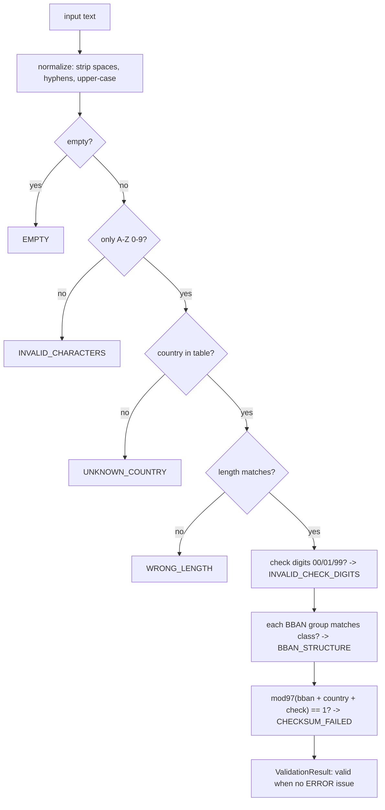

# IBAN, BIC, and Account Number Validation

> Mod-97 and country-specific BBAN rules.

**Type:** Build
**Languages:** Java, Python, Go
**Prerequisites:** Phase 0 Lesson 07 (Decimal and Integer Arithmetic), Phase 11 Lesson 08 (ACH and the NACHA File Format)
**Time:** ~60 minutes

## Learning Objectives

- Explain what an IBAN, a BBAN, and a BIC each identify, and which one a bank actually routes on
- Implement ISO 7064 MOD 97-10 on a string of letters and digits without big integers, and prove it detects every single-digit error and every adjacent transposition
- Generate IBAN check digits from a country and BBAN per ISO 13616-1 and show that validation of the result returns remainder 1
- Validate BBAN structure against a per-country table of character groups and extract the bank and branch identifiers
- Validate an ISO 9362 BIC and a US ABA routing transit number with the 3-7-1 weighted checksum
- Return structured failure reasons that a payout service can branch on, separating rejections from warnings

## The Problem

A payout service receives a SEPA bank transfer instruction from a merchant onboarding form: IBAN `DE89 3704 0044 0532 0130 0`, BIC `DEUTDEFF`, amount 4,812.50 EUR. The IBAN is one character short because the merchant's finance person dropped a trailing zero when retyping it from a PDF. The service does what the previous developer wrote: strip spaces, check that the string starts with two letters, send it to the bank.

The sending bank rejects the file three hours later with a return code that means "invalid creditor account". The payout is now late. The merchant's dashboard says "paid". Support opens a ticket, operations re-keys the IBAN by hand, and the second attempt goes out the next business day with a second fee. Multiply this by the fraction of a large onboarding funnel that mistypes something (two to four percent is typical for self-service forms), and you have a team whose job is retyping account numbers.

A second failure is worse because it does not bounce. A UK sort code and account number `20-00-00 55779911` is entered with two digits transposed: `20-00-00 55797911`. Both strings are eight digits; neither has a check digit that this payout service verifies. The money leaves, lands in a stranger's account, and recovery depends on the receiving bank's goodwill and a process measured in weeks. The payer is legally on the hook for the loss in most jurisdictions because they supplied the account number. The 2019 UK Confirmation of Payee scheme exists because misdirected payments of exactly this shape were costing hundreds of millions of pounds a year.

The fix for both is cheap and old: account identifiers carry check digits designed to catch exactly these typing errors, and a validator that applies them rejects the first case instantly at the form, with a reason the user can act on, and catches most of the second. This lesson builds that validator for the three identifiers a payments engineer meets most: the IBAN (ISO 13616), the BIC (ISO 9362), and the US ABA routing number. It returns structured reasons, not a boolean, because "invalid" is useless to the person who has to fix the number.

## The Concept

### Three identifiers, three jobs

| Identifier | Standard | Identifies | Length | Check digits | Example |
|------------|----------|------------|--------|--------------|---------|
| IBAN | ISO 13616-1 | One account at one bank in one country | 15 to 34, fixed per country | Two, mod-97 over the whole string | `GB82 WEST 1234 5698 7654 32` |
| BBAN | National (listed in the SWIFT IBAN Registry) | The same account in the domestic format | Fixed per country | Sometimes, national scheme | `WEST 1234 5698 7654 32` |
| BIC | ISO 9362 | A bank, or a branch of a bank | 8 or 11 | None | `DEUTDEFF` or `DEUTDEFF500` |
| ABA RTN | American Bankers Association | A US financial institution for ACH and wires | 9 | One, 3-7-1 weighted mod 10 | `021000021` |

The IBAN is a wrapper. Its first two characters are an ISO 3166-1 country code, the next two are check digits, and everything after position 4 is the **BBAN**, the Basic Bank Account Number in the country's own domestic format. For Germany the BBAN is an 8-digit Bankleitzahl followed by a 10-digit account number. For the UK it is a 4-letter bank code, a 6-digit sort code, and an 8-digit account number. The IBAN adds nothing to the BBAN except the country and a checksum over the whole thing; a bank that receives an IBAN strips the first four characters and routes on the BBAN it already knew how to route on. That is why the registry entry for every country specifies where inside the BBAN the bank identifier and (if any) branch identifier sit.

The BIC answers a different question: not "which account" but "which institution". Four letters of party prefix (`DEUT`), two letters of country (`DE`), two characters of location (`FF` for Frankfurt), and an optional three-character branch code (`500`; `XXX` means the primary office). Before IBANs carried enough information to derive the bank, a cross-border payment needed both. Within SEPA since 2016 the BIC is optional (the "IBAN-only" rule in Regulation (EU) 260/2012) because the bank identifier inside the BBAN is sufficient. Outside SEPA you still send both, and the validator checks that they agree on the country.

The ABA routing transit number is the US analogue of the bank identifier, nine digits with the first two drawn from the Federal Reserve's routing symbol ranges and the ninth a check digit. US account numbers themselves have no national structure and no check digit, which is why US account validation in practice means micro-deposits or an account-verification API (Phase 11, Lesson 13), not arithmetic.

### What a check digit promises

A check digit scheme is a function from the payload to a small number, appended to the payload, chosen so that the most common human errors change the result. Verhoeff's 1969 study of 12,000 keying errors found the distribution that every scheme since has targeted:

| Error type | Share of errors | Example |
|------------|-----------------|---------|
| Single digit wrong | about 79 percent | `1234` becomes `1237` |
| Adjacent transposition | about 10 percent | `1234` becomes `1324` |
| Jump transposition | under 1 percent | `1234` becomes `3214` |
| Twin error | under 1 percent | `1122` becomes `1133` |
| Phonetic error | under 1 percent | `13` becomes `30` (thirteen / thirty) |
| Other and multiple | about 9 percent | anything else |

Mod-97 catches **all** single-character errors and **all** adjacent transpositions, plus 99 percent of all other random errors (the chance a random corruption still leaves remainder 1 is 1 in 97). Two check digits buy that. The 3-7-1 scheme on ABA numbers uses one digit and catches all single-digit errors and most, not all, adjacent transpositions: a transposition of two digits whose difference is 5 under weights 3 and 7 is invisible because `(3-7) * 5 = -20` is a multiple of 10. The Luhn algorithm on card numbers (Phase 11, Lesson 04) has a similar blind spot on `09` and `90`.

The promise is bounded. A check digit detects *errors in transcription*. It does not tell you the account exists, is open, belongs to the named person, or can receive the currency. Those are questions for the bank or for a verification service, and a validator that passes is the precondition for asking them, not a substitute.

### ISO 7064 MOD 97-10 by hand

The IBAN check is defined in ISO 13616-1 as follows:

1. Move the first four characters (country and check digits) to the end of the string.
2. Replace every letter with two digits: `A` = 10, `B` = 11, ..., `Z` = 35.
3. Interpret the result as a decimal integer and compute it modulo 97.
4. The IBAN is valid if and only if the remainder is 1.

Worked example, `GB82 WEST 1234 5698 7654 32`:

```text
step 1  rearrange     WEST12345698765432 + GB82
                      = WEST12345698765432GB82
step 2  letters       W=32 E=14 S=28 T=29            G=16 B=11
                      = 3214282912345698765432161182    (28 digits)
step 3  mod 97        3214282912345698765432161182 mod 97 = 1
step 4  remainder 1   -> valid
```

A 28-digit integer overflows a `long`, so step 3 cannot be a single division. ISO 13616 suggests chunking: take the first nine digits, reduce, prepend the remainder to the next seven, reduce, and so on. That works because `(a * 10^k + b) mod 97 = ((a mod 97) * 10^k + b) mod 97`:

```text
321428291           mod 97 = 70
70 2345698          mod 97 = 29
29 7654321          mod 97 = 24
24 61182            mod 97 = 1
```

The implementation goes one step further and reduces after every single digit. The running value is then at most `96 * 10 + 9 = 969`, which fits in any integer type and needs no special handling for letters: a letter simply contributes two digit steps. The cost is 28 modulo operations instead of 4, which is irrelevant at the scale of a payout form and keeps the three language versions identical.

**Generation** is the same arithmetic run backwards. ISO 13616-1 Annex A: write the IBAN with check digits `00`, rearrange, compute the remainder `r`, and the check digits are `98 - r`, zero-padded to two digits. For the GB example:

```text
WEST12345698765432GB00 -> 3214282912345698765432161100 mod 97 = 16
check digits = 98 - 16 = 82
```

Why `98 - r`? Inserting check digits `c` in place of `00` adds `c` to the integer (they are the last two digits after rearrangement). You want `(N + c) mod 97 = 1`, so `c = (1 - N) mod 97 = (98 - r) mod 97` when `r = N mod 97`, and since `r` is in `0..96`, `98 - r` is in `2..98`. The values `00`, `01`, and `99` can therefore never be valid check digits, and the validator rejects them structurally before doing the arithmetic.

### BBAN structure: the per-country table

Mod-97 proves the string was transcribed correctly. It does not prove the string is an IBAN of the right shape, because a random 22-character string has a 1-in-97 chance of passing. The second check is structural: every country publishes its BBAN layout in the SWIFT IBAN Registry using the notation `n` (digits), `a` (upper-case letters), `c` (either), with a count:

| Country | Length | BBAN pattern | Bank identifier | Branch identifier | Note |
|---------|--------|--------------|-----------------|-------------------|------|
| DE | 22 | `8n 10n` | positions 1-8 (Bankleitzahl) | none | account number zero-padded to 10 |
| GB | 22 | `4a 6n 8n` | positions 1-4 (bank code) | positions 5-10 (sort code) | the only two IBAN fields a UK payer ever typed |
| FR | 27 | `5n 5n 11c 2n` | positions 1-5 | positions 6-10 | last 2n is a national RIB key, a second checksum |
| IT | 27 | `1a 5n 5n 12c` | positions 2-6 (ABI) | positions 7-11 (CAB) | first character is the CIN, a national check letter |
| NL | 18 | `4a 10n` | positions 1-4 | none | account number carries an 11-test, not enforced here |
| ES | 24 | `4n 4n 1n 1n 10n` | positions 1-4 | positions 5-8 | the two `1n` are national check digits |
| NO | 15 | `4n 6n 1n` | positions 1-4 | none | the shortest IBAN in the registry |
| SA | 24 | `2n 18c` | positions 1-2 | none | alphanumeric account part |

The implementation ships 19 countries. The full registry has 80 or so and changes a few times a year (a new country joins, a length changes), which is why the table is data keyed by country code and not a chain of `if` statements, and why a production service loads it from the registry file rather than from source.

Two lessons hide in this table. First, the bank identifier position is country-specific: Italy's starts at offset 1 because offset 0 is the CIN. A validator that assumes "the bank code is the first N characters" silently routes Italian payments by the check letter. Second, several countries carry their own national checksum inside the BBAN (the French RIB key, the Spanish control digits, the Italian CIN, the Dutch 11-test). Mod-97 over the whole IBAN subsumes them for transcription errors, so this lesson does not implement them; a domestic payment that carries only the BBAN would need them.

### The validation pipeline and its ordering



The order is not arbitrary. The first four checks each return immediately because the later checks are meaningless without them: there is no point computing mod-97 on a string with a `*` in it, and no point checking BBAN groups against a length that is already wrong. The last three are accumulated, because a user who typed a letter in a digit field and consequently broke the checksum should see both facts. The tests pin this: a short German IBAN yields exactly one issue, `WRONG_LENGTH`; an IBAN with an `X` in the account number yields two, `BBAN_STRUCTURE` and `CHECKSUM_FAILED`.

Every issue carries a `Reason` (a stable code the caller branches on), a `Severity` (`ERROR` rejects, `WARNING` informs), and a human message. `valid()` is defined as "no ERROR-severity issue". That lets a test BIC (location code ending in `0`) or an IBAN/BIC country mismatch surface as a warning without blocking a payout that may be legitimate.

### What this validator does not do

It does not call a bank, so it cannot tell you the account exists or whose it is; pair it with Confirmation of Payee, SEPA's planned Verification of Payee, or an aggregator (Phase 11, Lesson 13). It does not implement the national checksums embedded in some BBANs, because the IBAN-level mod-97 covers transcription errors over the same characters. It does not know which BICs are reachable on which network; the SWIFT BIC directory and the EBA/STEP2 reachability tables do, and a production payout service consults them. It ships a 19-country subset of the IBAN registry, which is enough to teach the mechanism and wrong for production: load the real registry.

## Build It

The walkthrough is in Java. Python and Go implement the same types with the same names; the subsections at the end show what differs.

### Step 1: Structured outcomes instead of a boolean

```java
enum Severity { ERROR, WARNING }

enum Reason {
    EMPTY, INVALID_CHARACTERS, UNKNOWN_COUNTRY, WRONG_LENGTH, INVALID_CHECK_DIGITS,
    BBAN_STRUCTURE, CHECKSUM_FAILED, INVALID_PREFIX, TEST_BIC, COUNTRY_MISMATCH
}

record Issue(Reason reason, Severity severity, String message) { }

record ValidationResult(String kind, String normalized, List<Issue> issues) {
    boolean valid() {
        return issues.stream().noneMatch(i -> i.severity() == Severity.ERROR);
    }
    boolean has(Reason reason) {
        return issues.stream().anyMatch(i -> i.reason() == reason);
    }
}
```

`Reason` is the API. A form renders `WRONG_LENGTH` as "This IBAN should be 22 characters; you entered 21", an ops dashboard groups rejections by it, and a test asserts on it without parsing prose. The message is free to change; the enum is not. `normalized` is returned so the caller stores the machine form (`GB82WEST12345698765432`) rather than whatever the user typed.

**Predict:** if `issues` contains one `WARNING` and nothing else, what does `valid()` return?

### Step 2: Mod-97 without big integers

```java
static int mod97(String text) {
    long remainder = 0;
    for (int i = 0; i < text.length(); i++) {
        char ch = text.charAt(i);
        if (ch >= '0' && ch <= '9') {
            remainder = (remainder * 10 + (ch - '0')) % 97;
        } else if (ch >= 'A' && ch <= 'Z') {
            int value = ch - 'A' + 10;                       // A=10 .. Z=35
            remainder = (remainder * 10 + value / 10) % 97;  // tens digit
            remainder = (remainder * 10 + value % 10) % 97;  // units digit
        } else {
            throw new IllegalArgumentException("mod97 input must be A-Z or 0-9, got '" + ch + "'");
        }
    }
    return (int) remainder;
}
```

The function never materialises the 28-digit integer. Each character advances the remainder by one or two decimal digits, and the remainder is reduced immediately, so the largest intermediate value is 969. A letter is handled as the two digits of its value: `W` is 32, so it contributes a `3` step and then a `2` step. There is no string substitution and no allocation.

Trace the last four characters of `WEST12345698765432GB82`. The remainder after `WEST12345698765432` is 12:

```text
G (=16): 12*10+1 = 121 mod 97 = 24;   24*10+6 = 246 mod 97 = 52
B (=11): 52*10+1 = 521 mod 97 = 36;   36*10+1 = 361 mod 97 = 70
8      : 70*10+8 = 708 mod 97 = 29
2      : 29*10+2 = 292 mod 97 = 1     <- valid
```

Compare with the chunked table: its third chunk ends after the first digit of `G`'s expansion (23 digits in), where it reports 24, and the digit-at-a-time loop reports 24 at exactly that point. The two methods are the same congruence applied in different step sizes, so they agree wherever they share a boundary. The intermediate values here never exceed 708.

**Predict:** `mod97("AZ")` processes the digits `1`, `0`, `3`, `5`. What is it, and how does that compare with `1035 % 97`?

### Step 3: The country table as data

```java
record Group(int count, char charClass) {
    boolean matches(String segment) {
        if (segment.length() != count) return false;
        for (int i = 0; i < segment.length(); i++) {
            char ch = segment.charAt(i);
            boolean digit = ch >= '0' && ch <= '9';
            boolean upper = ch >= 'A' && ch <= 'Z';
            switch (charClass) {
                case 'n' -> { if (!digit) return false; }
                case 'a' -> { if (!upper) return false; }
                default -> { if (!digit && !upper) return false; }
            }
        }
        return true;
    }
}

record CountryFormat(String country, int length, List<Group> groups,
                     int bankIdStart, int bankIdLength, int branchIdStart, int branchIdLength) {
    static CountryFormat of(String country, int length, String pattern,
                            int bankStart, int bankLen, int branchStart, int branchLen) {
        List<Group> groups = new ArrayList<>();
        for (String token : pattern.split(" ")) {
            groups.add(new Group(Integer.parseInt(token.substring(0, token.length() - 1)),
                    token.charAt(token.length() - 1)));
        }
        CountryFormat f = new CountryFormat(country, length, groups, bankStart, bankLen, branchStart, branchLen);
        if (f.bbanLength() + 4 != length) throw new IllegalStateException("bad table entry " + country);
        return f;
    }
}
```

The registry's own notation (`4a 6n 8n`) is parsed into `Group` records at class-load time, so the table in `Registry.COUNTRY_FORMATS` reads like the registry page it was copied from:

```java
CountryFormat.of("GB", 22, "4a 6n 8n", 0, 4, 4, 6),
CountryFormat.of("IT", 27, "1a 5n 5n 12c", 1, 5, 6, 5),
CountryFormat.of("DE", 22, "8n 10n", 0, 8),
```

The `bbanLength() + 4 != length` assertion in the factory catches a mistyped table entry the moment the class loads rather than the first time a payment to that country is attempted.

**Predict:** `Group(4, 'a').matches("WES1")` is false. What does the validator report as the message, and which positions does it name?

### Step 4: IBAN validation in registry order

```java
static ValidationResult validate(String text) {
    List<Issue> issues = new ArrayList<>();
    String s = Registry.normalize(text);
    if (s.isEmpty()) { issues.add(new Issue(Reason.EMPTY, Severity.ERROR, "empty IBAN")); return new ValidationResult("IBAN", s, issues); }
    if (!Registry.isAlnumUpper(s)) { /* INVALID_CHARACTERS, return */ }
    if (s.length() < 4 || !Registry.isLetters(s.substring(0, 2))) { /* UNKNOWN_COUNTRY, return */ }
    String country = s.substring(0, 2);
    CountryFormat fmt = Registry.COUNTRY_FORMATS.get(country);
    if (fmt == null) { /* UNKNOWN_COUNTRY, return */ }
    if (s.length() != fmt.length()) { /* WRONG_LENGTH with expected and actual, return */ }

    String check = s.substring(2, 4);
    boolean checkIsDigits = Registry.isDigits(check);
    if (!checkIsDigits || check.equals("00") || check.equals("01") || check.equals("99")) {
        issues.add(new Issue(Reason.INVALID_CHECK_DIGITS, Severity.ERROR, "check digits '" + check + "' are structurally invalid"));
    }
    String bban = s.substring(4);
    int pos = 0;
    for (Group g : fmt.groups()) {
        String segment = bban.substring(pos, Math.min(pos + g.count(), bban.length()));
        if (!g.matches(segment)) {
            issues.add(new Issue(Reason.BBAN_STRUCTURE, Severity.ERROR, "BBAN positions " + (pos + 1) + "-"
                    + (pos + g.count()) + " must be " + g.count() + g.charClass() + ", got '" + segment + "'"));
            break;
        }
        pos += g.count();
    }
    if (checkIsDigits && Registry.mod97(bban + country + check) != 1) {
        issues.add(new Issue(Reason.CHECKSUM_FAILED, Severity.ERROR, "mod-97 remainder is not 1; a digit is wrong or transposed"));
    }
    return new ValidationResult("IBAN", s, issues);
}
```

The early returns implement the pipeline from the diagram. Note `mod97(bban + country + check)`: the rearrangement in step 1 of the standard is just string concatenation in a different order. The structural check-digit test runs before the arithmetic so that `GB00...` is reported as structurally impossible rather than merely "checksum failed", which tells the operator the field was probably never filled in.

`parse` calls `validate`, throws with every reason joined if invalid, and otherwise slices the bank and branch identifiers out of the BBAN using the table offsets. `checkDigitsFor(country, bban)` validates the BBAN length against the table, computes `mod97(bban + country + "00")`, and returns `String.format("%02d", 98 - remainder)`. `generate` composes the two and re-parses the result, so a generated IBAN is always a validated IBAN.

**Predict:** `Iban.validate("GB82WEST1234569876543X")` returns two issues. Which two, and why not `WRONG_LENGTH`?

### Step 5: BIC and the ABA routing number

```java
static ValidationResult validate(String text) {            // Bic
    String s = Registry.normalize(text);
    if (s.length() != 8 && s.length() != 11) { /* WRONG_LENGTH, return */ }
    if (!Registry.isAlnumUpper(s)) { /* INVALID_CHARACTERS, return */ }
    String country = s.substring(4, 6);
    if (!Registry.isLetters(country)) {
        issues.add(new Issue(Reason.INVALID_CHARACTERS, Severity.ERROR, "country code '" + country + "' must be two letters"));
    } else if (!Registry.KNOWN_COUNTRIES.contains(country)) {
        issues.add(new Issue(Reason.UNKNOWN_COUNTRY, Severity.ERROR, country + " is not a known ISO 3166-1 country"));
    }
    if (s.charAt(7) == '0') {
        issues.add(new Issue(Reason.TEST_BIC, Severity.WARNING, "location code ending in 0 denotes a test BIC"));
    }
    return new ValidationResult("BIC", s, issues);
}
```

A BIC has no checksum, so validation is purely structural: length 8 or 11, alphanumeric, letters in the country position, a country that exists. ISO 9362 reserves a location code whose second character is `0` for test-and-training BICs; a payment to one will never settle, but a sandbox integration legitimately uses them, so it is a `WARNING`. `parse` fills `XXX` for the branch of an 8-character BIC so that `DEUTDEFF` and `DEUTDEFFXXX` compare equal, which is how SWIFT treats them.

```java
static final int[] WEIGHTS = {3, 7, 1, 3, 7, 1, 3, 7, 1};

static char checkDigit(String firstEight) {
    int total = 0;
    for (int i = 0; i < 8; i++) total += WEIGHTS[i] * (firstEight.charAt(i) - '0');
    return (char) ('0' + (10 - total % 10) % 10);
}
```

The ABA check digit is chosen so the weighted sum of all nine digits is a multiple of 10. For `02199999`: `3*0 + 7*2 + 1*1 + 3*9 + 7*9 + 1*9 + 3*9 + 7*9 = 204`, so the check digit is `(10 - 4) % 10 = 6` and the full number `021999996` sums to 210. `validate` additionally rejects a first-two-digit prefix outside the Federal Reserve's published routing symbol ranges (00-12, 21-32, 61-72, 80), which is how `991999990` is caught even though its arithmetic is fine.

**Predict:** transposing the last two digits of `021999996` gives `021999969`. The weights on those positions are 7 and 1; the digits differ by 3. What is the new weighted sum, and is it a multiple of 10?

### Step 6: The pair, and running it

```java
static ValidationResult validatePair(String ibanText, String bicText) {
    ValidationResult iban = Iban.validate(ibanText);
    ValidationResult bic = Bic.validate(bicText);
    List<Issue> issues = new ArrayList<>(iban.issues());
    issues.addAll(bic.issues());
    if (iban.valid() && bic.valid()
            && !iban.normalized().substring(0, 2).equals(bic.normalized().substring(4, 6))) {
        issues.add(new Issue(Reason.COUNTRY_MISMATCH, Severity.WARNING, "IBAN country ... differs from BIC country ..."));
    }
    return new ValidationResult("IBAN+BIC", iban.normalized() + "/" + bic.normalized(), issues);
}
```

A German IBAN with a British BIC is unusual but legal (a branch of a UK bank operating in Germany can hold German IBANs under its parent's BIC), so it is a warning for a human to look at, not a rejection. The mismatch is only evaluated when both halves are individually valid, otherwise the user sees a confusing second issue derived from garbage.

```bash
cd phases/11-payment-rails/11-iban-bic-and-account-validation/code/java
javac -d .out *.java && java -cp .out Main
java -cp .out MainTest
```

Expected output, abbreviated:

```console
== Mod-97 by hand: GB82 WEST 1234 5698 7654 32 ==
  rearranged      = WEST12345698765432GB82
  mod 97          = 1 (must be 1)
  bank identifier = WEST, branch (sort code) = 123456
  check digits regenerated from BBAN = 82

== What mod-97 catches ==
  one digit changed   GB82WEST12345698765431: rejected
  adjacent transposed GB82WEST12345698765423: rejected
  two groups swapped  GB82WEST56981234765432: rejected

== Structured failures ==
  IBAN     DE8937040044053201300            INVALID
           - ERROR WRONG_LENGTH: DE IBAN must be 22 characters, got 21
  IBAN     GB82WEST1234569876543X           INVALID
           - ERROR BBAN_STRUCTURE: BBAN positions 11-18 must be 8n, got '9876543X'
           - ERROR CHECKSUM_FAILED: mod-97 remainder is not 1; a digit is wrong or transposed

== ABA routing numbers (fictitious prefixes, real check digits) ==
  ABA      021999969                        INVALID
           - ERROR CHECKSUM_FAILED: 3-7-1 weighted sum 192 is not a multiple of 10
```

The test suite runs every one of the 19 registry examples through validation, regenerates its check digits from its BBAN, mutates its last character and asserts the mutation is caught, and checks that every country in the table has an example. Adding a country to the table without an example fails the build.

### In Python

The Python port keeps every type (`Issue`, `ValidationResult`, `Group`, `CountryFormat`, `Iban`, `Bic`, `RoutingNumber`, `AccountValidator`) with three differences. **Python could do it in one line:** `int(digits) % 97` works because Python integers are arbitrary precision. The implementation deliberately uses the digit-at-a-time loop anyway so that the three languages are the same algorithm and so that a learner who later ports it to a fixed-width language does not discover the overflow in production. **`str.isdigit()` is Unicode-aware:** `"٣".isdigit()` is `True` for an Arabic-Indic digit, which `ord(ch) - ord("0")` would then mangle. The normalizer only passes through characters it recognises, and `isalnum`-style checks are written as explicit `"A" <= ch <= "Z"` range tests for the same reason. **Enums are `Enum` members compared with `is`:** `Reason.WRONG_LENGTH is Reason.WRONG_LENGTH` is identity, which is what `has()` relies on; `ValidationResult.issues` is a tuple so results are hashable and immutable, and `valid` is a property. `branch_id` is `None` rather than a zero-length range where a country has no branch field.

Run it from `code/python/` with `python3 main.py`; test with `python3 -m unittest -v`.

#### Step 1: Structured outcomes instead of a boolean

Two `Enum`s and two frozen dataclasses. `valid` is `all(...)` over severities and `has` is `any(...)` over reasons, both using identity comparison on the enum members; `issues` defaults to an empty tuple.

```python
class Severity(Enum):
    ERROR = "ERROR"
    WARNING = "WARNING"


@dataclass(frozen=True)
class Issue:
    reason: Reason
    severity: Severity
    message: str

    def __str__(self) -> str:
        return f"{self.severity.value} {self.reason.value}: {self.message}"


@dataclass(frozen=True)
class ValidationResult:
    """The outcome of validating one identifier. `valid` is true when no ERROR-severity issue exists."""

    kind: str
    normalized: str
    issues: tuple[Issue, ...] = ()

    @property
    def valid(self) -> bool:
        return all(i.severity is not Severity.ERROR for i in self.issues)

    def has(self, reason: Reason) -> bool:
        return any(i.reason is reason for i in self.issues)
```

#### Step 2: Mod-97 without big integers

The same digit-at-a-time fold, kept even though `int` would not overflow; a letter contributes its tens digit and then its units digit, and the remainder never exceeds 969.

```python
def mod97(text: str) -> int:
    remainder = 0
    for ch in text:
        if ch.isdigit():
            remainder = (remainder * 10 + (ord(ch) - ord("0"))) % 97
        elif "A" <= ch <= "Z":
            value = ord(ch) - ord("A") + 10
            remainder = (remainder * 10 + value // 10) % 97
            remainder = (remainder * 10 + value % 10) % 97
        else:
            raise ValueError(f"mod97 input must be A-Z or 0-9, got {ch!r}")
    return remainder
```

#### Step 3: The country table as data

`Group.matches` uses the explicit range tests; `CountryFormat` stores `bank_id` and `branch_id` as `(start, length)` tuples. `_fmt` parses the registry notation at import time and asserts `bban_length() + 4 == length`, so a mistyped row fails when the module loads.

```python
@dataclass(frozen=True)
class Group:
    count: int
    char_class: str

    def matches(self, segment: str) -> bool:
        if len(segment) != self.count:
            return False
        if self.char_class == "n":
            return segment.isdigit()
        if self.char_class == "a":
            return all("A" <= ch <= "Z" for ch in segment)
        return all(ch.isdigit() or "A" <= ch <= "Z" for ch in segment)


@dataclass(frozen=True)
class CountryFormat:
    country: str
    length: int
    groups: tuple[Group, ...]
    bank_id: tuple[int, int]  # (start, length) of the bank identifier inside the BBAN
    branch_id: tuple[int, int] | None = None

    def bban_length(self) -> int:
        return sum(g.count for g in self.groups)


def _fmt(country: str, length: int, pattern: str, bank_id: tuple[int, int], branch_id: tuple[int, int] | None = None) -> CountryFormat:
    groups: list[Group] = []
    for token in pattern.split():
        groups.append(Group(int(token[:-1]), token[-1]))
    f = CountryFormat(country, length, tuple(groups), bank_id, branch_id)
    assert f.bban_length() + 4 == length, country
    return f
```

#### Step 4: IBAN validation in registry order

The pipeline with early returns, then the structural check-digit test, the group walk that names BBAN positions, and finally `mod97(bban + country + check)`. Slicing past the end of a string is safe in Python, so the `min(...)` guard is not needed.

```python
    def validate(text: str) -> ValidationResult:
        issues: list[Issue] = []
        s = normalize(text)
        if not s:
            return ValidationResult("IBAN", s, (Issue(Reason.EMPTY, Severity.ERROR, "empty IBAN"),))
        if not all(ch.isdigit() or "A" <= ch <= "Z" for ch in s):
            issues.append(Issue(Reason.INVALID_CHARACTERS, Severity.ERROR, "IBAN may contain only A-Z and 0-9"))
            return ValidationResult("IBAN", s, tuple(issues))
        if len(s) < 4 or not s[:2].isalpha():
            issues.append(Issue(Reason.UNKNOWN_COUNTRY, Severity.ERROR, f"no country code in {s!r}"))
            return ValidationResult("IBAN", s, tuple(issues))
        country = s[:2]
        fmt = COUNTRY_FORMATS.get(country)
        if fmt is None:
            issues.append(Issue(Reason.UNKNOWN_COUNTRY, Severity.ERROR, f"{country} is not in the IBAN registry subset"))
            return ValidationResult("IBAN", s, tuple(issues))
        if len(s) != fmt.length:
            issues.append(
                Issue(Reason.WRONG_LENGTH, Severity.ERROR, f"{country} IBAN must be {fmt.length} characters, got {len(s)}")
            )
            return ValidationResult("IBAN", s, tuple(issues))
        check = s[2:4]
        if not check.isdigit() or check in ("00", "01", "99"):
            issues.append(Issue(Reason.INVALID_CHECK_DIGITS, Severity.ERROR, f"check digits {check!r} are structurally invalid"))
        bban = s[4:]
        pos = 0
        for g in fmt.groups:
            segment = bban[pos : pos + g.count]
            if not g.matches(segment):
                issues.append(
                    Issue(
                        Reason.BBAN_STRUCTURE,
                        Severity.ERROR,
                        f"BBAN positions {pos + 1}-{pos + g.count} must be {g.count}{g.char_class}, got {segment!r}",
                    )
                )
                break
            pos += g.count
        if check.isdigit() and mod97(bban + country + check) != 1:
            issues.append(Issue(Reason.CHECKSUM_FAILED, Severity.ERROR, "mod-97 remainder is not 1; a digit is wrong or transposed"))
        return ValidationResult("IBAN", s, tuple(issues))
```

#### Step 5: BIC and the ABA routing number

Structural checks only for the BIC, with the test-BIC `WARNING` on a location code ending in `0`. The ABA check digit is a `zip` of weights and digits.

```python
    def validate(text: str) -> ValidationResult:
        issues: list[Issue] = []
        s = normalize(text)
        if not s:
            return ValidationResult("BIC", s, (Issue(Reason.EMPTY, Severity.ERROR, "empty BIC"),))
        if len(s) not in (8, 11):
            issues.append(Issue(Reason.WRONG_LENGTH, Severity.ERROR, f"BIC must be 8 or 11 characters, got {len(s)}"))
            return ValidationResult("BIC", s, tuple(issues))
        if not all(ch.isdigit() or "A" <= ch <= "Z" for ch in s):
            issues.append(Issue(Reason.INVALID_CHARACTERS, Severity.ERROR, "BIC may contain only A-Z and 0-9"))
            return ValidationResult("BIC", s, tuple(issues))
        country = s[4:6]
        if not country.isalpha():
            issues.append(Issue(Reason.INVALID_CHARACTERS, Severity.ERROR, f"country code {country!r} must be two letters"))
        elif country not in KNOWN_COUNTRIES:
            issues.append(Issue(Reason.UNKNOWN_COUNTRY, Severity.ERROR, f"{country} is not a known ISO 3166-1 country"))
        location = s[6:8]
        if location[1] == "0":
            issues.append(Issue(Reason.TEST_BIC, Severity.WARNING, "location code ending in 0 denotes a test BIC"))
        return ValidationResult("BIC", s, tuple(issues))
```

```python
class RoutingNumber:
    @staticmethod
    def check_digit(first_eight: str) -> str:
        if len(first_eight) != 8 or not first_eight.isdigit():
            raise ValueError("need exactly eight digits")
        total = sum(w * int(d) for w, d in zip(ABA_WEIGHTS, first_eight))
        return str((10 - total % 10) % 10)
```

#### Step 6: The pair, and running it

The issues of both halves are concatenated, and the country comparison runs only when both are individually valid.

```python
class AccountValidator:
    """Facade: validate an IBAN and BIC pair as a payment system receives them on a payout instruction."""

    @staticmethod
    def validate_pair(iban_text: str, bic_text: str) -> ValidationResult:
        iban = Iban.validate(iban_text)
        bic = Bic.validate(bic_text)
        issues = list(iban.issues) + list(bic.issues)
        if iban.valid and bic.valid and iban.normalized[:2] != bic.normalized[4:6]:
            issues.append(
                Issue(
                    Reason.COUNTRY_MISMATCH,
                    Severity.WARNING,
                    f"IBAN country {iban.normalized[:2]} differs from BIC country {bic.normalized[4:6]}",
                )
            )
        return ValidationResult("IBAN+BIC", iban.normalized + "/" + bic.normalized, tuple(issues))
```

```bash
cd phases/11-payment-rails/11-iban-bic-and-account-validation/code/python
python3 main.py
python3 -m unittest -v
```

The output matches the Java run:

```console
== Payout instruction: IBAN + BIC together ==
  IBAN+BIC DE89370400440532013000/DEUTDEFF  valid
  IBAN+BIC DE89370400440532013000/NWBKGB2L  valid
           - WARNING COUNTRY_MISMATCH: IBAN country DE differs from BIC country GB

== Generating an IBAN from a BBAN ==
  NL + ABNA0417164300 -> NL91 ABNA 0417 1643 00
```

### In Go

The Go port keeps the same types with three differences. **Bytes, not runes:** the normalizer has already guaranteed ASCII, so the validators index `text[i]` as bytes; indexing a Go string by position gives bytes, and a multi-byte character in an un-normalized input would be rejected by `isAlnumUpper` before any slicing happens. **Errors are values:** `Mod97`, `ParseIban`, `CheckDigitsFor`, `GenerateIban`, `ParseBic`, and `RoutingCheckDigit` return `(T, error)`. `ValidateIban`, `ValidateBic`, `ValidateRoutingNumber`, and `ValidatePair` return a `ValidationResult` and never fail, because a validator's job is to describe, not to abort. `Reason` and `Severity` are string-typed constants so they print as themselves. **Package-level tables are built by an immediately-invoked function:** `CountryFormats` is `map[string]CountryFormat` populated once at init, with the same `bbanLength + 4 == length` panic as Java's static initializer. An empty `BranchIdentifier` string stands in for Java's `null`.

Run it from `code/go/` with `go run .`; test with `go test ./...`.

#### Step 1: Structured outcomes instead of a boolean

`Severity` and `Reason` are string types with typed constants, so `%s` prints `WRONG_LENGTH` with no `String()` method. `Valid` and `Has` are explicit loops over the issue slice.

```go
type Severity string

const (
	Error   Severity = "ERROR"
	Warning Severity = "WARNING"
)

type Issue struct {
	Reason   Reason
	Severity Severity
	Message  string
}

func (i Issue) String() string { return fmt.Sprintf("%s %s: %s", i.Severity, i.Reason, i.Message) }

// ValidationResult is the outcome of validating one identifier. Valid is true when no ERROR-severity issue exists.
type ValidationResult struct {
	Kind       string
	Normalized string
	Issues     []Issue
}

func (r ValidationResult) Valid() bool {
	for _, i := range r.Issues {
		if i.Severity == Error {
			return false
		}
	}
	return true
}

func (r ValidationResult) Has(reason Reason) bool {
	for _, i := range r.Issues {
		if i.Reason == reason {
			return true
		}
	}
	return false
}
```

#### Step 2: Mod-97 without big integers

The byte loop with a tagless `switch`; the remainder is an `int64` that never exceeds 969, and a character outside `A-Z0-9` is an error return.

```go
func Mod97(text string) (int, error) {
	var remainder int64
	for i := 0; i < len(text); i++ {
		ch := text[i]
		switch {
		case isDigit(ch):
			remainder = (remainder*10 + int64(ch-'0')) % 97
		case isUpper(ch):
			value := int64(ch-'A') + 10
			remainder = (remainder*10 + value/10) % 97
			remainder = (remainder*10 + value%10) % 97
		default:
			return 0, fmt.Errorf("mod97 input must be A-Z or 0-9, got %q", ch)
		}
	}
	return int(remainder), nil
}
```

#### Step 3: The country table as data

`Group.CharClass` is a byte; `newFormat` parses the registry notation with `strings.Fields` and panics on a row whose groups do not add up. The table itself is a `map` filled by an immediately-invoked function, so it exists before `main` runs.

```go
type Group struct {
	Count     int
	CharClass byte
}

func (g Group) Matches(segment string) bool {
	if len(segment) != g.Count {
		return false
	}
	for i := 0; i < len(segment); i++ {
		ch := segment[i]
		switch g.CharClass {
		case 'n':
			if !isDigit(ch) {
				return false
			}
		case 'a':
			if !isUpper(ch) {
				return false
			}
		default:
			if !isDigit(ch) && !isUpper(ch) {
				return false
			}
		}
	}
	return true
}

func newFormat(country string, length int, pattern string, bank [2]int, branch [2]int) CountryFormat {
	var groups []Group
	for _, token := range strings.Fields(pattern) {
		count, err := strconv.Atoi(token[:len(token)-1])
		if err != nil {
			panic(err)
		}
		groups = append(groups, Group{count, token[len(token)-1]})
	}
	f := CountryFormat{country, length, groups, bank[0], bank[1], branch[0], branch[1]}
	if f.BbanLength()+4 != length {
		panic("bad table entry " + country)
	}
	return f
}
```

```go
var CountryFormats = func() map[string]CountryFormat {
	m := map[string]CountryFormat{}
	for _, f := range []CountryFormat{
		newFormat("AE", 23, "3n 16n", [2]int{0, 3}, none),
		newFormat("AT", 20, "5n 11n", [2]int{0, 5}, none),
		newFormat("BE", 16, "3n 7n 2n", [2]int{0, 3}, none),
		newFormat("CH", 21, "5n 12c", [2]int{0, 5}, none),
		newFormat("DE", 22, "8n 10n", [2]int{0, 8}, none),
		newFormat("DK", 18, "4n 9n 1n", [2]int{0, 4}, none),
		newFormat("ES", 24, "4n 4n 1n 1n 10n", [2]int{0, 4}, [2]int{4, 4}),
		newFormat("FI", 18, "3n 11n", [2]int{0, 3}, none),
		newFormat("FR", 27, "5n 5n 11c 2n", [2]int{0, 5}, [2]int{5, 5}),
		newFormat("GB", 22, "4a 6n 8n", [2]int{0, 4}, [2]int{4, 6}),
		newFormat("IE", 22, "4a 6n 8n", [2]int{0, 4}, [2]int{4, 6}),
		newFormat("IT", 27, "1a 5n 5n 12c", [2]int{1, 5}, [2]int{6, 5}),
	} {
		m[f.Country] = f
	}
	return m
}()
```

#### Step 4: IBAN validation in registry order

`ValidateIban` never returns an error; it builds the result struct and appends issues. Go slicing past the end panics, so the group walk clamps `end` by hand. The `Mod97` error is discarded because the input was already checked to be `A-Z0-9`.

```go
func ValidateIban(text string) ValidationResult {
	s := Normalize(text)
	r := ValidationResult{Kind: "IBAN", Normalized: s}
	if s == "" {
		r.Issues = append(r.Issues, Issue{Empty, Error, "empty IBAN"})
		return r
	}
	if !isAlnumUpper(s) {
		r.Issues = append(r.Issues, Issue{InvalidCharacters, Error, "IBAN may contain only A-Z and 0-9"})
		return r
	}
	if len(s) < 4 || !isLetters(s[:2]) {
		r.Issues = append(r.Issues, Issue{UnknownCountry, Error, fmt.Sprintf("no country code in %q", s)})
		return r
	}
	country := s[:2]
	fmtRow, ok := CountryFormats[country]
	if !ok {
		r.Issues = append(r.Issues, Issue{UnknownCountry, Error, country + " is not in the IBAN registry subset"})
		return r
	}
	if len(s) != fmtRow.Length {
		r.Issues = append(r.Issues, Issue{WrongLength, Error, fmt.Sprintf("%s IBAN must be %d characters, got %d", country, fmtRow.Length, len(s))})
		return r
	}
	check := s[2:4]
	checkIsDigits := isDigits(check)
	if !checkIsDigits || check == "00" || check == "01" || check == "99" {
		r.Issues = append(r.Issues, Issue{InvalidCheckDigits, Error, fmt.Sprintf("check digits %q are structurally invalid", check)})
	}
	bban := s[4:]
	pos := 0
	for _, g := range fmtRow.Groups {
		end := pos + g.Count
		if end > len(bban) {
			end = len(bban)
		}
		segment := bban[pos:end]
		if !g.Matches(segment) {
			r.Issues = append(r.Issues, Issue{BbanStructure, Error, fmt.Sprintf("BBAN positions %d-%d must be %d%c, got %q", pos+1, pos+g.Count, g.Count, g.CharClass, segment)})
			break
		}
		pos += g.Count
	}
	if checkIsDigits {
		if rem, _ := Mod97(bban + country + check); rem != 1 {
			r.Issues = append(r.Issues, Issue{ChecksumFailed, Error, "mod-97 remainder is not 1; a digit is wrong or transposed"})
		}
	}
	return r
}
```

#### Step 5: BIC and the ABA routing number

`ValidateBic` is the same structural pipeline over bytes, with `KnownCountries` a `map[string]bool`. `RoutingCheckDigit` returns the digit as a `byte` so it can be compared with `text[8]` directly.

```go
func ValidateBic(text string) ValidationResult {
	s := Normalize(text)
	r := ValidationResult{Kind: "BIC", Normalized: s}
	if s == "" {
		r.Issues = append(r.Issues, Issue{Empty, Error, "empty BIC"})
		return r
	}
	if len(s) != 8 && len(s) != 11 {
		r.Issues = append(r.Issues, Issue{WrongLength, Error, fmt.Sprintf("BIC must be 8 or 11 characters, got %d", len(s))})
		return r
	}
	if !isAlnumUpper(s) {
		r.Issues = append(r.Issues, Issue{InvalidCharacters, Error, "BIC may contain only A-Z and 0-9"})
		return r
	}
	country := s[4:6]
	if !isLetters(country) {
		r.Issues = append(r.Issues, Issue{InvalidCharacters, Error, fmt.Sprintf("country code %q must be two letters", country)})
	} else if !KnownCountries[country] {
		r.Issues = append(r.Issues, Issue{UnknownCountry, Error, country + " is not a known ISO 3166-1 country"})
	}
	if s[7] == '0' {
		r.Issues = append(r.Issues, Issue{TestBic, Warning, "location code ending in 0 denotes a test BIC"})
	}
	return r
}
```

```go
var AbaWeights = [9]int{3, 7, 1, 3, 7, 1, 3, 7, 1}

// RoutingCheckDigit returns the ninth digit for the first eight.
func RoutingCheckDigit(firstEight string) (byte, error) {
	if len(firstEight) != 8 || !isDigits(firstEight) {
		return 0, errors.New("need exactly eight digits")
	}
	total := 0
	for i := 0; i < 8; i++ {
		total += AbaWeights[i] * int(firstEight[i]-'0')
	}
	return byte('0' + (10-total%10)%10), nil
}
```

#### Step 6: The pair, and running it

`ValidatePair` copies the IBAN issues into a fresh slice before appending the BIC issues (so neither input slice is aliased), then adds the country-mismatch warning only when both halves are valid.

```go
func ValidatePair(ibanText, bicText string) ValidationResult {
	iban := ValidateIban(ibanText)
	bic := ValidateBic(bicText)
	issues := append([]Issue{}, iban.Issues...)
	issues = append(issues, bic.Issues...)
	if iban.Valid() && bic.Valid() && iban.Normalized[:2] != bic.Normalized[4:6] {
		issues = append(issues, Issue{CountryMismatch, Warning, fmt.Sprintf("IBAN country %s differs from BIC country %s", iban.Normalized[:2], bic.Normalized[4:6])})
	}
	return ValidationResult{"IBAN+BIC", iban.Normalized + "/" + bic.Normalized, issues}
}
```

```bash
cd phases/11-payment-rails/11-iban-bic-and-account-validation/code/go
go run .
go test ./...
```

The output matches the Java run:

```console
  IBAN+BIC DE89370400440532013000/DEUTDEFF  valid
  IBAN+BIC DE89370400440532013000/NWBKGB2L  valid
           - WARNING COUNTRY_MISMATCH: IBAN country DE differs from BIC country GB

== Generating an IBAN from a BBAN ==
  NL + ABNA0417164300 -> NL91 ABNA 0417 1643 00
```

## Use It

### `java.util.Currency` has no cousin for IBANs

The JDK, the Python standard library, and the Go standard library have no IBAN or BIC validation. The widely used libraries are Apache Commons Validator's `IBANValidator` (Java, backed by a `RegexValidator` per country, the same table approach as this lesson), `python-stdnum` (Python; `stdnum.iban`, `stdnum.bic`, and `stdnum.us.rtn` plus the national BBAN checks this lesson skips), and `github.com/go-pay/iban` or `github.com/almerlucke/go-iban` (Go). What they add over the scratch version: the complete registry, the national checksums, and periodic updates when SWIFT publishes a registry change. What they do not add: any knowledge of whether the account exists.

### The SWIFT IBAN Registry and the ECB's SEPA rules

The registry is a text file published by SWIFT (the ISO 13616 registration authority) with one row per country: IBAN length, BBAN structure in the `n/a/c` notation, bank and branch identifier positions, a sample IBAN, and whether the country is in SEPA. It is the primary source for the table in this lesson. SEPA's IBAN-only rule means a SEPA credit transfer carries only the IBAN; the sending bank derives the BIC from a directory. Non-SEPA cross-border payments (SWIFT MT103 / pacs.008) still carry both, and the validator's country-mismatch warning is the first line of defence against a payout file that pairs the wrong ones.

### Confirmation of Payee and Verification of Payee

The UK's Pay.UK Confirmation of Payee (2020) and the EU Instant Payments Regulation's Verification of Payee (mandatory for euro credit transfers from October 2025) are the production answer to the question a checksum cannot answer: does this account belong to the named person? Both are an API call to the receiving bank before the payment is sent, returning match / close match / no match. Both require a syntactically valid account identifier as input, which is this lesson's output.

### The US: no checksum on the account, so verify the account

The ABA routing number's check digit protects the routing part. The account number has no structure at all, so US payout systems validate accounts out of band: NACHA's WEB debit rule requires a "commercially reasonable fraudulent transaction detection system" that includes account validation, satisfied in practice by micro-deposits, prenotes, or an instant account-verification provider (Plaid Auth, Finicity, MX: Phase 11, Lesson 13). The Federal Reserve's E-Payments Routing Directory is the authoritative list of which routing numbers are live and for which services (ACH, Fedwire), and a production service checks it, because `021999996` passes this lesson's validator and routes nowhere.

## Ship It

`outputs/checklist-account-identifier-intake.md` is a review checklist for any form, API, or file import that accepts a bank account identifier: normalization, which checks to run in which order, what to store, what to show the user, and the out-of-band verification step a checksum cannot replace. Apply it to your onboarding form and to your bulk-payout CSV importer; they usually disagree.

## Exercises

1. **Reinforce.** Add Switzerland's neighbour Liechtenstein (`LI`, length 21, BBAN `5n 12c`, bank identifier positions 1-5; registry example `LI21088100002324013AA`) to the table in all three languages, add it to the example list in the tests, and confirm the "every table country has an example" and round-trip tests pass. Then remove the example and watch which test fails first.
2. **Apply.** Implement the French RIB key: for a French BBAN, the last two digits `KK` satisfy `(89 * bank + 15 * branch + 3 * account) mod 97 == 97 - KK`, where letters in the 11-character account field map `A/J=1, B/K/S=2, C/L/T=3, D/M/U=4, E/N/V=5, F/O/W=6, G/P/X=7, H/Q/Y=8, I/R/Z=9`. Add a `Reason.NATIONAL_CHECK_FAILED` and show, with `FR1420041010050500013M02606`, that the IBAN check and the RIB check both pass, then construct a BBAN where the RIB key is wrong but you can still generate valid IBAN check digits for it. What does that tell you about which check protects against what?
3. **Extend.** Combine this lesson with Phase 11, Lesson 04 (Luhn). Write a single `Identifier.detect(text)` that normalizes the input and returns which of PAN, IBAN, BIC, or ABA routing number it could be, running only the structural checks first and the checksum last, and returning all candidates when more than one shape matches. A 16-digit string can be a PAN; a 9-digit string can be a routing number; `GB82...` can only be an IBAN. Measure how many random 16-digit strings pass Luhn versus how many random 22-character GB-shaped strings pass mod-97, and explain the ratio from the number of check digits.

## Key Terms

| Term | What people say | What it actually means |
|------|-----------------|------------------------|
| IBAN | "the international account number" | ISO 13616: country code, two mod-97 check digits, and the domestic BBAN; a wrapper that adds a checksum, not a new account number |
| BBAN | "the local account number" | The country's own account identifier format, as registered with SWIFT; the part a bank actually routes on, with the bank and branch identifier at country-specific offsets |
| Mod-97 | "the IBAN checksum" | ISO/IEC 7064 MOD 97-10: letters to two digits, whole string as an integer, remainder on division by 97 must be 1; detects all single errors and all adjacent transpositions |
| Check digit | "the last digit" | A digit computed from the payload so that common keying errors change it; proves transcription, never existence or ownership |
| BIC | "the SWIFT code" | ISO 9362: 8 or 11 characters identifying an institution and optionally a branch; has no checksum; optional within SEPA since IBAN-only |
| ABA routing transit number | "the routing number" | Nine digits identifying a US institution for ACH and wires; prefix from Federal Reserve ranges, ninth digit from the 3-7-1 weighted sum |
| Confirmation of Payee | "name checking" | A pre-payment API to the receiving bank that answers whether the account belongs to the named party; what a checksum cannot do |

## Further Reading

- [ISO 13616-1:2020 Financial services — International bank account number (IBAN)](https://www.iso.org/standard/81090.html) — the normative definition of the layout, the mod-97 procedure, and check-digit generation.
- [SWIFT IBAN Registry](https://www.swift.com/standards/data-standards/iban-international-bank-account-number) — the per-country BBAN structures, lengths, and identifier positions this lesson's table is drawn from; download the TXT and diff it against your table on a schedule.
- [ISO/IEC 7064:2003 Check character systems](https://www.iso.org/standard/31531.html) — the family of pure and hybrid check-digit systems; MOD 97-10 is the one IBAN uses, MOD 11-2 is ISBN's.
- [ISO 9362:2022 Business identifier code (BIC)](https://www.iso.org/standard/84108.html) — the BIC structure, the test-BIC convention, and the branch code rules.
- [Regulation (EU) No 260/2012 (SEPA end-date regulation)](https://eur-lex.europa.eu/eli/reg/2012/260/oj) — Article 5 and Annex: the IBAN-only requirement that made the BIC optional for euro transfers.
- [Federal Reserve E-Payments Routing Directory](https://www.frbservices.org/EPaymentsDirectory/) — the authoritative list of live ABA routing numbers and the services each supports; the check digit algorithm is in the ABA's Routing Number Policy.
- [Pay.UK Confirmation of Payee](https://www.wearepay.uk/what-we-do/overlay-services/confirmation-of-payee/) — the scheme that answers the question a checksum cannot, with the misdirected-payment statistics that motivated it.
