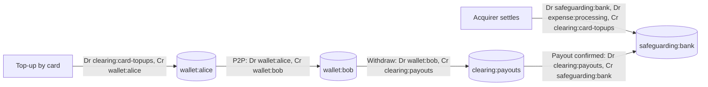

# Wallets, Stored Value, and E-Money Regulation

> A wallet balance is a liability on your books.

**Type:** Learn
**Languages:** —
**Prerequisites:** Phase 10, Lesson 03 (The Double-Entry Ledger from Scratch); Phase 10, Lesson 04 (Chart of Accounts and Account Types); Phase 10, Lesson 07 (Holds, Pending Transactions, and Available Balance); Phase 10, Lesson 08 (Reconciliation)
**Time:** ~60 minutes

## Learning Objectives

- Explain why a customer's wallet balance is a liability of the wallet provider and an asset of the customer, and what that means for the provider's balance sheet
- Distinguish pass-through wallets (Apple Pay, Google Pay), stored-value wallets (PayPal, Venmo, M-Pesa), closed-loop balances (gift cards), and bank accounts, by who holds the money and what protects it
- State the core obligations of the EU E-Money Directive and the UK EMRs (issue at par, redeem at par, no interest, safeguarding) and of US money transmitter regimes (licensing, permissible investments, bonds)
- Design a wallet ledger whose chart of accounts makes top-up, spend, transfer, and withdrawal balanced journal entries, with the invariant that customer liabilities never exceed safeguarded assets
- Identify the failure modes that turned wallet insolvencies into customer losses (commingling, unreconciled ledgers, records that do not identify owners) and the controls that prevent them

## The Problem

In April 2024 Synapse Financial Technologies, a "banking as a service" middleware company in San Francisco, filed for bankruptcy. Synapse sat between consumer fintech apps and several partner banks. End users of those apps saw balances in the apps; the money sat in pooled "for benefit of" (FBO) accounts at the partner banks; and Synapse's own ledger was the only record of which end user owned how much of each pool. When the bankruptcy trustee and the banks tried to reconcile Synapse's ledger with the banks' records, the totals did not match. Court filings put the shortfall between what the ledger said users were owed and what the banks held in the range of 65 to 95 million USD. Over a hundred thousand end users had their funds frozen for months. Many had been told their money was "FDIC insured". It was not, in any useful sense: deposit insurance protects against the failure of an insured bank, and it passes through to the beneficial owners of a pooled account only if the records identify those owners and their amounts. No bank had failed. The records were the problem.

Four years earlier, in June 2020, the UK's Financial Conduct Authority froze Wirecard Card Solutions, the UK e-money subsidiary of the collapsing German Wirecard group. Customers of the consumer apps built on it (Curve, Pockit, and others) could not spend their balances for several days. Their money was safeguarded and was eventually released, which is the regime working as designed, but millions of people learned that the app in their pocket was not a bank and that "your money" was a claim on a company they had never heard of.

Both incidents are about the same fact. When a customer tops up a wallet, the provider receives money and owes it back. The balance in the app is a liability on the provider's books. Everything about wallet regulation (safeguarding, permissible investments, redemption at par) and everything about wallet ledger design (one liability account per customer, daily reconciliation to the bank) exists to make sure that liability is always covered by assets that belong to the customers, not to the provider's creditors. This lesson explains the regulation, the accounting, and the ledger design that make a wallet safe.

## The Concept

### What kind of wallet is it?

"Wallet" means four different things, and the difference decides the regulation and the ledger.

| Kind | Who holds the money | Example | Regulated as | Ledger on the provider's books |
|------|--------------------|---------|--------------|--------------------------------|
| Pass-through (staged) wallet | The card issuer; the wallet holds only a token for the customer's card | Apple Pay, Google Pay, Click to Pay | Not money; token service under scheme rules and PCI (Lesson 05) | None: no balance exists |
| Stored-value (open-loop) wallet | The wallet provider, safeguarded at banks or in permitted assets | PayPal balance, Venmo, Revolut (e-money entity), Wise, M-Pesa, Paytm wallet | E-money (EU, UK), money transmission (US), PPI (India) | A liability per customer |
| Closed-loop balance | The merchant | Starbucks card, gift cards usable only at the issuer, airline credits | Usually excluded from e-money ("limited network"), but subject to gift card and unclaimed property laws | A liability (deferred revenue) per card |
| Bank account | A licensed bank, as a deposit | Any current account, neobank with a banking licence | Banking law, deposit insurance | Bank's own deposit ledger |

A pass-through wallet never touches the money: a payment with Apple Pay is a card payment with a device token, settled by the card's issuer. A stored-value wallet does: the customer pays in, the provider owes the customer. That is the boundary this lesson is about.

### Stored value is a liability

Take a wallet provider with no customers and 2,000,000 EUR of its own capital in a bank account. Its balance sheet:

```text
Assets                              Liabilities and equity
Operating bank account  2,000,000   Equity                       2,000,000
```

One customer tops up 100.00 EUR. The provider receives 100.00 into a separate safeguarding account and owes the customer 100.00:

```text
Assets                              Liabilities and equity
Operating bank account  2,000,000   Customer balances (e-money)        100
Safeguarding account          100   Equity                       2,000,000
```

Customer money increased the provider's assets and its liabilities equally. It did not increase equity: it is not revenue. If the provider spends that 100.00 on salaries, it still owes the customer 100.00, and if it then fails, the customer is an unsecured creditor competing with everyone else. Safeguarding makes the 100.00 in the safeguarding account unavailable for anything except paying customers back, and it puts that pool outside the reach of the provider's other creditors in insolvency.

The asset that backs the liability is called the **float**: the pool of customer money the provider holds at any moment. A wallet with 10 million customers and an average balance of 30 EUR holds a float of 300 million EUR. Interest on that float can be a significant revenue line, which is why regulation constrains where the float may be held.

### The EU and UK: e-money

The **Second E-Money Directive** (Directive 2009/110/EC, EMD2) defines electronic money as monetary value stored electronically, represented by a claim on the issuer, issued on receipt of funds to make payment transactions, and accepted by someone other than the issuer. That last clause is why gift cards that work only at the issuer are not e-money. The UK carried the same rules into the Electronic Money Regulations 2011 (EMRs).

The obligations that shape engineering:

| Obligation | Source | What it means in the system |
|------------|--------|------------------------------|
| Issue at par | EMD2 Article 11 | 100.00 EUR received creates 100.00 EUR of e-money; fees are charged separately and visibly, never by issuing less |
| Redeem at par, at any time | EMD2 Article 11 | The customer can withdraw the full balance; redemption fees only in narrow cases stated in the contract |
| No interest to holders | EMD2 Article 12 | The wallet may not pay interest on the balance (it may pay rewards not linked to time) |
| Safeguarding | EMD2 Article 7, referring to PSD2 Article 10 | Customer funds segregated in a designated account at a credit institution, or invested in secure low-risk liquid assets, or covered by insurance or a bank guarantee; protected from other creditors |
| Timing of safeguarding | EMD2 Article 7 | Funds must be safeguarded promptly; funds received through a payment instrument (a card top-up) must be safeguarded once available to the issuer and no later than five business days after issuance |
| Capital | EMD2 Articles 4 and 5 | Initial capital of 350,000 EUR; ongoing own funds of at least 2% of average outstanding e-money |

In the UK, the FCA has tightened safeguarding after a series of payment and e-money firm failures in which safeguarding shortfalls left customers waiting years for partial distributions. Its revised rules, effective from May 2026, require daily reconciliation of safeguarded funds against customer balances, monthly safeguarding returns to the regulator, and a resolution pack that lets an administrator identify every customer's entitlement quickly. That last requirement is the Synapse lesson written into regulation: the ledger is part of the protection.

### Is my product e-money? A decision procedure

Product teams describe new features as "credits", "points", or "balance" and only later discover they built a regulated product. Run these questions before launch:

| Question | If yes | If no |
|----------|--------|-------|
| Does the customer pay money in and receive a balance denominated in currency? | Continue | Loyalty points not bought with money are usually not e-money; check consumer law |
| Can the balance be spent with anyone other than you (other merchants, P2P, withdrawal)? | Continue | Closed-loop: likely excluded under the limited network exclusion (PSD2 Article 3(k)); gift card and unclaimed property rules still apply |
| Is the "network" of accepting merchants broad (a marketplace with thousands of sellers, a mall)? | Treat as e-money; the limited network exclusion is read narrowly and needs notification above volume thresholds | Continue with the limited network analysis |
| Do you hold the funds, or does a licensed partner issue the e-money and hold them? | You need an EMI licence (EU/UK) or money transmitter licences (US) | You are the partner's agent or distributor; your contract and the partner's ledger must still identify every customer |
| Is it just a token for a card the customer already has? | Pass-through wallet: no stored value, but PCI and scheme token rules (Lesson 05) | Stored value |

### The US: money transmission

The US has no federal e-money regime. A company that holds customer funds and moves them on their behalf is generally a **money transmitter** under state law and a **money services business** under federal anti-money-laundering rules.

- **State licences.** Each state licenses money transmitters separately (Montana is the long-standing exception). A national wallet needs licences in almost every state, or a bank partner whose charter covers the activity. The Conference of State Bank Supervisors' Money Transmission Modernization Act, adopted by a growing number of states since 2021, standardises the requirements.
- **Permissible investments.** Instead of safeguarding accounts, state laws require the licensee to hold permissible investments (cash, bank deposits, government securities, some receivables) with a value at least equal to its outstanding money transmission obligations, held in trust for customers under the model act.
- **Bonds and net worth.** Surety bonds and minimum net worth, scaled to volume.
- **Federal registration and AML.** Registration with FinCEN as an MSB, a Bank Secrecy Act compliance program, suspicious activity reporting, and the prepaid access rule. The CFPB's Prepaid Rule extends Regulation E disclosures and error resolution to prepaid accounts, including many digital wallets.

**FDIC pass-through insurance.** Many US wallets do not hold the float themselves. They place it in a custodial FBO account at a partner bank: "Wallet Co FBO its customers". FDIC insurance can pass through to each end customer, up to the insurance limit, only if the account title discloses the custodial relationship and the records (the bank's or the wallet's) identify each owner and their share (12 CFR 330.5 and 330.7). Pass-through insurance protects against the **bank** failing. It does not protect against the wallet or its middleware failing or keeping bad records, which is what happened at Synapse. After Synapse, the FDIC proposed recordkeeping rules for custodial accounts with transactional features that would require the bank to be able to identify beneficial owners directly.

### India: prepaid payment instruments

The Reserve Bank of India regulates wallets as prepaid payment instruments (PPIs) under its Master Directions. Non-bank PPI issuers need RBI authorisation and must keep outstanding balances in an escrow account with a scheduled commercial bank. Small PPIs with minimum KYC have tight balance limits; full-KYC PPIs allow balances up to 2 lakh INR and must be interoperable with UPI (Lesson 10). The structure is the same as the EU's: customer money in a segregated account, the issuer's ledger as the record of who owns it.

### Mobile money: M-Pesa

Safaricom's M-Pesa, launched in Kenya in 2007, is the best-known stored-value system outside the card and bank world. Customers convert cash to e-value at agents (shops that hold both cash and e-value float), send it by phone, and convert it back at another agent. The customer money is held in trust accounts at several Kenyan commercial banks, under a trust structure that keeps it outside Safaricom's estate, and the Central Bank of Kenya's e-money regulations require the trust balance to equal outstanding e-value. The agent network adds a second float problem the wallet must manage: each agent needs enough e-value to serve deposits and enough cash to serve withdrawals, and rebalancing them is a daily logistics operation.

The structure is the same as the EU's and India's: a segregated pool, a ledger of who owns it, and an invariant between them.

### Wallet ledger design

A wallet is a double-entry ledger (Phase 10, Lesson 03) with a chart of accounts (Phase 10, Lesson 04) built around one invariant:

```text
sum of customer wallet liabilities  <=  safeguarded assets
```

After reconciliation the two are equal, give or take amounts in transit that are explicitly tracked. The chart of accounts:

| Account | Type | Normal balance | Meaning |
|---------|------|----------------|---------|
| `wallet:<customer>` | Liability | Credit | What the provider owes each customer; one account per customer and currency |
| `safeguarding:bank` | Asset | Debit | The segregated account at the safeguarding bank; reconciled daily to its statement (Lesson 14) |
| `clearing:card-topups` | Asset | Debit | Card top-ups authorized and credited to wallets but not yet settled by the acquirer |
| `clearing:payouts` | Liability | Credit | Withdrawals debited from wallets but not yet confirmed by the payout rail |
| `revenue:fees` | Revenue | Credit | Fees the provider has earned; belong to the provider, not customers |
| `expense:processing` | Expense | Debit | Acquirer and rail fees the provider pays |
| `operating:bank` | Asset | Debit | The provider's own money; never mixed with safeguarding |

Every movement is a journal entry that sums to zero, and the money flows are kept honest by two rules: customer money moves only between customer accounts, clearing accounts, and the safeguarding account; the provider's money (fees, expenses) moves through the operating account and is swept out of safeguarding promptly, never left there to cover shortfalls silently.

The four operations:



A P2P transfer between two customers of the same wallet moves no money at any bank: it is two ledger postings inside the provider. That is why closed wallets can offer instant, free P2P, and why the ledger, not the bank, is the record of ownership.

The invariant is cheap to check and should run after every batch of postings and before every sweep. An illustrative check, using the `Money` type from Phase 10, Lesson 01:

```java
/** Customer money owed (positive balances only) must be covered by safeguarded assets plus tracked in-transit items. */
static Money safeguardingGap(List<Money> customerBalances, Money safeguardingStatement,
                             Money topUpsInTransit, Money payoutsInTransit) {
    Currency c = safeguardingStatement.currency();
    Money owed = Money.ofMinor(0, c);
    for (Money b : customerBalances) {
        if (b.isPositive()) owed = owed.plus(b);   // negative balances are receivables, never netted
    }
    Money covered = safeguardingStatement.plus(topUpsInTransit).minus(payoutsInTransit);
    return covered.minus(owed);                     // < 0: shortfall to fund now; > 0: surplus to sweep out
}
```

Two details carry the regulation. Negative balances are excluded rather than netted, so one customer's debt never reduces another customer's protection. And the in-transit items are explicit inputs, each traceable to clearing-account entries, so "the difference is timing" is a claim the reconciliation can prove rather than a comment in a spreadsheet.

### Top-up risk and available balance

A card top-up is a card payment (Lesson 02) and can be charged back for months. If the wallet credits the customer's spendable balance immediately and the customer sends the money onward, a fraudulent top-up becomes a loss when the chargeback arrives: the wallet must repay the issuer, but the money left the wallet as an irrevocable P2P transfer or withdrawal. This is the classic wallet fraud pattern: stolen cards used to top up, money moved out within minutes. The mitigations are the holds of Phase 10, Lesson 07: credit the ledger balance, keep a portion unavailable for withdrawal or P2P until the risk window passes or the funding instrument is trusted, and lower limits for new funding sources. The safeguarding regime does not cover this loss: it is the provider's loss, paid from its own funds.

### Float, breakage, and revenue

A wallet provider earns from fees on transactions, interchange on any card it issues against the wallet (Lesson 07), foreign exchange spreads, and income on the float. In the EU and UK the provider may not pay interest to customers but may earn interest on safeguarded deposits or permitted investments, subject to the safeguarding rules on where the money can be. Two balances need explicit treatment in the ledger:

- **Dormant and unclaimed balances.** A balance untouched for years is still owed. In the US, state unclaimed property (escheatment) laws require remitting it to the state after a dormancy period; in the EU and UK, the right to redeem at par continues. A ledger that "cleans up" small dormant balances into revenue is recording a liability as income.
- **Negative balances.** Chargebacks on top-ups, fees, and reversals can push a customer account below zero. A negative customer liability is a receivable from the customer, and it must not reduce the safeguarding requirement for other customers. The provider covers it from its own funds.

### Failure modes

| Failure | How it happens | Consequence | Control |
|---------|----------------|-------------|---------|
| Commingling | Customer funds and operating funds in one account, or fees left in safeguarding | Customer money used for expenses; shortfall at insolvency | Separate accounts; daily sweep of earned fees out of safeguarding |
| Unreconciled ledger | Ledger totals never compared to bank balances | Silent shortfall grows (Synapse) | Daily reconciliation of sum of wallet liabilities against safeguarding statement plus tracked in-transit items |
| Records that do not identify owners | Pooled FBO account with only middleware records | No pass-through insurance; months-long freeze in failure | Beneficial owner records reconciled with the bank; resolution pack |
| Late safeguarding | Top-ups credited to wallets but funds left in an acquirer or operating account | Funds unprotected for days | Track `clearing:card-topups`; enforce the five-business-day limit |
| Top-up fraud | Stolen cards fund wallets, money moved out instantly | Chargeback losses | Holds on new funding, velocity limits, risk scoring (Phase 13) |
| Negative balances netted | Negative customer balances offset against positive ones | Under-safeguarding | Safeguard the sum of positive balances; treat negatives as receivables |
| Rounding drift | Fees or FX computed in floats | Ledger and bank diverge by cents that accumulate | Integer minor units everywhere (Phase 10, Lesson 01) |

### What this lesson does not cover

It does not cover the authorisation process for an EMI or a money transmitter licence, the AML and KYC obligations of a wallet (Phase 13, Lessons 05 and 06), crypto-asset wallets and stablecoins (where the EU's MiCA regulation treats e-money tokens as e-money), or the accounting standards (IFRS 9, US GAAP) for presenting safeguarded funds on the balance sheet.

## Worked Example

A wallet launches with three customers. All amounts in EUR minor units; balances shown after each step.

**Step 1. Alice tops up 100.00 by card.** The acquirer authorizes; the wallet credits Alice.

```text
Dr clearing:card-topups      10000
Cr wallet:alice                       10000
```

| Account | Balance |
|---------|---------|
| wallet:alice (liability) | 10000 |
| clearing:card-topups (asset) | 10000 |
| safeguarding:bank (asset) | 0 |

Customer liabilities 10000; assets backing them 10000, but all of it is still a receivable from the acquirer. Alice's available balance for withdrawal is held at 0 for the risk window; she may spend at merchants.

**Step 2. The acquirer settles two days later, net of a 1.4% + 0.25 processing fee (1.65).** The wallet chooses to absorb the fee rather than charge Alice, which keeps issuance at par.

```text
Dr safeguarding:bank         9835
Dr expense:processing         165
Cr clearing:card-topups              10000
```

The safeguarding account now holds 98.35, but the provider owes Alice 100.00. Safeguarding is 1.65 short. The provider must move 1.65 of its own money into safeguarding:

```text
Dr safeguarding:bank          165
Cr operating:bank                      165
```

Now `safeguarding:bank` = 10000 = sum of wallet liabilities. This is the step that is easy to forget: a fee deducted from settlement leaves customer money under-safeguarded until the provider tops it up from its own funds.

**Step 3. Alice sends 40.00 to Bob.** No bank moves.

```text
Dr wallet:alice              4000
Cr wallet:bob                         4000
```

Liabilities: Alice 6000, Bob 4000, total 10000. Safeguarding 10000. The invariant holds.

**Step 4. Bob withdraws 40.00 to his bank account, with a 0.50 withdrawal fee disclosed in the contract.**

```text
Dr wallet:bob                4000
Cr clearing:payouts                   3950
Cr revenue:fees                         50
```

When the payout rail confirms:

```text
Dr clearing:payouts          3950
Cr safeguarding:bank                  3950
```

The 0.50 fee now sits in safeguarding but belongs to the provider. The daily sweep moves it out:

```text
Dr operating:bank              50
Cr safeguarding:bank                    50
```

Liabilities: Alice 6000, Bob 0, total 6000. Safeguarding: 10000 - 3950 - 50 = 6000. Equal.

**Step 5. Alice's top-up is charged back as fraud, 30 days later.** The acquirer debits 100.00 from the provider's settlement. The provider debits Alice's wallet for the full amount:

```text
Dr wallet:alice             10000
Cr safeguarding:bank                  10000     (acquirer recovers via settlement)
```

Alice's wallet is now 6000 - 10000 = -4000: she owes the provider 40.00, the amount she sent to Bob. Safeguarding is 6000 - 10000 = -4000, impossible for a bank account, so the provider funds the shortfall from operating:

```text
Dr safeguarding:bank         4000
Cr operating:bank                      4000
```

Final: customer liabilities owed to customers (positive balances only) = 0; safeguarding = 0; Alice's -40.00 is a receivable the provider may never collect. The provider lost 40.00 plus fees from its own capital. The customers with positive balances (none remaining, here) were never at risk, because the provider covered the shortfall rather than netting Alice's negative balance against them.

## Exercises

1. **Reinforce.** Extend the chart of accounts for a multi-currency wallet that holds EUR and GBP balances and lets customers convert between them at a spread. Write the journal entries for converting 100.00 EUR to GBP at a customer rate of 0.8500 when the provider's own rate is 0.8550, and identify which account holds the FX revenue and in which currency safeguarding must be held.
2. **Apply.** Write the daily safeguarding reconciliation as a procedure: inputs (ledger balances per customer, safeguarding bank statement from Lesson 14, list of in-transit top-ups and payouts), the computation (sum of positive customer balances versus statement balance plus or minus in-transit items), and the output (surplus to sweep out, or shortfall to fund before a cut-off time). State what must happen if the shortfall cannot be explained by in-transit items.
3. **Extend.** Combine with Phase 10, Lesson 11 (hot accounts): a popular merchant on the wallet receives 2,000 P2P payments per second into one `wallet:merchant` account. Design how the ledger keeps the invariant and the per-customer liability records accurate under that load, without making the merchant's account a single serialisation point, and explain how your design still lets an administrator produce every customer's exact entitlement within one day of insolvency.

## Key Terms

| Term | What people say | What it actually means |
|------|-----------------|------------------------|
| Stored value | "money in the app" | Funds a provider holds on a customer's behalf; a liability of the provider and a claim of the customer |
| E-money | "the wallet balance" | Under EMD2 and the EMRs, electronically stored value issued at par on receipt of funds, redeemable at par, accepted by third parties |
| Safeguarding | "ring-fenced" | Keeping customer funds segregated (or invested in permitted assets, or insured) so they are protected from the provider's other creditors |
| Float | "the balances" | The total customer money a provider holds at a point in time, and the assets backing it |
| FBO account | "our bank account" | A custodial account at a bank held "for the benefit of" a wallet's customers; insured per customer only if records identify each owner |
| Money transmitter | "payments licence" | A US state-licensed business that receives money to transmit it; must hold permissible investments covering outstanding obligations |
| Pass-through wallet | "a digital wallet" | A wallet that stores card tokens, not money (Apple Pay); the card issuer holds the funds |
| Breakage | "unused balances" | Value that is never redeemed; still a liability until law (escheatment) or contract says otherwise |

## Further Reading

- [Directive 2009/110/EC (Second E-Money Directive)](https://eur-lex.europa.eu/eli/dir/2009/110/oj) — the definition of e-money, issuance and redemption at par, the interest prohibition, and safeguarding by reference to PSD2
- [Directive (EU) 2015/2366 (PSD2), Article 10](https://eur-lex.europa.eu/eli/dir/2015/2366/oj) — the safeguarding methods that e-money institutions also use
- [FCA: Safeguarding regime for payments and e-money firms (PS25/12)](https://www.fca.org.uk/publications/policy-statements/ps25-12-changes-safeguarding-regime-payments-and-e-money-firms) — the UK's revised rules: daily reconciliation, monthly returns, resolution packs
- [CSBS Money Transmission Modernization Act](https://www.csbs.org/csbs-money-transmission-modernization-act-mtma) — the model state law on licensing, permissible investments, and trust treatment of customer funds
- [FDIC: Financial Products That Are Not Insured and pass-through deposit insurance rules (12 CFR Part 330)](https://www.fdic.gov/resources/deposit-insurance/financial-products-insured) — when insurance passes through a custodial account and when it does not
- [Reserve Bank of India Master Directions on Prepaid Payment Instruments](https://www.rbi.org.in/Scripts/BS_ViewMasDirections.aspx?id=12156) — the Indian PPI regime: escrow, KYC tiers, limits, interoperability
