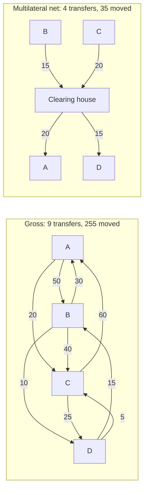

# Settlement and Clearing: Gross, Net, and Deferred

> When the money actually moves, and why T+1 exists.

**Type:** Learn
**Languages:** —
**Prerequisites:** Phase 10, Lesson 03 (The Double-Entry Ledger), Phase 10, Lesson 08 (Reconciliation), Phase 11, Lesson 01 (How a Card Payment Works), Phase 11, Lesson 08 (ACH and the NACHA File Format), Phase 11, Lesson 10 (Real-Time Payments)
**Time:** ~75 minutes

## Learning Objectives

- Distinguish clearing from settlement and state, for any payment you are shown, which of the two has happened and what claim exists in between
- Compute gross, bilateral-net, and multilateral-net settlement obligations for a set of banks and explain why the three answers differ by a factor of seven
- Compare deferred net settlement with real-time gross settlement on liquidity, credit risk, and finality, and name the risk each one carries
- Explain the T+1 and T+2 conventions as settlement cycles and describe what happens to the money and the risk during the gap
- Describe the 1974 Herstatt failure, define settlement risk and payment-versus-payment, and explain what CLS changed
- Trace where the money physically sits at each step of a card payment, an ACH credit, and a real-time payment, and identify which party is extending credit at each step

## The Problem

A merchant sells a 100.00 USD item on Monday afternoon. The card authorization is approved in 300 milliseconds and the customer walks away with the goods. The merchant's dashboard shows the sale. The customer's banking app shows a pending 100.00 debit. The merchant's bank account shows nothing. On Tuesday, nothing. On Wednesday morning, a deposit of 4,217.33 arrives, which is Monday's entire day of sales minus fees, in one line. Nobody at the merchant can say which transactions are in it, and if one of Monday's customers disputes their charge a month later, the merchant will see a 100.00 debit with a different reference again.

The merchant's finance lead asks a reasonable question: where was the 100.00 between Monday afternoon and Wednesday morning? The answer is that it was not anywhere, because no money had moved. The authorization was a promise by the issuing bank to pay. The capture that evening was a message to the acquirer saying "collect on that promise". Clearing, overnight, was the card network sorting millions of such messages into what each bank owes each other bank. Settlement, the next business day, was the network's settlement bank actually moving net amounts between the banks' accounts. The acquirer paying the merchant was a fourth step, on the acquirer's own schedule. Each step is a separate event with a separate party bearing risk, and the 100.00 was a growing stack of claims until the last one.

Engineers who build on top of payment rails need this picture because every rail answers "when is it final?" differently, and the answer determines what your system may do. A real-time payment is final in seconds, so you can release goods. An ACH credit can be returned for up to two banking days (and, for certain reasons, sixty), so releasing goods on receipt is extending credit. A card payment can be charged back for months. A wire is final on receipt, but your bank may still hold it. Reconciliation (Phase 10, Lesson 08) exists because settlement is batched and netted, so the per-transaction records you hold and the per-batch records your bank holds have to be matched. And the greatest payment-system failure of the twentieth century, the Herstatt collapse, was a settlement-timing failure: one leg of each trade had settled and the other had not when the bank was closed.

## The Concept

### Clearing is agreeing; settlement is paying

The two words are used interchangeably in conversation and they must not be in design documents.

| | Clearing | Settlement |
|--|----------|------------|
| What happens | Transmitting, reconciling, and confirming payment instructions; computing what is owed | Discharging the obligation: the transfer of funds (or securities) that extinguishes the claim |
| Output | A set of obligations: "Bank B owes Bank A 15,000,000 for today" | Final, irrevocable credits and debits on settlement accounts |
| Who does it | A clearing house, a card network, an ACH operator, or the two banks bilaterally | A settlement institution, almost always the central bank, sometimes a commercial settlement bank |
| Risk during | Operational (lost or malformed instructions) | Credit and liquidity (the payer may not have the money when it is due) |
| Reversible | Instructions can be rejected or returned by rule | Final by definition; undoing it requires a new, opposite payment |

Three phrases that sound like settlement and are not:

- "The payment was successful" from a processor API means the instruction was accepted for clearing.
- "Funds available" from a bank means the bank has chosen to let you spend against an incoming payment that may not be final (ACH returns, cheque bounces).
- "Posted" on a card statement means the issuer has recorded the cleared transaction; it says nothing about whether the acquirer has paid the merchant.

Between clearing and settlement there is a **claim**: a legally defined obligation of one participant to another, not yet discharged. The duration of that claim and who bears the risk if the obligor fails is the design variable that every settlement system optimizes differently. The Bank for International Settlements' Principles for Financial Market Infrastructures (CPMI-IOSCO, 2012) call the moment the claim is extinguished **settlement finality** and require every systemically important system to define it precisely in its rules.

### Gross versus net

Settle **gross** and every obligation is paid individually, in full. Settle **net** and offsetting obligations are cancelled first and only the differences are paid. The arithmetic is the whole argument for netting, so work it by hand.

#### Worked Example: four banks, nine payments

Four banks exchange payments during a day. Amounts in millions.

| Payer | Payee | Amount |
|-------|-------|--------|
| A | B | 50 |
| A | C | 20 |
| B | A | 30 |
| B | C | 40 |
| B | D | 10 |
| C | A | 60 |
| C | D | 25 |
| D | B | 15 |
| D | C | 5 |

**Gross settlement.** Nine transfers, total value moved `50 + 20 + 30 + 40 + 10 + 60 + 25 + 15 + 5 = 255`. Each bank needs enough liquidity to cover its outgoing payments as they occur: A needs 70 at some point during the day, B needs 80, C needs 85, D needs 20, regardless of what it will receive.

**Bilateral netting.** For each pair, cancel what they owe each other and pay the difference.

```text
A-B:  A owes 50, B owes 30  -> A pays B 20
A-C:  A owes 20, C owes 60  -> C pays A 40
B-C:  B owes 40, C owes  0  -> B pays C 40
B-D:  B owes 10, D owes 15  -> D pays B  5
C-D:  C owes 25, D owes  5  -> C pays D 20
A-D:  nothing either way
total value moved = 20 + 40 + 40 + 5 + 20 = 125     (49% of gross)
```

**Multilateral netting.** Each bank's position against the whole system: everything it receives minus everything it pays.

```text
A: receives 30 + 60 = 90, pays 50 + 20 = 70        -> net +20  (receives 20)
B: receives 50 + 15 = 65, pays 30 + 40 + 10 = 80   -> net -15  (pays 15)
C: receives 20 + 40 + 5 = 65, pays 60 + 25 = 85    -> net -20  (pays 20)
D: receives 10 + 25 = 35, pays 15 + 5 = 20         -> net +15  (receives 15)
check: +20 - 15 - 20 + 15 = 0
total value moved = 15 + 20 = 35                    (14% of gross)
```

Two banks pay into the clearing house's settlement account, two banks are paid out of it, and the net positions sum to zero because every payment is both a debit and a credit, which is the double-entry rule from Phase 10, Lesson 03 applied to the system as a whole. The liquidity needed falls from 255 to 35. That is why almost every high-volume retail system (cards, ACH, cheque clearing, most domestic instant-payment schemes) settles multilaterally net.



#### What netting costs

Netting reduces liquidity by replacing many small, immediate claims with one large, deferred claim on each participant. If C fails before settlement, the clearing house cannot deliver 20 to A and 15 to D. Three ways systems handle that failure:

- **Unwind.** Remove the failed participant's payments and recompute everyone's positions. A's position changes from +20 to -40 (it no longer receives 60 from C), which A may not be able to pay, and a second participant fails. This cascade is **systemic risk**, and the Lamfalussy Report (BIS, 1990) set the standard that a net system must be able to settle on time even if the participant with the largest single net debit position fails. Unwind is no longer acceptable for systemically important systems.
- **Loss sharing.** Survivors cover the shortfall by a pre-agreed formula, backed by collateral each participant posted. Card schemes and ACH operators use variants of this; the scheme's rules make the surviving members jointly liable.
- **Prefunding.** Each participant deposits enough at the settlement institution before the cycle to cover its maximum possible net debit. The claim is then fully collateralized and the failure of a participant costs no one else anything. Modern instant-payment systems (RTP, UPI's settlement guarantee, FedNow's use of master accounts) are built this way; it is netting's liquidity saving traded back for safety.

### Deferred net settlement versus real-time gross settlement

| | Deferred net settlement (DNS) | Real-time gross settlement (RTGS) |
|--|-------------------------------|-----------------------------------|
| When money moves | At fixed cycles: end of day, or several windows | Continuously, payment by payment, as each is submitted |
| Amount moved | Net positions | Each payment in full |
| Liquidity needed | Low: only net debit positions | High: every outgoing payment needs covering funds or intraday credit at the moment it is sent |
| Credit exposure between participants | Yes, from payment acceptance until settlement; the clearing house's rules decide who bears it | None: a payment either settles immediately or queues; nobody extends credit |
| Finality | At the settlement cycle | Immediate on settlement |
| Typical use | Retail: cards, ACH, cheques, many instant-payment schemes | Wholesale: large-value interbank payments, securities settlement cash legs, central-bank money |
| Examples | Visa and Mastercard settlement, Nacha ACH, CHAPS before 1996, BACS | Fedwire (US), T2 (Eurosystem, successor to TARGET2), CHAPS (UK, since 1996), RTGS (India) |

RTGS systems emerged in the 1980s and 1990s precisely as the response to DNS credit risk in large-value payments: when a single payment can be a billion, no one wants to be an unsecured creditor of the payer for six hours. The price is liquidity. Central banks provide collateralized intraday credit to RTGS participants so that payments do not deadlock (A waits for funds from B who waits for funds from A), and modern RTGS systems add **liquidity-saving mechanisms**: queued payments are offset against each other when they can be, which is netting again, applied continuously in small groups. CHIPS in the US is the clearest hybrid: it holds a prefunded balance for each participant and continuously searches for bilateral and multilateral offsets among queued payments, settling them gross against the prefunded balance when it finds them.

### T+1, T+2, and what the gap is for

`T+n` means settlement occurs `n` business days after the trade or transaction date `T`. The convention comes from securities markets, where the gap was originally the time it took to physically deliver certificates, and it persists because the gap is used for clearing: matching both sides' records, netting, and giving participants time to fund their obligations. Shorter cycles mean less time exposed to a counterparty's failure and less margin posted to the clearing house; longer cycles mean more operational slack and fewer settlement fails.

| Cycle | Where | Note |
|-------|-------|------|
| T+0 | RTGS payments, instant payments, FX in CLS (same-day in the PvP window) | Final within seconds to hours |
| T+1 | US equities (since May 28, 2024, down from T+2), card scheme settlement to acquirers, Same Day ACH | The US securities move was motivated by margin requirements during the 2021 volatility |
| T+2 | EU and UK equities (moving to T+1 in October 2027), many card payouts to merchants, standard ACH | |
| T+3 and longer | Some cross-border flows, legacy markets, certain fund settlements | |

For a card payment, the cycle runs: authorization on `T` (a claim on the issuer, no money moved), capture on `T` evening (the acquirer submits it for clearing), clearing overnight (the network computes net positions by `T+1` morning), settlement on `T+1` (the network's settlement bank moves net amounts between the acquirer's and issuer's settlement accounts), and payout on `T+1` or `T+2` (the acquirer pays the merchant from its own account, less the merchant discount rate). The acquirer is extending credit to the merchant if it pays before it is settled, and the issuer is extending credit to the cardholder from authorization until the cardholder pays the statement, which may be weeks. Interchange (Phase 11, Lesson 07) is netted inside the settlement: the acquirer receives the transaction amount minus interchange, and the issuer pays the transaction amount minus interchange, with the scheme fee taken separately.

#### Worked Example: one card payment, hour by hour

The 100.00 USD sale from The Problem, with the claim that exists at each step and who is exposed if the next party fails.

| When | Event | Money moved? | Claim created or extinguished | Who is exposed |
|------|-------|--------------|-------------------------------|----------------|
| Mon 14:02 | Authorization approved | No | Issuer promises to pay; cardholder's available credit reduced | Merchant, on the issuer's promise (small: authorizations are honoured almost always) |
| Mon 23:30 | Acquirer submits capture to scheme | No | Acquirer has a receivable from the scheme; merchant has a receivable from the acquirer | Merchant, on the acquirer |
| Tue 03:00 | Scheme clears: computes net positions per member | No | Issuer owes scheme net; scheme owes acquirer net | Acquirer, on the scheme and its loss-sharing rules |
| Tue 10:00 | Settlement: scheme's settlement bank moves net amounts in central bank money | Yes, net | Scheme-acquirer and scheme-issuer claims extinguished | Nobody at the interbank level; merchant still on the acquirer |
| Wed 06:00 | Acquirer pays merchant 4,217.33 (day's net) | Yes | Acquirer-merchant payable extinguished | Acquirer, on the merchant, for future chargebacks |
| Up to 120 days later | Cardholder disputes; chargeback flows back through the chain | Yes, reversed | New claim: acquirer on merchant for 100.00 plus fees | Acquirer, then merchant |

Read the "Money moved?" column: in a six-step process, money moves twice, and the first time is almost a full day after the sale. Everything before Tuesday 10:00 is bookkeeping about promises. That is normal, not a defect; the design question is only who is allowed to be exposed to whom, for how long, and against what collateral.

### What the rulebooks say

Three excerpts, paraphrased, that fix the vocabulary:

- **PFMI Principle 8 (Settlement finality):** an FMI should provide clear and certain final settlement, at a minimum by the end of the value date, and where necessary or preferable, intraday or in real time. The point at which settlement is final must be defined in the rules and enforceable in every relevant jurisdiction, including in an insolvency of a participant. The word "certain" is doing the work: a settlement that a bankruptcy court could later unwind is not final.
- **Lamfalussy minimum standard IV:** multilateral netting systems should, at a minimum, be capable of ensuring the timely completion of daily settlements in the event of an inability to settle by the participant with the largest single net-debit position. This is the "cover one" standard; the PFMI later raised systemically important CCPs to "cover two".
- **Nacha Operating Rules, returns:** an RDFI may return most entries so that the return is available to the ODFI by the opening of business on the second banking day following the settlement date; unauthorized consumer debits may be returned within 60 calendar days. This is the rule that makes "ACH funds received" different from "ACH funds final".

### Herstatt risk and payment-versus-payment

On 26 June 1974, the German regulator withdrew Bankhaus I.D. Herstatt's banking licence and ordered it to close at 16:30 Frankfurt time. Herstatt had been an active foreign-exchange trader. On that day its counterparties had already paid Deutsche Marks into Herstatt's account in Frankfurt for FX trades settling that day. The US dollar legs of those same trades were due to be paid out of Herstatt's correspondent account in New York, where it was 10:30 in the morning and the dollar payment system had not yet processed them. When Herstatt closed, the correspondent bank suspended all outgoing dollar payments. The counterparties had paid and would not be paid; losses were around 620 million dollars in 1974 money, and the US payment system seized up for days as banks refused to release payments until they knew which counterparties were solvent.

The failure has a precise structure: a transaction with two legs, settling in two systems with different hours, where one leg became final before the other. The time zone gap turned every FX trade into an unsecured intraday loan from whoever paid first. It is called **settlement risk** or **Herstatt risk**, and it is the risk that you deliver your side and do not receive the other, as distinct from **replacement-cost risk**, which is the risk that the counterparty fails before either side delivers and you must re-trade at a worse price.

The fix took 28 years. **Payment-versus-payment (PvP)** means the two legs settle simultaneously or not at all. CLS Bank, operational since 2002, is the PvP settlement institution for FX: both parties pay their currency into CLS, CLS pays out both legs only when both are in, and if one party fails to fund, the other's payment is returned. CLS settles the gross legs on its own books while participants fund only their multilateral net positions per currency, so it is also a netting system, and it settles over 6 trillion dollars a day. The securities equivalent is **delivery-versus-payment (DvP)**: the securities move if and only if the cash moves. Every modern central securities depository settles DvP.

The lesson for an engineer building anything with two legs (a currency conversion, a marketplace that charges a buyer and pays a seller, an atomic swap) is that the failure mode is not "both legs fail" but "one leg completes". Phase 7, Lesson 12 (the saga pattern) is the application-level version of this problem and compensation is the application-level version of CLS returning the funded leg.

### Three rails, three settlement models

The same four questions, asked of each rail: who clears, who settles, when, and who is extending credit in the meantime.

| | Card schemes (Visa, Mastercard) | ACH (Nacha, operated by FedACH and EPN) | Real-time payments (RTP, FedNow, UPI, UK Faster Payments) |
|--|--------------------------------|------------------------------------------|----------------------------------------------------------|
| Clearing | The scheme computes each member's net position daily, by currency | The operator sorts batch files into per-bank files and computes net positions per settlement window | Each payment is cleared individually in seconds; the operator confirms both banks have accepted |
| Settlement | Multilateral net, via the scheme's settlement bank accounts, on T+1 | Multilateral net, via Federal Reserve accounts, at scheduled windows (several per day with Same Day ACH) | RTP: gross, in real time, against a prefunded joint account at the Fed. FedNow: gross, in real time, between master accounts. UPI: deferred multilateral net through NPCI at RBI, several cycles a day, with the receiving bank crediting the customer immediately |
| Finality for the end customer | Merchant: when the acquirer pays out (T+1 to T+2), subject to chargeback for months. Cardholder: when the statement is paid | Receiver: funds available by the rule's deadline, but a credit can be returned for 2 banking days (60 for unauthorized consumer debits) | Receiver: within seconds; the payment is irrevocable |
| Who extends credit, and to whom | Issuer to cardholder (until statement paid); acquirer to merchant (payout before settlement); scheme members to each other (until T+1 settlement, backed by collateral and loss-sharing rules) | Originating bank to the operator's other members until the window settles; receiving bank to the receiver if it makes funds available before settlement | RTP: nobody; the sending bank's prefunded balance covers it. UPI: the receiving bank credits the customer before interbank settlement, so it is extending credit to the system until the next cycle |
| Where the money sits during the gap | In the issuer's reserve account; the merchant has a receivable from the acquirer; the acquirer has a receivable from the scheme | In the originator's bank's reserve account until the window; then in the receiver's bank's reserve account; the receiver has a deposit claim | Moves from the sender's bank's prefunded or master account to the receiver's bank's account in the same second |

"Instant" describes the customer experience, not the interbank settlement model, and the schemes differ underneath:

| Scheme | Customer finality | Interbank settlement | Who carries the gap |
|--------|-------------------|----------------------|---------------------|
| RTP (US, The Clearing House, 2017) | Seconds, irrevocable | Gross, real time, from a prefunded joint account at the Fed | Nobody; the sender's bank prefunded |
| FedNow (US, Federal Reserve, 2023) | Seconds, irrevocable | Gross, real time, between master accounts in central bank money | Nobody |
| UK Faster Payments (2008) | Seconds | Deferred multilateral net, three cycles a day at the Bank of England, prefunded since 2015 | Prefunding covers the net debit cap |
| UPI (India, NPCI, 2016) | Seconds | Deferred multilateral net through NPCI at RBI, several cycles a day | Receiving bank credits before settlement; NPCI settlement guarantee mechanism |
| SEPA Instant / TIPS (Eurosystem, 2018) | Ten seconds | Gross, real time, on TIPS accounts in central bank money | Nobody; TIPS balances are prefunded reserves |
| PIX (Brazil, 2020) | Seconds | Gross, real time, on the central bank's SPI with participant accounts prefunded | Nobody |

The design trend is clear: the earliest schemes (Faster Payments, UPI) kept the DNS model banks already understood and added prefunding and guarantee funds to make it safe; everything built after about 2017 settles gross in real time in central bank money, which is RTGS for retail-sized payments, made possible by the drop in the cost of processing each payment individually. Where a scheme still settles net, the receiving bank's decision to credit the customer immediately is an extension of credit to the system, and its risk team sets a cap on it.

Where the money sits is the question to keep asking. Commercial bank money is a liability of the bank to its customer; central bank money (reserves) is a liability of the central bank to the bank. Interbank settlement means moving reserves between banks' accounts at the central bank, because that is the only money that is not someone else's credit risk. Every rail above eventually settles in reserves; they differ in how long the chain of IOUs is before that happens.

### Cross-border: correspondent accounts and why there is no settlement institution

Domestic rails settle in reserves at one central bank. Across currencies there is no shared central bank, so banks hold accounts with each other. A **nostro** account is "our account at your bank" (a US bank's euro account at a Frankfurt bank); the same account is a **vostro** from the Frankfurt bank's side. A dollar payment from a Brazilian bank to a Kenyan bank may pass through a correspondent in New York, settling in Fedwire between two US banks' reserve accounts, with the Brazilian and Kenyan banks' nostro balances at those correspondents being debited and credited. Each hop is a separate settlement with its own cut-off, its own fee, and its own credit exposure, which is why a cross-border payment takes days and why SWIFT gpi exists to at least track where it is.

The settlement questions apply hop by hop. Who extends credit? The correspondent, if it credits the beneficiary bank's nostro before it has received cover. When is it final? At each hop, when that hop's settlement system says so; end to end, only when the last hop is done. Where is the money? In a chain of nostro balances, each of which is a deposit claim on a commercial bank and therefore carries that bank's credit risk. This is also the arrangement that Herstatt's counterparties were in, and PvP through CLS is available only for the eighteen currencies CLS settles; for the rest, FX settlement risk is still managed by bilateral limits and prayer.

### Cut-offs, windows, and the calendar

Settlement systems run on schedules, and the schedule is the part engineers most often get wrong. Each system has a **cut-off**: the time by which an instruction must be received to be included in a settlement cycle. Fedwire closes at 19:00 Eastern for third-party payments; Same Day ACH has three submission windows with settlement at 13:00, 17:00, and 18:00 Eastern; card schemes have a daily clearing cut-off per region after which a capture falls into the next day's cycle. Instant-payment systems settle continuously but their *participants* may still post to customer accounts in batches.

Combine cut-offs with calendars and the result is the pattern every operations team recognizes: a payment submitted at 18:30 on a Friday before a Monday holiday misses Friday's window, and the next settlement cycle is Tuesday. The money is not lost and not slow; it is sitting in the originator's account because no settlement has occurred. A system that promises users "funds in two business days" must compute business days in the settlement system's calendar (Federal Reserve holidays for US rails, TARGET closing days for euro rails), not the user's. The Lesson 08 reconciliation job sees every one of these as a `MISSING_THEIRS` that clears on the next run.

### Gridlock: why RTGS needs intraday credit

Gross settlement has a failure mode of its own. Suppose A must pay B 100 and B must pay A 100, each has 10 in its account, and neither payment can settle until the other has. Both queue. Nothing moves. With three or more banks the cycles are longer and harder to see, and a system-wide shortage of liquidity at the open of the day (everyone waiting to receive before they send) can stall an entire RTGS. Two remedies, used together:

- **Intraday credit from the central bank**, collateralized (Fedwire's daylight overdrafts, the Eurosystem's intraday credit against eligible collateral). The central bank lends reserves for hours so that payments flow, and charges a fee or requires collateral so banks do not treat it as free.
- **Queue offsetting**: the system periodically looks for sets of queued payments that can settle simultaneously because they net to amounts the participants can cover. The A-B example above resolves instantly if the system settles both payments at once: each bank's balance goes 10 to 10. This is netting applied inside a gross system, which is why the gross-versus-net line in practice is a spectrum.

### Failure modes a payments engineer should recognize

| Symptom | Likely settlement cause | What to check |
|---------|-------------------------|---------------|
| Merchant sees one deposit for a day's sales and cannot match it to transactions | Acquirer pays out net of fees per batch | The acquirer's settlement report; the matching rule in Lesson 08's Exercise 3 |
| An ACH credit arrived, goods were shipped, the credit was reversed three days later | Return within the two-banking-day window; funds were available but not final | The return reason code; the policy on releasing value before the return window closes |
| A customer refund shows "sent" but the customer sees nothing for a week | Refund entered a deferred cycle; issuer posts credits in its own batch; a holiday | The rail's cut-off and calendar; whether the refund was a reversal of the original authorization or a new credit |
| Cash position on Monday morning is off by exactly Friday's gross outflow | Friday's cycle settled on Monday; the ledger posted on Friday | Timing differences in reconciliation, not an error |
| Platform ledger says sellers were paid; bank says the payout file was rejected | Clearing failed (file-level rejection), so settlement never happened, but the ledger recorded settlement | Ledger entries must be posted on settlement confirmation, not on submission; the `1200`-style receivable account should carry the gap |
| Two legs of an FX conversion: customer debited, counterparty credit never arrived | One leg final, the other failed: settlement risk in miniature | Whether the two legs were submitted atomically or sequentially; compensation path |

### The ledger view

In Phase 10, Lesson 03 terms, each step is an entry. For a card payment seen from the acquirer:

```text
T   capture submitted     Dr 1200 Receivable from scheme     100.00
                              Cr 2100 Payable to merchant      97.10
                              Cr 4100 Fee revenue                2.90
T+1 scheme settles        Dr 1010 Settlement bank account     98.20   (100.00 less 1.80 interchange)
                          Dr 5100 Interchange expense           1.80
                              Cr 1200 Receivable from scheme  100.00
T+2 payout                Dr 2100 Payable to merchant          97.10
                              Cr 1010 Settlement bank account   97.10
```

The receivable account `1200` is exactly the claim that exists between clearing and settlement, and its balance at any moment is the acquirer's credit exposure to the scheme. The reconciliation job of Lesson 08 matches the `1010` postings against the settlement bank's statement; the breaks it finds are, almost always, settlement timing.

### Decision procedure: which settlement model does your system need

When you design something that moves value between parties, answer these in order:

1. **Is there a trusted settlement institution whose liability both parties accept?** If yes (a central bank, a scheme, your own platform ledger holding both parties' balances), you can settle on its books. If no, you are in the bilateral world of correspondent banking and every payment is a credit decision.
2. **Can participants prefund?** If yes, settle gross in real time against prefunded balances: no credit risk, immediate finality, and the liquidity cost is borne by participants up front. If no, you need netting, and therefore a deferred cycle and rules for a participant's failure.
3. **What is the largest single net debit a participant could run up in one cycle?** The Lamfalussy standard says the system must survive its failure. The answer sets the collateral requirement or the cycle length.
4. **Does the transaction have two legs?** If yes, settle them atomically (PvP, DvP, a single ledger entry with both postings) or accept that the one that completes first is an unsecured loan.
5. **When does the end user need finality?** Goods released at the counter need seconds. Payroll needs certainty by the morning of payday, not instant. Match the rail to the need and do not pay for finality you do not use.

### What this lesson does not cover

- Securities settlement mechanics beyond the DvP principle: central securities depositories, central counterparties, and margin models are a field of their own.
- Central bank digital currency and tokenized deposits, which propose to collapse the clearing-settlement gap by making the ledger entry and the settlement the same event; the questions in the decision procedure still apply to them.
- The legal doctrine of finality in specific jurisdictions (the EU Settlement Finality Directive, UCC Article 4A in the US); the engineering consequence is only that finality is defined by rules, not by the arrival of a message.
- Scheme-specific settlement reports and their formats, which Phase 11, Lesson 14 (Bank Statement Formats) and Phase 10, Lesson 08 (Reconciliation) cover from the receiving side.

## Exercises

1. **Reinforce.** Add a fifth bank E to the worked example with payments E→A 35, E→C 10, B→E 45, D→E 5. Recompute gross total, all bilateral nets, and the multilateral net positions, and confirm the positions sum to zero. Then remove C entirely (it failed before settlement) and recompute: which bank's position changes sign, and what does that tell you about unwind risk?
2. **Apply.** Write, in the style of the ledger view above, the acquirer-side entries for a 100.00 USD card payment that is charged back 40 days after settlement. Include the chargeback debit from the scheme, the recovery from the merchant's payable (assume the merchant has 60.00 of pending payouts and the rest must be invoiced), and the fee the scheme charges for the dispute. Which account carries the acquirer's loss exposure, and at what balance would you stop onboarding merchants in that category?
3. **Extend.** Using the `Reconciler` from Phase 10, Lesson 08, model a day of settlement for the four-bank example as seen by Bank C: C's ledger holds nine individual postings (its payments and receipts), but the clearing house's statement shows one line, a net debit of 20. Design the one-to-many matching rule that pairs the statement line with the set of postings whose sum is the net, and state what break kind you would raise if C's ledger summed to 19 instead. Then explain in a paragraph why most reconciliation breaks against a net-settlement counterparty are timing differences rather than errors.

## Key Terms

| Term | What people say | What it actually means |
|------|-----------------|------------------------|
| Clearing | "processing the payment" | Transmitting, matching, and confirming payment instructions and computing resulting obligations; no money moves |
| Settlement | "the money arrives" | Discharge of an obligation by transfer of funds, typically central bank reserves; the moment a claim is extinguished |
| Settlement finality | "it's done" | The legally defined point after which a settled transfer cannot be unwound, even in the payer's insolvency; required by the PFMI to be stated in a system's rules |
| Multilateral netting | "netting out" | Replacing each participant's many bilateral obligations with one net position against the system; positions sum to zero and liquidity need falls to the sum of net debits |
| Deferred net settlement | "end-of-day settlement" | Netting followed by settlement at fixed cycles; cheap in liquidity, creates interbank credit exposure until the cycle |
| Real-time gross settlement | "RTGS", "wire" | Each payment settled individually and immediately in central bank money; no credit exposure, high liquidity need, central bank intraday credit to avoid gridlock |
| Herstatt risk | "settlement risk" | Loss of the full principal when one leg of a two-legged transaction settles and the other does not; named for the 1974 failure that cost counterparties 620 million dollars |
| Payment-versus-payment | "PvP", "atomic settlement" | Both legs settle simultaneously or neither does; CLS Bank for FX, delivery-versus-payment for securities, a single balanced journal entry on one ledger |

## Further Reading

- [CPMI-IOSCO, Principles for Financial Market Infrastructures (2012)](https://www.bis.org/cpmi/publ/d101a.pdf) — the international standard for payment and settlement systems; Principle 8 (settlement finality), Principle 9 (money settlements), and Principle 4 (credit risk) are the ones this lesson draws on.
- [BIS, Report of the Committee on Interbank Netting Schemes (Lamfalussy Report, 1990)](https://www.bis.org/cpmi/publ/d04.pdf) — the document that defined the minimum standards for net settlement systems after the Herstatt and 1987 experiences; short and still the clearest statement of why unwind is unacceptable.
- [BIS, Real-Time Gross Settlement Systems (1997)](https://www.bis.org/cpmi/publ/d22.pdf) — the design survey written as central banks moved large-value systems from DNS to RTGS; the chapter on gridlock and intraday liquidity explains why liquidity-saving mechanisms exist.
- [CLS Group, About CLS and the PvP settlement model](https://www.cls-group.com/about/) — how the FX settlement institution funds, nets, and settles, and what happens when a member fails to pay in.
- [Nacha Operating Rules, settlement and returns sections](https://www.nacha.org/rules) — the authoritative schedule for ACH settlement windows and return deadlines, including the Same Day ACH windows.
- [The Clearing House, RTP Network Operating Rules and Participant Funding](https://www.theclearinghouse.org/payment-systems/rtp) — the prefunded joint-account model for instant gross settlement, which is the modern answer to the DNS credit problem.
- [Federal Reserve, Fedwire Funds Service and FedNow Service](https://www.frbservices.org/financial-services) — the two RTGS systems of the US dollar; the Fedwire pages describe daylight overdraft policy, which is the intraday-credit side of RTGS.
