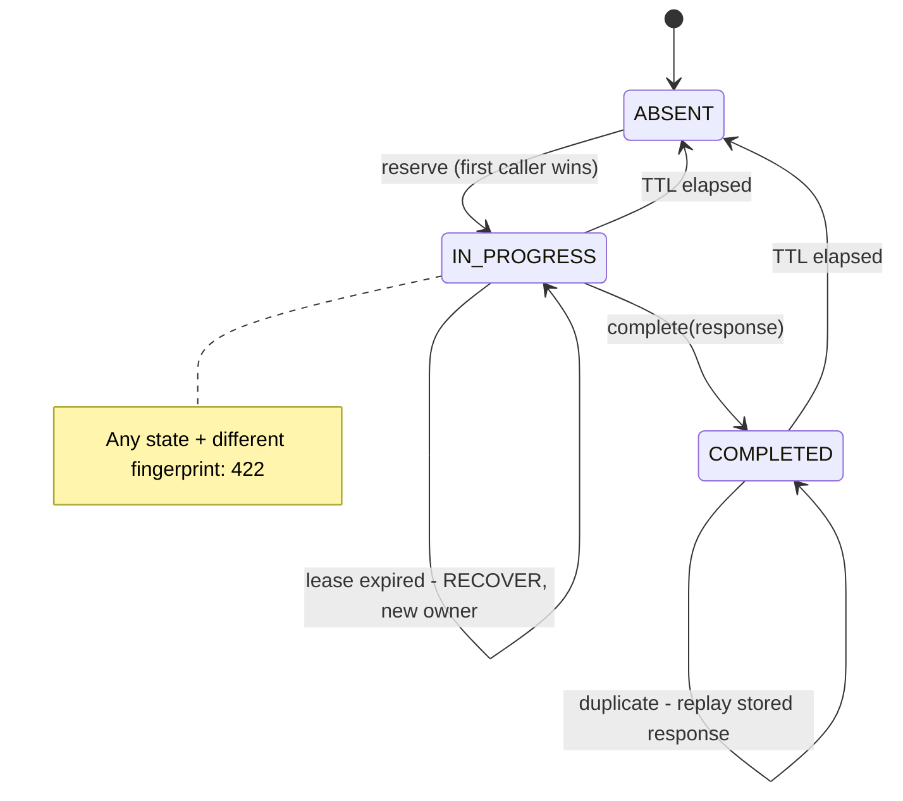

# Designing an Idempotent Payment API

> A payment endpoint that cannot be safely retried is an endpoint that will eventually charge someone twice.

**Type:** Build
**Languages:** Java, Python, Go
**Prerequisites:** Phase 5 Lesson 09 (Idempotency Keys), Phase 5 Lesson 10 (Retries, Exponential Backoff, and Jitter), Phase 10 Lesson 01 (Representing Money)
**Time:** ~120 minutes

## Learning Objectives

- Explain why a `POST /payments` endpoint must be idempotent and why the network makes that the client's problem unless the server solves it
- Build an idempotency layer that scopes keys per merchant, fingerprints the request body with SHA-256 over a canonical encoding, and stores every response, including failures
- Implement the atomic check-and-reserve that turns a concurrent duplicate into a `409` instead of a second charge, and the lease that lets a retry recover after a crash
- State the HTTP semantics table (`201`/`402` replay, `409` in progress, `422` fingerprint mismatch) and justify each status with RFC 9110
- Decide which operations must be idempotent (writes with side effects) and which must not be (reads), and explain what goes wrong when a read is cached as if it were a write
- Choose a key TTL and explain what a TTL does and does not protect against

## The Problem

A merchant's checkout service calls your payments API: `POST /payments` with `{"amount": 1999, "currency": "USD", "source": "tok_visa_4242"}`. Your service authorizes the card with the processor, which takes 1.8 seconds because the issuer is slow tonight. The merchant's HTTP client has a 1.5-second timeout. It gives up, logs `read timeout`, and, because its author read Phase 5 Lesson 10, retries with backoff. The retry succeeds in 400 milliseconds. The merchant records one successful payment. Your processor records two authorizations on the same card for 19.99 USD, and the second one is the one the merchant knows about. The first one sits as a pending authorization on the customer's statement until it expires in seven days, or until the customer calls their bank, disputes it, and your merchant eats a 15.00 USD chargeback fee on a 19.99 USD order.

That is the benign version. The malign version is a capture rather than an authorization, on a debit card, for a customer whose balance was 25.00 USD. The second capture overdraws the account. The customer is charged an overdraft fee by their bank for a purchase they made once. Multiply by the retry storm that follows any processor latency spike: a 30-second slowdown at 2,000 requests per second with a 20 percent timeout rate is 12,000 duplicate charges in half a minute. Support tickets, refunds, chargebacks, and a post-mortem titled "retry logic caused double charges" that misses the point. The retry logic was correct. The endpoint was not safe to retry.

Phase 5 Lesson 09 built the idempotency store: a key, a stored result, and the rule that a repeated key returns the stored result. That is the data structure. This lesson is the API around it, and the API adds concerns the store alone does not answer. Whose key is it (two merchants will both send `order-1001`)? What if the same key arrives with a different amount (a bug, or an attack)? What if the duplicate arrives while the first request is still in flight and there is no stored result yet? What if the first request charged the card and then the process died before storing the result? Should a declined payment be replayed, or should the retry get a second chance at the card? Should `GET /payments/{id}` be idempotent? Each of these has a right answer, each is encoded as an HTTP status, and getting one wrong moves money incorrectly.

## The Concept

### Idempotency is a server-side promise about client-side retries

An operation is idempotent when performing it twice has the same effect as performing it once. HTTP already labels `GET`, `PUT`, and `DELETE` idempotent by definition (RFC 9110, section 9.2.2) and `POST` not. A payment creation is a `POST`: two `POST /payments` with the same body are, by default, two payments. The idempotency key changes that contract. The client attaches a unique key to the request; the server promises that any request carrying a key it has already seen will produce the same response as the first one, without re-running the side effect. The client can now retry freely, because a retry is indistinguishable, from the processor's point of view, from a request that was never duplicated.

The promise has a precise shape, and every piece of it corresponds to something that goes wrong without it:

| Guarantee | Without it |
|-----------|-----------|
| Same key, same scope, same body: return the stored response | Duplicate charge |
| Same key, same scope, different body: refuse | A client bug silently charges the wrong amount and gets a success response for the original |
| Same key while the first is still running: refuse with "try again shortly" | Both callers see "no record" and both charge |
| Same key after the first call crashed mid-flight: recover, do not redo | A charge whose response was lost is repeated |
| Store failures too | A declined card is retried against the issuer on every client retry |
| Keys scoped to the caller | Merchant A's `order-1` replays Merchant B's payment |
| Keys expire | The store grows without bound, and a key reused a year later by a new client build is treated as a replay |

### The key and its scope

The key is chosen by the client. It is opaque to the server; the server never parses it or derives meaning from it. The IETF HTTP API working group's `Idempotency-Key` header draft specifies exactly this: a client-generated unique string, typically a UUID, carried in a request header, with the server storing the response for a bounded time.

The key is not globally unique, and the server must not pretend it is. Two merchants will both send `order-1001`, `1`, or `test`. The store key is therefore `(merchant, key)`, where the merchant is whoever authenticated the request. In this lesson the two are joined with a separator character that the key grammar forbids (`U+001F`, the ASCII unit separator), so the concatenation is injective: `"a:b" + "c"` and `"a" + "b:c"` cannot collide because `:` is never the separator and the separator can never appear in a key. A request whose key contains a control character is rejected with `400` before anything else happens.

What goes inside the scope is a design decision. Stripe scopes keys per account and per API key; a key is also implicitly scoped to the endpoint, because the stored response is only meaningful for the request shape that produced it. This lesson's handler has one endpoint, so the scope is the merchant alone.

### The fingerprint: what "the same request" means

Replaying a stored response is only correct if the retry is the same request. The retry is byte-for-byte identical in the easy case. In the hard cases the client re-serialized the body (field order changed, whitespace changed, a float printed as `19.99` once and `19.990` the next time), or the client has a bug and sent a different amount with the same key. The server needs a definition of "same" that is stable under harmless re-serialization and strict under meaningful change.

The fingerprint is SHA-256 over a canonical encoding of the request's semantic fields. Canonical means: a fixed set of fields, sorted by name, one `name=value` per line, **every line terminated by `\n` (including the last one)**, with the amount rendered as its integer minor units and the currency as its ISO code. Shown with the line terminators visible:

```text
amount=1999\n
currency=USD\n
description=Order 1001\n
source=tok_visa_4242\n
```

SHA-256 of those exact 69 bytes (UTF-8, four `\n` characters) is `a3e98e16f24b06155d4539aa040c1d1362dcaafddc3debe88ee16fb23f9a644f`, and all three implementations in this lesson produce that exact string; drop the final newline and you get a different digest, which is the first thing to check when two services disagree on a fingerprint. One known weakness of this simple form, left as it is here to keep the test vector short: a value is written raw, so a `description` containing a newline followed by `source=...` could forge another request's canonical bytes; a production encoding length-prefixes or escapes each value so a field boundary can never be injected through a value. That is a cross-language test vector: a Java service and a Go service fronting the same store will agree on whether two requests match. Note what is in the fingerprint and what is not. The amount in minor units is in, so `19.99` and `19.990` collapse to `1999`. The merchant is not in it, because the merchant is in the scope. The idempotency key itself is not in it, obviously. Transport-level noise (header order, `User-Agent`, the TLS session) is not in it.

Why a hash rather than storing the canonical body? Because the comparison then is a fixed-length string equality, the store row is a fixed size regardless of body size, and the body never has to be retained. SHA-256's collision resistance means two different canonical bodies will not produce the same fingerprint in any realistic lifetime of the system.

### The state machine of a key



A key is in one of three states. `ABSENT` means the server has never seen it (or has forgotten it). `IN_PROGRESS` means a request with that key has been accepted and is executing; there is no response yet. `COMPLETED` means the response is stored. The transition from `ABSENT` to `IN_PROGRESS` is the critical one: it must be atomic with the check that the key is absent. If the check and the insert are two steps, two concurrent requests can both observe `ABSENT` and both insert, and both charge. In this lesson the atomicity comes from a single lock around a `HashMap`; in production it is a unique constraint on `(merchant, key)` in the database, or a compare-and-set in Redis. The name for the operation is *reserve*, and exactly one caller per key gets a `RESERVED` outcome.

### The HTTP semantics

| Situation | Status | Body | Headers | RFC 9110 justification |
|-----------|--------|------|---------|------------------------|
| First request, approved | `201 Created` | the payment | | A new resource was created |
| First request, declined by the issuer | `402 Payment Required` | the failed payment | | The request was valid and processed; the outcome was a decline |
| Duplicate of a completed request | the stored status (`201` or `402`) | the stored body, byte-identical | `Idempotent-Replayed: true` | The client asked for the same thing and gets the same answer; the header lets it know no new work happened |
| Duplicate while the first is still in flight | `409 Conflict` | `request_in_progress` | `Retry-After: 1` | The request conflicts with the current state of the target resource; the client should wait and retry |
| Same key, different fingerprint | `422 Unprocessable Content` | `idempotency_key_reused_with_different_request` | | The request is syntactically valid but semantically unacceptable: it contradicts an earlier request |
| Missing key | `400 Bad Request` | `idempotency_key_required` | | The server requires the header for this endpoint |
| Key contains control characters or exceeds 255 bytes | `400 Bad Request` | `idempotency_key_invalid` | | |
| No authenticated merchant | `401 Unauthorized` | | | Nothing can be scoped without a caller |

Three points deserve emphasis. First, `409` is not an error the client should surface; it is an instruction to retry after a short delay, and the `Retry-After` header says how long. A client that treats `409` as a failure and shows the customer an error has turned a 1-second race into an abandoned checkout. Second, `422` *is* an error the client must surface, to a developer rather than a customer, because it means the client is reusing keys incorrectly. The server never picks one of the two bodies and proceeds; it refuses, because it cannot know which one the client meant. Third, the replay of a `402` is deliberate. A retry is a retry of the *request*, not a second attempt at the *card*. If the client wants to try the card again, that is a new request with a new key. Replaying declines also protects the issuer from being hammered by a client's retry loop and protects the merchant from velocity limits that count declined attempts.

### The crash window and the lease

The sequence inside a reserved request is: charge the processor, render the response, store it, return it. The process can die between step one and step three. The processor has committed a charge; the store says `IN_PROGRESS` forever; the client's retry sees `409` forever. Phase 5 Lesson 09's store did not have an answer for this because it did not model the external side effect. This lesson does, with two mechanisms.

The first is a *lease*. An `IN_PROGRESS` record carries an `updatedAt` timestamp. A duplicate that arrives within `LEASE_MILLIS` (30 seconds here) of that timestamp gets `409`: the owner might still be working. A duplicate that arrives after the lease has expired is told `RECOVER`: the owner is presumed dead, and the new caller takes over the record by renewing the lease. The lease length is a trade-off between how long a slow-but-alive owner is protected from being superseded and how long a client waits after a real crash. Thirty seconds is longer than any sane processor timeout and shorter than any client's patience.

The second is a *deterministic processor reference*. Before charging, the handler derives the reference it will give the processor as a pure function of the scoped key: `ref_` + the first 16 hex characters of SHA-256 of `"ref:" + scopedKey`. A recovering caller computes the same reference and asks the processor `lookup(reference)` before charging. If the processor has it, the charge happened; render it and complete the record. If the processor does not have it, the owner died *before* charging; charge now. Every real processor offers this, under various names: Stripe's own idempotency keys on its API, Adyen's `reference`, a card network's retrieval reference number. The pattern is the same one Phase 7's saga lessons use for compensations: give the remote side a name you can ask about later.

Worked example, with the clock injected and starting at `t=0`:

```text
t=0.000  POST merchant_acme key-1002 45.00 USD
         reserve -> RESERVED, record {IN_PROGRESS, createdAt=0, updatedAt=0}
         processor.charge(ref_db1d1c2769c470a6) -> approved, stored at the processor
         *** process dies ***
t=0.000  retry: reserve -> record is IN_PROGRESS, now - updatedAt = 0 < 30000 -> IN_PROGRESS -> 409 Retry-After: 1
t=30.000 retry: reserve -> now - updatedAt = 30000 >= 30000 -> RECOVER, updatedAt=30000
         processor.lookup(ref_db1d1c2769c470a6) -> found, approved
         complete(record, 201 body)  -> 201 (not marked replayed: this caller finished the work)
t=30.001 retry: reserve -> COMPLETED -> 201 Idempotent-Replayed: true
```

Charge calls to the processor across the whole sequence: one.

### The TTL

Keys expire 24 hours after creation. The TTL exists for two reasons that have nothing to do with correctness during a retry: the store must not grow forever, and a key reused by accident long after the original request (a client that persists keys in a database and reuses them after a restore from backup, for instance) should be a new request rather than a stale replay. Stripe's documented behaviour is to prune keys after 24 hours; the IETF draft leaves the duration to the server but requires that it be documented.

The TTL is measured from `createdAt`, not from the last access. Refreshing it on access would let a client that retries every hour keep a key alive indefinitely. One consequence the tests pin down: at exactly `createdAt + TTL`, the key is gone, and a request with the same key and a *different* body is accepted as a new payment, because there is nothing left to compare its fingerprint against. A client must therefore never rely on `422` as a safety net across a day boundary.

### What must not be idempotent

Idempotency keys protect operations with side effects. Reads have none. `GET /payments/{id}` takes no key, writes no record, and returns the payment's *current* state. The temptation, once an idempotency layer exists, is to run every request through it. Doing so for reads is wrong in two ways. First, it would return a stale response: a payment that was `authorized` when first read and has since been `captured`, `refunded`, or `disputed` would keep reporting `authorized` for as long as the key lives. Second, it would make the store grow with every poll, and polling is exactly what clients do after a `409`. The rule is: idempotency is for `POST` (and non-idempotent `PATCH`); `GET` is already idempotent by construction and must stay that way by returning live state. The same reasoning says that a `POST /payments/{id}/capture` needs its own key, scoped to that endpoint, because capturing twice is as bad as charging twice.

### What this design does not do

- It does not persist the store. A process restart loses every record, which in production means a duplicate after a restart charges twice. The store belongs in the same database transaction as the payment row (Phase 7), with a unique index on `(merchant, key)`.
- It does not authorize the reader. `GET /payments/{id}` returns any payment whose id you know. Payment ids are unguessable in practice, but authorization is a separate layer (Phase 12, Lesson 13).
- It does not bound the number of `IN_PROGRESS` records a merchant may hold, so a client that opens a thousand payments and never finishes any of them consumes a thousand records for 24 hours. Rate limits are Phase 12, Lesson 09.
- It does not know about the processor's own idempotency semantics beyond `charge` and `lookup`. Real processors have their own key headers, their own TTLs, and their own ideas about what a duplicate reference means; Phase 12, Lesson 10 builds the adapter layer.

## Build It

The walkthrough is in Java. Python and Go implement the same types and the same tests; the subsections at the end show what differs.

### Step 1: The request and its fingerprint

```java
record PaymentRequest(Money amount, String source, String description) {
    PaymentRequest {
        if (!amount.isPositive()) throw new IllegalArgumentException("amount must be positive: " + amount);
    }

    /** Canonical form: fields sorted by name, one `name=value` per line, amount in minor units. */
    String canonical() {
        TreeMap<String, String> fields = new TreeMap<>();
        fields.put("amount", Long.toString(amount.minorUnits()));
        fields.put("currency", amount.currency().code());
        fields.put("description", description);
        fields.put("source", source);
        StringBuilder sb = new StringBuilder();
        fields.forEach((k, v) -> sb.append(k).append('=').append(v).append('\n'));
        return sb.toString();
    }

    String fingerprint() { return Hashing.sha256Hex(canonical()); }
}
```

`Money` is the Phase 10 Lesson 01 record, copied in. The `TreeMap` sorts by key, which is the whole canonicalization: whatever order the client sent the fields in, they come out alphabetical. The amount is rendered from `minorUnits()`, so the fingerprint cannot be affected by how the client formatted a decimal. `Hashing.sha256Hex` is `MessageDigest.getInstance("SHA-256")` with a hex encoder; it lives in a small helper class because the handler uses it twice.

**Predict:** two requests, one constructed with `Money.parse("19.99", USD)` and one with `Money.ofMinor(1999, USD)`, otherwise identical. Same fingerprint or different?

### Step 2: The store record and the reserve outcome

```java
enum KeyState { IN_PROGRESS, COMPLETED }

record IdempotencyRecord(String key, String fingerprint, String referenceId, KeyState state,
                         PaymentResponse response, long createdAtMillis, long updatedAtMillis) {
    IdempotencyRecord complete(PaymentResponse response, long now) {
        return new IdempotencyRecord(key, fingerprint, referenceId, KeyState.COMPLETED, response, createdAtMillis, now);
    }
    IdempotencyRecord renewLease(long now) {
        return new IdempotencyRecord(key, fingerprint, referenceId, KeyState.IN_PROGRESS, null, createdAtMillis, now);
    }
}

enum Reservation { RESERVED, RECOVER, IN_PROGRESS, COMPLETED, FINGERPRINT_MISMATCH }

record ReserveOutcome(Reservation decision, IdempotencyRecord record) {}
```

The record is immutable; state changes produce a new record. `createdAtMillis` drives the TTL and never changes. `updatedAtMillis` drives the lease and is bumped when a record is completed or when a recovering caller takes it over. `Reservation` is the five-way verdict `reserve` can return, and the handler maps each one to an HTTP response. Keeping the verdict as an enum rather than a boolean is what makes the handler's switch readable and the tests precise.

### Step 3: Atomic check-and-reserve

```java
synchronized ReserveOutcome reserve(String key, String fingerprint, String referenceId) {
    long now = clock.nowMillis();
    IdempotencyRecord existing = records.get(key);
    if (existing != null && now - existing.createdAtMillis() >= ttlMillis) {
        records.remove(key);                       // expired: the key may be reused with any body
        existing = null;
    }
    if (existing == null) {
        IdempotencyRecord fresh = new IdempotencyRecord(key, fingerprint, referenceId, KeyState.IN_PROGRESS, null, now, now);
        records.put(key, fresh);
        return new ReserveOutcome(Reservation.RESERVED, fresh);
    }
    if (!existing.fingerprint().equals(fingerprint)) {
        return new ReserveOutcome(Reservation.FINGERPRINT_MISMATCH, existing);
    }
    if (existing.state() == KeyState.COMPLETED) {
        return new ReserveOutcome(Reservation.COMPLETED, existing);
    }
    if (now - existing.updatedAtMillis() < leaseMillis) {
        return new ReserveOutcome(Reservation.IN_PROGRESS, existing);   // a live owner is still working
    }
    IdempotencyRecord renewed = existing.renewLease(now);               // owner died: this caller takes over
    records.put(key, renewed);
    return new ReserveOutcome(Reservation.RECOVER, renewed);
}
```

The order of the checks is the specification. TTL first, because an expired record is as good as absent and must not produce a `422` against a body nobody remembers. Fingerprint second, because a mismatch is a client error regardless of whether the original completed, and reporting `409` for a mismatched in-flight request would send the client into a retry loop that can never succeed. State third. Lease last, and only for `IN_PROGRESS`. The `synchronized` keyword makes the whole decision atomic; the thirty-two-thread test proves that exactly one caller gets `RESERVED`.

**Predict:** a record is `IN_PROGRESS` with `updatedAt = 0`, the lease is 30,000 ms, and two callers arrive at `now = 30,000` within the same millisecond. How many get `RECOVER`?

### Step 4: The handler and the HTTP mapping

```java
PaymentResponse post(String merchantId, String idempotencyKey, PaymentRequest request) {
    if (merchantId == null || merchantId.isBlank()) return PaymentResponse.of(401, "{\"error\":\"unauthenticated\"}");
    if (idempotencyKey == null || idempotencyKey.isBlank()) return PaymentResponse.of(400, "{\"error\":\"idempotency_key_required\"}");
    if (idempotencyKey.length() > 255 || idempotencyKey.chars().anyMatch(Character::isISOControl)) {
        return PaymentResponse.of(400, "{\"error\":\"idempotency_key_invalid\"}");
    }
    String key = scopedKey(merchantId, idempotencyKey);
    String fingerprint = request.fingerprint();
    String referenceId = referenceIdFor(key);
    ReserveOutcome outcome = store.reserve(key, fingerprint, referenceId);
    switch (outcome.decision()) {
        case FINGERPRINT_MISMATCH: return PaymentResponse.of(422, "{\"error\":\"idempotency_key_reused_with_different_request\"}");
        case IN_PROGRESS:          return PaymentResponse.of(409, "{\"error\":\"request_in_progress\"}")
                                           .withHeader(PaymentResponse.RETRY_AFTER, Integer.toString(RETRY_AFTER_SECONDS));
        case COMPLETED:            return outcome.record().response().withHeader(PaymentResponse.REPLAYED, "true");
        case RECOVER:              return recover(key, request, referenceId);
        case RESERVED: default:    return execute(key, request, referenceId);
    }
}
```

Validation before reservation: a request with no key or no merchant never touches the store. `scopedKey` is `merchantId + "\u001f" + idempotencyKey`; `referenceIdFor` is the deterministic processor reference. The `COMPLETED` branch returns the stored response object with one header added, so the body is byte-identical to the original by construction, not by re-rendering.

### Step 5: Execute and recover

```java
private PaymentResponse execute(String key, PaymentRequest request, String referenceId) {
    ProcessorResult result = processor.charge(referenceId, request.amount(), request.source());
    PaymentResponse response = render(result);
    store.complete(key, response);     // only reached if the process survived the charge
    return response;
}

private PaymentResponse recover(String key, PaymentRequest request, String referenceId) {
    Optional<ProcessorResult> prior = processor.lookup(referenceId);
    ProcessorResult result = prior.orElseGet(() -> processor.charge(referenceId, request.amount(), request.source()));
    PaymentResponse response = render(result);
    store.complete(key, response);
    return response;
}
```

`execute` is the happy path. If `charge` throws (the `FakeProcessor` can be told to throw `SimulatedCrash` *after* recording the charge, which models a process death), `complete` never runs and the record stays `IN_PROGRESS`. `recover` is what the next caller runs after the lease expires: look up first, charge only if the lookup finds nothing. `render` maps an approved result to `201` and a decline to `402`, and both go through `complete`, which is why declines are replayed.

**Predict:** `recover` finds nothing at the processor and calls `charge`, which succeeds. Is the response marked `Idempotent-Replayed`?

### Step 6: The read path

```java
PaymentResponse get(String paymentId) {
    Optional<ProcessorResult> current = processor.lookup(paymentId);
    if (current.isEmpty()) return PaymentResponse.of(404, "{\"error\":\"not_found\"}");
    return new PaymentResponse(200, render(current.get()).body(), Map.of());
}
```

No key, no store, no `Idempotent-Replayed`. The test asserts that two `GET`s leave `store.size()` unchanged and that `chargeCalls` does not move.

### Step 7: Run it

```bash
cd phases/12-payment-systems-design/01-idempotent-payment-api/code/java
javac -d .out *.java && java -cp .out Main
java -cp .out MainTest
```

Expected output, abbreviated:

```console
== Fingerprint: SHA-256 of the canonical body ==
amount=1999
currency=USD
description=Order 1001
source=tok_visa_4242
fingerprint = a3e98e16f24b06155d4539aa040c1d1362dcaafddc3debe88ee16fb23f9a644f

== First call charges; the duplicate is replayed, not re-charged ==
POST #1 -> 201 {"id":"ref_349281adde6ae74d","status":"succeeded",...} {}
POST #2 -> 201 {"id":"ref_349281adde6ae74d","status":"succeeded",...} {Idempotent-Replayed=true}
processor charge calls = 1

== Same key, different body: refuse, do not guess ==
POST #3 -> 422 {"error":"idempotency_key_reused_with_different_request"}

== Same key, different merchant: a different payment ==
POST by globex -> 201 replayed=false ref=ref_1efc6a45df856b86

== Crash after the processor committed, before we stored the response ==
retry at +0s   -> 409 Retry-After=1 (owner lease still live)
retry at +30s  -> 201 {"id":"ref_db1d1c2769c470a6",...}
processor charge calls = 3, charges stored = 3  (recovery looked up ... instead of charging again)

== Reads are not idempotent operations: no key, no stored response ==
GET /payments/ref_db1d1c2769c470a6 -> 200 {...}
GET /payments/ref_missing -> 404; store records = 4 (unchanged by reads)
```

The test harness runs 64 assertions, including a 32-thread race on one key that must produce exactly one processor call.

### In Python

The Python port (`code/python/main.py`, tests in `test_main.py`) is the same design with three differences. **A `threading.Lock` replaces `synchronized`:** the GIL does not make the check-and-insert atomic, because a thread can be preempted between `get` and `__setitem__`, so the lock is held for the whole decision; `FakeClock` also takes a lock because `advance` and `now_millis` are called from different threads in the crash tests. **Control characters are detected with `ord(c) < 32 or ord(c) == 127`**, the same set as Java's `Character.isISOControl` for the ASCII range and Go's `unicode.IsControl` for the key grammar the handler accepts. **The concurrency tests use `threading.Event` and `threading.Barrier`:** the in-flight test holds the processor inside `before_commit` until the duplicate has been observed to get `409`, exactly as the Java `CountDownLatch` pair does.

Run it from `code/python/` with `python3 main.py`; test with `python3 -m unittest -v`.

#### Step 1: The request and its fingerprint

A frozen dataclass validates the amount in `__post_init__`. There is no `TreeMap`; the canonical form sorts the field names with `sorted(fields)` and joins one `name=value\n` per field, and `sha256_hex` is `hashlib.sha256(...).hexdigest()` over the UTF-8 bytes. Because the amount is rendered from `minor_units`, `Money.parse("19.99", USD)` and `Money.of_minor(1999, USD)` produce the same line and therefore the same fingerprint.

```python
def sha256_hex(text: str) -> str:
    return hashlib.sha256(text.encode("utf-8")).hexdigest()


@dataclass(frozen=True)
class PaymentRequest:
    amount: Money
    source: str
    description: str

    def __post_init__(self) -> None:
        if not self.amount.is_positive():
            raise ValueError(f"amount must be positive: {self.amount}")

    def canonical(self) -> str:
        """Fields sorted by name, one `name=value` per line, amount in minor units."""
        fields = {
            "amount": str(self.amount.minor_units),
            "currency": self.amount.currency.code,
            "description": self.description,
            "source": self.source,
        }
        return "".join(f"{k}={fields[k]}\n" for k in sorted(fields))

    def fingerprint(self) -> str:
        return sha256_hex(self.canonical())
```

#### Step 2: The store record and the reserve outcome

`KeyState` and `Reservation` are `Enum`s; `IdempotencyRecord` and `ReserveOutcome` are frozen dataclasses, so `complete` and `renew_lease` return new records rather than mutating. `response` is `Optional[PaymentResponse]` and is `None` while the record is `IN_PROGRESS`; `created_at_millis` is copied forward unchanged (it drives the TTL) while `updated_at_millis` takes the new `now` (it drives the lease).

```python
class KeyState(Enum):
    IN_PROGRESS = "in_progress"
    COMPLETED = "completed"


@dataclass(frozen=True)
class IdempotencyRecord:
    key: str
    fingerprint: str
    reference_id: str
    state: KeyState
    response: Optional[PaymentResponse]
    created_at_millis: int
    updated_at_millis: int

    def complete(self, response: PaymentResponse, now: int) -> "IdempotencyRecord":
        return IdempotencyRecord(self.key, self.fingerprint, self.reference_id, KeyState.COMPLETED, response,
                                 self.created_at_millis, now)

    def renew_lease(self, now: int) -> "IdempotencyRecord":
        return IdempotencyRecord(self.key, self.fingerprint, self.reference_id, KeyState.IN_PROGRESS, None,
                                 self.created_at_millis, now)


class Reservation(Enum):
    RESERVED = "reserved"
    RECOVER = "recover"
    IN_PROGRESS = "in_progress"
    COMPLETED = "completed"
    FINGERPRINT_MISMATCH = "fingerprint_mismatch"


@dataclass(frozen=True)
class ReserveOutcome:
    decision: Reservation
    record: IdempotencyRecord
```

#### Step 3: Atomic check-and-reserve

The method body is the Java method wrapped in `with self._lock:`; the ordering of the checks is identical, TTL, fingerprint, state, lease. Enum comparisons use `is` because `Enum` members are singletons. Everything the lock protects, including the `del` of an expired record and the `renew_lease` take-over, happens before the `with` block exits, which is what the 32-thread test relies on to see exactly one `RESERVED`.

```python
    def reserve(self, key: str, fingerprint: str, reference_id: str) -> ReserveOutcome:
        """Atomic check-and-reserve: the whole decision happens under one lock."""
        with self._lock:
            now = self._clock.now_millis()
            existing = self._records.get(key)
            if existing is not None and now - existing.created_at_millis >= self._ttl_millis:
                del self._records[key]
                existing = None
            if existing is None:
                fresh = IdempotencyRecord(key, fingerprint, reference_id, KeyState.IN_PROGRESS, None, now, now)
                self._records[key] = fresh
                return ReserveOutcome(Reservation.RESERVED, fresh)
            if existing.fingerprint != fingerprint:
                return ReserveOutcome(Reservation.FINGERPRINT_MISMATCH, existing)
            if existing.state is KeyState.COMPLETED:
                return ReserveOutcome(Reservation.COMPLETED, existing)
            if now - existing.updated_at_millis < self._lease_millis:
                return ReserveOutcome(Reservation.IN_PROGRESS, existing)
            renewed = existing.renew_lease(now)
            self._records[key] = renewed
            return ReserveOutcome(Reservation.RECOVER, renewed)
```

#### Step 4: The handler and the HTTP mapping

`post` accepts `Optional[str]` for the merchant and key because an HTTP layer may hand it nothing. Validation precedes reservation; `scoped_key` and `reference_id_for` are module-level functions. Python has no `switch` on enums, so the five verdicts are an `if` ladder in the same order as the Java `case` arms; the `COMPLETED` branch adds the `Idempotent-Replayed` header to the stored response object, so the body is byte-identical by construction.

```python
KEY_SEPARATOR = "\u001f"  # a control character the key grammar forbids, so scoped keys cannot collide


def scoped_key(merchant_id: str, idempotency_key: str) -> str:
    """Keys are scoped to the merchant (the authenticated caller): merchant + key is the store key."""
    return merchant_id + KEY_SEPARATOR + idempotency_key


def reference_id_for(scoped: str) -> str:
    """Our reference at the processor is a pure function of the scoped key, so a retry can ask about it."""
    return "ref_" + sha256_hex("ref:" + scoped)[:16]

    def post(self, merchant_id: Optional[str], idempotency_key: Optional[str], request: PaymentRequest) -> PaymentResponse:
        """POST /payments: the only idempotent operation."""
        if merchant_id is None or not merchant_id.strip():
            return PaymentResponse(401, '{"error":"unauthenticated"}')
        if idempotency_key is None or not idempotency_key.strip():
            return PaymentResponse(400, '{"error":"idempotency_key_required"}')
        if len(idempotency_key) > 255 or any(ord(c) < 32 or ord(c) == 127 for c in idempotency_key):
            return PaymentResponse(400, '{"error":"idempotency_key_invalid"}')
        key = scoped_key(merchant_id, idempotency_key)
        fingerprint = request.fingerprint()
        reference_id = reference_id_for(key)
        outcome = self._store.reserve(key, fingerprint, reference_id)
        if outcome.decision is Reservation.FINGERPRINT_MISMATCH:
            return PaymentResponse(422, '{"error":"idempotency_key_reused_with_different_request"}')
        if outcome.decision is Reservation.IN_PROGRESS:
            return PaymentResponse(409, '{"error":"request_in_progress"}').with_header(RETRY_AFTER, str(RETRY_AFTER_SECONDS))
        if outcome.decision is Reservation.COMPLETED:
            assert outcome.record.response is not None
            return outcome.record.response.with_header(REPLAYED, "true")
        if outcome.decision is Reservation.RECOVER:
            return self._recover(key, request, reference_id)
        return self._execute(key, request, reference_id)
```

#### Step 5: Execute and recover

`_execute` and `_recover` are private methods. `SimulatedCrash` is a `RuntimeError` raised by `FakeProcessor.charge` *after* the charge is stored, so when it propagates out of `_execute` the `complete` call never runs and the record stays `IN_PROGRESS`. `_recover` asks `lookup` first and charges only on `None`; `render` maps approval to `201` and a decline to `402`, and both go through `complete`.

```python
    def _execute(self, key: str, request: PaymentRequest, reference_id: str) -> PaymentResponse:
        result = self._processor.charge(reference_id, request.amount, request.source)
        response = render(result)
        self._store.complete(key, response)
        return response

    def _recover(self, key: str, request: PaymentRequest, reference_id: str) -> PaymentResponse:
        """The previous owner died between charge() and complete(). Ask before charging again."""
        result = self._processor.lookup(reference_id)
        if result is None:
            result = self._processor.charge(reference_id, request.amount, request.source)
        response = render(result)
        self._store.complete(key, response)
        return response


def render(result: ProcessorResult) -> PaymentResponse:
    status = "succeeded" if result.approved else "failed"
    body = f'{{"id":"{result.reference_id}","status":"{status}","code":"{result.code}","amount":"{result.amount}"}}'
    return PaymentResponse(201 if result.approved else 402, body)
```

#### Step 6: The read path

`get` consults the processor only: no key, no store record, no replay header. `render(current).body` is re-rendered from the current processor state, which is the point of the read being a read.

```python
    def get(self, payment_id: str) -> PaymentResponse:
        """GET /payments/{id}: a read. No key, no store record, always the *current* state.
        Replaying a stored response here would hide a capture, refund, or dispute that happened since."""
        current = self._processor.lookup(payment_id)
        if current is None:
            return PaymentResponse(404, '{"error":"not_found"}')
        return PaymentResponse(200, render(current).body)
```

#### Step 7: Run it

```bash
cd phases/12-payment-systems-design/01-idempotent-payment-api/code/python
python3 main.py
python3 -m unittest -v
```

The output matches the Java run except that headers print as a Python dict:

```console
== First call charges; the duplicate is replayed, not re-charged ==
POST #1 -> 201 {"id":"ref_349281adde6ae74d","status":"succeeded","code":"approved","amount":"19.99 USD"} {}
POST #2 -> 201 {"id":"ref_349281adde6ae74d","status":"succeeded","code":"approved","amount":"19.99 USD"} {'Idempotent-Replayed': 'true'}
processor charge calls = 1
```

### In Go

The Go port (`code/go/main.go`, tests in `main_test.go`) keeps the design and changes how failure is reported. **The simulated crash is an error value, not a panic:** `Charge` returns `ErrSimulatedCrash`, `execute` returns it without calling `Complete`, so the record stays `IN_PROGRESS` exactly as in Java; tests check it with `errors.Is`. **`FakeClock` is an `atomic.Int64`**, `FakeProcessor` guards its map with a `sync.Mutex`, and `chargeCalls` is an `atomic.Int32`; the suite passes under `go test -race ./...`, which is the check that the reserve path has no unsynchronized access. **The `beforeCommit` hook is read under the mutex and then called outside it**, so the hook can block (the in-flight test blocks it on a channel) without holding the processor's lock and deadlocking the duplicate's `Lookup`. **`IdempotencyRecord.Response` is a pointer** so an `IN_PROGRESS` record can carry "no response yet", the role `null` plays in Java and `None` in Python.

Run it from `code/go/` with `go run .`; test with `go test ./...`.

#### Step 1: The request and its fingerprint

A struct literal cannot validate itself, so `NewPaymentRequest` is the checked constructor. Go maps iterate in random order, so `Canonical` collects the keys, `sort.Strings` them, and writes `name=value\n` through a `strings.Builder`: the sort is the canonicalization. `sha256Hex` is `sha256.Sum256` plus `hex.EncodeToString`.

```go
type PaymentRequest struct {
	Amount      Money
	Source      string
	Description string
}

func NewPaymentRequest(amount Money, source, description string) (PaymentRequest, error) {
	if !amount.IsPositive() {
		return PaymentRequest{}, fmt.Errorf("amount must be positive: %v", amount)
	}
	return PaymentRequest{amount, source, description}, nil
}

// Canonical renders fields sorted by name, one name=value per line, amount in minor units.
func (r PaymentRequest) Canonical() string {
	fields := map[string]string{
		"amount":      strconv.FormatInt(r.Amount.MinorUnits, 10),
		"currency":    r.Amount.Currency.Code,
		"description": r.Description,
		"source":      r.Source,
	}
	keys := make([]string, 0, len(fields))
	for k := range fields {
		keys = append(keys, k)
	}
	sort.Strings(keys)
	var sb strings.Builder
	for _, k := range keys {
		sb.WriteString(k)
		sb.WriteByte('=')
		sb.WriteString(fields[k])
		sb.WriteByte('\n')
	}
	return sb.String()
}

func (r PaymentRequest) Fingerprint() string { return sha256Hex(r.Canonical()) }

func sha256Hex(text string) string {
	sum := sha256.Sum256([]byte(text))
	return hex.EncodeToString(sum[:])
}
```

#### Step 2: The store record and the reserve outcome

`KeyState` and `Reservation` are `int` enums built with `iota`. Two of the reservation names carry a `Reservation` prefix (`ReservationInProgress`, `ReservationCompleted`) because Go has one namespace per package and `InProgress`/`Completed` are already taken by `KeyState`. Records are plain value structs; "no response yet" is a `nil` `*PaymentResponse`.

```go
type KeyState int

const (
	InProgress KeyState = iota
	Completed
)

type IdempotencyRecord struct {
	Key             string
	Fingerprint     string
	ReferenceID     string
	State           KeyState
	Response        *PaymentResponse
	CreatedAtMillis int64
	UpdatedAtMillis int64
}

// Reservation is what Reserve decided. Exactly one caller per key gets Reserved or Recover.
type Reservation int

const (
	Reserved Reservation = iota
	Recover
	ReservationInProgress
	ReservationCompleted
	FingerprintMismatch
)

type ReserveOutcome struct {
	Decision Reservation
	Record   IdempotencyRecord
}
```

#### Step 3: Atomic check-and-reserve

`s.mu.Lock(); defer s.mu.Unlock()` holds the store mutex for the whole decision. The checks run in the same order as the Java method. Because records are values, there is no `renewLease` method: the take-over copies `existing`, bumps `UpdatedAtMillis`, and writes the copy back into the map.

```go
func (s *IdempotencyStore) Reserve(key, fingerprint, referenceID string) ReserveOutcome {
	s.mu.Lock()
	defer s.mu.Unlock()
	now := s.clock.NowMillis()
	existing, ok := s.records[key]
	if ok && now-existing.CreatedAtMillis >= s.ttlMillis {
		delete(s.records, key) // expired: the key may be reused with any body
		ok = false
	}
	if !ok {
		fresh := IdempotencyRecord{key, fingerprint, referenceID, InProgress, nil, now, now}
		s.records[key] = fresh
		return ReserveOutcome{Reserved, fresh}
	}
	if existing.Fingerprint != fingerprint {
		return ReserveOutcome{FingerprintMismatch, existing}
	}
	if existing.State == Completed {
		return ReserveOutcome{ReservationCompleted, existing}
	}
	if now-existing.UpdatedAtMillis < s.leaseMillis {
		return ReserveOutcome{ReservationInProgress, existing} // a live owner is still working
	}
	renewed := existing
	renewed.UpdatedAtMillis = now // owner died: this caller takes over
	s.records[key] = renewed
	return ReserveOutcome{Recover, renewed}
}
```

#### Step 4: The handler and the HTTP mapping

`Post` returns `(PaymentResponse, error)`: the error is only ever the simulated crash, every HTTP outcome is a response value. `strings.IndexFunc(idempotencyKey, unicode.IsControl)` is the control-character check; `ScopedKey` and `ReferenceIDFor` are package functions. The `switch` maps the five verdicts exactly as the Java one does, with `Reserved` as the `default` arm.

```go
const (
	KeyTTLMillis      = int64(24 * 60 * 60 * 1000) // 24h
	LeaseMillis       = int64(30_000)              // how long an IN_PROGRESS owner is trusted
	RetryAfterSeconds = 1
	KeySeparator      = "\u001f" // a control character the key grammar forbids
)

// ScopedKey joins the merchant (the authenticated caller) and the key: two merchants may both send
// "order-1001" and must never see each other's responses.
func ScopedKey(merchantID, idempotencyKey string) string {
	return merchantID + KeySeparator + idempotencyKey
}

// ReferenceIDFor is a pure function of the scoped key, so a retry can ask the processor about it.
func ReferenceIDFor(scoped string) string { return "ref_" + sha256Hex("ref:" + scoped)[:16] }

func (h *PaymentsHandler) Post(merchantID, idempotencyKey string, request PaymentRequest) (PaymentResponse, error) {
	if strings.TrimSpace(merchantID) == "" {
		return respond(401, `{"error":"unauthenticated"}`), nil
	}
	if strings.TrimSpace(idempotencyKey) == "" {
		return respond(400, `{"error":"idempotency_key_required"}`), nil
	}
	if len(idempotencyKey) > 255 || strings.IndexFunc(idempotencyKey, unicode.IsControl) >= 0 {
		return respond(400, `{"error":"idempotency_key_invalid"}`), nil
	}
	key := ScopedKey(merchantID, idempotencyKey)
	fingerprint := request.Fingerprint()
	referenceID := ReferenceIDFor(key)
	outcome := h.store.Reserve(key, fingerprint, referenceID)
	switch outcome.Decision {
	case FingerprintMismatch:
		return respond(422, `{"error":"idempotency_key_reused_with_different_request"}`), nil
	case ReservationInProgress:
		return respond(409, `{"error":"request_in_progress"}`).WithHeader(HeaderRetryAfter, strconv.Itoa(RetryAfterSeconds)), nil
	case ReservationCompleted:
		return outcome.Record.Response.WithHeader(HeaderReplayed, "true"), nil
	case Recover:
		return h.recover(key, request, referenceID)
	default:
		return h.execute(key, request, referenceID)
	}
}
```

#### Step 5: Execute and recover

`execute` returns the `Charge` error unchanged, which leaves the record `IN_PROGRESS` because `Complete` is never reached. `recover` uses the `(result, found)` pair from `Lookup` and charges only when `found` is false; both paths pass the rendered response through `Complete`.

```go
func (h *PaymentsHandler) execute(key string, request PaymentRequest, referenceID string) (PaymentResponse, error) {
	result, err := h.processor.Charge(referenceID, request.Amount, request.Source)
	if err != nil {
		return PaymentResponse{}, err // the process "died" here: the record stays IN_PROGRESS
	}
	response := render(result)
	if err := h.store.Complete(key, response); err != nil {
		return PaymentResponse{}, err
	}
	return response, nil
}

// recover runs when the previous owner died between Charge and Complete: ask before charging again.
func (h *PaymentsHandler) recover(key string, request PaymentRequest, referenceID string) (PaymentResponse, error) {
	result, found := h.processor.Lookup(referenceID)
	if !found {
		var err error
		if result, err = h.processor.Charge(referenceID, request.Amount, request.Source); err != nil {
			return PaymentResponse{}, err
		}
	}
	response := render(result)
	if err := h.store.Complete(key, response); err != nil {
		return PaymentResponse{}, err
	}
	return response, nil
}
```

#### Step 6: The read path

`Get` returns a bare `PaymentResponse` (no error is possible) and consults only the processor, so neither the store size nor the charge count moves when it is called.

```go
func (h *PaymentsHandler) Get(paymentID string) PaymentResponse {
	current, ok := h.processor.Lookup(paymentID)
	if !ok {
		return respond(404, `{"error":"not_found"}`)
	}
	return respond(200, render(current).Body)
}

func render(result ProcessorResult) PaymentResponse {
	status, http := "failed", 402
	if result.Approved {
		status, http = "succeeded", 201
	}
	body := fmt.Sprintf(`{"id":"%s","status":"%s","code":"%s","amount":"%v"}`, result.ReferenceID, status, result.Code, result.Amount)
	return respond(http, body)
}
```

#### Step 7: Run it

```bash
cd phases/12-payment-systems-design/01-idempotent-payment-api/code/go
go run .
go test ./...
```

The crash section shows the error value rather than an exception message, and headers print as a Go map:

```console
POST #1 -> 201 {"id":"ref_349281adde6ae74d","status":"succeeded","code":"approved","amount":"19.99 USD"} map[]
POST #2 -> 201 {"id":"ref_349281adde6ae74d","status":"succeeded","code":"approved","amount":"19.99 USD"} map[Idempotent-Replayed:true]

== Crash after the processor committed, before we stored the response ==
POST #4 -> process crashed after the processor committed the charge
retry at +0s   -> 409 Retry-After=1 (owner lease still live)
retry at +30s  -> 201 {"id":"ref_db1d1c2769c470a6","status":"succeeded","code":"approved","amount":"45.00 USD"}
processor charge calls = 3, charges stored = 3  (recovery looked up ref_db1d1c2769c470a6 instead of charging again)
```

## Use It

### Stripe's `Idempotency-Key`

Stripe's API is the reference design most teams copy. Keys are client-generated (Stripe recommends V4 UUIDs), scoped per account, saved with the first response for 24 hours, and replayed with the original status code and body. A reused key with different request parameters returns `400` with `idempotency_error`; this lesson uses `422` for the same situation, and both are defensible readings of RFC 9110 (Stripe's API predates the `422` status being registered for general HTTP use). A duplicate arriving while the original is in flight returns `409 Conflict`. Stripe also documents the point this lesson's tests pin down: errors (`402`, `4xx`) are saved and replayed, except for `429` and `5xx` responses that indicate the request never reached a decision, because those are safe to retry for real.

### The IETF `Idempotency-Key` header draft

`draft-ietf-httpapi-idempotency-key-header` standardizes the header name, requires that keys be unique per client and that servers document their retention window, and specifies the `422` response for a fingerprint mismatch and `409` for a concurrent request. The draft also makes a point this lesson's handler encodes in `get`: the header is for *non-idempotent* methods; a server must not require it on `GET`.

### PostgreSQL as the store

The in-memory `HashMap` behind a lock becomes a table with a unique index on `(merchant_id, idempotency_key)`. `reserve` becomes `INSERT ... ON CONFLICT DO NOTHING RETURNING *` followed by a `SELECT` if nothing was returned, inside the same transaction that will later write the payment row. That transactional coupling is what the in-memory version cannot show you: if the payment row and the completed record commit together, the crash window between "charged" and "stored" shrinks to the processor call alone, which is exactly the window `recover` handles.

### What the production versions hide

Every production idempotency layer makes the same decisions this lesson made explicit: what is in the scope, what is in the fingerprint, how long the lease is before a stuck key is reclaimed, and how to find out whether the external side effect happened. Read your provider's documentation for each of those four. The one that is most often wrong in home-grown layers is the lease: a store that never reclaims `IN_PROGRESS` keys turns every crash into a permanently stuck order.

## Ship It

`outputs/checklist-idempotent-endpoint.md` is a review checklist for any endpoint that creates, captures, refunds, or otherwise moves money. It covers scope, fingerprint, the status table, crash recovery, TTL, and the read-path rule, and ends with the tests a reviewer should expect to see in the pull request.

## Exercises

1. **Reinforce.** The fingerprint currently includes `description`. A product manager argues that two requests differing only in description are "the same payment" and should replay. Make the change in all three languages, run the tests, and then write three sentences on what a client could now do by accident that it could not do before.
2. **Apply.** Add `POST /payments/{id}/capture` with its own idempotency key, scoped to `(merchant, "capture", paymentId, key)`, that transitions the payment and is replayed on retry. The `FakeProcessor` needs a `capture(referenceId)` method. Write the same six tests the create path has: replay, mismatch, concurrent `409`, crash recovery, TTL, scoping.
3. **Extend.** Replace the `HashMap` store with `sqlite3` (Python), `java.sql` is not in the allowed list so use a file-backed `Properties` or a hand-rolled append-only log (Java), and `encoding/gob` to a file (Go), so that the store survives a process restart. Then write the test this lesson cannot: start a handler, charge, "restart" by constructing a new handler over the same file, and assert the retry is replayed. This connects to Phase 6, Lesson 01 (Write-Ahead Logs).

## Key Terms

| Term | What people say | What it actually means |
|------|-----------------|------------------------|
| Idempotency key | "the dedupe id" | A client-generated opaque string that lets the server recognize a retry of a request it has already processed and return the stored response instead of re-running the side effect |
| Scope | "per customer" | The tuple the key is unique within; here `(merchant, key)`, so two merchants' identical keys never collide and one merchant cannot replay another's response |
| Fingerprint | "the request hash" | SHA-256 over a canonical encoding of the request's semantic fields; two requests with the same scope and key but different fingerprints are a client error (`422`), never a replay |
| Reserve | "check if the key exists" | The atomic check-and-insert that moves a key from absent to `IN_PROGRESS`; exactly one concurrent caller wins it, and atomicity is the entire point |
| Lease | "the lock timeout" | How long an `IN_PROGRESS` record protects its owner from being superseded; after it expires a retry recovers the key instead of receiving `409` |
| Recovery | "retry the charge" | On a reclaimed key, asking the processor whether the side effect happened (by a deterministic reference) before redoing it |
| Replay | "return the cached response" | Returning the stored status and body unchanged, with a header saying so; applies to writes only, never to reads |
| TTL | "key expiry" | The bounded retention window after which a key is forgotten and may be reused with any body; measured from creation, not last access |

## Further Reading

- [RFC 9110: HTTP Semantics, section 9.2.2 (Idempotent Methods) and section 15 (Status Codes)](https://www.rfc-editor.org/rfc/rfc9110.html#name-idempotent-methods) — the definitions of idempotent methods, `409`, `422`, and `Retry-After` that the status table relies on.
- [draft-ietf-httpapi-idempotency-key-header](https://datatracker.ietf.org/doc/draft-ietf-httpapi-idempotency-key-header/) — the IETF standardization of the header: key uniqueness, fingerprint mismatch as `422`, concurrent requests as `409`, and the requirement that servers document retention.
- [Stripe API reference: Idempotent requests](https://docs.stripe.com/api/idempotent_requests) — the production design most APIs copy, including the 24-hour retention window and the rule on which error responses are replayed.
- [FIPS 180-4: Secure Hash Standard](https://csrc.nist.gov/publications/detail/fips/180/4/final) — the SHA-256 specification behind the fingerprint; the collision-resistance property is what makes a 32-byte hash a safe stand-in for the full canonical body.
- [Stripe Engineering: Designing robust and predictable APIs with idempotency](https://stripe.com/blog/idempotency) — a first-hand account of the crash window between the processor call and the stored response, and why the server, not the client, must own recovery.
- [PostgreSQL documentation: INSERT ... ON CONFLICT](https://www.postgresql.org/docs/current/sql-insert.html#SQL-ON-CONFLICT) — the primitive that turns `reserve` into one atomic statement against a unique index.
