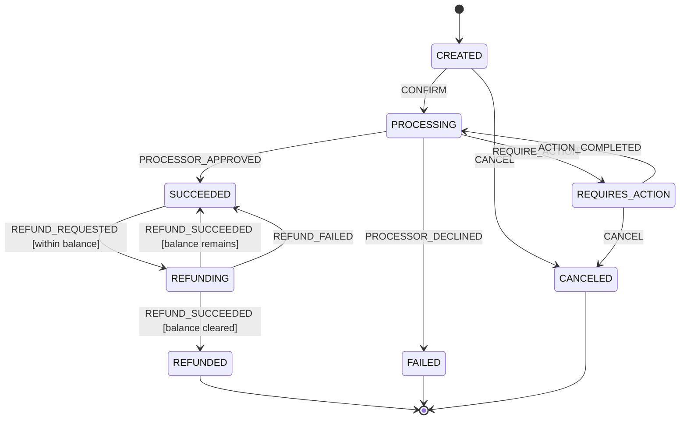

# The Payment State Machine

> Every transition is explicit, persisted, and reversible or terminal.

**Type:** Build
**Languages:** Java, Python, Go
**Prerequisites:** Phase 12 Lesson 01 (Designing an Idempotent Payment API), Phase 10 Lesson 01 (Representing Money), Phase 7 Lesson 06 (MVCC and Snapshot Isolation)
**Time:** ~120 minutes

## Learning Objectives

- Draw the lifecycle of a card payment as a finite set of states and events, and name which states are terminal and why
- Encode the lifecycle as a transition table with guards, so that an illegal event is refused with a precise reason and nothing is mutated
- Persist every transition as an append-only, versioned history and rebuild a payment from it by replay
- Use a version number to make two concurrent handlers of the same payment conflict instead of both winning
- Drive the machine from an asynchronous processor whose callbacks are deduplicated by event id and delivered by an injected clock
- Enforce refund invariants (never more than was captured, one refund in flight at a time) as guards rather than as `if` statements scattered through handlers

## The Problem

A payments service stores a `status` column on its `payments` table: a free-text string that handlers overwrite. `POST /payments/{id}/confirm` sets it to `processing` and calls the processor. The processor webhook handler sets it to `succeeded` or `failed`. `POST /payments/{id}/cancel` sets it to `canceled`. `POST /payments/{id}/refund` checks `status == 'succeeded'`, calls the processor, and sets it to `refunded`. Each handler is five lines and each one is reviewed in isolation, and each one is correct in isolation.

In production, three things happen that no handler anticipated. First, the processor delivers the `succeeded` webhook twice (webhooks are at-least-once; Lesson 05), and the second delivery arrives *after* the merchant has refunded the payment. The handler does `UPDATE payments SET status='succeeded'`, the refund disappears from the payment's point of view, and the merchant refunds it again a week later when the customer complains. Second, a customer hits cancel in one browser tab at the same moment the 3-D Secure challenge completes in another. Both handlers read `status = 'requires_action'`, both decide they are allowed to proceed, one writes `canceled` and the other writes `processing`; the processor authorizes the card for a payment the database says is canceled, and the money is captured against an order that was never fulfilled. Third, a partial refund of 15.00 USD on a 49.99 USD payment sets the status to `refunded`, after which the merchant cannot refund the remaining 34.99 USD because the handler's check `status == 'succeeded'` fails. Support fixes it by hand with a SQL update, which is how a status column becomes a value nobody trusts.

The post-mortem for each incident proposes another `if`. The fix is not another `if`. The fix is to stop treating status as a column to overwrite and start treating it as a *state machine*: a closed set of states, a closed set of events, a table saying which event moves which state where, under which condition, and a log of every move that was made. Once the lifecycle is a table, "can a refund happen now" is a lookup, "did this webhook already arrive" is a set membership test, "which of two concurrent handlers wins" is a version comparison, and "how did this payment get here" is a list you can print. This lesson builds that machine, persists it, and drives it from a simulated asynchronous processor.

## The Concept

### States, events, and the table

A finite state machine is a set of states `S`, a set of events `E`, and a partial function `S x E -> S`. "Partial" is the whole point: most pairs are undefined, and an undefined pair is an error, not a no-op. The payment machine in this lesson has eight states and nine events:

| State | Meaning | Terminal |
|-------|---------|----------|
| `CREATED` | The merchant has described the payment; nothing has been sent to the processor | no |
| `PROCESSING` | An authorization or re-presentment is in flight at the processor | no |
| `REQUIRES_ACTION` | The processor needs the customer to do something (a 3-D Secure challenge, a bank redirect) | no |
| `SUCCEEDED` | Funds are captured; the payment can be refunded | no |
| `REFUNDING` | A refund is in flight at the processor | no |
| `REFUNDED` | The full amount has been returned | yes |
| `FAILED` | The processor declined; no funds moved | yes |
| `CANCELED` | The merchant withdrew before the processor decided | yes |

The events split into two families, and keeping them separate is what makes the concurrency story work. *Commands* come from the merchant or customer: `CONFIRM`, `ACTION_COMPLETED`, `CANCEL`, `REFUND_REQUESTED`. *Processor events* come from the outside world, asynchronously: `REQUIRE_ACTION`, `PROCESSOR_APPROVED`, `PROCESSOR_DECLINED`, `REFUND_SUCCEEDED`, `REFUND_FAILED`.



Eleven rules. Eight states times nine events is seventy-two pairs, ten of which are legal (two rules share the pair `(REFUNDING, REFUND_SUCCEEDED)` and are distinguished by their guards). The test suite enumerates the other sixty-two and asserts that every one of them is refused and leaves the payment untouched. That exhaustive negative test is the single most valuable test in this lesson: it is what guarantees that a spoofed `PROCESSOR_APPROVED` on a `CREATED` payment, or a `REFUND_SUCCEEDED` on a `FAILED` one, cannot move money.

Two design decisions in the table deserve a sentence each. `CANCEL` is legal from `CREATED` and `REQUIRES_ACTION` but not from `PROCESSING`: once the authorization has been sent, the processor owns the outcome and the merchant must wait for it; a cancel racing an approval is exactly the second incident in the Problem. And the three terminal states have no outgoing rules at all, which `resolve` checks before it even looks at the table, so a terminal payment refuses every event with a message that says "terminal".

### Guards: rules with conditions

A plain table cannot express "a refund is legal only if it does not exceed what is left". Guards add a predicate to a rule. The rule fires if the payment is in `from`, the event is of `kind`, and the guard holds over the payment and the event. This lesson needs three:

| Guard | Holds when | Why it exists |
|-------|------------|---------------|
| `REFUND_WITHIN_BALANCE` | `event.amount > 0` and `refunded + event.amount <= amount` | Over-refunding is the merchant paying the customer out of its own pocket; a zero refund is a bug |
| `REFUND_LEAVES_BALANCE` | after settling the pending refund, `refunded < amount` | A partial refund returns to `SUCCEEDED` so another refund can follow |
| `REFUND_CLEARS_BALANCE` | after settling the pending refund, `refunded == amount` | A full refund is terminal |

The two balance guards are mutually exclusive and exhaustive over the reachable states, which is what makes the shared `(REFUNDING, REFUND_SUCCEEDED)` pair deterministic. `resolve` tries the candidates in table order and returns the first whose guard holds; if none holds, it refuses with the first candidate's guard named in the message, so the caller reads `refund 40.00 USD exceeds refundable 34.99 USD` rather than `illegal transition`.

Note what the guards *read*: `amount`, `refunded`, and `pendingRefund`, all of them `Money` values from Phase 10 Lesson 01. The comparison `refunded + event.amount <= amount` is integer arithmetic on minor units with a currency check, so a refund request in EUR against a USD payment fails with `CurrencyMismatch` before any guard logic runs.

### The transition is the unit of persistence

Overwriting a status column throws away the one thing you need in every incident: how the payment got here. This lesson persists *transitions*, not states. Each transition records the payment id, a version number, the event id that caused it, the event kind, the state before, the state after, the amount if any, a human reason, and the clock time. A payment's history is the ordered list of its transitions, and its current state is the `toState` of the last one.

```text
pay_1001, 49.99 USD
v1  CONFIRM              CREATED          -> PROCESSING       merchant confirmed
v2  REQUIRE_ACTION       PROCESSING       -> REQUIRES_ACTION  processor: challenge
v3  ACTION_COMPLETED     REQUIRES_ACTION  -> PROCESSING       customer completed challenge
v4  PROCESSOR_APPROVED   PROCESSING       -> SUCCEEDED        processor: approved
v5  REFUND_REQUESTED     SUCCEEDED        -> REFUNDING        refund requested (15.00 USD)
v6  REFUND_SUCCEEDED     REFUNDING        -> SUCCEEDED        processor: refund_ok
v7  REFUND_REQUESTED     SUCCEEDED        -> REFUNDING        refund requested (34.99 USD)
v8  REFUND_SUCCEEDED     REFUNDING        -> REFUNDED         processor: refund_ok
```

Three invariants hold over every history, and `replay` checks the first two on every load:

1. **Contiguity.** Transition `n` has version `n`. A gap means a write was lost.
2. **Chaining.** `fromState` of transition `n` equals `toState` of transition `n-1`. A break means someone wrote a transition against a state the payment was not in.
3. **Derivability.** The payment's state, version, `refunded`, and `pendingRefund` are pure functions of the history. There is no field on the payment that cannot be recomputed by replaying it.

The third invariant is enforced structurally: `apply` and `replay` call the same private `mutate` method, so there is one place where state changes and the two paths cannot disagree. If you find yourself writing a field on the aggregate that `mutate` does not set, you have broken replay.

### Optimistic concurrency: the version is the lock

Two handlers load `pay_2002` at version 0. Handler A applies `CONFIRM`, producing an uncommitted transition `v1`. Handler B applies `CANCEL`, also producing `v1`. Both call `save`. The store holds version 0; it accepts A's `v1` and the store is now at version 1. B's `v1` arrives, the store expects `v2`, and B gets `ConcurrencyConflict`. B must reload, see `PROCESSING`, and discover that `CANCEL` is no longer legal. The merchant's cancel is refused with a clear message instead of racing an authorization.

This is Kung and Robinson's optimistic concurrency control (1981), and Phase 7 Lesson 06 showed the same idea at the row level. Here the "validation phase" is one comparison: `transition.version == storedVersion + 1`. In a database it is `INSERT INTO payment_transitions (payment_id, version, ...)` against a `UNIQUE (payment_id, version)` index; the loser's insert fails with a uniqueness violation, which is the conflict. No row locks, no `SELECT ... FOR UPDATE`, no lock held across the processor call. The trade-off is that the loser must retry, and the retry must *re-decide*, not re-apply: B's cancel after reload is not a cancel of a `CREATED` payment any more.

`save` is all-or-nothing over a handler's uncommitted transitions. If a handler applied three events and the first one conflicts, none are written. The check runs over every uncommitted version before anything is appended.

### Deduplication by event id

Processor callbacks arrive at least once. The machine recognises a redelivery not by comparing states (a redelivered `PROCESSOR_APPROVED` on a `SUCCEEDED` payment would be "illegal", which is the wrong answer, because illegal means a bug and a redelivery is normal) but by the event id. Every transition records the id of the event that caused it; `apply` checks the set of applied ids *before* consulting the table and returns `DUPLICATE` without touching anything. The processor reference (`pr_0002`) is the event id for callbacks, so a second delivery of the same callback is a no-op by construction, and the first incident in the Problem cannot happen: the late `succeeded` webhook has an id that was already applied at v4, and it is dropped regardless of what state the payment has since reached.

The distinction between `DUPLICATE` and `IllegalTransition` matters operationally. `DUPLICATE` is logged at debug level and acknowledged to the processor so it stops retrying. `IllegalTransition` on a processor event is paged, because it means either a bug in the table or a forged callback.

### Worked example by hand

Trace `pay_2002`, 25.00 USD, through the concurrency scenario with the clock at `t=0`:

```text
store: pay_2002 created, log = [], version 0
A: load -> replay([]) -> CREATED v0
B: load -> replay([]) -> CREATED v0           (independent copy)
A: apply(CONFIRM)  -> resolve: (CREATED, CONFIRM) ALWAYS -> PROCESSING
                      uncommitted = [v1 CONFIRM CREATED->PROCESSING]
B: apply(CANCEL)   -> resolve: (CREATED, CANCEL) ALWAYS -> CANCELED
                      uncommitted = [v1 CANCEL CREATED->CANCELED]
A: save            -> store at v0, A's first uncommitted is v1 == 0+1 -> append; store at v1
B: save            -> store at v1, B's first uncommitted is v1 != 1+1 -> ConcurrencyConflict
B: load -> replay([v1 CONFIRM]) -> PROCESSING v1
B: canApply(CANCEL) -> (PROCESSING, CANCEL) has no row -> false
```

Processor calls made: one (A's confirm). Money moved against a canceled order: none.

### Complexity

`resolve` is a linear scan of an eleven-row table, which is constant for any practical purpose; a `Map<(state, kind), List<Rule>>` would make it a hash lookup and is a reasonable refactor once the table grows past a few dozen rows. `apply` is O(1) plus the guard. `replay` is O(n) in the length of the history, and `load` replays on every call, which is fine for payments (histories are short, rarely more than twenty transitions) and is exactly the design that event-sourced systems use, with snapshots once histories get long. `save` is O(k) in the number of uncommitted transitions. The applied-event-id set is O(n) memory per loaded payment.

### What this machine does not do

- It does not model authorization and capture as separate states. Many processors authorize first and capture later (Phase 11, Lesson 02); adding `AUTHORIZED` and a `CAPTURE` event is Exercise 2, and it is a table change plus one guard.
- It does not model disputes and chargebacks, which arrive months after `SUCCEEDED` and move money without the merchant's consent (Phase 12, Lesson 07).
- It does not run the processor call inside the transaction that saves the transition. The service saves `PROCESSING` *before* calling the processor; if the process dies between the two, the payment sits in `PROCESSING` until a reconciliation job (Phase 14, Lesson 04) asks the processor what happened. That ordering is deliberate: a payment the database thinks is `CREATED` but the processor has authorized is far worse than the reverse.
- It does not persist across process restarts. The store is a map. In production it is a table of transitions with the unique index described above.

## Build It

The walkthrough is in Java. Python and Go implement the same types and the same tests; the subsections at the end show what differs.

### Step 1: States, events, and the terminal predicate

```java
enum PaymentState {
    CREATED, REQUIRES_ACTION, PROCESSING, SUCCEEDED, REFUNDING, REFUNDED, FAILED, CANCELED;

    boolean isTerminal() { return this == REFUNDED || this == FAILED || this == CANCELED; }
}

enum EventKind {
    CONFIRM, REQUIRE_ACTION, ACTION_COMPLETED, PROCESSOR_APPROVED, PROCESSOR_DECLINED, CANCEL,
    REFUND_REQUESTED, REFUND_SUCCEEDED, REFUND_FAILED
}

record PaymentEvent(String eventId, EventKind kind, Money amount, String detail) {
    PaymentEvent {
        Objects.requireNonNull(eventId, "eventId");
        if (kind == EventKind.REFUND_REQUESTED && amount == null) throw new IllegalArgumentException("REFUND_REQUESTED needs an amount");
        if (kind != EventKind.REFUND_REQUESTED && amount != null) throw new IllegalArgumentException(kind + " does not carry an amount");
    }
}
```

Enums close the sets: there is no way to construct a state or event the table does not know about. The event carries an id, which is what deduplication keys on, and an amount only when it is a refund request; the compact constructor rejects the other combinations so a typo cannot smuggle an amount into a `CONFIRM`.

**Predict:** which states does `isTerminal` return true for, and what does `resolve` do with any event on a payment in one of them?

### Step 2: The transition table as data

```java
enum Guard { ALWAYS, REFUND_WITHIN_BALANCE, REFUND_LEAVES_BALANCE, REFUND_CLEARS_BALANCE }

record Rule(PaymentState from, EventKind kind, Guard guard, PaymentState to) {}

static final List<Rule> RULES = List.of(
        new Rule(PaymentState.CREATED, EventKind.CONFIRM, Guard.ALWAYS, PaymentState.PROCESSING),
        new Rule(PaymentState.CREATED, EventKind.CANCEL, Guard.ALWAYS, PaymentState.CANCELED),
        new Rule(PaymentState.PROCESSING, EventKind.REQUIRE_ACTION, Guard.ALWAYS, PaymentState.REQUIRES_ACTION),
        new Rule(PaymentState.PROCESSING, EventKind.PROCESSOR_APPROVED, Guard.ALWAYS, PaymentState.SUCCEEDED),
        new Rule(PaymentState.PROCESSING, EventKind.PROCESSOR_DECLINED, Guard.ALWAYS, PaymentState.FAILED),
        new Rule(PaymentState.REQUIRES_ACTION, EventKind.ACTION_COMPLETED, Guard.ALWAYS, PaymentState.PROCESSING),
        new Rule(PaymentState.REQUIRES_ACTION, EventKind.CANCEL, Guard.ALWAYS, PaymentState.CANCELED),
        new Rule(PaymentState.SUCCEEDED, EventKind.REFUND_REQUESTED, Guard.REFUND_WITHIN_BALANCE, PaymentState.REFUNDING),
        new Rule(PaymentState.REFUNDING, EventKind.REFUND_SUCCEEDED, Guard.REFUND_LEAVES_BALANCE, PaymentState.SUCCEEDED),
        new Rule(PaymentState.REFUNDING, EventKind.REFUND_SUCCEEDED, Guard.REFUND_CLEARS_BALANCE, PaymentState.REFUNDED),
        new Rule(PaymentState.REFUNDING, EventKind.REFUND_FAILED, Guard.ALWAYS, PaymentState.SUCCEEDED));
```

The table is a list of records, not a `switch`. That is what lets `main` print it, lets the test iterate over it to prove every rule fires, and lets the test iterate over its complement to prove everything else is refused. Guards are an enum rather than lambdas so that a rule can be printed, logged, and compared; the predicate behind each guard lives in one `switch` in `holds`.

### Step 3: Resolving an event against the table

```java
static Rule resolve(Payment p, PaymentEvent event) {
    if (p.state().isTerminal()) {
        throw new IllegalTransitionException(p.id() + " is " + p.state() + " (terminal); " + event.kind() + " refused");
    }
    List<Rule> candidates = RULES.stream().filter(r -> r.from() == p.state() && r.kind() == event.kind()).toList();
    if (candidates.isEmpty()) {
        throw new IllegalTransitionException(p.id() + ": " + event.kind() + " is not legal from " + p.state());
    }
    for (Rule r : candidates) {
        if (holds(r.guard(), p, event)) return r;
    }
    throw new IllegalTransitionException(p.id() + ": " + event.kind() + " from " + p.state() + " refused by guard "
            + candidates.get(0).guard() + " (" + guardFailure(candidates.get(0).guard(), p, event) + ")");
}

static boolean holds(Guard g, Payment p, PaymentEvent e) {
    return switch (g) {
        case ALWAYS -> true;
        case REFUND_WITHIN_BALANCE -> e.amount().isPositive() && p.refunded().plus(e.amount()).compareTo(p.amount()) <= 0;
        case REFUND_LEAVES_BALANCE -> p.refunded().plus(p.pendingRefund()).compareTo(p.amount()) < 0;
        case REFUND_CLEARS_BALANCE -> p.refunded().plus(p.pendingRefund()).equals(p.amount());
    };
}
```

Three distinct refusals, three distinct messages: terminal, no row, guard failed. The messages are part of the design; an operator reading `refund 40.00 USD exceeds refundable 34.99 USD` at 3 a.m. does not need to open the code. `resolve` is pure: it reads the payment and returns a rule or throws, and never mutates, which is what lets `canApply` reuse it.

**Predict:** a payment is `REFUNDING` with `amount = 49.99`, `refunded = 15.00`, `pendingRefund = 34.99`. `REFUND_SUCCEEDED` arrives. Which of the two candidate rules fires?

### Step 4: The aggregate and the one place state changes

```java
ApplyOutcome apply(PaymentEvent event, String reason) {
    if (appliedEventIds.contains(event.eventId())) return ApplyOutcome.DUPLICATE;
    Rule rule = TransitionTable.resolve(this, event);          // throws before any mutation
    Transition t = new Transition(id, version + 1, event.eventId(), event.kind(), state, rule.to(),
            event.amount(), reason, clock.nowMillis());
    mutate(t);
    uncommitted.add(t);
    return ApplyOutcome.APPLIED;
}

private void mutate(Transition t) {
    switch (t.kind()) {
        case REFUND_REQUESTED -> pendingRefund = pendingRefund.plus(t.amount());
        case REFUND_SUCCEEDED -> { refunded = refunded.plus(pendingRefund); pendingRefund = Money.zero(amount.currency()); }
        case REFUND_FAILED -> pendingRefund = Money.zero(amount.currency());
        default -> { }
    }
    state = t.toState();
    version = t.version();
    appliedEventIds.add(t.eventId());
    history.add(t);
}
```

`apply` has exactly three outcomes and the order of checks is the specification: duplicate first (a redelivery must never be reported as illegal), then resolve (which throws before anything is touched), then mutate and record. `mutate` is private and is the only method that assigns `state`, `version`, `refunded`, or `pendingRefund`. `replay` calls it too, which is why a rebuilt payment and a live one agree by construction.

### Step 5: Replay with integrity checks

```java
static Payment replay(String id, Money amount, List<Transition> transitions, Clock clock) {
    Payment p = new Payment(id, amount, clock);
    for (Transition t : transitions) {
        if (t.version() != p.version + 1) {
            throw new IllegalStateException(id + ": history gap, expected v" + (p.version + 1) + " got v" + t.version());
        }
        if (t.fromState() != p.state) {
            throw new IllegalStateException(id + ": v" + t.version() + " claims fromState " + t.fromState() + " but payment is " + p.state);
        }
        p.mutate(t);
    }
    return p;
}
```

Replay does not re-run the guards. The guards were evaluated when the transition was written, against the state at that time; re-evaluating them now against a table that may since have changed would make old histories unloadable after a rule change. What replay does check is structural: contiguity and chaining. A history that fails either is corruption, and loading it throws rather than producing a payment whose state nobody can vouch for.

**Predict:** the test deletes transition `v3` from a five-entry history and replays. Which check fires, and what does the message say?

### Step 6: The store and the version check

```java
void save(Payment p) {
    List<Transition> target = log.get(p.id());
    if (target == null) throw new IllegalStateException("unknown payment " + p.id());
    int expected = target.size();
    for (Transition t : p.uncommitted()) {
        if (t.version() != expected + 1) {
            throw new ConcurrencyConflictException(p.id() + ": expected to write v" + t.version()
                    + " but store is at v" + target.size() + "; reload and retry");
        }
        expected++;
    }
    target.addAll(p.uncommitted());
    p.markCommitted();
}
```

The whole of optimistic concurrency control is the `if`. The store's version is the length of the log; the first uncommitted transition must be exactly one more. The loop validates every uncommitted transition before appending any, so a batch is all-or-nothing. `load` replays the log on every call and returns a fresh object, so two handlers never share an aggregate instance; that is what makes the conflict scenario reproducible in a single-threaded test.

### Step 7: The processor adapter and the service

```java
Payment confirm(String id, String eventId) {
    Payment p = store.load(id);
    p.apply(PaymentEvent.of(eventId, EventKind.CONFIRM), "merchant confirmed");
    store.save(p);                                    // persist PROCESSING before calling out
    processor.authorize(id, p.amount());
    return p;
}

ApplyOutcome deliver(ProcessorCallback cb) {
    EventKind kind = switch (cb.outcome()) {
        case APPROVED -> EventKind.PROCESSOR_APPROVED;
        case DECLINED -> EventKind.PROCESSOR_DECLINED;
        case CHALLENGE -> EventKind.REQUIRE_ACTION;
        case REFUND_OK -> EventKind.REFUND_SUCCEEDED;
        case REFUND_FAILED -> EventKind.REFUND_FAILED;
    };
    Payment p = store.load(cb.paymentId());
    ApplyOutcome outcome = p.apply(PaymentEvent.of(cb.reference(), kind, cb.detail()), "processor: " + cb.detail());
    if (outcome == ApplyOutcome.APPLIED) store.save(p);
    return outcome;
}
```

Every service method is load, apply, save, and only then call the processor. `FakeProcessor` answers from a per-payment script of outcomes and schedules each callback for `now + latency` on the injected clock; `pump()` delivers whatever is due. Nothing sleeps. The callback's processor reference becomes the event id, so `deliver` on a redelivered callback returns `DUPLICATE` and skips `save`.

### Step 8: Run it

```bash
cd phases/12-payment-systems-design/02-payment-state-machine/code/java
javac -d .out *.java && java -cp .out Main
java -cp .out MainTest
```

Expected output, abbreviated:

```console
== A 3-D Secure payment: created -> processing -> requires_action -> processing -> succeeded ==
after confirm:   PROCESSING v1
pump before latency elapsed -> 0 callbacks applied
pump at +800ms              -> 1 callbacks applied; state REQUIRES_ACTION
after approval:  SUCCEEDED v4

== The processor redelivers the approval: recognised by event id, not applied twice ==
deliver(pr_0002 again) -> DUPLICATE, version still 4

== Refunds: SUCCEEDED -> REFUNDING -> SUCCEEDED (partial) or REFUNDED (full) ==
after request:   REFUNDING, refundable = 34.99 USD (15.00 pending at the processor)
refused: pay_1001: REFUND_REQUESTED is not legal from REFUNDING
after settle:    SUCCEEDED, refunded = 15.00 USD, refundable = 34.99 USD
refused: pay_1001: REFUND_REQUESTED from SUCCEEDED refused by guard REFUND_WITHIN_BALANCE (refund 40.00 USD exceeds refundable 34.99 USD)
after full:      REFUNDED (terminal: true), refunded = 49.99 USD

== Optimistic concurrency: two handlers load pay_2002 at v0; only one may write v1 ==
handler A saved CONFIRM as v1
handler B refused: pay_2002: expected to write v1 but store is at v1; reload and retry
stored state is PROCESSING; B reloads and finds CANCEL is now illegal: canApply=false
```

The test harness enumerates all seventy-two `(state, event)` pairs: ten legal pairs are driven and asserted to land in the table's `to` state, and sixty-two illegal pairs are asserted to throw and leave state, version, and the uncommitted list untouched.

### In Python

The Python port (`code/python/main.py`, tests in `test_main.py`) is the same design with four differences. **Exceptions are subclasses of `RuntimeError`:** `IllegalTransitionError` and `ConcurrencyConflictError` both extend it, replay corruption raises a bare `RuntimeError`, and the tests use `assertRaises` with the specific class where one exists. **The table is a tuple of frozen dataclasses** (`RULES`), and `Rule` uses `from_state`/`to_state` because `from` is a keyword. **`history()` and `uncommitted()` return tuples**, so a caller cannot append to the aggregate's log from outside; the Java version wraps with `Collections.unmodifiableList` for the same reason. **The exhaustive negative test uses `subTest`**, so a failure names the exact `(state, kind)` pair rather than stopping at the first one.

Run it from `code/python/` with `python3 main.py`; test with `python3 -m unittest -v`.

#### Step 1: States, events, and the terminal predicate

`PaymentState` and `EventKind` are `Enum`s with string values; `is_terminal` is a method on the state enum. `PaymentEvent` is a frozen dataclass whose `__post_init__` enforces the amount rule the Java compact constructor enforces, raising `ValueError`; `amount` defaults to `None`, and the two static factories `of` and `refund_requested` are the only constructors the rest of the code uses.

```python
class PaymentState(Enum):
    CREATED = "created"
    REQUIRES_ACTION = "requires_action"
    PROCESSING = "processing"
    SUCCEEDED = "succeeded"
    REFUNDING = "refunding"
    REFUNDED = "refunded"
    FAILED = "failed"
    CANCELED = "canceled"

    def is_terminal(self) -> bool:
        return self in (PaymentState.REFUNDED, PaymentState.FAILED, PaymentState.CANCELED)

@dataclass(frozen=True)
class PaymentEvent:
    """Carries an id so a redelivered callback is recognised; an amount only for refund requests."""

    event_id: str
    kind: EventKind
    amount: Money | None = None
    detail: str = ""

    def __post_init__(self) -> None:
        if self.kind is EventKind.REFUND_REQUESTED and self.amount is None:
            raise ValueError("REFUND_REQUESTED needs an amount")
        if self.kind is not EventKind.REFUND_REQUESTED and self.amount is not None:
            raise ValueError(f"{self.kind.name} does not carry an amount")

    @staticmethod
    def of(event_id: str, kind: EventKind, detail: str = "") -> "PaymentEvent":
        return PaymentEvent(event_id, kind, None, detail)

    @staticmethod
    def refund_requested(event_id: str, amount: Money) -> "PaymentEvent":
        return PaymentEvent(event_id, EventKind.REFUND_REQUESTED, amount)
```

#### Step 2: The transition table as data

`Guard` is an enum and `Rule` a frozen dataclass; `RULES` is a module-level tuple, which is immutable the way `List.of` is. The rows are the same eleven as the Java table in the same order, which matters because `resolve` tries candidates in table order and reports the first guard when none holds.

```python
class Guard(Enum):
    ALWAYS = "always"
    REFUND_WITHIN_BALANCE = "refund_within_balance"
    REFUND_LEAVES_BALANCE = "refund_leaves_balance"
    REFUND_CLEARS_BALANCE = "refund_clears_balance"


@dataclass(frozen=True)
class Rule:
    from_state: PaymentState
    kind: EventKind
    guard: Guard
    to_state: PaymentState


class IllegalTransitionError(RuntimeError):
    pass


RULES: tuple[Rule, ...] = (
    Rule(PaymentState.CREATED, EventKind.CONFIRM, Guard.ALWAYS, PaymentState.PROCESSING),
    Rule(PaymentState.CREATED, EventKind.CANCEL, Guard.ALWAYS, PaymentState.CANCELED),
    Rule(PaymentState.PROCESSING, EventKind.REQUIRE_ACTION, Guard.ALWAYS, PaymentState.REQUIRES_ACTION),
    Rule(PaymentState.PROCESSING, EventKind.PROCESSOR_APPROVED, Guard.ALWAYS, PaymentState.SUCCEEDED),
    Rule(PaymentState.PROCESSING, EventKind.PROCESSOR_DECLINED, Guard.ALWAYS, PaymentState.FAILED),
    Rule(PaymentState.REQUIRES_ACTION, EventKind.ACTION_COMPLETED, Guard.ALWAYS, PaymentState.PROCESSING),
    Rule(PaymentState.REQUIRES_ACTION, EventKind.CANCEL, Guard.ALWAYS, PaymentState.CANCELED),
    Rule(PaymentState.SUCCEEDED, EventKind.REFUND_REQUESTED, Guard.REFUND_WITHIN_BALANCE, PaymentState.REFUNDING),
    Rule(PaymentState.REFUNDING, EventKind.REFUND_SUCCEEDED, Guard.REFUND_LEAVES_BALANCE, PaymentState.SUCCEEDED),
    Rule(PaymentState.REFUNDING, EventKind.REFUND_SUCCEEDED, Guard.REFUND_CLEARS_BALANCE, PaymentState.REFUNDED),
    Rule(PaymentState.REFUNDING, EventKind.REFUND_FAILED, Guard.ALWAYS, PaymentState.SUCCEEDED),
)
```

#### Step 3: Resolving an event against the table

`resolve` and `holds` are static methods on `TransitionTable`. The three refusals, terminal, no row, guard failed, raise `IllegalTransitionError` with the same three messages as Java; `holds` is an `if` chain over the guard enum with `compare_to` doing the money comparison. The guard-failure message is computed inline rather than in a separate `guardFailure` helper.

```python
class TransitionTable:
    RULES = RULES

    @staticmethod
    def has_row(from_state: PaymentState, kind: EventKind) -> bool:
        return any(r.from_state is from_state and r.kind is kind for r in RULES)

    @staticmethod
    def holds(guard: Guard, p: "Payment", e: PaymentEvent) -> bool:
        if guard is Guard.ALWAYS:
            return True
        if guard is Guard.REFUND_WITHIN_BALANCE:
            assert e.amount is not None
            return e.amount.is_positive() and p.refunded.plus(e.amount).compare_to(p.amount) <= 0
        settled = p.refunded.plus(p.pending_refund)
        if guard is Guard.REFUND_LEAVES_BALANCE:
            return settled.compare_to(p.amount) < 0
        return settled == p.amount  # REFUND_CLEARS_BALANCE

    @staticmethod
    def resolve(p: "Payment", event: PaymentEvent) -> Rule:
        if p.state.is_terminal():
            raise IllegalTransitionError(f"{p.id} is {p.state.name} (terminal); {event.kind.name} refused")
        candidates = [r for r in RULES if r.from_state is p.state and r.kind is event.kind]
        if not candidates:
            raise IllegalTransitionError(f"{p.id}: {event.kind.name} is not legal from {p.state.name}")
        for r in candidates:
            if TransitionTable.holds(r.guard, p, event):
                return r
        guard = candidates[0].guard
        if guard is Guard.REFUND_WITHIN_BALANCE and event.amount is not None and not event.amount.is_positive():
            why = "refund amount must be positive"
        elif guard is Guard.REFUND_WITHIN_BALANCE:
            why = f"refund {event.amount} exceeds refundable {p.refundable()}"
        else:
            why = "balance guard failed"
        raise IllegalTransitionError(
            f"{p.id}: {event.kind.name} from {p.state.name} refused by guard {guard.name} ({why})"
        )
```

#### Step 4: The aggregate and the one place state changes

`apply` checks the duplicate set first, lets `resolve` raise before anything is touched, then builds the `Transition` and hands it to `_mutate`. `_mutate` is the only method that assigns `state`, `version`, `refunded`, or `pending_refund`; the leading underscore is the Python convention for what Java spells `private`, and `replay` calls it too.

```python
    def apply(self, event: PaymentEvent, reason: str) -> ApplyOutcome:
        """Exactly one of: state moves and one transition is recorded; DUPLICATE and nothing changes;
        IllegalTransitionError and nothing changes."""
        if event.event_id in self._applied_event_ids:
            return ApplyOutcome.DUPLICATE
        rule = TransitionTable.resolve(self, event)  # raises before any mutation
        t = Transition(self.id, self.version + 1, event.event_id, event.kind, self.state, rule.to_state,
                       event.amount, reason, self._clock.now_millis())
        self._mutate(t)
        self._uncommitted.append(t)
        return ApplyOutcome.APPLIED

    def _mutate(self, t: Transition) -> None:
        """The single place state changes; shared by apply() and replay() so they agree by construction."""
        if t.kind is EventKind.REFUND_REQUESTED:
            assert t.amount is not None
            self.pending_refund = self.pending_refund.plus(t.amount)
        elif t.kind is EventKind.REFUND_SUCCEEDED:
            self.refunded = self.refunded.plus(self.pending_refund)
            self.pending_refund = Money.zero(self.amount.currency)
        elif t.kind is EventKind.REFUND_FAILED:
            self.pending_refund = Money.zero(self.amount.currency)
        self.state = t.to_state
        self.version = t.version
        self._applied_event_ids.add(t.event_id)
        self._history.append(t)
```

#### Step 5: Replay with integrity checks

`replay` is a `@staticmethod` that builds a fresh `Payment` and feeds each transition through `_mutate` after the two structural checks: contiguous versions, and `from_state` equal to the current state. Enum identity is compared with `is`. Guards are not re-evaluated, for the reason given in the Java step; corruption raises `RuntimeError`.

```python
    @staticmethod
    def replay(id: str, amount: Money, transitions: list[Transition] | tuple[Transition, ...], clock: Clock) -> "Payment":
        """Rebuild from persisted history. A version gap or a mismatched from_state is corruption."""
        p = Payment(id, amount, clock)
        for t in transitions:
            if t.version != p.version + 1:
                raise RuntimeError(f"{id}: history gap, expected v{p.version + 1} got v{t.version}")
            if t.from_state is not p.state:
                raise RuntimeError(f"{id}: v{t.version} claims from_state {t.from_state.name} but payment is {p.state.name}")
            p._mutate(t)
        return p
```

#### Step 6: The store and the version check

`save` validates every uncommitted transition against `expected`, starting from the log length, before `extend`ing the list, so a batch is all-or-nothing. The conflict raises `ConcurrencyConflictError` with the same "reload and retry" message. `load` replays the log on every call, so two handlers never share a `Payment` instance.

```python
    def load(self, id: str) -> Payment:
        if id not in self._created:
            raise RuntimeError(f"unknown payment {id}")
        amount, _ = self._created[id]
        return Payment.replay(id, amount, self._log[id], self._clock)

    def save(self, p: Payment) -> None:
        """Append uncommitted transitions; each must be exactly current_version + 1. All-or-nothing."""
        if p.id not in self._log:
            raise RuntimeError(f"unknown payment {p.id}")
        target = self._log[p.id]
        expected = len(target)
        for t in p.uncommitted():
            if t.version != expected + 1:
                raise ConcurrencyConflictError(
                    f"{p.id}: expected to write v{t.version} but store is at v{len(target)}; reload and retry"
                )
            expected += 1
        target.extend(p.uncommitted())
        p.mark_committed()
```

#### Step 7: The processor adapter and the service

`ProcessorAdapter` is a `typing.Protocol`, so `FakeProcessor` satisfies it structurally without inheriting. The outcome-to-kind mapping is a module-level dict rather than a `switch`. Every service method is load, apply, save, and only then call the processor; `deliver` uses the callback reference as the event id and saves only on `APPLIED`.

```python
_OUTCOME_TO_KIND = {
    ProcessorOutcome.APPROVED: EventKind.PROCESSOR_APPROVED,
    ProcessorOutcome.DECLINED: EventKind.PROCESSOR_DECLINED,
    ProcessorOutcome.CHALLENGE: EventKind.REQUIRE_ACTION,
    ProcessorOutcome.REFUND_OK: EventKind.REFUND_SUCCEEDED,
    ProcessorOutcome.REFUND_FAILED: EventKind.REFUND_FAILED,
}

    def confirm(self, id: str, event_id: str) -> Payment:
        p = self._store.load(id)
        p.apply(PaymentEvent.of(event_id, EventKind.CONFIRM), "merchant confirmed")
        self._store.save(p)  # persist PROCESSING before calling out
        self._processor.authorize(id, p.amount)
        return p

    def pump(self) -> int:
        """Drain due callbacks into events. The reference is the event id, so redelivery is a no-op."""
        applied = 0
        for cb in self._processor.due_callbacks():
            if self.deliver(cb) is ApplyOutcome.APPLIED:
                applied += 1
        return applied

    def deliver(self, cb: ProcessorCallback) -> ApplyOutcome:
        p = self._store.load(cb.payment_id)
        outcome = p.apply(PaymentEvent.of(cb.reference, _OUTCOME_TO_KIND[cb.outcome], cb.detail), f"processor: {cb.detail}")
        if outcome is ApplyOutcome.APPLIED:
            self._store.save(p)
        return outcome
```

#### Step 8: Run it

```bash
cd phases/12-payment-systems-design/02-payment-state-machine/code/python
python3 main.py
python3 -m unittest -v
```

The output matches the Java run line for line except that the terminal flag prints as Python's `True`:

```console
== Refunds: SUCCEEDED -> REFUNDING -> SUCCEEDED (partial) or REFUNDED (full) ==
after request:   REFUNDING, refundable = 34.99 USD (15.00 pending at the processor)
refused: pay_1001: REFUND_REQUESTED is not legal from REFUNDING
after settle:    SUCCEEDED, refunded = 15.00 USD, refundable = 34.99 USD
refused: pay_1001: REFUND_REQUESTED from SUCCEEDED refused by guard REFUND_WITHIN_BALANCE (refund 40.00 USD exceeds refundable 34.99 USD)
after full:      REFUNDED (terminal: True), refunded = 49.99 USD
```

### In Go

The Go port (`code/go/main.go`, tests in `main_test.go`) keeps the design and changes how failure is reported. **Errors are values wrapped around sentinels:** `ErrIllegalTransition`, `ErrConcurrencyConflict`, and `ErrCurrencyMismatch` are package-level, and every refusal is `fmt.Errorf("%w: ...")`, so tests check with `errors.Is` and still get the precise message. **Event validation happens in `Apply`, not at construction**, because a Go struct literal cannot run a constructor; `NewEvent` and `NewRefundRequested` build valid events and `validate` catches a hand-built invalid one. **`PaymentEvent.Amount` and `Transition.Amount` are `*Money`** so "no amount" is representable, the role `null` plays in Java and `None` in Python. **`Replay` returns `(*Payment, error)`** rather than panicking on corruption, and `Load` propagates it, so a corrupt history surfaces at the call site that tried to use the payment.

Run it from `code/go/` with `go run .`; test with `go test ./...`.

#### Step 1: States, events, and the terminal predicate

`PaymentState` and `EventKind` are `int` types with `iota` constants and a `String` method that prints the Java name, so the demo output matches. `AllStates` and `AllKinds` exist so the exhaustive test can enumerate the 72 pairs. `PaymentEvent` carries `*Money`; `validate` is the deferred constructor check.

```go
type PaymentState int

const (
	Created PaymentState = iota
	RequiresAction
	Processing
	Succeeded
	Refunding
	Refunded
	Failed
	Canceled
)

var AllStates = []PaymentState{Created, RequiresAction, Processing, Succeeded, Refunding, Refunded, Failed, Canceled}

func (s PaymentState) String() string {
	return [...]string{"CREATED", "REQUIRES_ACTION", "PROCESSING", "SUCCEEDED", "REFUNDING", "REFUNDED", "FAILED", "CANCELED"}[s]
}

type PaymentEvent struct {
	EventID string
	Kind    EventKind
	Amount  *Money
	Detail  string
}

func NewEvent(eventID string, kind EventKind, detail string) PaymentEvent {
	return PaymentEvent{EventID: eventID, Kind: kind, Detail: detail}
}

func NewRefundRequested(eventID string, amount Money) PaymentEvent {
	return PaymentEvent{EventID: eventID, Kind: RefundRequested, Amount: &amount}
}

func (e PaymentEvent) validate() error {
	if e.EventID == "" {
		return errors.New("event id required")
	}
	if e.Kind == RefundRequested && e.Amount == nil {
		return errors.New("REFUND_REQUESTED needs an amount")
	}
	if e.Kind != RefundRequested && e.Amount != nil {
		return fmt.Errorf("%s does not carry an amount", e.Kind)
	}
	return nil
}
```

#### Step 2: The transition table as data

`Rule` can use `From` and `To` as field names because they are not keywords in Go. `Rules` is a package-level slice of struct literals in the same order as the Java list, and the two sentinel errors are declared right beside it.

```go
type Guard int

const (
	Always Guard = iota
	RefundWithinBalance
	RefundLeavesBalance
	RefundClearsBalance
)

func (g Guard) String() string {
	return [...]string{"ALWAYS", "REFUND_WITHIN_BALANCE", "REFUND_LEAVES_BALANCE", "REFUND_CLEARS_BALANCE"}[g]
}

type Rule struct {
	From  PaymentState
	Kind  EventKind
	Guard Guard
	To    PaymentState
}

var Rules = []Rule{
	{Created, Confirm, Always, Processing},
	{Created, Cancel, Always, Canceled},
	{Processing, RequireAction, Always, RequiresAction},
	{Processing, ProcessorApproved, Always, Succeeded},
	{Processing, ProcessorDeclined, Always, Failed},
	{RequiresAction, ActionCompleted, Always, Processing},
	{RequiresAction, Cancel, Always, Canceled},
	{Succeeded, RefundRequested, RefundWithinBalance, Refunding},
	{Refunding, RefundSucceeded, RefundLeavesBalance, Succeeded},
	{Refunding, RefundSucceeded, RefundClearsBalance, Refunded},
	{Refunding, RefundFailed, Always, Succeeded},
}

var ErrIllegalTransition = errors.New("illegal transition")
var ErrConcurrencyConflict = errors.New("concurrency conflict")
```

#### Step 3: Resolving an event against the table

`Resolve` returns `(Rule, error)`; each refusal wraps `ErrIllegalTransition` with `%w` and the same message text as Java. `guardHolds` returns `(bool, error)` because `Plus` can fail on a currency mismatch; the money comparisons are done on `MinorUnits` directly, and `RefundClearsBalance` is the `default` arm.

```go
func guardHolds(g Guard, p *Payment, e PaymentEvent) (bool, error) {
	switch g {
	case Always:
		return true, nil
	case RefundWithinBalance:
		after, err := p.Refunded.Plus(*e.Amount)
		if err != nil {
			return false, err
		}
		return e.Amount.IsPositive() && after.MinorUnits <= p.Amount.MinorUnits, nil
	case RefundLeavesBalance:
		return mustPlus(p.Refunded, p.PendingRefund).MinorUnits < p.Amount.MinorUnits, nil
	default: // RefundClearsBalance
		return mustPlus(p.Refunded, p.PendingRefund) == p.Amount, nil
	}
}

// Resolve picks the one rule whose guard holds, or returns ErrIllegalTransition with the precise reason.
func Resolve(p *Payment, e PaymentEvent) (Rule, error) {
	if p.State.IsTerminal() {
		return Rule{}, fmt.Errorf("%w: %s is %s (terminal); %s refused", ErrIllegalTransition, p.ID, p.State, e.Kind)
	}
	var candidates []Rule
	for _, r := range Rules {
		if r.From == p.State && r.Kind == e.Kind {
			candidates = append(candidates, r)
		}
	}
	if len(candidates) == 0 {
		return Rule{}, fmt.Errorf("%w: %s: %s is not legal from %s", ErrIllegalTransition, p.ID, e.Kind, p.State)
	}
	for _, r := range candidates {
		ok, err := guardHolds(r.Guard, p, e)
		if err != nil {
			return Rule{}, err
		}
		if ok {
			return r, nil
		}
	}
	g := candidates[0].Guard
	why := "balance guard failed"
	if g == RefundWithinBalance && !e.Amount.IsPositive() {
		why = "refund amount must be positive"
	} else if g == RefundWithinBalance {
		why = fmt.Sprintf("refund %s exceeds refundable %s", *e.Amount, p.Refundable())
	}
	return Rule{}, fmt.Errorf("%w: %s: %s from %s refused by guard %s (%s)", ErrIllegalTransition, p.ID, e.Kind, p.State, g, why)
}
```

#### Step 4: The aggregate and the one place state changes

`Apply` returns `(ApplyOutcome, error)`: it validates the event first (there was no constructor to do it), then the duplicate check, then `Resolve`, and only then `mutate`. `mutate` is unexported and is the one place `State`, `Version`, `Refunded`, and `PendingRefund` are assigned; `mustPlus` is safe here because both operands share the payment's currency by construction.

```go
func (p *Payment) Apply(e PaymentEvent, reason string) (ApplyOutcome, error) {
	if err := e.validate(); err != nil {
		return Duplicate, err
	}
	if p.appliedIDs[e.EventID] {
		return Duplicate, nil
	}
	rule, err := Resolve(p, e)
	if err != nil {
		return Duplicate, err
	}
	t := Transition{p.ID, p.Version + 1, e.EventID, e.Kind, p.State, rule.To, e.Amount, reason, p.clock.NowMillis()}
	p.mutate(t)
	p.uncommitted = append(p.uncommitted, t)
	return Applied, nil
}

// mutate is the single place state changes; Apply and Replay share it so they agree by construction.
func (p *Payment) mutate(t Transition) {
	switch t.Kind {
	case RefundRequested:
		p.PendingRefund = mustPlus(p.PendingRefund, *t.Amount)
	case RefundSucceeded:
		p.Refunded = mustPlus(p.Refunded, p.PendingRefund)
		p.PendingRefund = Zero(p.Amount.Currency)
	case RefundFailed:
		p.PendingRefund = Zero(p.Amount.Currency)
	}
	p.State = t.ToState
	p.Version = t.Version
	p.appliedIDs[t.EventID] = true
	p.history = append(p.history, t)
}
```

#### Step 5: Replay with integrity checks

`Replay` returns an error on the first structural fault: a version gap or a `FromState` that does not chain. It calls `mutate` for each surviving transition and never re-runs the guards.

```go
func Replay(id string, amount Money, transitions []Transition, clock Clock) (*Payment, error) {
	p, err := NewPayment(id, amount, clock)
	if err != nil {
		return nil, err
	}
	for _, t := range transitions {
		if t.Version != p.Version+1 {
			return nil, fmt.Errorf("%s: history gap, expected v%d got v%d", id, p.Version+1, t.Version)
		}
		if t.FromState != p.State {
			return nil, fmt.Errorf("%s: v%d claims fromState %s but payment is %s", id, t.Version, t.FromState, p.State)
		}
		p.mutate(t)
	}
	return p, nil
}
```

#### Step 6: The store and the version check

`Save` compares each uncommitted `Version` to `expected`, initialised from the log length, before appending anything; the conflict wraps `ErrConcurrencyConflict`. `Load` calls `Replay` on every call and propagates its error.

```go
func (s *PaymentStore) Load(id string) (*Payment, error) {
	c, ok := s.created[id]
	if !ok {
		return nil, fmt.Errorf("unknown payment %s", id)
	}
	return Replay(id, c.amount, s.log[id], s.clock)
}

// Save appends the uncommitted transitions; each must be exactly CurrentVersion+1. All-or-nothing.
func (s *PaymentStore) Save(p *Payment) error {
	target, ok := s.log[p.ID]
	if !ok {
		return fmt.Errorf("unknown payment %s", p.ID)
	}
	expected := len(target)
	for _, t := range p.uncommitted {
		if t.Version != expected+1 {
			return fmt.Errorf("%w: %s: expected to write v%d but store is at v%d; reload and retry",
				ErrConcurrencyConflict, p.ID, t.Version, len(target))
		}
		expected++
	}
	s.log[p.ID] = append(target, p.uncommitted...)
	p.MarkCommitted()
	return nil
}
```

#### Step 7: The processor adapter and the service

`ProcessorAdapter` is an interface that `*FakeProcessor` satisfies. Because every step returns an error, the load-apply-save sequence is factored into `applyAndSave`; `Confirm` calls it and then `Authorize`, so `PROCESSING` is persisted before the call-out. `outcomeToKind` is a map, and `Deliver` saves only when the outcome is `Applied`.

```go
func (s *PaymentService) applyAndSave(id string, e PaymentEvent, reason string) (*Payment, error) {
	p, err := s.store.Load(id)
	if err != nil {
		return nil, err
	}
	if _, err := p.Apply(e, reason); err != nil {
		return nil, err
	}
	if err := s.store.Save(p); err != nil {
		return nil, err
	}
	return p, nil
}

func (s *PaymentService) Confirm(id, eventID string) (*Payment, error) {
	p, err := s.applyAndSave(id, NewEvent(eventID, Confirm, ""), "merchant confirmed")
	if err != nil {
		return nil, err
	}
	s.processor.Authorize(id, p.Amount) // only after PROCESSING is persisted
	return p, nil
}

var outcomeToKind = map[ProcessorOutcome]EventKind{
	OutcomeApproved: ProcessorApproved, OutcomeDeclined: ProcessorDeclined, OutcomeChallenge: RequireAction,
	OutcomeRefundOK: RefundSucceeded, OutcomeRefundFailed: RefundFailed,
}

func (s *PaymentService) Deliver(cb ProcessorCallback) (ApplyOutcome, error) {
	p, err := s.store.Load(cb.PaymentID)
	if err != nil {
		return Duplicate, err
	}
	outcome, err := p.Apply(NewEvent(cb.Reference, outcomeToKind[cb.Outcome], cb.Detail), "processor: "+cb.Detail)
	if err != nil {
		return Duplicate, err
	}
	if outcome == Applied {
		if err := s.store.Save(p); err != nil {
			return Duplicate, err
		}
	}
	return outcome, nil
}
```

#### Step 8: Run it

```bash
cd phases/12-payment-systems-design/02-payment-state-machine/code/go
go run .
go test ./...
```

The output is identical to the Java run; the optimistic-concurrency section reads:

```console
== Optimistic concurrency: two handlers load pay_2002 at v0; only one may write v1 ==
handler A saved CONFIRM as v1
handler B refused: pay_2002: expected to write v1 but store is at v1; reload and retry
stored state is PROCESSING; B reloads and finds CANCEL is now illegal: canApply=false
```

## Use It

### Stripe's PaymentIntent

Stripe's `PaymentIntent` object is this machine with public names: `requires_payment_method`, `requires_confirmation`, `requires_action`, `processing`, `requires_capture`, `succeeded`, `canceled`. Its documentation publishes the lifecycle as a diagram and states which API calls are legal from which status; `cancel` on a `processing` intent returns an error, exactly as this lesson's table refuses it. Refunds are a separate `Refund` object with its own `pending`/`succeeded`/`failed`/`canceled` states, linked to the charge, which is the production answer to "how do I model multiple partial refunds": each refund is its own small machine and the payment tracks `amount_refunded`. Stripe's webhook events carry an `id` that integrators are told to deduplicate on, which is the `appliedEventIds` set.

### Adyen and the notification model

Adyen's payment flow sends `AUTHORISATION`, `CAPTURE`, `REFUND`, and `CANCELLATION` notifications with a `pspReference` per operation and a `success` flag. The integrator is expected to maintain the state machine; Adyen is explicit that notifications may arrive out of order and more than once, and that the `pspReference` is the deduplication key. That is the processor-event family of this lesson delivered over HTTP.

### Event sourcing and the database

The `PaymentStore` in this lesson is an in-memory event store. In PostgreSQL it is:

```sql
CREATE TABLE payment_transitions (
    payment_id  TEXT    NOT NULL,
    version     INTEGER NOT NULL,
    event_id    TEXT    NOT NULL,
    kind        TEXT    NOT NULL,
    from_state  TEXT    NOT NULL,
    to_state    TEXT    NOT NULL,
    amount_minor BIGINT,
    currency    CHAR(3),
    reason      TEXT    NOT NULL,
    at_millis   BIGINT  NOT NULL,
    PRIMARY KEY (payment_id, version),
    UNIQUE (payment_id, event_id)
);
```

The primary key is the optimistic concurrency check: the losing handler's `INSERT` fails with a uniqueness violation. The second unique constraint is deduplication by event id, enforced by the database even if the application forgets. A `payments` table with a denormalised `state` column, updated in the same transaction, serves reads without replay; the transitions table remains the source of truth and the reconciliation job (Phase 14, Lesson 04) rebuilds the column from it when they disagree.

### What the production versions hide

Stripe decides for you which transitions exist. When you build the machine yourself, the decisions that matter are the ones this lesson made explicit: which states are terminal, whether cancel is legal while the processor is working, whether a partial refund returns to `SUCCEEDED` or to a distinct `PARTIALLY_REFUNDED` state, and what the deduplication key is for each event source. Write them down as a table before writing a handler.

## Ship It

`outputs/design-doc-payment-state-machine.md` is a design-document template for any object with a lifecycle: a payment, a payout, a dispute, a subscription. It asks for the state table, the event table, the transition table with guards, the terminal set, the deduplication key per event source, the concurrency strategy, and the four tests every lifecycle needs. Fill it in before the first handler is written and attach it to the design review.

## Exercises

1. **Reinforce.** Add a `PARTIALLY_REFUNDED` state so that a payment with `0 < refunded < amount` is distinguishable from one that was never refunded. Update the table (the `REFUND_LEAVES_BALANCE` rule now lands there, and `REFUND_REQUESTED` must be legal from it), update the exhaustive negative test's expected count, and run all three suites.
2. **Apply.** Split authorization from capture: add an `AUTHORIZED` state between `PROCESSING` and `SUCCEEDED`, a `CAPTURE` command with a `CAPTURE_WITHIN_AUTHORIZED` guard that allows a capture amount up to the authorized amount, and a `VOID` command that cancels an uncaptured authorization. A `FakeProcessor.capture` method and a `CAPTURED` outcome are needed. This connects to Phase 11, Lesson 02 (Authorization, Capture, Void, Refund).
3. **Extend.** Combine with Phase 12, Lesson 01: wrap `PaymentService.requestRefund` in the idempotency layer so that a retried refund request with the same key replays the first response rather than producing `REFUND_REQUESTED is not legal from REFUNDING`. Then write the test that distinguishes the three outcomes a retry can see: replay (same key), illegal transition (new key while a refund is pending), and guard failure (new key, amount too large).

## Key Terms

| Term | What people say | What it actually means |
|------|-----------------|------------------------|
| State machine | "the status flow" | A closed set of states and events with a partial transition function; every pair not in the table is an error, not a no-op |
| Guard | "the business rule check" | A predicate attached to a transition rule that must hold over the current state and the event for the rule to fire; evaluated once, at apply time, and not re-evaluated on replay |
| Terminal state | "done" | A state with no outgoing transitions; the machine refuses every event, including redeliveries that would otherwise look legal |
| Transition | "the audit row" | The persisted record of one state change: version, event id, from, to, amount, reason, time; the payment's state is derived from the ordered list of them |
| Replay | "load the payment" | Rebuilding an aggregate by re-applying its transitions through the same `mutate` path that live applies use, with contiguity and chaining checked |
| Optimistic concurrency | "version check" | Letting concurrent handlers proceed without locks and rejecting the second writer when the version it expects is not the version the store holds |
| Deduplication key | "idempotency on webhooks" | The identifier (processor reference, webhook event id) recorded with each transition so a redelivered event is recognised as a no-op rather than as an illegal transition |
| Command vs event | "API call vs webhook" | A command is a request from the merchant that the machine may refuse; a processor event is a fact about the outside world that the machine must record or recognise as a duplicate, never ignore |

## Further Reading

- [Stripe API reference: PaymentIntent statuses and lifecycle](https://docs.stripe.com/payments/paymentintents/lifecycle) — the production state machine most teams integrate with; compare its status names and legal operations to the table in this lesson.
- [Stripe API reference: Refund object](https://docs.stripe.com/api/refunds/object) — refunds as separate objects with their own states and `amount_refunded` on the charge, the production answer to multiple partial refunds.
- [EMVCo: EMV 3-D Secure Protocol and Core Functions Specification](https://www.emvco.com/emv-technologies/3-d-secure/) — the source of the `REQUIRES_ACTION` detour: frictionless versus challenge flows and why the processor hands control back to the customer mid-authorization.
- [Kung and Robinson, "On Optimistic Methods for Concurrency Control" (ACM TODS, 1981)](https://dl.acm.org/doi/10.1145/319566.319567) — the read, validate, write protocol that the version check in `save` implements.
- [Adyen documentation: Webhooks and notification handling](https://docs.adyen.com/development-resources/webhooks/) — out-of-order and duplicate notifications, `pspReference` as the deduplication key, and the integrator's responsibility to keep the state machine.
- [Fowler, "Event Sourcing"](https://martinfowler.com/eaaDev/EventSourcing.html) — the pattern this lesson's store implements: state as a function of an append-only log, with replay and snapshots.
